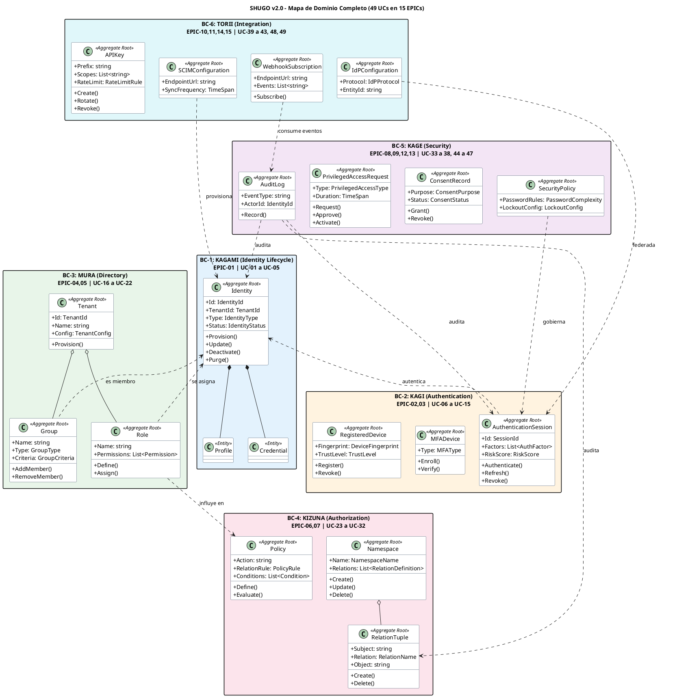

# SHUGO - Análisis de Dominio (Domain Analysis)

| Metadatos del Documento | |
| :--- | :--- |
| **Proyecto:** | SHUGO - Identity & Access Platform |
| **Documento:** | Domain_Analysis.md |
| **Metodología:** | Domain-Driven Design (Eric Evans, Vaughn Vernon) + Event Storming + Context Mapping |
| **Estándares:** | ISO/IEC 25010 (Calidad de Software), ISO/IEC 27001 (Seguridad de la Información), NIST SP 800-63 (Identidad Digital) |
| **Autor:** | Gastón Ruiz |
| **Versión Actual:** | 2.0.0 |
| **Fecha:** | 30/08/2026 |

---

## Historial de Versiones

| Versión | Fecha | Autor | Descripción de Cambios | Impacto |
| :--- | :--- | :--- | :--- | :--- |
| **1.0.0** | 27/08/2026 | Gastón Ruiz | Versión inicial con 4 motores (KAGAMI, KAGI, MURA, KIZUNA) y 24 UCs. | Base del análisis de dominio. |
| **2.0.0** | 30/08/2026 | Gastón Ruiz | **Refactorización completa.** Expansión a 49 UCs en 15 EPICs. Incorporación de nuevos subdominios: Session Management, Passwordless Auth, SCIM, Identity Provider, PAM, Consent & Privacy, Directory Sync, Risk-Based Auth, Breach Detection, Access Reviews. Actualización del Context Map, Bounded Contexts, Aggregate Roots, Value Objects, y Domain Events. Alineación con NIST SP 800-63 y ISO 27001. | Documento de referencia para toda la arquitectura de SHUGO. Define el vocabulario, los límites de contexto y las relaciones entre todos los subdominios de la plataforma. |

---

## 1. Introducción y Alcance

Este documento presenta el **Análisis de Dominio** completo de SHUGO, la plataforma de Identity & Access Management (IAM) diseñada para ser el sistema central de identidad y autorización de múltiples aplicaciones cliente.

El análisis sigue la metodología **Domain-Driven Design (DDD)** de Eric Evans y las prácticas de **Event Storming** de Alberto Brandolini, complementadas con estándares internacionales:

- **ISO/IEC 25010:** Modelo de calidad de software (seguridad, mantenibilidad, rendimiento, etc.)
- **ISO/IEC 27001:** Sistema de gestión de seguridad de la información
- **NIST SP 800-63:** Guías de identidad digital (niveles de assurance, autenticación, federación)
- **RFC 6749 / RFC 7519:** OAuth 2.0 y JSON Web Tokens
- **RFC 7643 / RFC 7644:** SCIM (System for Cross-domain Identity Management)

### 1.1. Propósito

1. **Definir el Lenguaje Ubicuo:** Establecer un vocabulario compartido entre desarrolladores, stakeholders y usuarios.
2. **Identificar Bounded Contexts:** Delimitar las fronteras de cada subdominio y sus responsabilidades.
3. **Modelar Agregados y Entidades:** Definir las raíces de agregado, entidades y value objects de cada contexto.
4. **Mapear Contextos:** Establecer las relaciones entre contextos (Upstream/Downstream, Customer/Supplier, Conformist, Anti-Corruption Layer).
5. **Identificar Eventos de Dominio:** Definir los eventos que comunican cambios de estado entre contextos.

### 1.2. Alcance

El análisis cubre los **49 Casos de Uso** organizados en **15 EPICs**, agrupados en **6 Bounded Contexts** principales:

| Bounded Context | Motor | EPICs | UCs |
| :--- | :--- | :--- | :--- |
| **Identity Lifecycle** | KAGAMI | EPIC-01 | UC-01 a UC-05 |
| **Authentication & Sessions** | KAGI | EPIC-02, EPIC-03 | UC-06 a UC-15 |
| **Directory & Tenancy** | MURA | EPIC-04, EPIC-05 | UC-16 a UC-22 |
| **Authorization Engine** | KIZUNA | EPIC-06, EPIC-07 | UC-23 a UC-32 |
| **Security & Compliance** | KAGE | EPIC-08, EPIC-09, EPIC-12, EPIC-13 | UC-33 a UC-38, UC-44 a UC-47 |
| **Integration & Gateway** | TORII | EPIC-10, EPIC-11, EPIC-14, EPIC-15 | UC-39 a UC-43, UC-48, UC-49 |

---

## 2. Lenguaje Ubicuo (Ubiquitous Language)

El Lenguaje Ubicuo es el vocabulario compartido que todos los miembros del equipo (desarrolladores, stakeholders, usuarios) utilizan para comunicarse sobre el dominio. Cada término tiene una definición precisa y no ambigua.

### 2.1. Términos de Identidad

| Término | Definición | Ejemplo |
| :--- | :--- | :--- |
| **Identidad (Identity)** | Representación digital única de un sujeto (persona, servicio, dispositivo) dentro de SHUGO. Tiene un identificador global único. | `user:uuid-123`, `service:payment-api`, `device:iphone-15` |
| **Sujeto (Subject)** | Entidad que solicita acceso a un recurso. Puede ser un usuario, un grupo, un servicio o un dispositivo. | `user:veterinario-juan` |
| **Perfil (Profile)** | Conjunto de atributos descriptivos asociados a una identidad (nombre, email, teléfono, etc.). | `{ name: "Juan", email: "juan@khcs.com" }` |
| **Credencial (Credential)** | Secreto o evidencia que demuestra la posesión de una identidad. Puede ser contraseña, certificado, clave pública, token, factor biométrico. | Contraseña Argon2id, TOTP secret, WebAuthn credential |
| **Autenticación (Authentication)** | Proceso de verificar que un sujeto es quien dice ser, mediante la validación de una o más credenciales. | Login con username/password + TOTP |
| **Autorización (Authorization)** | Proceso de determinar si un sujeto autenticado tiene permiso para realizar una acción sobre un recurso específico. | ¿Puede Juan rectificar el registro médico X? |
| **Federación (Federation)** | Mecanismo por el cual SHUGO confía en la autenticación realizada por un proveedor de identidad externo (IdP). | Login con Google, GitHub, Microsoft |
| **Assurance Level** | Nivel de confianza en la identidad verificada, según NIST SP 800-63 (IAL1, IAL2, IAL3). | IAL2: Identidad verificada con evidencia documental |

### 2.2. Términos de Sesión

| Término | Definición | Ejemplo |
| :--- | :--- | :--- |
| **Sesión (Session)** | Período de interacción continua entre un sujeto autenticado y SHUGO. Tiene un inicio, un tiempo de vida y un fin. | Sesión activa desde las 10:00 hasta las 10:30 |
| **Token de Acceso (Access Token)** | Token JWT de corta duración (15 min) que el sujeto presenta para acceder a APIs protegidas. | `eyJhbGciOiJSUzI1NiIs...` |
| **Token de Refresco (Refresh Token)** | Token opaco de larga duración (7 días) que el sujeto usa para obtener nuevos tokens de acceso sin re-autenticarse. | `dGhpcyBpcyBhIHJlZnJlc2g...` |
| **Factor de Autenticación (Auth Factor)** | Categoría de evidencia utilizada para autenticar un sujeto. Tres tipos: conocimiento (algo que sabes), posesión (algo que tienes), inherencia (algo que eres). | Contraseña (conocimiento), TOTP (posesión), huella (inherencia) |
| **MFA (Multi-Factor Authentication)** | Autenticación que requiere dos o más factores de diferentes categorías. | Contraseña + TOTP |
| **Dispositivo (Device)** | Hardware utilizado por un sujeto para interactuar con SHUGO. Puede ser registrado y gestionado. | iPhone 15, Laptop corporativo |

### 2.3. Términos de Tenant y Roles

| Término | Definición | Ejemplo |
| :--- | :--- | :--- |
| **Tenant** | Organización o unidad de negocio aislada dentro de SHUGO. Cada tenant tiene su propio conjunto de identidades, roles, namespaces y configuraciones. | `khcs-001`, `ecommerce-xyz` |
| **Rol (Role)** | Etiqueta asignada a un sujeto dentro de un tenant que determina un conjunto de permisos. | `admin`, `veterinario`, `mozo` |
| **Permiso (Permission)** | Capacidad específica otorgada por un rol para realizar una acción sobre un tipo de recurso. | `create:registro_medico` |
| **Grupo (Group)** | Colección de identidades que comparten una membresía común. Los grupos pueden tener roles asignados. | `group:veterinarios`, `group:mozos_turno_a` |

### 2.4. Términos de Autorización (KIZUNA)

| Término | Definición | Ejemplo |
| :--- | :--- | :--- |
| **Namespace** | Contenedor lógico dentro de un tenant que agrupa tipos de objetos y define las relations válidas. Es el vocabulario de autorización del tenant. | `registro_medico`, `equino`, `documento` |
| **Relation** | Tipo de vínculo semántico entre un sujeto y un objeto, definido dentro de un namespace. | `autor`, `veterinario_asignado`, `editor` |
| **Tupla (Tuple)** | Unidad atómica del grafo de relaciones. Es una tripleta (sujeto, relación, objeto) que representa un hecho de autorización. | `(user:juan, autor, registro_medico:123)` |
| **Grafo de Relaciones (Relation Graph)** | Estructura de datos tipo grafo dirigida formada por todas las tuplas de un tenant. Los nodos son sujetos y objetos; las aristas son relations. | Grafo completo de permisos de KHCS |
| **ReBAC (Relationship-Based Access Control)** | Modelo de autorización que evalúa permisos basándose en las relaciones entre sujetos y objetos en el grafo. | ¿Tiene Juan una relación "autor" con el registro 123? |
| **ABAC (Attribute-Based Access Control)** | Modelo de autorización que evalúa permisos basándose en atributos contextuales del sujeto, recurso o entorno. | Solo permitir acceso desde la red corporativa |
| **Política (Policy)** | Regla que define qué relaciones o condiciones otorgan permiso para una acción específica. | `action=rectificar → rule="autor OR director_medico"` |
| **Check API** | Endpoint de KIZUNA que evalúa si un sujeto tiene permiso para realizar una acción sobre un recurso. Es el endpoint más consumido de SHUGO. | `POST /authz/check` |
| **Write API** | Endpoint de KIZUNA que crea, actualiza o elimina tuplas en el grafo de relaciones. | `POST /relations` |

### 2.5. Términos de Seguridad y Compliance

| Término | Definición | Ejemplo |
| :--- | :--- | :--- |
| **Password Policy** | Conjunto de reglas que definen los requisitos de complejidad, expiración, historial y detección de brechas para las contraseñas. | Mínimo 12 caracteres, expira cada 90 días |
| **Account Lockout** | Mecanismo que bloquea temporalmente una cuenta tras N intentos fallidos de autenticación. | Bloqueo tras 5 intentos fallidos, desbloqueo en 30 minutos |
| **Break-Glass Access** | Acceso de emergencia que permite a un usuario autorizado saltar las restricciones normales en situaciones críticas, con auditoría reforzada. | Acceso de emergencia al historial clínico durante cirugía |
| **Just-in-Time Access (JIT)** | Acceso temporal concedido bajo demanda con workflow de aprobación y revocación automática. | Acceso de 2 horas a la base de datos de producción |
| **Consent** | Aprobación explícita e informada del usuario para el procesamiento de sus datos personales con un propósito específico. | Consentir compartir email con terceros |
| **Data Residency** | Requisito de que los datos se almacenen y procesen en una región geográfica específica. | Datos de usuarios EU almacenados en Frankfurt |
| **Access Review** | Revisión periódica y formal de los accesos concedidos para verificar que siguen siendo apropiados. | Revisión trimestral de roles de administradores |

### 2.6. Términos de Integración

| Término | Definición | Ejemplo |
| :--- | :--- | :--- |
| **SCIM (System for Cross-domain Identity Management)** | Estándar RFC 7643/7644 para el provisionamiento automatizado de identidades entre sistemas. | Sincronización de usuarios desde Workday |
| **SAML (Security Assertion Markup Language)** | Estándar XML para intercambio de datos de autenticación y autorización entre un IdP y un SP. | SHUGO como IdP para Salesforce |
| **OIDC (OpenID Connect)** | Capa de identidad sobre OAuth 2.0 que permite a las aplicaciones verificar la identidad del usuario. | SHUGO como IdP OIDC |
| **IdP (Identity Provider)** | Sistema que autentica usuarios y emite tokens/assertions para otros sistemas (Service Providers). | SHUGO actuando como IdP |
| **SP (Service Provider)** | Sistema que confía en un IdP para autenticar usuarios y consume los tokens/assertions emitidos. | KHCS consumiendo tokens de SHUGO |
| **Webhook** | Callback HTTP configurado por el cliente que SHUGO invoca automáticamente cuando ocurre un evento específico. | Notificar a KHCS cuando se crea un usuario |
| **API Key** | Clave secreta de larga duración utilizada por aplicaciones para autenticarse ante la API de SHUGO. | `shugo_sk_live_abc123...` |
| **Rate Limit** | Límite máximo de requests que un cliente puede realizar en una ventana de tiempo determinada. | 1000 requests/minuto para Plan Enterprise |

---

## 3. Bounded Contexts y Subdominios

### 3.1. Mapa de Contextos (Context Map)

```
┌─────────────────────────────────────────────────────────────────────┐
│                        SHUGO - Context Map v2.0                     │
├─────────────────────────────────────────────────────────────────────┤
│                                                                     │
│  ┌──────────────┐    ACL   ┌──────────────────┐    ACL   ┌────────┐ │
│  │   External   │─────────>│  Integration &   │─────────>│ KHCS   │ │
│  │   IdPs       │  SAML/   │  Gateway (TORII) │  OAuth/  │ E-com  │ │
│  │  (Google,    │  OIDC    │  EPIC-10,11,14,15│  SCIM    │ SaaS   │ │
│  │   GitHub)    │          │  UC-39 a 43,48,49│          │        │ │
│  └──────┬───────┘          └────────┬─────────┘          └───┬────┘ │
│         │                           │                         │     │
│         │ Federation                │ Events                  │ API │
│         v                           v                         │     │
│  ┌──────────────────┐    ┌──────────────────┐                  │    │
│  │  Authentication  │───>│  Authorization   │<─────────────────┘    │
│  │  & Sessions      │    │  Engine (KIZUNA) │                       │
│  │  (KAGI)          │    │  EPIC-06, 07     │                       │
│  │  EPIC-02, 03     │    │  UC-23 a 32      │                       │
│  │  UC-06 a 15      │    │                  │                       │
│  └────────┬─────────┘    └────────┬─────────┘                       │
│           │                       │                                 │
│           │ Identity              │ Policy                          │
│           v                       v                                 │
│  ┌──────────────────┐    ┌───────────────────┐                      │
│  │ Identity Lifecycle│   │  Security &       │                      │
│  │ (KAGAMI)         │<──>│  Compliance (KAGE)│                      │
│  │ EPIC-01          │    │  EPIC-08,09,12,13 │                      │
│  │ UC-01 a 05       │    │  UC-33 a 38,      │                      │
│  └────────┬─────────┘    │  UC-44 a 47       │                      │
│           │              └───────────────────┘                      │
│           │                                                         │
│           v                                                         │
│  ┌──────────────────┐                                               │
│  │ Directory &      │                                               │
│  │ Tenancy (MURA)   │                                               │
│  │ EPIC-04, 05      │                                               │
│  │ UC-16 a 22       │                                               │
│  └──────────────────┘                                               │
│                                                                     │
│  Leyenda:                                                           │
│  ───>  Customer/Supplier    <──>  Partnership                       │
│  ACL = Anti-Corruption Layer                                        │
└─────────────────────────────────────────────────────────────────────┘
```

### 3.2. Detalle de Bounded Contexts

#### **BC-1: Identity Lifecycle (Motor KAGAMI)**
*EPIC-01 | UC-01 a UC-05*

| Aspecto | Detalle |
| :--- | :--- |
| **Propósito** | Gestionar el ciclo de vida completo de las identidades digitales (creación, actualización, consulta, desactivación, purga). |
| **Tipo de Subdominio** | **Core Domain** - Es la base sobre la que operan todos los demás contextos. |
| **Aggregate Root** | `Identity` |
| **Entidades** | `Profile`, `Credential`, `IdentityStatus` |
| **Value Objects** | `IdentityId`, `EmailAddress`, `PhoneNumber`, `DisplayName` |
| **Domain Events** | `Identity.Provisioned`, `Identity.Updated`, `Identity.Deactivated`, `Identity.Purged`, `Identity.Imported` |
| **Relación con otros BCs** | **Upstream** para Authentication, Directory. **Downstream** de Integration (SCIM). |
| **NIST Alignment** | IAL (Identity Assurance Level) |

#### **BC-2: Authentication & Sessions (Motor KAGI)**
*EPIC-02, EPIC-03 | UC-06 a UC-15*

| Aspecto | Detalle |
| :--- | :--- |
| **Propósito** | Verificar la identidad de los sujetos mediante credenciales locales, federadas, MFA y passwordless. Gestionar el ciclo de vida de las sesiones. |
| **Tipo de Subdominio** | **Core Domain** - Diferenciador competitivo de SHUGO. |
| **Aggregate Roots** | `AuthenticationSession`, `MFADevice`, `RegisteredDevice` |
| **Entidades** | `SessionToken`, `RefreshToken`, `MFAEnrollment`, `LoginAttempt` |
| **Value Objects** | `AccessToken`, `JWTPayload`, `TOTPSecret`, `WebAuthnCredential`, `RiskScore`, `DeviceFingerprint`, `GeoLocation` |
| **Domain Events** | `Session.Authenticated`, `Session.Refreshed`, `Session.Revoked`, `Session.ForceTerminated`, `MFA.Enrolled`, `MFA.Challenged`, `MFA.Verified`, `MFA.Failed`, `Device.Registered`, `Device.Removed`, `Login.AttemptFailed`, `Login.RiskDetected` |
| **Relación con otros BCs** | **Customer** de Identity Lifecycle (consulta identidades). **Supplier** de Authorization (emite tokens con claims). **Customer** de Security (consulta políticas de lockout, password). |
| **NIST Alignment** | AAL (Authenticator Assurance Level): AAL1 (single factor), AAL2 (MFA), AAL3 (hardware-based) |

#### **BC-3: Directory & Tenancy (Motor MURA)**
*EPIC-04, EPIC-05 | UC-16 a UC-22*

| Aspecto | Detalle |
| :--- | :--- |
| **Propósito** | Gestionar el ciclo de vida de los tenants, la configuración de roles, la asignación de roles a identidades, y la gestión de grupos dinámicos. |
| **Tipo de Subdominio** | **Supporting Subdomain** - Necesario para multi-tenancy pero no es el diferenciador principal. |
| **Aggregate Roots** | `Tenant`, `Role`, `Group` |
| **Entidades** | `RolePermission`, `GroupMembership`, `RoleAssignment`, `GroupRule` |
| **Value Objects** | `TenantId`, `TenantConfig`, `Permission`, `GroupCriteria`, `AccessReviewCycle` |
| **Domain Events** | `Tenant.Provisioned`, `Tenant.Configured`, `Role.Defined`, `Role.Assigned`, `Role.Revoked`, `Group.Created`, `Group.MemberAdded`, `Group.MemberRemoved`, `Group.MembershipRecalculated`, `AccessReview.Initiated`, `AccessReview.Completed` |
| **Relación con otros BCs** | **Customer** de Identity Lifecycle (consulta identidades para asignar roles). **Supplier** de Authorization (provee roles para evaluación RBAC). |

#### **BC-4: Authorization Engine (Motor KIZUNA)**
*EPIC-06, EPIC-07 | UC-23 a UC-32*

| Aspecto | Detalle |
| :--- | :--- |
| **Propósito** | Configurar el esquema de autorización (namespaces, relations), gestionar el grafo de relaciones (tuplas), y evaluar permisos en tiempo real mediante ReBAC y ABAC. |
| **Tipo de Subdominio** | **Core Domain** - El diferenciador principal de SHUGO. El motor KIZUNA es el corazón de la plataforma. |
| **Aggregate Roots** | `Namespace`, `RelationTuple`, `Policy` |
| **Entidades** | `RelationDefinition`, `Condition` |
| **Value Objects** | `NamespaceName`, `RelationName`, `TupleKey` (subject, relation, object), `CheckRequest`, `CheckResult`, `PathResult`, `PolicyRule`, `ContextualAttribute` |
| **Domain Events** | `Namespace.Created`, `Namespace.Updated`, `Namespace.Deleted`, `Tuple.Created`, `Tuple.Deleted`, `Policy.Defined`, `Policy.Updated`, `Check.Evaluated`, `Check.Denied`, `Check.Timeout` |
| **Relación con otros BCs** | **Customer** de Directory (consulta roles para RBAC). **Customer** de Security (consulta condiciones ABAC). **Supplier** de todos los clientes externos (provee decisiones de autorización). |
| **Patrones Especiales** | Graph BFS Traversal, Cache-Aside Multinivel, Outbox Pattern, Fail Secure |

#### **BC-5: Security & Compliance (Motor KAGE)**
*EPIC-08, EPIC-09, EPIC-12, EPIC-13 | UC-33 a UC-38, UC-44 a UC-47*

| Aspecto | Detalle |
| :--- | :--- |
| **Propósito** | Gestionar políticas de seguridad (passwords, lockout, breach detection), consentimiento y privacidad (GDPR/CCPA), acceso privilegiado (PAM, break-glass, JIT), y auditoría/compliance. |
| **Tipo de Subdominio** | **Core Domain** - Crítico para compliance y seguridad enterprise. |
| **Aggregate Roots** | `SecurityPolicy`, `ConsentRecord`, `PrivilegedAccessRequest`, `AuditLog` |
| **Entidades** | `PasswordRule`, `LockoutPolicy`, `BreachAlert`, `ConsentPurpose`, `DataResidencyRule`, `BreakGlassSession`, `JITApproval`, `AuditEvent`, `ComplianceReport` |
| **Value Objects** | `PasswordComplexity`, `LockoutConfig`, `BreachMatch`, `ConsentScope`, `ResidencyRegion`, `ApprovalWorkflow`, `AuditFilter`, `ReportCriteria` |
| **Domain Events** | `Policy.PasswordUpdated`, `Policy.LockoutTriggered`, `Breach.CredentialDetected`, `Consent.Granted`, `Consent.Revoked`, `Consent.Expired`, `DataResidency.ViolationDetected`, `DataPortability.ExportRequested`, `BreakGlass.Activated`, `BreakGlass.Deactivated`, `JIT.Requested`, `JIT.Approved`, `JIT.Revoked`, `JIT.Expired`, `Audit.EventRecorded`, `Report.Generated` |
| **Relación con otros BCs** | **Customer** de Authentication (provee políticas de password/lockout). **Customer** de Authorization (provee condiciones ABAC). **Upstream** de todos los BCs (consume eventos para auditoría). |
| **Compliance** | GDPR (Art. 6, 7, 17, 20), CCPA, SOC 2 (CC6.1, CC6.6, CC7.2, CC8.1), ISO 27001 |

#### **BC-6: Integration & Gateway (Motor TORII)**
*EPIC-10, EPIC-11, EPIC-14, EPIC-15 | UC-39 a UC-43, UC-48, UC-49*

| Aspecto | Detalle |
| :--- | :--- |
| **Propósito** | Gestionar la integración con sistemas externos (SCIM, AD/LDAP), actuar como Identity Provider (SAML/OIDC), manejar webhooks, y controlar el acceso a la API (API keys, rate limits). |
| **Tipo de Subdominio** | **Generic Subdomain** - Funcionalidad estándar de la industria, puede usar soluciones de terceros. |
| **Aggregate Roots** | `SCIMConfiguration`, `DirectorySyncJob`, `IdPConfiguration`, `WebhookSubscription`, `APIKey` |
| **Entidades** | `SCIMResource`, `SyncMapping`, `ClaimsMapping`, `SAMLAssertion`, `OIDCToken`, `WebhookDelivery`, `RateLimitRule` |
| **Value Objects** | `SCIMSchema`, `LDAPConnectionConfig`, `ClaimsTransformation`, `SAMLConfiguration`, `OIDCClientRegistration`, `WebhookEndpoint`, `WebhookSignature`, `APIKeySecret`, `RateLimitWindow`, `UsageQuota` |
| **Domain Events** | `SCIM.UserProvisioned`, `SCIM.UserUpdated`, `SCIM.UserDeprovisioned`, `Directory.SyncCompleted`, `Directory.SyncFailed`, `IdP.AssertionIssued`, `IdP.TokenIssued`, `Webhook.Subscribed`, `Webhook.DeliverySucceeded`, `Webhook.DeliveryFailed`, `APIKey.Created`, `APIKey.Rotated`, `APIKey.Revoked`, `RateLimit.Exceeded` |
| **Relación con otros BCs** | **Downstream** de Identity Lifecycle (provisiona identidades vía SCIM). **Downstream** de Authentication (emite assertions SAML/tokens OIDC). **Supplier** de todos los clientes externos. |
| **Estándares** | RFC 7643/7644 (SCIM), SAML 2.0, OIDC 1.0, OAuth 2.0 |

---

## 4. Aggregate Roots y Entidades por Bounded Context

### 4.1. BC-1: Identity Lifecycle (KAGAMI)

#### **Aggregate Root: Identity**

| Propiedad | Tipo | Descripción |
| :--- | :--- | :--- |
| `Id` | `IdentityId` (VO) | Identificador global único (UUID) |
| `TenantId` | `TenantId` (VO) | Tenant al que pertenece |
| `Type` | `IdentityType` (Enum) | `User`, `Service`, `Device` |
| `Profile` | `Profile` (Entity) | Datos descriptivos |
| `Credentials` | `List<Credential>` (Entity) | Credenciales asociadas |
| `Status` | `IdentityStatus` (VO) | `Active`, `Suspended`, `Deactivated`, `Purged` |
| `CreatedAt` | `DateTime` | Fecha de creación |
| `UpdatedAt` | `DateTime` | Fecha de última modificación |
| `DeactivatedAt` | `DateTime?` | Fecha de desactivación (si aplica) |
| `PurgedAt` | `DateTime?` | Fecha de purga (si aplica) |

**Invariantes:**
- INV-ID-01: Una identidad siempre pertenece a exactamente un tenant.
- INV-ID-02: Una identidad activa debe tener al menos una credencial válida.
- INV-ID-03: Una identidad purgada no puede ser reactivada.
- INV-ID-04: El email debe ser único dentro del tenant.
- INV-ID-05: La transición de estado sigue el orden: Active → Suspended → Deactivated → Purged.

#### **Entity: Profile**

| Propiedad | Tipo | Descripción |
| :--- | :--- | :--- |
| `DisplayName` | `DisplayName` (VO) | Nombre para mostrar |
| `Email` | `EmailAddress` (VO) | Correo electrónico |
| `Phone` | `PhoneNumber` (VO) | Número de teléfono |
| `Locale` | `string` | Idioma preferido |
| `Timezone` | `string` | Zona horaria |
| `CustomAttributes` | `Dictionary<string, object>` | Atributos personalizados |

#### **Entity: Credential**

| Propiedad | Tipo | Descripción |
| :--- | :--- | :--- |
| `Id` | `string` | Identificador de la credencial |
| `Type` | `CredentialType` (Enum) | `Password`, `TOTP`, `WebAuthn`, `Certificate`, `APIKey` |
| `Secret` | `string` | Hash o secreto encriptado |
| `Algorithm` | `string` | Algoritmo de hash (ej. Argon2id) |
| `CreatedAt` | `DateTime` | Fecha de creación |
| `ExpiresAt` | `DateTime?` | Fecha de expiración |
| `LastUsedAt` | `DateTime?` | Fecha de último uso |
| `Status` | `CredentialStatus` (Enum) | `Active`, `Expired`, `Revoked` |

### 4.2. BC-2: Authentication & Sessions (KAGI)

#### **Aggregate Root: AuthenticationSession**

| Propiedad | Tipo | Descripción |
| :--- | :--- | :--- |
| `Id` | `SessionId` (VO) | Identificador de sesión |
| `IdentityId` | `IdentityId` (VO) | Identidad autenticada |
| `TenantId` | `TenantId` (VO) | Tenant |
| `AccessToken` | `AccessToken` (VO) | JWT de acceso |
| `RefreshToken` | `RefreshToken` (VO) | Token de refresco |
| `Factors` | `List<AuthFactor>` (VO) | Factores utilizados |
| `RiskScore` | `RiskScore` (VO) | Puntuación de riesgo |
| `DeviceId` | `DeviceFingerprint` (VO) | Dispositivo utilizado |
| `IpAddress` | `string` | IP de origen |
| `GeoLocation` | `GeoLocation` (VO) | Ubicación geográfica |
| `StartedAt` | `DateTime` | Inicio de sesión |
| `ExpiresAt` | `DateTime` | Expiración de sesión |
| `LastActivityAt` | `DateTime` | Última actividad |
| `Status` | `SessionStatus` (Enum) | `Active`, `Expired`, `Revoked`, `ForceTerminated` |

**Invariantes:**
- INV-SE-01: Una sesión activa debe tener al menos un factor de autenticación.
- INV-SE-02: El access token no puede tener una duración mayor a 15 minutos.
- INV-SE-03: El refresh token no puede tener una duración mayor a 7 días.
- INV-SE-04: Una sesión revocada no puede ser reactivada.
- INV-SE-05: Si el risk score excede el umbral configurado, la sesión debe requerir step-up authentication.

#### **Aggregate Root: MFADevice**

| Propiedad | Tipo | Descripción |
| :--- | :--- | :--- |
| `Id` | `string` | Identificador del dispositivo MFA |
| `IdentityId` | `IdentityId` (VO) | Identidad propietaria |
| `Type` | `MFAType` (Enum) | `TOTP`, `SMS`, `Email`, `Push`, `WebAuthn` |
| `Secret` | `string` | Secreto encriptado |
| `Name` | `string` | Nombre descriptivo |
| `EnrolledAt` | `DateTime` | Fecha de enrolamiento |
| `LastUsedAt` | `DateTime?` | Último uso |
| `Status` | `MFAStatus` (Enum) | `Pending`, `Active`, `Disabled` |

#### **Aggregate Root: RegisteredDevice**

| Propiedad | Tipo | Descripción |
| :--- | :--- | :--- |
| `Id` | `DeviceId` (VO) | Identificador del dispositivo |
| `IdentityId` | `IdentityId` (VO) | Propietario |
| `Fingerprint` | `DeviceFingerprint` (VO) | Huella digital del dispositivo |
| `Name` | `string` | Nombre del dispositivo |
| `Platform` | `string` | Plataforma (iOS, Android, Windows, macOS) |
| `RegisteredAt` | `DateTime` | Fecha de registro |
| `LastSeenAt` | `DateTime` | Última vez visto |
| `TrustLevel` | `TrustLevel` (Enum) | `Trusted`, `Untrusted`, `Revoked` |

### 4.3. BC-3: Directory & Tenancy (MURA)

#### **Aggregate Root: Tenant**

| Propiedad | Tipo | Descripción |
| :--- | :--- | :--- |
| `Id` | `TenantId` (VO) | Identificador único del tenant |
| `Name` | `string` | Nombre del tenant |
| `Slug` | `string` | Slug URL-friendly |
| `Config` | `TenantConfig` (VO) | Configuración del tenant |
| `Status` | `TenantStatus` (Enum) | `Active`, `Suspended`, `Archived` |
| `CreatedAt` | `DateTime` | Fecha de creación |

**Invariantes:**
- INV-TN-01: El slug del tenant debe ser globalmente único.
- INV-TN-02: Un tenant suspendido no permite autenticación de sus identidades.
- INV-TN-03: Un tenant archivado no permite operaciones de escritura.

#### **Aggregate Root: Role**

| Propiedad | Tipo | Descripción |
| :--- | :--- | :--- |
| `Id` | `RoleId` (VO) | Identificador del rol |
| `TenantId` | `TenantId` (VO) | Tenant |
| `Name` | `string` | Nombre del rol |
| `Description` | `string` | Descripción |
| `Permissions` | `List<Permission>` (VO) | Permisos asignados |
| `IsSystem` | `boolean` | Si es un rol del sistema (no modificable) |
| `CreatedAt` | `DateTime` | Fecha de creación |

#### **Aggregate Root: Group**

| Propiedad | Tipo | Descripción |
| :--- | :--- | :--- |
| `Id` | `GroupId` (VO) | Identificador del grupo |
| `TenantId` | `TenantId` (VO) | Tenant |
| `Name` | `string` | Nombre del grupo |
| `Description` | `string` | Descripción |
| `Type` | `GroupType` (Enum) | `Static`, `Dynamic` |
| `Criteria` | `GroupCriteria` (VO) | Reglas para membresía dinámica |
| `Members` | `List<IdentityId>` | Miembros (para grupos estáticos) |
| `CreatedAt` | `DateTime` | Fecha de creación |

### 4.4. BC-4: Authorization Engine (KIZUNA)

#### **Aggregate Root: Namespace**

| Propiedad | Tipo | Descripción |
| :--- | :--- | :--- |
| `TenantId` | `TenantId` (VO) | Tenant propietario |
| `Name` | `NamespaceName` (VO) | Nombre del namespace (identificador compuesto con TenantId) |
| `Description` | `string` | Descripción |
| `Relations` | `List<RelationDefinition>` (VO) | Relations válidas |
| `CreatedAt` | `DateTime` | Fecha de creación |
| `CreatedBy` | `IdentityId` (VO) | Creador |

**Invariantes:**
- INV-NS-01: El nombre del namespace debe ser único dentro del tenant.
- INV-NS-02: Un namespace debe tener al menos una relation.
- INV-NS-03: El nombre no puede ser un nombre reservado del sistema.
- INV-NS-04: Las relations dentro de un namespace deben tener nombres únicos.

#### **Aggregate Root: RelationTuple**

| Propiedad | Tipo | Descripción |
| :--- | :--- | :--- |
| `Id` | `string` | Identificador generado |
| `TenantId` | `TenantId` (VO) | Tenant |
| `Subject` | `string` | Sujeto (formato: type:id) |
| `Relation` | `RelationName` (VO) | Tipo de relación |
| `Object` | `string` | Objeto (formato: namespace:id) |
| `CreatedAt` | `DateTime` | Fecha de creación |
| `ExpiresAt` | `DateTime?` | Fecha de expiración |
| `CreatedBy` | `IdentityId` (VO) | Creador |

**Invariantes:**
- INV-TU-01: La combinación (tenant_id, subject, relation, object) debe ser única.
- INV-TU-02: El subject debe tener formato `type:id`.
- INV-TU-03: El object debe tener formato `namespace:id`.
- INV-TU-04: La relation debe estar definida en el namespace del object.
- INV-TU-05: Si `ExpiresAt` está definido, debe ser una fecha futura al momento de creación.

#### **Aggregate Root: Policy**

| Propiedad | Tipo | Descripción |
| :--- | :--- | :--- |
| `Id` | `string` | Identificador |
| `TenantId` | `TenantId` (VO) | Tenant |
| `Name` | `string` | Nombre de la política |
| `Action` | `string` | Acción protegida |
| `Namespace` | `NamespaceName` (VO) | Namespace del recurso |
| `RelationRule` | `PolicyRule` (VO) | Regla de relación (ej. "autor OR director_medico") |
| `ContextConditions` | `List<Condition>` (Entity) | Condiciones ABAC |
| `CreatedAt` | `DateTime` | Fecha de creación |

### 4.5. BC-5: Security & Compliance (KAGE)

#### **Aggregate Root: SecurityPolicy**

| Propiedad | Tipo | Descripción |
| :--- | :--- | :--- |
| `Id` | `string` | Identificador |
| `TenantId` | `TenantId` (VO) | Tenant |
| `PasswordRules` | `PasswordComplexity` (VO) | Reglas de contraseña |
| `LockoutConfig` | `LockoutConfig` (VO) | Configuración de bloqueo |
| `BreachDetectionEnabled` | `boolean` | Detección de brechas habilitada |
| `UpdatedAt` | `DateTime` | Última actualización |

#### **Aggregate Root: ConsentRecord**

| Propiedad | Tipo | Descripción |
| :--- | :--- | :--- |
| `Id` | `string` | Identificador |
| `IdentityId` | `IdentityId` (VO) | Usuario que consiente |
| `Purpose` | `ConsentPurpose` (VO) | Propósito del consentimiento |
| `Scope` | `ConsentScope` (VO) | Alcance de datos |
| `GrantedAt` | `DateTime` | Fecha de otorgamiento |
| `ExpiresAt` | `DateTime?` | Fecha de expiración |
| `RevokedAt` | `DateTime?` | Fecha de revocación |
| `Status` | `ConsentStatus` (Enum) | `Active`, `Expired`, `Revoked` |

#### **Aggregate Root: PrivilegedAccessRequest**

| Propiedad | Tipo | Descripción |
| :--- | :--- | :--- |
| `Id` | `string` | Identificador |
| `IdentityId` | `IdentityId` (VO) | Solicitante |
| `Type` | `PrivilegedAccessType` (Enum) | `BreakGlass`, `JIT` |
| `Reason` | `string` | Justificación |
| `TargetResource` | `string` | Recurso solicitado |
| `Duration` | `TimeSpan` | Duración del acceso |
| `ApprovalWorkflow` | `ApprovalWorkflow` (VO) | Workflow de aprobación |
| `Status` | `PrivilegedAccessStatus` (Enum) | `Pending`, `Approved`, `Denied`, `Active`, `Expired`, `Revoked` |
| `RequestedAt` | `DateTime` | Fecha de solicitud |
| `ActivatedAt` | `DateTime?` | Fecha de activación |
| `ExpiresAt` | `DateTime?` | Fecha de expiración |

#### **Aggregate Root: AuditLog**

| Propiedad | Tipo | Descripción |
| :--- | :--- | :--- |
| `Id` | `string` | Identificador |
| `EventType` | `string` | Tipo de evento |
| `Timestamp` | `DateTime` | Timestamp |
| `TenantId` | `TenantId` (VO) | Tenant |
| `ActorId` | `IdentityId` (VO) | Actor que realizó la acción |
| `Action` | `string` | Acción realizada |
| `Resource` | `string` | Recurso afectado |
| `Outcome` | `AuditOutcome` (Enum) | `Success`, `Failure`, `Denied` |
| `Details` | `Dictionary<string, object>` | Detalles adicionales |
| `IpAddress` | `string` | IP del actor |
| `TraceId` | `string` | Trace ID para correlación |

**Invariantes:**
- INV-AU-01: Un AuditLog es inmutable una vez creado (append-only).
- INV-AU-02: Todo cambio de estado en cualquier Aggregate Root debe generar un AuditLog.
- INV-AU-03: Los AuditLogs no pueden ser eliminados ni modificados (compliance).

### 4.6. BC-6: Integration & Gateway (TORII)

#### **Aggregate Root: SCIMConfiguration**

| Propiedad | Tipo | Descripción |
| :--- | :--- | :--- |
| `Id` | `string` | Identificador |
| `TenantId` | `TenantId` (VO) | Tenant |
| `EndpointUrl` | `string` | URL del endpoint SCIM |
| `AuthenticationType` | `string` | Tipo de autenticación |
| `MappingRules` | `List<SCIMMapping>` | Reglas de mapeo |
| `SyncFrequency` | `TimeSpan` | Frecuencia de sincronización |
| `Status` | `SyncStatus` (Enum) | `Active`, `Paused`, `Error` |

#### **Aggregate Root: IdPConfiguration**

| Propiedad | Tipo | Descripción |
| :--- | :--- | :--- |
| `Id` | `string` | Identificador |
| `TenantId` | `TenantId` (VO) | Tenant |
| `Protocol` | `IdPProtocol` (Enum) | `SAML`, `OIDC` |
| `EntityId` | `string` | Entity ID (SAML) o Client ID (OIDC) |
| `Configuration` | `Dictionary<string, object>` | Configuración del protocolo |
| `ClaimsMapping` | `List<ClaimsTransformation>` | Mapeo de claims |
| `Status` | `IdPStatus` (Enum) | `Active`, `Disabled` |

#### **Aggregate Root: WebhookSubscription**

| Propiedad | Tipo | Descripción |
| :--- | :--- | :--- |
| `Id` | `string` | Identificador |
| `TenantId` | `TenantId` (VO) | Tenant |
| `EndpointUrl` | `string` | URL del webhook |
| `Events` | `List<string>` | Eventos suscritos |
| `Secret` | `string` | Secreto para firma HMAC |
| `Status` | `WebhookStatus` (Enum) | `Active`, `Paused`, `Failed` |
| `FailureCount` | `int` | Contador de fallos consecutivos |

#### **Aggregate Root: APIKey**

| Propiedad | Tipo | Descripción |
| :--- | :--- | :--- |
| `Id` | `string` | Identificador |
| `TenantId` | `TenantId` (VO) | Tenant |
| `Name` | `string` | Nombre descriptivo |
| `KeyHash` | `string` | Hash de la clave |
| `Prefix` | `string` | Prefijo visible (ej. `shugo_sk_live_abc`) |
| `Scopes` | `List<string>` | Alcances permitidos |
| `RateLimit` | `RateLimitRule` (VO) | Límite de requests |
| `ExpiresAt` | `DateTime?` | Fecha de expiración |
| `LastUsedAt` | `DateTime?` | Último uso |
| `Status` | `APIKeyStatus` (Enum) | `Active`, `Revoked`, `Expired` |

---

## 5. Domain Events Catalog

### 5.1. Eventos por Bounded Context

| BC | Evento | Trigger | Payload Clave |
| :--- | :--- | :--- | :--- |
| **KAGAMI** | `Identity.Provisioned` | UC-01 exitoso | identityId, tenantId, type, createdBy |
| **KAGAMI** | `Identity.Updated` | UC-02 exitoso | identityId, changes, updatedBy |
| **KAGAMI** | `Identity.Deactivated` | UC-04 exitoso | identityId, reason, deactivatedBy |
| **KAGAMI** | `Identity.Purged` | UC-05 exitoso | identityId, purgedBy |
| **KAGI** | `Session.Authenticated` | UC-06 exitoso | sessionId, identityId, factors, riskScore |
| **KAGI** | `Session.Refreshed` | UC-08 exitoso | sessionId, newAccessToken |
| **KAGI** | `Session.Revoked` | UC-07 exitoso | sessionId, reason |
| **KAGI** | `Session.ForceTerminated` | UC-14 exitoso | sessionId, terminatedBy |
| **KAGI** | `MFA.Enrolled` | UC-10 exitoso | identityId, mfaType |
| **KAGI** | `MFA.Challenged` | UC-09 inicio | sessionId, mfaType |
| **KAGI** | `MFA.Verified` | UC-09 exitoso | sessionId, mfaType |
| **KAGI** | `MFA.Failed` | UC-09 fallido | sessionId, mfaType, attemptCount |
| **MURA** | `Tenant.Provisioned` | UC-16 exitoso | tenantId, name |
| **MURA** | `Role.Defined` | UC-19 exitoso | roleId, name, permissions |
| **MURA** | `Role.Assigned` | UC-20 exitoso | roleId, identityId |
| **MURA** | `Group.MemberAdded` | UC-16 exitoso | groupId, identityId |
| **KIZUNA** | `Namespace.Created` | UC-23 exitoso | namespace, relations, createdBy |
| **KIZUNA** | `Namespace.Updated` | UC-24 exitoso | namespace, changes |
| **KIZUNA** | `Namespace.Deleted` | UC-25 exitoso | namespace, deletedBy |
| **KIZUNA** | `Tuple.Created` | UC-27 exitoso | subject, relation, object |
| **KIZUNA** | `Tuple.Deleted` | UC-28 exitoso | subject, relation, object |
| **KIZUNA** | `Policy.Defined` | UC-31 exitoso | action, namespace, rule |
| **KIZUNA** | `Check.Evaluated` | UC-30 (allowed=true) | subject, action, resource, evaluationTimeMs |
| **KIZUNA** | `Check.Denied` | UC-30 (allowed=false) | subject, action, resource, reason |
| **KAGE** | `Policy.LockoutTriggered` | UC-34 | identityId, failedAttempts, lockoutDuration |
| **KAGE** | `Breach.CredentialDetected` | UC-35 | identityId, source, severity |
| **KAGE** | `Consent.Granted` | UC-36 exitoso | identityId, purpose, scope |
| **KAGE** | `Consent.Revoked` | UC-36 revocación | identityId, purpose |
| **KAGE** | `BreakGlass.Activated` | UC-44 activación | identityId, reason, duration |
| **KAGE** | `JIT.Approved` | UC-45 aprobación | identityId, resource, duration, approver |
| **KAGE** | `JIT.Expired` | UC-45 expiración | identityId, resource |
| **KAGE** | `Audit.EventRecorded` | Cualquier cambio | eventType, actor, action, resource |
| **TORII** | `SCIM.UserProvisioned` | UC-39 | externalId, identityId, source |
| **TORII** | `Directory.SyncCompleted` | UC-40 | directoryType, syncedCount, errorsCount |
| **TORII** | `Webhook.DeliverySucceeded` | UC-48 | webhookId, eventType, deliveryTimeMs |
| **TORII** | `Webhook.DeliveryFailed` | UC-48 | webhookId, eventType, error, retryCount |
| **TORII** | `APIKey.Created` | UC-49 | keyId, name, scopes |
| **TORII** | `RateLimit.Exceeded` | UC-49 | tenantId, endpoint, limit |

---

## 6. Context Mapping Patterns

### 6.1. Relaciones entre Bounded Contexts

| Upstream (Proveedor) | Downstream (Consumidor) | Patrón | Justificación |
| :--- | :--- | :--- | :--- |
| **KAGAMI** (Identity) | **KAGI** (Authentication) | Customer/Supplier | KAGI necesita consultar identidades para autenticar. KAGAMI define el contrato. |
| **KAGAMI** (Identity) | **MURA** (Directory) | Customer/Supplier | MURA necesita consultar identidades para asignar roles y grupos. |
| **MURA** (Directory) | **KIZUNA** (Authorization) | Conformist | KIZUNA consume roles de MURA para evaluación RBAC. KIZUNA se adapta al formato de MURA. |
| **KAGE** (Security) | **KAGI** (Authentication) | Customer/Supplier | KAGI consulta políticas de password y lockout de KAGE. |
| **KAGE** (Security) | **KIZUNA** (Authorization) | Customer/Supplier | KIZUNA consulta condiciones ABAC de KAGE. |
| **KIZUNA** (Authorization) | **Clientes Externos** | Published Language | KIZUNA expone la Check API como contrato público (OpenAPI 3.0). |
| **External IdPs** | **TORII** (Integration) | Anti-Corruption Layer | TORII traduce protocolos externos (SAML, OIDC) al modelo interno de SHUGO. |
| **HR Systems** | **TORII** (Integration) | Anti-Corruption Layer | TORII traduce formato SCIM al modelo interno de identidades. |
| **Todos los BCs** | **KAGE** (Audit) | Event Sourcing / Pub-Sub | Todos los BCs publican eventos que KAGE consume para auditoría. |

### 6.2. Anti-Corruption Layers (ACL)

| ACL | Ubicación | Traduce | Protege |
| :--- | :--- | :--- | :--- |
| **SAML ACL** | TORII | SAML Assertions → SHUGO Identity | KAGAMI de formatos XML externos |
| **OIDC ACL** | TORII | OIDC Tokens → SHUGO Identity | KAGAMI de claims externos |
| **SCIM ACL** | TORII | SCIM Resources → SHUGO Identity | KAGAMI de schemas SCIM |
| **SHUGOClient** | KHCS / Clientes | Check API → Dominio del cliente | Dominio del cliente de conceptos IAM |
| **AD/LDAP ACL** | TORII | LDAP Entries → SHUGO Identity | KAGAMI de esquemas LDAP |

---

## 7. Diagrama de Dominio General (PlantUML)



---

## 8. Alineación con Estándares Internacionales

### 8.1. NIST SP 800-63 (Digital Identity Guidelines)

| NIST Concept | SHUGO Implementation | Bounded Context |
| :--- | :--- | :--- |
| **IAL1** (Self-asserted) | Registro básico con email | KAGAMI |
| **IAL2** (Remote verification) | Verificación con documento + selfie | KAGAMI + KAGE (Identity Proofing) |
| **IAL3** (In-person verification) | Verificación presencial con biometría | KAGAMI + KAGE |
| **AAL1** (Single factor) | Contraseña sola | KAGI |
| **AAL2** (Multi-factor) | Contraseña + TOTP | KAGI |
| **AAL3** (Hardware-based) | WebAuthn/FIDO2 | KAGI |
| **FAL1** (Bearer token) | JWT sin cifrar | KAGI |
| **FAL2** (Holder-of-key) | JWT con mTLS | KAGI + TORII |
| **FAL3** (Verifier impersonation resistant) | mTLS + device binding | KAGI + TORII |

### 8.2. ISO/IEC 27001 (Information Security)

| Control ISO 27001 | SHUGO Feature | Bounded Context |
| :--- | :--- | :--- |
| **A.9.1** (Access control policy) | RBAC + ReBAC + ABAC | MURA, KIZUNA, KAGE |
| **A.9.2** (User access management) | Identity Lifecycle | KAGAMI |
| **A.9.3** (User responsibilities) | Password Policies | KAGE |
| **A.9.4** (System and application access) | MFA, Lockout | KAGI, KAGE |
| **A.12.4** (Logging and monitoring) | Audit Logs | KAGE |
| **A.13.1** (Network security) | Rate Limiting, API Keys | TORII |
| **A.14.2** (Secure development) | Input validation, fail secure | Todos |

### 8.3. GDPR (General Data Protection Regulation)

| Artículo GDPR | SHUGO Feature | Bounded Context |
| :--- | :--- | :--- |
| **Art. 6** (Lawfulness) | Consent Management | KAGE |
| **Art. 7** (Conditions for consent) | Granular consent por propósito | KAGE |
| **Art. 17** (Right to erasure) | Identity Purge (Hard Delete) | KAGAMI |
| **Art. 20** (Data portability) | Data Portability Export | KAGE |
| **Art. 25** (Data protection by design) | Data Residency Control | KAGE |
| **Art. 32** (Security of processing) | Encryption, MFA, Lockout | KAGI, KAGE |

---

## 9. Decisiones de Diseño de Dominio (ADR)

| ID | Decisión | Justificación | Alternativas Consideradas |
| :--- | :--- | :--- | :--- |
| **ADR-01** | Separar KAGAMI (Identity) de KAGI (Authentication) | La identidad existe independientemente de la autenticación. Una identidad puede tener múltiples mecanismos de autenticación. | Modelo unificado Identity-Authentication (descartado por acoplamiento) |
| **ADR-02** | KIZUNA es agnóstico al dominio | Permite que SHUGO sirva a cualquier industria sin modificaciones al core. | KIZUNA con conocimiento de dominio (descartado por falta de reutilización) |
| **ADR-03** | AuditLog es append-only e inmutable | Requisito de compliance (SOC 2, GDPR). Los logs no pueden ser alterados. | Logs mutables con versionado (descartado por complejidad) |
| **ADR-04** | Usar patrón Outbox para eventos de KIZUNA | Garantiza atomicidad entre persistencia de tuplas y publicación de eventos. | Publicación directa a Kafka (descartado por riesgo de pérdida de eventos) |
| **ADR-05** | SessionToken es un Value Object, no una Entity | Los tokens son inmutables y se comparan por valor. No tienen comportamiento propio. | SessionToken como Entity (descartado por overhead innecesario) |
| **ADR-06** | Separar RBAC (MURA) de ReBAC (KIZUNA) | RBAC es estático (roles predefinidos). ReBAC es dinámico (relaciones en tiempo real). Son modelos complementarios. | Unificar RBAC y ReBAC en un solo BC (descartado por complejidad) |
| **ADR-07** | ConsentRecord tiene ciclo de vida propio | El consentimiento puede ser otorgado, expirado y revocado independientemente de la identidad. | Consent como atributo de Identity (descartado por falta de flexibilidad) |
| **ADR-08** | TORII usa ACL para integraciones externas | Protege el dominio interno de SHUGO de formatos y protocolos externos. | Integración directa sin ACL (descartado por acoplamiento) |

---

## 10. Trazabilidad

| Documento | Relación |
| :--- | :--- |
| `Product_Vision.md` | Define la visión y estrategia que este análisis de dominio materializa. |
| `System_Architecture_Overview.md` | Traduce los Bounded Contexts de este documento en componentes de infraestructura. |
| `KIZUNA_Engine_Architecture.md` | Detalla la arquitectura interna del BC-4 (KIZUNA). |
| `Security_Threat_Model.md` | Analiza las amenazas específicas de cada Bounded Context definido aquí. |
| `Glossary.md` | Contiene definiciones detalladas de los términos del Lenguaje Ubicuo. |
| `KHCS_SHUGO_Integration_Contract.md` | Define cómo KHCS interactúa con los Bounded Contexts de SHUGO. |
| Cada documento de UC | Implementa los Aggregate Roots y Domain Events definidos para su EPIC correspondiente. |

---
*Fin del Documento Domain_Analysis v2.0 para SHUGO*