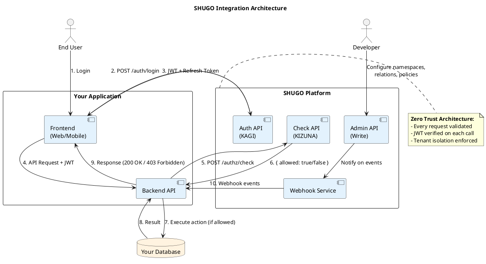
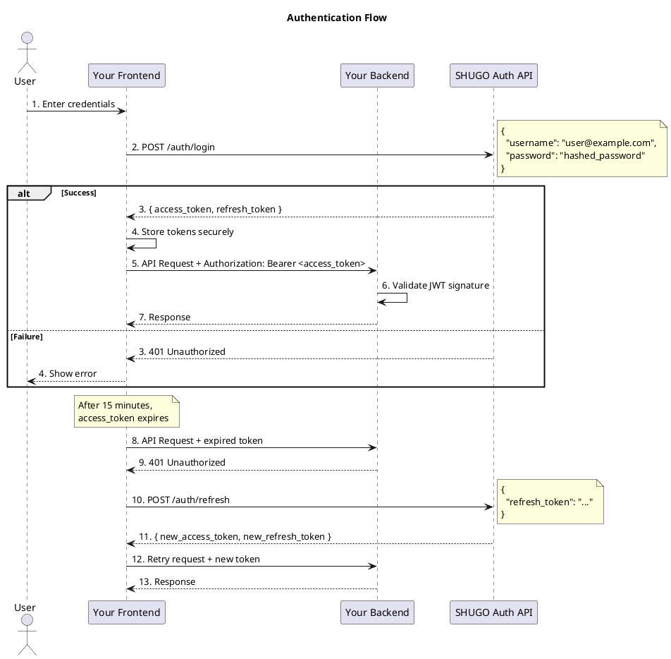
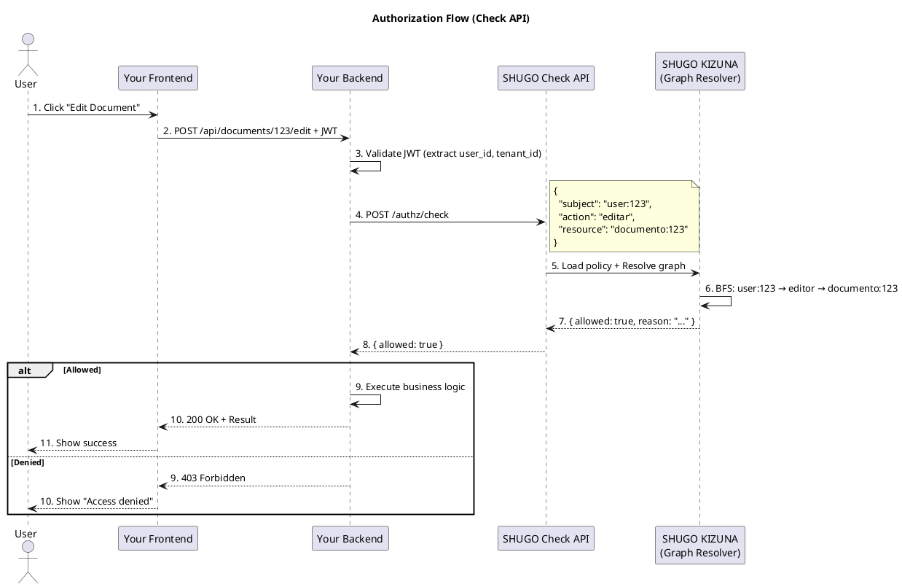

# SHUGO Identity & Access Platform - Integration Guide

| Metadatos del Documento | |
| :--- | :--- |
| **Proyecto:** | SHUGO (守護) - Identity & Access Platform |
| **Documento:** | Integration_Guide.md |
| **Ubicación:** | SHUGO/00_Global/ |
| **Metodología:** | API-First + Developer Experience (DX) + Zero Trust |
| **Autor:** | [Tu Nombre Completo] |
| **Versión Actual:** | 1.0.0 |
| **Fecha:** | [Fecha Actual] |

---

## 1. Introducción y Propósito

Esta guía proporciona **todo lo necesario para integrar tu aplicación con SHUGO** en menos de 4 horas. Está diseñada para desarrolladores que necesitan agregar autenticación y autorización robusta a sus aplicaciones sin construir un sistema IAM desde cero.

### 1.1. ¿Qué aprenderás en esta guía?

✅ Cómo registrar tu aplicación como tenant en SHUGO  
✅ Cómo implementar login/logout con JWTs  
✅ Cómo verificar permisos usando la Check API (ReBAC)  
✅ Cómo gestionar usuarios y relaciones mediante la Write API  
✅ Cómo recibir notificaciones en tiempo real vía Webhooks  
✅ Cómo usar nuestros SDKs oficiales (C#, Python, JavaScript, Go)  
✅ Mejores prácticas de seguridad y manejo de errores  

### 1.2. ¿Para quién es esta guía?

- **Desarrolladores Backend** que necesitan agregar autenticación/autorización a sus APIs
- **Desarrolladores Frontend** que necesitan implementar flujos de login
- **Arquitectos de Software** que evalúan SHUGO para su organización
- **DevOps/Platform Engineers** que despliegan y configuran SHUGO

### 1.3. Requisitos previos

- Conocimiento básico de REST APIs
- Familiaridad con JWT (JSON Web Tokens)
- Acceso a un entorno de desarrollo (local o cloud)
- Cuenta de administrador en SHUGO (o solicitar acceso)

---

## 2. Arquitectura de Integración

### 2.1. Diagrama de Integración de Alto Nivel



### 2.2. Flujos de Integración Principales

| Flujo | Descripción | Endpoints Involucrados |
| :--- | :--- | :--- |
| **Authentication Flow** | Login, logout, refresh tokens | `/auth/login`, `/auth/logout`, `/auth/refresh` |
| **Authorization Flow** | Verificar permisos antes de acciones | `/authz/check`, `/authz/check/batch` |
| **Identity Management** | Crear/actualizar usuarios | `/identities`, `/identities/{id}` |
| **Relationship Management** | Crear/eliminar relaciones (tuplas) | `/relations`, `/relations/{id}` |
| **Webhook Integration** | Recibir eventos en tiempo real | Configurar en Admin API, recibir en tu backend |

---

## 3. Onboarding: Registrar tu Aplicación como Tenant

### 3.1. Paso 1: Crear tu Tenant

El primer paso es registrar tu aplicación como un **Tenant** en SHUGO. Esto te proporciona aislamiento completo de datos y credenciales propias.

#### **Request:**

```bash
curl -X POST https://api.shugo.io/v1/admin/tenants \
  -H "Authorization: Bearer <super-admin-token>" \
  -H "Content-Type: application/json" \
  -d '{
    "tenant_id": "my-app-001",
    "name": "Mi Aplicación SaaS",
    "admin_email": "admin@miapp.com",
    "plan": "professional",
    "metadata": {
      "industry": "saas",
      "region": "latam",
      "company_size": "50-100"
    }
  }'
```

#### **Response:**

```json
{
  "tenant_id": "my-app-001",
  "name": "Mi Aplicación SaaS",
  "status": "active",
  "created_at": "2024-01-30T10:00:00Z",
  "api_key": "sk_live_abc123...",
  "api_secret": "ss_secret_xyz789...",
  "endpoints": {
    "auth_api": "https://api.shugo.io/v1/auth",
    "check_api": "https://api.shugo.io/v1/authz",
    "admin_api": "https://api.shugo.io/v1/admin",
    "webhooks": "https://api.shugo.io/v1/webhooks"
  },
  "quotas": {
    "max_users": 10000,
    "max_relations": 1000000,
    "checks_per_month": 10000000
  }
}
```

**⚠️ IMPORTANTE:** Guarda `api_key` y `api_secret` en un lugar seguro (ej. Azure Key Vault, AWS Secrets Manager). **Nunca los commitees a Git.**

### 3.2. Paso 2: Configurar tu Esquema de Autorización

Antes de poder usar la Check API, debes definir tu **esquema de autorización**: qué tipos de objetos (namespaces) existen y qué relaciones son válidas.

#### **Ejemplo: Aplicación de Gestión Documental**

```bash
# Definir namespace "documento"
curl -X POST https://api.shugo.io/v1/admin/namespaces \
  -H "X-Tenant-ID: my-app-001" \
  -H "Authorization: Bearer <tenant-admin-token>" \
  -H "Content-Type: application/json" \
  -d '{
    "namespace": "documento",
    "description": "Documentos en la aplicación",
    "relations": [
      {
        "name": "owner",
        "description": "Propietario del documento (puede eliminar)"
      },
      {
        "name": "editor",
        "description": "Puede editar el contenido"
      },
      {
        "name": "viewer",
        "description": "Solo puede leer"
      },
      {
        "name": "commenter",
        "description": "Puede leer y comentar"
      }
    ]
  }'

# Definir namespace "carpeta"
curl -X POST https://api.shugo.io/v1/admin/namespaces \
  -H "X-Tenant-ID: my-app-001" \
  -H "Authorization: Bearer <tenant-admin-token>" \
  -H "Content-Type: application/json" \
  -d '{
    "namespace": "carpeta",
    "description": "Carpetas para organizar documentos",
    "relations": [
      { "name": "owner", "description": "Propietario de la carpeta" },
      { "name": "editor", "description": "Puede crear documentos en la carpeta" },
      { "name": "viewer", "description": "Puede ver el contenido" }
    ]
  }'

# Definir namespace "grupo" (para relaciones transitivas)
curl -X POST https://api.shugo.io/v1/admin/namespaces \
  -H "X-Tenant-ID: my-app-001" \
  -H "Authorization: Bearer <tenant-admin-token>" \
  -H "Content-Type: application/json" \
  -d '{
    "namespace": "grupo",
    "description": "Grupos de usuarios",
    "relations": [
      { "name": "member", "description": "Miembro del grupo" },
      { "name": "admin", "description": "Administrador del grupo" }
    ]
  }'
```

### 3.3. Paso 3: Definir Políticas de Acceso

Las políticas definen **qué relaciones otorgan qué permisos**. Son las reglas de negocio de tu autorización.

```bash
# Política: Solo owner o editor pueden editar un documento
curl -X POST https://api.shugo.io/v1/admin/policies \
  -H "X-Tenant-ID: my-app-001" \
  -H "Authorization: Bearer <tenant-admin-token>" \
  -H "Content-Type: application/json" \
  -d '{
    "name": "editar_documento",
    "action": "editar",
    "resource": "documento",
    "relation_rule": "owner OR editor",
    "description": "Solo el propietario o editor pueden editar"
  }'

# Política: Owner, editor o commenter pueden leer
curl -X POST https://api.shugo.io/v1/admin/policies \
  -H "X-Tenant-ID: my-app-001" \
  -H "Authorization: Bearer <tenant-admin-token>" \
  -H "Content-Type: application/json" \
  -d '{
    "name": "leer_documento",
    "action": "leer",
    "resource": "documento",
    "relation_rule": "owner OR editor OR viewer OR commenter",
    "description": "Cualquiera con relación puede leer"
  }'

# Política: Solo owner puede eliminar
curl -X POST https://api.shugo.io/v1/admin/policies \
  -H "X-Tenant-ID: my-app-001" \
  -H "Authorization: Bearer <tenant-admin-token>" \
  -H "Content-Type: application/json" \
  -d '{
    "name": "eliminar_documento",
    "action": "eliminar",
    "resource": "documento",
    "relation_rule": "owner",
    "description": "Solo el propietario puede eliminar"
  }'
```

### 3.4. Paso 4: Verificar tu Configuración

```bash
# Listar namespaces configurados
curl -X GET https://api.shugo.io/v1/admin/namespaces \
  -H "X-Tenant-ID: my-app-001" \
  -H "Authorization: Bearer <tenant-admin-token>"

# Response:
{
  "namespaces": [
    {
      "namespace": "documento",
      "relations": ["owner", "editor", "viewer", "commenter"],
      "created_at": "2024-01-30T10:05:00Z"
    },
    {
      "namespace": "carpeta",
      "relations": ["owner", "editor", "viewer"],
      "created_at": "2024-01-30T10:05:30Z"
    },
    {
      "namespace": "grupo",
      "relations": ["member", "admin"],
      "created_at": "2024-01-30T10:06:00Z"
    }
  ]
}
```

✅ **¡Felicidades!** Tu tenant está configurado y listo para recibir usuarios.

---

## 4. Integración de Autenticación (Login/Logout/Refresh)

### 4.1. Flujo de Autenticación Completo



### 4.2. Login: Obtener Tokens

#### **Request:**

```bash
curl -X POST https://api.shugo.io/v1/auth/login \
  -H "X-Tenant-ID: my-app-001" \
  -H "Content-Type: application/json" \
  -d '{
    "username": "juan.perez@example.com",
    "password": "SecureP@ssw0rd123"
  }'
```

#### **Response:**

```json
{
  "access_token": "eyJhbGciOiJSUzI1NiIsInR5cCI6IkpXVCJ9.eyJzdWIiOiJ1c2VyOjEyMyIsInRlbmFudF9pZCI6Im15LWFwcC0wMDEiLCJyb2xlcyI6WyJ1c2VyIl0sImlhdCI6MTcwNjYyNDAwMCwiZXhwIjoxNzA2NjI0OTAwfQ.signature",
  "refresh_token": "dGhpcyBpcyBhIHJlZnJlc2ggdG9rZW4...",
  "token_type": "Bearer",
  "expires_in": 900,
  "user_id": "user-uuid-123",
  "roles": ["user"],
  "tenant_id": "my-app-001"
}
```

#### **Decodificar el JWT (para debugging):**

```json
// Header
{
  "alg": "RS256",
  "typ": "JWT",
  "kid": "key-2024-01"
}

// Payload
{
  "sub": "user:123",
  "tenant_id": "my-app-001",
  "roles": ["user"],
  "iat": 1706624000,
  "exp": 1706624900,  // 15 minutes from iat
  "iss": "shugo-platform",
  "aud": "shugo-api"
}
```

### 4.3. Refresh Token: Renovar Sesión

Cuando el `access_token` expira (después de 15 minutos), usa el `refresh_token` para obtener uno nuevo **sin pedir credenciales al usuario**.

#### **Request:**

```bash
curl -X POST https://api.shugo.io/v1/auth/refresh \
  -H "X-Tenant-ID: my-app-001" \
  -H "Content-Type: application/json" \
  -d '{
    "refresh_token": "dGhpcyBpcyBhIHJlZnJlc2ggdG9rZW4..."
  }'
```

#### **Response:**

```json
{
  "access_token": "eyJhbGciOiJSUzI1NiIs...nuevo_token",
  "refresh_token": "bnVldm8gcmVmcmVzaCB0b2tlbg...",
  "token_type": "Bearer",
  "expires_in": 900
}
```

**⚠️ IMPORTANTE:** SHUGO implementa **Refresh Token Rotation**. Cada vez que usas un refresh token, recibes uno nuevo y el anterior se invalida. Esto previene el robo de sesiones.

### 4.4. Logout: Invalidar Sesión

```bash
curl -X POST https://api.shugo.io/v1/auth/logout \
  -H "X-Tenant-ID: my-app-001" \
  -H "Content-Type: application/json" \
  -d '{
    "refresh_token": "bnVldm8gcmVmcmVzaCB0b2tlbg..."
  }'
```

#### **Response:**

```json
{
  "success": true,
  "message": "Session revoked successfully"
}
```

### 4.5. Validar JWT en tu Backend

**Nunca confíes ciegamente en el JWT recibido del frontend.** Siempre valida la firma y los claims.

#### **Ejemplo en C# (.NET 8):**

```csharp
using System.IdentityModel.Tokens.Jwt;
using Microsoft.IdentityModel.Tokens;
using System.Security.Claims;

public class JwtValidator
{
    private readonly RSA _publicKey;
    private readonly IConfiguration _config;

    public JwtValidator(IConfiguration config)
    {
        _config = config;
        // Cargar clave pública desde JWKS endpoint
        _publicKey = LoadPublicKeyFromJWKS();
    }

    public ClaimsPrincipal ValidateToken(string token)
    {
        var parameters = new TokenValidationParameters
        {
            ValidateIssuer = true,
            ValidIssuer = "shugo-platform",
            
            ValidateAudience = true,
            ValidAudience = "shugo-api",
            
            ValidateLifetime = true,
            ClockSkew = TimeSpan.FromMinutes(1),
            
            ValidateIssuerSigningKey = true,
            IssuerSigningKey = new RsaSecurityKey(_publicKey),
            
            // CRÍTICO: Solo aceptar RS256
            ValidAlgorithms = new[] { "RS256" }
        };

        var handler = new JwtSecurityTokenHandler();
        
        try
        {
            return handler.ValidateToken(token, parameters, out _);
        }
        catch (SecurityTokenException ex)
        {
            _logger.LogWarning(ex, "JWT validation failed");
            return null;
        }
    }

    private RSA LoadPublicKeyFromJWKS()
    {
        // Obtener clave pública desde https://api.shugo.io/.well-known/jwks.json
        // Implementación omitida por brevedad
        throw new NotImplementedException();
    }
}

// Uso en un middleware
public class AuthMiddleware
{
    public async Task InvokeAsync(HttpContext context, JwtValidator validator)
    {
        var authHeader = context.Request.Headers["Authorization"].FirstOrDefault();
        
        if (string.IsNullOrEmpty(authHeader) || !authHeader.StartsWith("Bearer "))
        {
            context.Response.StatusCode = 401;
            await context.Response.WriteAsync("Missing or invalid Authorization header");
            return;
        }

        var token = authHeader.Substring("Bearer ".Length).Trim();
        var principal = validator.ValidateToken(token);

        if (principal == null)
        {
            context.Response.StatusCode = 401;
            await context.Response.WriteAsync("Invalid token");
            return;
        }

        // Extraer claims útiles
        var userId = principal.FindFirst("sub")?.Value;
        var tenantId = principal.FindFirst("tenant_id")?.Value;
        var roles = principal.FindAll("roles").Select(c => c.Value).ToList();

        // Inyectar en el contexto para uso posterior
        context.Items["UserId"] = userId;
        context.Items["TenantId"] = tenantId;
        context.Items["Roles"] = roles;

        await _next(context);
    }
}
```

#### **Ejemplo en Python (FastAPI):**

```python
from fastapi import FastAPI, Depends, HTTPException, status
from fastapi.security import HTTPBearer, HTTPAuthorizationCredentials
import jwt
from jwt import PyJWKClient
from typing import Optional

app = FastAPI()
security = HTTPBearer()

# Configurar JWKS client para validar firmas
jwks_url = "https://api.shugo.io/.well-known/jwks.json"
jwks_client = PyJWKClient(jwks_url)

class SHUGOUser:
    def __init__(self, user_id: str, tenant_id: str, roles: list[str]):
        self.user_id = user_id
        self.tenant_id = tenant_id
        self.roles = roles

async def get_current_user(
    credentials: HTTPAuthorizationCredentials = Depends(security)
) -> SHUGOUser:
    token = credentials.credentials
    
    try:
        # Obtener clave pública desde JWKS
        signing_key = jwks_client.get_signing_key_from_jwt(token)
        
        # Validar y decodificar JWT
        payload = jwt.decode(
            token,
            signing_key.key,
            algorithms=["RS256"],
            audience="shugo-api",
            issuer="shugo-platform",
            options={
                "verify_exp": True,
                "verify_aud": True,
                "verify_iss": True
            }
        )
        
        return SHUGOUser(
            user_id=payload["sub"],
            tenant_id=payload["tenant_id"],
            roles=payload.get("roles", [])
        )
    
    except jwt.ExpiredSignatureError:
        raise HTTPException(
            status_code=status.HTTP_401_UNAUTHORIZED,
            detail="Token expired"
        )
    except jwt.InvalidTokenError as e:
        raise HTTPException(
            status_code=status.HTTP_401_UNAUTHORIZED,
            detail=f"Invalid token: {str(e)}"
        )

@app.get("/api/documents")
async def get_documents(current_user: SHUGOUser = Depends(get_current_user)):
    # current_user ya está validado
    return {"user_id": current_user.user_id, "documents": [...]}
```

#### **Ejemplo en JavaScript (Node.js + Express):**

```javascript
const express = require('express');
const jwt = require('jsonwebtoken');
const jwksClient = require('jwks-rsa');

const app = express();

// Configurar JWKS client
const client = jwksClient({
  jwksUri: 'https://api.shugo.io/.well-known/jwks.json',
  cache: true,
  cacheMaxAge: 600000 // 10 minutes
});

function getKey(header, callback) {
  client.getSigningKey(header.kid, (err, key) => {
    if (err) {
      callback(err);
      return;
    }
    const signingKey = key.getPublicKey();
    callback(null, signingKey);
  });
}

// Middleware de autenticación
function authenticate(req, res, next) {
  const authHeader = req.headers.authorization;
  
  if (!authHeader || !authHeader.startsWith('Bearer ')) {
    return res.status(401).json({ error: 'Missing or invalid Authorization header' });
  }

  const token = authHeader.substring(7);

  jwt.verify(
    token,
    getKey,
    {
      algorithms: ['RS256'],
      audience: 'shugo-api',
      issuer: 'shugo-platform'
    },
    (err, decoded) => {
      if (err) {
        return res.status(401).json({ error: 'Invalid token', details: err.message });
      }

      // Adjuntar usuario validado al request
      req.user = {
        userId: decoded.sub,
        tenantId: decoded.tenant_id,
        roles: decoded.roles || []
      };

      next();
    }
  );
}

// Uso en rutas
app.get('/api/documents', authenticate, (req, res) => {
  // req.user ya está validado
  res.json({ userId: req.user.userId, documents: [...] });
});
```

---

## 5. Integración de Autorización (Check API)

### 5.1. Flujo de Autorización



### 5.2. Verificar un Permiso (Check Simple)

#### **Request:**

```bash
curl -X POST https://api.shugo.io/v1/authz/check \
  -H "X-Tenant-ID: my-app-001" \
  -H "Authorization: Bearer <access_token>" \
  -H "Content-Type: application/json" \
  -d '{
    "subject": "user:123",
    "action": "editar",
    "resource": "documento:123"
  }'
```

#### **Response (Allowed):**

```json
{
  "allowed": true,
  "reason": "user:123 has 'editor' relation on documento:123",
  "policy_evaluated": "owner OR editor",
  "evaluation_time_ms": 12
}
```

#### **Response (Denied):**

```json
{
  "allowed": false,
  "reason": "No matching relation found for user:123 on documento:123",
  "policy_evaluated": "owner OR editor",
  "evaluation_time_ms": 8
}
```

### 5.3. Verificar Múltiples Permisos (Batch Check)

Útil para UI que necesita mostrar/ocultar botones según permisos.

#### **Request:**

```bash
curl -X POST https://api.shugo.io/v1/authz/check/batch \
  -H "X-Tenant-ID: my-app-001" \
  -H "Authorization: Bearer <access_token>" \
  -H "Content-Type: application/json" \
  -d '{
    "checks": [
      {
        "subject": "user:123",
        "action": "editar",
        "resource": "documento:123"
      },
      {
        "subject": "user:123",
        "action": "eliminar",
        "resource": "documento:123"
      },
      {
        "subject": "user:123",
        "action": "compartir",
        "resource": "documento:123"
      }
    ]
  }'
```

#### **Response:**

```json
{
  "results": [
    {
      "check": { "subject": "user:123", "action": "editar", "resource": "documento:123" },
      "allowed": true,
      "reason": "user:123 has 'editor' relation"
    },
    {
      "check": { "subject": "user:123", "action": "eliminar", "resource": "documento:123" },
      "allowed": false,
      "reason": "No matching relation found"
    },
    {
      "check": { "subject": "user:123", "action": "compartir", "resource": "documento:123" },
      "allowed": false,
      "reason": "No matching relation found"
    }
  ],
  "total_checks": 3,
  "evaluation_time_ms": 25
}
```

### 5.4. Uso en tu Backend (Ejemplo C#)

```csharp
[ApiController]
[Route("api/documents")]
public class DocumentsController : ControllerBase
{
    private readonly ISHUGOClient _shugoClient;
    private readonly IDocumentRepository _docRepo;

    public DocumentsController(ISHUGOClient shugoClient, IDocumentRepository docRepo)
    {
        _shugoClient = shugoClient;
        _docRepo = docRepo;
    }

    [HttpPost("{id}/edit")]
    public async Task<IActionResult> EditDocument(string id, [FromBody] EditDocumentRequest request)
    {
        // 1. Extraer user_id del JWT (ya validado por middleware)
        var userId = User.FindFirst("sub")?.Value;
        var tenantId = User.FindFirst("tenant_id")?.Value;

        // 2. Verificar permiso en SHUGO
        var checkResult = await _shugoClient.CheckAsync(
            tenantId: tenantId,
            subject: $"user:{userId}",
            action: "editar",
            resource: $"documento:{id}"
        );

        if (!checkResult.Allowed)
        {
            return Forbid($"Access denied: {checkResult.Reason}");
        }

        // 3. Ejecutar lógica de negocio
        var document = await _docRepo.GetByIdAsync(id);
        if (document == null)
        {
            return NotFound();
        }

        document.Content = request.Content;
        document.UpdatedAt = DateTime.UtcNow;
        await _docRepo.UpdateAsync(document);

        return Ok(new { success = true, document });
    }

    [HttpGet("{id}")]
    public async Task<IActionResult> GetDocument(string id)
    {
        var userId = User.FindFirst("sub")?.Value;
        var tenantId = User.FindFirst("tenant_id")?.Value;

        // Verificar permiso de lectura
        var checkResult = await _shugoClient.CheckAsync(
            tenantId: tenantId,
            subject: $"user:{userId}",
            action: "leer",
            resource: $"documento:{id}"
        );

        if (!checkResult.Allowed)
        {
            return Forbid();
        }

        var document = await _docRepo.GetByIdAsync(id);
        if (document == null)
        {
            return NotFound();
        }

        return Ok(document);
    }
}
```

### 5.5. Relaciones Transitivas (Grupos)

SHUGO soporta **relaciones transitivas** a través de grupos. Si un usuario es miembro de un grupo, y el grupo tiene una relación con un objeto, el usuario hereda esa relación.

#### **Ejemplo:**

```bash
# 1. Crear usuario
POST /identities
{ "username": "juan.perez@example.com", ... }
→ user_id: "user-juan"

# 2. Crear grupo
POST /identities
{ "username": "grupo-editores", "metadata": { "type": "group" } }
→ user_id: "group-editores"

# 3. Hacer a Juan miembro del grupo
POST /relations
{
  "subject": "user:user-juan",
  "relation": "member",
  "object": "group:group-editores"
}

# 4. Dar al grupo permisos de editor sobre un documento
POST /relations
{
  "subject": "group:group-editores",
  "relation": "editor",
  "object": "documento:doc-123"
}

# 5. Verificar si Juan puede editar el documento
POST /authz/check
{
  "subject": "user:user-juan",
  "action": "editar",
  "resource": "documento:doc-123"
}

# Response:
{
  "allowed": true,
  "reason": "user:user-juan → member → group:group-editores → editor → documento:doc-123 (transitive)"
}
```

**¿Cómo funciona internamente?**
KIZUNA ejecuta un **BFS (Breadth-First Search)** desde `user:user-juan`:
1. Nivel 1: Busca relaciones directas de `user:user-juan` → encuentra `(user:user-juan, member, group:group-editores)`
2. Nivel 2: Busca relaciones de `group:group-editores` → encuentra `(group:group-editores, editor, documento:doc-123)`
3. ¡Coincidencia! Retorna `allowed: true`

---

## 6. Gestión de Identidades y Relaciones (Write API)

### 6.1. Crear un Usuario

```bash
curl -X POST https://api.shugo.io/v1/identities \
  -H "X-Tenant-ID: my-app-001" \
  -H "Authorization: Bearer <tenant-admin-token>" \
  -H "Content-Type: application/json" \
  -d '{
    "username": "maria.garcia@example.com",
    "email": "maria.garcia@example.com",
    "password": "SecureP@ssw0rd456",
    "metadata": {
      "first_name": "María",
      "last_name": "García",
      "department": "Marketing",
      "role": "editor"
    }
  }'
```

#### **Response:**

```json
{
  "user_id": "user-uuid-456",
  "username": "maria.garcia@example.com",
  "email": "maria.garcia@example.com",
  "status": "active",
  "metadata": {
    "first_name": "María",
    "last_name": "García",
    "department": "Marketing",
    "role": "editor"
  },
  "created_at": "2024-01-30T11:00:00Z"
}
```

### 6.2. Crear una Relación (Tupla)

```bash
curl -X POST https://api.shugo.io/v1/relations \
  -H "X-Tenant-ID: my-app-001" \
  -H "Authorization: Bearer <tenant-admin-token>" \
  -H "Content-Type: application/json" \
  -d '{
    "subject": "user:user-uuid-456",
    "relation": "editor",
    "object": "documento:doc-789"
  }'
```

#### **Response:**

```json
{
  "relation_id": "rel-uuid-789",
  "subject": "user:user-uuid-456",
  "relation": "editor",
  "object": "documento:doc-789",
  "created_at": "2024-01-30T11:05:00Z"
}
```

### 6.3. Listar Relaciones de un Objeto

```bash
curl -X GET "https://api.shugo.io/v1/relations?object=documento:doc-789" \
  -H "X-Tenant-ID: my-app-001" \
  -H "Authorization: Bearer <tenant-admin-token>"
```

#### **Response:**

```json
{
  "relations": [
    {
      "relation_id": "rel-uuid-789",
      "subject": "user:user-uuid-456",
      "relation": "editor",
      "object": "documento:doc-789",
      "created_at": "2024-01-30T11:05:00Z"
    },
    {
      "relation_id": "rel-uuid-790",
      "subject": "user:user-uuid-123",
      "relation": "owner",
      "object": "documento:doc-789",
      "created_at": "2024-01-30T10:00:00Z"
    }
  ],
  "total": 2
}
```

### 6.4. Eliminar una Relación

```bash
curl -X DELETE https://api.shugo.io/v1/relations/rel-uuid-789 \
  -H "X-Tenant-ID: my-app-001" \
  -H "Authorization: Bearer <tenant-admin-token>"
```

#### **Response:**

```json
{
  "deleted": true,
  "relation_id": "rel-uuid-789"
}
```

---

## 7. Webhooks: Recibir Eventos en Tiempo Real

### 7.1. Configurar un Webhook

```bash
curl -X POST https://api.shugo.io/v1/webhooks \
  -H "X-Tenant-ID: my-app-001" \
  -H "Authorization: Bearer <tenant-admin-token>" \
  -H "Content-Type: application/json" \
  -d '{
    "url": "https://miapp.com/webhooks/shugo",
    "events": [
      "identity.created",
      "identity.updated",
      "relation.created",
      "relation.deleted",
      "check.denied"
    ],
    "secret": "webhook-secret-xyz789",
    "active": true
  }'
```

#### **Response:**

```json
{
  "webhook_id": "wh-uuid-123",
  "url": "https://miapp.com/webhooks/shugo",
  "events": ["identity.created", "identity.updated", "relation.created", "relation.deleted", "check.denied"],
  "status": "active",
  "created_at": "2024-01-30T12:00:00Z"
}
```

### 7.2. Recibir y Validar un Webhook

SHUGO envía webhooks con una firma HMAC para que puedas verificar que provienen realmente de SHUGO.

#### **Ejemplo en C# (ASP.NET Core):**

```csharp
[ApiController]
[Route("webhooks")]
public class WebhooksController : ControllerBase
{
    private readonly string _webhookSecret = "webhook-secret-xyz789";

    [HttpPost("shugo")]
    public async Task<IActionResult> HandleSHUGOWebhook()
    {
        // 1. Leer el body
        using var reader = new StreamReader(Request.Body);
        var body = await reader.ReadToEndAsync();

        // 2. Obtener la firma del header
        var signature = Request.Headers["X-SHUGO-Signature"].FirstOrDefault();
        
        if (string.IsNullOrEmpty(signature))
        {
            return BadRequest("Missing signature");
        }

        // 3. Validar la firma
        if (!ValidateSignature(body, signature))
        {
            return Unauthorized("Invalid signature");
        }

        // 4. Procesar el evento
        var webhookEvent = JsonSerializer.Deserialize<SHUGOWebhookEvent>(body);
        
        await ProcessEvent(webhookEvent);

        return Ok();
    }

    private bool ValidateSignature(string payload, string signature)
    {
        using var hmac = new HMACSHA256(Encoding.UTF8.GetBytes(_webhookSecret));
        var hash = hmac.ComputeHash(Encoding.UTF8.GetBytes(payload));
        var computedSignature = Convert.ToBase64String(hash);
        
        return computedSignature == signature;
    }

    private async Task ProcessEvent(SHUGOWebhookEvent evt)
    {
        switch (evt.EventType)
        {
            case "identity.created":
                // Sincronizar usuario con tu base de datos local
                await SyncUser(evt.Data);
                break;
            
            case "relation.created":
                // Actualizar caché local de permisos
                await InvalidatePermissionCache(evt.Data);
                break;
            
            case "check.denied":
                // Alertar al equipo de seguridad si hay muchos denials
                await AlertSecurityTeam(evt.Data);
                break;
        }
    }
}

public class SHUGOWebhookEvent
{
    public string EventType { get; set; }
    public string Timestamp { get; set; }
    public JsonElement Data { get; set; }
}
```

### 7.3. Ejemplo de Payload de Webhook

```json
{
  "event_type": "relation.created",
  "timestamp": "2024-01-30T12:05:00Z",
  "tenant_id": "my-app-001",
  "data": {
    "relation_id": "rel-uuid-789",
    "subject": "user:user-uuid-456",
    "relation": "editor",
    "object": "documento:doc-789",
    "created_by": "user:admin-001"
  }
}
```

---

## 8. SDKs Oficiales

SHUGO proporciona SDKs oficiales para los lenguajes más populares. Estos SDKs abstraen la complejidad de las llamadas HTTP y proporcionan una API fluida y tipada.

### 8.1. SDK de C# (.NET 8)

#### **Instalación:**

```bash
dotnet add package SHUGO.Client
```

#### **Configuración:**

```csharp
// Program.cs
builder.Services.AddSHUGO(options =>
{
    options.ApiBaseUrl = "https://api.shugo.io/v1";
    options.TenantId = "my-app-001";
    options.ApiKey = builder.Configuration["SHUGO:ApiKey"];
    options.ApiSecret = builder.Configuration["SHUGO:ApiSecret"];
    
    // Opciones avanzadas
    options.Timeout = TimeSpan.FromSeconds(30);
    options.MaxRetries = 3;
    options.EnableCaching = true;
    options.CacheDuration = TimeSpan.FromMinutes(5);
});
```

#### **Uso:**

```csharp
public class DocumentService
{
    private readonly ISHUGOClient _shugo;

    public DocumentService(ISHUGOClient shugo)
    {
        _shugo = shugo;
    }

    public async Task<bool> CanUserEditDocument(string userId, string documentId)
    {
        var result = await _shugo.CheckAsync(
            subject: $"user:{userId}",
            action: "editar",
            resource: $"documento:{documentId}"
        );

        return result.Allowed;
    }

    public async Task GrantEditorAccess(string userId, string documentId)
    {
        await _shugo.Relations.CreateAsync(new CreateRelationRequest
        {
            Subject = $"user:{userId}",
            Relation = "editor",
            Object = $"documento:{documentId}"
        });
    }

    public async Task RevokeAccess(string userId, string documentId)
    {
        // Buscar la relación
        var relations = await _shugo.Relations.ListAsync(new ListRelationsRequest
        {
            Subject = $"user:{userId}",
            Object = $"documento:{documentId}"
        });

        // Eliminar cada relación encontrada
        foreach (var rel in relations)
        {
            await _shugo.Relations.DeleteAsync(rel.RelationId);
        }
    }
}
```

### 8.2. SDK de Python

#### **Instalación:**

```bash
pip install shugo-client
```

#### **Uso:**

```python
from shugo import SHUGOClient

# Inicializar cliente
shugo = SHUGOClient(
    api_base_url="https://api.shugo.io/v1",
    tenant_id="my-app-001",
    api_key="sk_live_abc123...",
    api_secret="ss_secret_xyz789..."
)

# Verificar permiso
result = shugo.check(
    subject="user:user-123",
    action="editar",
    resource="documento:doc-456"
)

if result.allowed:
    print("✅ User can edit document")
else:
    print(f"❌ Access denied: {result.reason}")

# Crear relación
shugo.relations.create(
    subject="user:user-456",
    relation="editor",
    object="documento:doc-789"
)

# Listar relaciones
relations = shugo.relations.list(object="documento:doc-789")
for rel in relations:
    print(f"{rel.subject} → {rel.relation} → {rel.object}")
```

### 8.3. SDK de JavaScript (Node.js)

#### **Instalación:**

```bash
npm install @shugo/client
```

#### **Uso:**

```javascript
const { SHUGOClient } = require('@shugo/client');

const shugo = new SHUGOClient({
  apiBaseUrl: 'https://api.shugo.io/v1',
  tenantId: 'my-app-001',
  apiKey: process.env.SHUGO_API_KEY,
  apiSecret: process.env.SHUGO_API_SECRET
});

// Verificar permiso
async function canEditDocument(userId, documentId) {
  const result = await shugo.check({
    subject: `user:${userId}`,
    action: 'editar',
    resource: `documento:${documentId}`
  });

  return result.allowed;
}

// Crear relación
async function grantAccess(userId, documentId) {
  await shugo.relations.create({
    subject: `user:${userId}`,
    relation: 'editor',
    object: `documento:${documentId}`
  });
}
```

### 8.4. SDK de Go

#### **Instalación:**

```bash
go get github.com/shugo-io/shugo-go
```

#### **Uso:**

```go
package main

import (
    "context"
    "fmt"
    "github.com/shugo-io/shugo-go"
)

func main() {
    client := shugo.NewClient(shugo.Config{
        APIBaseURL: "https://api.shugo.io/v1",
        TenantID:   "my-app-001",
        APIKey:     "sk_live_abc123...",
        APISecret:  "ss_secret_xyz789...",
    })

    ctx := context.Background()

    // Verificar permiso
    result, err := client.Check(ctx, &shugo.CheckRequest{
        Subject:  "user:user-123",
        Action:   "editar",
        Resource: "documento:doc-456",
    })

    if err != nil {
        panic(err)
    }

    if result.Allowed {
        fmt.Println("✅ User can edit document")
    } else {
        fmt.Printf("❌ Access denied: %s\n", result.Reason)
    }

    // Crear relación
    err = client.Relations.Create(ctx, &shugo.CreateRelationRequest{
        Subject:  "user:user-456",
        Relation: "editor",
        Object:   "documento:doc-789",
    })

    if err != nil {
        panic(err)
    }
}
```

---

## 9. Manejo de Errores y Códigos HTTP

### 9.1. Códigos de Estado HTTP

| Código | Significado | Cuándo ocurre |
| :--- | :--- | :--- |
| **200 OK** | Éxito | Operación completada correctamente |
| **201 Created** | Creado | Recurso creado exitosamente (POST) |
| **204 No Content** | Sin contenido | Operación exitosa sin respuesta (DELETE) |
| **400 Bad Request** | Request inválido | JSON malformado, campos faltantes, validación fallida |
| **401 Unauthorized** | No autenticado | JWT faltante, expirado o inválido |
| **403 Forbidden** | No autorizado | Usuario no tiene permiso para la acción |
| **404 Not Found** | No encontrado | Recurso no existe o no pertenece al tenant |
| **409 Conflict** | Conflicto | Recurso duplicado (ej. username ya existe) |
| **429 Too Many Requests** | Rate limit excedido | Demasiadas requests en poco tiempo |
| **500 Internal Server Error** | Error del servidor | Bug en SHUGO (reportar a soporte) |
| **503 Service Unavailable** | Servicio no disponible | SHUGO en mantenimiento o sobrecargado |

### 9.2. Formato de Respuesta de Error

Todos los errores siguen el mismo formato:

```json
{
  "error": {
    "code": "RELATION_NOT_FOUND",
    "message": "The specified relation does not exist",
    "details": {
      "relation_id": "rel-uuid-999",
      "tenant_id": "my-app-001"
    },
    "request_id": "req-uuid-123",
    "timestamp": "2024-01-30T13:00:00Z"
  }
}
```

### 9.3. Manejo de Errores en tu Backend

#### **Ejemplo en C#:**

```csharp
public async Task<IActionResult> CreateRelation(CreateRelationRequest request)
{
    try
    {
        var result = await _shugoClient.Relations.CreateAsync(request);
        return CreatedAtAction(nameof(GetRelation), new { id = result.RelationId }, result);
    }
    catch (SHUGOException ex) when (ex.StatusCode == HttpStatusCode.Conflict)
    {
        // Relación ya existe
        return Conflict(new { error = "Relation already exists" });
    }
    catch (SHUGOException ex) when (ex.StatusCode == HttpStatusCode.BadRequest)
    {
        // Request inválido
        return BadRequest(new { error = ex.Message, details = ex.Details });
    }
    catch (SHUGOException ex) when (ex.StatusCode == HttpStatusCode.TooManyRequests)
    {
        // Rate limit excedido
        var retryAfter = ex.Headers["Retry-After"];
        return StatusCode(429, new { error = "Rate limit exceeded", retry_after = retryAfter });
    }
    catch (SHUGOException ex)
    {
        // Otros errores de SHUGO
        _logger.LogError(ex, "SHUGO API error: {Code} - {Message}", ex.Code, ex.Message);
        return StatusCode(500, new { error = "Internal server error" });
    }
    catch (Exception ex)
    {
        // Errores inesperados
        _logger.LogError(ex, "Unexpected error");
        return StatusCode(500, new { error = "Internal server error" });
    }
}
```

### 9.4. Retry Strategy

Para errores transitorios (5xx, timeouts, 429), implementa retry con backoff exponencial:

```csharp
public async Task<T> ExecuteWithRetry<T>(Func<Task<T>> action, int maxRetries = 3)
{
    int retryCount = 0;
    
    while (true)
    {
        try
        {
            return await action();
        }
        catch (SHUGOException ex) when (IsTransient(ex) && retryCount < maxRetries)
        {
            retryCount++;
            var delay = TimeSpan.FromSeconds(Math.Pow(2, retryCount)); // 2s, 4s, 8s
            _logger.LogWarning(ex, "SHUGO request failed, retrying in {Delay}s (attempt {Retry}/{Max})", 
                delay.TotalSeconds, retryCount, maxRetries);
            await Task.Delay(delay);
        }
    }
}

private bool IsTransient(SHUGOException ex)
{
    return ex.StatusCode == HttpStatusCode.RequestTimeout ||
           ex.StatusCode == HttpStatusCode.TooManyRequests ||
           (int)ex.StatusCode >= 500;
}
```

---

## 10. Mejores Prácticas de Seguridad

### 10.1. Nunca Expongas Credenciales de SHUGO

❌ **MAL:**
```javascript
// Frontend (NUNCA hagas esto)
const shugo = new SHUGOClient({
  apiKey: "sk_live_abc123...",  // ❌ Expuesto en el navegador
  apiSecret: "ss_secret_xyz..." // ❌ Cualquiera puede verlo
});
```

✅ **BIEN:**
```javascript
// Frontend
const response = await fetch('/api/login', {
  method: 'POST',
  body: JSON.stringify({ username, password })
});
const { access_token } = await response.json();

// Backend
const shugo = new SHUGOClient({
  apiKey: process.env.SHUGO_API_KEY,      // ✅ En variables de entorno
  apiSecret: process.env.SHUGO_API_SECRET  // ✅ Solo en el servidor
});
```

### 10.2. Valida JWTs en Cada Request

Nunca confíes en el frontend. Siempre valida el JWT en tu backend:

```csharp
// Middleware que valida JWT en CADA request
app.UseMiddleware<JwtValidationMiddleware>();

public class JwtValidationMiddleware
{
    public async Task Invoke(HttpContext context)
    {
        var token = context.Request.Headers["Authorization"]
            .FirstOrDefault()?.Split(" ").Last();

        if (string.IsNullOrEmpty(token))
        {
            context.Response.StatusCode = 401;
            return;
        }

        var principal = ValidateJWT(token);
        if (principal == null)
        {
            context.Response.StatusCode = 401;
            return;
        }

        context.User = principal;
        await _next(context);
    }
}
```

### 10.3. Usa HTTPS Siempre

Todas las comunicaciones con SHUGO deben usar HTTPS (TLS 1.2+). Nunca HTTP.

### 10.4. Implementa Rate Limiting en tu Backend

Protege tu backend (y a SHUGO) de abusos:

```csharp
builder.Services.AddRateLimiter(options =>
{
    options.GlobalLimiter = PartitionedRateLimiter.Create<HttpContext, string>(
        httpContext => RateLimitPartition.GetFixedWindowLimiter(
            partitionKey: httpContext.User.Identity?.Name ?? "anonymous",
            factory: _ => new FixedWindowRateLimiterOptions
            {
                AutoReplenishment = true,
                PermitLimit = 100,
                Window = TimeSpan.FromMinutes(1)
            }));
    
    options.RejectionStatusCode = 429;
});

app.UseRateLimiter();
```

### 10.5. Rota tus API Keys Periódicamente

Cada 90 días, rota tus API keys en SHUGO:

```bash
# Generar nueva API key
curl -X POST https://api.shugo.io/v1/admin/tenants/my-app-001/rotate-api-key \
  -H "Authorization: Bearer <super-admin-token>"

# Response:
{
  "new_api_key": "sk_live_newkey123...",
  "old_api_key_expires_at": "2024-04-30T00:00:00Z"
}
```

---

## 11. Troubleshooting y FAQ

### 11.1. Problemas Comunes

#### **Problema: "Invalid token" al validar JWT**
**Causas posibles:**
1. El JWT ha expirado (verifica el claim `exp`).
2. La firma es inválida (¿estás usando la clave pública correcta del endpoint JWKS?).
3. Los claims `aud` (audience) o `iss` (issuer) no coinciden con la configuración de tu tenant.

**Solución:**
```bash
# Decodificar el payload del JWT para debugging (sin validar la firma)
echo "eyJhbGci..." | cut -d '.' -f 2 | base64 -d | jq .
```
*Nota: Asegúrate de que tu backend esté descargando la clave pública más reciente desde `https://api.shugo.io/.well-known/jwks.json`.*

#### **Problema: "Access denied" pero el usuario debería tener permiso**
**Causas posibles:**
1. La relación (tupla) no se creó correctamente en la Write API.
2. La regla de la política (Policy rule) tiene un error de sintaxis o lógica.
3. El formato del `subject` u `object` es incorrecto (debe ser estrictamente `tipo:id`, ej. `user:123`, no solo `123`).

**Solución:**
```bash
# 1. Verificar si la relación existe en el grafo
curl -X GET "https://api.shugo.io/v1/relations?subject=user:123&object=documento:456" \
  -H "X-Tenant-ID: my-app-001" \
  -H "Authorization: Bearer <tenant-admin-token>"

# 2. Verificar la política evaluada
curl -X GET "https://api.shugo.io/v1/admin/policies?action=editar&resource=documento" \
  -H "X-Tenant-ID: my-app-001" \
  -H "Authorization: Bearer <tenant-admin-token>"
```

#### **Problema: Rate Limit Exceeded (429 Too Many Requests)**
**Causas posibles:**
1. Tu aplicación está haciendo demasiadas llamadas a la Check API en un corto período (ej. dentro de un bucle `for`).
2. Un pico de tráfico legítimo superó tu cuota del plan actual.

**Solución:**
1. Implementa **caché local** en tu backend para resultados de Check API frecuentes (con un TTL de 1 a 5 minutos).
2. Usa el endpoint `/authz/check/batch` en lugar de múltiples llamadas individuales secuenciales.
3. Respeta el header `Retry-After` que SHUGO devuelve en las respuestas 429.

```csharp
// Ejemplo de manejo de Retry-After en C#
catch (SHUGOException ex) when (ex.StatusCode == HttpStatusCode.TooManyRequests)
{
    var retryAfter = ex.Headers.RetryAfter.Delta ?? TimeSpan.FromSeconds(5);
    _logger.LogWarning("Rate limit exceeded. Retrying after {Seconds}s", retryAfter.TotalSeconds);
    await Task.Delay(retryAfter);
    // Reintentar la operación...
}
```

#### **Problema: Webhooks no se reciben en mi backend**
**Causas posibles:**
1. Tu endpoint no está devolviendo un `200 OK` dentro de los 3 segundos (timeout de SHUGO).
2. La validación de la firma HMAC está fallando silenciosamente en tu código.
3. Tu firewall o WAF está bloqueando las direcciones IP de origen de SHUGO.

**Solución:**
1. Revisa el **Dashboard de Webhooks** en el portal de administración de SHUGO para ver el historial de entregas y los códigos de estado HTTP que tu servidor está devolviendo.
2. Usa herramientas como [webhook.site](https://webhook.site) temporalmente para confirmar que los eventos están saliendo correctamente de SHUGO.
3. Asegúrate de que tu endpoint permita métodos `POST` y acepte el header `Content-Type: application/json`.

---

### 11.2. Preguntas Frecuentes (FAQ)

#### ❓ ¿Puedo usar SHUGO solo para Autenticación (Login) sin usar ReBAC?
**Sí.** SHUGO está diseñado de forma modular. Puedes usar únicamente el módulo **KAGI** (Autenticación) para gestionar usuarios, emitir JWTs y manejar MFA, y mantener tu lógica de autorización (RBAC simple) en tu propia base de datos. Sin embargo, recomendamos encarecidamente adoptar **KIZUNA** (Check API) a medida que tus reglas de negocio se vuelvan más complejas y requieran granularidad fina.

#### ❓ ¿Cómo migro mi sistema actual de RBAC a SHUGO (ReBAC)?
Recomendamos una **migración en fases** para evitar interrupciones:
1. **Fase 1 (Shadow Mode):** Integra SHUGO en tu backend, pero no bloquees las requests. Solo registra en los logs si la decisión de SHUGO (`Check API`) coincide con tu lógica RBAC actual.
2. **Fase 2 (Dual Write):** Cuando crees o actualices permisos en tu sistema legacy, escribe también la tupla equivalente en SHUGO vía la Write API.
3. **Fase 3 (Cutover):** Cambia tu lógica de autorización para que dependa 100% de la respuesta de la Check API de SHUGO.
4. **Fase 4 (Cleanup):** Elimina el código legacy de RBAC de tu aplicación.

#### ❓ ¿Qué sucede si SHUGO experimenta una caída (Downtime)?
SHUGO está diseñado con una disponibilidad del 99.99%. Sin embargo, en el evento improbable de una caída:
- **Autenticación:** Los JWTs ya emitidos siguen siendo válidos hasta su expiración. Tu backend los valida localmente con la clave pública JWKS, *sin necesidad de llamar a SHUGO*.
- **Autorización:** Si tu aplicación depende de la Check API en tiempo real, las requests fallarán (Fail Secure / Deny by Default). Para mitigar esto, te recomendamos implementar un **Circuit Breaker** y una caché local de permisos con un TTL corto (ej. 60 segundos) para degradar el servicio gracefulmente en lugar de bloquear a todos los usuarios.

#### ❓ ¿SHUGO almacena los datos de mi aplicación (ej. el contenido de mis documentos o registros médicos)?
**No.** SHUGO es completamente agnóstico al dominio. Solo almacena **metadatos de autorización**: identidades (user_id, email), tuplas de relaciones (`user:123` es `editor` de `documento:456`) y políticas. El contenido real de tus recursos vive exclusivamente en tu propia base de datos.

#### ❓ ¿Cómo manejo la eliminación de un usuario (Hard Delete) en relación con el GDPR (Derecho al Olvido)?
Cuando un usuario solicita la eliminación total de sus datos:
1. Llama a `DELETE /identities/{user_id}` en SHUGO (UC-05 de SHUGO).
2. SHUGO eliminará la identidad y ejecutará una **eliminación en cascada automática** de todas las tuplas de relaciones donde ese usuario sea `subject` u `object`.
3. SHUGO anonimizará o eliminará los logs de auditoría (KAGE) asociados a ese `user_id` después del período de retención legal mínimo, cumpliendo estrictamente con el GDPR.

---

## 12. Recursos Adicionales

Para profundizar en la integración y el uso avanzado de SHUGO, consulta los siguientes recursos:

| Recurso | Descripción | Enlace Conceptual |
| :--- | :--- | :--- |
| **OpenAPI Specification** | Definición completa de todos los endpoints de SHUGO (Swagger/Redoc). | `https://api.shugo.io/docs` |
| **JWKS Endpoint** | Claves públicas para validar firmas de JWTs localmente en tu backend. | `https://api.shugo.io/.well-known/jwks.json` |
| **SDKs en GitHub** | Código fuente y ejemplos de los SDKs oficiales (C#, Python, JS, Go). | `github.com/shugo-io` |
| **Postman Collection** | Colección lista para importar y probar todos los flujos de API. | `https://shugo.io/postman` |
| **Guía de Migración** | Documento paso a paso para migrar tenants desde Auth0, Okta o Keycloak. | `https://docs.shugo.io/migration` |

---

## 13. Soporte y Comunidad

¿Necesitas ayuda con tu integración?

- **Documentación Oficial:** [docs.shugo.io](https://docs.shugo.io)
- **Comunidad de Desarrolladores:** Únete a nuestro Discord o GitHub Discussions para hacer preguntas y compartir patrones de integración.
- **Soporte Enterprise:** Si tienes un plan Professional o Enterprise, abre un ticket en el portal de soporte con tu `tenant_id` para obtener una respuesta prioritaria (SLA de 4 horas).

---

> *"La seguridad no es un producto, es un proceso. SHUGO te proporciona las herramientas para que ese proceso sea robusto, escalable y agnóstico a tu dominio."*

---
*Fin del Documento Integration_Guide*