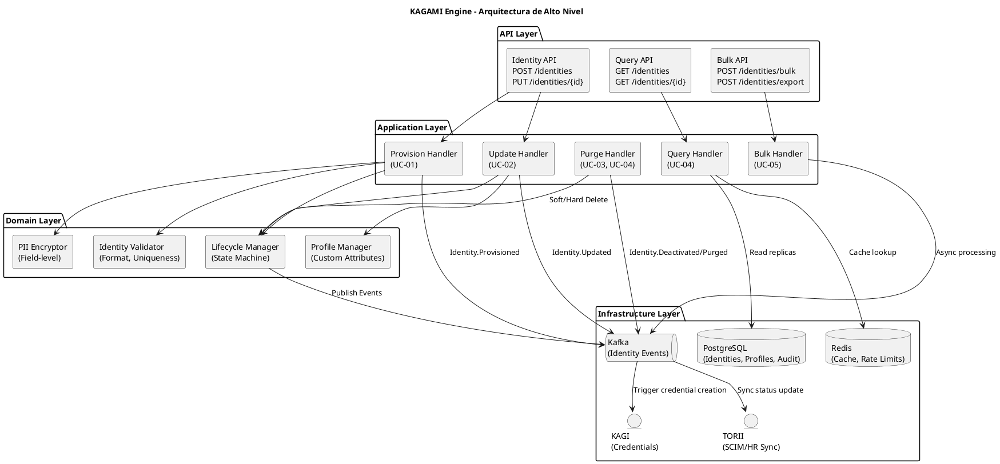
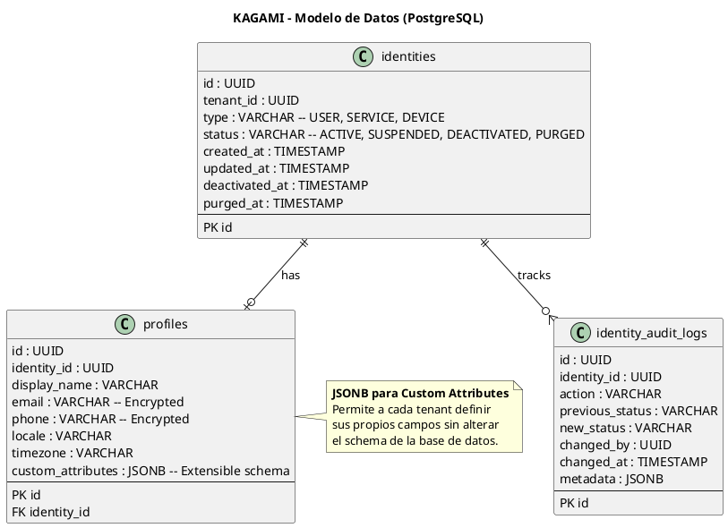
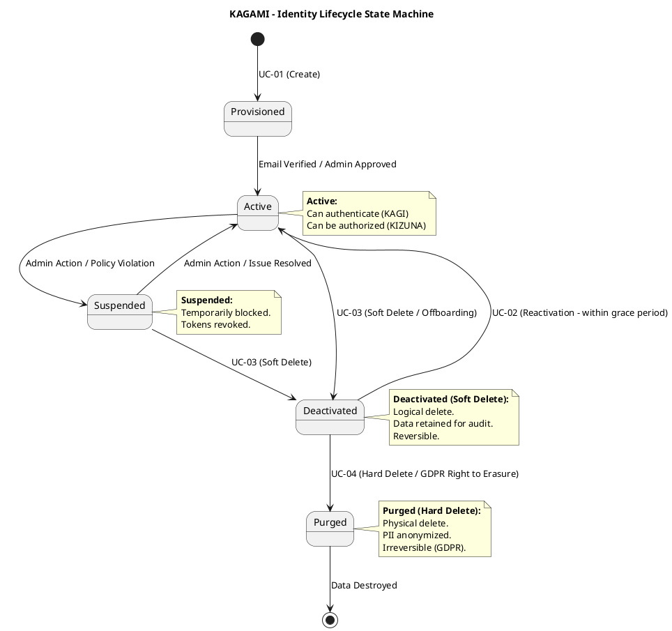

# SHUGO - KAGAMI Engine Architecture (Motor de Ciclo de Vida de Identidades)

| Metadatos del Documento | |
| :--- | :--- |
| **Proyecto:** | SHUGO - Identity & Access Platform |
| **Documento:** | KAGAMI_Engine_Architecture.md |
| **Metodología:** | Domain-Driven Design + Clean Architecture + Event Sourcing (Audit) |
| **Estándares:** | ISO/IEC 27001 (Security), GDPR (Privacy), SCIM 2.0 (RFC 7643), NIST SP 800-63A (Enrollment) |
| **Autor:** | Gastón Ruiz |
| **Versión Actual:** | 1.0.0 |
| **Fecha:** | 30/08/2026 |

---

## Historial de Versiones

| Versión | Fecha | Autor | Descripción de Cambios | Impacto |
| :--- | :--- | :--- | :--- | :--- |
| **1.0.0** | 30/08/2026 | Gastón Ruiz | **Creación inicial.** Arquitectura detallada del motor KAGAMI. Cubre 5 UCs (UC-01 a UC-05) de gestión de identidades, perfiles, ciclo de vida, operaciones bulk y cumplimiento GDPR. Incluye separación Identity/Profile, manejo de atributos custom (JSONB), y estrategia de borrado (Soft/Hard Delete). | Documento de referencia técnica para el motor de gestión de identidades de SHUGO. Define la arquitectura interna, modelo de datos extensible y flujos de integración con KAGI y TORII. |

---

## 1. Introducción y Propósito

KAGAMI (espejo en japonés) es el **motor de gestión de identidades y perfiles** de SHUGO. Es el "Source of Truth" para todos los sujetos (Usuarios, Servicios, Dispositivos) dentro de la plataforma.

KAGAMI es fundamental porque:
- **Es la base de todo:** Sin identidades, no hay autenticación (KAGI) ni autorización (KIZUNA).
- **Gestiona datos sensibles (PII):** Debe cumplir estrictamente con GDPR, CCPA y normativas de privacidad.
- **Permite extensibilidad:** Cada tenant tiene necesidades diferentes de atributos de usuario. KAGAMI debe ser flexible sin romper el esquema core.

### 1.1. Alcance

KAGAMI cubre **5 Casos de Uso** organizados en 1 EPIC:

| EPIC | UCs | Descripción |
| :--- | :--- | :--- |
| **EPIC-01: Identity Management** | UC-01 a UC-05 | Provisionamiento, actualización, consulta, desactivación, purga y operaciones bulk de identidades. |

### 1.2. Objetivos de Rendimiento y Cumplimiento

| Métrica | Objetivo | Justificación |
| :--- | :--- | :--- |
| **Latencia CRUD Identidad** | < 100ms p95 | Operaciones administrativas rápidas |
| **Latencia Consulta (Read)** | < 50ms p95 | Alto throughput para validaciones |
| **Bulk Import Throughput** | 10,000 identidades/min | Eficiencia en migraciones y syncs |
| **GDPR Erasure Time** | < 24 horas | Tiempo máximo para hard delete (Purge) |
| **Audit Trail Coverage** | 100% | Inmutabilidad de cambios de estado |

---

## 2. Arquitectura General de KAGAMI

### 2.1. Vista de Alto Nivel



### 2.2. Componentes Principales

| Componente | Responsabilidad | UCs Asociados |
| :--- | :--- | :--- |
| **Identity API** | Endpoints para crear y actualizar identidades | UC-01, UC-02 |
| **Query API** | Endpoints para buscar y consultar detalles | UC-04 |
| **Bulk API** | Endpoints para importación/exportación masiva | UC-05 |
| **Provision Handler** | Orquesta la creación de identidad y perfil | UC-01 |
| **Lifecycle Manager** | Gestiona la máquina de estados (Active -> Purged) | UC-03, UC-04 |
| **Profile Manager** | Maneja atributos custom y validación de schema | UC-02 |
| **PII Encryptor** | Cifrado a nivel de campo para datos sensibles (email, phone) | Todos |
| **Identity Validator** | Valida formato, unicidad y reglas de negocio | UC-01, UC-02 |

---

## 3. Modelo de Datos de KAGAMI

### 3.1. Separación Identity vs. Profile

Una decisión arquitectónica clave en KAGAMI es separar los **datos del sistema** (Identity) de los **datos del usuario** (Profile).

*   **Identity:** Datos inmutables o de control (ID, TenantID, Status, CreatedAt). Usado por KAGI y KIZUNA.
*   **Profile:** Datos descriptivos y PII (Nombre, Email, Teléfono, Atributos Custom). Usado por UI y reportes.

Esta separación facilita el cumplimiento de GDPR: se puede anonimizar el Profile manteniendo la Identity para auditoría, o purgar ambos.

### 3.2. Diagrama de Modelo de Datos



### 3.3. Scripts de Creación de Tablas

```sql
-- ============================================
-- IDENTITIES (Core System Data)
-- ============================================
CREATE TABLE identities (
    id UUID PRIMARY KEY DEFAULT gen_random_uuid(),
    tenant_id UUID NOT NULL,
    type VARCHAR(20) NOT NULL CHECK (type IN ('USER', 'SERVICE', 'DEVICE')),
    status VARCHAR(20) NOT NULL DEFAULT 'ACTIVE' CHECK (status IN ('ACTIVE', 'SUSPENDED', 'DEACTIVATED', 'PURGED')),
    created_at TIMESTAMP WITH TIME ZONE NOT NULL DEFAULT NOW(),
    updated_at TIMESTAMP WITH TIME ZONE NOT NULL DEFAULT NOW(),
    deactivated_at TIMESTAMP WITH TIME ZONE,
    purged_at TIMESTAMP WITH TIME ZONE,
    CONSTRAINT uq_identity_tenant_type UNIQUE (tenant_id, id) -- Implicit, but good for partitioning
);

-- Partitioning by tenant_id for massive scale
-- CREATE TABLE identities PARTITION BY LIST (tenant_id);

CREATE INDEX idx_identities_tenant_status ON identities(tenant_id, status);

-- ============================================
-- PROFILES (User Data & PII)
-- ============================================
CREATE TABLE profiles (
    id UUID PRIMARY KEY DEFAULT gen_random_uuid(),
    identity_id UUID NOT NULL,
    display_name VARCHAR(255),
    email VARCHAR(255), -- Must be encrypted at rest
    phone VARCHAR(50),  -- Must be encrypted at rest
    locale VARCHAR(10) DEFAULT 'en-US',
    timezone VARCHAR(50) DEFAULT 'UTC',
    custom_attributes JSONB DEFAULT '{}',
    CONSTRAINT fk_profile_identity FOREIGN KEY (identity_id) REFERENCES identities(id) ON DELETE CASCADE,
    CONSTRAINT uq_profile_identity UNIQUE (identity_id)
);

CREATE INDEX idx_profiles_email ON profiles(email); -- Note: Indexing encrypted fields requires deterministic encryption or separate hash column.
CREATE INDEX idx_profiles_custom_gin ON profiles USING GIN (custom_attributes); -- For fast JSONB queries

-- ============================================
-- IDENTITY AUDIT LOGS (Immutable History)
-- ============================================
CREATE TABLE identity_audit_logs (
    id UUID PRIMARY KEY DEFAULT gen_random_uuid(),
    identity_id UUID NOT NULL,
    tenant_id UUID NOT NULL,
    action VARCHAR(50) NOT NULL, -- CREATED, STATUS_CHANGED, PROFILE_UPDATED, PURGED
    previous_status VARCHAR(20),
    new_status VARCHAR(20),
    changed_by UUID, -- Admin or System ID
    changed_at TIMESTAMP WITH TIME ZONE NOT NULL DEFAULT NOW(),
    metadata JSONB, -- IP address, User-Agent, Reason
    CONSTRAINT fk_audit_identity FOREIGN KEY (identity_id) REFERENCES identities(id)
);

-- Audit logs should be append-only. No UPDATE or DELETE permissions for app users.
CREATE INDEX idx_audit_logs_identity ON identity_audit_logs(identity_id, changed_at);
```

---

## 4. Identity Lifecycle State Machine

El ciclo de vida de una identidad en KAGAMI sigue una máquina de estados estricta para garantizar la integridad y el cumplimiento normativo.

### 4.1. Diagrama de Estados



### 4.2. Reglas de Transición

| Transición | Condición | Efectos Secundarios (Eventos) |
| :--- | :--- | :--- |
| **Provisioned -> Active** | Verificación de email o aprobación manual. | `Identity.Activated` -> KAGI permite login. |
| **Active -> Suspended** | Violación de política (ej. fuerza bruta) o acción admin. | `Identity.Suspended` -> KAGI revoca sesiones activas. |
| **Active -> Deactivated** | Offboarding de empleado. | `Identity.Deactivated` -> KAGI revoca tokens, KIZUNA deniega acceso. |
| **Deactivated -> Purged** | Solicitud GDPR o fin del período de retención. | `Identity.Purged` -> Borrado físico de `profiles`, anonimización de `audit_logs`. |

---

## 5. Profile & Attribute Management (Extensibilidad)

### 5.1. Atributos Custom con JSONB

Para soportar la agnosticidad de dominio, KAGAMI permite a los tenants definir atributos personalizados sin modificar el schema SQL.

**Ejemplo de JSONB en `profiles`:**
```json
{
  "department": "Engineering",
  "employee_id": "EMP-12345",
  "manager_id": "user:uuid-manager",
  "clearance_level": 4,
  "equino_assigned": "rayo" // Específico para KHCS
}
```

### 5.2. Validación de Schema (Tenant Level)

Cada tenant puede definir un schema JSON Schema para validar los `custom_attributes` antes de guardar.

```csharp
public class ProfileManager : IProfileManager
{
    public async Task UpdateCustomAttributesAsync(Guid identityId, Guid tenantId, Dictionary<string, object> newAttributes)
    {
        // 1. Obtener schema de validación del tenant
        var schema = await _tenantConfigRepo.GetAttributeSchemaAsync(tenantId);
        
        // 2. Validar nuevos atributos contra el schema
        var validator = new JsonSchemaValidator(schema);
        var validationResult = validator.Validate(newAttributes);
        
        if (!validationResult.IsValid)
        {
            throw new InvalidProfileAttributeException(validationResult.Errors);
        }

        // 3. Merge con atributos existentes (patch, no replace)
        var currentProfile = await _profileRepo.GetByIdentityAsync(identityId);
        var mergedAttributes = currentProfile.CustomAttributes.DeepMerge(newAttributes);

        // 4. Guardar
        await _profileRepo.UpdateCustomAttributesAsync(identityId, mergedAttributes);
    }
}
```

---

## 6. Credential Management (The KAGI Bridge)

KAGAMI **NO** almacena credenciales (passwords, hashes). Esa responsabilidad es de KAGI. Sin embargo, KAGAMI debe orquestar la creación inicial.

### 6.1. Flujo de Provisionamiento con Credenciales

1. **Admin crea identidad en KAGAMI** (POST /identities).
2. **KAGAMI guarda Identity y Profile** en PostgreSQL.
3. **KAGAMI publica evento** `Identity.Provisioned` en Kafka.
4. **KAGI consume el evento** y genera un "Password Reset Token" o inicializa el espacio para MFA.
5. **KAGI envía email** de bienvenida al usuario (vía TORII).

Este desacoplamiento (Eventual Consistency) permite que KAGAMI sea rápido y no falle si KAGI está temporalmente lento, aunque requiere mecanismos de retry en Kafka.

---

## 7. Bulk Operations & SCIM Integration (UC-05)

### 7.1. Procesamiento Asíncrono de Bulk

Las operaciones de importación masiva (UC-05) no deben bloquear la API síncrona.

1. **Upload:** Cliente sube archivo CSV/JSON a Bulk API.
2. **Validation:** KAGAMI valida el archivo (tamaño, formato, schema).
3. **Queueing:** KAGAMI divide el archivo en "chunks" y los envía a Kafka (`BulkImport.Queue`).
4. **Processing:** Workers consumen chunks, procesan identidades en lotes de 100 y reportan progreso.
5. **Completion:** KAGAMI publica `BulkImport.Completed` con un reporte de éxitos/errores.

### 7.2. SCIM 2.0 Adapter (TORII Integration)

KAGAMI expone un endpoint compatible con SCIM 2.0 para que sistemas de RRHH (Workday, BambooHR) sincronicen identidades automáticamente.

*   **POST /scim/v2/Users** -> Mapea a `ProvisionHandler`.
*   **PUT /scim/v2/Users/{id}** -> Mapea a `UpdateHandler`.
*   **DELETE /scim/v2/Users/{id}** -> Mapea a `PurgeHandler` (Soft Delete).

---

## 8. Multi-Tenancy & Data Isolation

### 8.1. Estrategias de Aislamiento

| Estrategia | Implementación en KAGAMI | Justificación |
| :--- | :--- | :--- |
| **Logical Isolation** | Columna `tenant_id` en todas las tablas. | Flexibilidad, backups centralizados. |
| **Row-Level Security (RLS)** | Políticas de PostgreSQL que fuerzan `tenant_id` en cada query. | Prevención de errores de aplicación (forgot tenant filter). |
| **Encryption at Rest** | TDE (Transparent Data Encryption) en PostgreSQL. | Cumplimiento ISO 27001. |
| **Field-Level Encryption** | Cifrado de `email` y `phone` en `profiles` usando AES-256-GCM. | Protección de PII en caso de breach de DB. |

### 8.2. Implementación de RLS (PostgreSQL)

```sql
-- Habilitar RLS en la tabla identities
ALTER TABLE identities ENABLE ROW LEVEL SECURITY;

-- Crear política: Solo se pueden ver/modify identidades del tenant actual
-- (Asumiendo que el tenant_id se setea en la sesión de DB por el middleware)
CREATE POLICY tenant_isolation_policy ON identities
    FOR ALL
    USING (tenant_id = current_setting('app.current_tenant_id')::uuid);
```

---

## 9. Security & Privacy (GDPR Compliance)

### 9.1. Right to Erasure (Hard Delete / Purge)

Cuando un usuario ejerce su derecho al olvido (GDPR Art. 17), KAGAMI ejecuta el estado `Purged`.

**Proceso de Purge:**
1. **Anonimización de Audit Logs:** Los logs no se borran (requerimiento legal de auditoría), pero se anonimiza la referencia al usuario.
   ```sql
   UPDATE identity_audit_logs 
   SET metadata = jsonb_set(metadata, '{anonymized}', 'true'),
       changed_by = NULL
   WHERE identity_id = 'target-uuid';
   ```
2. **Borrado de Profile:** Se elimina la fila en `profiles`.
3. **Borrado de Identity:** Se elimina la fila en `identities`.
4. **Notificación a Downstream:** Evento `Identity.Purged` -> KAGI borra credenciales, KIZUNA borra tuplas donde el usuario sea subject.

### 9.2. Data Portability (Export)

KAGAMI proporciona un endpoint `POST /identities/{id}/export` que genera un archivo JSON estructurado con todos los datos del usuario (Identity, Profile, Audit Logs, Active Sessions from KAGI) en formato legible, cumpliendo con GDPR Art. 20.

---

## 10. Decisiones de Arquitectura (ADR)

### 10.1. ADR-KAGAMI-001: JSONB vs EAV para Atributos Custom

**Decisión:** Usar JSONB (JSON Binary) en PostgreSQL en lugar del patrón EAV (Entity-Attribute-Value).

**Contexto:** Necesitamos almacenar atributos personalizados por tenant sin alterar el schema.

**Opciones Consideradas:**
1. EAV (Tablas separadas para cada atributo)
2. JSONB (Documento JSON almacenado en una columna)
3. NoSQL (MongoDB) para perfiles

**Decisión Tomada:** Opción 2 - JSONB

**Justificación:**
- **Rendimiento:** JSONB en Postgres es binario y soporta índices GIN para búsquedas rápidas dentro del JSON.
- **Simplicidad:** Mantiene todo en una base de datos relacional ACID.
- **Flexibilidad:** Permite validación contra JSON Schema a nivel de aplicación.

**Consecuencias:**
- Las queries complejas sobre atributos custom requieren conocimiento de operadores JSONB de Postgres (`->>`, `@>`).

### 10.2. ADR-KAGAMI-002: Eventual Consistency para Identity->Credential Sync

**Decisión:** Usar eventos de Kafka para sincronizar la creación de identidades con KAGI (credenciales).

**Contexto:** Cuando se crea una identidad, KAGI debe saberlo para permitir el login.

**Opciones Consideradas:**
1. Synchronous API Call (KAGAMI llama a KAGI directamente)
2. Distributed Transaction (2PC / Saga)
3. Asynchronous Events (Kafka)

**Decisión Tomada:** Opción 3 - Asynchronous Events

**Justificación:**
- **Resiliencia:** Si KAGI está caído, KAGAMI puede seguir creando identidades. Los eventos se encolan y procesan cuando KAGI se recupere.
- **Performance:** La API de KAGAMI no se bloquea esperando respuesta de KAGI.
- **Decoupling:** KAGAMI no necesita conocer los detalles internos de cómo KAGI maneja las credenciales.

**Consecuencias:**
- Ventana de inconsistencia: Una identidad puede existir en KAGAMI pero no ser autenticable en KAGI por unos milisegundos/segundos. Se mitiga con retry logic y dead-letter queues.

### 10.3. ADR-KAGAMI-003: Soft Delete vs Hard Delete Strategy

**Decisión:** Implementar un ciclo de vida de dos fases: `Deactivated` (Soft Delete) seguido de `Purged` (Hard Delete).

**Contexto:** Necesitamos cumplir con GDPR (derecho al olvido) pero también con auditoría (no perder historial de acciones).

**Opciones Consideradas:**
1. Solo Hard Delete (Borrado físico inmediato)
2. Solo Soft Delete (Flag `is_deleted = true`)
3. Two-Phase Delete (Deactivated -> Purged)

**Decisión Tomada:** Opción 3 - Two-Phase Delete

**Justificación:**
- **Deactivated:** Permite "deshacer" un offboarding accidental. Mantiene la integridad referencial histórica.
- **Purged:** Cumple estrictamente con GDPR. Anonimiza los logs de auditoría en lugar de borrarlos, manteniendo el "qué" y "cuándo" pero eliminando el "quién".

**Consecuencias:**
- Complejidad en las queries: Todos los queries deben filtrar por `status != 'DEACTIVATED'` y `status != 'PURGED'`.
- Necesidad de un "Grim Reaper" job que mueva identidades de `Deactivated` a `Purged` después de X días (configurable por tenant).

---

## 11. Trazabilidad

| Documento | Relación |
| :--- | :--- |
| `Product_Vision.md` | Define la visión de KAGAMI como el source of truth de identidades. |
| `Domain_Analysis.md` | Define el Bounded Context KAGAMI y sus Aggregate Roots (Identity, Profile). |
| `System_Architecture_Overview.md` | Define KAGAMI como uno de los 6 microservicios de SHUGO. |
| `KAGI_Engine_Architecture.md` | Define el consumo de identidades por parte del motor de autenticación. |
| `Security_Threat_Model.md` | Analiza las amenazas específicas de KAGAMI (PII leakage, enumeration). |
| `Glossary.md` | Contiene definiciones de términos de identidad usados en este documento. |
| `KHCS_SHUGO_Integration_Contract.md` | Primer caso de uso real que consume KAGAMI para gestionar veterinarios y mozos. |
| UC-01 a UC-05 (5 documentos) | Cada UC tiene su paquete completo de 9 documentos que detalla la implementación de KAGAMI. |

---

## 12. Anexos

### 12.1. Glosario de Términos Técnicos de KAGAMI

| Término | Definición |
| :--- | :--- |
| **PII (Personally Identifiable Information)** | Datos que pueden identificar a un individuo (email, teléfono, nombre). |
| **Soft Delete** | Marcado lógico de un registro como eliminado sin borrarlo físicamente de la DB. |
| **Hard Delete (Purge)** | Borrado físico de los datos de la base de datos. |
| **JSONB** | Formato binario de JSON en PostgreSQL que permite indexación y consultas rápidas. |
| **Row-Level Security (RLS)** | Característica de PostgreSQL que restringe el acceso a filas de una tabla basado en el rol o sesión. |
| **SCIM (System for Cross-domain Identity Management)** | Estándar abierto para automatizar el intercambio de identidades entre dominios. |
| **Eventual Consistency** | Modelo de consistencia donde las actualizaciones se propagan asíncronamente. |

### 12.2. Referencias

1. **SCIM 2.0 (RFC 7643/7644):** System for Cross-domain Identity Management - https://scim.dev/
2. **GDPR:** General Data Protection Regulation (Art. 17 Right to Erasure, Art. 20 Portability) - https://gdpr.eu/
3. **NIST SP 800-63A:** Enrollment and Identity Proofing - https://pages.nist.gov/800-63-3/sp800-63a.html
4. **PostgreSQL JSONB Documentation:** https://www.postgresql.org/docs/current/datatype-json.html
5. **OWASP PII Protection Cheat Sheet:** https://cheatsheetseries.owasp.org/cheatsheets/Privacy_Cheat_Sheet.html

---
*Fin del Documento KAGAMI_Engine_Architecture v1.0 para SHUGO*