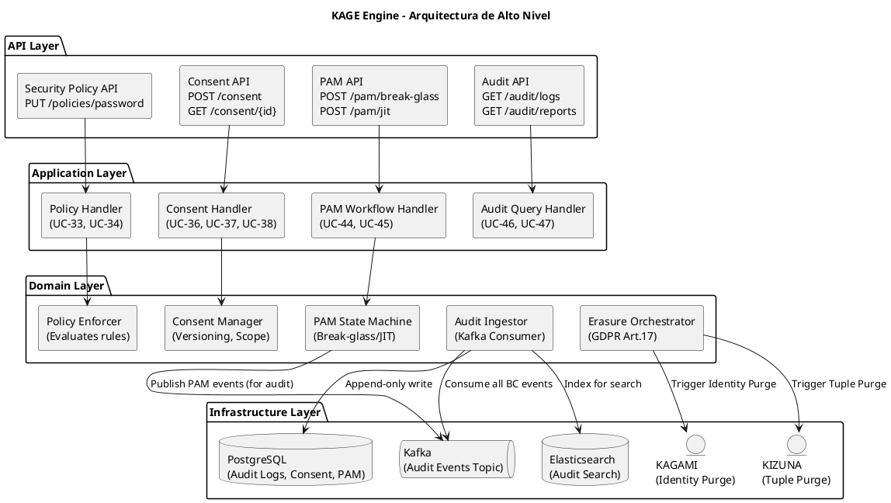
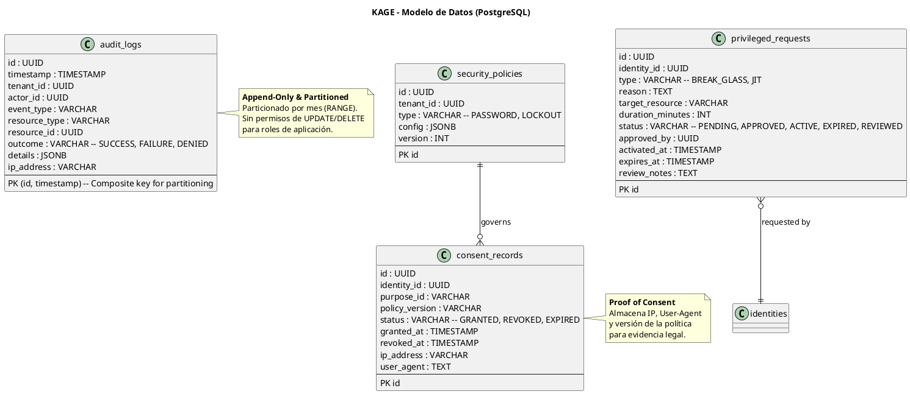
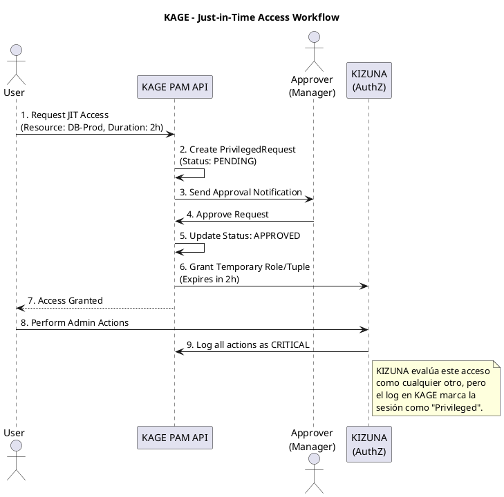

# SHUGO - KAGE Engine Architecture (Motor de Seguridad, Cumplimiento y Auditoría)

| Metadatos del Documento | |
| :--- | :--- |
| **Proyecto:** | SHUGO - Identity & Access Platform |
| **Documento:** | KAGE_Engine_Architecture.md |
| **Metodología:** | Domain-Driven Design + Event Sourcing (Audit) + Compliance by Design |
| **Estándares:** | ISO/IEC 27001, SOC 2 Type II, GDPR (Arts. 6, 7, 17, 20), NIST SP 800-53 |
| **Autor:** | Gastón Ruiz |
| **Versión Actual:** | 1.0.0 |
| **Fecha:** | 30/08/2026 |

---

## Historial de Versiones

| Versión | Fecha | Autor | Descripción de Cambios | Impacto |
| :--- | :--- | :--- | :--- | :--- |
| **1.0.0** | 30/08/2026 | Gastón Ruiz | **Creación inicial.** Arquitectura detallada del motor KAGE. Cubre 9 UCs (UC-33 a UC-38, UC-44 a UC-47) enfocados en políticas de seguridad, consentimiento (GDPR), Privileged Access Management (PAM), y auditoría inmutable. Incluye motor de ingestión de eventos, orquestación de borrado (Right to Erasure) y flujos de Break-Glass. | Documento de referencia técnica para el motor de cumplimiento y seguridad de SHUGO. Define cómo se garantiza la integridad, privacidad y auditabilidad de toda la plataforma. |

---

## 1. Introducción y Propósito

KAGE (sombra en japonés) es el **motor de Seguridad, Cumplimiento y Auditoría** de SHUGO. Actúa como el "sistema nervioso" observador y el "juez" de cumplimiento normativo. A diferencia de los otros motores que ejecutan acciones, KAGE **registra, valida y hace cumplir** las políticas transversales.

KAGE es crítico porque:
- **Garantiza la confianza:** Sin un registro inmutable de auditoría, ninguna plataforma enterprise puede operar.
- **Habilita el cumplimiento legal:** Gestiona el consentimiento (GDPR) y los derechos de privacidad.
- **Controla el acceso privilegiado:** Gestiona situaciones de emergencia (Break-Glass) y acceso temporal (JIT) sin romper el modelo Zero Trust.

### 1.1. Alcance

KAGE cubre **9 Casos de Uso** organizados en 4 EPICs:

| EPIC | UCs | Descripción |
| :--- | :--- | :--- |
| **EPIC-08: Password & Security** | UC-33 a UC-35 | Políticas de contraseñas, Account Lockout, Detección de Brechas. |
| **EPIC-09: Consent & Privacy** | UC-36 a UC-38 | Gestión de consentimiento, Residencia de datos, Portabilidad (GDPR). |
| **EPIC-12: Privileged Access (PAM)** | UC-44, UC-45 | Acceso Break-Glass (emergencia) y Just-in-Time (JIT). |
| **EPIC-13: Audit & Compliance** | UC-46, UC-47 | Consulta de logs de auditoría inmutables y Reportes de cumplimiento. |

### 1.2. Objetivos de Rendimiento y Cumplimiento

| Métrica | Objetivo | Justificación |
| :--- | :--- | :--- |
| **Audit Ingestion Rate** | > 10,000 eventos/segundo | Capacidad de absorber eventos de todos los BCs sin pérdida. |
| **Audit Query Latency** | < 200ms p95 (por rango de fechas) | Consultas rápidas para investigadores de seguridad. |
| **Consent Evaluation** | < 10ms | La validación de consentimiento no debe bloquear el flujo de usuario. |
| **Break-Glass Activation** | < 5 segundos | En una emergencia, el acceso debe ser inmediato, pero auditado. |
| **Immutability Guarantee** | 100% | Ningún log de auditoría puede ser modificado o borrado, ni siquiera por admins. |

---

## 2. Arquitectura General de KAGE

### 2.1. Vista de Alto Nivel



### 2.2. Componentes Principales

| Componente | Responsabilidad | UCs Asociados |
| :--- | :--- | :--- |
| **Policy Enforcer** | Valida reglas de seguridad (complejidad de password, lockout) antes de que KAGI las aplique. | UC-33, UC-34 |
| **Consent Manager** | Gestiona el ciclo de vida del consentimiento, versionado de políticas y scopes. | UC-36 |
| **Erasure Orchestrator** | Coordina el borrado de datos (GDPR) enviando comandos a KAGAMI y KIZUNA. | UC-38 |
| **PAM State Machine** | Controla los estados de solicitudes privilegiadas (Pending -> Approved -> Active -> Expired -> Reviewed). | UC-44, UC-45 |
| **Audit Ingestor** | Consumidor de Kafka de alta velocidad que persiste eventos en almacenamiento inmutable. | UC-46 |

---

## 3. Modelo de Datos de KAGE

### 3.1. Diagrama de Modelo de Datos



### 3.2. Scripts de Creación de Tablas (Extracto Clave)

```sql
-- ============================================
-- AUDIT LOGS (Inmutable y Particionado)
-- ============================================
CREATE TABLE audit_logs (
    id UUID NOT NULL DEFAULT gen_random_uuid(),
    timestamp TIMESTAMP WITH TIME ZONE NOT NULL DEFAULT NOW(),
    tenant_id UUID NOT NULL,
    actor_id UUID,
    event_type VARCHAR(100) NOT NULL,
    resource_type VARCHAR(50),
    resource_id UUID,
    outcome VARCHAR(20) NOT NULL,
    details JSONB,
    ip_address VARCHAR(45),
    PRIMARY KEY (id, timestamp)
) PARTITION BY RANGE (timestamp);

-- Crear particiones mensuales (ejemplo para 2024)
CREATE TABLE audit_logs_2024_01 PARTITION OF audit_logs
    FOR VALUES FROM ('2024-01-01') TO ('2024-02-01');
CREATE TABLE audit_logs_2024_02 PARTITION OF audit_logs
    FOR VALUES FROM ('2024-02-01') TO ('2024-03-01');

-- Índices para consultas frecuentes de seguridad
CREATE INDEX idx_audit_logs_tenant_time ON audit_logs(tenant_id, timestamp DESC);
CREATE INDEX idx_audit_logs_actor ON audit_logs(actor_id, timestamp DESC);
CREATE INDEX idx_audit_logs_event ON audit_logs(event_type, timestamp DESC);

-- ============================================
-- PRIVILEGED REQUESTS (PAM)
-- ============================================
CREATE TABLE privileged_requests (
    id UUID PRIMARY KEY DEFAULT gen_random_uuid(),
    identity_id UUID NOT NULL,
    tenant_id UUID NOT NULL,
    type VARCHAR(20) NOT NULL CHECK (type IN ('BREAK_GLASS', 'JIT')),
    reason TEXT NOT NULL,
    target_resource VARCHAR(255) NOT NULL,
    duration_minutes INT NOT NULL,
    status VARCHAR(20) NOT NULL DEFAULT 'PENDING',
    approved_by UUID,
    activated_at TIMESTAMP WITH TIME ZONE,
    expires_at TIMESTAMP WITH TIME ZONE,
    review_notes TEXT,
    created_at TIMESTAMP WITH TIME ZONE DEFAULT NOW()
);

-- Solo los admins de seguridad pueden aprobar o revisar
-- Esto se enforce a nivel de aplicación y RLS.
```

---

## 4. Audit Ingestion Engine (UC-46)

### 4.1. Flujo de Ingestión de Eventos

KAGE consume eventos de todos los Bounded Contexts a través de un tópico centralizado en Kafka: `shugo.audit.events`.

1. **Producción:** KAGI, KIZUNA, MURA publican eventos de dominio (ej. `Identity.Created`, `Check.Denied`).
2. **Consumo:** `AuditIngestor` consume en lotes (batching) para maximizar throughput.
3. **Enriquecimiento:** Añade metadatos de contexto (GeoIP, clasificación de severidad).
4. **Persistencia Dual:**
   - **PostgreSQL (Hot/Warm Storage):** Para consultas transaccionales y reportes de compliance de los últimos 12 meses.
   - **Elasticsearch/S3 (Cold Storage):** Para búsqueda full-text y archivado a largo plazo (7 años para SOX).

### 4.2. Garantía de Inmutabilidad

```csharp
public class AuditIngestor : IHostedService
{
    public async Task ProcessEventsAsync(IEnumerable<AuditEvent> events)
    {
        // 1. Validar que no haya intentos de modificación (los eventos de Kafka son inmutables por diseño)
        
        // 2. Batch insert en PostgreSQL (Partitioned Table)
        using var connection = _db.CreateConnection();
        await connection.ExecuteAsync(@"
            INSERT INTO audit_logs (id, timestamp, tenant_id, actor_id, event_type, outcome, details)
            VALUES (@Id, @Timestamp, @TenantId, @ActorId, @EventType, @Outcome, @Details::jsonb)", 
            events);
            
        // 3. Indexar en Elasticsearch para búsqueda rápida
        await _elasticClient.BulkIndexAsync(events);
    }
}
```
*Nota de Seguridad:* La base de datos de auditoría se configura con permisos `GRANT INSERT ONLY` para el usuario de la aplicación. Ni siquiera los DBAs pueden hacer `UPDATE` o `DELETE` sin pasar por un proceso de emergencia auditado.

---

## 5. Consent & Privacy Manager (GDPR Compliance)

### 5.1. Modelo de Consentimiento Granular

El consentimiento no es un simple booleano. Es un registro legal que vincula una identidad, un propósito específico y la versión exacta de la política de privacidad aceptada.

**Ejemplo de Registro de Consentimiento:**
```json
{
  "identity_id": "user:uuid-123",
  "purpose": "marketing_emails",
  "policy_version": "privacy_policy_v2.1_2023-10-01",
  "status": "GRANTED",
  "granted_at": "2023-10-05T14:30:00Z",
  "proof": {
    "ip_address": "192.168.1.1",
    "user_agent": "Mozilla/5.0...",
    "signature_hash": "sha256:abc..."
  }
}
```

### 5.2. Orquestación del "Derecho al Olvido" (UC-38)

Cuando un usuario ejerce su derecho al borrado (GDPR Art. 17), KAGE actúa como orquestador:

1. **Solicitud:** Usuario solicita borrado vía API.
2. **Validación:** KAGE verifica que no haya obligaciones legales de retención (ej. facturas).
3. **Orquestación (Saga Pattern):**
   - KAGE envía comando `PurgeIdentity` a **KAGAMI**.
   - KAGE envía comando `PurgeTuples` a **KIZUNA**.
   - KAGE envía comando `RevokeSessions` a **KAGI**.
4. **Anonimización de Auditoría:** Los logs en `audit_logs` no se borran, pero el `actor_id` se reemplaza por un ID anónimo (`system:purged-user`) para mantener la integridad del historial de seguridad sin violar la privacidad.

---

## 6. Privileged Access Management (PAM) (UC-44, UC-45)

### 6.1. Break-Glass Access (Acceso de Emergencia)

Permite a un administrador romper el control de acceso normal (ej. ReBAC/RBAC) en situaciones críticas (ej. un sistema caído a las 3 AM).

**Reglas de Oro del Break-Glass:**
1. **Aprobación Posterior:** El acceso se concede inmediatamente, pero *requiere* la aprobación de un segundo administrador en un plazo de 24 horas.
2. **Duración Límite:** El acceso expira automáticamente en un máximo de 4 horas.
3. **Auditoría Reforzada:** Todas las acciones realizadas durante este período se marcan con `severity: CRITICAL` en los logs de auditoría.

### 6.2. Just-in-Time (JIT) Access

Acceso temporal a un recurso específico, aprobado mediante un workflow.



---

## 7. Decisiones de Arquitectura (ADR)

### 7.1. ADR-KAGE-001: Almacenamiento de Logs de Auditoría (PostgreSQL vs. Elasticsearch)

**Decisión:** Usar PostgreSQL particionado como "Source of Truth" inmutable y Elasticsearch para búsqueda avanzada.

**Contexto:** Los logs de auditoría deben ser inmutables (compliance) pero también fácilmente consultables por los equipos de seguridad.

**Opciones Consideradas:**
1. Solo Elasticsearch (Rápido, pero difícil de garantizar inmutabilidad estricta a nivel de DB).
2. Solo PostgreSQL (Inmutable con permisos, pero lento para búsquedas full-text en TB de datos).
3. Dual Write (Postgres para compliance, ES para search).

**Decisión Tomada:** Opción 3 - Dual Write

**Justificación:**
- **PostgreSQL:** Permite usar `GRANT INSERT ONLY` y Table Partitioning para retención y borrado eficiente por fecha. Cumple estrictamente con SOC 2.
- **Elasticsearch:** Permite a los analistas de seguridad hacer queries complejas (`actor_id:X AND resource_type:Y AND outcome:DENIED`) en milisegundos.

### 7.2. ADR-KAGE-002: Versionado de Políticas de Consentimiento

**Decisión:** Cada registro de consentimiento debe almacenar el hash o versión exacta de la política de privacidad que estaba vigente en el momento de la aceptación.

**Contexto:** Las políticas de privacidad cambian. Si un usuario demanda, necesitamos probar exactamente qué aceptó.

**Opciones Consideradas:**
1. Guardar solo el ID de la política.
2. Guardar una copia (snapshot) del texto de la política en el registro.
3. Guardar el número de versión y un hash criptográfico del texto.

**Decisión Tomada:** Opción 3 - Versión + Hash

**Justificación:**
- **Eficiencia:** No duplicamos texto legal en millones de filas.
- **Integridad:** El hash garantiza que la política referenciada no ha sido alterada retrospectivamente.

### 7.3. ADR-KAGE-003: Break-Glass con "Aprobación Posterior" (Post-Facto Approval)

**Decisión:** El acceso Break-Glass se concede *antes* de la aprobación, pero se revoca automáticamente si no se aprueba en 24h.

**Contexto:** En una emergencia real (ej. ransomware, caída crítica), esperar a que un segundo admin despierte y apruebe puede costar millones.

**Opciones Consideradas:**
1. Aprobación previa obligatoria (Demasiado lento para emergencias).
2. Aprobación posterior con revocación automática.
3. Acceso ilimitado con auditoría.

**Decisión Tomada:** Opción 2 - Aprobación Posterior

**Justificación:**
- Balancea la necesidad operativa de velocidad con el control de seguridad.
- La revocación automática (Time-bomb) previene el abuso si el aprobador se olvida.

---

## 8. Trazabilidad

| Documento | Relación |
| :--- | :--- |
| `Product_Vision.md` | Define la visión de KAGE como el garante de confianza y cumplimiento de SHUGO. |
| `Domain_Analysis.md` | Define el Bounded Context KAGE y sus Aggregate Roots (AuditLog, ConsentRecord, PrivilegedRequest). |
| `System_Architecture_Overview.md` | Define KAGE como el consumidor final de todos los eventos de dominio. |
| `Security_Threat_Model.md` | Analiza amenazas como Audit log tampering y Consent bypass. |
| `Glossary.md` | Contiene definiciones de términos de compliance (PII, SoD, WORM). |
| `KHCS_SHUGO_Integration_Contract.md` | Define cómo KHCS debe manejar el consentimiento de los dueños de equinos (GDPR). |
| UC-33 a UC-38, UC-44 a UC-47 (9 documentos) | Cada UC tiene su paquete completo de 9 documentos que detalla la implementación de KAGE. |

---

## 9. Anexos

### 9.1. Glosario de Términos Técnicos de KAGE

| Término | Definición |
| :--- | :--- |
| **WORM (Write Once Read Many)** | Modelo de almacenamiento donde los datos, una vez escritos, no pueden ser modificados ni borrados. |
| **Break-Glass** | Procedimiento de emergencia para obtener acceso privilegiado temporal, saltándose los controles normales. |
| **JIT (Just-in-Time)** | Acceso concedido solo por el tiempo exacto necesario para realizar una tarea específica. |
| **Saga Pattern** | Patrón de gestión de transacciones distribuidas mediante una secuencia de transacciones locales y eventos compensatorios. |
| **PII (Personally Identifiable Information)** | Información que puede usarse por sí sola o con otra información para identificar a un individuo. |
| **Data Residency** | Requisitos legales o corporativos que dictan que los datos deben almacenarse dentro de fronteras geográficas específicas. |

### 9.2. Referencias

1. **GDPR:** Regulation (EU) 2016/679 (Arts. 6, 7, 17, 20) - https://gdpr.eu/
2. **SOC 2 Trust Services Criteria:** AICPA - https://www.aicpa.org/
3. **NIST SP 800-53 (AU-2, AU-12):** Audit Events and Audit Generation - https://csrc.nist.gov/publications/detail/sp/800-53/rev-5/final
4. **ISO/IEC 27001:2022 (A.8.15, A.8.16):** Logging and Monitoring Activities.

---
*Fin del Documento KAGE_Engine_Architecture v1.0 para SHUGO*