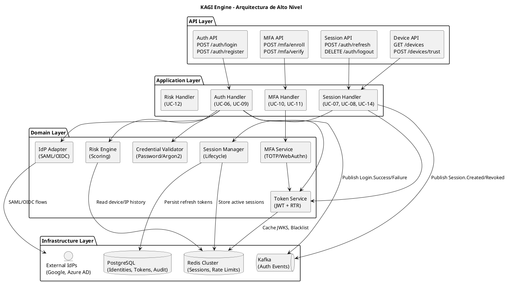
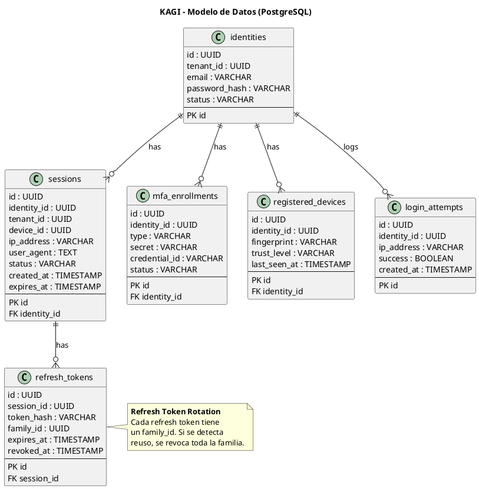
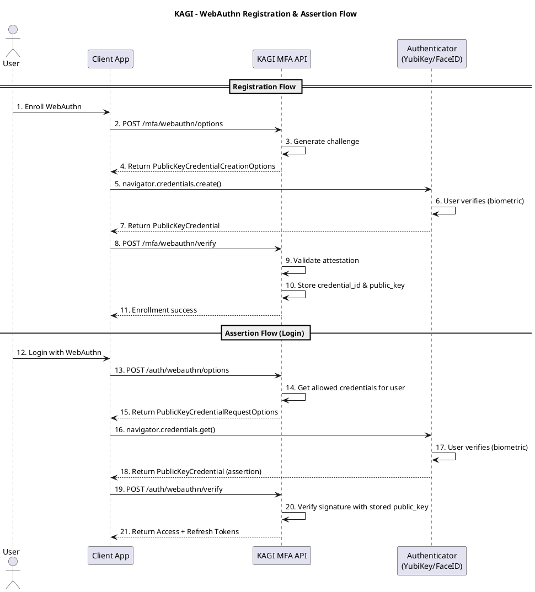

# SHUGO - KAGI Engine Architecture (Motor de Autenticación y Sesiones)

| Metadatos del Documento | |
| :--- | :--- |
| **Proyecto:** | SHUGO - Identity & Access Platform |
| **Documento:** | KAGI_Engine_Architecture.md |
| **Metodología:** | Domain-Driven Design + Clean Architecture + NIST 800-63 + OWASP ASVS |
| **Estándares:** | ISO/IEC 27001 (Security), NIST SP 800-63B (Digital Identity Guidelines), RFC 6749 (OAuth 2.0), RFC 7519 (JWT), WebAuthn Level 2 |
| **Autor:** | Gastón Ruiz |
| **Versión Actual:** | 1.0.0 |
| **Fecha:** | 30/08/2026 |

---

## Historial de Versiones

| Versión | Fecha | Autor | Descripción de Cambios | Impacto |
| :--- | :--- | :--- | :--- | :--- |
| **1.0.0** | 30/08/2026 | Gastón Ruiz | **Creación inicial.** Arquitectura detallada del motor KAGI. Cubre 10 UCs (UC-06 a UC-15) de autenticación local, federada, MFA, passwordless, gestión de sesiones y dispositivos. Incluye Token Service con Refresh Token Rotation, Risk Engine, y alineación con NIST AAL1/AAL2/AAL3. | Documento de referencia técnica para el motor de autenticación de SHUGO. Define la arquitectura interna, flujos de tokens, gestión de sesiones y controles de seguridad. |

---

## 1. Introducción y Propósito

KAGI es el **motor de autenticación y gestión de sesiones** de SHUGO. Es la "puerta de entrada" de la plataforma, responsable de verificar la identidad de los sujetos (usuarios, servicios, dispositivos) y emitir credenciales de sesión seguras.

KAGI es crítico porque:
- **Es el primer punto de contacto:** Cualquier vulnerabilidad aquí compromete todo el sistema.
- **Define la experiencia de usuario:** Flujos de login, MFA y recuperación deben ser fluidos pero seguros.
- **Cumple con normativas estrictas:** Alineado con NIST SP 800-63B para Assurance Levels (AAL).

### 1.1. Alcance

KAGI cubre **10 Casos de Uso** organizados en 2 EPICs:

| EPIC | UCs | Descripción |
| :--- | :--- | :--- |
| **EPIC-02: Authentication** | UC-06 a UC-12 | Autenticación local, federada (SSO), MFA, Passwordless, Risk-Based |
| **EPIC-03: Session Management** | UC-13 a UC-15 | Gestión de sesiones activas, Force Logout, Device Management |

### 1.2. Objetivos de Rendimiento y Seguridad

| Métrica | Objetivo | Justificación |
| :--- | :--- | :--- |
| **Latencia Login (Local)** | < 200ms p95 | Experiencia de usuario fluida |
| **Latencia Token Refresh** | < 50ms p95 | Transparente para el usuario |
| **Latencia MFA Verify** | < 100ms p95 | Rápido para TOTP/Push |
| **Disponibilidad** | 99.99% | Crítico para acceso al sistema |
| **NIST AAL2 Compliance** | 100% | MFA obligatorio para acciones sensibles |
| **Token Revocation Time** | < 1 segundo | Respuesta inmediata ante compromiso |

---

## 2. Arquitectura General de KAGI

### 2.1. Vista de Alto Nivel



### 2.2. Componentes Principales

| Componente | Responsabilidad | UCs Asociados |
| :--- | :--- | :--- |
| **Auth API** | Endpoints para login, registro y recuperación | UC-06, UC-09 |
| **Session API** | Endpoints para refresh, logout y gestión de sesiones | UC-07, UC-08, UC-13, UC-14 |
| **MFA API** | Endpoints para enrolamiento y verificación MFA | UC-10, UC-11 |
| **Token Service** | Generación y validación de JWTs, Refresh Token Rotation (RTR) | UC-06, UC-08 |
| **Session Manager** | Ciclo de vida de sesiones, concurrencia, force logout | UC-13, UC-14 |
| **MFA Service** | Lógica de TOTP (RFC 6238) y WebAuthn/FIDO2 | UC-10, UC-11 |
| **Risk Engine** | Scoring de riesgo basado en IP, dispositivo, geo-velocidad | UC-12 |
| **IdP Adapter** | Anti-Corruption Layer para SAML/OIDC externos | UC-09 |
| **Credential Validator** | Hashing y verificación de passwords (Argon2id) | UC-06 |

---

## 3. Modelo de Datos de KAGI

### 3.1. Diagrama de Modelo de Datos



### 3.2. Scripts de Creación de Tablas

```sql
-- ============================================
-- SESSIONS
-- ============================================
CREATE TABLE sessions (
    id UUID PRIMARY KEY DEFAULT gen_random_uuid(),
    identity_id UUID NOT NULL,
    tenant_id UUID NOT NULL,
    device_id UUID,
    ip_address VARCHAR(45) NOT NULL,
    user_agent TEXT,
    status VARCHAR(50) NOT NULL DEFAULT 'ACTIVE', -- ACTIVE, REVOKED, EXPIRED
    created_at TIMESTAMP NOT NULL DEFAULT NOW(),
    expires_at TIMESTAMP NOT NULL,
    CONSTRAINT fk_session_identity FOREIGN KEY (identity_id) REFERENCES identities(id) ON DELETE CASCADE
);

CREATE INDEX idx_sessions_identity ON sessions(identity_id);
CREATE INDEX idx_sessions_status ON sessions(status) WHERE status = 'ACTIVE';

-- ============================================
-- REFRESH TOKENS (Con soporte para Rotation)
-- ============================================
CREATE TABLE refresh_tokens (
    id UUID PRIMARY KEY DEFAULT gen_random_uuid(),
    session_id UUID NOT NULL,
    token_hash VARCHAR(255) NOT NULL, -- SHA-256 hash del token
    family_id UUID NOT NULL, -- Para detectar reuso
    expires_at TIMESTAMP NOT NULL,
    revoked_at TIMESTAMP,
    CONSTRAINT fk_token_session FOREIGN KEY (session_id) REFERENCES sessions(id) ON DELETE CASCADE
);

CREATE INDEX idx_refresh_tokens_hash ON refresh_tokens(token_hash);
CREATE INDEX idx_refresh_tokens_family ON refresh_tokens(family_id);

-- ============================================
-- MFA ENROLLMENTS
-- ============================================
CREATE TABLE mfa_enrollments (
    id UUID PRIMARY KEY DEFAULT gen_random_uuid(),
    identity_id UUID NOT NULL,
    type VARCHAR(50) NOT NULL, -- TOTP, WEBAUTHN, SMS
    secret VARCHAR(500), -- Para TOTP (encriptado)
    credential_id VARCHAR(255), -- Para WebAuthn
    status VARCHAR(50) NOT NULL DEFAULT 'PENDING', -- PENDING, ACTIVE
    CONSTRAINT fk_mfa_identity FOREIGN KEY (identity_id) REFERENCES identities(id) ON DELETE CASCADE
);

-- ============================================
-- REGISTERED DEVICES
-- ============================================
CREATE TABLE registered_devices (
    id UUID PRIMARY KEY DEFAULT gen_random_uuid(),
    identity_id UUID NOT NULL,
    fingerprint VARCHAR(255) NOT NULL,
    trust_level VARCHAR(50) NOT NULL DEFAULT 'UNTRUSTED', -- UNTRUSTED, TRUSTED, REVOKED
    last_seen_at TIMESTAMP NOT NULL DEFAULT NOW(),
    CONSTRAINT fk_device_identity FOREIGN KEY (identity_id) REFERENCES identities(id) ON DELETE CASCADE,
    CONSTRAINT uq_device_fingerprint UNIQUE (identity_id, fingerprint)
);

-- ============================================
-- LOGIN ATTEMPTS (Para Lockout y Risk)
-- ============================================
CREATE TABLE login_attempts (
    id UUID PRIMARY KEY DEFAULT gen_random_uuid(),
    identity_id UUID,
    email VARCHAR(255),
    ip_address VARCHAR(45) NOT NULL,
    success BOOLEAN NOT NULL,
    created_at TIMESTAMP NOT NULL DEFAULT NOW()
);

CREATE INDEX idx_login_attempts_email ON login_attempts(email, created_at);
CREATE INDEX idx_login_attempts_ip ON login_attempts(ip_address, created_at);
```

---

## 4. Token Service: El Corazón de KAGI

### 4.1. Estrategia de Tokens (JWT + RTR)

KAGI implementa un modelo de **Access Token JWT de corta duración** + **Refresh Token Opaco con Rotation (RTR)**.

| Token Tipo | Formato | Duración | Almacenamiento | Revocación |
| :--- | :--- | :--- | :--- | :--- |
| **Access Token** | JWT (RS256) | 15 minutos | Memory (Client) | No revocable (short-lived) |
| **Refresh Token** | Opaque (UUID) | 7 días | HttpOnly Cookie | Revocable (DB + Redis blacklist) |

### 4.2. Refresh Token Rotation (RTR) Logic

```csharp
public class TokenService : ITokenService
{
    private readonly IRefreshTokenRepository _tokenRepo;
    private readonly ISessionRepository _sessionRepo;
    private readonly IJwtProvider _jwtProvider;

    public async Task<AuthTokens> RefreshTokenAsync(string refreshToken, string sessionId)
    {
        // 1. Hash del token recibido
        var tokenHash = HashToken(refreshToken);

        // 2. Buscar token en DB
        var storedToken = await _tokenRepo.GetByHashAsync(tokenHash);

        if (storedToken == null || storedToken.ExpiresAt < DateTime.UtcNow)
        {
            // Token no encontrado o expirado -> Posible ataque de reuso
            await RevokeTokenFamilyAsync(storedToken?.FamilyId ?? Guid.Empty);
            throw new SecurityException("Invalid or expired refresh token");
        }

        // 3. Verificar si el token ya fue usado (Reuso detectado)
        if (storedToken.RevokedAt != null)
        {
            // ¡ALERTA DE SEGURIDAD! Alguien está usando un token robado
            await RevokeTokenFamilyAsync(storedToken.FamilyId);
            await _sessionRepo.RevokeSessionAsync(sessionId, "Token reuse detected");
            throw new SecurityException("Token reuse detected. Session revoked.");
        }

        // 4. Rotar el token (Revocar el actual, crear uno nuevo)
        await _tokenRepo.RevokeAsync(storedToken.Id);
        
        var newRefreshToken = GenerateSecureToken();
        var newTokenHash = HashToken(newRefreshToken);
        
        await _tokenRepo.CreateAsync(new RefreshToken
        {
            SessionId = sessionId,
            TokenHash = newTokenHash,
            FamilyId = storedToken.FamilyId, // Mantiene la misma familia
            ExpiresAt = DateTime.UtcNow.AddDays(7)
        });

        // 5. Generar nuevo Access Token JWT
        var session = await _sessionRepo.GetByIdAsync(sessionId);
        var newAccessToken = _jwtProvider.GenerateToken(session.IdentityId, session.TenantId);

        return new AuthTokens
        {
            AccessToken = newAccessToken,
            RefreshToken = newRefreshToken,
            ExpiresIn = 900 // 15 minutos
        };
    }

    private async Task RevokeTokenFamilyAsync(Guid familyId)
    {
        // Revocar todos los tokens de la familia (mitiga robo de refresh tokens)
        await _tokenRepo.RevokeFamilyAsync(familyId);
    }
}
```

---

## 5. MFA & Passwordless Engine

### 5.1. Soporte de Factores

KAGI soporta múltiples factores de autenticación alineados con NIST AAL2 y AAL3:

| Factor | Tipo | Estándar | AAL Level | Implementación |
| :--- | :--- | :--- | :--- | :--- |
| **TOTP** | Posesión (Software) | RFC 6238 | AAL2 | Google Authenticator, Authy |
| **WebAuthn** | Posesión (Hardware) | W3C WebAuthn | AAL3 | YubiKey, FaceID, TouchID |
| **Magic Link** | Posesión (Email) | Custom | AAL1 | Email con token de un solo uso |
| **SMS/Email OTP** | Posesión | Custom | AAL1 (Legacy) | Código de 6 dígitos |

### 5.2. Flujo WebAuthn (Passwordless)



---

## 6. Risk-Based Authentication Engine

### 6.1. Risk Scoring Model

El Risk Engine evalúa cada intento de autenticación y asigna un score de 0 a 100.

| Factor de Riesgo | Condición | Puntuación | Acción |
| :--- | :--- | :--- | :--- |
| **Nuevo Dispositivo** | Fingerprint no registrado | +30 | Requerir MFA |
| **Nueva IP** | IP no vista en últimos 30 días | +20 | Requerir MFA |
| **Geo-Velocidad Imposible** | Login en 2 países en < 1 hora | +50 | Bloquear y alertar |
| **Tor/Proxy Detectado** | IP en lista de Tor/VPN conocida | +40 | Requerir MFA o Bloquear |
| **Hora Inusual** | Login fuera del horario habitual del usuario | +10 | Log only |
| **Múltiples Fallos** | > 3 fallos en últimos 10 minutos | +25 | Captcha o Lockout |

### 6.2. Implementación del Risk Engine

```csharp
public class RiskEngine : IRiskEngine
{
    public async Task<RiskAssessment> AssessAsync(LoginRequest request, Identity identity)
    {
        var score = 0;
        var reasons = new List<string>();

        // 1. Device Fingerprint Check
        var device = await _deviceRepo.GetByFingerprintAsync(identity.Id, request.DeviceFingerprint);
        if (device == null)
        {
            score += 30;
            reasons.Add("New device detected");
        }
        else if (device.TrustLevel == TrustLevel.Revoked)
        {
            score += 100; // Bloqueo inmediato
            reasons.Add("Revoked device");
        }

        // 2. Geo-Velocity Check
        var lastLogin = await _loginRepo.GetLastSuccessfulAsync(identity.Id);
        if (lastLogin != null)
        {
            var distance = CalculateDistance(lastLogin.GeoLocation, request.GeoLocation);
            var timeDiff = DateTime.UtcNow - lastLogin.CreatedAt;
            var speed = distance / timeDiff.TotalHours;

            if (speed > 800) // Imposible volar a 800 km/h
            {
                score += 50;
                reasons.Add("Impossible travel detected");
            }
        }

        // 3. Determine Action
        var action = score switch
        {
            >= 80 => RiskAction.BLOCK,
            >= 40 => RiskAction.REQUIRE_MFA,
            >= 20 => RiskAction.REQUIRE_STEP_UP,
            _ => RiskAction.ALLOW
        };

        return new RiskAssessment
        {
            Score = score,
            Reasons = reasons,
            Action = action
        };
    }
}
```

---

## 7. Integración Federada (SSO)

### 7.1. Anti-Corruption Layer (ACL) para IdPs Externos

KAGI actúa como **Service Provider (SP)** o **Relying Party (RP)** para IdPs externos (Google, Azure AD, Okta).

```csharp
public class IdPAdapter : IIdPAdapter
{
    private readonly ISamlClient _samlClient;
    private readonly IOidcClient _oidcClient;

    public async Task<ExternalIdentity> AuthenticateAsync(string provider, string token)
    {
        return provider switch
        {
            "saml" => await ProcessSamlAsync(token),
            "oidc" => await ProcessOidcAsync(token),
            _ => throw new NotSupportedException($"Provider {provider} not supported")
        };
    }

    private async Task<ExternalIdentity> ProcessOidcAsync(string idToken)
    {
        // 1. Validar firma del JWT del IdP usando JWKS
        var validator = new JwtSecurityTokenHandler();
        var validationParameters = new TokenValidationParameters
        {
            ValidateIssuer = true,
            ValidIssuers = _config.AllowedIssuers,
            ValidateAudience = true,
            ValidAudience = _config.ClientId,
            ValidateIssuerSigningKey = true,
            IssuerSigningKeyResolver = (token, securityToken, kid, parameters) => 
            {
                return _jwksCache.GetSigningKeys(kid); // Cache de JWKS del IdP
            }
        };

        var principal = validator.ValidateToken(idToken, validationParameters, out _);

        // 2. Mapear claims externos al modelo interno de SHUGO
        return new ExternalIdentity
        {
            Provider = "oidc",
            ProviderUserId = principal.FindFirst("sub")?.Value,
            Email = principal.FindFirst("email")?.Value,
            Name = principal.FindFirst("name")?.Value,
            VerifiedEmail = principal.FindFirst("email_verified")?.Value == "true"
        };
    }
}
```

---

## 8. Multi-Tenancy y Configuración de Seguridad

Cada tenant en SHUGO puede configurar sus propias políticas de autenticación:

```json
{
  "tenant_id": "khcs-001",
  "auth_config": {
    "password_policy": {
      "min_length": 12,
      "require_uppercase": true,
      "require_numbers": true,
      "require_symbols": true,
      "max_age_days": 90,
      "history_count": 5
    },
    "mfa_policy": {
      "required": true,
      "allowed_methods": ["totp", "webauthn"],
      "remember_device_days": 30
    },
    "session_policy": {
      "access_token_ttl_minutes": 15,
      "refresh_token_ttl_days": 7,
      "absolute_timeout_hours": 8,
      "idle_timeout_minutes": 30,
      "concurrent_sessions_limit": 3
    },
    "lockout_policy": {
      "max_attempts": 5,
      "lockout_duration_minutes": 30,
      "progressive_delay": true
    }
  }
}
```

---

## 9. Security & Compliance (NIST 800-63)

### 9.1. Alineación con NIST Assurance Levels

| NIST Level | Requisito | Implementación en KAGI |
| :--- | :--- | :--- |
| **AAL1** | Password o factor único | Login con password + rate limiting |
| **AAL2** | MFA requerido | TOTP o WebAuthn como segundo factor |
| **AAL3** | Hardware-based MFA + Phishing resistant | WebAuthn/FIDO2 con user verification |
| **IAL1** | Self-asserted identity | Registro con email verification |
| **IAL2** | Remote identity proofing | Integración con proveedores de KYC (Jumio, Onfido) |

### 9.2. OWASP Session Management Controls

| Control OWASP | Implementación en KAGI |
| :--- | :--- |
| **Session ID Length** | 128 bits (UUID v4) |
| **Session ID Entropy** | CSPRNG (Cryptographically Secure PRNG) |
| **Session Timeout** | Absolute (8h) + Idle (30min) |
| **Logout Functionality** | Server-side revocation + client-side clear |
| **Session Binding** | IP + User-Agent + Device Fingerprint |
| **Cookie Security** | HttpOnly, Secure, SameSite=Strict |

---

## 10. Decisiones de Arquitectura (ADR)

### 10.1. ADR-KAGI-001: JWT (Access) + Opaque (Refresh) vs Both JWT

**Decisión:** Usar JWT para Access Tokens y Opaque Tokens (UUID) para Refresh Tokens.

**Contexto:** Necesitamos un mecanismo de sesión que balancee rendimiento (stateless) y control (revocación).

**Opciones Consideradas:**
1. Ambos JWT (Stateless completo)
2. Ambos Opaque (Stateful completo)
3. JWT Access + Opaque Refresh (Híbrido)

**Decisión Tomada:** Opción 3 - Híbrido

**Justificación:**
- **Access Token JWT:** Permite validación stateless en APIs downstream (KIZUNA, etc.) sin llamar a KAGI. Mejora latencia.
- **Refresh Token Opaque:** Permite revocación inmediata y detección de reuso (RTR) en el servidor. Crítico para seguridad.
- **Short-lived Access (15 min):** Minimiza la ventana de vulnerabilidad si un access token es comprometido.

**Consecuencias:**
- Necesidad de JWKS endpoint público para validar JWTs.
- Refresh tokens requieren lookup en DB/Redis en cada refresh.

### 10.2. ADR-KAGI-002: Redis vs PostgreSQL para Sesiones Activas

**Decisión:** Usar Redis para sesiones activas y PostgreSQL para auditoría y refresh tokens.

**Contexto:** Las sesiones se consultan en cada request protegida. Necesitamos baja latencia.

**Opciones Consideradas:**
1. Solo PostgreSQL
2. Solo Redis
3. Redis (activo) + PostgreSQL (persistencia/auditoría)

**Decisión Tomada:** Opción 3 - Híbrido

**Justificación:**
- **Redis:** Latencia < 1ms para verificar estado de sesión. Soporta TTL nativo para expiración automática.
- **PostgreSQL:** Persistencia de refresh tokens (requiere transacciones ACID para RTR). Auditoría de eventos de sesión.

**Consecuencias:**
- Necesidad de sincronizar estado entre Redis y Postgres (eventual consistency para session status).
- Mayor complejidad operacional (mantener 2 data stores).

### 10.3. ADR-KAGI-003: WebAuthn como Estándar para MFA

**Decisión:** Soportar WebAuthn/FIDO2 como el método MFA primario recomendado.

**Contexto:** TOTP es vulnerable a phishing y SIM swapping. Necesitamos un método más seguro.

**Opciones Consideradas:**
1. Solo TOTP
2. TOTP + SMS
3. WebAuthn + TOTP (fallback)

**Decisión Tomada:** Opción 3 - WebAuthn + TOTP

**Justificación:**
- **WebAuthn:** Phishing-resistant, sin passwords, mejor UX (biometría nativa). Alineado con NIST AAL3.
- **TOTP:** Fallback para dispositivos sin soporte WebAuthn o como backup.
- **SMS Deprecado:** Vulnerable a SIM swapping. Solo permitido si el tenant lo fuerza explícitamente.

**Consecuencias:**
- Mayor complejidad de implementación (protocolo WebAuthn es complejo).
- Necesidad de librerías especializadas (Fido2.NetLib).

---

## 11. Trazabilidad

| Documento | Relación |
| :--- | :--- |
| `Product_Vision.md` | Define la visión de KAGI como el gatekeeper seguro de SHUGO. |
| `Domain_Analysis.md` | Define el Bounded Context KAGI y sus Aggregate Roots (Session, RefreshToken, MfaEnrollment). |
| `System_Architecture_Overview.md` | Define KAGI como uno de los 6 microservicios de SHUGO. |
| `Security_Threat_Model.md` | Analiza las amenazas específicas de KAGI (Credential theft, Session hijacking, MFA bypass). |
| `Glossary.md` | Contiene definiciones de términos de autenticación usados en este documento. |
| `KHCS_SHUGO_Integration_Contract.md` | Primer caso de uso real que consume KAGI para autenticar veterinarios. |
| UC-06 a UC-15 (10 documentos) | Cada UC tiene su paquete completo de 9 documentos que detalla la implementación de KAGI. |

---

## 12. Anexos

### 12.1. Glosario de Términos Técnicos de KAGI

| Término | Definición |
| :--- | :--- |
| **AAL (Authenticator Assurance Level)** | Nivel de confianza en el método de autenticación (NIST 800-63). |
| **RTR (Refresh Token Rotation)** | Patrón de seguridad donde cada uso de refresh token genera uno nuevo y revoca el anterior. |
| **WebAuthn** | Estándar W3C para autenticación sin contraseña usando criptografía de clave pública. |
| **TOTP** | Time-based One-Time Password (RFC 6238). Código de 6 dígitos que cambia cada 30s. |
| **JWKS** | JSON Web Key Set. Conjunto de claves públicas para validar firmas JWT. |
| **Device Fingerprint** | Hash único generado a partir de características del dispositivo (browser, OS, screen, etc.). |
| **Geo-Velocity** | Cálculo de velocidad entre dos puntos de login para detectar viajes imposibles. |
| **Anti-Corruption Layer (ACL)** | Patrón para aislar el dominio interno de protocolos externos (SAML/OIDC). |

### 12.2. Referencias

1. **NIST SP 800-63B:** Digital Identity Guidelines - Authentication and Lifecycle Management - https://pages.nist.gov/800-63-3/sp800-63b.html
2. **OWASP Session Management Cheat Sheet** - https://cheatsheetseries.owasp.org/cheatsheets/Session_Management_Cheat_Sheet.html
3. **RFC 6749:** The OAuth 2.0 Authorization Framework - https://tools.ietf.org/html/rfc6749
4. **RFC 7519:** JSON Web Token (JWT) - https://tools.ietf.org/html/rfc7519
5. **WebAuthn Level 2:** W3C Recommendation - https://www.w3.org/TR/webauthn-2/
6. **RFC 6238:** TOTP: Time-Based One-Time Password Algorithm - https://tools.ietf.org/html/rfc6238

---
*Fin del Documento KAGI_Engine_Architecture v1.0 para SHUGO*