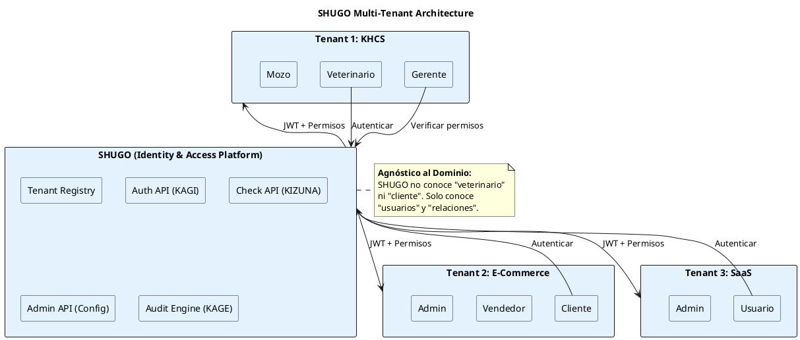
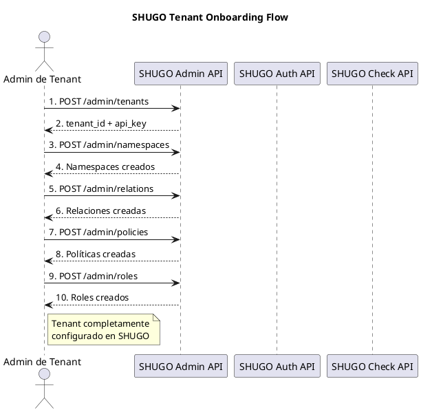
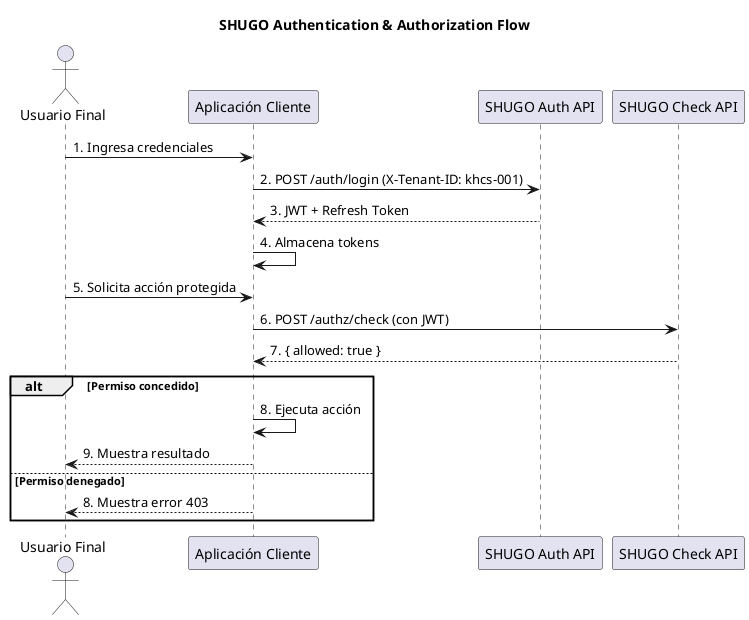

# KHCS-SHUGO Integration Contract

| Metadatos del Documento | |
| :--- | :--- |
| **Proyecto:** | SHUGO (Identity & Access Platform) + KHCS (Kakehashi Care System) |
| **Documento:** | KHCS_SHUGO_Integration_Contract.md |
| **Ubicación:** | SHUGO/00_Global/ |
| **Metodología:** | ICONIX + DDD + Clean Architecture + Zero Trust + Multi-Tenancy |
| **Autor:** | Gastón Ruiz |
| **Versión Actual:** | 2.0.0 |
| **Fecha:** | 27/08/2026 |

---

## Historial de Versiones

| Versión | Fecha | Autor | Descripción de Cambios | Impacto |
| :--- | :--- | :--- | :--- | :--- |
| **1.0.0** | 27/08/2026 | Gastón Ruiz | Versión inicial con acoplamiento de dominio (namespaces y roles hardcodeados de KHCS). | Documento con fugas de dominio que limitaban la reutilización de SHUGO. |
| **2.0.0** | 27/08/2026 | Gastón Ruiz | **Refactor completo.** SHUGO ahora es una plataforma IAM agnóstica multi-tenant. KHCS se configura como tenant vía API de auto-configuración. Agregado ejemplo de integración con proyecto no-KHCS (e-commerce). | SHUGO nace como plataforma reutilizable tipo Auth0/Okta. |

---

## 1. Introducción y Propósito

Este documento establece el **Contrato de Integración** entre **SHUGO (守護 - Identity & Access Platform)** y **KHCS (Kakehashi Care System)**, su primer tenant.

Su propósito es definir **SHUGO como una plataforma IAM genérica y reutilizable** que puede servir a múltiples proyectos (tenants) sin conocer sus dominios específicos, mientras **KHCS se configura dinámicamente** como un tenant que define sus propios namespaces, relaciones y políticas.

### 1.1. Filosofía de Separación de Dominios

**Principio Fundamental:**
> **"SHUGO no conoce el dominio. SHUGO conoce la estructura del dominio."**

**Analogía Japonesa:**
- **SHUGO (Shogunado)** = El gobierno militar que establece las **leyes universales** de protección (cómo se autentican los samuráis, cómo se verifican los permisos, cómo se auditan las acciones).
- **KHCS (Castillo Kakehashi)** = Un castillo específico que tiene sus **propias reglas internas** (quién puede entrar al dojo, quién puede acceder a las caballerizas).
- **Futuro Proyecto X (Castillo E-Commerce)** = Otro castillo con reglas completamente distintas (quién puede ver productos, quién puede procesar pagos).

El Shogunado **no decide** quién entra al dojo o quién procesa pagos. Solo provee el **mecanismo universal** para que cada castillo defina sus propias reglas.

### 1.2. Beneficios de este Enfoque

| Beneficio | Descripción |
| :--- | :--- |
| **Reutilización Total** | SHUGO puede servir a e-commerce, SaaS, banca, salud, etc. sin modificaciones |
| **Multi-Tenancy Nativo** | Aislamiento completo de datos entre tenants |
| **Evolución Independiente** | KHCS cambia sus reglas sin tocar SHUGO; SHUGO mejora su motor sin afectar a KHCS |
| **Monetización SaaS** | SHUGO puede venderse como servicio a terceros |

---

## 2. Arquitectura de Integración (Visión de Alto Nivel)

### 2.1. Diagrama de Contexto Multi-Tenant (PlantUML)



### 2.2. Principios de Integración

| Principio | Descripción | Implementación |
| :--- | :--- | :--- |
| **Zero Trust** | Nunca confiar, siempre verificar | Cada API call requiere JWT válido |
| **Least Privilege** | Mínimo privilegio necesario | Cada tenant solo accede a sus recursos |
| **Separation of Concerns** | Separación de responsabilidades | SHUGO no conoce dominios específicos |
| **Eventual Consistency** | Consistencia eventual aceptable | Read Models se actualizan asincrónicamente |
| **Tenant Isolation** | Aislamiento completo de datos | Cada tenant tiene su propio namespace lógico |

---

## 3. API de Auto-Configuración (Admin API)

Esta es la API que permite a **cualquier tenant** configurar su propio esquema de autorización en SHUGO, sin que SHUGO conozca los detalles de su dominio.

### 3.1. Provisionar Tenant

#### **POST /admin/tenants**
```json
{
  "request": {
    "tenant_id": "khcs-001",
    "name": "Kakehashi Care System",
    "admin_email": "admin@khcs.com",
    "plan": "enterprise",
    "metadata": {
      "industry": "veterinary",
      "region": "latam"
    }
  },
  "response": {
    "tenant_id": "khcs-001",
    "created_at": "2024-01-30T10:00:00Z",
    "api_key": "sk_live_...",
    "status": "active"
  }
}
```

**Uso:** Cualquier proyecto nuevo se registra como tenant y recibe credenciales para usar SHUGO.

### 3.2. Definir Namespaces

#### **POST /admin/namespaces**
```json
{
  "request": {
    "namespace": "registro_medico",
    "description": "Registros médicos de pacientes"
  },
  "headers": {
    "X-Tenant-ID": "khcs-001",
    "Authorization": "Bearer {admin_token}"
  },
  "response": {
    "namespace": "registro_medico",
    "created_at": "2024-01-30T10:00:00Z"
  }
}
```

**Uso:** KHCS define sus propios tipos de objetos (registro_medico, equino, instalacion, etc.).

### 3.3. Definir Relaciones

#### **POST /admin/relations**
```json
{
  "request": {
    "namespace": "registro_medico",
    "relations": [
      { "name": "autor", "type": "user", "description": "El usuario que creó el registro" },
      { "name": "rectificador", "type": "user", "description": "Usuarios que pueden rectificar" },
      { "name": "lector", "type": "user", "description": "Usuarios que pueden leer" }
    ]
  },
  "headers": {
    "X-Tenant-ID": "khcs-001",
    "Authorization": "Bearer {admin_token}"
  },
  "response": {
    "namespace": "registro_medico",
    "relations_created": 3,
    "created_at": "2024-01-30T10:00:00Z"
  }
}
```

**Uso:** KHCS define qué tipos de relaciones existen entre usuarios y objetos.

### 3.4. Definir Políticas

#### **POST /admin/policies**
```json
{
  "request": {
    "name": "rectificar_registro",
    "resource": "registro_medico",
    "action": "rectificar",
    "rule": "autor OR director_medico",
    "context_requirements": {
      "user_status": "active",
      "mfa_verified": true
    }
  },
  "headers": {
    "X-Tenant-ID": "khcs-001",
    "Authorization": "Bearer {admin_token}"
  },
  "response": {
    "policy_id": "uuid-v4",
    "created_at": "2024-01-30T10:00:00Z"
  }
}
```

**Uso:** KHCS define las reglas de autorización usando su propio vocabulario de dominio.

### 3.5. Definir Roles

#### **POST /admin/roles**
```json
{
  "request": {
    "name": "veterinario",
    "description": "Veterinario con acceso a registros médicos",
    "permissions": [
      { "resource": "registro_medico", "action": "crear" },
      { "resource": "registro_medico", "action": "rectificar", "condition": "autor OR director_medico" },
      { "resource": "registro_medico", "action": "leer" }
    ]
  },
  "headers": {
    "X-Tenant-ID": "khcs-001",
    "Authorization": "Bearer {admin_token}"
  },
  "response": {
    "role_id": "uuid-v4",
    "created_at": "2024-01-30T10:00:00Z"
  }
}
```

**Uso:** KHCS define roles con permisos específicos de su dominio.

---

## 4. Contratos de API Genéricos (Lo que SHUGO Provee)

### 4.1. Endpoints de Autenticación (KAGI)

#### **POST /auth/login**
```json
{
  "request": {
    "username": "usuario@dominio.com",
    "password": "hashed_password",
    "mfa_code": "123456"
  },
  "headers": {
    "X-Tenant-ID": "khcs-001"
  },
  "response": {
    "access_token": "eyJhbGciOiJSUzI1NiIs...",
    "refresh_token": "dGhpcyBpcyBhIHJlZnJlc2g...",
    "token_type": "Bearer",
    "expires_in": 3600,
    "user_id": "uuid-v4",
    "roles": ["veterinario", "khcs_user"],
    "tenant_id": "khcs-001"
  }
}
```

**Característica Genérica:** SHUGO no valida el formato del username ni la estructura de roles. Solo autentica y retorna lo que el tenant configuró.

#### **POST /auth/refresh**
```json
{
  "request": {
    "refresh_token": "dGhpcyBpcyBhIHJlZnJlc2g..."
  },
  "headers": {
    "X-Tenant-ID": "khcs-001"
  },
  "response": {
    "access_token": "eyJhbGciOiJSUzI1NiIs...",
    "refresh_token": "bnVldm8gcmVmcmVzaCB0b2tlbg...",
    "expires_in": 3600
  }
}
```

#### **POST /auth/logout**
```json
{
  "request": {
    "refresh_token": "dGhpcyBpcyBhIHJlZnJlc2g..."
  },
  "headers": {
    "X-Tenant-ID": "khcs-001"
  },
  "response": {
    "success": true
  }
}
```

---

### 4.2. Endpoints de Autorización (KIZUNA - Check API)

#### **POST /authz/check**
```json
{
  "request": {
    "subject": "user:uuid-v4",
    "action": "rectificar",
    "resource": "registro_medico:uuid-123",
    "context": {
      "ip_address": "192.168.1.50",
      "timestamp": "2024-01-30T10:00:00Z"
    }
  },
  "headers": {
    "X-Tenant-ID": "khcs-001"
  },
  "response": {
    "allowed": true,
    "reason": "user has 'autor' relation on resource",
    "policy_evaluated": "autor OR director_medico"
  }
}
```

**Característica Genérica:** SHUGO no conoce qué es "rectificar" ni "registro_medico". Solo evalúa si existe la relación definida por el tenant.

#### **POST /authz/check/batch**
```json
{
  "request": {
    "checks": [
      {
        "subject": "user:uuid-v4",
        "action": "rectificar",
        "resource": "registro_medico:uuid-123"
      },
      {
        "subject": "user:uuid-v4",
        "action": "eliminar",
        "resource": "registro_medico:uuid-123"
      }
    ]
  },
  "headers": {
    "X-Tenant-ID": "khcs-001"
  },
  "response": {
    "results": [
      { "allowed": true, "reason": "..." },
      { "allowed": false, "reason": "..." }
    ]
  }
}
```

---

### 4.3. Endpoints de Gestión de Identidad (KAGAMI)

#### **POST /identities**
```json
{
  "request": {
    "username": "usuario@dominio.com",
    "email": "usuario@dominio.com",
    "password": "hashed_password",
    "metadata": {
      "role": "veterinario",
      "shift": "noche",
      "area": "paddock_norte"
    }
  },
  "headers": {
    "X-Tenant-ID": "khcs-001"
  },
  "response": {
    "user_id": "uuid-v4",
    "created_at": "2024-01-30T10:00:00Z"
  }
}
```

**Característica Genérica:** El campo `metadata` acepta **cualquier JSON arbitrario**. SHUGO no valida la estructura.

#### **GET /identities/{user_id}**
```json
{
  "response": {
    "user_id": "uuid-v4",
    "username": "usuario@dominio.com",
    "email": "usuario@dominio.com",
    "status": "active",
    "metadata": {
      "role": "veterinario",
      "shift": "noche",
      "area": "paddock_norte"
    },
    "created_at": "2024-01-30T10:00:00Z"
  }
}
```

#### **PATCH /identities/{user_id}**
```json
{
  "request": {
    "metadata": {
      "shift": "mañana"
    }
  },
  "headers": {
    "X-Tenant-ID": "khcs-001"
  },
  "response": {
    "updated_at": "2024-01-30T11:00:00Z"
  }
}
```

---

### 4.4. Endpoints de Gestión de Relaciones (KIZUNA - Write API)

#### **POST /relations**
```json
{
  "request": {
    "subject": "user:uuid-v4",
    "relation": "autor",
    "resource": "registro_medico:uuid-123"
  },
  "headers": {
    "X-Tenant-ID": "khcs-001"
  },
  "response": {
    "relation_id": "uuid-v4",
    "created_at": "2024-01-30T10:00:00Z"
  }
}
```

**Característica Genérica:** SHUGO no valida si "autor" es una relación válida para "registro_medico". Solo almacena la tupla.

#### **DELETE /relations/{relation_id}**
```json
{
  "headers": {
    "X-Tenant-ID": "khcs-001"
  },
  "response": {
    "deleted": true
  }
}
```

#### **GET /relations**
```json
{
  "request": {
    "resource": "registro_medico:uuid-123",
    "relation": "autor"
  },
  "headers": {
    "X-Tenant-ID": "khcs-001"
  },
  "response": {
    "relations": [
      {
        "relation_id": "uuid-v4",
        "subject": "user:uuid-v4",
        "relation": "autor",
        "resource": "registro_medico:uuid-123",
        "created_at": "2024-01-30T10:00:00Z"
      }
    ]
  }
}
```

---

## 5. Ejemplo de Configuración: KHCS como Tenant

Esta sección muestra **cómo KHCS se configura en SHUGO** usando la API de auto-configuración. Estos son ejemplos, no definiciones hardcodeadas.

### 5.1. Configuración de Namespaces de KHCS

```json
// KHCS define sus propios namespaces
POST /admin/namespaces
Headers: { "X-Tenant-ID": "khcs-001" }
{
  "namespaces": [
    { "name": "registro_medico", "description": "Registros médicos de equinos" },
    { "name": "incidencia_salud", "description": "Incidencias de salud reportadas" },
    { "name": "instalacion", "description": "Instalaciones físicas" },
    { "name": "equino", "description": "Equinos bajo cuidado" },
    { "name": "orden_mantenimiento", "description": "Órdenes de mantenimiento" },
    { "name": "solicitud_adopcion", "description": "Solicitudes de adopción" }
  ]
}
```

### 5.2. Configuración de Relaciones de KHCS

```json
// KHCS define sus propias relaciones
POST /admin/relations
Headers: { "X-Tenant-ID": "khcs-001" }
{
  "namespace": "registro_medico",
  "relations": [
    { "name": "autor", "type": "user" },
    { "name": "rectificador", "type": "user" },
    { "name": "lector", "type": "user" }
  ]
}

POST /admin/relations
Headers: { "X-Tenant-ID": "khcs-001" }
{
  "namespace": "incidencia_salud",
  "relations": [
    { "name": "reportante", "type": "user" },
    { "name": "asignado", "type": "user" },
    { "name": "supervisor", "type": "user" }
  ]
}
```

### 5.3. Configuración de Políticas de KHCS

```json
// KHCS define sus propias políticas
POST /admin/policies
Headers: { "X-Tenant-ID": "khcs-001" }
{
  "policies": [
    {
      "name": "rectificar_registro",
      "resource": "registro_medico",
      "action": "rectificar",
      "rule": "autor OR director_medico"
    },
    {
      "name": "reportar_incidencia",
      "resource": "incidencia_salud",
      "action": "reportar",
      "rule": "mozo OR veterinario"
    },
    {
      "name": "asignar_equino",
      "resource": "instalacion",
      "action": "asignar_equino",
      "rule": "gerente_operaciones OR admin"
    }
  ]
}
```

### 5.4. Configuración de Roles de KHCS

```json
// KHCS define sus propios roles
POST /admin/roles
Headers: { "X-Tenant-ID": "khcs-001" }
{
  "roles": [
    {
      "name": "veterinario",
      "permissions": [
        { "resource": "registro_medico", "action": "crear" },
        { "resource": "registro_medico", "action": "rectificar", "condition": "autor OR director_medico" },
        { "resource": "registro_medico", "action": "leer" }
      ]
    },
    {
      "name": "gerente_operaciones",
      "permissions": [
        { "resource": "instalacion", "action": "asignar_equino" },
        { "resource": "instalacion", "action": "modificar" }
      ]
    },
    {
      "name": "mozo",
      "permissions": [
        { "resource": "incidencia_salud", "action": "reportar" }
      ]
    }
  ]
}
```

---

## 6. Ejemplo de Configuración: E-Commerce como Tenant

Para demostrar la **reutilización de SHUGO**, aquí mostramos cómo un proyecto de e-commerce se configuraría en SHUGO con un dominio completamente diferente.

### 6.1. Provisionar Tenant E-Commerce

```json
POST /admin/tenants
{
  "tenant_id": "ecommerce-xyz",
  "name": "Tienda Online XYZ",
  "admin_email": "admin@xyz.com",
  "plan": "professional",
  "metadata": {
    "industry": "retail",
    "region": "north-america"
  }
}
```

### 6.2. Configuración de Namespaces de E-Commerce

```json
POST /admin/namespaces
Headers: { "X-Tenant-ID": "ecommerce-xyz" }
{
  "namespaces": [
    { "name": "producto", "description": "Productos en venta" },
    { "name": "orden_compra", "description": "Órdenes de compra" },
    { "name": "carrito", "description": "Carritos de compra" },
    { "name": "resena", "description": "Reseñas de productos" }
  ]
}
```

### 6.3. Configuración de Relaciones de E-Commerce

```json
POST /admin/relations
Headers: { "X-Tenant-ID": "ecommerce-xyz" }
{
  "namespace": "producto",
  "relations": [
    { "name": "propietario", "type": "user" },
    { "name": "editor", "type": "user" },
    { "name": "lector", "type": "user" },
    { "name": "comprador", "type": "user" }
  ]
}

POST /admin/relations
Headers: { "X-Tenant-ID": "ecommerce-xyz" }
{
  "namespace": "orden_compra",
  "relations": [
    { "name": "comprador", "type": "user" },
    { "name": "vendedor", "type": "user" },
    { "name": "logistica", "type": "user" }
  ]
}
```

### 6.4. Configuración de Políticas de E-Commerce

```json
POST /admin/policies
Headers: { "X-Tenant-ID": "ecommerce-xyz" }
{
  "policies": [
    {
      "name": "editar_producto",
      "resource": "producto",
      "action": "editar",
      "rule": "propietario OR admin"
    },
    {
      "name": "comprar_producto",
      "resource": "producto",
      "action": "comprar",
      "rule": "cualquier_usuario_autenticado"
    },
    {
      "name": "cancelar_orden",
      "resource": "orden_compra",
      "action": "cancelar",
      "rule": "comprador OR (vendedor AND estado_pendiente)"
    }
  ]
}
```

### 6.5. Uso en E-Commerce

```json
// Verificar si un usuario puede editar un producto
POST /authz/check
Headers: { "X-Tenant-ID": "ecommerce-xyz" }
{
  "subject": "user:vendedor.juan",
  "action": "editar",
  "resource": "producto:uuid-789"
}

// Response
{
  "allowed": true,
  "reason": "user has 'propietario' relation on resource"
}
```

---

## 7. Modelo de Multi-Tenancy

### 7.1. Aislamiento de Datos

SHUGO garantiza el aislamiento completo de datos entre tenants mediante:

| Estrategia | Descripción | Implementación |
| :--- | :--- | :--- |
| **Logical Isolation** | Cada tenant tiene su propio namespace lógico | Todos los queries incluyen `WHERE tenant_id = ?` |
| **API Key Isolation** | Cada tenant tiene su propia API key | Validación en middleware |
| **JWT Isolation** | JWTs incluyen `tenant_id` en claims | Validación en cada request |
| **Cache Isolation** | Caché separada por tenant | Redis keys con prefijo `{tenant_id}:` |

### 7.2. Esquema de Base de Datos (Ejemplo)

```sql
-- Tabla de Tenants
CREATE TABLE tenants (
  tenant_id VARCHAR(50) PRIMARY KEY,
  name VARCHAR(255) NOT NULL,
  admin_email VARCHAR(255) NOT NULL,
  plan VARCHAR(50) NOT NULL,
  created_at TIMESTAMP DEFAULT CURRENT_TIMESTAMP
);

-- Tabla de Namespaces (por tenant)
CREATE TABLE namespaces (
  id UUID PRIMARY KEY,
  tenant_id VARCHAR(50) NOT NULL,
  name VARCHAR(100) NOT NULL,
  description TEXT,
  created_at TIMESTAMP DEFAULT CURRENT_TIMESTAMP,
  UNIQUE(tenant_id, name),
  FOREIGN KEY (tenant_id) REFERENCES tenants(tenant_id)
);

-- Tabla de Relaciones (por tenant)
CREATE TABLE relations (
  id UUID PRIMARY KEY,
  tenant_id VARCHAR(50) NOT NULL,
  namespace VARCHAR(100) NOT NULL,
  name VARCHAR(100) NOT NULL,
  type VARCHAR(50) NOT NULL,
  created_at TIMESTAMP DEFAULT CURRENT_TIMESTAMP,
  UNIQUE(tenant_id, namespace, name),
  FOREIGN KEY (tenant_id) REFERENCES tenants(tenant_id)
);

-- Tabla de Tuplas (grafo de relaciones, por tenant)
CREATE TABLE relation_tuples (
  id UUID PRIMARY KEY,
  tenant_id VARCHAR(50) NOT NULL,
  subject VARCHAR(255) NOT NULL,
  relation VARCHAR(100) NOT NULL,
  resource VARCHAR(255) NOT NULL,
  created_at TIMESTAMP DEFAULT CURRENT_TIMESTAMP,
  UNIQUE(tenant_id, subject, relation, resource),
  FOREIGN KEY (tenant_id) REFERENCES tenants(tenant_id)
);

-- Índice optimizado para Check API
CREATE INDEX idx_relation_tuples_lookup 
ON relation_tuples(tenant_id, resource, relation);
```

### 7.3. Aislamiento en Caché

```redis
# KHCS
khcs-001:relations:registro_medico:uuid-123 -> [autor:user:uuid-456]
khcs-001:policies:rectificar_registro -> "autor OR director_medico"

# E-Commerce
ecommerce-xyz:relations:producto:uuid-789 -> [propietario:user:uuid-012]
ecommerce-xyz:policies:editar_producto -> "propietario OR admin"
```

---

## 8. Flujos de Integración (Diagramas de Secuencia)

### 8.1. Flujo de Configuración Inicial de un Tenant



### 8.2. Flujo de Autenticación y Autorización



---

## 9. Consideraciones de Seguridad y Rendimiento

### 9.1. Seguridad

| Aspecto | Implementación |
| :--- | :--- |
| **Transmisión** | TLS 1.3 obligatorio |
| **Autenticación Mutua** | mTLS para comunicación backend-to-backend |
| **JWT** | RS256 (RSA con SHA-256), expiración 1 hora |
| **Refresh Tokens** | Rotación en cada uso, expiración 7 días |
| **Rate Limiting** | 100 requests/minuto por tenant en Check API |
| **Audit Logging** | Todos los checks registrados (UC-22) |
| **Tenant Isolation** | Validación de `X-Tenant-ID` en cada request |

### 9.2. Rendimiento

| Métrica | Objetivo | Estrategia |
| :--- | :--- | :--- |
| **Latencia de Check API** | < 50ms (p95) | Caché en memoria de relaciones frecuentes |
| **Throughput de Check API** | 10,000 req/seg | Load balancing horizontal |
| **Disponibilidad** | 99.99% uptime | Multi-region deployment |
| **Consistencia** | Eventual (max 500ms delay) | Read Models con eventos de dominio |

### 9.3. Escalabilidad

| Escenario | Solución |
| :--- | :--- |
| **Múltiples Tenants** | Sharding por `tenant_id` |
| **Alto Volumen de Checks** | Caché distribuida (Redis Cluster) |
| **Grafo de Relaciones Grande** | Indexación optimizada + paginación |
| **Picos de Tráfico** | Auto-scaling horizontal |

---

## 10. Plan de Integración con KHCS

### 10.1. Estado Actual de KHCS

Actualmente, KHCS tiene lógica de autorización dispersa en sus handlers:
```csharp
// ANTES (RBAC disperso en KHCS)
if (user.Rol == "Veterinario" || user.Rol == "DirectorMedico")
{
    // Permitir rectificación
}
```

### 10.2. Estado Futuro con SHUGO

```csharp
// DESPUÉS (ReBAC centralizado en SHUGO)
var checkResult = await shugoClient.CheckAsync(
    tenantId: "khcs-001",
    subject: $"user:{user.Id}",
    action: "rectificar",
    resource: $"registro_medico:{registroId}"
);

if (checkResult.Allowed)
{
    // Permitir rectificación
}
```

### 10.3. Fases de Migración

| Fase | Alcance | Duración Estimada |
| :--- | :--- | :--- |
| **Fase 1** | Provisionar KHCS como tenant en SHUGO | 1 semana |
| **Fase 2** | Configurar namespaces, relaciones, políticas de KHCS | 1 semana |
| **Fase 3** | Integrar autenticación (Login/Logout) | 2 semanas |
| **Fase 4** | Integrar Check API para UCs críticos (UC-03B, UC-04, UC-06) | 3 semanas |
| **Fase 5** | Migración completa de todos los UCs | 4 semanas |
| **Fase 6** | Eliminación de lógica RBAC legacy en KHCS | 1 semana |

---

## 11. Trazabilidad con Documentos de KHCS y SHUGO

### 11.1. Documentos de KHCS que dependen de este contrato

| Documento KHCS | Dependencia de SHUGO |
| :--- | :--- |
| `UC-03B/06_Robustness_Diagram.md` | Usa `SHUGO.Check API` para validar permisos de rectificación |
| `UC-04/06_Robustness_Diagram.md` | Usa `SHUGO.Check API` para validar permisos de reporte |
| `UC-06/06_Robustness_Diagram.md` | Usa `SHUGO.Check API` para validar permisos de asignación |

### 11.2. Documentos de SHUGO que implementan este contrato

| Documento SHUGO | Responsabilidad |
| :--- | :--- |
| `UC-12/01_Requirements_Specification.md` | Implementa endpoint `/admin/tenants` |
| `UC-17/01_Requirements_Specification.md` | Implementa endpoints `/admin/namespaces`, `/admin/relations`, `/admin/policies` |
| `UC-06/01_Requirements_Specification.md` | Implementa endpoint `/auth/login` |
| `UC-20/01_Requirements_Specification.md` | Implementa endpoint `/authz/check` |
| `UC-01/01_Requirements_Specification.md` | Implementa endpoint `/identities` |

---

## 12. Glosario de Términos

| Término | Definición |
| :--- | :--- |
| **Tenant** | Cliente aislado de SHUGO (ej. KHCS, E-Commerce XYZ) |
| **Namespace** | Espacio de nombres definido por el tenant para sus tipos de objetos |
| **Relation** | Vínculo entre un sujeto y un objeto (definido por el tenant) |
| **Tuple** | Tripla `(sujeto, relación, objeto)` almacenada en el grafo de KIZUNA |
| **Policy** | Regla de autorización definida por el tenant (ej. "autor OR director_medico") |
| **Check API** | Endpoint de SHUGO que evalúa si un sujeto puede realizar una acción sobre un objeto |
| **JWT** | JSON Web Token, token de acceso emitido por SHUGO tras autenticación exitosa |
| **Refresh Token** | Token de larga duración usado para obtener nuevos JWTs sin pedir credenciales |
| **Zero Trust** | Modelo de seguridad que asume que ninguna entidad es confiable por defecto |
| **Multi-Tenancy** | Arquitectura que permite servir a múltiples clientes aislados en una sola instancia |

---

## 13. Próximos Pasos

Con este contrato definido, los próximos pasos son:

1. **SHUGO UC-12:** Documentar el flujo de provisionamiento de tenants (`/admin/tenants`) con nivel Elite.
2. **SHUGO UC-17:** Documentar el flujo de auto-configuración (`/admin/namespaces`, `/admin/relations`, `/admin/policies`) con nivel Elite.
3. **SHUGO UC-06:** Documentar el flujo de autenticación (`/auth/login`) con nivel Elite.
4. **SHUGO UC-20:** Documentar el flujo de autorización (`/authz/check`) con nivel Elite.
5. **KHCS UC-03B:** Rediseñar el diagrama de robustez para integrar la llamada a SHUGO.
6. **KHCS UC-04:** Rediseñar el diagrama de robustez para integrar la llamada a SHUGO.
7. **KHCS UC-06:** Rediseñar el diagrama de robustez para integrar la llamada a SHUGO.

---

*Fin del Documento KHCS_SHUGO_Integration_Contract v2.0.0*