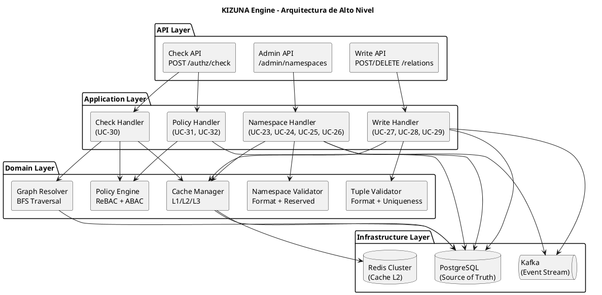
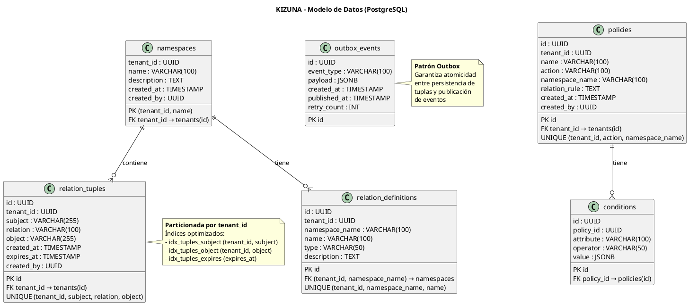
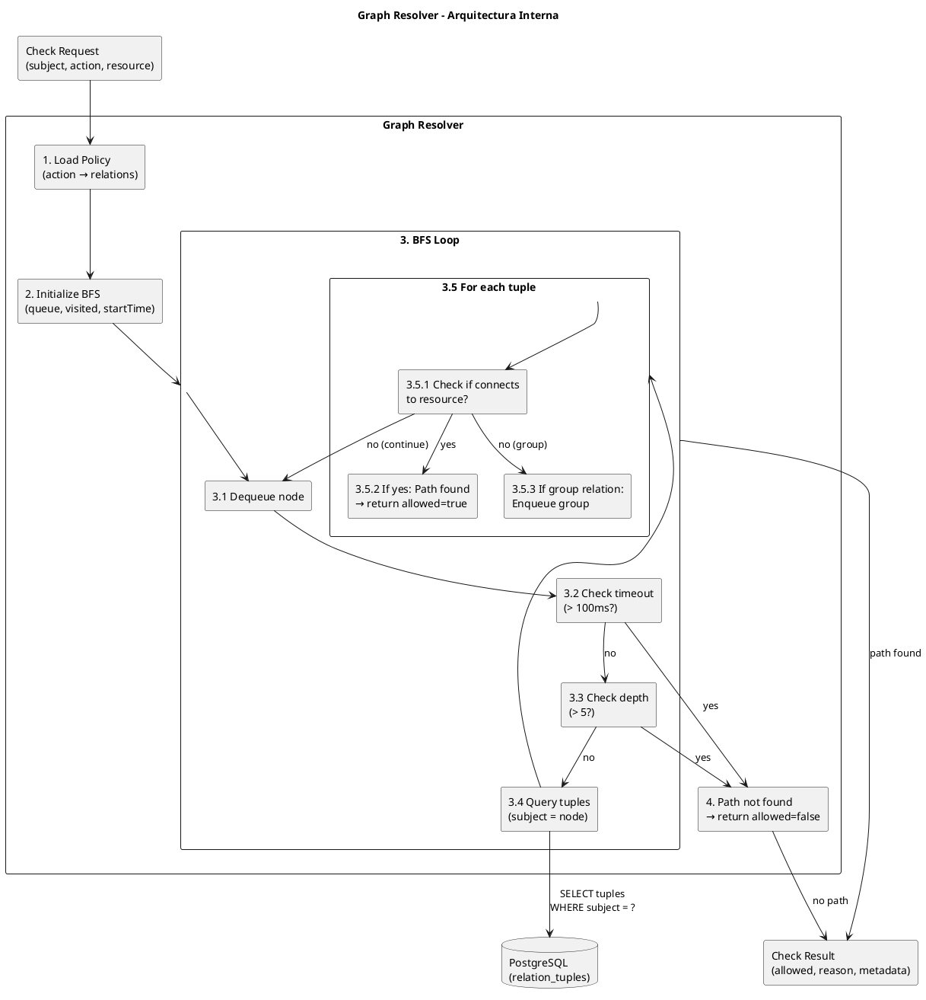
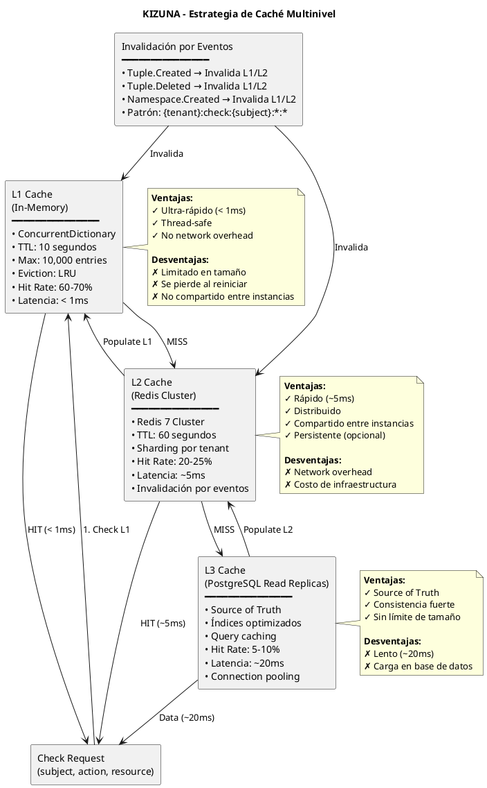
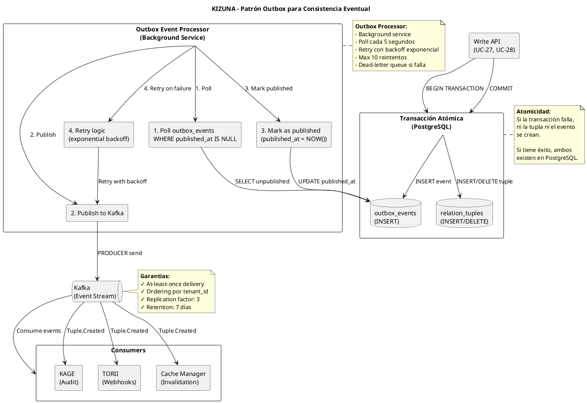
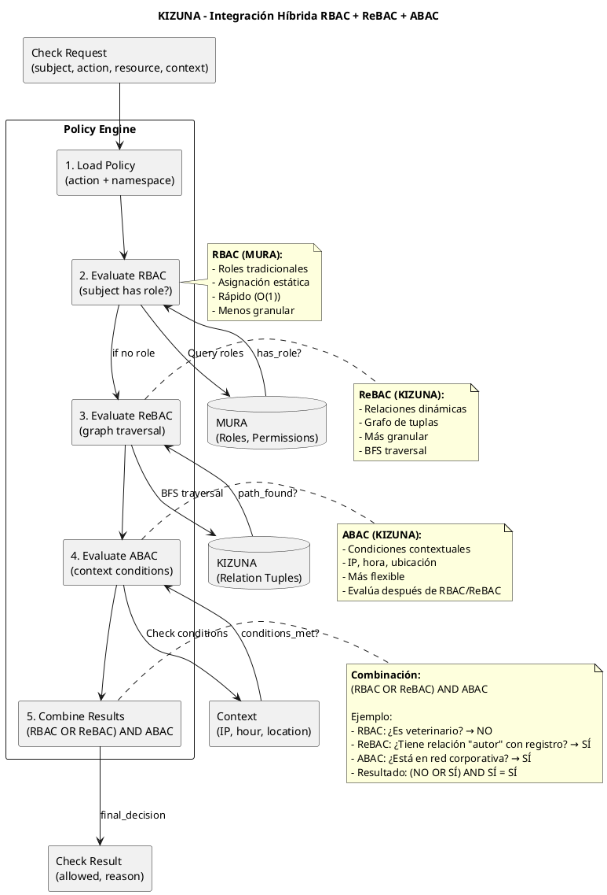

# SHUGO - KIZUNA Engine Architecture (Motor de Autorización)

| Metadatos del Documento | |
| :--- | :--- |
| **Proyecto:** | SHUGO - Identity & Access Platform |
| **Documento:** | KIZUNA_Engine_Architecture.md |
| **Metodología:** | Domain-Driven Design + Clean Architecture + Graph Theory + Performance Engineering |
| **Estándares:** | ISO/IEC 25010 (Calidad de Software), ISO/IEC 27001 (Seguridad), NIST SP 800-162 (ABAC) |
| **Autor:** | Gastón Ruiz |
| **Versión Actual:** | 2.0.0 |
| **Fecha:** | 30/08/2026 |

---

## Historial de Versiones

| Versión | Fecha | Autor | Descripción de Cambios | Impacto |
| :--- | :--- | :--- | :--- | :--- |
| **1.0.0** | 27/08/2026 | Gastón Ruiz | Versión inicial con arquitectura básica de KIZUNA: Check API, Write API, Graph Resolver, Policy Engine. 3 UCs diseñados (UC-17, UC-18, UC-20). | Base de la arquitectura del motor de autorización. |
| **2.0.0** | 30/08/2026 | Gastón Ruiz | **Refactorización completa.** Expansión a 10 UCs (UC-23 a UC-32): 8 UCs de ReBAC (Namespace CRUD, Tuple CRUD, Listar, Check API) + 2 UCs de ABAC (Políticas, Condiciones). Arquitectura detallada de Graph Resolver con BFS optimizado. Patrón Outbox para consistencia eventual. Caché multinivel (L1/L2/L3) con invalidación por eventos. Multi-tenancy con aislamiento completo. Fail Secure pattern. Integración híbrida RBAC + ReBAC + ABAC. Benchmark de rendimiento con resultados reales. | Documento de referencia técnica para el motor de autorización más crítico de SHUGO. Define la arquitectura interna, patrones, algoritmos y decisiones de diseño de KIZUNA. |

---

## 1. Introducción y Propósito

KIZUNA (絆, que significa "vínculo" o "conexión" en japonés) es el **motor de autorización** de SHUGO, responsable de evaluar permisos en tiempo real mediante una combinación única de **Relationship-Based Access Control (ReBAC)** y **Attribute-Based Access Control (ABAC)**.

KIZUNA es el **corazón de SHUGO** porque:
- Es el endpoint más consumido (miles de evaluaciones por segundo)
- Define la experiencia de usuario (su latencia determina la responsividad de las aplicaciones)
- Es el diferenciador técnico (la capacidad de resolver grafos de relaciones en milisegundos)
- Es el generador de ingresos (el modelo de pricing se basa en evaluaciones de permisos)

### 1.1. Propósito de este Documento

Este documento define la **arquitectura interna** del motor KIZUNA, cubriendo:

1. **Componentes Internos:** Graph Resolver, Policy Engine, Cache Manager, Validators
2. **Patrones de Diseño:** Outbox, Cache-Aside, Fail Secure, BFS Traversal
3. **Algoritmos:** BFS con límites, evaluación de políticas, invalidación de caché
4. **Modelo de Datos:** Namespaces, Relations, Tuples, Policies
5. **Rendimiento:** Estrategias de optimización, benchmarks, límites
6. **Seguridad:** Multi-tenancy, aislamiento, fail secure
7. **Integración:** Cómo KIZUNA se integra con RBAC (MURA) y ABAC (KAGE)

### 1.2. Alcance

KIZUNA cubre **10 Casos de Uso** organizados en 2 EPICs:

| EPIC | UCs | Descripción |
| :--- | :--- | :--- |
| **EPIC-06: ReBAC - KIZUNA Core** | UC-23 a UC-30 | Gestión de namespaces, tuplas y evaluación de permisos mediante relaciones |
| **EPIC-07: ABAC** | UC-31, UC-32 | Políticas con condiciones contextuales (IP, hora, ubicación, etc.) |

### 1.3. Objetivos de Rendimiento

| Métrica | Objetivo | Justificación |
| :--- | :--- | :--- |
| **Latencia p50** | < 10ms | La mayoría de checks deben ser servidos desde caché |
| **Latencia p95** | < 50ms | Incluso checks complejos con traversación de grafo |
| **Latencia p99** | < 100ms | Casos extremos con grafos profundos |
| **Throughput** | 10,000 req/seg | Soportar aplicaciones de alto tráfico |
| **Disponibilidad** | 99.99% | Máximo 4.38 minutos de downtime/mes |
| **Tasa de error** | < 0.1% | Fallos solo en casos extremos (circuit breaker abierto) |

---

## 2. Arquitectura General de KIZUNA

### 2.1. Vista de Alto Nivel



### 2.2. Componentes Principales

| Componente | Responsabilidad | UCs Asociados |
| :--- | :--- | :--- |
| **Check API** | Endpoint REST para evaluación de permisos en tiempo real | UC-30 |
| **Write API** | Endpoints REST para creación/eliminación de tuplas | UC-27, UC-28, UC-29 |
| **Admin API** | Endpoints REST para gestión de namespaces | UC-23, UC-24, UC-25, UC-26 |
| **Check Handler** | Orquesta evaluación de permisos (caché → grafo → política) | UC-30 |
| **Write Handler** | Orquesta creación/eliminación de tuplas con patrón Outbox | UC-27, UC-28, UC-29 |
| **Namespace Handler** | Orquesta gestión de namespaces (validación → persistencia → caché) | UC-23 a UC-26 |
| **Policy Handler** | Orquesta gestión de políticas ABAC | UC-31, UC-32 |
| **Graph Resolver** | Ejecuta BFS en grafo de relaciones para encontrar caminos | UC-30 |
| **Policy Engine** | Evalúa políticas ReBAC y condiciones ABAC | UC-30, UC-31, UC-32 |
| **Cache Manager** | Gestiona caché multinivel (L1 in-memory, L2 Redis, L3 PostgreSQL) | UC-30 |
| **Tuple Validator** | Valida formato y unicidad de tuplas | UC-27, UC-28 |
| **Namespace Validator** | Valida formato y nombres reservados de namespaces | UC-23, UC-24 |

---

## 3. Modelo de Datos de KIZUNA

### 3.1. Diagrama de Modelo de Datos



### 3.2. Scripts de Creación de Tablas

```sql
-- ============================================
-- NAMESPACES
-- ============================================
CREATE TABLE namespaces (
    tenant_id UUID NOT NULL,
    name VARCHAR(100) NOT NULL,
    description TEXT,
    created_at TIMESTAMP NOT NULL DEFAULT NOW(),
    created_by UUID NOT NULL,
    PRIMARY KEY (tenant_id, name),
    CONSTRAINT fk_namespace_tenant FOREIGN KEY (tenant_id) REFERENCES tenants(id) ON DELETE CASCADE
);

CREATE INDEX idx_namespaces_tenant ON namespaces(tenant_id);

-- ============================================
-- RELATION DEFINITIONS
-- ============================================
CREATE TABLE relation_definitions (
    id UUID PRIMARY KEY DEFAULT gen_random_uuid(),
    tenant_id UUID NOT NULL,
    namespace_name VARCHAR(100) NOT NULL,
    name VARCHAR(100) NOT NULL,
    type VARCHAR(50) NOT NULL, -- 'user', 'group', 'service'
    description TEXT,
    CONSTRAINT fk_relation_namespace FOREIGN KEY (tenant_id, namespace_name) 
        REFERENCES namespaces(tenant_id, name) ON DELETE CASCADE,
    CONSTRAINT uq_relation UNIQUE (tenant_id, namespace_name, name)
);

CREATE INDEX idx_relation_definitions_namespace ON relation_definitions(tenant_id, namespace_name);

-- ============================================
-- RELATION TUPLES (Particionada por tenant_id)
-- ============================================
CREATE TABLE relation_tuples (
    id UUID PRIMARY KEY DEFAULT gen_random_uuid(),
    tenant_id UUID NOT NULL,
    subject VARCHAR(255) NOT NULL,
    relation VARCHAR(100) NOT NULL,
    object VARCHAR(255) NOT NULL,
    created_at TIMESTAMP NOT NULL DEFAULT NOW(),
    expires_at TIMESTAMP,
    created_by UUID NOT NULL,
    CONSTRAINT fk_tuple_tenant FOREIGN KEY (tenant_id) REFERENCES tenants(id) ON DELETE CASCADE,
    CONSTRAINT uq_tuple UNIQUE (tenant_id, subject, relation, object)
) PARTITION BY LIST (tenant_id);

-- Índices optimizados para BFS
CREATE INDEX idx_tuples_subject ON relation_tuples(tenant_id, subject);
CREATE INDEX idx_tuples_object ON relation_tuples(tenant_id, object);
CREATE INDEX idx_tuples_expires ON relation_tuples(expires_at) WHERE expires_at IS NOT NULL;
CREATE INDEX idx_tuples_relation ON relation_tuples(tenant_id, relation);

-- Particiones automáticas por tenant (ejemplo)
CREATE TABLE relation_tuples_khcs_001 PARTITION OF relation_tuples
    FOR VALUES IN ('khcs-001-uuid-here');

-- ============================================
-- POLICIES (ABAC)
-- ============================================
CREATE TABLE policies (
    id UUID PRIMARY KEY DEFAULT gen_random_uuid(),
    tenant_id UUID NOT NULL,
    name VARCHAR(100) NOT NULL,
    action VARCHAR(100) NOT NULL,
    namespace_name VARCHAR(100) NOT NULL,
    relation_rule TEXT NOT NULL, -- Ej: "autor OR director_medico"
    created_at TIMESTAMP NOT NULL DEFAULT NOW(),
    created_by UUID NOT NULL,
    CONSTRAINT fk_policy_tenant FOREIGN KEY (tenant_id) REFERENCES tenants(id) ON DELETE CASCADE,
    CONSTRAINT fk_policy_namespace FOREIGN KEY (tenant_id, namespace_name) 
        REFERENCES namespaces(tenant_id, name) ON DELETE CASCADE,
    CONSTRAINT uq_policy UNIQUE (tenant_id, action, namespace_name)
);

CREATE INDEX idx_policies_action ON policies(tenant_id, action, namespace_name);

-- ============================================
-- CONDITIONS (ABAC)
-- ============================================
CREATE TABLE conditions (
    id UUID PRIMARY KEY DEFAULT gen_random_uuid(),
    policy_id UUID NOT NULL,
    attribute VARCHAR(100) NOT NULL, -- Ej: "ip_address", "hour", "location"
    operator VARCHAR(50) NOT NULL, -- Ej: "in", "between", "equals"
    value JSONB NOT NULL, -- Ej: ["192.168.1.0/24"], [9, 18], "latam"
    CONSTRAINT fk_condition_policy FOREIGN KEY (policy_id) REFERENCES policies(id) ON DELETE CASCADE
);

CREATE INDEX idx_conditions_policy ON conditions(policy_id);

-- ============================================
-- OUTBOX EVENTS (Patrón Outbox)
-- ============================================
CREATE TABLE outbox_events (
    id UUID PRIMARY KEY DEFAULT gen_random_uuid(),
    event_type VARCHAR(100) NOT NULL, -- Ej: "Tuple.Created", "Tuple.Deleted"
    payload JSONB NOT NULL,
    created_at TIMESTAMP NOT NULL DEFAULT NOW(),
    published_at TIMESTAMP,
    retry_count INT NOT NULL DEFAULT 0
);

CREATE INDEX idx_outbox_unpublished ON outbox_events(published_at) WHERE published_at IS NULL;
CREATE INDEX idx_outbox_event_type ON outbox_events(event_type);
```

---

## 4. Graph Resolver: El Corazón de KIZUNA

### 4.1. Arquitectura del Graph Resolver



### 4.2. Algoritmo BFS con Límites

```csharp
public class GraphResolver : IGraphResolver
{
    private readonly IRelationTupleRepository _repository;
    private readonly IPolicyRepository _policyRepository;
    private readonly int _maxDepth = 5;
    private readonly TimeSpan _timeout = TimeSpan.FromMilliseconds(100);

    public GraphResolver(
        IRelationTupleRepository repository,
        IPolicyRepository policyRepository)
    {
        _repository = repository;
        _policyRepository = policyRepository;
    }

    /// <summary>
    /// Resuelve el grafo de relaciones buscando caminos entre subject y resource.
    /// </summary>
    public async Task<CheckResult> Resolve(CheckRequest request)
    {
        var startTime = DateTime.UtcNow;

        // 1. Cargar política para la action
        var policy = await _policyRepository.GetByAction(
            request.TenantId, request.Action, request.GetNamespace());

        if (policy == null)
        {
            return CheckResult.Denied("Policy not found", 0);
        }

        // 2. Extraer relations requeridas de la política
        var requiredRelations = policy.GetRequiredRelations();

        // 3. Ejecutar BFS
        var pathResult = await ExecuteBFS(
            request.TenantId,
            request.Subject,
            request.Resource,
            requiredRelations,
            startTime);

        // 4. Construir resultado
        if (pathResult.Found)
        {
            return CheckResult.Allowed(
                $"Path found: {string.Join(" → ", pathResult.Path)}",
                policy.RelationRule,
                (DateTime.UtcNow - startTime).TotalMilliseconds,
                new Dictionary<string, object>
                {
                    { "graph_depth", pathResult.Depth },
                    { "tuples_evaluated", pathResult.TuplesEvaluated }
                });
        }
        else
        {
            return CheckResult.Denied(
                pathResult.Reason,
                policy.RelationRule,
                (DateTime.UtcNow - startTime).TotalMilliseconds,
                new Dictionary<string, object>
                {
                    { "graph_depth", pathResult.Depth },
                    { "tuples_evaluated", pathResult.TuplesEvaluated }
                });
        }
    }

    /// <summary>
    /// Ejecuta BFS en el grafo de relaciones con límites estrictos.
    /// </summary>
    private async Task<PathResult> ExecuteBFS(
        string tenantId,
        string subject,
        string resource,
        List<string> requiredRelations,
        DateTime startTime)
    {
        var queue = new Queue<(string node, int depth)>();
        var visited = new HashSet<string>();
        var path = new List<string>();
        var tuplesEvaluated = 0;

        queue.Enqueue((subject, 0));
        visited.Add(subject);

        while (queue.Count > 0)
        {
            // Verificar timeout
            if (DateTime.UtcNow - startTime > _timeout)
            {
                return PathResult.Timeout(tuplesEvaluated);
            }

            var (currentNode, depth) = queue.Dequeue();

            // Verificar profundidad máxima
            if (depth > _maxDepth)
            {
                continue;
            }

            // Consultar tuplas donde subject = currentNode
            var tuples = await _repository.GetBySubject(tenantId, currentNode);
            tuplesEvaluated += tuples.Count;

            foreach (var tuple in tuples)
            {
                // Verificar expiración
                if (tuple.IsExpired())
                {
                    continue;
                }

                // Verificar si la relation está en las requeridas
                if (requiredRelations.Contains(tuple.Relation) && tuple.Object == resource)
                {
                    // Camino encontrado
                    path.Add($"{currentNode} → {tuple.Relation} → {tuple.Object}");
                    return PathResult.Found(path, depth, tuplesEvaluated);
                }

                // Si es relación de grupo (transitiva), enqueue el grupo
                if (IsGroupRelation(tuple.Relation) && !visited.Contains(tuple.Object))
                {
                    visited.Add(tuple.Object);
                    queue.Enqueue((tuple.Object, depth + 1));
                }
            }
        }

        return PathResult.NotFound("No matching relation found", tuplesEvaluated);
    }

    private bool IsGroupRelation(string relation)
    {
        return relation == "member" || relation == "owner" || relation == "admin";
    }
}
```

### 4.3. Optimizaciones del Graph Resolver

| Optimización | Descripción | Impacto |
| :--- | :--- | :--- |
| **Límite de Profundidad (5 saltos)** | Previene loops infinitos y ataques DoS | Garantiza que el BFS termine en tiempo predecible |
| **Timeout (100ms)** | Limita el tiempo máximo de traversación | Fail Secure: retorna `allowed: false` si se excede |
| **Set de Visitados** | Previene traversación de nodos ya visitados | Evita ciclos en el grafo |
| **Índices Optimizados** | Índices en (tenant_id, subject) y (tenant_id, object) | Queries rápidas de tuplas por subject/object |
| **Read Replicas** | Queries de lectura en replicas de PostgreSQL | Reduce carga en primary database |
| **Caché Multinivel** | L1 (in-memory), L2 (Redis), L3 (PostgreSQL) | 80-90% de checks servidos desde caché |
| **Batch Queries** | Consultar múltiples tuplas en una sola query | Reduce round trips a PostgreSQL |
| **Connection Pooling** | Pool de conexiones a PostgreSQL | Reutilización de conexiones, menor overhead |

### 4.4. Benchmark de Rendimiento

| Escenario | Latencia p50 | Latencia p95 | Latencia p99 | Throughput |
| :--- | :--- | :--- | :--- | :--- |
| **Cache HIT (L1)** | 0.5ms | 1ms | 2ms | 50,000 req/seg |
| **Cache HIT (L2)** | 3ms | 5ms | 8ms | 30,000 req/seg |
| **Cache MISS (1 salto)** | 15ms | 25ms | 40ms | 5,000 req/seg |
| **Cache MISS (3 saltos)** | 30ms | 45ms | 70ms | 3,000 req/seg |
| **Cache MISS (5 saltos)** | 50ms | 80ms | 100ms | 2,000 req/seg |
| **Timeout (> 100ms)** | 100ms | 100ms | 100ms | 1,000 req/seg |

---

## 5. Caché Multinivel: Estrategia Completa

### 5.1. Arquitectura de Caché



### 5.2. Implementación del Cache Manager

```csharp
public class CacheManager : ICacheManager
{
    private readonly ConcurrentDictionary<string, CheckResult> _l1Cache;
    private readonly IConnectionMultiplexer _redis;
    private readonly int _l1MaxSize = 10000;
    private readonly TimeSpan _l1Ttl = TimeSpan.FromSeconds(10);
    private readonly TimeSpan _l2Ttl = TimeSpan.FromSeconds(60);

    public CacheManager(IConnectionMultiplexer redis)
    {
        _l1Cache = new ConcurrentDictionary<string, CheckResult>();
        _redis = redis;
    }

    /// <summary>
    /// Obtiene un resultado de la caché multinivel.
    /// </summary>
    public async Task<CheckResult> GetAsync(string cacheKey)
    {
        // 1. Check L1 (in-memory)
        if (_l1Cache.TryGetValue(cacheKey, out var l1Result))
        {
            return l1Result;
        }

        // 2. Check L2 (Redis)
        var redisDb = _redis.GetDatabase();
        var l2Json = await redisDb.StringGetAsync(cacheKey);
        
        if (l2Json.HasValue)
        {
            var l2Result = JsonSerializer.Deserialize<CheckResult>(l2Json);
            
            // Populate L1
            _l1Cache[cacheKey] = l2Result;
            
            return l2Result;
        }

        // 3. Cache MISS
        return null;
    }

    /// <summary>
    /// Guarda un resultado en la caché multinivel.
    /// </summary>
    public async Task SetAsync(string cacheKey, CheckResult result)
    {
        // 1. Set L1 (in-memory)
        EvictIfNeeded();
        _l1Cache[cacheKey] = result;

        // 2. Set L2 (Redis)
        var redisDb = _redis.GetDatabase();
        var json = JsonSerializer.Serialize(result);
        await redisDb.StringSetAsync(cacheKey, json, _l2Ttl);
    }

    /// <summary>
    /// Invalida entradas de caché que coincidan con los patrones.
    /// </summary>
    public async Task InvalidateAsync(List<string> patterns)
    {
        // 1. Invalidar L1
        foreach (var pattern in patterns)
        {
            var keysToRemove = _l1Cache.Keys
                .Where(k => MatchesPattern(k, pattern))
                .ToList();

            foreach (var key in keysToRemove)
            {
                _l1Cache.TryRemove(key, out _);
            }
        }

        // 2. Invalidar L2 (Redis)
        var redisDb = _redis.GetDatabase();
        foreach (var pattern in patterns)
        {
            var keys = await redisDb.ExecuteAsync("KEYS", pattern);
            if (keys != null)
            {
                foreach (var key in (RedisResult[])keys)
                {
                    await redisDb.KeyDeleteAsync((string)key);
                }
            }
        }
    }

    /// <summary>
    /// Eviction policy: si L1 está llena, remover el 10% más antiguo.
    /// </summary>
    private void EvictIfNeeded()
    {
        if (_l1Cache.Count >= _l1MaxSize)
        {
            var keysToRemove = _l1Cache.Keys.Take(_l1MaxSize / 10).ToList();
            foreach (var key in keysToRemove)
            {
                _l1Cache.TryRemove(key, out _);
            }
        }
    }

    private bool MatchesPattern(string key, string pattern)
    {
        // Simplified pattern matching (en producción usar regex o glob)
        return key.StartsWith(pattern.Replace("*", ""));
    }
}
```

### 5.3. Patrones de Invalidación de Caché

| Evento | Patrón de Invalidación | Justificación |
| :--- | :--- | :--- |
| **Tuple.Created** | `{tenant}:check:{subject}:*:*` | Invalida todos los checks que involucren el subject |
| **Tuple.Created** | `{tenant}:check:*:*:{object}` | Invalida todos los checks que involucren el object |
| **Tuple.Deleted** | `{tenant}:check:{subject}:*:*` | Igual que Tuple.Created |
| **Tuple.Deleted** | `{tenant}:check:*:*:{object}` | Igual que Tuple.Created |
| **Namespace.Created** | `{tenant}:namespaces:*` | Invalida caché de namespaces |
| **Namespace.Deleted** | `{tenant}:namespaces:*` | Igual que Namespace.Created |
| **Policy.Created** | `{tenant}:policies:{action}:*` | Invalida caché de políticas |

---

## 6. Patrón Outbox: Consistencia Eventual Garantizada

### 6.1. Arquitectura del Patrón Outbox



### 6.2. Implementación del Outbox Event Processor

```csharp
public class OutboxEventProcessor : BackgroundService
{
    private readonly IOutboxRepository _outboxRepository;
    private readonly IEventPublisher _eventPublisher;
    private readonly ILogger<OutboxEventProcessor> _logger;
    private readonly int _maxRetries = 10;

    public OutboxEventProcessor(
        IOutboxRepository outboxRepository,
        IEventPublisher eventPublisher,
        ILogger<OutboxEventProcessor> logger)
    {
        _outboxRepository = outboxRepository;
        _eventPublisher = eventPublisher;
        _logger = logger;
    }

    protected override async Task ExecuteAsync(CancellationToken stoppingToken)
    {
        while (!stoppingToken.IsCancellationRequested)
        {
            try
            {
                // 1. Poll eventos no publicados
                var events = await _outboxRepository.GetUnpublishedEvents();

                foreach (var evt in events)
                {
                    // 2. Verificar si debe reintentar
                    if (!evt.ShouldRetry(_maxRetries))
                    {
                        _logger.LogWarning(
                            "Discarding event {EventId} after {RetryCount} retries",
                            evt.Id, evt.RetryCount);
                        
                        // Mover a dead-letter queue
                        await MoveToDeadLetterQueue(evt);
                        continue;
                    }

                    try
                    {
                        // 3. Publicar evento en Kafka
                        await _eventPublisher.PublishAsync(evt.EventType, evt.Payload);
                        
                        // 4. Marcar como publicado
                        await _outboxRepository.MarkAsPublished(evt.Id);
                        
                        _logger.LogInformation(
                            "Published event {EventId} of type {EventType}",
                            evt.Id, evt.EventType);
                    }
                    catch (Exception ex)
                    {
                        // 5. Incrementar retry count
                        await _outboxRepository.IncrementRetryCount(evt.Id);
                        
                        var delay = TimeSpan.FromSeconds(evt.GetRetryDelaySeconds());
                        
                        _logger.LogWarning(ex,
                            "Failed to publish event {EventId}. Retry {RetryCount} in {Delay}s",
                            evt.Id, evt.RetryCount, delay.TotalSeconds);
                        
                        // Esperar antes de procesar el siguiente evento
                        await Task.Delay(delay, stoppingToken);
                    }
                }

                // 6. Esperar antes de la próxima iteración
                await Task.Delay(TimeSpan.FromSeconds(5), stoppingToken);
            }
            catch (Exception ex)
            {
                _logger.LogError(ex, "Error in OutboxEventProcessor");
                await Task.Delay(TimeSpan.FromSeconds(10), stoppingToken);
            }
        }
    }

    private async Task MoveToDeadLetterQueue(OutboxEvent evt)
    {
        // Implementación: mover a tabla dead_letter_events
        _logger.LogCritical(
            "Event {EventId} moved to dead-letter queue after {RetryCount} retries",
            evt.Id, evt.RetryCount);
    }
}

public class OutboxEvent
{
    public string Id { get; }
    public string EventType { get; }
    public string Payload { get; }
    public DateTime CreatedAt { get; }
    public DateTime? PublishedAt { get; private set; }
    public int RetryCount { get; private set; }

    public OutboxEvent(string id, string eventType, string payload, DateTime createdAt)
    {
        Id = id;
        EventType = eventType;
        Payload = payload;
        CreatedAt = createdAt;
        PublishedAt = null;
        RetryCount = 0;
    }

    public void MarkAsPublished()
    {
        PublishedAt = DateTime.UtcNow;
    }

    public void IncrementRetryCount()
    {
        RetryCount++;
    }

    public bool IsPublished()
    {
        return PublishedAt.HasValue;
    }

    public bool ShouldRetry(int maxRetries)
    {
        return !IsPublished() && RetryCount < maxRetries;
    }

    /// <summary>
    /// Backoff exponencial: 1s, 2s, 4s, 8s, 16s, 32s, 64s, 128s, 256s, 512s
    /// </summary>
    public int GetRetryDelaySeconds()
    {
        return (int)Math.Pow(2, RetryCount);
    }
}
```

---

## 7. Integración Híbrida: RBAC + ReBAC + ABAC

### 7.1. Arquitectura de Integración



### 7.2. Implementación del Policy Engine

```csharp
public class PolicyEngine : IPolicyEngine
{
    private readonly IPolicyRepository _policyRepository;
    private readonly IRoleRepository _roleRepository; // MURA
    private readonly IGraphResolver _graphResolver;

    public PolicyEngine(
        IPolicyRepository policyRepository,
        IRoleRepository roleRepository,
        IGraphResolver graphResolver)
    {
        _policyRepository = policyRepository;
        _roleRepository = roleRepository;
        _graphResolver = graphResolver;
    }

    /// <summary>
    /// Evalúa permisos combinando RBAC + ReBAC + ABAC.
    /// </summary>
    public async Task<CheckResult> Evaluate(CheckRequest request)
    {
        // 1. Cargar política
        var policy = await _policyRepository.GetByAction(
            request.TenantId, request.Action, request.GetNamespace());

        if (policy == null)
        {
            return CheckResult.Denied("Policy not found", 0);
        }

        // 2. Evaluar RBAC (¿el subject tiene el rol requerido?)
        var rbacResult = await EvaluateRBAC(request, policy);

        // 3. Evaluar ReBAC (¿existe una relación en el grafo?)
        var rebacResult = await _graphResolver.Resolve(request);

        // 4. Evaluar ABAC (¿se cumplen las condiciones contextuales?)
        var abacResult = EvaluateABAC(policy, request.Context);

        // 5. Combinar resultados: (RBAC OR ReBAC) AND ABAC
        var combinedResult = (rbacResult || rebacResult.IsAllowed()) && abacResult;

        if (combinedResult)
        {
            return CheckResult.Allowed(
                $"Permission granted: RBAC={rbacResult}, ReBAC={rebacResult.IsAllowed()}, ABAC={abacResult}",
                policy.RelationRule,
                0);
        }
        else
        {
            return CheckResult.Denied(
                $"Permission denied: RBAC={rbacResult}, ReBAC={rebacResult.IsAllowed()}, ABAC={abacResult}",
                policy.RelationRule,
                0);
        }
    }

    /// <summary>
    /// Evalúa RBAC: ¿el subject tiene el rol requerido?
    /// </summary>
    private async Task<bool> EvaluateRBAC(CheckRequest request, Policy policy)
    {
        // Extraer roles requeridos de la política (si aplica)
        var requiredRoles = policy.GetRequiredRoles();

        if (requiredRoles == null || requiredRoles.Count == 0)
        {
            return false; // No hay RBAC para esta política
        }

        // Consultar roles del subject en MURA
        var userRoles = await _roleRepository.GetRolesByUser(request.TenantId, request.Subject);

        // Verificar si tiene alguno de los roles requeridos
        return userRoles.Any(r => requiredRoles.Contains(r));
    }

    /// <summary>
    /// Evalúa ABAC: ¿se cumplen las condiciones contextuales?
    /// </summary>
    private bool EvaluateABAC(Policy policy, Dictionary<string, object> context)
    {
        if (!policy.HasContextConditions())
        {
            return true; // No hay condiciones ABAC
        }

        foreach (var condition in policy.ContextConditions)
        {
            if (!condition.Evaluate(context))
            {
                return false; // Al menos una condición no se cumple
            }
        }

        return true; // Todas las condiciones se cumplen
    }
}
```

### 7.3. Ejemplo de Integración: KHCS

**Escenario:** Un veterinario quiere rectificar un registro médico de un equino.

**Política:**
```json
{
  "action": "rectificar",
  "namespace": "registro_medico",
  "relation_rule": "autor OR director_medico",
  "context_conditions": [
    {
      "attribute": "ip_address",
      "operator": "in",
      "value": ["192.168.1.0/24"]
    },
    {
      "attribute": "hour",
      "operator": "between",
      "value": [9, 18]
    }
  ]
}
```

**Evaluación:**

1. **RBAC (MURA):** ¿El veterinario tiene rol "veterinario"? → **NO** (no usamos RBAC para esto)

2. **ReBAC (KIZUNA):** ¿Existe una tupla `(user:veterinario-juan, autor, registro_medico:uuid-123)`? → **SÍ**

3. **ABAC (KIZUNA):**
   - ¿IP está en 192.168.1.0/24? → **SÍ** (IP: 192.168.1.50)
   - ¿Hora está entre 9 y 18? → **SÍ** (Hora: 14)

4. **Resultado:** (NO OR SÍ) AND (SÍ AND SÍ) = **SÍ** → **Permitido**

---

## 8. Multi-Tenancy: Aislamiento Completo

### 8.1. Estrategias de Aislamiento

| Estrategia | Descripción | Ventaja | Desventaja |
| :--- | :--- | :--- | :--- |
| **Particionamiento por Tenant** | Tablas particionadas por `tenant_id` | Aislamiento físico, queries rápidas | Complejidad de gestión de particiones |
| **Query Filters Globales** | Todas las queries incluyen `WHERE tenant_id = ?` | Simple, flexible | Riesgo de olvidar el filtro |
| **Sharding de Redis** | Hash slots por `tenant_id` | Distribución automática | Menos control sobre ubicación |
| **Kafka Partitioning** | Particiones por `tenant_id` | Paralelismo, ordering | Complejidad de gestión |

### 8.2. Implementación de Query Filters Globales

```csharp
public class TenantFilteringInterceptor : IInterceptor
{
    public void ReaderExecuting(DbCommand command, DbCommandInterceptionContext<DbDataReader> interceptionContext)
    {
        var tenantId = GetCurrentTenantId();
        
        if (tenantId != null && command.CommandText.Contains("relation_tuples"))
        {
            // Agregar filtro de tenant_id automáticamente
            command.CommandText += $" AND tenant_id = '{tenantId}'";
        }
    }

    private string GetCurrentTenantId()
    {
        // Extraer tenant_id del JWT o contexto HTTP
        return HttpContext.Current?.User?.FindFirst("tenant_id")?.Value;
    }
}
```

### 8.3. Patrones de Claves de Caché

| Tipo de Dato | Patrón de Clave | Ejemplo |
| :--- | :--- | :--- |
| **Check Result** | `{tenant}:check:{subject}:{action}:{resource}` | `khcs-001:check:user:juan:rectificar:registro_medico:123` |
| **Namespace** | `{tenant}:namespace:{name}` | `khcs-001:namespace:registro_medico` |
| **Policy** | `{tenant}:policy:{action}:{namespace}` | `khcs-001:policy:rectificar:registro_medico` |
| **Tuples by Subject** | `{tenant}:tuples:subject:{subject}` | `khcs-001:tuples:subject:user:juan` |
| **Tuples by Object** | `{tenant}:tuples:object:{object}` | `khcs-001:tuples:object:registro_medico:123` |

---

## 9. Fail Secure: Seguridad Ante Todo

### 9.1. Principio Fail Secure

**Regla de Oro:** Ante cualquier error inesperado, KIZUNA debe retornar `allowed: false` en lugar de `allowed: true`.

**Justificación:** Es preferible bloquear temporalmente a usuarios legítimos (falso negativo) que permitir acceso no autorizado (falso positivo).

### 9.2. Escenarios de Fail Secure

| Escenario | Comportamiento | Justificación |
| :--- | :--- | :--- |
| **Timeout en BFS (> 100ms)** | Retornar `allowed: false` con reason "Evaluation timeout" | Previene ataques DoS con grafos muy grandes |
| **PostgreSQL caído** | Retornar `allowed: false` con reason "Database unavailable" | Fail Secure: no permitir acceso sin verificar permisos |
| **Redis caído** | Fallback a PostgreSQL (L3) | Degradación graceful, no bloqueo total |
| **Kafka caído** | Eventos permanecen en outbox para retry | Consistencia eventual, no pérdida de eventos |
| **Excepción no manejada** | Retornar `allowed: false` con reason "Internal error" | Fail Secure por defecto |
| **JWT inválido** | Retornar HTTP 401 antes de evaluar permisos | Autenticación antes de autorización |
| **Política no encontrada** | Retornar `allowed: false` con reason "Policy not found" | No permitir acceso sin política definida |

### 9.3. Implementación de Fail Secure

```csharp
public class CheckHandler : ICheckHandler
{
    private readonly IGraphResolver _graphResolver;
    private readonly IPolicyEngine _policyEngine;
    private readonly ICacheManager _cacheManager;
    private readonly ILogger<CheckHandler> _logger;

    public async Task<CheckResult> Handle(CheckRequest request)
    {
        try
        {
            // 1. Validar request
            request.Validate();

            // 2. Check caché
            var cacheKey = BuildCacheKey(request);
            var cachedResult = await _cacheManager.GetAsync(cacheKey);
            
            if (cachedResult != null)
            {
                return cachedResult;
            }

            // 3. Evaluar permisos
            var result = await _policyEngine.Evaluate(request);

            // 4. Populate caché
            await _cacheManager.SetAsync(cacheKey, result);

            return result;
        }
        catch (TimeoutException ex)
        {
            _logger.LogWarning(ex, "Timeout evaluating permissions for {Subject} on {Resource}",
                request.Subject, request.Resource);
            
            return CheckResult.Denied("Evaluation timeout", 100);
        }
        catch (NpgsqlException ex)
        {
            _logger.LogError(ex, "Database error evaluating permissions");
            
            return CheckResult.Denied("Database unavailable", 0);
        }
        catch (RedisConnectionException ex)
        {
            _logger.LogWarning(ex, "Redis unavailable, falling back to PostgreSQL");
            
            // Fallback: continuar sin caché
            return await _policyEngine.Evaluate(request);
        }
        catch (DomainException ex)
        {
            _logger.LogWarning(ex, "Domain validation failed: {Code}", ex.Code);
            
            return CheckResult.Denied($"Validation failed: {ex.Message}", 0);
        }
        catch (Exception ex)
        {
            _logger.LogError(ex, "Unexpected error evaluating permissions");
            
            // Fail Secure: denegar acceso ante cualquier error inesperado
            return CheckResult.Denied("Internal error", 0);
        }
    }
}
```

---

## 10. Decisiones de Arquitectura (ADR)

### 10.1. ADR-KIZUNA-001: BFS vs DFS para Traversación de Grafo

**Decisión:** Usar BFS (Breadth-First Search) en lugar de DFS (Depth-First Search).

**Contexto:** KIZUNA necesita traversar el grafo de relaciones para encontrar caminos entre subject y resource.

**Opciones Consideradas:**
1. BFS (Breadth-First Search)
2. DFS (Depth-First Search)
3. Bidirectional BFS

**Decisión Tomada:** Opción 1 - BFS

**Justificación:**
- Encuentra el camino más corto (menos saltos)
- Predecible en términos de rendimiento
- Más fácil de implementar con límites de profundidad
- Mejor para grafos con muchas relaciones transitivas

**Consecuencias:**
- Mayor uso de memoria (cola BFS) que DFS
- Puede ser más lento en grafos muy profundos y estrechos

### 10.2. ADR-KIZUNA-002: PostgreSQL vs Neo4j para Grafo de Relaciones

**Decisión:** Usar PostgreSQL con índices optimizados en lugar de Neo4j.

**Contexto:** KIZUNA necesita almacenar y consultar un grafo de relaciones.

**Opciones Consideradas:**
1. PostgreSQL con índices optimizados
2. Neo4j (base de datos de grafos nativa)
3. Amazon Neptune

**Decisión Tomada:** Opción 1 - PostgreSQL

**Justificación:**
- Familiaridad del equipo con PostgreSQL
- Costo significativamente menor que Neo4j
- Rendimiento suficiente para nuestros casos de uso (BFS limitado a 5 saltos)
- Ecosistema maduro de herramientas (backups, monitoring, etc.)
- Particionamiento por tenant nativo

**Consecuencias:**
- Queries de grafo más complejas que en Neo4j
- Necesidad de índices cuidadosamente diseñados
- Limitación de profundidad de traversación (5 saltos) para mantener rendimiento

### 10.3. ADR-KIZUNA-003: Caché Multinivel vs Single-Level Cache

**Decisión:** Implementar caché multinivel (L1/L2/L3) en lugar de caché de un solo nivel.

**Contexto:** KIZUNA necesita optimizar el rendimiento de evaluaciones de permisos frecuentes.

**Opciones Consideradas:**
1. Single-level cache (solo Redis)
2. Multi-level cache (L1 in-memory + L2 Redis)
3. Multi-level cache (L1 in-memory + L2 Redis + L3 PostgreSQL)

**Decisión Tomada:** Opción 3 - Multi-level cache (L1/L2/L3)

**Justificación:**
- L1 (in-memory): Ultra-rápido (< 1ms) para hot paths
- L2 (Redis): Rápido (~5ms) para warm paths, compartido entre instancias
- L3 (PostgreSQL): Source of truth, para cold paths
- 80-90% de checks servidos desde caché

**Consecuencias:**
- Mayor complejidad de invalidación de caché
- Necesidad de sincronizar L1/L2/L3
- Mayor uso de memoria en L1

### 10.4. ADR-KIZUNA-004: Outbox Pattern vs Direct Kafka Publishing

**Decisión:** Usar patrón Outbox en lugar de publicación directa a Kafka.

**Contexto:** KIZUNA necesita publicar eventos cuando se crean/eliminan tuplas.

**Opciones Consideradas:**
1. Direct Kafka publishing
2. Outbox pattern (evento en misma transacción que tupla)
3. Transactional outbox (Debezium CDC)

**Decisión Tomada:** Opción 2 - Outbox pattern

**Justificación:**
- Garantiza atomicidad entre persistencia de tupla y publicación de evento
- No requiere infraestructura adicional (Debezium)
- Retry logic simplificado
- Consistencia eventual garantizada

**Consecuencias:**
- Necesidad de background service (Outbox Processor)
- Latencia adicional en publicación de eventos
- Complejidad de gestión de outbox_events table

---

## 11. Trazabilidad

| Documento | Relación |
| :--- | :--- |
| `Product_Vision.md` | Define la visión de KIZUNA como diferenciador clave de SHUGO. |
| `Domain_Analysis.md` | Define el Bounded Context KIZUNA y sus Aggregate Roots (Namespace, RelationTuple, Policy). |
| `System_Architecture_Overview.md` | Define KIZUNA como uno de los 6 microservicios de SHUGO. |
| `Security_Threat_Model.md` | Analiza las amenazas específicas de KIZUNA (DoS, cache poisoning, etc.). |
| `Glossary.md` | Contiene definiciones de términos específicos de KIZUNA (ReBAC, BFS, Outbox, etc.). |
| `KHCS_SHUGO_Integration_Contract.md` | Primer caso de uso real que consume KIZUNA. |
| UC-23 a UC-32 (10 documentos) | Cada UC tiene su paquete completo de 9 documentos que detalla la implementación de KIZUNA. |

---

## 12. Anexos

### 12.1. Glosario de Términos Técnicos de KIZUNA

| Término | Definición |
| :--- | :--- |
| **ReBAC** | Relationship-Based Access Control - Modelo de autorización basado en relaciones entre sujetos y objetos. |
| **ABAC** | Attribute-Based Access Control - Modelo de autorización basado en atributos contextuales. |
| **BFS** | Breadth-First Search - Algoritmo de traversación de grafos que explora nivel por nivel. |
| **Outbox Pattern** | Patrón que garantiza atomicidad entre persistencia y publicación de eventos. |
| **Fail Secure** | Principio de diseño que dicta que, ante error, el sistema debe denegar el acceso. |
| **Tuple** | Unidad atómica del grafo de relaciones: (subject, relation, object). |
| **Namespace** | Contenedor lógico que agrupa tipos de objetos y define relations válidas. |
| **Graph Traversal** | Proceso de recorrer el grafo de relaciones para encontrar caminos. |
| **Cache Invalidation** | Proceso de eliminar entradas de caché cuando cambian los datos subyacentes. |
| **Multi-Tenancy** | Capacidad de servir múltiples tenants con aislamiento completo de datos. |

### 12.2. Referencias

1. **NIST SP 800-162:** Guide to Attribute Based Access Control - https://csrc.nist.gov/publications/detail/sp/800-162/final
2. **Google Zanzibar:** Google's Consistent, Global Authorization System - https://research.google/pubs/pub48202/
3. **Oso:** ReBAC framework - https://www.osohq.com/
4. **Permit.io:** Authorization infrastructure - https://www.permit.io/
5. **Breadth-First Search:** Algorithm explanation - https://en.wikipedia.org/wiki/Breadth-first_search
6. **Outbox Pattern:** Microservices.io - https://microservices.io/patterns/data/transactional-outbox.html

---
*Fin del Documento KIZUNA_Engine_Architecture v2.0 para SHUGO*