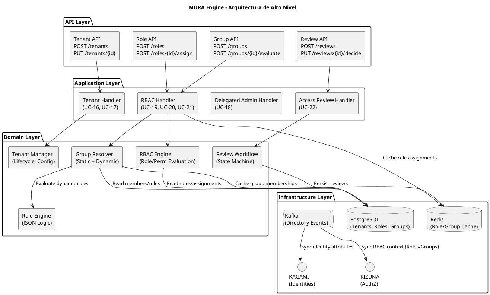
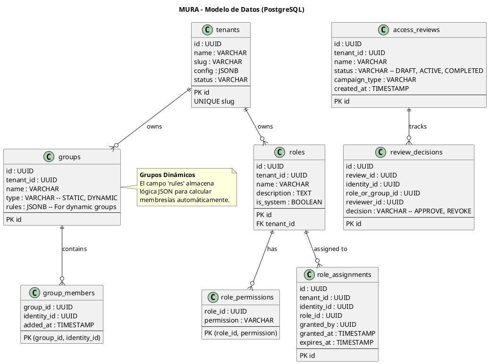
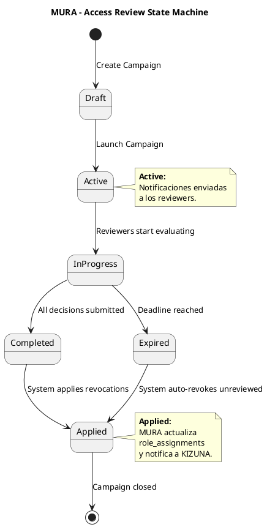

# SHUGO - MURA Engine Architecture (Motor de Directorio, Tenancy y RBAC)

| Metadatos del Documento | |
| :--- | :--- |
| **Proyecto:** | SHUGO - Identity & Access Platform |
| **Documento:** | MURA_Engine_Architecture.md |
| **Metodología:** | Domain-Driven Design + Clean Architecture + RBAC/ABAC Standards |
| **Estándares:** | ISO/IEC 27001 (Security), NIST SP 800-53 (AC), SOC 2 (CC6.1), SCIM 2.0 |
| **Autor:** | Gastón Ruiz |
| **Versión Actual:** | 1.0.0 |
| **Fecha:** | 30/08/2026 |

---

## Historial de Versiones

| Versión | Fecha | Autor | Descripción de Cambios | Impacto |
| :--- | :--- | :--- | :--- | :--- |
| **1.0.0** | 30/08/2026 | Gastón Ruiz | **Creación inicial.** Arquitectura detallada del motor MURA. Cubre 7 UCs (UC-16 a UC-22) de gestión de tenants, roles, grupos (estáticos y dinámicos), administración delegada y revisiones de acceso (Access Reviews). Incluye motor de reglas para grupos dinámicos y workflow de compliance. | Documento de referencia técnica para el motor de directorio y control de acceso basado en roles de SHUGO. Define la arquitectura interna, modelo de datos y flujos de integración con KAGAMI y KIZUNA. |

---

## 1. Introducción y Propósito

MURA (muro o valla en japonés) es el **motor de Directorio, Multi-Tenancy y RBAC** de SHUGO. Es responsable de definir la estructura organizacional, los límites de los tenants, y las asignaciones de roles y grupos que alimentan los motores de autenticación (KAGI) y autorización (KIZUNA).

MURA es fundamental porque:
- **Define los límites de seguridad:** El aislamiento de tenants (Multi-tenancy) nace aquí.
- **Estructura la organización:** Roles y grupos (estáticos y dinámicos) permiten escalar la gestión de accesos.
- **Garantiza el Compliance:** Las Revisiones de Acceso (Access Reviews) son un requisito obligatorio para SOC 2 e ISO 27001.

### 1.1. Alcance

MURA cubre **7 Casos de Uso** organizados en 2 EPICs:

| EPIC | UCs | Descripción |
| :--- | :--- | :--- |
| **EPIC-04: Tenant Management** | UC-16 a UC-18 | Provisionamiento de tenants, configuración y administración delegada. |
| **EPIC-05: RBAC** | UC-19 a UC-22 | Definición de roles, asignación, permisos y Revisiones de Acceso (Access Reviews). |

### 1.2. Objetivos de Rendimiento y Cumplimiento

| Métrica | Objetivo | Justificación |
| :--- | :--- | :--- |
| **Latencia Role Assignment** | < 100ms p95 | Propagación rápida de permisos |
| **Dynamic Group Evaluation** | < 500ms para 10,000 usuarios | Eficiencia en reglas complejas |
| **Access Review Generation** | < 1 minuto para 100,000 asignaciones | Rendimiento en campañas de compliance |
| **Tenant Isolation** | 100% (Zero Leakage) | Requisito crítico de seguridad |
| **Audit Coverage** | 100% de cambios en Roles/Grupos | Requisito SOC 2 |

---

## 2. Arquitectura General de MURA

### 2.1. Vista de Alto Nivel



### 2.2. Componentes Principales

| Componente | Responsabilidad | UCs Asociados |
| :--- | :--- | :--- |
| **Tenant Manager** | Ciclo de vida del tenant, configuración de features y límites | UC-16, UC-17 |
| **RBAC Engine** | Evaluación de roles y permisos tradicionales | UC-19, UC-20, UC-21 |
| **Group Resolver** | Resuelve membresías de grupos estáticos y evalúa reglas de grupos dinámicos | UC-15, UC-16 |
| **Rule Engine** | Ejecuta reglas JSON (ej. `department == 'Sales'`) para grupos dinámicos | UC-15 |
| **Review Workflow** | Máquina de estados para campañas de Revisiones de Acceso | UC-22 |
| **Delegated Admin Handler** | Valida scopes de administración delegada | UC-18 |

---

## 3. Modelo de Datos de MURA

### 3.1. Diagrama de Modelo de Datos



### 3.2. Scripts de Creación de Tablas (Extracto Clave)

```sql
-- ============================================
-- GROUPS (Soporte para Estáticos y Dinámicos)
-- ============================================
CREATE TABLE groups (
    id UUID PRIMARY KEY DEFAULT gen_random_uuid(),
    tenant_id UUID NOT NULL,
    name VARCHAR(100) NOT NULL,
    type VARCHAR(20) NOT NULL CHECK (type IN ('STATIC', 'DYNAMIC')),
    rules JSONB, -- Solo usado si type = 'DYNAMIC'
    created_at TIMESTAMP WITH TIME ZONE DEFAULT NOW(),
    CONSTRAINT uq_group_tenant_name UNIQUE (tenant_id, name)
);

-- ============================================
-- ROLE ASSIGNMENTS (Con soporte para expiración)
-- ============================================
CREATE TABLE role_assignments (
    id UUID PRIMARY KEY DEFAULT gen_random_uuid(),
    tenant_id UUID NOT NULL,
    identity_id UUID NOT NULL,
    role_id UUID NOT NULL,
    granted_by UUID NOT NULL,
    granted_at TIMESTAMP WITH TIME ZONE DEFAULT NOW(),
    expires_at TIMESTAMP WITH TIME ZONE, -- Para acceso temporal (JIT)
    CONSTRAINT fk_assignment_role FOREIGN KEY (role_id) REFERENCES roles(id) ON DELETE CASCADE
);

CREATE INDEX idx_assignments_identity ON role_assignments(identity_id);
CREATE INDEX idx_assignments_expires ON role_assignments(expires_at) WHERE expires_at IS NOT NULL;
```

---

## 4. Group Resolver: Estáticos vs. Dinámicos

### 4.1. Motor de Reglas para Grupos Dinámicos

Los grupos dinámicos calculan su membresía basándose en atributos del perfil de la identidad (gestionados por KAGAMI). MURA utiliza un **Rule Engine** basado en JSON Logic.

**Ejemplo de Regla (JSONB):**
```json
{
  "and": [
    { "==": [{ "var": "department" }, "Engineering"] },
    { ">=": [{ "var": "clearance_level" }, 3] }
  ]
}
```

### 4.2. Implementación del Group Resolver

```csharp
public class GroupResolver : IGroupResolver
{
    private readonly IProfileRepository _profileRepo; // KAGAMI context
    private readonly IGroupRepository _groupRepo;
    private readonly IRuleEngine _ruleEngine;

    public async Task<List<Guid>> ResolveDynamicGroupMembersAsync(Guid groupId, Guid tenantId)
    {
        var group = await _groupRepo.GetByIdAsync(groupId);
        if (group.Type != GroupType.Dynamic || group.Rules == null)
            throw new InvalidOperationException("Group is not dynamic");

        // 1. Obtener todas las identidades activas del tenant
        var identities = await _profileRepo.GetActiveIdentitiesAsync(tenantId);
        var members = new List<Guid>();

        // 2. Evaluar regla contra cada perfil (Optimizado con batching)
        foreach (var batch in identities.Chunk(100))
        {
            var profiles = await _profileRepo.GetProfilesAsync(batch.Select(i => i.Id));
            
            foreach (var profile in profiles)
            {
                if (_ruleEngine.Evaluate(group.Rules, profile.CustomAttributes))
                {
                    members.Add(profile.IdentityId);
                }
            }
        }

        return members;
    }
}
```

---

## 5. Access Reviews Engine (UC-22)

Las Revisiones de Acceso son críticas para el cumplimiento de SOC 2 e ISO 27001. Permiten a los managers revisar periódicamente si sus subordinados mantienen los roles y accesos adecuados.

### 5.1. Workflow de Revisión



### 5.2. Lógica de Aplicación de Decisiones

Cuando una campaña se completa (`Applied`), MURA debe revocar los accesos denegados.

```csharp
public class ReviewWorkflow : IReviewWorkflow
{
    public async Task ApplyDecisionsAsync(Guid reviewId)
    {
        var decisions = await _reviewRepo.GetDecisionsAsync(reviewId);
        var revocations = decisions.Where(d => d.Decision == "REVOKE");

        foreach (var revocation in revocations)
        {
            // 1. Marcar asignación como expirada/revocada en MURA
            await _assignmentRepo.RevokeAsync(revocation.IdentityId, revocation.RoleOrGroupId);
            
            // 2. Publicar evento para que KIZUNA/KAGI se sincronicen
            await _eventPublisher.PublishAsync("Access.Revoked", new {
                IdentityId = revocation.IdentityId,
                RoleId = revocation.RoleOrGroupId,
                Reason = "Access Review Campaign"
            });
        }
    }
}
```

---

## 6. Multi-Tenancy & Delegated Administration (UC-18)

### 6.1. Aislamiento de Tenant

MURA es el dueño del concepto `tenant_id`. Todas las tablas de MURA tienen `tenant_id` como parte de su clave primaria o índice principal.

*   **Query Filters:** Todos los repositorios inyectan automáticamente `WHERE tenant_id = @currentTenantId`.
*   **Row-Level Security (RLS):** Similar a KAGAMI, MURA utiliza RLS en PostgreSQL para prevenir fugas de datos a nivel de base de datos.

### 6.2. Administración Delegada

La administración delegada permite que un usuario (ej. "Manager de Ventas") administre roles/grupos solo para un subconjunto de usuarios (ej. "Su equipo"), sin ser un Tenant Admin global.

**Implementación:**
Se utiliza un modelo de **Scopes** en la asignación de roles de administración.

```json
{
  "admin_identity_id": "user:manager-juan",
  "admin_role": "group_admin",
  "scope": {
    "type": "group",
    "target_id": "group:ventas"
  }
}
```
El `Delegated Admin Handler` intercepta cada request de administración y valida que el `identity_id` objetivo esté dentro del `scope` del administrador.

---

## 7. Security & Compliance

### 7.1. Segregación de Funciones (SoD)

MURA enforce SoD para prevenir conflictos de interés.
*   **Ejemplo:** Un usuario no puede tener simultáneamente los roles `APPROVE_PAYMENTS` y `CREATE_VENDOR`.
*   **Implementación:** Matriz de SoD en la configuración del tenant. El `RBAC Engine` valida las asignaciones contra esta matriz antes de persistir.

### 7.2. Audit Trail Inmutable

Cada cambio en roles, grupos o asignaciones genera un evento en Kafka que KAGE consume para crear un log inmutable.

| Evento | Payload Clave |
| :--- | :--- |
| `Role.Created` | role_id, name, permissions |
| `Role.Assigned` | identity_id, role_id, granted_by, expires_at |
| `Group.MemberAdded` | group_id, identity_id, added_by |
| `Review.DecisionMade` | review_id, identity_id, decision, reviewer_id |

---

## 8. Decisiones de Arquitectura (ADR)

### 8.1. ADR-MURA-001: Grupos Estáticos vs. Dinámicos (Híbrido)

**Decisión:** Soportar ambos tipos de grupos en la misma tabla `groups`, diferenciados por un campo `type` y `rules`.

**Contexto:** Los grupos estáticos son fáciles de gestionar manualmente, pero no escalan. Los dinámicos escalan pero son complejos de depurar.

**Opciones Consideradas:**
1. Solo Estáticos
2. Solo Dinámicos
3. Híbrido (Estáticos + Dinámicos)

**Decisión Tomada:** Opción 3 - Híbrido

**Justificación:**
- **Flexibilidad:** Permite a los tenants empezar con grupos estáticos y evolucionar a dinámicos.
- **Simplicidad de Modelo:** Una sola tabla `group_members` para ambos, donde los miembros de grupos dinámicos se recalculan y se materializan en la tabla para consultas rápidas.

**Consecuencias:**
- Necesidad de un "Re-evaluation Job" que recalcule los miembros de grupos dinámicos cuando los atributos de las identidades (KAGAMI) cambian.

### 8.2. ADR-MURA-002: Almacenamiento de Access Reviews (Snapshot)

**Decisión:** Tomar una "foto" (snapshot) de las asignaciones al inicio de la campaña de revisión.

**Contexto:** Si un usuario obtiene un nuevo rol durante una revisión de 2 semanas, ¿debe aparecer en la revisión?

**Opciones Consideradas:**
1. Real-time (Mostrar estado actual siempre)
2. Snapshot (Congelar estado al inicio)

**Decisión Tomada:** Opción 2 - Snapshot

**Justificación:**
- **Consistencia para el Reviewer:** El manager revisa una lista fija. Si cambia en tiempo real, genera confusión y errores de compliance.
- **Auditabilidad:** Permite comparar exactamente qué se revisó vs. el estado actual.

**Consecuencias:**
- Requiere almacenamiento adicional para guardar el snapshot de asignaciones en la tabla `review_decisions`.

### 8.3. ADR-MURA-003: Jerarquía de Roles (Plana con Herencia)

**Decisión:** Roles planos (sin jerarquía anidada compleja) pero con herencia de permisos explícita.

**Contexto:** Los roles anidados (Role A incluye Role B) son potentes pero difíciles de auditar ("¿Por qué tiene este usuario este permiso?").

**Opciones Consideradas:**
1. Jerarquía profunda (RBAC1/NIST)
2. Roles planos con asignación múltiple
3. Roles planos con herencia explícita ("Includes")

**Decisión Tomada:** Opción 3 - Planos con Herencia Explícita

**Justificación:**
- **Auditabilidad:** Es fácil de explicar: "Tiene el rol X, que incluye explícitamente los permisos A, B, C".
- **Alineación con ReBAC:** KIZUNA maneja la complejidad de las relaciones. MURA debe mantener el RBAC simple y predecible.

---

## 9. Trazabilidad

| Documento | Relación |
| :--- | :--- |
| `Product_Vision.md` | Define la visión de MURA como el estructurador organizacional de SHUGO. |
| `Domain_Analysis.md` | Define el Bounded Context MURA y sus Aggregate Roots (Tenant, Role, Group). |
| `System_Architecture_Overview.md` | Define MURA como uno de los 6 microservicios de SHUGO. |
| `KIZUNA_Engine_Architecture.md` | Define cómo KIZUNA consume los roles y grupos de MURA para evaluación RBAC. |
| `Security_Threat_Model.md` | Analiza amenazas como escalada de privilegios y manipulación de membresías. |
| `Glossary.md` | Contiene definiciones de términos de directorio usados en este documento. |
| `KHCS_SHUGO_Integration_Contract.md` | Primer caso de uso real que consume MURA para gestionar roles de veterinarios. |
| UC-16 a UC-22 (7 documentos) | Cada UC tiene su paquete completo de 9 documentos que detalla la implementación de MURA. |

---

## 10. Anexos

### 10.1. Glosario de Términos Técnicos de MURA

| Término | Definición |
| :--- | :--- |
| **RBAC (Role-Based Access Control)** | Modelo de autorización donde los permisos se asignan a roles, y los roles a usuarios. |
| **Access Review** | Proceso periódico de revisión y certificación de accesos por parte de los propietarios de los datos. |
| **Dynamic Group** | Grupo cuya membresía se calcula automáticamente basándose en atributos de las identidades. |
| **Delegated Administration** | Capacidad de asignar responsabilidades administrativas a usuarios no globales, limitadas por scope. |
| **Segregation of Duties (SoD)** | Principio de control interno que previene que una sola persona controle todas las fases de una transacción crítica. |
| **Snapshot** | Copia congelada del estado de las asignaciones en un momento específico para fines de auditoría. |

### 10.2. Referencias

1. **NIST SP 800-53 (AC-2, AC-3, AC-6):** Access Control Policies - https://csrc.nist.gov/publications/detail/sp/800-53/rev-5/final
2. **SOC 2 Trust Services Criteria (CC6.1):** Logical and Physical Access Controls - https://www.aicpa.org/
3. **SCIM 2.0 (RFC 7643):** Core Schema (para integración de grupos y roles) - https://scim.dev/
4. **JSON Logic:** Rule engine specification - https://jsonlogic.com/

---
*Fin del Documento MURA_Engine_Architecture v1.0 para SHUGO*