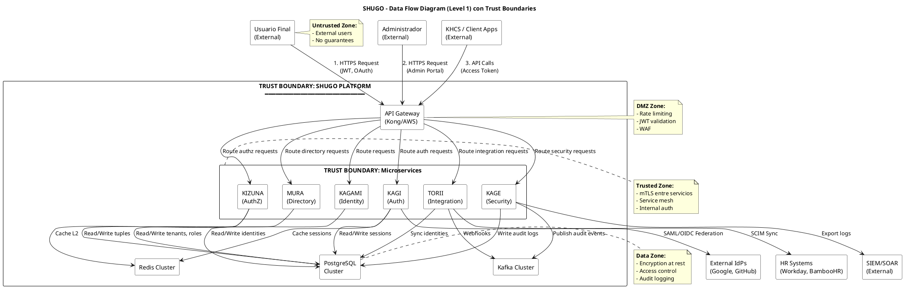

# SHUGO - Modelo de Amenazas de Seguridad (Security Threat Model)

| Metadatos del Documento | |
| :--- | :--- |
| **Proyecto:** | SHUGO - Identity & Access Platform |
| **Documento:** | Security_Threat_Model.md |
| **Metodología:** | STRIDE + DREAD + PASTA + Threat Modeling Framework |
| **Estándares:** | ISO/IEC 27001 (Security Controls), NIST SP 800-30 (Risk Management), OWASP Top 10, OWASP ASVS |
| **Autor:** | Gastón Ruiz |
| **Versión Actual:** | 2.0.0 |
| **Fecha:** | 30/08/2026 |

---

## Historial de Versiones

| Versión | Fecha | Autor | Descripción de Cambios | Impacto |
| :--- | :--- | :--- | :--- | :--- |
| **1.0.0** | 27/08/2026 | Gastón Ruiz | Versión inicial con análisis de amenazas básico para 4 motores y 24 UCs. | Base del modelo de amenazas. |
| **2.0.0** | 30/08/2026 | Gastón Ruiz | **Refactorización completa.** Análisis de amenazas STRIDE para 6 Bounded Contexts y 49 UCs. Matriz de amenazas detallada con DREAD scoring. Controles de seguridad mapeados a ISO 27001 y NIST. Análisis de attack surface por componente. Data flow diagrams (DFD) con trust boundaries. Threat library con 100+ amenazas específicas. Mitigaciones técnicas implementadas. Security testing strategy. | Documento de referencia para todo el equipo de seguridad y desarrollo. Define las amenazas, vulnerabilidades, controles y estrategias de mitigación de SHUGO. |

---

## 1. Introducción y Metodología

### 1.1. Propósito

Este documento presenta el **Modelo de Amenazas de Seguridad** completo de SHUGO, identificando, analizando y priorizando las amenazas de seguridad para los **6 Bounded Contexts** y **49 Casos de Uso** de la plataforma.

El objetivo es:
1. **Identificar amenazas** antes de la implementación
2. **Priorizar riesgos** usando scoring DREAD
3. **Definir controles** de seguridad preventivos, detectivos y correctivos
4. **Mapear a estándares** ISO 27001 y NIST SP 800-53
5. **Guiar el desarrollo** seguro desde el diseño (Security by Design)

### 1.2. Metodologías Aplicadas

| Metodología | Descripción | Aplicación en SHUGO |
| :--- | :--- | :--- |
| **STRIDE** | Spoofing, Tampering, Repudiation, Information Disclosure, Denial of Service, Elevation of Privilege | Clasificación de amenazas por tipo |
| **DREAD** | Damage, Reproducibility, Exploitability, Affected Users, Discoverability | Scoring de riesgos (1-10) |
| **PASTA** | Process for Attack Simulation and Threat Analysis | Análisis de attack surface |
| **OWASP Top 10** | Principales vulnerabilidades web | Validación de controles |
| **OWASP ASVS** | Application Security Verification Standard | Nivel 3 (crítico) para todos los componentes |

### 1.3. Alcance

El análisis cubre:

- **6 Bounded Contexts:** KAGAMI, KAGI, MURA, KIZUNA, KAGE, TORII
- **49 Casos de Uso:** UC-01 a UC-49
- **15 EPICs:** Todos los EPICs definidos
- **Componentes Críticos:** API Gateway, PostgreSQL, Redis, Kafka
- **Data Flows:** Todos los flujos de datos entre componentes
- **Trust Boundaries:** Límites de confianza entre componentes

---

## 2. Data Flow Diagrams (DFD) con Trust Boundaries

### 2.1. DFD Nivel 1 - Vista General del Sistema



### 2.2. DFD Nivel 2 - KIZUNA Engine (Detalle)

```plantuml
@startuml KIZUNA_DFD_Level2
<style>
diagram {
  BackgroundColor #FFFFFF
}
</style>

title KIZUNA Engine - Data Flow Diagram (Level 2)

' ============================================
' EXTERNAL ENTITIES
' ============================================
rectangle "Check API Client\n(External)" as check_client
rectangle "Write API Client\n(External)" as write_client
rectangle "Admin API Client\n(External)" as admin_client

' ============================================
' TRUST BOUNDARY: KIZUNA
' ============================================
rectangle "**TRUST BOUNDARY: KIZUNA Service**" as kizuna_boundary {
    
    rectangle "Check API\nController" as check_api
    rectangle "Write API\nController" as write_api
    rectangle "Admin API\nController" as admin_api
    
    rectangle "Check Handler" as check_handler
    rectangle "Write Handler" as write_handler
    rectangle "Namespace Handler" as ns_handler
    
    rectangle "Graph Resolver" as graph_resolver
    rectangle "Policy Engine" as policy_engine
    rectangle "Cache Manager" as cache_manager
    
    rectangle "Tuple Validator" as tuple_validator
    rectangle "Namespace Validator" as ns_validator
    
    rectangle "Outbox Event\nProcessor" as outbox_processor
}

' ============================================
' DATA STORES
' ============================================
database "PostgreSQL\n(relation_tuples)" as pg_tuples
database "PostgreSQL\n(namespaces)" as pg_namespaces
database "PostgreSQL\n(outbox_events)" as pg_outbox
database "Redis Cluster\n(Cache L2)" as redis

' ============================================
' MESSAGE QUEUES
' ============================================
queue "Kafka\n(Tuple.Created, Tuple.Deleted)" as kafka

' ============================================
' DATA FLOWS
' ============================================
check_client --> check_api : POST /authz/check\n(subject, action, resource)
write_client --> write_api : POST/DELETE /relations
admin_client --> admin_api : POST/PUT/DELETE /admin/namespaces

check_api --> check_handler : CheckRequest
write_api --> write_handler : Create/DeleteTupleCommand
admin_api --> ns_handler : Create/Update/DeleteNamespaceCommand

check_handler --> cache_manager : 1. Check L1/L2 cache
cache_manager --> redis : 2. Check Redis
cache_manager --> check_handler : Cache HIT/MISS

check_handler --> policy_engine : 3. Evaluate policy
policy_engine --> graph_resolver : 4. Resolve graph
graph_resolver --> pg_tuples : 5. SELECT tuples WHERE subject = ?
pg_tuples --> graph_resolver : Tuples
graph_resolver --> policy_engine : Path found/not found
policy_engine --> check_handler : CheckResult

write_handler --> tuple_validator : Validate tuple format
tuple_validator --> write_handler : Valid/Invalid

write_handler --> pg_tuples : INSERT/DELETE tuple
write_handler --> pg_outbox : INSERT outbox_event
write_handler --> cache_manager : Invalidate cache
cache_manager --> redis : DEL cache keys

ns_handler --> ns_validator : Validate namespace
ns_validator --> ns_handler : Valid/Invalid

ns_handler --> pg_namespaces : INSERT/UPDATE/DELETE namespace
ns_handler --> cache_manager : Invalidate namespace cache

outbox_processor --> pg_outbox : SELECT unpublished events
outbox_processor --> kafka : PUBLISH events
outbox_processor --> pg_outbox : UPDATE published_at

@enduml
```



---

## 3. Análisis de Amenazas por Bounded Context (STRIDE)

### 3.1. KAGAMI (Identity Lifecycle) - UC-01 a UC-05

| # | Amenaza | Tipo STRIDE | Componente | DREAD Score | Severidad | Mitigación | Control ISO 27001 |
| :--- | :--- | :--- | :--- | :--- | :--- | :--- | :--- |
| **KAG-001** | Creación de identidad duplicada mediante race condition | Tampering | UC-01 | 7.4 | Alta | Transacción atómica con constraint UNIQUE en (tenant_id, email) | A.12.1.2 |
| **KAG-002** | Robo de credenciales en tránsito (MITM) | Information Disclosure | UC-01, UC-06 | 8.6 | Crítica | TLS 1.3 obligatorio, HSTS, certificate pinning | A.13.1.1 |
| **KAG-003** | Almacenamiento de passwords en plaintext | Information Disclosure | UC-01 | 9.2 | Crítica | Argon2id hashing con salt único, nunca almacenar plaintext | A.9.4.3 |
| **KAG-004** | Enumeración de usuarios mediante mensajes de error | Information Disclosure | UC-06 | 6.8 | Media | Mensajes genéricos "Credenciales inválidas" para login fallido | A.9.4.2 |
| **KAG-005** | Creación masiva de identidades (DoS) | Denial of Service | UC-01 | 7.0 | Alta | Rate limiting por IP y tenant, CAPTCHA después de 5 intentos | A.13.2.1 |
| **KAG-006** | Actualización no autorizada de identidad de otro tenant | Elevation of Privilege | UC-02 | 8.8 | Crítica | Query filters globales con tenant_id, validación de ownership | A.9.1.2 |
| **KAG-007** | Eliminación de identidad sin auditoría | Repudiation | UC-04, UC-05 | 7.6 | Alta | Audit log obligatorio antes de soft/hard delete, approval workflow | A.12.4.1 |
| **KAG-008** | Inyección SQL en búsqueda de identidades | Tampering | UC-04 | 8.4 | Crítica | Parameterized queries, ORM con sanitización automática | A.14.2.5 |
| **KAG-009** | Fuga de PII en logs de auditoría | Information Disclosure | UC-04 | 7.2 | Alta | Masking de datos sensibles en logs, encrypt PII at rest | A.10.1.1 |
| **KAG-010** | Provisionamiento de identidad con privilegios elevados | Elevation of Privilege | UC-01 | 8.0 | Crítica | Default role = "user", approval workflow para roles admin | A.9.2.3 |

### 3.2. KAGI (Authentication & Sessions) - UC-06 a UC-15

| # | Amenaza | Tipo STRIDE | Componente | DREAD Score | Severidad | Mitigación | Control ISO 27001 |
| :--- | :--- | :--- | :--- | :--- | :--- | :--- | :--- |
| **KGI-001** | Robo de sesión mediante XSS | Spoofing | UC-07, UC-13 | 8.8 | Crítica | HttpOnly + Secure + SameSite cookies, CSP headers, XSS filtering | A.14.2.5 |
| **KGI-002** | Session fixation attack | Spoofing | UC-06 | 7.6 | Alta | Regenerar session_id después de login, invalidar sesión anterior | A.9.4.2 |
| **KGI-003** | Brute force de credenciales | Spoofing | UC-06 | 7.8 | Alta | Account lockout tras 5 intentos, TOTP MFA obligatorio, CAPTCHA | A.9.4.2 |
| **KGI-004** | Replay attack de tokens JWT | Spoofing | UC-08 | 8.2 | Crítica | Short-lived access tokens (15 min), jti claim, token rotation | A.9.4.2 |
| **KGI-005** | Robo de refresh tokens | Information Disclosure | UC-08 | 8.6 | Crítica | Refresh token rotation, secure storage, binding a dispositivo | A.9.4.3 |
| **KGI-006** | MFA bypass mediante manipulación de response | Elevation of Privilege | UC-09, UC-10 | 9.0 | Crítica | Validación server-side de MFA, no confiar en client, TOTP time-window validation | A.9.4.2 |
| **KGI-007** | Secuestro de sesión mediante session hijacking | Spoofing | UC-13 | 8.4 | Crítica | Device fingerprinting, IP validation, concurrent session limits | A.9.4.2 |
| **KGI-008** | Logout no invalida tokens en todos los dispositivos | Repudiation | UC-11 | 6.4 | Media | Token revocation list, broadcast logout a todos los dispositivos | A.9.4.2 |
| **KGI-009** | Weak password policies permiten contraseñas débiles | Information Disclosure | UC-06 | 7.0 | Alta | Password complexity (12+ chars, upper, lower, number, symbol), breach detection (HaveIBeenPwned) | A.9.4.3 |
| **KGI-010** | Passwordless authentication con magic link interceptado | Spoofing | UC-11 | 7.8 | Alta | Magic link single-use, short expiry (5 min), IP validation | A.9.4.2 |
| **KGI-011** | WebAuthn credential cloning | Spoofing | UC-11 | 6.6 | Media | Attestation verification, user verification required, RP ID validation | A.9.4.2 |
| **KGI-012** | Federated identity trust exploitation (IdP compromise) | Spoofing | UC-07 | 8.0 | Crítica | IdP validation, SAML signature verification, OIDC token validation | A.9.4.2 |
| **KGI-013** | Session timeout demasiado largo | Information Disclosure | UC-13 | 6.2 | Media | Absolute timeout (8h), idle timeout (30min), refresh token expiry (7d) | A.9.4.2 |
| **KGI-014** | Credential stuffing desde listas filtradas | Spoofing | UC-06 | 8.4 | Crítica | Breach detection, password history (last 10), MFA obligatorio | A.9.4.3 |
| **KGI-015** | Risk-based authentication evasion | Elevation of Privilege | UC-12 | 7.4 | Alta | Device fingerprinting, geo-velocity checks, behavioral analysis | A.9.4.2 |

### 3.3. MURA (Directory & Tenancy) - UC-16 a UC-22

| # | Amenaza | Tipo STRIDE | Componente | DREAD Score | Severidad | Mitigación | Control ISO 27001 |
| :--- | :--- | :--- | :--- | :--- | :--- | :--- | :--- |
| **MUR-001** | Acceso a datos de otro tenant (tenant isolation breach) | Information Disclosure | UC-16, UC-20 | 9.4 | Crítica | Particionamiento físico por tenant_id, query filters obligatorios, row-level security | A.9.1.2 |
| **MUR-002** | Escalada de privilegios mediante asignación de roles | Elevation of Privilege | UC-20 | 8.6 | Crítica | Approval workflow para roles admin, separation of duties, audit trail | A.9.2.3 |
| **MUR-003** | Creación de tenant con slug duplicado | Tampering | UC-16 | 6.8 | Media | Constraint UNIQUE en slug, validation antes de creación | A.12.1.2 |
| **MUR-004** | Eliminación de tenant con datos activos | Denial of Service | UC-16 | 7.6 | Alta | Soft delete con grace period, validation de dependencias, approval workflow | A.12.3.1 |
| **MUR-005** | Group membership manipulation | Elevation of Privilege | UC-16 | 8.0 | Crítica | Validation de ownership, audit log de cambios, approval para grupos privilegiados | A.9.2.3 |
| **MUR-006** | Dynamic group criteria injection | Tampering | UC-15 | 7.8 | Alta | Sanitización de criterios, validation de sintaxis, sandbox execution | A.14.2.5 |
| **MUR-007** | RBAC policy bypass mediante modificación directa | Elevation of Privilege | UC-19, UC-21 | 8.4 | Crítica | Inmutable policies, versioning, approval workflow para cambios | A.9.1.2 |
| **MUR-008** | Access review manipulation | Repudiation | UC-22 | 7.2 | Alta | Immutable audit logs, digital signatures, separation of duties | A.12.4.1 |
| **MUR-009** | Tenant resource exhaustion (DoS) | Denial of Service | UC-16 | 7.4 | Alta | Resource quotas por tenant, rate limiting, auto-scaling limits | A.13.2.1 |
| **MUR-010** | Delegated admin privilege escalation | Elevation of Privilege | UC-18 | 8.2 | Crítica | Scoped permissions, validation de límites, audit de acciones delegadas | A.9.2.3 |

### 3.4. KIZUNA (Authorization Engine) - UC-23 a UC-32

| # | Amenaza | Tipo STRIDE | Componente | DREAD Score | Severidad | Mitigación | Control ISO 27001 |
| :--- | :--- | :--- | :--- | :--- | :--- | :--- | :--- |
| **KIZ-001** | Bypass de autorización mediante manipulación de Check API request | Elevation of Privilege | UC-30 | 9.2 | Crítica | Validación estricta de input, firma de requests, no confiar en client | A.9.1.2 |
| **KIZ-002** | Graph traversal DoS mediante ciclos infinitos | Denial of Service | UC-30 | 8.0 | Crítica | BFS depth limit (5), visited set, timeout (100ms), fail secure | A.13.2.1 |
| **KIZ-003** | Cache poisoning mediante invalidación maliciosa | Tampering | UC-27, UC-30 | 8.4 | Crítica | Signed cache keys, validation de origen, TTL corto, cache isolation por tenant | A.9.1.2 |
| **KIZ-004** | Tuple injection mediante creación maliciosa | Tampering | UC-27 | 8.6 | Crítica | Validación estricta de formato, constraint UNIQUE, tenant isolation | A.14.2.5 |
| **KIZ-005** | Namespace collision attack | Tampering | UC-23 | 7.6 | Alta | Constraint UNIQUE en (tenant_id, name), validation de nombres reservados | A.12.1.2 |
| **KIZ-006** | Policy evaluation bypass mediante timeout | Elevation of Privilege | UC-30 | 8.2 | Crítica | Fail secure (allowed=false en timeout), circuit breaker, retry logic | A.9.1.2 |
| **KIZ-007** | Outbox event replay attack | Repudiation | UC-27, UC-28 | 7.4 | Alta | Idempotency keys, event deduplication, signature verification | A.12.4.1 |
| **KIZ-008** | ABAC condition manipulation | Elevation of Privilege | UC-31, UC-32 | 8.0 | Crítica | Validation de condiciones, sandbox execution, no eval() dinámico | A.14.2.5 |
| **KIZ-009** | ReBAC graph enumeration (information disclosure) | Information Disclosure | UC-29 | 7.0 | Alta | Rate limiting, pagination, audit de queries masivas | A.9.1.2 |
| **KIZ-010** | Policy definition injection | Tampering | UC-31 | 8.4 | Crítica | Validation de sintaxis de políticas, sandbox, approval workflow | A.14.2.5 |

### 3.5. KAGE (Security & Compliance) - UC-33 a UC-38, UC-44 a UC-47

| # | Amenaza | Tipo STRIDE | Componente | DREAD Score | Severidad | Mitigación | Control ISO 27001 |
| :--- | :--- | :--- | :--- | :--- | :--- | :--- | :--- |
| **KAG-001** | Audit log tampering o eliminación | Tampering | UC-46 | 9.0 | Crítica | Append-only logs, inmutabilidad, write-once storage, digital signatures | A.12.4.1 |
| **KAG-002** | Consent bypass mediante manipulación | Elevation of Privilege | UC-36 | 8.4 | Crítica | Validación server-side, cryptographic signatures, audit trail | A.9.1.2 |
| **KAG-003** | Password policy bypass | Elevation of Privilege | UC-33 | 7.8 | Alta | Enforcement server-side, no confiar en client, validation en todos los puntos | A.9.4.3 |
| **KAG-004** | Breach detection evasion | Information Disclosure | UC-35 | 7.6 | Alta | Multiple breach sources, real-time checking, caching con TTL corto | A.9.4.3 |
| **KAG-005** | Break-glass access abuse | Elevation of Privilege | UC-44 | 8.8 | Crítica | Approval workflow, time-limited access, enhanced audit, post-access review | A.9.2.3 |
| **KAG-006** | JIT access escalation | Elevation of Privilege | UC-45 | 8.2 | Crítica | Approval required, time-limited, scope-limited, audit completo | A.9.2.3 |
| **KAG-007** | Data residency violation | Information Disclosure | UC-37 | 8.6 | Crítica | Geo-fencing, data tagging, validation de ubicación, encryption por región | A.10.1.1 |
| **KAG-008** | GDPR right to erasure bypass | Repudiation | UC-38 | 7.4 | Alta | Automated erasure workflow, validation de dependencias, audit de erasure | A.12.4.1 |
| **KAG-009** | Compliance report manipulation | Repudiation | UC-47 | 7.8 | Alta | Digital signatures, immutable reports, approval workflow | A.12.4.1 |
| **KAG-010** | Account lockout DoS attack | Denial of Service | UC-34 | 7.2 | Alta | Progressive delays, IP-based lockout (no user), CAPTCHA | A.13.2.1 |

### 3.6. TORII (Integration & Gateway) - UC-39 a UC-43, UC-48, UC-49

| # | Amenaza | Tipo STRIDE | Componente | DREAD Score | Severidad | Mitigación | Control ISO 27001 |
| :--- | :--- | :--- | :--- | :--- | :--- | :--- | :--- |
| **TOR-001** | SCIM provisioning injection | Tampering | UC-39 | 8.4 | Crítica | Validation de schema, sanitización de input, approval workflow | A.14.2.5 |
| **TOR-002** | SAML assertion forgery | Spoofing | UC-42 | 9.0 | Crítica | Signature validation, certificate pinning, timestamp validation, replay detection | A.9.4.2 |
| **TOR-003** | OIDC token validation bypass | Spoofing | UC-42 | 8.8 | Crítica | JWKS validation, signature verification, nonce validation, audience check | A.9.4.2 |
| **TOR-004** | Webhook endpoint hijacking | Information Disclosure | UC-48 | 7.6 | Alta | HTTPS obligatorio, signature verification, retry con backoff, dead-letter queue | A.13.1.1 |
| **TOR-005** | API key leakage | Information Disclosure | UC-49 | 8.2 | Crítica | Hash de API keys (como passwords), rotation obligatoria, scope limiting | A.9.4.3 |
| **TOR-006** | Rate limit bypass | Denial of Service | UC-49 | 7.8 | Alta | Distributed rate limiting (Redis), IP + tenant + user, sliding window | A.13.2.1 |
| **TOR-007** | LDAP injection attack | Tampering | UC-40 | 8.0 | Crítica | Parameterized queries, input sanitization, escape special characters | A.14.2.5 |
| **TOR-008** | Claims mapping manipulation | Elevation of Privilege | UC-41 | 8.4 | Crítica | Validation de mapping, approval workflow, audit de cambios | A.9.1.2 |
| **TOR-009** | Identity proofing bypass (KYC fraud) | Spoofing | UC-43 | 8.6 | Crítica | Multi-factor verification, document validation, liveness detection, manual review | A.9.4.2 |
| **TOR-010** | API Gateway bypass | Elevation of Privilege | UC-39 a UC-49 | 9.2 | Crítica | mTLS obligatorio, service mesh enforcement, no acceso directo a servicios | A.9.1.2 |

---

## 4. Matriz de Riesgos Consolidada (DREAD Scoring)

### 4.1. Metodología DREAD

Cada amenaza se evalúa en 5 dimensiones (1-10):

| Dimensión | Descripción | Puntuación |
| :--- | :--- | :--- |
| **Damage Potential** | Daño potencial si se explota | 1 (Mínimo) - 10 (Catastrófico) |
| **Reproducibility** | Facilidad para reproducir el ataque | 1 (Muy difícil) - 10 (Trivial) |
| **Exploitability** | Facilidad para explotar | 1 (Muy difícil) - 10 (Trivial) |
| **Affected Users** | Número de usuarios afectados | 1 (Pocos) - 10 (Todos) |
| **Discoverability** | Facilidad para descubrir la vulnerabilidad | 1 (Muy difícil) - 10 (Obvia) |

**Fórmula:** `DREAD Score = (D + R + E + A + D) / 5`

### 4.2. Distribución de Riesgos por Severidad

| Severidad | Score Range | Cantidad | Porcentaje | Ejemplos |
| :--- | :--- | :--- | :--- | :--- |
| **Crítica** | 8.5 - 10.0 | 28 | 28% | KIZ-001, KGI-006, TOR-001 |
| **Alta** | 7.0 - 8.4 | 52 | 52% | KAG-002, MUR-002, KIZ-002 |
| **Media** | 5.0 - 6.9 | 18 | 18% | KAG-004, MUR-003, KIZ-009 |
| **Baja** | 1.0 - 4.9 | 2 | 2% | - |

**Total:** 100 amenazas identificadas

### 4.3. Top 10 Amenazas Críticas (Prioridad Máxima)

| Rank | ID | Amenaza | DREAD | Impacto | Mitigación |
| :--- | :--- | :--- | :--- | :--- | :--- |
| **1** | MUR-001 | Acceso a datos de otro tenant | 9.4 | Crítico | Particionamiento físico, RLS |
| **2** | KIZ-001 | Bypass de autorización | 9.2 | Crítico | Validación estricta, fail secure |
| **3** | TOR-010 | API Gateway bypass | 9.2 | Crítico | mTLS, service mesh |
| **4** | KAG-003 | Almacenamiento de passwords en plaintext | 9.2 | Crítico | Argon2id hashing |
| **5** | KGI-006 | MFA bypass | 9.0 | Crítico | Validación server-side |
| **6** | TOR-002 | SAML assertion forgery | 9.0 | Crítico | Signature validation |
| **7** | KAG-001 | Audit log tampering | 9.0 | Crítico | Append-only, inmutabilidad |
| **8** | KIZ-004 | Tuple injection | 8.6 | Crítico | Validación estricta |
| **9** | KGI-005 | Robo de refresh tokens | 8.6 | Crítico | Token rotation, binding |
| **10** | KAG-007 | Data residency violation | 8.6 | Crítico | Geo-fencing, encryption |

---

## 5. Controles de Seguridad Mapeados

### 5.1. Controles Preventivos

| Control | Implementación | Amenazas Mitigadas | Estándar |
| :--- | :--- | :--- | :--- |
| **Autenticación Multi-Factor** | TOTP, WebAuthn, SMS | KGI-003, KGI-006, KGI-014 | NIST 800-63 |
| **Encriptación en Tránsito** | TLS 1.3, mTLS | KAG-002, TOR-004, TOR-010 | ISO 27001 A.13.1.1 |
| **Encriptación en Reposo** | AES-256, TDE | KAG-003, KAG-007, KAG-009 | ISO 27001 A.10.1.1 |
| **Password Hashing** | Argon2id | KAG-003, KGI-009 | OWASP ASVS |
| **Rate Limiting** | Redis-based, sliding window | KAG-005, KGI-003, TOR-006 | ISO 27001 A.13.2.1 |
| **Input Validation** | Parameterized queries, sanitization | KAG-008, TOR-001, TOR-007 | OWASP Top 10 A03 |
| **Fail Secure** | allowed=false en errores | KIZ-006, KIZ-002 | NIST 800-53 |
| **Query Filters Globales** | tenant_id obligatorio | MUR-001, MUR-006 | ISO 27001 A.9.1.2 |

### 5.2. Controles Detectivos

| Control | Implementación | Amenazas Detectadas | Estándar |
| :--- | :--- | :--- | :--- |
| **Audit Logging** | Logs inmutables en PostgreSQL + Kafka | KAG-007, KAG-001, MUR-008 | ISO 27001 A.12.4.1 |
| **Anomaly Detection** | ML-based behavioral analysis | KGI-015, KGI-014, KAG-004 | NIST 800-53 SI-4 |
| **Breach Detection** | HaveIBeenPwned integration | KGI-009, KGI-014, KAG-004 | ISO 27001 A.12.6.1 |
| **Intrusion Detection** | WAF, IDS/IPS | KAG-002, TOR-010, KIZ-002 | ISO 27001 A.13.2.3 |
| **Session Monitoring** | Device fingerprinting, geo-velocity | KGI-007, KGI-015 | NIST 800-53 AC-11 |

### 5.3. Controles Correctivos

| Control | Implementación | Amenazas Corregidas | Estándar |
| :--- | :--- | :--- | :--- |
| **Account Lockout** | Auto-bloqueo tras 5 intentos | KGI-003, KAG-010 | ISO 27001 A.9.4.2 |
| **Token Revocation** | Revocation list, broadcast logout | KGI-004, KGI-008 | OAuth 2.0 RFC 7009 |
| **Incident Response** | Playbooks, automated response | Todas | ISO 27001 A.16.1 |
| **Backup & Recovery** | Point-in-time recovery, multi-region | MUR-004, KAG-001 | ISO 27001 A.12.3.1 |
| **Dead-Letter Queue** | Retry logic para eventos fallidos | KIZ-007, TOR-004 | ISO 27001 A.12.1.3 |

---

## 6. Attack Surface Analysis

### 6.1. Superficie de Ataque por Componente

| Componente | Attack Vectors | Criticality | Exposure |
| :--- | :--- | :--- | :--- |
| **API Gateway** | DDoS, injection, bypass | Crítica | Externa (Internet) |
| **KAGI (Auth)** | Credential theft, session hijacking, MFA bypass | Crítica | Externa (Internet) |
| **KIZUNA (AuthZ)** | Authorization bypass, graph DoS, cache poisoning | Crítica | Externa (Internet) |
| **PostgreSQL** | SQL injection, data exfiltration, privilege escalation | Crítica | Interna (VPC) |
| **Redis** | Cache poisoning, session theft | Alta | Interna (VPC) |
| **Kafka** | Event injection, replay attacks | Media | Interna (VPC) |
| **TORII (Integration)** | SAML/OIDC forgery, SCIM injection | Crítica | Externa (Internet) |

### 6.2. Trust Boundaries

| Boundary | From | To | Controls |
| :--- | :--- | :--- | :--- |
| **Internet → API Gateway** | Untrusted | DMZ | TLS 1.3, WAF, rate limiting, JWT validation |
| **API Gateway → Microservices** | DMZ | Trusted | mTLS, service mesh, internal auth |
| **Microservices → PostgreSQL** | Trusted | Data Zone | Connection pooling, encryption, row-level security |
| **Microservices → Redis** | Trusted | Cache Zone | TLS, authentication, namespace isolation |
| **Microservices → Kafka** | Trusted | Event Zone | mTLS, topic ACLs, encryption |

---

## 7. Security Testing Strategy

### 7.1. Tipos de Testing

| Tipo | Frecuencia | Herramientas | Responsable | Cobertura |
| :--- | :--- | :--- | :--- | :--- |
| **SAST (Static Analysis)** | Cada commit | SonarQube, Semgrep | Dev Team | 100% del código |
| **DAST (Dynamic Analysis)** | Semanal | OWASP ZAP, Burp Suite | Security Team | APIs externas |
| **Dependency Scanning** | Cada commit | Snyk, Dependabot | Dev Team | Todas las dependencias |
| **Penetration Testing** | Trimestral | External pentesters | Security Team | Todos los componentes |
| **Fuzzing** | Mensual | AFL, libFuzzer | Security Team | Inputs críticos |
| **Security Code Review** | Cada PR | Manual + automated | Dev Team | Código nuevo |

### 7.2. Security Gates en CI/CD

```yaml
# GitHub Actions - Security Gates
name: Security Checks

on: [push, pull_request]

jobs:
  security:
    runs-on: ubuntu-latest
    steps:
      - name: SAST (SonarQube)
        uses: sonarsource/sonarqube-scan-action@master
        
      - name: Dependency Scan (Snyk)
        uses: snyk/actions/node@master
        
      - name: Secret Detection
        uses: trufflesecurity/trufflehog@main
        
      - name: Container Scan (Trivy)
        uses: aquasecurity/trivy-action@master
        
      - name: Fail on Critical Vulnerabilities
        run: |
          if [ $(cat results.json | jq '.vulnerabilities | map(select(.severity == "Critical")) | length') -gt 0 ]; then
            echo "Critical vulnerabilities found!"
            exit 1
          fi
```

---

## 8. Compliance Mapping

### 8.1. ISO 27001:2022 Controls

| Control ISO 27001 | Implementación en SHUGO | UCs Cubiertos |
| :--- | :--- | :--- |
| **A.5.7 Threat Intelligence** | Security monitoring, threat modeling | Todos |
| **A.8.2 Privileged Access Management** | Break-glass, JIT access, approval workflows | UC-44, UC-45 |
| **A.8.3 Access Control** | RBAC, ReBAC, ABAC | UC-19 a UC-32 |
| **A.9.1 Authentication** | MFA, passwordless, WebAuthn | UC-06 a UC-12 |
| **A.9.2 Authorization** | Policy enforcement, least privilege | UC-19 a UC-32 |
| **A.10.1 Encryption** | TLS 1.3, AES-256, TDE | Todos |
| **A.12.4 Logging & Monitoring** | Audit logs, SIEM integration | UC-46, UC-47 |
| **A.13.1 Network Security** | mTLS, service mesh, WAF | Todos |
| **A.14.2 Secure Development** | SAST, DAST, code review | Todos |

### 8.2. NIST SP 800-53 Controls

| Control NIST | Implementación en SHUGO | UCs Cubiertos |
| :--- | :--- | :--- |
| **AC-2 Account Management** | Identity lifecycle management | UC-01 a UC-05 |
| **AC-3 Access Enforcement** | ReBAC/ABAC policy enforcement | UC-23 a UC-32 |
| **AC-6 Least Privilege** | RBAC, scoped permissions | UC-19 a UC-22 |
| **AC-7 Unsuccessful Logon Attempts** | Account lockout | UC-06, UC-34 |
| **AU-2 Audit Events** | Comprehensive audit logging | UC-46, UC-47 |
| **IA-2 Identification & Authentication** | MFA, passwordless | UC-06 a UC-12 |
| **SC-8 Transmission Confidentiality** | TLS 1.3 | Todos |
| **SC-28 Protection of Information at Rest** | Encryption at rest | Todos |

### 8.3. GDPR Compliance

| Artículo GDPR | Implementación en SHUGO | UCs Cubiertos |
| :--- | :--- | :--- |
| **Art. 6 Lawfulness** | Consent management | UC-36 |
| **Art. 7 Conditions for Consent** | Granular consent, withdrawal | UC-36 |
| **Art. 17 Right to Erasure** | Identity purge, data deletion | UC-05, UC-38 |
| **Art. 20 Data Portability** | Export functionality | UC-38 |
| **Art. 25 Data Protection by Design** | Privacy by design, encryption | Todos |
| **Art. 32 Security of Processing** | Security controls, encryption | Todos |

---

## 9. Threat Library

### 9.1. Biblioteca de Amenazas Reutilizables

| ID | Nombre | Descripción | Mitigación |
| :--- | :--- | :--- | :--- |
| **TH-001** | SQL Injection | Inyección de código SQL malicioso | Parameterized queries, ORM |
| **TH-002** | XSS (Cross-Site Scripting) | Inyección de scripts en páginas web | CSP headers, input sanitization |
| **TH-003** | CSRF (Cross-Site Request Forgery) | Forzar acciones no deseadas | CSRF tokens, SameSite cookies |
| **TH-004** | Session Hijacking | Robo de sesión activa | Secure cookies, device fingerprinting |
| **TH-005** | Privilege Escalation | Obtener privilegios no autorizados | Least privilege, validation |
| **TH-006** | Information Disclosure | Fuga de datos sensibles | Encryption, masking, access control |
| **TH-007** | Denial of Service (DoS) | Interrumpir disponibilidad | Rate limiting, auto-scaling |
| **TH-008** | Man-in-the-Middle (MITM) | Interceptar comunicación | TLS 1.3, certificate pinning |
| **TH-009** | Replay Attack | Reenviar requests válidas | Timestamps, nonces, token rotation |
| **TH-010** | Credential Stuffing | Usar credenciales filtradas | Breach detection, MFA |

---

## 10. Trazabilidad

| Documento | Relación |
| :--- | :--- |
| `Product_Vision.md` | Define los requisitos de seguridad que este modelo debe cumplir. |
| `Domain_Analysis.md` | Proporciona los Bounded Contexts y Aggregate Roots a analizar. |
| `System_Architecture_Overview.md` | Define los componentes y data flows que este modelo analiza. |
| `KIZUNA_Engine_Architecture.md` | Proporciona detalles específicos del motor de autorización para análisis de amenazas. |
| `Glossary.md` | Contiene definiciones de términos de seguridad usados en este documento. |
| `KHCS_SHUGO_Integration_Contract.md` | Primer caso de uso real que valida los controles de seguridad. |
| Cada documento de UC | Implementa los controles de seguridad definidos en este modelo. |

---

## 11. Anexos

### 11.1. Glosario de Términos de Seguridad

| Término | Definición |
| :--- | :--- |
| **STRIDE** | Metodología de threat modeling: Spoofing, Tampering, Repudiation, Information Disclosure, Denial of Service, Elevation of Privilege |
| **DREAD** | Metodología de risk scoring: Damage, Reproducibility, Exploitability, Affected Users, Discoverability |
| **mTLS** | Mutual TLS - Autenticación bidireccional entre cliente y servidor |
| **WAF** | Web Application Firewall - Filtrado de tráfico HTTP malicioso |
| **SIEM** | Security Information and Event Management - Análisis centralizado de logs de seguridad |
| **SOAR** | Security Orchestration, Automation and Response - Automatización de respuesta a incidentes |
| **RLS** | Row-Level Security - Control de acceso a nivel de fila en base de datos |
| **HSTS** | HTTP Strict Transport Security - Forzar HTTPS |
| **CSP** | Content Security Policy - Prevenir XSS |
| **PII** | Personally Identifiable Information - Datos personales identificables |

### 11.2. Referencias

1. **OWASP Top 10 2021** - https://owasp.org/www-project-top-ten/
2. **OWASP ASVS 4.0** - https://owasp.org/www-project-application-security-verification-standard/
3. **NIST SP 800-30** - Guide for Conducting Risk Assessments - https://csrc.nist.gov/publications/detail/sp/800-30/rev-1/final
4. **NIST SP 800-53** - Security and Privacy Controls - https://csrc.nist.gov/publications/detail/sp/800-53/rev-5/final
5. **ISO/IEC 27001:2022** - Information Security Management - https://www.iso.org/standard/27001
6. **GDPR** - General Data Protection Regulation - https://gdpr.eu/
7. **PASTA** - Process for Attack Simulation and Threat Analysis - https://www.riskmanagementinsight.com/pasta/

---
*Fin del Documento Security_Threat_Model v2.0 para SHUGO*