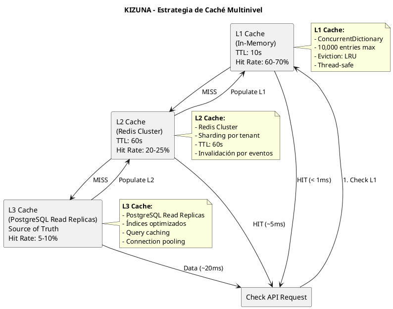
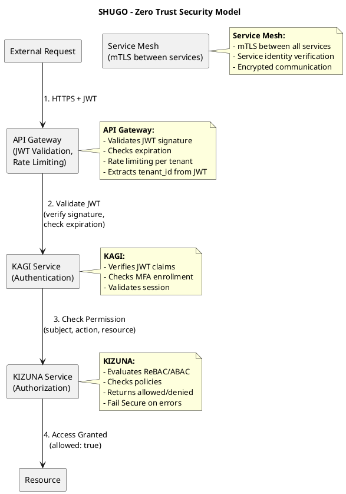
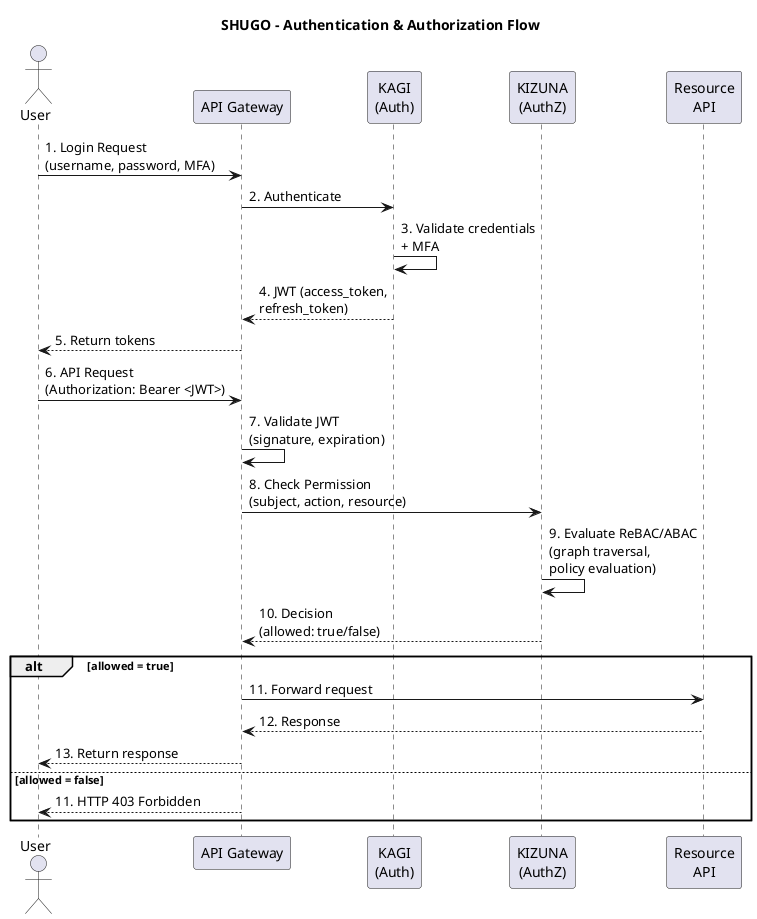
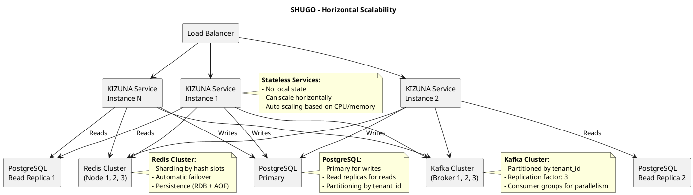
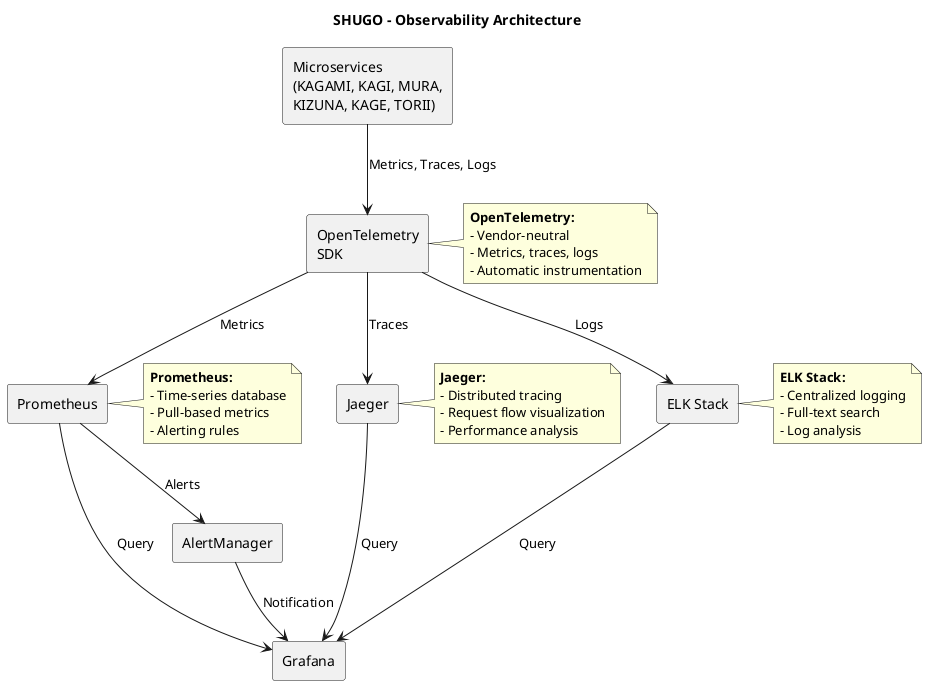
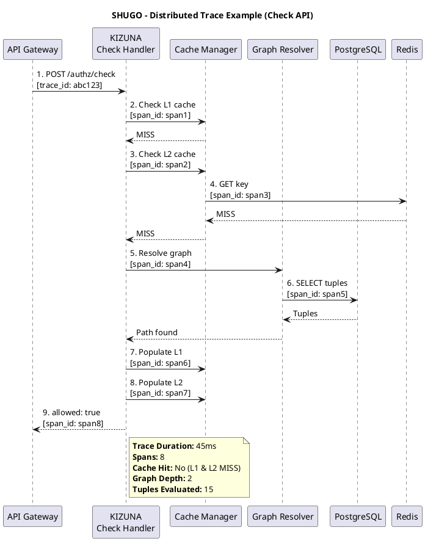
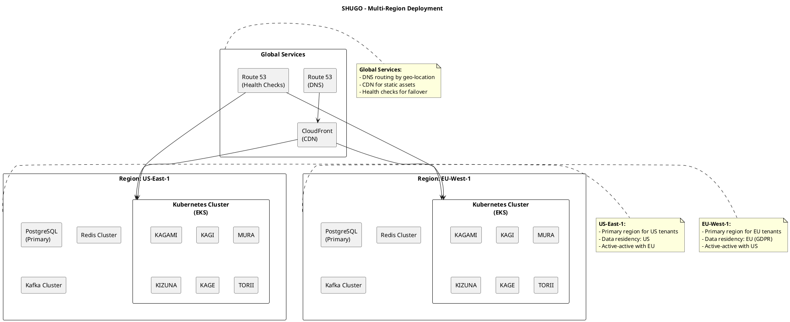
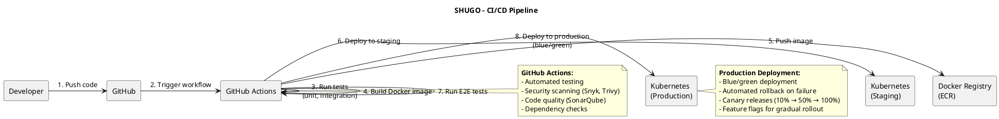

# SHUGO - Visión General de Arquitectura del Sistema (System Architecture Overview)

| Metadatos del Documento | |
| :--- | :--- |
| **Proyecto:** | SHUGO - Identity & Access Platform |
| **Documento:** | System_Architecture_Overview.md |
| **Metodología:** | Clean Architecture + Domain-Driven Design + Microservices + Event-Driven Architecture |
| **Estándares:** | ISO/IEC 25010 (Calidad de Software), ISO/IEC 27001 (Seguridad), TOGAF (Enterprise Architecture), C4 Model (Visualización) |
| **Autor:** | Gastón Ruiz |
| **Versión Actual:** | 2.0.0 |
| **Fecha:** | 30/08/2026 |

---

## Historial de Versiones

| Versión | Fecha | Autor | Descripción de Cambios | Impacto |
| :--- | :--- | :--- | :--- | :--- |
| **1.0.0** | 27/08/2026 | Gastón Ruiz | Versión inicial con 4 motores (KAGAMI, KAGI, MURA, KIZUNA) y arquitectura monolítica modular. | Base de la arquitectura del sistema. |
| **2.0.0** | 30/08/2026 | Gastón Ruiz | **Refactorización completa.** Evolución de monolito modular a microservicios distribuidos. 6 Bounded Contexts como servicios independientes. 15 EPICs y 49 UCs mapeados a componentes. Arquitectura event-driven con Kafka. Caché multinivel (L1/L2/L3). Patrón Outbox para consistencia eventual. Zero Trust Security Model. Multi-region deployment. Observabilidad completa con OpenTelemetry. Alineación con TOGAF y C4 Model. | Documento de referencia técnica para todo el equipo de ingeniería. Define la arquitectura completa del sistema SHUGO, sus componentes, patrones, tecnologías y decisiones de diseño. |

---

## 1. Introducción y Alcance

Este documento presenta la **Arquitectura del Sistema** completa de SHUGO, la plataforma de Identity & Access Management (IAM) diseñada para ser el sistema central de identidad y autorización de múltiples aplicaciones cliente.

La arquitectura sigue los principios de:

- **Clean Architecture** (Robert C. Martin): Separación de responsabilidades en capas concéntricas.
- **Domain-Driven Design** (Eric Evans): Alineación de la arquitectura con el dominio de negocio.
- **Microservices Architecture**: Servicios independientes, desplegables y escalables.
- **Event-Driven Architecture**: Comunicación asíncrona mediante eventos de dominio.
- **Zero Trust Security Model**: Nunca confiar, siempre verificar.
- **Cloud-Native Design**: Diseñado para ejecutarse en Kubernetes con escalabilidad horizontal.

### 1.1. Propósito

1. **Definir la Arquitectura de Alto Nivel:** Establecer los componentes principales, sus responsabilidades y relaciones.
2. **Especificar los Patrones de Diseño:** Documentar los patrones arquitectónicos utilizados (CQRS, Event Sourcing, Outbox, Cache-Aside, etc.).
3. **Seleccionar las Tecnologías:** Justificar la selección de tecnologías para cada componente.
4. **Garantizar Atributos de Calidad:** Asegurar seguridad, escalabilidad, disponibilidad, mantenibilidad y observabilidad.
5. **Facilitar la Comunicación:** Proveer un lenguaje común para desarrolladores, arquitectos y stakeholders.

### 1.2. Alcance

La arquitectura cubre:

- **6 Bounded Contexts** implementados como microservicios independientes
- **15 EPICs** y **49 UCs** mapeados a componentes específicos
- **Infraestructura cloud-native** con Kubernetes, PostgreSQL, Redis, Kafka
- **Seguridad Zero Trust** con mTLS, JWT, OAuth 2.0, OIDC
- **Observabilidad completa** con OpenTelemetry, logs estructurados, métricas y traces
- **Multi-region deployment** para alta disponibilidad y residencia de datos

---

## 2. Principios Arquitectónicos

### 2.1. Principios Fundamentales

| Principio | Descripción | Manifestación en SHUGO |
| :--- | :--- | :--- |
| **Separación de Responsabilidades** | Cada componente tiene una única razón para cambiar. | 6 Bounded Contexts con responsabilidades claramente delimitadas. |
| **Agnosticismo de Dominio** | El core del sistema no asume ningún modelo de negocio específico. | KIZUNA no conoce "veterinario" o "equino", solo "subject", "relation", "object". |
| **Fail Secure** | Ante cualquier error, el sistema debe denegar el acceso, no permitirlo. | La Check API retorna `allowed: false` ante timeouts, errores de infraestructura o excepciones no manejadas. |
| **Consistencia Eventual** | Los efectos secundarios (caché, eventos) pueden fallar sin afectar la operación principal. | Invalidación de caché y publicación de eventos son no bloqueantes. |
| **Escalabilidad Horizontal** | El sistema debe escalar agregando más instancias, no más recursos por instancia. | Stateless services, particionamiento por tenant, caché distribuida. |
| **Observabilidad por Diseño** | El sistema debe ser observable desde el primer día, no como add-on. | OpenTelemetry, logs estructurados, métricas, traces distribuidos. |
| **Seguridad en Profundidad** | Múltiples capas de defensa, no confiar en una sola. | JWT + mTLS + RBAC + ReBAC + ABAC + auditoría completa. |
| **Estándares Abiertos** | Preferir estándares de la industria sobre soluciones propietarias. | OAuth 2.0, OIDC, SAML, SCIM, JWT, WebAuthn/FIDO2. |

### 2.2. Restricciones Arquitectónicas

| Restricción | Justificación |
| :--- | :--- |
| **Latencia p95 < 50ms para Check API** | Requisito de experiencia de usuario para evaluaciones de permisos en tiempo real. |
| **Disponibilidad 99.99%** | Requisito de SLA para clientes enterprise. |
| **Multi-tenancy con aislamiento completo** | Requisito de seguridad para que tenants no puedan acceder a datos de otros tenants. |
| **Cumplimiento GDPR, SOC 2, ISO 27001** | Requisito regulatorio para operar en mercados regulados. |
| **Residencia de datos por región** | Requisito legal para clientes en regiones con leyes de soberanía de datos. |
| **Audit trail completo e inmutable** | Requisito de compliance para auditorías regulatorias. |

---

## 3. Vista de Contexto (C4 Model - Level 1)

### 3.1. Diagrama de Contexto del Sistema

```plantuml
@startuml SHUGO_Context_Diagram
!include https://raw.githubusercontent.com/plantuml-stdlib/C4-PlantUML/master/C4_Context.puml

title System Context Diagram - SHUGO IAM Platform

Person(admin, "Administrador de Tenant", "Gestiona identidades, roles y configuraciones de seguridad")
Person(developer, "Desarrollador de Aplicación", "Integra SHUGO en su aplicación mediante APIs y SDKs")
Person(enduser, "Usuario Final", "Se autentica y accede a recursos protegidos")

System_Boundary(shugo_boundary, "SHUGO IAM Platform") {
    System(shugo, "SHUGO Core", "Plataforma IAM que gestiona identidades, autenticación, autorización y auditoría")
}

System_Ext(khcs, "KHCS (Kakehashi Care System)", "Sistema de gestión veterinaria - Primer cliente de SHUGO")
System_Ext(external_idp, "External IdPs", "Proveedores de identidad externos (Google, GitHub, Microsoft)")
System_Ext(hr_system, "HR Systems", "Sistemas de RRHH (Workday, BambooHR) para sincronización de identidades")
System_Ext(audit_system, "SIEM/SOAR", "Sistemas de seguridad para consumo de logs de auditoría")

Rel(admin, shugo, "Administra", "HTTPS/REST")
Rel(developer, shugo, "Integra", "HTTPS/REST, SDKs")
Rel(enduser, shugo, "Se autentica", "HTTPS/OAuth2")
Rel(khcs, shugo, "Consume APIs", "HTTPS/REST")
Rel(shugo, external_idp, "Federación", "SAML/OIDC")
Rel(shugo, hr_system, "Sincroniza", "SCIM")
Rel(shugo, audit_system, "Exporta logs", "Kafka/Syslog")

@enduml
```

### 3.2. Actores y Sistemas Externos

| Actor/Sistema | Tipo | Interacción con SHUGO | Protocolo |
| :--- | :--- | :--- | :--- |
| **Administrador de Tenant** | Humano | Gestiona identidades, roles, políticas de seguridad | HTTPS/REST (Admin Portal) |
| **Desarrollador de Aplicación** | Humano | Integra SHUGO en su aplicación mediante APIs y SDKs | HTTPS/REST, SDKs (C#, Python, JS, Go) |
| **Usuario Final** | Humano | Se autentica y accede a recursos protegidos | HTTPS/OAuth2, WebAuthn/FIDO2 |
| **KHCS** | Sistema | Consume APIs de SHUGO para autenticación y autorización | HTTPS/REST |
| **External IdPs** | Sistema | Proveedores de identidad para federación (Google, GitHub, Microsoft) | SAML 2.0, OIDC |
| **HR Systems** | Sistema | Sincronización de identidades desde sistemas de RRHH | SCIM (RFC 7643/7644) |
| **SIEM/SOAR** | Sistema | Consumo de logs de auditoría para análisis de seguridad | Kafka, Syslog, Splunk HEC |

---

## 4. Vista de Contenedores (C4 Model - Level 2)

### 4.1. Diagrama de Contenedores

```plantuml
@startuml SHUGO_Container_Diagram
!include https://raw.githubusercontent.com/plantuml-stdlib/C4-PlantUML/master/C4_Container.puml

title Container Diagram - SHUGO IAM Platform

Person(admin, "Administrador")
Person(developer, "Desarrollador")
Person(enduser, "Usuario Final")

System_Boundary(shugo_boundary, "SHUGO IAM Platform") {
    
    ' API Gateway
    Container(gateway, "API Gateway", "Kong/AWS API Gateway", "Enrutamiento, rate limiting, autenticación JWT")
    
    ' Bounded Contexts como Microservicios
    Container_Boundary(bc1, "BC-1: KAGAMI (Identity Lifecycle)") {
        Container(kagami, "KAGAMI Service", ".NET 8 / ASP.NET Core", "Gestión de identidades (UC-01 a UC-05)")
    }
    
    Container_Boundary(bc2, "BC-2: KAGI (Authentication)") {
        Container(kagi, "KAGI Service", ".NET 8 / ASP.NET Core", "Autenticación y sesiones (UC-06 a UC-15)")
    }
    
    Container_Boundary(bc3, "BC-3: MURA (Directory)") {
        Container(mura, "MURA Service", ".NET 8 / ASP.NET Core", "Tenants, roles, grupos (UC-16 a UC-22)")
    }
    
    Container_Boundary(bc4, "BC-4: KIZUNA (Authorization)") {
        Container(kizuna, "KIZUNA Service", ".NET 8 / ASP.NET Core", "Autorización ReBAC/ABAC (UC-23 a UC-32)")
    }
    
    Container_Boundary(bc5, "BC-5: KAGE (Security)") {
        Container(kage, "KAGE Service", ".NET 8 / ASP.NET Core", "Seguridad, consentimiento, auditoría (UC-33 a UC-47)")
    }
    
    Container_Boundary(bc6, "BC-6: TORII (Integration)") {
        Container(torii, "TORII Service", ".NET 8 / ASP.NET Core", "SCIM, IdP, webhooks, API keys (UC-39 a UC-49)")
    }
    
    ' Admin Portal
    Container(admin_portal, "Admin Portal", "React/TypeScript", "Interfaz de administración para tenants")
    
    ' Infraestructura de Datos
    ContainerDb(postgres, "PostgreSQL Cluster", "PostgreSQL 15", "Almacenamiento principal (identidades, tuplas, políticas)")
    ContainerDb(redis, "Redis Cluster", "Redis 7", "Caché multinivel (L1/L2), sesiones, rate limiting")
    ContainerDb(kafka, "Apache Kafka", "Kafka 3.x", "Event streaming, auditoría, comunicación asíncrona")
    
    ' Observabilidad
    Container(prometheus, "Prometheus", "Prometheus", "Métricas y alertas")
    Container(grafana, "Grafana", "Grafana", "Visualización de métricas")
    Container(jaeger, "Jaeger", "Jaeger", "Distributed tracing")
    Container(elk, "ELK Stack", "Elasticsearch/Logstash/Kibana", "Logs centralizados")
}

' Relaciones
Rel(admin, admin_portal, "Administra", "HTTPS")
Rel(admin_portal, gateway, "API calls", "HTTPS/REST")
Rel(developer, gateway, "API calls", "HTTPS/REST")
Rel(enduser, gateway, "Auth flows", "HTTPS/OAuth2")

Rel(gateway, kagami, "Routes", "gRPC/HTTP")
Rel(gateway, kagi, "Routes", "gRPC/HTTP")
Rel(gateway, mura, "Routes", "gRPC/HTTP")
Rel(gateway, kizuna, "Routes", "gRPC/HTTP")
Rel(gateway, kage, "Routes", "gRPC/HTTP")
Rel(gateway, torii, "Routes", "gRPC/HTTP")

Rel(kagami, postgres, "Reads/Writes", "TCP/5432")
Rel(kagi, postgres, "Reads/Writes", "TCP/5432")
Rel(mura, postgres, "Reads/Writes", "TCP/5432")
Rel(kizuna, postgres, "Reads/Writes", "TCP/5432")
Rel(kage, postgres, "Reads/Writes", "TCP/5432")
Rel(torii, postgres, "Reads/Writes", "TCP/5432")

Rel(kagi, redis, "Sessions/Cache", "TCP/6379")
Rel(kizuna, redis, "Cache L1/L2", "TCP/6379")

Rel(kagami, kafka, "Publishes events", "TCP/9092")
Rel(kagi, kafka, "Publishes events", "TCP/9092")
Rel(mura, kafka, "Publishes events", "TCP/9092")
Rel(kizuna, kafka, "Publishes events", "TCP/9092")
Rel(kage, kafka, "Publishes events", "TCP/9092")
Rel(torii, kafka, "Publishes events", "TCP/9092")

Rel(kage, elk, "Audit logs", "TCP/5044")

@enduml
```

### 4.2. Descripción de Contenedores

| Contenedor | Tecnología | Responsabilidad | UCs Asociados |
| :--- | :--- | :--- | :--- |
| **API Gateway** | Kong / AWS API Gateway | Enrutamiento, rate limiting, autenticación JWT, transformación de requests/responses | Todos |
| **KAGAMI Service** | .NET 8 / ASP.NET Core | Gestión del ciclo de vida de identidades (provisionar, actualizar, consultar, desactivar, purgar) | UC-01 a UC-05 |
| **KAGI Service** | .NET 8 / ASP.NET Core | Autenticación (local, federada, MFA, passwordless), gestión de sesiones | UC-06 a UC-15 |
| **MURA Service** | .NET 8 / ASP.NET Core | Gestión de tenants, roles, grupos, asignación de roles | UC-16 a UC-22 |
| **KIZUNA Service** | .NET 8 / ASP.NET Core | Motor de autorización ReBAC/ABAC, gestión de namespaces, tuplas, políticas, Check API | UC-23 a UC-32 |
| **KAGE Service** | .NET 8 / ASP.NET Core | Políticas de seguridad, consentimiento, privacidad, PAM, auditoría, compliance | UC-33 a UC-47 |
| **TORII Service** | .NET 8 / ASP.NET Core | Integración con sistemas externos (SCIM, AD/LDAP), IdP (SAML/OIDC), webhooks, API keys | UC-39 a UC-43, UC-48, UC-49 |
| **Admin Portal** | React / TypeScript | Interfaz de administración para gestores de tenants | Todos (UI) |
| **PostgreSQL Cluster** | PostgreSQL 15 | Almacenamiento principal de identidades, tuplas, políticas, auditoría | Todos |
| **Redis Cluster** | Redis 7 | Caché multinivel (L1 in-memory, L2 Redis), sesiones, rate limiting | KAGI, KIZUNA |
| **Apache Kafka** | Kafka 3.x | Event streaming, auditoría, comunicación asíncrona entre servicios | Todos |
| **Prometheus** | Prometheus | Recolección y almacenamiento de métricas | Todos |
| **Grafana** | Grafana | Visualización de métricas y dashboards | Todos |
| **Jaeger** | Jaeger | Distributed tracing para observabilidad de requests end-to-end | Todos |
| **ELK Stack** | Elasticsearch / Logstash / Kibana | Logs centralizados para auditoría y debugging | KAGE (principalmente) |

---

## 5. Vista de Componentes (C4 Model - Level 3)

### 5.1. Componentes de KIZUNA Service (Ejemplo Detallado)

```plantuml
@startuml KIZUNA_Component_Diagram
!include https://raw.githubusercontent.com/plantuml-stdlib/C4-PlantUML/master/C4_Component.puml

title Component Diagram - KIZUNA Service (Authorization Engine)

Container(kizuna, "KIZUNA Service", ".NET 8", "Motor de autorización ReBAC/ABAC")

Container_Boundary(kizuna_internal, "KIZUNA Internal Components") {
    
    ' API Layer
    Component(check_api, "Check API Controller", "ASP.NET Core Controller", "Endpoint POST /authz/check - Evalúa permisos en tiempo real")
    Component(write_api, "Write API Controller", "ASP.NET Core Controller", "Endpoints POST/PUT/DELETE /relations - Gestiona tuplas")
    Component(admin_api, "Admin API Controller", "ASP.NET Core Controller", "Endpoints /admin/namespaces - Gestiona namespaces")
    
    ' Application Layer
    Component(check_handler, "Check Handler", "Command Handler", "Orquesta evaluación de permisos (UC-30)")
    Component(write_handler, "Write Handler", "Command Handler", "Orquesta creación/eliminación de tuplas (UC-27, UC-28)")
    Component(namespace_handler, "Namespace Handler", "Command Handler", "Orquesta gestión de namespaces (UC-23 a UC-26)")
    
    ' Domain Layer
    Component(graph_resolver, "Graph Resolver", "Domain Service", "Ejecuta BFS en grafo de relaciones para encontrar caminos")
    Component(policy_engine, "Policy Engine", "Domain Service", "Evalúa políticas ReBAC y condiciones ABAC")
    Component(cache_manager, "Cache Manager", "Domain Service", "Gestiona caché multinivel (L1 in-memory, L2 Redis)")
    Component(tuple_validator, "Tuple Validator", "Domain Service", "Valida formato y unicidad de tuplas")
    Component(namespace_validator, "Namespace Validator", "Domain Service", "Valida formato y nombres reservados de namespaces")
    
    ' Infrastructure Layer
    Component(tuple_repository, "Tuple Repository", "Repository", "Accede a tuplas en PostgreSQL")
    Component(namespace_repository, "Namespace Repository", "Repository", "Accede a namespaces en PostgreSQL")
    Component(policy_repository, "Policy Repository", "Repository", "Accede a políticas en PostgreSQL")
    Component(redis_client, "Redis Client", "Infrastructure", "Cliente para caché L2")
    Component(kafka_publisher, "Kafka Publisher", "Infrastructure", "Publica eventos de dominio")
}

' Relaciones
Rel(check_api, check_handler, "Uses")
Rel(write_api, write_handler, "Uses")
Rel(admin_api, namespace_handler, "Uses")

Rel(check_handler, graph_resolver, "Uses")
Rel(check_handler, policy_engine, "Uses")
Rel(check_handler, cache_manager, "Uses")

Rel(write_handler, tuple_validator, "Uses")
Rel(write_handler, tuple_repository, "Uses")
Rel(write_handler, cache_manager, "Uses")
Rel(write_handler, kafka_publisher, "Uses")

Rel(namespace_handler, namespace_validator, "Uses")
Rel(namespace_handler, namespace_repository, "Uses")
Rel(namespace_handler, cache_manager, "Uses")
Rel(namespace_handler, kafka_publisher, "Uses")

Rel(graph_resolver, tuple_repository, "Uses")
Rel(policy_engine, policy_repository, "Uses")
Rel(cache_manager, redis_client, "Uses")

@enduml
```

### 5.2. Componentes por Bounded Context

| Bounded Context | Componentes Principales | Patrones Aplicados |
| :--- | :--- | :--- |
| **KAGAMI** | IdentityController, ProvisionHandler, IdentityRepository, CredentialService | CQRS, Repository, Unit of Work |
| **KAGI** | AuthController, SessionManager, MFAService, TokenService, JWKSProvider | CQRS, Token Rotation, Fail Secure |
| **MURA** | TenantController, RoleController, GroupController, AccessReviewService | CQRS, Event Sourcing (Access Reviews) |
| **KIZUNA** | CheckAPI, WriteAPI, GraphResolver, PolicyEngine, CacheManager, TupleValidator | CQRS, Cache-Aside, Outbox, BFS Traversal |
| **KAGE** | SecurityPolicyController, ConsentController, AuditService, ComplianceReporter | Event Sourcing, CQRS, Fail Safe |
| **TORII** | SCIMController, IdPController, WebhookController, APIKeyController | Anti-Corruption Layer, Adapter Pattern |

---

## 6. Patrones Arquitectónicos

### 6.1. Patrones de Diseño Aplicados

| Patrón | Dónde se Aplica | Justificación |
| :--- | :--- | :--- |
| **CQRS (Command Query Responsibility Segregation)** | Todos los Bounded Contexts | Separa operaciones de escritura (commands) de lectura (queries) para optimizar rendimiento y escalabilidad. |
| **Event Sourcing** | KAGE (Audit Logs), MURA (Access Reviews) | Almacena cambios de estado como secuencia de eventos, permitiendo auditoría completa y reconstrucción de estado. |
| **Outbox Pattern** | KIZUNA (Write API) | Garantiza atomicidad entre persistencia de tuplas y publicación de eventos. El evento se guarda en la misma transacción que la tupla. |
| **Cache-Aside Pattern** | KIZUNA (Check API) | Caché multinivel (L1 in-memory, L2 Redis) para optimizar evaluaciones frecuentes. |
| **Circuit Breaker** | Todos los servicios (llamadas a PostgreSQL, Redis, Kafka) | Previene cascadas de fallos cuando dependencias están caídas. |
| **Retry with Backoff** | Publicación de eventos a Kafka | Reintentos con backoff exponencial para tolerar fallos transitorios. |
| **Bulkhead Pattern** | Separación de thread pools para Check API vs Write API | Aislamiento de fallos: si Write API satura, no afecta a Check API. |
| **Anti-Corruption Layer (ACL)** | TORII (integración con SAML, OIDC, SCIM, AD/LDAP) | Protege el dominio interno de SHUGO de formatos y protocolos externos. |
| **Repository Pattern** | Todos los Bounded Contexts | Abstrae el acceso a datos, permitiendo testeo unitario con mocks. |
| **Unit of Work Pattern** | KIZUNA (Write API) | Gestiona transacciones atómicas para creación de tuplas + eventos. |
| **Fail Secure Pattern** | KIZUNA (Check API) | Ante cualquier error, retorna `allowed: false` en lugar de permitir el acceso. |
| **Zero Trust Pattern** | API Gateway, todos los servicios | Nunca confiar, siempre verificar. JWT + mTLS + validación de permisos en cada request. |

### 6.2. Patrones de Comunicación

| Patrón | Dónde se Aplica | Justificación |
| :--- | :--- | :--- |
| **Synchronous (gRPC/HTTP)** | API Gateway → Servicios, Servicios → PostgreSQL/Redis | Para operaciones que requieren respuesta inmediata (evaluación de permisos, autenticación). |
| **Asynchronous (Kafka Events)** | Servicios → KAGE (auditoría), Servicios → TORII (webhooks) | Para operaciones que pueden procesarse eventualmente (auditoría, notificaciones). |
| **Event-Driven** | Todos los servicios publican eventos de dominio | Permite desacoplamiento entre servicios y reacción a cambios de estado. |
| **Pub/Sub** | KAGE consume eventos de todos los servicios para auditoría | KAGE actúa como suscriptor global de eventos para compliance. |

---

## 7. Arquitectura de Datos

### 7.1. Estrategia de Almacenamiento

| Tipo de Dato | Tecnología | Justificación |
| :--- | :--- | :--- |
| **Identidades, Tuplas, Políticas** | PostgreSQL 15 | Base de datos relacional ACID para datos transaccionales críticos. |
| **Caché L1 (Hot Paths)** | In-Memory (ConcurrentDictionary) | Ultra-rápido (< 1ms) para evaluaciones muy frecuentes. |
| **Caché L2 (Warm Paths)** | Redis 7 Cluster | Rápido (~5ms), distribuido, para evaluaciones frecuentes. |
| **Caché L3 (Cold Paths)** | PostgreSQL (Read Replicas) | Source of truth, para evaluaciones que no están en caché. |
| **Eventos de Dominio** | Apache Kafka | Event streaming para comunicación asíncrona y auditoría. |
| **Logs de Auditoría** | Elasticsearch (ELK Stack) | Búsqueda full-text y análisis de logs de auditoría. |
| **Sesiones Activas** | Redis | Almacenamiento de sesiones con TTL automático. |
| **Rate Limiting** | Redis | Contadores distribuidos para rate limiting por tenant. |

### 7.2. Particionamiento de Datos

#### **Particionamiento por Tenant**

Todos los datos en PostgreSQL están particionados por `tenant_id` para garantizar aislamiento y optimizar queries:

```sql
-- Ejemplo: Tabla de tuplas particionada por tenant
CREATE TABLE relation_tuples (
    id UUID PRIMARY KEY,
    tenant_id UUID NOT NULL,
    subject VARCHAR(255) NOT NULL,
    relation VARCHAR(100) NOT NULL,
    object VARCHAR(255) NOT NULL,
    created_at TIMESTAMP NOT NULL,
    expires_at TIMESTAMP,
    created_by UUID NOT NULL,
    CONSTRAINT fk_tenant FOREIGN KEY (tenant_id) REFERENCES tenants(id)
) PARTITION BY LIST (tenant_id);

-- Particiones automáticas por tenant
CREATE TABLE relation_tuples_khcs_001 PARTITION OF relation_tuples
    FOR VALUES IN ('khcs-001-uuid');

CREATE TABLE relation_tuples_ecommerce_xyz PARTITION OF relation_tuples
    FOR VALUES IN ('ecommerce-xyz-uuid');
```

#### **Sharding de Redis**

Redis Cluster utiliza hash slots para distribuir datos entre nodos:

```
Key: {tenant_id}:check:{subject}:{action}:{resource}
Hash Slot: CRC16(key) % 16384
```

### 7.3. Estrategia de Caché Multinivel



### 7.4. Modelo de Datos por Bounded Context

#### **KAGAMI (Identity Lifecycle)**

```sql
-- Tabla de identidades
CREATE TABLE identities (
    id UUID PRIMARY KEY DEFAULT gen_random_uuid(),
    tenant_id UUID NOT NULL,
    type VARCHAR(50) NOT NULL, -- 'User', 'Service', 'Device'
    status VARCHAR(50) NOT NULL, -- 'Active', 'Suspended', 'Deactivated', 'Purged'
    display_name VARCHAR(255),
    email VARCHAR(255),
    phone VARCHAR(50),
    locale VARCHAR(10),
    timezone VARCHAR(50),
    created_at TIMESTAMP NOT NULL DEFAULT NOW(),
    updated_at TIMESTAMP NOT NULL DEFAULT NOW(),
    deactivated_at TIMESTAMP,
    purged_at TIMESTAMP,
    CONSTRAINT fk_tenant FOREIGN KEY (tenant_id) REFERENCES tenants(id),
    CONSTRAINT uq_email UNIQUE (tenant_id, email)
);

-- Tabla de credenciales
CREATE TABLE credentials (
    id UUID PRIMARY KEY DEFAULT gen_random_uuid(),
    identity_id UUID NOT NULL,
    type VARCHAR(50) NOT NULL, -- 'Password', 'TOTP', 'WebAuthn', 'Certificate'
    secret_hash VARCHAR(500) NOT NULL,
    algorithm VARCHAR(50) NOT NULL, -- 'Argon2id', 'bcrypt'
    created_at TIMESTAMP NOT NULL DEFAULT NOW(),
    expires_at TIMESTAMP,
    last_used_at TIMESTAMP,
    status VARCHAR(50) NOT NULL, -- 'Active', 'Expired', 'Revoked'
    CONSTRAINT fk_identity FOREIGN KEY (identity_id) REFERENCES identities(id)
);
```

#### **KIZUNA (Authorization Engine)**

```sql
-- Tabla de namespaces
CREATE TABLE namespaces (
    tenant_id UUID NOT NULL,
    name VARCHAR(100) NOT NULL,
    description TEXT,
    created_at TIMESTAMP NOT NULL DEFAULT NOW(),
    created_by UUID NOT NULL,
    PRIMARY KEY (tenant_id, name),
    CONSTRAINT fk_tenant FOREIGN KEY (tenant_id) REFERENCES tenants(id)
);

-- Tabla de relation definitions
CREATE TABLE relation_definitions (
    id UUID PRIMARY KEY DEFAULT gen_random_uuid(),
    tenant_id UUID NOT NULL,
    namespace_name VARCHAR(100) NOT NULL,
    name VARCHAR(100) NOT NULL,
    type VARCHAR(50) NOT NULL, -- 'user', 'group', 'service'
    description TEXT,
    CONSTRAINT fk_namespace FOREIGN KEY (tenant_id, namespace_name) REFERENCES namespaces(tenant_id, name),
    CONSTRAINT uq_relation UNIQUE (tenant_id, namespace_name, name)
);

-- Tabla de tuplas de relación
CREATE TABLE relation_tuples (
    id UUID PRIMARY KEY DEFAULT gen_random_uuid(),
    tenant_id UUID NOT NULL,
    subject VARCHAR(255) NOT NULL,
    relation VARCHAR(100) NOT NULL,
    object VARCHAR(255) NOT NULL,
    created_at TIMESTAMP NOT NULL DEFAULT NOW(),
    expires_at TIMESTAMP,
    created_by UUID NOT NULL,
    CONSTRAINT fk_tenant FOREIGN KEY (tenant_id) REFERENCES tenants(id),
    CONSTRAINT uq_tuple UNIQUE (tenant_id, subject, relation, object)
) PARTITION BY LIST (tenant_id);

-- Índices optimizados para BFS
CREATE INDEX idx_tuples_subject ON relation_tuples (tenant_id, subject);
CREATE INDEX idx_tuples_object ON relation_tuples (tenant_id, object);
CREATE INDEX idx_tuples_expires ON relation_tuples (expires_at) WHERE expires_at IS NOT NULL;

-- Tabla de outbox events (patrón Outbox)
CREATE TABLE outbox_events (
    id UUID PRIMARY KEY DEFAULT gen_random_uuid(),
    event_type VARCHAR(100) NOT NULL,
    payload JSONB NOT NULL,
    created_at TIMESTAMP NOT NULL DEFAULT NOW(),
    published_at TIMESTAMP,
    retry_count INT NOT NULL DEFAULT 0
);

CREATE INDEX idx_outbox_unpublished ON outbox_events (published_at) WHERE published_at IS NULL;
```

---

## 8. Arquitectura de Seguridad

### 8.1. Modelo Zero Trust



### 8.2. Capas de Seguridad

| Capa | Tecnología | Responsabilidad |
| :--- | :--- | :--- |
| **Perimeter** | API Gateway (Kong/AWS) | Rate limiting, JWT validation, DDoS protection, WAF |
| **Network** | Service Mesh (Istio/Linkerd) | mTLS between services, network policies, service identity |
| **Authentication** | KAGI Service | JWT issuance, MFA, passwordless, federation |
| **Authorization** | KIZUNA Service | ReBAC/ABAC evaluation, policy enforcement |
| **Data** | PostgreSQL TDE, Redis Encryption | Encryption at rest, field-level encryption for sensitive data |
| **Audit** | KAGE Service | Immutable audit logs, compliance reporting |

### 8.3. Flujo de Autenticación y Autorización



### 8.4. Cifrado y Protección de Datos

| Tipo de Dato | Cifrado en Tránsito | Cifrado en Reposo |
| :--- | :--- | :--- |
| **Credenciales (passwords)** | TLS 1.3 | Argon2id hash (never stored in plaintext) |
| **JWT Tokens** | TLS 1.3 | N/A (short-lived, stateless) |
| **PII (email, phone)** | TLS 1.3 | AES-256 field-level encryption |
| **Audit Logs** | TLS 1.3 | AES-256, immutable storage |
| **Tuplas de Relación** | TLS 1.3 | PostgreSQL TDE (Transparent Data Encryption) |

---

## 9. Arquitectura de Escalabilidad

### 9.1. Escalabilidad Horizontal



### 9.2. Estrategias de Escalabilidad

| Componente | Estrategia | Justificación |
| :--- | :--- | :--- |
| **Microservicios** | Escalado independiente por servicio | KIZUNA (Check API) puede escalar más que KAGE (audit) según demanda. |
| **PostgreSQL** | Read replicas + particionamiento por tenant | Reads escalan horizontalmente, writes se particionan por tenant. |
| **Redis** | Redis Cluster con sharding | Distribución automática de datos entre nodos. |
| **Kafka** | Particionamiento por tenant_id + consumer groups | Procesamiento paralelo de eventos por tenant. |
| **Caché** | Multinivel (L1/L2/L3) | Reduce carga en PostgreSQL para evaluaciones frecuentes. |

### 9.3. Auto-Scaling

```yaml
# Kubernetes HPA (Horizontal Pod Autoscaler) para KIZUNA Service
apiVersion: autoscaling/v2
kind: HorizontalPodAutoscaler
metadata:
  name: kizuna-hpa
spec:
  scaleTargetRef:
    apiVersion: apps/v1
    kind: Deployment
    name: kizuna-service
  minReplicas: 3
  maxReplicas: 50
  metrics:
  - type: Resource
    resource:
      name: cpu
      target:
        type: Utilization
        averageUtilization: 70
  - type: Pods
    pods:
      metric:
        name: http_requests_per_second
      target:
        type: AverageValue
        averageValue: 1000
  behavior:
    scaleUp:
      stabilizationWindowSeconds: 60
      policies:
      - type: Percent
        value: 100
        periodSeconds: 60
    scaleDown:
      stabilizationWindowSeconds: 300
      policies:
      - type: Percent
        value: 10
        periodSeconds: 60
```

---

## 10. Arquitectura de Observabilidad

### 10.1. Pilares de Observabilidad



### 10.2. Métricas Clave

| Métrica | Tipo | Descripción | Alerta |
| :--- | :--- | :--- | :--- |
| `shugo.kizuna.check.latency` | Histogram | Latencia de evaluación de permisos | p95 > 50ms |
| `shugo.kizuna.checks.total` | Counter | Total de evaluaciones de permisos | - |
| `shugo.kizuna.cache.hit_rate` | Gauge | Hit rate de caché | < 80% |
| `shugo.kizuna.errors.total` | Counter | Total de errores | > 1% de requests |
| `shugo.kizuna.graph.depth` | Histogram | Profundidad de traversación de grafo | > 5 saltos |
| `shugo.kizuna.outbox.pending` | Gauge | Eventos pendientes en outbox | > 1000 |
| `shugo.kagi.auth.success_rate` | Gauge | Tasa de éxito de autenticación | < 95% |
| `shugo.kagi.sessions.active` | Gauge | Sesiones activas | - |

### 10.3. Distributed Tracing



---

## 11. Arquitectura de Deployment

### 11.1. Multi-Region Deployment



### 11.2. CI/CD Pipeline



### 11.3. Estrategia de Deployment

| Estrategia | Dónde se Aplica | Justificación |
| :--- | :--- | :--- |
| **Blue/Green Deployment** | Todos los microservicios | Zero-downtime deployments, rollback instantáneo. |
| **Canary Releases** | KIZUNA (Check API) | Rollout gradual para validar rendimiento y errores antes de rollout completo. |
| **Feature Flags** | Todos los servicios | Activar/desactivar features sin deployment, A/B testing. |
| **Automated Rollback** | Todos los servicios | Rollback automático si health checks fallan después de deployment. |

---

## 12. Decisiones de Arquitectura (ADR)

### 12.1. ADR-001: Microservices vs Monolith

**Decisión:** Evolucionar de monolito modular a microservicios distribuidos.

**Contexto:** SHUGO comenzó como un monolito modular con 4 motores (KAGAMI, KAGI, MURA, KIZUNA). A medida que el sistema crecía, necesitamos escalar componentes específicos (KIZUNA) independientemente.

**Opciones Consideradas:**
1. Mantener monolito modular
2. Evolucionar a microservicios
3. Usar modular monolith con boundaries estrictos

**Decisión Tomada:** Opción 2 - Microservicios

**Justificación:**
- Escalabilidad independiente por Bounded Context
- Deployments independientes
- Flexibilidad tecnológica (aunque usamos .NET 8 para todos)
- Alineación con equipos (cada equipo es dueño de un Bounded Context)

**Consecuencias:**
- Mayor complejidad operacional (orquestación, monitoring)
- Latencia de red entre servicios (mitigado con gRPC)
- Necesidad de service mesh para mTLS
- Mayor overhead de infraestructura

### 12.2. ADR-002: PostgreSQL vs Neo4j para Grafo de Relaciones

**Decisión:** Usar PostgreSQL con índices optimizados en lugar de Neo4j para el grafo de relaciones de KIZUNA.

**Contexto:** KIZUNA necesita traversar un grafo de relaciones para evaluar permisos. Neo4j es una base de datos de grafos nativa, pero PostgreSQL es más familiar para el equipo.

**Opciones Consideradas:**
1. PostgreSQL con índices optimizados
2. Neo4j (base de datos de grafos nativa)
3. Amazon Neptune (grafo managed)

**Decisión Tomada:** Opción 1 - PostgreSQL

**Justificación:**
- Familiaridad del equipo con PostgreSQL
- Costo significativamente menor que Neo4j
- Rendimiento suficiente para nuestros casos de uso (BFS limitado a 5 saltos)
- Ecosistema maduro de herramientas (backups, monitoring, etc.)
- Particionamiento por tenant nativo

**Consecuencias:**
- Queries de grafo más complejas que en Neo4j
- Necesidad de índices cuidadosamente diseñados
- Limitación de profundidad de traversación (5 saltos) para mantener rendimiento

### 12.3. ADR-003: Kafka vs RabbitMQ para Event Streaming

**Decisión:** Usar Apache Kafka en lugar de RabbitMQ para event streaming.

**Contexto:** SHUGO necesita comunicación asíncrona entre servicios para auditoría, webhooks y eventos de dominio.

**Opciones Consideradas:**
1. Apache Kafka
2. RabbitMQ
3. AWS SQS/SNS

**Decisión Tomada:** Opción 1 - Kafka

**Justificación:**
- Alto throughput (millones de eventos por segundo)
- Retención de mensajes configurable (para replay)
- Particionamiento por tenant_id para paralelismo
- Ecosistema rico (Kafka Connect, Kafka Streams)
- Durabilidad garantizada (replicación)

**Consecuencias:**
- Mayor complejidad operacional que RabbitMQ
- Necesidad de gestionar clusters de Kafka
- Curva de aprendizaje para el equipo

### 12.4. ADR-004: Redis Cluster vs Memcached para Caché

**Decisión:** Usar Redis Cluster en lugar de Memcached para caché multinivel.

**Contexto:** KIZUNA necesita caché multinivel (L1 in-memory, L2 distribuida) para optimizar evaluaciones de permisos.

**Opciones Consideradas:**
1. Redis Cluster
2. Memcached
3. Hazelcast

**Decisión Tomada:** Opción 1 - Redis Cluster

**Justificación:**
- Soporte para estructuras de datos avanzadas (sets, sorted sets) para optimizaciones futuras
- Persistencia opcional (RDB + AOF)
- Sharding nativo con Redis Cluster
- Pub/Sub para invalidación de caché
- Comunidad más activa y ecosistema más rico

**Consecuencias:**
- Mayor uso de memoria que Memcached
- Necesidad de gestionar cluster de Redis
- Costo ligeramente mayor

### 12.5. ADR-005: .NET 8 vs Go vs Node.js para Microservicios

**Decisión:** Usar .NET 8 para todos los microservicios.

**Contexto:** SHUGO necesita un stack tecnológico para implementar los 6 Bounded Contexts.

**Opciones Consideradas:**
1. .NET 8 (C#)
2. Go
3. Node.js (TypeScript)
4. Java (Spring Boot)

**Decisión Tomada:** Opción 1 - .NET 8

**Justificación:**
- Rendimiento excelente (comparable a Go)
- Ecosistema maduro y enterprise-grade
- Familiaridad del equipo con .NET
- Soporte nativo para gRPC, OpenTelemetry, Entity Framework
- Tipado fuerte con C# para prevenir errores

**Consecuencias:**
- Dependencia de Microsoft ecosystem
- Menos flexibilidad que Go para concurrencia
- Mayor consumo de memoria que Go

---

## 13. Atributos de Calidad

### 13.1. Seguridad

| Atributo | Target | Cómo se Logra |
| :--- | :--- | :--- |
| **Confidencialidad** | Datos cifrados en tránsito y reposo | TLS 1.3, AES-256, Argon2id para passwords |
| **Integridad** | Datos no alterados sin autorización | Firmas digitales, audit logs inmutables |
| **Disponibilidad** | 99.99% uptime | Multi-region, auto-scaling, circuit breakers |
| **No Repudio** | Acciones trazables a usuarios | Audit logs con tenant_id, user_id, timestamp |
| **Fail Secure** | Denegar acceso ante errores | Check API retorna `allowed: false` ante cualquier error |

### 13.2. Rendimiento

| Atributo | Target | Cómo se Logra |
| :--- | :--- | :--- |
| **Latencia Check API** | p95 < 50ms | Caché multinivel, BFS limitado, read replicas |
| **Throughput Check API** | 10,000 req/seg | Stateless services, horizontal scaling, connection pooling |
| **Latencia Write API** | p95 < 200ms | Transacciones optimizadas, índices, batch inserts |
| **Throughput Write API** | 100 req/seg | Particionamiento por tenant, async processing |

### 13.3. Escalabilidad

| Atributo | Target | Cómo se Logra |
| :--- | :--- | :--- |
| **Identidades** | 1M+ identidades | Particionamiento por tenant, sharding de PostgreSQL |
| **Tuplas** | 100M+ tuplas | Particionamiento por tenant, índices optimizados |
| **Evaluaciones/día** | 100M+ evaluaciones | Caché multinivel, read replicas, horizontal scaling |
| **Tenants** | 1,000+ tenants | Aislamiento por particionamiento, resource quotas |

### 13.4. Disponibilidad

| Atributo | Target | Cómo se Logra |
| :--- | :--- | :--- |
| **Uptime** | 99.99% | Multi-region deployment, auto-failover, health checks |
| **RTO (Recovery Time Objective)** | < 5 minutos | Automated failover, backup restoration |
| **RPO (Recovery Point Objective)** | < 1 minuto | Synchronous replication, point-in-time recovery |

### 13.5. Mantenibilidad

| Atributo | Target | Cómo se Logra |
| :--- | :--- | :--- |
| **Cobertura de Tests** | > 90% | Unit tests, integration tests, E2E tests |
| **Documentación** | 100% de APIs documentadas | OpenAPI 3.0, ADRs, runbooks |
| **Deuda Técnica** | < 5% del tiempo | Code reviews, refactoring sprints, SonarQube |
| **Time to Deploy** | < 30 minutos | CI/CD automatizado, blue/green deployments |

### 13.6. Observabilidad

| Atributo | Target | Cómo se Logra |
| :--- | :--- | :--- |
| **Métricas** | 100% de servicios instrumentados | OpenTelemetry SDK, Prometheus |
| **Traces** | 100% de requests trazables | Jaeger, distributed tracing |
| **Logs** | 100% de eventos críticos logeados | ELK Stack, structured logging |
| **Alertas** | < 5 minutos para detectar incidentes | Prometheus AlertManager, PagerDuty |

---

## 14. Trazabilidad

| Documento | Relación |
| :--- | :--- |
| `Product_Vision.md` | Define la visión y estrategia que esta arquitectura materializa. |
| `Domain_Analysis.md` | Define los Bounded Contexts que esta arquitectura implementa como microservicios. |
| `KIZUNA_Engine_Architecture.md` | Detalla la arquitectura interna del Bounded Context KIZUNA. |
| `Security_Threat_Model.md` | Analiza las amenazas que esta arquitectura debe mitigar. |
| `Glossary.md` | Contiene definiciones de términos técnicos usados en este documento. |
| `KHCS_SHUGO_Integration_Contract.md` | Primer caso de uso real que valida esta arquitectura. |
| Cada documento de UC | Implementa los componentes definidos en esta arquitectura. |

---

## 15. Anexos

### 15.1. Glosario de Términos Técnicos

| Término | Definición |
| :--- | :--- |
| **Bounded Context** | Delimitación semántica dentro de un dominio donde un modelo de dominio es aplicable. |
| **CQRS** | Command Query Responsibility Segregation - Patrón que separa operaciones de lectura y escritura. |
| **Event Sourcing** | Patrón que almacena cambios de estado como secuencia de eventos. |
| **Outbox Pattern** | Patrón que garantiza atomicidad entre persistencia y publicación de eventos. |
| **mTLS** | Mutual TLS - Autenticación bidireccional entre servicios. |
| **Service Mesh** | Infraestructura dedicada para manejar comunicación entre servicios (Istio, Linkerd). |
| **Blue/Green Deployment** | Estrategia de deployment con dos ambientes idénticos para zero-downtime. |
| **Canary Release** | Rollout gradual de una nueva versión a un subconjunto de usuarios. |
| **RTO** | Recovery Time Objective - Tiempo máximo aceptable de downtime. |
| **RPO** | Recovery Point Objective - Pérdida máxima aceptable de datos. |

### 15.2. Referencias

1. **Clean Architecture** - Robert C. Martin - https://blog.cleancoder.com/uncle-bob/2012/08/13/the-clean-architecture.html
2. **Domain-Driven Design** - Eric Evans - https://www.domainlanguage.com/ddd/
3. **Microservices** - Martin Fowler - https://martinfowler.com/articles/microservices.html
4. **C4 Model** - Simon Brown - https://c4model.com/
5. **TOGAF** - The Open Group Architecture Framework - https://www.opengroup.org/togaf
6. **Zero Trust Architecture** - NIST SP 800-207 - https://csrc.nist.gov/publications/detail/sp/800-207/final
7. **Event-Driven Architecture** - Martin Kleppmann - https://martin.kleppmann.com/

---
*Fin del Documento System_Architecture_Overview v2.0 para SHUGO*