# 📚 SHUGO - EPIC 01: Core Identity Lifecycle Management

| Metadatos del Documento | |
| :--- | :--- |
| **Proyecto:** | SHUGO - Identity & Access Platform |
| **EPIC:** | EPIC-01 - Core Identity Lifecycle Management (Motor KAGAMI) |
| **Versión del Documento:** | 2.0.0 |
| **Fecha:** | 05/09/2026 |
| **Estado:** | ✅ **Completado (120/120 Documentos)** |
| **Autor Principal:** | Gastón Ruiz |
| **Metodología:** | ICONIX + DDD + Clean Architecture + Event-Driven Architecture + Security by Design |
| **Estándares Aplicados:** | GDPR, SOC 2 Type II, ISO 27001:2022, NIST SP 800-63B, OWASP ASVS 4.0 |

---

## 🎯 1. Introducción y Propósito

Este directorio contiene la **especificación de diseño arquitectónico y técnico completo** para el **EPIC-01**, que abarca el ciclo de vida central de las identidades en la plataforma SHUGO.

El motor **KAGAMI** (Identity Lifecycle Engine) es el núcleo del sistema, responsable de la creación, modificación, consulta, desactivación, purga irreversible, registro self-service, invitación corporativa, gestión de perfiles, verificación de contactos y operaciones masivas de importación/exportación. Garantiza en todo momento el cumplimiento normativo (GDPR, SOC 2, ISO 27001, NIST SP 800-88), la seguridad criptográfica y el rendimiento enterprise.

### 1.1. Alcance del EPIC-01

Este EPIC cubre las **10 operaciones fundamentales** del ciclo de vida de una identidad, organizadas en tres dominios lógicos:

#### 🏗️ Dominio 1: Core Lifecycle (UC-01 a UC-05)
Operaciones administrativas fundamentales gestionadas por el motor KAGAMI.

| UC | Nombre | Patrón Arquitectónico | Complejidad |
| :--- | :--- | :--- | :--- |
| **UC-01** | Provisionar Nueva Identidad | Command Pattern + Outbox Pattern | ⭐⭐⭐⭐ |
| **UC-02** | Actualizar Identidad | Merge Patch + OCC + Event Sourcing | ⭐⭐⭐⭐⭐ |
| **UC-03** | Desactivar Identidad | Soft Delete + Grace Period + Saga | ⭐⭐⭐⭐ |
| **UC-04** | Consultar Identidad | CQRS Query Side + Cache-Aside | ⭐⭐⭐ |
| **UC-05** | Purgar Identidad | Crypto-Shredding + Legal Hold + GDPR Art. 17 | ⭐⭐⭐⭐⭐ |

#### 🌐 Dominio 2: Self-Service & User Autonomy (UC-06 a UC-09)
Operaciones iniciadas por el propio usuario, con validaciones de ownership y seguridad reforzada.

| UC | Nombre | Patrón Arquitectónico | Complejidad |
| :--- | :--- | :--- | :--- |
| **UC-06** | Registro Self-Service | Dual-Actor Async + Compensation Pattern | ⭐⭐⭐⭐ |
| **UC-07** | Invitación de Usuarios | Token-Based Verification + Anti-Enumeration | ⭐⭐⭐⭐ |
| **UC-08** | Self-Service Profile | Ownership Validation + Granular Audit (GDPR Art. 16) | ⭐⭐⭐⭐ |
| **UC-09** | Verificación de Contactos | OOB Verification + Atomic Redis + 3-Phase Validation | ⭐⭐⭐⭐⭐ |

#### 📦 Dominio 3: Bulk Operations & Integration (UC-10)
Operaciones masivas asíncronas para integración enterprise y migración de datos.

| UC | Nombre | Patrón Arquitectónico | Complejidad |
| :--- | :--- | :--- | :--- |
| **UC-10** | Import/Export Masivo | Async Batch Processing + Chunking + Signed URLs | ⭐⭐⭐⭐⭐ |

---

## 🏆 2. Métricas del EPIC-01

### 2.1. Estadísticas de Diseño

| Métrica | Valor |
| :--- | :--- |
| **Total de Casos de Uso** | 10 |
| **Total de Documentos Generados** | 120 |
| **Documentos por Caso de Uso** | 12 (9 funcionales + 3 técnicos) |
| **Líneas de Código de Referencia (C#)** | ~15.000 |
| **Diagramas UML Generados** | 50+ |
| **Amenazas de Seguridad Modeladas** | 70+ (STRIDE + DREAD) |
| **Métricas OpenTelemetry Definidas** | 150+ |
| **Endpoints API Definidos** | 45+ |
| **Tablas de Base de Datos** | 25+ |
| **Eventos de Dominio** | 35+ |

### 2.2. Cobertura de Estándares

| Estándar | Requisitos Cubiertos | Nivel de Cumplimiento |
| :--- | :--- | :--- |
| **GDPR** | Art. 5, 6, 7, 16, 17, 32 | ✅ 100% |
| **SOC 2 Type II** | CC6.1, CC6.7, CC7.2, CC7.4, CC8.1 | ✅ 100% |
| **ISO 27001:2022** | A.9.2, A.9.4, A.12.6, A.14.2 | ✅ 100% |
| **NIST SP 800-63B** | Enrollment, Authentication, MFA | ✅ 100% |
| **OWASP ASVS 4.0** | V2 (Authentication), V4 (Access Control) | ✅ 100% |

---

## 📐 3. Estándar de Diseño Aplicado

Cada Caso de Uso (UC) dentro de este EPIC ha sido diseñado siguiendo un **riguroso estándar de 12 documentos** (Opción A+), divididos en dos fases:

### Fase 1: Diseño Funcional y de Dominio (Documentos 01-09)

| # | Documento | Metodología | Propósito | Entregable Clave |
| :--- | :--- | :--- | :--- | :--- |
| 01 | `Requirements_Specification.md` | ICONIX + BDD | Especificación analítica, actores, precondiciones y criterios de aceptación Gherkin. | 10+ escenarios BDD |
| 02 | `Use_Case_Diagram.md` | UML 2.5 | Límites del sistema, actores y relaciones `<<include>>` / `<<extend>>`. | Diagrama PlantUML |
| 03 | `Activity_Diagram.md` | UML 2.5 + Swimlanes | Flujo de trabajo interno, decisiones lógicas y carriles de responsabilidad. | Diagrama con 8+ carriles |
| 04 | `Initial_Domain_Model.md` | DDD + ICONIX | Modelo conceptual de Aggregate Roots, Entities, Value Objects y Domain Services. | 20+ clases de dominio |
| 05 | `State_Machine_Diagram.md` | UML 2.5 | Máquinas de estados, transiciones permitidas y guardas (guards) de dominio. | 3+ máquinas de estado |
| 06 | `Robustness_Diagram.md` | ICONIX | Validación de acoplamiento entre Boundary, Control y Entity objects. | Diagrama con 15+ objetos |
| 07 | `Sequence_Diagram.md` | UML 2.5 | Orden temporal exacto de las interacciones entre objetos y sistemas externos. | 50+ mensajes secuenciales |
| 08 | `Final_Class_Design.md` | DDD + Clean Arch | Firmas de métodos, visibilidad, patrones de diseño y código C# de referencia. | 15+ clases con código |
| 09 | `Modern_Artifacts.md` | API-First + DevSecOps | Contratos OpenAPI 3.1, métricas OpenTelemetry, Feature Flags y Compliance. | 45+ endpoints API |

### Fase 2: Diseño Técnico Específico (Documentos 10-12)

| # | Documento | Metodología | Propósito | Entregable Clave |
| :--- | :--- | :--- | :--- | :--- |
| 10 | `UC_Specific_Data_Model.md` | Physical Data Modeling | DDL, índices optimizados, particionamiento, RLS y estrategias de almacenamiento. | 25+ tablas con DDL |
| 11 | `UC_Specific_Security_Threats.md` | STRIDE + DREAD + Attack Trees | Análisis de amenazas específico, mitigaciones de nivel elite y compliance mapping. | 70+ amenazas modeladas |
| 12 | `UC_Specific_Performance_Benchmarks.md` | SRE + Load Testing | SLIs, SLOs, estrategias de optimización, capacity planning y scripts de k6. | 150+ métricas + scripts k6 |

---

## 📋 4. Índice de Casos de Uso (Status: 100% Completado)

| UC | Nombre del Caso de Uso | Dominio | Documentos | Estado |
| :--- | :--- | :--- | :--- | :--- |
| **UC-01** | Provisionar Nueva Identidad | Identity Creation | [12/12](./UC-01_Provisionar_Identidad/) | ✅ Completo |
| **UC-02** | Actualizar Identidad | Identity Mutation | [12/12](./UC-02_Actualizar_Identidad/) | ✅ Completo |
| **UC-03** | Desactivar Identidad | Lifecycle Management | [12/12](./UC-03_Desactivar_Identidad/) | ✅ Completo |
| **UC-04** | Consultar Identidad | CQRS Query Side | [12/12](./UC-04_Consultar_Identidad/) | ✅ Completo |
| **UC-05** | Purgar Identidad | Compliance & Deletion | [12/12](./UC-05_Purgar_Identidad/) | ✅ Completo |
| **UC-06** | Registro Self-Service | User Onboarding | [12/12](./UC-06_Registro_Self_Service/) | ✅ Completo |
| **UC-07** | Invitación de Usuarios | Corporate Onboarding | [12/12](./UC-07_Invitacion_Usuarios/) | ✅ Completo |
| **UC-08** | Self-Service Profile | User Autonomy | [12/12](./UC-08_Self_Service_Profile/) | ✅ Completo |
| **UC-09** | Verificación de Contactos | OOB Verification | [12/12](./UC-09_Verificacion_Contactos/) | ✅ Completo |
| **UC-10** | Import/Export Masivo | Bulk Operations | [12/12](./UC-10_Import_Export_Masivo/) | ✅ Completo |

**Total de Documentos Generados en EPIC-01: 120**

---

## 🏛️ 5. Principios Arquitectónicos Clave del EPIC-01

### 5.1. Domain-Driven Design (DDD)
Lógica de negocio encapsulada en **Aggregate Roots** con métodos de intención explícita:
```csharp
// ✅ CORRECTO: Método de intención explícita
identity.Deactivate(adminId, reason);

// ❌ INCORRECTO: Mutación directa de estado
identity.Status = IdentityStatus.DEACTIVATED;
```

### 5.2. CQRS (Command Query Responsibility Segregation)
Separación estricta entre el lado de escritura (UC-01, 02, 03, 05, 06, 07, 08, 09, 10) y el lado de lectura optimizado (UC-04) con **Cache-Aside** y **Read Replicas**.

### 5.3. Optimistic Concurrency Control (OCC)
Prevención de **Lost Updates** mediante `RowVersion` (UUID) en todas las operaciones de mutación:
```csharp
// EF Core Configuration
builder.Property(i => i.RowVersion)
    .IsConcurrencyToken()
    .HasDefaultValueSql("gen_random_uuid()");
```

### 5.4. Privacy by Design & Crypto-Shredding
- **Enmascaramiento automático** de PII para Self-Service (UC-04, UC-08)
- **Anonimización criptográfica irreversible** (HMAC-SHA256) durante la purga (UC-05)
- **Hashing de contactos** para prevención de enumeración (UC-09)

### 5.5. Defense-in-Depth
Validaciones en múltiples capas:
1. **API Gateway:** Rate limiting, validación de JWT, extracción de claims
2. **Application Service:** Validación de permisos, quota, concurrencia
3. **Domain Service:** Reglas de negocio, invariantes de dominio
4. **Database:** Row-Level Security (RLS), CHECK constraints, triggers

### 5.6. Event-Driven Architecture
Uso del **Outbox Pattern** para garantizar la consistencia eventual en la notificación a sistemas downstream (KAGI, KIZUNA, KAGE, TORII) sin comprometer la atomicidad de la transacción principal.

### 5.7. Async Batch Processing
Para operaciones masivas (UC-10), separación clara entre:
- **Iniciación síncrona** (<2s): Validación, encolado, respuesta inmediata
- **Procesamiento asíncrono** (minutos a horas): Chunking, validación en 3 fases, generación de reportes

---

## 🗂️ 6. Cómo Navegar este Directorio

Cada Caso de Uso tiene su propio subdirectorio (ej. `UC-02_Actualizar_Identidad/`). Dentro de cada uno, los documentos están numerados del `01` al `12` para facilitar la lectura secuencial.

### Estructura de Directorios

```
EPIC-01_Core_Identity_Lifecycle/
├── README.md                                    ← Este archivo
├── UC-01_Provisionar_Identidad/
│   ├── 01_Requirements_Specification.md
│   ├── 02_Use_Case_Diagram.md
│   ├── 03_Activity_Diagram.md
│   ├── 04_Initial_Domain_Model.md
│   ├── 05_State_Machine_Diagram.md
│   ├── 06_Robustness_Diagram.md
│   ├── 07_Sequence_Diagram.md
│   ├── 08_Final_Class_Design.md
│   ├── 09_Modern_Artifacts.md
│   ├── 10_UC_Specific_Data_Model.md
│   ├── 11_UC_Specific_Security_Threats.md
│   └── 12_UC_Specific_Performance_Benchmarks.md
├── UC-02_Actualizar_Identidad/
│   └── ... (misma estructura)
├── UC-03_Desactivar_Identidad/
│   └── ...
├── UC-04_Consultar_Identidad/
│   └── ...
├── UC-05_Purgar_Identidad/
│   └── ...
├── UC-06_Registro_Self_Service/
│   └── ...
├── UC-07_Invitacion_Usuarios/
│   └── ...
├── UC-08_Self_Service_Profile/
│   └── ...
├── UC-09_Verificacion_Contactos/
│   └── ...
└── UC-10_Import_Export_Masivo/
    └── ...
```

### Flujo de Lectura Recomendado para Desarrolladores

1. **Entender el "qué" y el "por qué":**
   - Leer `01_Requirements_Specification.md`
   - Revisar criterios de aceptación BDD (Gherkin)

2. **Entender el "cómo" a nivel de flujo y código:**
   - Revisar `07_Sequence_Diagram.md` (orden temporal exacto)
   - Estudiar `08_Final_Class_Design.md` (firmas de métodos + código C#)

3. **Implementar la lógica de negocio:**
   - Consultar `04_Initial_Domain_Model.md` (Aggregate Roots, Value Objects)
   - Revisar `05_State_Machine_Diagram.md` (transiciones de estado)

### Flujo de Lectura Recomendado para DBAs / SREs

1. **Diseño de base de datos:**
   - Ir directamente a `10_UC_Specific_Data_Model.md` (DDL, índices, RLS)
   - Revisar estrategias de particionamiento y archivado

2. **Monitoreo y rendimiento:**
   - Revisar `12_UC_Specific_Performance_Benchmarks.md` (SLOs, alertas, tuning)
   - Estudiar scripts de k6 para load testing

3. **Seguridad:**
   - Consultar `11_UC_Specific_Security_Threats.md` (amenazas, mitigaciones)
   - Revisar políticas RLS y configuración de WAF

### Flujo de Lectura Recomendado para Arquitectos de Seguridad

1. **Análisis de amenazas:**
   - Estudiar `11_UC_Specific_Security_Threats.md` de cada UC
   - Revisar Attack Trees y matrices STRIDE + DREAD

2. **Controles de seguridad:**
   - Consultar `09_Modern_Artifacts.md` (Feature Flags, Circuit Breakers)
   - Revisar `10_UC_Specific_Data_Model.md` (RLS, encriptación)

3. **Compliance:**
   - Validar mapeo a GDPR, SOC 2, ISO 27001 en cada UC
   - Revisar estrategias de auditoría y trazabilidad

---

## 🔗 7. Dependencias y Sistemas Relacionados

El Motor **KAGAMI** (EPIC-01) interactúa estrechamente con otros motores de la plataforma SHUGO:

```plantuml
@startuml EPIC01_Dependencies
<style>
diagram {
  BackgroundColor #FFFFFF
}
component {
  BackgroundColor #E3F2FD
  BorderColor #1565C0
}
rectangle {
  BackgroundColor #FFF3E0
  BorderColor #E65100
}
</style>

title EPIC-01: Motor KAGAMI - Dependencias y Sistemas Relacionados

' ============================================
' MOTOR KAGAMI (EPIC-01)
' ============================================
rectangle "EPIC-01: KAGAMI\n(Identity Lifecycle Engine)" as KAGAMI {
  component "UC-01\nProvisionar" as UC01
  component "UC-02\nActualizar" as UC02
  component "UC-03\nDesactivar" as UC03
  component "UC-04\nConsultar" as UC04
  component "UC-05\nPurgar" as UC05
  component "UC-06\nRegistro" as UC06
  component "UC-07\nInvitación" as UC07
  component "UC-08\nPerfil" as UC08
  component "UC-09\nVerificación" as UC09
  component "UC-10\nImport/Export" as UC10
}

' ============================================
' SISTEMAS CONSUMIDORES
' ============================================
component "KAGI\n(Authentication Engine)" as KAGI #FFE4E1
component "KIZUNA\n(Authorization Engine)" as KIZUNA #E8F5E9
component "KAGE\n(Audit Engine)" as KAGE #F3E5F5
component "TORII\n(Integration Engine)" as TORII #FFF9C4

' ============================================
' EVENTOS Y DEPENDENCIAS
' ============================================
UC01 --> KAGE : Identity.Created
UC01 --> TORII : Identity.Created

UC02 --> KIZUNA : Identity.Updated
UC02 --> KAGE : Identity.Updated

UC03 --> KAGI : Identity.Deactivated
UC03 --> KIZUNA : Identity.Deactivated
UC03 --> KAGE : Identity.Deactivated

UC05 --> KAGI : Identity.Purged
UC05 --> KIZUNA : Identity.Purged
UC05 --> KAGE : Identity.Purged

UC06 --> KAGE : Identity.Created
UC06 --> TORII : Identity.Created

UC07 --> KAGE : Invitation.Created\nInvitation.Accepted

UC08 --> KAGE : Profile.Updated

UC09 --> KAGE : Contact.Verified

UC10 --> KAGE : BulkImport.Completed
UC10 --> TORII : BulkImport.Completed

' ============================================
' NOTAS EXPLICATIVAS
' ============================================
note right of KAGI
  **Authentication Engine**
  - Valida JWTs
  - Gestiona sesiones
  - Refresh Tokens
  - MFA
end note

note right of KIZUNA
  **Authorization Engine**
  - Evalúa permisos
  - Caché de autorización
  - RBAC/ABAC
end note

note right of KAGE
  **Audit Engine**
  - Logs inmutables
  - Trazabilidad forense
  - Compliance (GDPR, SOC 2)
end note

note right of TORII
  **Integration Engine**
  - Webhooks
  - Notificaciones externas
  - HRIS, SIEM
end note

@enduml
```



### Descripción de Sistemas Relacionados

| Motor | Responsabilidad | Eventos Consumidos |
| :--- | :--- | :--- |
| **KAGI** (Authentication Engine) | Valida JWTs, gestiona sesiones y Refresh Tokens, MFA | `Identity.Deactivated`, `Identity.Purged` |
| **KIZUNA** (Authorization Engine) | Evalúa permisos, gestiona caché de autorización, RBAC | `Identity.Updated`, `Identity.Deactivated`, `Identity.Purged` |
| **KAGE** (Audit Engine) | Ingesta y almacena logs de auditoría inmutables | Todos los eventos de todos los UCs |
| **TORII** (Integration Engine) | Notifica a sistemas externos (HRIS, SIEM) vía webhooks | `Identity.Created`, `BulkImport.Completed` |

---

## 📊 8. Resumen Técnico por Caso de Uso

### 8.1. UC-01: Provisionar Nueva Identidad

**Patrones Clave:**
- Command Pattern para encapsular la intención de creación
- Outbox Pattern para notificación asíncrona a sistemas downstream
- Validación de unicidad de email con prevención de enumeración

**Métricas de Rendimiento:**
- Latencia p95: <200ms
- Throughput: 100 identidades/segundo

**Seguridad:**
- Prevención de IDOR mediante validación de permisos
- Hashing de passwords con Argon2id
- Auditoría completa de creación

### 8.2. UC-02: Actualizar Identidad

**Patrones Clave:**
- Merge Patch para actualizaciones parciales
- Optimistic Concurrency Control (OCC) con `RowVersion`
- Event Sourcing para trazabilidad de cambios

**Métricas de Rendimiento:**
- Latencia p95: <150ms
- Throughput: 200 actualizaciones/segundo

**Seguridad:**
- Validación de permisos granulares por campo
- Auditoría granular con old_value/new_value
- Prevención de escalación de privilegios

### 8.3. UC-03: Desactivar Identidad

**Patrones Clave:**
- Soft Delete con Grace Period (30 días)
- Saga Pattern para orquestar desactivación en múltiples sistemas
- Legal Hold para prevención de desactivación durante auditorías

**Métricas de Rendimiento:**
- Latencia p95: <100ms
- Throughput: 300 desactivaciones/segundo

**Seguridad:**
- Validación de Legal Hold antes de desactivar
- Notificación a sistemas downstream (KAGI, KIZUNA)
- Auditoría de desactivación con razón y administrador

### 8.4. UC-04: Consultar Identidad

**Patrones Clave:**
- CQRS Query Side con separación de lecturas
- Cache-Aside con Redis para consultas frecuentes
- Read Replicas para distribución de carga

**Métricas de Rendimiento:**
- Latencia p95: <50ms (con cache), <200ms (sin cache)
- Throughput: 1.000 consultas/segundo
- Cache Hit Ratio: >90%

**Seguridad:**
- Enmascaramiento de PII para usuarios no autorizados
- Row-Level Security (RLS) para aislamiento multi-tenant
- Auditoría de consultas sensibles

### 8.5. UC-05: Purgar Identidad

**Patrones Clave:**
- Crypto-Shredding con HMAC-SHA256 para anonimización irreversible
- Legal Hold para prevención de purga durante auditorías
- GDPR Art. 17 Right to Erasure compliance

**Métricas de Rendimiento:**
- Latencia p95: <500ms (incluyendo crypto-shredding)
- Throughput: 50 purgas/segundo

**Seguridad:**
- Validación de Legal Hold antes de purgar
- Anonimización criptográfica irreversible
- Auditoría completa con snapshot pre-purga

### 8.6. UC-06: Registro Self-Service

**Patrones Clave:**
- Dual-Actor Async Flow (usuario + sistema)
- Compensation Pattern para rollback si email falla
- Rate Limiting para prevención de abuso

**Métricas de Rendimiento:**
- Latencia p95: <1.500ms (incluyendo envío de email)
- Throughput: 100 registros/segundo
- Tasa de conversión: >80%

**Seguridad:**
- Validación de passwords con Have I Been Pwned
- Prevención de enumeración de emails
- Auditoría de registro con IP y User Agent

### 8.7. UC-07: Invitación de Usuarios

**Patrones Clave:**
- Token-Based Verification con UUID v4 criptográfico
- TTL estricto (7 días) con expiración automática
- Anti-Enumeration para prevención de descubrimiento de emails

**Métricas de Rendimiento:**
- Latencia p95: <500ms (creación de invitación)
- Throughput: 50 invitaciones/minuto
- Tasa de aceptación: >70%

**Seguridad:**
- Tokens almacenados como hashes SHA256
- Prevención de reutilización de tokens
- Rate Limiting para prevención de SMS/Email Bombing

### 8.8. UC-08: Self-Service Profile

**Patrones Clave:**
- Ownership Validation (JWT sub == identity_id)
- Whitelist de campos editables
- Granular Audit con old_value/new_value (GDPR Art. 16)

**Métricas de Rendimiento:**
- Latencia p95: <200ms
- Throughput: 200 actualizaciones/segundo
- Tasa de No-Op detection: >20%

**Seguridad:**
- Prevención de IDOR mediante ownership validation
- Validación de avatar (tamaño, tipo, dimensiones)
- Auditoría granular con campo anterior y nuevo

### 8.9. UC-09: Verificación de Contactos

**Patrones Clave:**
- Out-of-Band (OOB) Verification
- Atomic Redis Operations para prevención de Race Conditions
- 3-Phase Validation (Sintáctica → Semántica → Consistencia)

**Métricas de Rendimiento:**
- Latencia p95: <50ms (validación), <2.000ms (envío de OTP)
- Throughput: 1.000 validaciones/segundo
- Tasa de detección de fuerza bruta: 100%

**Seguridad:**
- SecureCompare para prevención de Timing Attacks
- Límite de 5 intentos por OTP
- Hashing SHA256 de contactos para protección de PII

### 8.10. UC-10: Import/Export Masivo

**Patrones Clave:**
- Async Batch Processing con separación iniciación/procesamiento
- Chunking (1.000 registros) para eficiencia de memoria
- Signed URLs con TTL para descarga segura

**Métricas de Rendimiento:**
- Latencia de iniciación p95: <2.000ms
- Throughput: >1.000 registros/minuto (importación), >5.000 registros/minuto (exportación)
- Tasa de éxito: >90%

**Seguridad:**
- Validación en 3 fases para prevención de Data Poisoning
- Límites estrictos (50MB, 500.000 registros) para prevención de Resource Exhaustion
- URLs firmadas con TTL de 24h para protección de PII

---

## 📈 9. Historial de Versiones del EPIC

| Versión | Fecha | Autor | Descripción de Cambios |
| :--- | :--- | :--- | :--- |
| **2.0.0** | 05/09/2026 | Gastón Ruiz | **Completitud Total del EPIC-01.** Agregados UC-06 a UC-10 (5 casos de uso adicionales). Total de 120 documentos. Actualización de métricas, principios arquitectónicos y roadmap. Elevación del nivel de documentación a estándar enterprise. |
| **1.0.0** | 03/09/2026 | Arquitecto de Software SHUGO | Lanzamiento Inicial. Completitud del 100% de los 60 documentos de diseño para los 5 Casos de Uso del ciclo de vida core (UC-01 a UC-05). |

---

## 🚀 10. Próximos Pasos (Roadmap)

Con el **EPIC-01 completado al 100%**, las siguientes fases de diseño son:

### 10.1. EPIC-02: Authentication & Session Management (Motor KAGI)

| UC | Nombre | Dominio | Estado |
| :--- | :--- | :--- | :--- |
| UC-11 | Autenticar Credenciales Locales | Login con email/password | 📋 Pendiente |
| UC-12 | Autenticar con Proveedores Externos | Social Login (Google, GitHub, Microsoft) | 📋 Pendiente |
| UC-13 | Multi-Factor Authentication | MFA con TOTP, SMS, Email | 📋 Pendiente |
| UC-14 | Cerrar Sesiones | Logout, revocación de tokens | 📋 Pendiente |
| UC-15 | Recuperar Credenciales | Forgot Password, Reset Password | 📋 Pendiente |

**Estimación:** 60 documentos (5 UCs × 12 documentos)

### 10.2. EPIC-03: Authorization & Access Control (Motor KIZUNA)

| UC | Nombre | Dominio | Estado |
| :--- | :--- | :--- | :--- |
| UC-16 | Definir Roles | Creación de roles personalizados | 📋 Pendiente |
| UC-17 | Definir Permisos | Creación de permisos granulares | 📋 Pendiente |
| UC-18 | Asignar Roles a Identidades | RBAC assignments | 📋 Pendiente |
| UC-19 | Evaluar Permisos | Authorization checks | 📋 Pendiente |
| UC-20 | Gestionar Grupos | Group-based access control | 📋 Pendiente |

**Estimación:** 60 documentos (5 UCs × 12 documentos)

### 10.3. Documentos Transversales (Master)

| Documento | Propósito | Estado |
| :--- | :--- | :--- |
| `SHUGO_Data_Model_Master.md` | Consolidar todos los modelos de datos de los 10 UCs | 📋 Pendiente |
| `SHUGO_Security_Architecture.md` | Consolidar todas las amenazas y mitigaciones | 📋 Pendiente |
| `SHUGO_Performance_Architecture.md` | Consolidar todas las métricas y SLAs | 📋 Pendiente |
| `SHUGO_Deployment_Architecture.md` | Arquitectura de despliegue en Kubernetes | 📋 Pendiente |
| `SHUGO_API_Gateway_Configuration.md` | Configuración centralizada de rutas y rate limiting | 📋 Pendiente |

**Estimación:** 5 documentos maestros

### 10.4. Roadmap de Implementación

| Fase | Descripción | Duración Estimada |
| :--- | :--- | :--- |
| **Fase 1** | Implementación de EPIC-01 (UC-01 a UC-05) | 8 semanas |
| **Fase 2** | Implementación de EPIC-01 (UC-06 a UC-10) | 6 semanas |
| **Fase 3** | Diseño e implementación de EPIC-02 | 10 semanas |
| **Fase 4** | Diseño e implementación de EPIC-03 | 8 semanas |
| **Fase 5** | Documentos transversales y pruebas de integración | 4 semanas |

**Total estimado:** 36 semanas (9 meses)

---

## 💎 11. Principio de Diseño SHUGO

> *"La excelencia en la gestión de identidades no se mide por lo que el sistema permite hacer, sino por lo que garantiza que no se pueda hacer de forma insegura, no auditable o no compliant."*
> 
> — **Principio de Diseño SHUGO**

---

## 📞 12. Contacto y Soporte

| Rol | Nombre | Contacto |
| :--- | :--- | :--- |
| **Arquitecto de Software** | Gastón Ruiz | gaston.ruiz@shugo.io |
| **Tech Lead** | [Por definir] | - |
| **Security Architect** | [Por definir] | - |
| **DBA Lead** | [Por definir] | - |
| **SRE Lead** | [Por definir] | - |

---

## 📜 13. Licencia y Confidencialidad

Este documento y todo el contenido del directorio EPIC-01 son **propiedad confidencial de SHUGO Identity & Access Platform**.

- **Clasificación:** Confidencial
- **Distribución:** Solo equipo interno de SHUGO
- **Reproducción:** Prohibida sin autorización escrita

---

## 🎓 14. Agradecimientos

Este EPIC ha sido posible gracias a la aplicación rigurosa de metodologías y estándares de la industria:

- **ICONIX Process** para el modelado de casos de uso
- **Domain-Driven Design** (Eric Evans, Vaughn Vernon) para el modelado de dominio
- **Clean Architecture** (Robert C. Martin) para la separación de responsabilidades
- **Event-Driven Architecture** para la integración asíncrona
- **STRIDE + DREAD** (Microsoft) para el modelado de amenazas
- **Google SRE Workbook** para la definición de SLIs/SLOs/SLAs
- **OWASP ASVS 4.0** para la seguridad de aplicaciones
- **NIST SP 800-63B** para la gestión de identidades y autenticación

---

**Última actualización:** 05/09/2026  
**Versión del documento:** 2.0.0  
**Estado:** ✅ **EPIC-01 Completado (120/120 Documentos)**

---

*"Con 120 documentos de diseño profundo, SHUGO-IAM establece un nuevo estándar de excelencia en la arquitectura de sistemas de gestión de identidades enterprise."*