# UC-01: Provisionar Nueva Identidad - Diagrama de Caso de Uso

| Metadatos del Documento | |
| :--- | :--- |
| **Proyecto:** | SHUGO - Identity & Access Platform |
| **Caso de Uso:** | UC-01 - Provisionar Nueva Identidad |
| **Documento:** | 02_Use_Case_Diagram.md |
| **Metodología:** | UML 2.5 + ICONIX + Domain-Driven Design |
| **Autor:** | Gastón Ruiz |
| **Versión Actual:** | 1.0.0 |
| **Fecha:** | 30/08/2026 |

---

## Historial de Versiones

| Versión | Fecha | Autor | Descripción de Cambios | Impacto |
| :--- | :--- | :--- | :--- | :--- |
| **1.0.0** | 30/08/2026 | Gastón Ruiz | **Creación inicial.** Diagrama de Caso de Uso UML para UC-01, mostrando el límite del motor KAGAMI para el provisionamiento de identidades, los actores (administradores de tenant, sistemas SCIM/HRIS), las relaciones <<include>> obligatorias con los módulos de validación y cifrado, y las relaciones <<extend>> con publicación de eventos y auditoría. | Documento base del paquete de diseño Tier 1 del UC-01. Establece el límite del sistema, los actores y las dependencias críticas del endpoint de provisionamiento de identidades, que es la puerta de entrada a todo el sistema SHUGO. |

---

## 1. Diagrama de Caso de Uso (PlantUML)

A continuación, se presenta el Diagrama de Casos de Uso UML para el UC-01. Este diagrama ha sido generado mediante código (PlantUML) para garantizar su versionado y consistencia con la especificación analítica.

```plantuml
@startuml UC-01_CasoDeUso
<style>
diagram {
  BackgroundColor #FFFFFF
}
</style>
top to bottom direction
skinparam packageStyle rectangle
skinparam actorStyle awesome
skinparam usecaseBackgroundColor #E3F2FD
skinparam usecaseBorderColor #1565C0
skinparam actorBorderColor #2E7D32
skinparam rectangleBackgroundColor #FFF3E0
skinparam rectangleBorderColor #E65100

title UC-01: Provisionar Nueva Identidad - Motor KAGAMI (Identity Lifecycle)

' ============================================
' ACTORES PRIMARIOS
' ============================================
actor "Administrador\nde Tenant" as Admin
actor "Sistema SCIM/HRIS\n(Workday, BambooHR)" as SCIM

' ============================================
' SISTEMA PRINCIPAL: KAGAMI ENGINE
' ============================================
rectangle "SHUGO - Motor KAGAMI (Identity Lifecycle)" as KAGAMI {
  usecase "UC-01: Provisionar\nNueva Identidad" as UC01
  usecase "UC-02: Actualizar\nIdentidad" as UC02
  usecase "UC-03: Desactivar\nIdentidad" as UC03
  usecase "UC-04: Consultar\nIdentidad" as UC04
  usecase "UC-05: Purgar\nIdentidad" as UC05
}

' ============================================
' MÓDULOS DEPENDIENTES (<<include>>)
' ============================================
rectangle "SHUGO - Motor KAGI (Autenticación)" as KAGI {
  usecase "UC-06: Validar JWT\ny Extraer Claims" as UC06
}

rectangle "SHUGO - Motor KAGI (Autorización)" as KAGI_AuthZ {
  usecase "Validar Permisos\nde Administrador" as UC_ValidarPermisos
}

rectangle "SHUGO - Motor KAGAMI (Validación)" as Validacion {
  usecase "Validar Formato\nde Identidad" as UC_ValidarFormato
  usecase "Validar Unicidad\nde Email" as UC_ValidarUnicidad
  usecase "Validar Schema\nde Atributos Custom" as UC_ValidarSchema
}

rectangle "SHUGO - Motor KAGAMI (Seguridad)" as Seguridad {
  usecase "Cifrar Campos\nPII (AES-256-GCM)" as UC_CifrarPII
}

rectangle "SHUGO - Infraestructura (Persistencia)" as Persistencia {
  usecase "Persistir Identidad\nen PostgreSQL" as UC_Persistir
}

' ============================================
' MÓDULOS COMPLEMENTARIOS (<<extend>>)
' ============================================
rectangle "SHUGO - Motor KAGE (Auditoría)" as KAGE {
  usecase "UC-46: Registrar Evento\nde Auditoría" as UC46
}

rectangle "SHUGO - Motor KIZUNA (Autorización)" as KIZUNA {
  usecase "Inicializar Grafo\nde Relaciones" as UC_InicializarGrafo
}

rectangle "SHUGO - Motor TORII (Integración)" as TORII {
  usecase "Publicar Evento\nIdentity.Provisioned" as UC_PublicarEvento
}

' ============================================
' RELACIONES DE INICIO (Actores → UC Principal)
' ============================================
Admin --> UC01 : Provisiona identidad\nmanualmente
SCIM --> UC01 : Sincroniza identidades\nautomáticamente

' ============================================
' RELACIONES <<include>> (OBLIGATORIAS)
' ============================================
' El provisionamiento DEBE validar el JWT antes de procesar
UC01 ..> UC06 : <<include>>\n(Validar identidad\ndel admin)

' El provisionamiento DEBE validar permisos de administrador
UC01 ..> UC_ValidarPermisos : <<include>>\n(Verificar permisos\nidentity:create)

' El provisionamiento DEBE validar el formato de la identidad
UC01 ..> UC_ValidarFormato : <<include>>\n(Validar email RFC 5322,\nphone E.164, type válido)

' El provisionamiento DEBE validar que el email no exista
UC01 ..> UC_ValidarUnicidad : <<include>>\n(Verificar unicidad\nde email en tenant)

' El provisionamiento DEBE validar atributos custom si existen
UC01 ..> UC_ValidarSchema : <<include>>\n(Validar contra\nJSON Schema del tenant)

' El provisionamiento DEBE cifrar campos PII antes de persistir
UC01 ..> UC_CifrarPII : <<include>>\n(Cifrar email y phone\ncon AES-256-GCM)

' El provisionamiento DEBE persistir la identidad
UC01 ..> UC_Persistir : <<include>>\n(Persistir identidad\ny perfil en PostgreSQL)

' ============================================
' RELACIONES <<extend>> (OPCIONALES)
' ============================================
' La publicación de eventos ocurre después de persistir
UC_PublicarEvento .up.> UC01 : <<extend>>\n(Publicar evento\nIdentity.Provisioned)

' La inicialización del grafo ocurre para nuevas identidades
UC_InicializarGrafo .left.> UC01 : <<extend>>\n(Inicializar grafo\nvacío en KIZUNA)

' El registro de auditoría ocurre en cada creación
UC46 .right.> UC01 : <<extend>>\n(Registrar creación\npara auditoría)

' ============================================
' RELACIÓN CON OTROS UCs DE KAGAMI
' ============================================
note right of UC02
  **Casos de Uso Relacionados:**
  UC-02: Actualizar identidad existente
  UC-03: Desactivar identidad (soft delete)
  UC-04: Consultar detalles de identidad
  UC-05: Purgar identidad (hard delete, GDPR)
end note

UC01 .down.> UC02 : <<dependency>>\n(Crea identidad\nque UC-02 actualiza)

UC01 .down.> UC03 : <<dependency>>\n(Crea identidad\nque UC-03 desactiva)

UC01 .down.> UC04 : <<dependency>>\n(Crea identidad\nque UC-04 consulta)

UC01 .down.> UC05 : <<dependency>>\n(Crea identidad\nque UC-05 purga)

@enduml
```

---

## 2. Explicación del Diagrama

### 2.1. Límite del Sistema (System Boundary)

El diagrama identifica **cuatro límites de sistema claramente diferenciados**:

1. **Motor KAGAMI - Identity Lifecycle (UC-01 a UC-05):** El sistema principal que contiene los casos de uso de gestión de identidades. Es responsable de crear, actualizar, consultar, desactivar y purgar identidades. Este es el "source of truth" para todas las identidades en SHUGO.

2. **Motor KAGI (Autenticación y Autorización):** Sistema secundario que provee la validación de identidad y permisos. El UC-01 depende de KAGI para validar que el administrador tiene permisos para crear identidades.

3. **Motor KAGE (Auditoría):** Sistema transversal que consume eventos de todas las creaciones de identidades para registrar logs inmutables de auditoría.

4. **Motor KIZUNA (Autorización) y TORII (Integración):** Sistemas que consumen el evento `Identity.Provisioned` para inicializar el grafo de relaciones y notificar a aplicaciones cliente, respectivamente.

**Justificación de los Límites:**
- La separación entre **KAGAMI** (gestión de identidades) y **KAGI** (autenticación) sigue el principio de **Separación de Responsabilidades**. KAGAMI gestiona el ciclo de vida de la identidad; KAGI gestiona cómo esa identidad se autentica.
- KAGE es un sistema transversal que no pertenece a ningún motor específico, sino que consume eventos de todos ellos para garantizar trazabilidad completa.

### 2.2. Actores del Sistema

#### Actores Primarios: **Administrador de Tenant** y **Sistema SCIM/HRIS**

El UC-01 tiene dos tipos de actores primarios:

*   **Administrador de Tenant (humano):** Representa al administrador humano de un tenant que necesita crear identidades manualmente. Puede ser el CTO de una empresa, el líder técnico de un proyecto, o el administrador de seguridad de una organización.
    *   **Meta:** Crear identidades para usuarios, servicios o dispositivos que necesitan acceder al sistema.
    *   **Frecuencia:** Baja (onboarding de nuevos empleados, creación de servicios).

*   **Sistema SCIM/HRIS (automatizado):** Representa a sistemas externos como Workday, BambooHR, o SAP SuccessFactors que sincronizan identidades automáticamente mediante el protocolo SCIM 2.0.
    *   **Meta:** Mantener las identidades de SHUGO sincronizadas con el sistema de RRHH de la organización.
    *   **Frecuencia:** Alta (sincronización diaria o en tiempo real).

**Nota de Diseño Elite:** Modelar tanto al "Administrador" como al "Sistema SCIM/HRIS" como actores demuestra que la API de provisionamiento está diseñada tanto para uso humano (con validaciones estrictas y mensajes descriptivos) como para automatización (con APIs idempotentes y respuestas consistentes).

#### Actores Secundarios (Sistemas Dependientes)

*   **UC-06 (Validar JWT):** Sistema de autenticación que valida la firma del JWT y extrae el `tenant_id` y `user_id`. Es una dependencia **obligatoria** (<<include>>) porque sin identidad válida, no hay provisionamiento posible.

*   **UC_ValidarPermisos:** Sistema de autorización que verifica que el usuario tenga rol de administrador o el permiso `identity:create`. Es una dependencia **obligatoria** porque solo los administradores pueden crear identidades.

*   **UC_ValidarFormato:** Componente interno de KAGAMI que valida el formato de email (RFC 5322), teléfono (E.164), y tipo de identidad (USER, SERVICE, DEVICE). Es una dependencia **obligatoria** para garantizar la integridad de los datos.

*   **UC_ValidarUnicidad:** Componente interno de KAGAMI que verifica que no exista una identidad con el mismo email en el tenant. Es una dependencia **obligatoria** para prevenir duplicados.

*   **UC_ValidarSchema:** Componente interno de KAGAMI que valida que los atributos custom cumplan con el JSON Schema definido por el tenant. Es una dependencia **obligatoria** si el tenant tiene un schema definido.

*   **UC_CifrarPII:** Componente de seguridad que cifra los campos PII (email, phone) usando AES-256-GCM. Es una dependencia **obligatoria** para cumplir con GDPR y proteger datos sensibles.

*   **UC_Persistir:** Componente de infraestructura que persiste la identidad y su perfil en PostgreSQL. Es una dependencia **obligatoria** porque es el source of truth de las identidades.

*   **UC_PublicarEvento:** Componente de integración que publica el evento `Identity.Provisioned` en Kafka. Es una dependencia **opcional** (<<extend>>) porque si falla, la identidad ya fue creada (consistencia eventual).

*   **UC_InicializarGrafo:** Componente de KIZUNA que inicializa el grafo de relaciones vacío para la nueva identidad. Es una dependencia **opcional** (<<extend>>) porque puede ocurrir asíncronamente.

*   **UC-46 (Registrar Evento):** Motor de auditoría que consume eventos de creación para registrar logs inmutables. Es una dependencia **opcional** (<<extend>>) porque la auditoría es un efecto secundario, no parte del flujo principal de creación.

### 2.3. Relaciones UML

#### Relaciones `<<include>>`: UC-01 → UC-06, UC_ValidarPermisos, UC_ValidarFormato, UC_ValidarUnicidad, UC_ValidarSchema, UC_CifrarPII, UC_Persistir

*   **Dirección:** La flecha va **DESDE** UC-01 **HACIA** los casos de uso incluidos.
*   **Semántica:** UC-01 **depende obligatoriamente** de estos siete casos de uso. No existe un flujo de provisionamiento exitoso que no valide el JWT (UC-06), valide permisos (UC_ValidarPermisos), valide formato (UC_ValidarFormato), valide unicidad (UC_ValidarUnicidad), valide schema (UC_ValidarSchema), cifre PII (UC_CifrarPII) y persista la identidad (UC_Persistir).
*   **Justificación Arquitectónica:** Estas relaciones materializan las **INV-01 a INV-08** (invariantes de dominio) definidas en el archivo de requisitos. Representan las precondiciones de dominio que deben evaluarse antes de persistir.

**Detalle de cada <<include>>:**

1. **UC-01 → UC-06 (Validar JWT):**
   - **Cuándo ocurre:** Al inicio de cada provisionamiento.
   - **Qué hace:** Valida la firma del JWT usando las claves públicas del JWKS endpoint, verifica que no esté expirado, y extrae el `tenant_id` y `user_id` del claim.
   - **Si falla:** Retorna HTTP 401 Unauthorized inmediatamente, sin proceder con el provisionamiento.

2. **UC-01 → UC_ValidarPermisos (Validar Permisos de Administrador):**
   - **Cuándo ocurre:** Después de validar el JWT.
   - **Qué hace:** Verifica que el usuario tenga rol de administrador o el permiso `identity:create`.
   - **Si falla:** Retorna HTTP 403 Forbidden inmediatamente.

3. **UC-01 → UC_ValidarFormato (Validar Formato de Identidad):**
   - **Cuándo ocurre:** Después de validar permisos.
   - **Qué hace:** Valida que el email tenga formato RFC 5322, el teléfono tenga formato E.164, y el tipo de identidad sea válido (USER, SERVICE, DEVICE).
   - **Si falla:** Retorna HTTP 400 Bad Request con detalles de validación.

4. **UC-01 → UC_ValidarUnicidad (Validar Unicidad de Email):**
   - **Cuándo ocurre:** Después de validar formato.
   - **Qué hace:** Consulta PostgreSQL para verificar que no exista una identidad con el mismo email en el tenant.
   - **Si falla:** Retorna HTTP 409 Conflict con el mensaje "Email already exists in tenant".

5. **UC-01 → UC_ValidarSchema (Validar Schema de Atributos Custom):**
   - **Cuándo ocurre:** Después de validar unicidad.
   - **Qué hace:** Valida que los atributos custom cumplan con el JSON Schema definido por el tenant (si existe).
   - **Si falla:** Retorna HTTP 400 Bad Request con detalles de los campos inválidos.

6. **UC-01 → UC_CifrarPII (Cifrar Campos PII):**
   - **Cuándo ocurre:** Después de validar schema.
   - **Qué hace:** Cifra los campos email y phone usando AES-256-GCM con una clave maestra rotativa.
   - **Si falla:** Retorna HTTP 500 Internal Server Error con el mensaje "Failed to encrypt PII data".

7. **UC-01 → UC_Persistir (Persistir Identidad):**
   - **Cuándo ocurre:** Después de cifrar PII.
   - **Qué hace:** Inserta la identidad y su perfil en PostgreSQL en una transacción atómica.
   - **Si falla:** Retorna HTTP 500 Internal Server Error con el mensaje "Failed to create identity".

#### Relaciones `<<extend>>`: UC_PublicarEvento → UC-01, UC_InicializarGrafo → UC-01, UC-46 → UC-01

*   **Dirección:** La flecha va **DESDE** los casos de uso extend **HACIA** UC-01 (caso de uso base).
*   **Semántica:** UC_PublicarEvento, UC_InicializarGrafo y UC-46 son comportamientos **opcionales** que se "inyectan" en UC-01 bajo ciertas condiciones.
*   **Justificación:** 
    - La publicación de eventos es un efecto secundario que ocurre después del provisionamiento principal. Si Kafka está caído, el provisionamiento aún debe proceder (consistencia eventual).
    - La inicialización del grafo puede ocurrir asíncronamente después de crear la identidad.
    - La auditoría es un efecto secundario que ocurre después del provisionamiento. Si el motor de auditoría está caído, el provisionamiento aún debe proceder.

**Detalle de cada <<extend>>:**

1. **UC_PublicarEvento → UC-01 (Publicar Evento Identity.Provisioned):**
   - **Cuándo ocurre:** Después de persistir la identidad exitosamente.
   - **Qué hace:** Publica el evento `Identity.Provisioned` en Kafka para notificar a KAGI, KIZUNA, y sistemas de auditoría.
   - **Si falla:** Registra un warning en los logs pero el provisionamiento ya fue exitoso. El evento se reintentará desde el outbox.

2. **UC_InicializarGrafo → UC-01 (Inicializar Grafo de Relaciones):**
   - **Cuándo ocurre:** Después de publicar el evento (asíncronamente).
   - **Qué hace:** KIZUNA recibe el evento e inicializa un grafo de relaciones vacío para la nueva identidad.
   - **Si falla:** Se reintentará automáticamente. La identidad ya fue creada.

3. **UC-46 → UC-01 (Registrar Evento de Auditoría):**
   - **Cuándo ocurre:** Después de completar el provisionamiento (éxito o fracaso).
   - **Qué hace:** KAGE consume el evento `Identity.Provisioned` o `Identity.ProvisioningFailed` y lo registra en el log de auditoría inmutable.
   - **Si falla:** El evento se pierde (consistencia eventual), pero el provisionamiento ya fue retornado al cliente. Se registra una alerta de operaciones.

#### Relaciones `<<dependency>>`: UC-01 → UC-02, UC-03, UC-04, UC-05

*   **Dirección:** La flecha va **DESDE** UC-01 **HACIA** UC-02, UC-03, UC-04, y UC-05.
*   **Semántica:** UC-01 **depende** de UC-02, UC-03, UC-04, y UC-05 en el sentido de que las identidades creadas por UC-01 son actualizadas, desactivadas, consultadas y purgadas por estos casos de uso. No es una dependencia de ejecución, sino de datos.
*   **Justificación:** Esta relación visual demuestra el ciclo de vida completo de una identidad:
    - **UC-01 (Provisionar):** Crea la identidad.
    - **UC-02 (Actualizar):** Modifica atributos de la identidad.
    - **UC-03 (Desactivar):** Desactiva temporalmente la identidad (soft delete).
    - **UC-04 (Consultar):** Consulta detalles de la identidad.
    - **UC-05 (Purgar):** Elimina permanentemente la identidad (hard delete, GDPR).

---

## 3. Análisis de Coherencia con la Especificación Analítica

Este diagrama es **100% coherente** con el documento `01_Requirements_Specification.md`:

| Elemento del Diagrama | Referencia en Especificación |
| :--- | :--- |
| Actores: Administrador de Tenant y Sistema SCIM/HRIS | Sección 2 (Descripción Analítica) - Actor Principal |
| Relación <<include>> con UC-06 | Sección 2.4 (Excepción 2.1) - JWT Inválido o Expirado |
| Relación <<include>> con UC_ValidarPermisos | Sección 2.4 (Excepción 3.1) - Usuario sin Permisos de Administrador |
| Relación <<include>> con UC_ValidarFormato | Sección 3 (INV-01, INV-02, INV-03) - Formato de Tipo, Email, Teléfono |
| Relación <<include>> con UC_ValidarUnicidad | Sección 3 (INV-05, INV-06) - Unicidad de Email y Nombre de Servicio |
| Relación <<include>> con UC_ValidarSchema | Sección 3 (INV-07) - Schema de Atributos Custom |
| Relación <<include>> con UC_CifrarPII | Sección 3 (INV-08) - Cifrado de PII |
| Relación <<include>> con UC_Persistir | Sección 2.1 (Pasos 9-10) - Persistencia en PostgreSQL |
| Relación <<extend>> con UC_PublicarEvento | Sección 3 (RN-02) - Audit Trail |
| Relación <<extend>> con UC_InicializarGrafo | Sección 2.1 (Paso 11) - Publicación de Evento |
| Relación <<extend>> con UC-46 | Sección 3 (RN-02) - Audit Trail |
| Relación <<dependency>> con UC-02 a UC-05 | Sección 1.2 (Relación con Otros Casos de Uso) - Complementariedad |
| Objetivos de rendimiento | Sección 1.3 - Latencia p95 < 200ms, Throughput 100 req/seg |

---

## 4. Consideraciones de Diseño y Arquitectura (DDD + Clean Architecture)

### 4.1. Agnosticismo de Dominio (Diseño Elite)

Observa que el diagrama **NO muestra ningún concepto de dominio específico**:
- No dice "veterinario", "equino", "registro_medico", "mozo".
- Solo habla de "identidad", "perfil", "email", "atributos custom".

**¿Por qué es esto crítico?**
Porque demuestra que UC-01 es **completamente agnóstico al dominio**. Puede servir a KHCS (salud veterinaria), a un e-commerce (productos, órdenes), a un SaaS (documentos, workspaces), o a cualquier otro dominio sin modificar una sola línea de código del core de KAGAMI.

El dominio específico (KHCS) se configura mediante:
1. **Atributos Custom** (UC-01): Define los campos específicos del dominio (ej. "department", "clearance_level").
2. **JSON Schema** (UC-01): Define las reglas de validación para los atributos custom.

Pero el **core de KAGAMI** (UC-01) no sabe nada de esto. Solo sabe crear identidades genéricas con perfiles extensibles.

### 4.2. Multi-Tenancy Nativo

El diagrama muestra dos actores primarios distintos: "Administrador de Tenant" y "Sistema SCIM/HRIS", lo que refleja que SHUGO es **multi-tenant desde el diseño**:
- Cada tenant tiene su propio conjunto de identidades.
- El `tenant_id` extraído del JWT (UC-06) garantiza el aislamiento de datos (INV-04).
- La validación de unicidad (UC_ValidarUnicidad) incluye el `tenant_id` para prevenir colisiones entre tenants.
- Row-Level Security (RLS) en PostgreSQL previene que un tenant acceda a identidades de otro tenant.

### 4.3. Separación de Identidad y Perfil

El diagrama muestra que UC-01 crea tanto la **Identidad** (datos del sistema: id, type, status) como el **Perfil** (datos del usuario: email, nombre, teléfono, atributos custom). Esta separación es crítica porque:

- **Identidad:** Usada por KAGI (autenticación) y KIZUNA (autorización). Es inmutable y de alto rendimiento.
- **Perfil:** Usado por UI y reportes. Es extensible y contiene PII que debe cifrarse.

Esta separación facilita el cumplimiento de GDPR: se puede anonimizar el Perfil manteniendo la Identidad para auditoría, o purgar ambos.

### 4.4. Cifrado de PII como Requisito Obligatorio

La relación <<include>> con UC_CifrarPII refleja el principio de **Privacy by Design**:
- Los campos PII (email, phone) se cifran **antes** de persistir, no después.
- Si el cifrado falla, la identidad no se crea (fail secure).
- El cifrado usa AES-256-GCM con clave maestra rotativa, cumpliendo con GDPR Art. 32 y ISO 27001 A.10.1.

### 4.5. Consistencia Eventual por Diseño

Las relaciones <<extend>> con UC_PublicarEvento, UC_InicializarGrafo y UC-46 reflejan el principio de **Consistencia Eventual**:
- Si la publicación de eventos falla, la identidad ya fue creada (éxito parcial).
- Si la inicialización del grafo falla, la identidad ya fue creada (éxito parcial).
- Si la auditoría falla, la identidad ya fue creada (éxito parcial).
- El sistema eventualmente convergerá a un estado consistente (eventos se reintentan desde outbox).

Esto garantiza que la API de provisionamiento sea **altamente disponible** incluso cuando componentes secundarios están caídos.

---

## 5. Trazabilidad con Otros Documentos del Paquete

Este diagrama se relaciona con los siguientes documentos del paquete de diseño:

| Documento | Relación |
| :--- | :--- |
| `01_Requirements_Specification.md` | Define los flujos, invariantes y criterios de aceptación que este diagrama visualiza. |
| `03_Activity_Diagram.md` | Mostrará el flujo de trabajo interno, destacando los pasos de validación JWT, validación de permisos, validación de formato, validación de unicidad, validación de schema, cifrado de PII, persistencia, y publicación de eventos. |
| `04_Initial_Domain_Model.md` | Definirá el Servicio de Dominio `IdentityValidator`, el `PIIEncryptor`, y los Value Objects `Identity`, `Profile`, `CreateIdentityRequest`, `CreateIdentityResult`. |
| `06_Robustness_Diagram.md` | Mostrará la colaboración entre el Handler, el IdentityValidator, el PIIEncryptor, el CacheManager y los repositorios. |
| `07_Sequence_Diagram.md` | Detallará el orden temporal de las llamadas: validación JWT → validación permisos → validación formato → validación unicidad → validación schema → cifrado PII → persistencia → publicación evento. |
| `08_Final_Class_Design.md` | Definirá las firmas exactas de los métodos: `IdentityValidator.Validate()`, `PIIEncryptor.Encrypt()`, `IdentityRepository.Create()`. |
| `09_Modern_Artifacts.md` | Especificará los contratos OpenAPI, las métricas OpenTelemetry, y los patrones de resiliencia (Circuit Breaker, Timeout). |
| `KAGAMI_Engine_Architecture.md` | Documento global que define la arquitectura completa del motor KAGAMI (del cual UC-01 es el caso de uso fundamental). |
| `KHCS_SHUGO_Integration_Contract.md` | Define cómo KHCS consume la API de provisionamiento de identidades. |
| `UC-06/02_Use_Case_Diagram.md` | Documento hermano que define la autenticación, que consume identidades creadas por UC-01. |

---

## 6. Notas de Implementación

### 6.1. Generación del Diagrama
- **Herramienta:** PlantUML (Diagrams as Code).
- **Ventaja:** Versionable en Git, reproducible, sin dependencias de software propietario.
- **Renderizado:** VS Code (extensión PlantUML), GitHub, o Pandoc para exportación a PDF.

### 6.2. Estilos Aplicados
- `<style>` block: Para evitar advertencias de `skinparam` deprecados en versiones modernas de PlantUML.
- `top to bottom direction`: Organiza el flujo de arriba hacia abajo (Actores → Sistema Principal → Sistemas Dependientes).
- `skinparam actorStyle awesome`: Íconos modernos para actores.
- `skinparam usecaseBackgroundColor #E3F2FD`: Color azul claro para casos de uso de identidad (diferenciación visual con otros motores).
- `skinparam systemBackgroundColor #FFF3E0`: Color naranja claro para sistemas secundarios (estándar UML).

### 6.3. Convenciones de Nomenclatura
- **Actores:** Nombres descriptivos que indican su rol (no nombres técnicos).
- **Casos de Uso:** Verbos en infinitivo que describen la meta del actor (ej. "Provisionar Identidad", no "Identity API").
- **Sistemas:** Nombres que reflejan el Bounded Context de DDD (ej. "Motor KAGAMI (Identity Lifecycle)", "Motor KAGI (Autenticación)").
- **Relaciones:** Etiquetas descriptivas que explican el propósito de la relación (ej. "<<include>> (Validar identidad del admin)").

### 6.4. Diferenciación Visual entre UC-01 y Otros UCs
Para facilitar la comprensión del ciclo de vida de identidades, se usa una diferenciación visual clara:
- **UC-01 (Provisionar):** Color azul claro (#E3F2FD) para el caso de uso de creación.
- **UC-02 a UC-05 (CRUD):** Mismo color azul claro, conectados por relaciones <<dependency>>.
- **Relaciones <<dependency>>:** Flechas punteadas que conectan UC-01 con UC-02 a UC-05, mostrando que las identidades creadas por UC-01 son gestionadas por estos casos de uso.

---
*Fin del Documento 02_Use_Case_Diagram para UC-01*