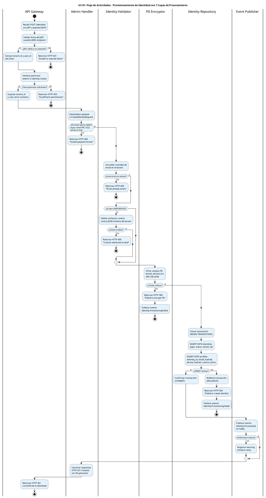

# UC-01: Provisionar Nueva Identidad - Diagrama de Actividades

| Metadatos del Documento | |
| :--- | :--- |
| **Proyecto:** | SHUGO - Identity & Access Platform |
| **Caso de Uso:** | UC-01 - Provisionar Nueva Identidad |
| **Documento:** | 03_Activity_Diagram.md |
| **Metodología:** | UML 2.5 + ICONIX + Clean Architecture + Privacy by Design |
| **Autor:** | Gastón Ruiz |
| **Versión Actual:** | 1.0.0 |
| **Fecha:** | 30/08/2026 |

---

## Historial de Versiones

| Versión | Fecha | Autor | Descripción de Cambios | Impacto |
| :--- | :--- | :--- | :--- | :--- |
| **1.0.0** | 30/08/2026 | Gastón Ruiz | **Creación inicial.** Modelado del flujo de trabajo interno del UC-01, destacando las 7 capas de procesamiento (JWT, Permisos, Formato, Unicidad, Schema, Cifrado PII, Persistencia), la transaccionalidad atómica, y la publicación asíncrona de eventos. | Documento base del paquete de diseño Tier 1 del UC-01. Establece la lógica de negocio, los flujos de decisión y las garantías de seguridad y privacidad para el endpoint fundamental del motor KAGAMI. |

---

## 1. Introducción y Propósito

El **Diagrama de Actividades** para el UC-01 visualiza el flujo de control, decisiones y orquestación necesario para provisionar una nueva identidad en el motor **KAGAMI**.

A diferencia de un CRUD tradicional, el UC-01 es un caso de uso de **alta criticidad y complejidad transversal**. Este diagrama introduce cinco complejidades arquitectónicas clave:

1. **Validación en Múltiples Capas:** El flujo debe validar la identidad del actor (JWT), sus permisos (RBAC), el formato de los datos (RFC 5322, E.164), la unicidad en el tenant, y el schema de atributos custom.
2. **Privacy by Design (Cifrado PII):** Los campos sensibles (email, teléfono) deben cifrarse *antes* de tocar la base de datos, usando AES-256-GCM. Si el cifrado falla, el flujo se aborta (Fail Secure).
3. **Persistencia Transaccional Atómica:** La creación de la entidad `Identity` y su `Profile` debe ocurrir en una sola transacción.
4. **Consistencia Eventual Controlada:** La publicación del evento `Identity.Provisioned` es un efecto secundario no bloqueante. Si Kafka está caído, la identidad se crea igual, y el evento se reintentará.
5. **Agnosticismo de Dominio:** El flujo es idéntico si la identidad es un `USER`, `SERVICE` o `DEVICE`, adaptándose dinámicamente a las reglas de validación de cada tipo.

Utilizamos carriles (swimlanes) para separar las responsabilidades entre el API Gateway, el Admin Handler, el Identity Validator, el PII Encryptor, el Identity Repository, y el Event Publisher.

---

## 2. Diagrama de Actividades (PlantUML)

A continuación, se presenta el diagrama que cubre el Escenario Principal (creación exitosa), los Escenarios Alternativos (Service Account, Device) y los Flujos de Excepción (JWT inválido, permisos insuficientes, formato inválido, email duplicado, schema inválido, error de cifrado, error de persistencia).

---

## 3. Explicación Detallada del Flujo

### 3.1. Carriles (Partitions / Swimlanes)

El diagrama está dividido en seis carriles que representan las capas y responsabilidades de la arquitectura:

1. **`|API Gateway|` (Capa de Entrada):** Responsable de la validación inicial del JWT, extracción de claims (`tenant_id`, `user_id`), verificación de permisos de alto nivel, y retorno de respuestas HTTP de autenticación/autorización.
2. **`|Admin Handler|` (Capa de Aplicación):** Orquesta el flujo. Deserializa el payload, valida el formato básico, construye la respuesta final y delega las responsabilidades de dominio e infraestructura.
3. **`|Identity Validator|` (Capa de Dominio - Validación):** Responsable de las reglas de negocio: unicidad de email por tenant, y validación de atributos custom contra el JSON Schema del tenant.
4. **`|PII Encryptor|` (Capa de Dominio/Infraestructura - Seguridad):** Responsable de cifrar los campos PII (email, phone) usando AES-256-GCM antes de que los datos salgan de la capa de aplicación hacia la base de datos.
5. **`|Identity Repository|` (Capa de Infraestructura - Persistencia):** Responsable de ejecutar la transacción atómica (BEGIN, INSERT Identity, INSERT Profile, COMMIT/ROLLBACK) en PostgreSQL.
6. **`|Event Publisher|` (Capa de Infraestructura - Eventos):** Responsable de publicar el evento de dominio `Identity.Provisioned` en Kafka de forma no bloqueante.

### 3.2. Puntos de Decisión Críticos (Rombos)

1. **Validación de JWT (API Gateway):**
   - **Pregunta:** ¿El JWT es válido, no está expirado, y tiene los claims requeridos?
   - **Si falla:** Retorna HTTP 401 inmediatamente. No procede.
   - **Justificación:** Sin identidad verificada, no hay provisionamiento posible.

2. **Validación de Permisos (API Gateway):**
   - **Pregunta:** ¿El usuario tiene rol de administrador o el permiso granular `identity:create`?
   - **Si falla:** Retorna HTTP 403 inmediatamente.
   - **Justificación:** Principio de Least Privilege. No todos los usuarios autenticados pueden crear identidades.

3. **Validación de Formato Básico (Admin Handler):**
   - **Pregunta:** ¿El `type` es válido (USER/SERVICE/DEVICE)? ¿El email cumple RFC 5322? ¿El phone cumple E.164?
   - **Si falla:** Retorna HTTP 400 con detalles.
   - **Justificación:** Fail Fast. Previene que requests malformadas consuman recursos de validación profunda.

4. **Validación de Unicidad (Identity Validator):**
   - **Pregunta:** ¿Existe ya una identidad con este email en el `tenant_id` actual?
   - **Si falla:** Retorna HTTP 409 Conflict.
   - **Justificación:** Previene duplicados. La query incluye `WHERE tenant_id = ?` para aislamiento.

5. **Validación de Schema (Identity Validator):**
   - **Pregunta:** ¿Los `custom_attributes` cumplen con el JSON Schema definido por el tenant?
   - **Si falla:** Retorna HTTP 400 con los campos inválidos.
   - **Justificación:** Garantiza la integridad de los datos extensibles.

6. **Cifrado de PII (PII Encryptor):**
   - **Pregunta:** ¿Se pudieron cifrar los campos email y phone con la clave maestra actual?
   - **Si falla:** Retorna HTTP 500 y publica evento de fallo. **No persiste.**
   - **Justificación:** Privacy by Design. Nunca persistir PII en claro. Si el cifrado falla, es un error crítico de seguridad.

7. **Persistencia Transaccional (Identity Repository):**
   - **Pregunta:** ¿Se pudieron insertar la Identity y el Profile atómicamente?
   - **Si falla:** ROLLBACK, retorna HTTP 500 y publica evento de fallo.
   - **Justificación:** Integridad referencial. Una Identity sin Profile (o viceversa) es un estado corrupto.

8. **Publicación de Evento (Event Publisher):**
   - **Pregunta:** ¿Se pudo publicar el evento en Kafka?
   - **Si falla:** Registra warning. **NO revierte la transacción.**
   - **Justificación:** Consistencia Eventual. La identidad ya existe. El evento se reintentará desde el Outbox.

### 3.3. Las 7 Capas de Procesamiento

El flujo implementa una estrategia de procesamiento en 7 capas, cada una con responsabilidades específicas:

| Capa | Responsable | Validación/Procesamiento | Código HTTP si falla |
| :--- | :--- | :--- | :--- |
| **Capa 1** | API Gateway | JWT válido y no expirado | 401 Unauthorized |
| **Capa 2** | API Gateway | Permisos (admin o identity:create) | 403 Forbidden |
| **Capa 3** | Admin Handler | Formato básico (type, email, phone) | 400 Bad Request |
| **Capa 4** | Identity Validator | Unicidad de email en el tenant | 409 Conflict |
| **Capa 5** | Identity Validator | Schema de atributos custom | 400 Bad Request |
| **Capa 6** | PII Encryptor | Cifrado AES-256-GCM de PII | 500 Internal Server Error |
| **Capa 7** | Identity Repository | Transacción atómica (Identity + Profile) | 500 Internal Server Error |
| **Capa 8** | Event Publisher | Publicación asíncrona en Kafka | Warning (No bloquea) |

**Justificación:**
- **Fail Fast:** Las capas 1-3 validan lo más rápido posible sin tocar la base de datos.
- **Defensa en Profundidad:** Múltiples capas previenen que datos inválidos o inseguros lleguen a la base de datos.
- **Separación de Preocupaciones:** Cada capa valida lo que le corresponde según su responsabilidad.

---

## 4. Alineación con la Especificación de Requisitos

Este diagrama es la representación visual exacta del documento `01_Requirements_Specification.md`:

| Sección en Requisitos | Representación en el Diagrama |
| :--- | :--- |
| **2.1 Escenario Principal (Pasos 1-13)** | El flujo principal que va desde "Recibir POST /identities" hasta "Retornar HTTP 201". |
| **2.2 Escenario Alternativo (Atributos Custom)** | El rombo "¿Es tipo USER/SERVICE?" y la validación de schema. |
| **2.3 Excepción 2.1 (JWT Inválido)** | El primer rombo "¿JWT válido y no expirado?" y su rama "no". |
| **2.3 Excepción 3.1 (Sin Permisos)** | El rombo "¿Tiene permisos suficientes?" y su rama "no". |
| **2.3 Excepción 5.1 (Payload Malformado)** | El rombo "¿Formato básico válido?" y su rama "no". |
| **2.3 Excepción 6.1 (Email Duplicado)** | El rombo "¿Email único en tenant?" y su rama "no". |
| **2.3 Excepción 7.1 (Atributos Custom Inválidos)** | El rombo "¿Schema válido?" y su rama "no". |
| **2.3 Excepción 8.1 (Error de Cifrado PII)** | El rombo "¿Cifrado exitoso?" y su rama "no" (con evento de fallo). |
| **2.3 Excepción 10.1 (Error de Persistencia)** | El rombo "¿INSERT exitoso?" y su rama "no" (con ROLLBACK). |
| **2.3 Excepción 11.1 (Error de Publicación)** | El rombo "¿Publicación exitosa?" y su rama "no" (con warning). |
| **3 INV-01 a INV-08** | Las validaciones de tipo, formato, tenant isolation, unicidad, schema, y cifrado están todas representadas. |
| **RN-03 (Atomicity)** | El carril "Identity Repository" muestra el BEGIN/COMMIT/ROLLBACK. |
| **RN-04 (Eventual Consistency)** | El carril "Event Publisher" muestra que el fallo no detiene el flujo. |

---

## 5. Consideraciones de Arquitectura y Diseño (Clean Architecture + DDD)

### 5.1. Separación de Responsabilidades

El diagrama muestra claramente la separación de responsabilidades:
- **API Gateway:** Solo valida JWT y permisos. No conoce la lógica de negocio.
- **Admin Handler:** Orquesta, pero no implementa la lógica de validación ni cifrado.
- **Identity Validator:** Solo valida reglas de negocio. No conoce la persistencia.
- **PII Encryptor:** Solo cifra. No conoce la lógica de validación.
- **Identity Repository:** Solo persiste. No conoce la lógica de negocio.

Esta separación permite:
- **Testeabilidad:** Cada componente puede ser testeado unitariamente de forma aislada.
- **Mantenibilidad:** Cambios en el algoritmo de cifrado no afectan la lógica de validación.

### 5.2. Privacy by Design (Cifrado antes de Persistir)

El diagrama muestra explícitamente que el **PII Encryptor** se ejecuta *antes* del **Identity Repository**.

**Justificación:**
- **Seguridad:** Los datos PII nunca viajan en claro hacia la base de datos. Si hay un log de queries SQL o un dump de la DB, los datos están seguros.
- **Compliance:** Cumple con GDPR Art. 32 (Security of Processing) e ISO 27001 A.10.1 (Cryptographic Controls).
- **Fail Secure:** Si el cifrado falla, la transacción no se inicia. No hay riesgo de persistir PII en claro por error.

### 5.3. Transaccionalidad Atómica

El carril **Identity Repository** muestra un bloque claro: `BEGIN TRANSACTION` → `INSERT Identity` → `INSERT Profile` → `COMMIT` (o `ROLLBACK`).

**Justificación:**
- **Integridad:** Una `Identity` sin `Profile` es inútil. Un `Profile` sin `Identity` es huérfano. Deben crearse juntos o no crearse.
- **Unit of Work Pattern:** El repositorio gestiona la transacción de forma transparente para el Handler.

### 5.4. Consistencia Eventual en la Publicación de Eventos

El carril **Event Publisher** está al final del flujo, y su fallo no genera un `stop` ni un `rollback`.

**Justificación:**
- **Alta Disponibilidad:** Si Kafka está caído, el administrador aún puede crear identidades. El sistema no se detiene por un fallo en un componente secundario.
- **Outbox Pattern:** Aunque no se muestra explícitamente en este diagrama de alto nivel, en la implementación real, el evento se guarda en una tabla `outbox_events` dentro de la misma transacción de la Capa 7, y un proceso en segundo plano (Outbox Processor) lo publica en Kafka. Esto garantiza "At-least-once delivery".

---

## 6. Trazabilidad con Otros Documentos del Paquete

| Documento | Relación |
| :--- | :--- |
| `01_Requirements_Specification.md` | Este diagrama visualiza los flujos de texto, las invariantes de dominio y los criterios de aceptación. |
| `02_Use_Case_Diagram.md` | Muestra el límite del sistema y los actores; este diagrama muestra el flujo interno. |
| `04_Initial_Domain_Model.md` | Las acciones de los carriles "Identity Validator", "PII Encryptor" utilizarán los Servicios de Dominio definidos en el modelo. |
| `06_Robustness_Diagram.md` | Mostrará la colaboración entre el Handler, el Validator, el Encryptor y los repositorios. |
| `07_Sequence_Diagram.md` | Este diagrama dice "qué" decisiones se toman; el de secuencia dirá "quién" se envía mensajes en qué orden temporal. |
| `KAGAMI_Engine_Architecture.md` | Documento global que define la arquitectura completa del motor KAGAMI. |
| `KHCS_SHUGO_Integration_Contract.md` | Define cómo KHCS consume la API de provisionamiento. |

---

## 7. Notas de Implementación

### 7.1. Generación del Diagrama
- **Herramienta:** PlantUML (Diagrams as Code).
- **Ventaja:** Versionable en Git, reproducible, sin dependencias de software propietario.
- **Renderizado:** VS Code (extensión PlantUML), GitHub, o Pandoc para exportación a PDF.

### 7.2. Estilos Aplicados
- `<style>` block: Para evitar advertencias de `skinparam` deprecados en versiones modernas de PlantUML.
- Colores diferenciados para actividades (azul) y decisiones (naranja).
- Carriles (swimlanes) para separar responsabilidades arquitectónicas.
- **Estructura plana:** Se evitan anidamientos profundos de `if/else` para garantizar compatibilidad y legibilidad en PlantUML.

### 7.3. Complejidad del Diagrama
Este es uno de los diagramas de actividades más complejos del sistema debido a:
- La validación en 7 capas.
- La integración de un componente de seguridad crítico (PII Encryptor).
- La gestión de transacciones atómicas.
- El manejo de consistencia eventual para eventos.

Sin embargo, esta complejidad es necesaria para capturar la riqueza del flujo de provisionamiento en un sistema IAM de nivel enterprise que maneja PII y requiere cumplimiento normativo estricto.

---
*Fin del Documento 03_Activity_Diagram para UC-01*