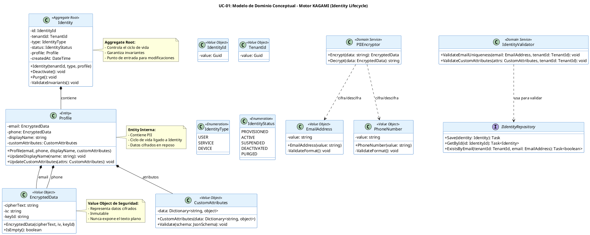

# UC-01: Provisionar Nueva Identidad - Modelo de Dominio Inicial

| Metadatos del Documento | |
| :--- | :--- |
| **Proyecto:** | SHUGO - Identity & Access Platform |
| **Caso de Uso:** | UC-01 - Provisionar Nueva Identidad |
| **Documento:** | 04_Initial_Domain_Model.md |
| **Metodología:** | ICONIX (Modelo de Análisis) + DDD (Domain-Driven Design) + Privacy by Design |
| **Autor:** | Gastón Ruiz |
| **Versión Actual:** | 1.0.0 |
| **Fecha:** | 30/08/2026 |

---

## Historial de Versiones

| Versión | Fecha | Autor | Descripción de Cambios | Impacto |
| :--- | :--- | :--- | :--- | :--- |
| **1.0.0** | 30/08/2026 | Gastón Ruiz | **Creación inicial.** Definición del Modelo de Dominio Conceptual para UC-01. Se introducen los Aggregate Roots (`Identity`), Value Objects (`EmailAddress`, `PhoneNumber`, `CustomAttributes`), Domain Services (`IdentityValidator`, `PIIEncryptor`), y las interfaces de repositorio. Se enfatiza la separación entre datos de identidad y datos de perfil (PII), y la estrategia de cifrado antes de la persistencia. | Documento base del paquete de diseño Tier 1 del UC-01. Establece la arquitectura de dominio del endpoint de provisionamiento, garantizando agnosticismo, seguridad de datos (PII) y consistencia transaccional. |

---

## 1. Introducción y Propósito

Este documento presenta el **Modelo de Dominio Inicial** para el Caso de Uso UC-01 (Provisionar Nueva Identidad).

A diferencia de un modelo de datos relacional tradicional, este modelo se centra en el **comportamiento** y las **reglas de negocio** (invariantes) que protegen la integridad de las identidades. El diseño sigue los principios de **Domain-Driven Design (DDD)** y **Privacy by Design**:

1. **Aggregate Root `Identity`:** Es la puerta de entrada para modificar el estado de una identidad. Garantiza que ninguna identidad exista en un estado inválido.
2. **Separación Identity/Profile:** Separa los datos de control del sistema (ID, Tenant, Status) de los datos personales (Email, Phone), facilitando el cumplimiento de GDPR y la optimización de consultas.
3. **Value Objects para PII:** `EmailAddress` y `PhoneNumber` no son simples strings; encapsulan la validación de formato (RFC 5322, E.164) y, crucialmente, la lógica de cifrado/descifrado.
4. **Domain Services para Validación Transversal:** `IdentityValidator` y `PIIEncryptor` manejan reglas que involucran múltiples agregados o infraestructura externa (como el servicio de claves maestras).

---

## 2. Diagrama de Modelo de Dominio Conceptual (PlantUML)

A continuación, se presenta el diagrama de clases conceptual. Se enfatiza la separación entre Aggregate Roots, Value Objects y Domain Services.



---

## 3. Detalle de Conceptos de Dominio (DDD)

### 3.1. Aggregate Root: `Identity`

**Propósito:** Representa la identidad digital de un sujeto (Usuario, Servicio, Dispositivo) dentro de un Tenant. Es la unidad de consistencia transaccional.

**Invariantes:**
1. Una `Identity` siempre pertenece a un `TenantId` válido.
2. El `IdentityType` no puede cambiar una vez creado.
3. El `Status` debe seguir la máquina de estados definida (ej. no se puede pasar de `PURGED` a `ACTIVE`).
4. Una `Identity` debe tener un `Profile` asociado (aunque esté vacío para servicios).

**Código (C#):**
```csharp
public class Identity
{
    public IdentityId Id { get; private set; }
    public TenantId TenantId { get; private set; }
    public IdentityType Type { get; private set; }
    public IdentityStatus Status { get; private set; }
    public Profile Profile { get; private set; }
    public DateTime CreatedAt { get; private set; }

    // Constructor privado para EF Core / Deserialización
    private Identity() { }

    public Identity(TenantId tenantId, IdentityType type, Profile profile)
    {
        Id = IdentityId.NewId();
        TenantId = tenantId ?? throw new ArgumentNullException(nameof(tenantId));
        Type = type;
        Profile = profile ?? throw new ArgumentNullException(nameof(profile));
        Status = IdentityStatus.Provisioned; // Estado inicial
        CreatedAt = DateTime.UtcNow;
        
        ValidateInvariants();
    }

    public void Deactivate()
    {
        if (Status == IdentityStatus.Purged)
            throw new DomainException("Cannot deactivate a purged identity.");
            
        Status = IdentityStatus.Deactivated;
    }

    public void Purge()
    {
        if (Status == IdentityStatus.Purged) return; // Idempotente
        
        Status = IdentityStatus.Purged;
        Profile.Anonymize(); // Borra datos sensibles
    }

    private void ValidateInvariants()
    {
        if (TenantId.IsEmpty()) throw new DomainException("TenantId is required.");
        if (Profile == null) throw new DomainException("Profile is required.");
    }
}
```

### 3.2. Entity: `Profile`

**Propósito:** Contiene los datos descriptivos y PII de la identidad. Vive dentro del Aggregate `Identity`.

**Nota de Diseño:** Los campos `Email` y `Phone` son de tipo `EncryptedData`. Esto asegura que, incluso en memoria, si el objeto se serializa accidentalmente (logs, dumps), los datos sensibles no se expongan. El texto plano solo existe momentáneamente durante la creación/actualización antes de ser cifrado por el `PIIEncryptor`.

**Código (C#):**
```csharp
public class Profile
{
    public EncryptedData Email { get; private set; }
    public EncryptedData Phone { get; private set; }
    public string DisplayName { get; private set; }
    public CustomAttributes CustomAttributes { get; private set; }

    public Profile(EncryptedData email, EncryptedData phone, string displayName, CustomAttributes customAttributes)
    {
        Email = email;
        Phone = phone;
        DisplayName = displayName;
        CustomAttributes = customAttributes ?? CustomAttributes.Empty();
    }

    public void Anonymize()
    {
        Email = EncryptedData.Empty();
        Phone = EncryptedData.Empty();
        DisplayName = "Anonymized";
        CustomAttributes = CustomAttributes.Empty();
    }
}
```

### 3.3. Value Objects

#### `EmailAddress` y `PhoneNumber`
Estos VO validan el formato *antes* de ser cifrados.

```csharp
public class EmailAddress
{
    public string Value { get; }

    public EmailAddress(string value)
    {
        if (string.IsNullOrWhiteSpace(value))
            throw new DomainException("Email cannot be empty.");
            
        if (!IsValidFormat(value))
            throw new InvalidEmailFormatException(value);
            
        Value = value.ToLowerInvariant();
    }

    private bool IsValidFormat(string email)
    {
        // Validación RFC 5322 simplificada o uso de librería como EmailValidation
        return Regex.IsMatch(email, @"^[^@\s]+@[^@\s]+\.[^@\s]+$");
    }
}
```

#### `EncryptedData`
Representa el resultado del cifrado. Es inmutable.

```csharp
public class EncryptedData
{
    public string CipherText { get; }
    public string IV { get; } // Initialization Vector
    public string KeyId { get; } // Para rotación de claves

    public EncryptedData(string cipherText, string iv, string keyId)
    {
        CipherText = cipherText;
        IV = iv;
        KeyId = keyId;
    }

    public static EncryptedData Empty() => new EncryptedData("", "", "");
    public bool IsEmpty() => string.IsNullOrEmpty(CipherText);
}
```

#### `CustomAttributes`
Encapsula el diccionario de atributos extensibles y su validación.

```csharp
public class CustomAttributes
{
    private readonly Dictionary<string, object> _data;

    public CustomAttributes(Dictionary<string, object> data)
    {
        _data = data ?? new Dictionary<string, object>();
    }

    public void Validate(JsonSchema schema)
    {
        if (schema == null) return; // Sin schema, no hay validación
        
        // Lógica de validación contra JSON Schema
        // Lanza InvalidCustomAttributesException si falla
    }

    public static CustomAttributes Empty() => new CustomAttributes(null);
}
```

### 3.4. Domain Services

#### `PIIEncryptor`
Servicio de dominio responsable de cifrar y descifrar datos sensibles. Utiliza una interfaz de infraestructura (`IEncryptionAlgorithm`) para acceder a las claves maestras (AWS KMS, Vault).

```csharp
public class PIIEncryptor
{
    private readonly IEncryptionAlgorithm _algorithm;

    public PIIEncryptor(IEncryptionAlgorithm algorithm)
    {
        _algorithm = algorithm;
    }

    public EncryptedData Encrypt(string plainText)
    {
        if (string.IsNullOrEmpty(plainText)) return EncryptedData.Empty();
        
        // Llama a infraestructura para cifrar
        var result = _algorithm.EncryptAES256GCM(plainText);
        return new EncryptedData(result.CipherText, result.IV, result.KeyId);
    }

    public string Decrypt(EncryptedData data)
    {
        if (data.IsEmpty()) return null;
        return _algorithm.DecryptAES256GCM(data.CipherText, data.IV, data.KeyId);
    }
}
```

#### `IdentityValidator`
Valida reglas que requieren acceso a repositorios o configuraciones externas (como el Schema del Tenant).

```csharp
public class IdentityValidator
{
    private readonly IIdentityRepository _repository;
    private readonly ITenantConfigurationRepository _tenantConfigRepo;

    public IdentityValidator(IIdentityRepository repository, ITenantConfigurationRepository tenantConfigRepo)
    {
        _repository = repository;
        _tenantConfigRepo = tenantConfigRepo;
    }

    public async Task ValidateEmailUniquenessAsync(TenantId tenantId, EmailAddress email)
    {
        var exists = await _repository.ExistsByEmailAsync(tenantId, email);
        if (exists)
            throw new DuplicateEmailException(email.Value);
    }

    public async Task ValidateCustomAttributesAsync(TenantId tenantId, CustomAttributes attributes)
    {
        var schema = await _tenantConfigRepo.GetCustomAttributeSchemaAsync(tenantId);
        attributes.Validate(schema);
    }
}
```

---

## 4. Interfaces de Repositorio

### `IIdentityRepository`
Define el contrato para la persistencia del Aggregate `Identity`.

```csharp
public interface IIdentityRepository
{
    Task SaveAsync(Identity identity);
    Task<Identity> GetByIdAsync(IdentityId id);
    Task<bool> ExistsByEmailAsync(TenantId tenantId, EmailAddress email);
}
```

**Nota:** El repositorio es responsable de traducir el `EncryptedData` a columnas de base de datos y viceversa. No debe haber lógica de cifrado en el repositorio; el dominio ya entrega los datos cifrados.

---

## 5. Excepciones de Dominio

Todas heredan de `DomainException`.

| Excepción | Descripción | Código HTTP Asociado |
| :--- | :--- | :--- |
| `InvalidEmailFormatException` | El email no cumple RFC 5322. | 400 Bad Request |
| `InvalidPhoneFormatException` | El teléfono no cumple E.164. | 400 Bad Request |
| `DuplicateEmailException` | Ya existe una identidad con ese email en el tenant. | 409 Conflict |
| `InvalidCustomAttributesException` | Los atributos no cumplen el JSON Schema. | 400 Bad Request |
| `PIIEncryptionException` | Fallo al cifrar datos (clave maestra no disponible). | 500 Internal Server Error |
| `IdentityNotFoundException` | La identidad solicitada no existe. | 404 Not Found |
| `InvalidTransitionException` | Cambio de estado inválido (ej. Purged -> Active). | 400 Bad Request |

---

## 6. Eventos de Dominio

El Aggregate `Identity` genera eventos que son capturados por la capa de aplicación y publicados en Kafka.

| Evento | Trigger | Payload |
| :--- | :--- | :--- |
| `Identity.Provisioned` | Creación exitosa. | `IdentityId`, `TenantId`, `Type`, `Email` (Hash o cifrado, nunca claro). |
| `Identity.Deactivated` | Llamada a `Deactivate()`. | `IdentityId`, `Reason`. |
| `Identity.Purged` | Llamada a `Purge()`. | `IdentityId`, `PurgedAt`. |

---

## 7. Decisiones de Diseño DDD (ADR)

### 7.1. ¿Por qué `EncryptedData` es un Value Object y no un servicio del Repositorio?

**Decisión:** El dominio maneja objetos `EncryptedData`. El cifrado ocurre *antes* de llamar al repositorio.

**Justificación:**
- **Seguridad en Memoria:** Si el objeto `Identity` se serializa para logs o caché, los datos PII ya están cifrados.
- **Claridad de Intención:** El modelo dice explícitamente "este campo está cifrado".
- **Testeabilidad:** Se puede testear la lógica de negocio sin mockear servicios de cifrado complejos, solo verificando que se llame al `PIIEncryptor`.

### 7.2. ¿Por qué `Profile` es una Entity y no un Value Object?

**Decisión:** `Profile` tiene identidad propia (implícita a través de `IdentityId`) y mutable.

**Justificación:**
- Aunque su ciclo de vida está ligado a `Identity`, el `Profile` puede actualizarse independientemente (cambio de email, teléfono) sin recrear la `Identity`.
- Contiene datos complejos (CustomAttributes) que pueden crecer.

### 7.3. ¿Por qué `CustomAttributes` valida contra un Schema externo?

**Decisión:** El VO `CustomAttributes` recibe un `JsonSchema` para validarse.

**Justificación:**
- Permite que cada Tenant defina su propia estructura de datos sin modificar el código del dominio.
- Mantiene la integridad de los datos extensibles.

---

## 8. Trazabilidad

| Documento | Relación |
| :--- | :--- |
| `01_Requirements_Specification.md` | Define las invariantes (INV-01 a INV-08) que este modelo implementa. |
| `02_Use_Case_Diagram.md` | Muestra los actores; este modelo define los objetos con los que interactúan. |
| `03_Activity_Diagram.md` | Los carriles "Identity Validator" y "PII Encryptor" se implementan aquí como Domain Services. |
| `06_Robustness_Diagram.md` | Mostrará la colaboración entre Handler, Validator, Encryptor y Repository. |
| `07_Sequence_Diagram.md` | Detallará el orden de creación de estos objetos. |
| `08_Final_Class_Design.md` | Definirá las firmas exactas y patrones de concurrencia. |
| `KAGAMI_Engine_Architecture.md` | Documento global que define la arquitectura del motor. |

---

## 9. Notas para la Implementación

### 9.1. Ubicación en Clean Architecture
- **Dominio (`SHUGO.Domain`):** `Identity`, `Profile`, `EmailAddress`, `IdentityValidator`, `PIIEncryptor`, `IIdentityRepository`.
- **Infraestructura (`SHUGO.Infrastructure`):** `IdentityRepository` (EF Core), `KmsEncryptionAlgorithm` (AWS KMS).
- **Aplicación (`SHUGO.Application`):** `ProvisionIdentityHandler` (Coordina el flujo: crea VOs -> cifra -> crea Aggregate -> guarda).

### 9.2. Manejo de Transacciones
La creación de `Identity` y `Profile` debe ocurrir en la misma transacción de base de datos. Dado que `Profile` es parte del Aggregate `Identity`, el repositorio `IIdentityRepository.SaveAsync(identity)` debe ser responsable de persistir ambas tablas atómicamente.

---
*Fin del Documento 04_Initial_Domain_Model para UC-01*