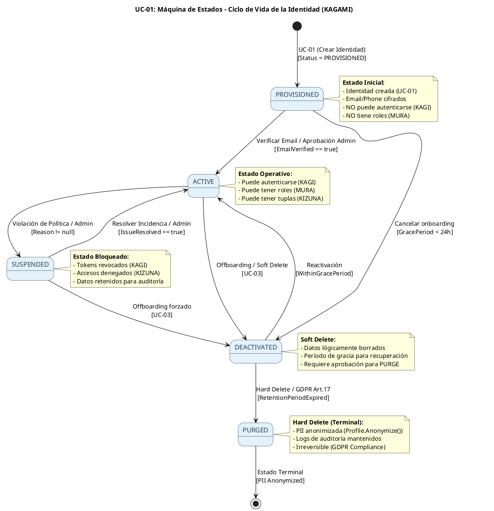
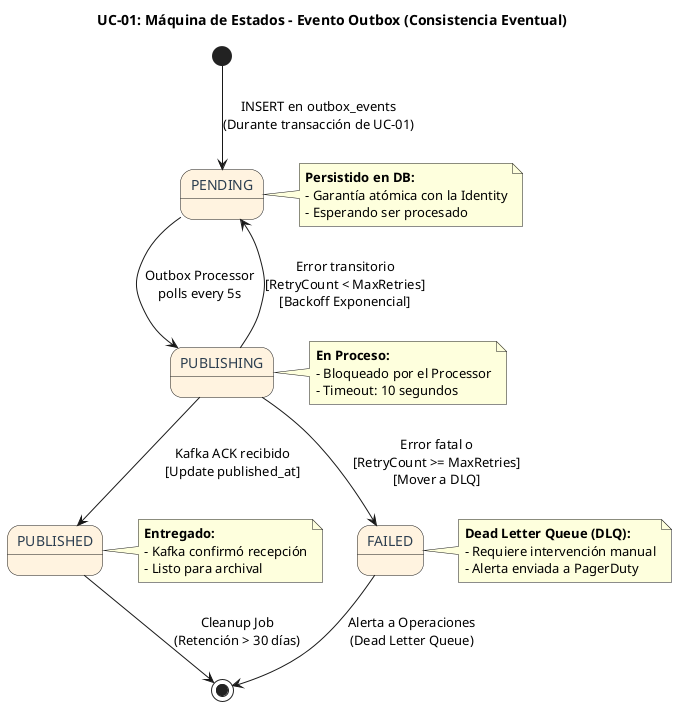

# UC-01: Provisionar Nueva Identidad - Diagrama de Máquina de Estados

| Metadatos del Documento | |
| :--- | :--- |
| **Proyecto:** | SHUGO - Identity & Access Platform |
| **Caso de Uso:** | UC-01 - Provisionar Nueva Identidad |
| **Documento:** | 05_State_Machine_Diagram.md |
| **Metodología:** | UML 2.5 + ICONIX + Domain-Driven Design (Lifecycle Management) |
| **Autor:** | Gastón Ruiz |
| **Versión Actual:** | 1.0.0 |
| **Fecha:** | 30/08/2026 |

---

## Historial de Versiones

| Versión | Fecha | Autor | Descripción de Cambios | Impacto |
| :--- | :--- | :--- | :--- | :--- |
| **1.0.0** | 30/08/2026 | Gastón Ruiz | **Creación inicial.** Definición de las máquinas de estados para UC-01. Se modelan dos máquinas críticas: (1) El Ciclo de Vida de la Entidad `Identity` (dominio persistente) y (2) El Ciclo de Vida del Evento de Dominio `Identity.Provisioned` (infraestructura de consistencia eventual / Outbox). Estas máquinas garantizan transiciones válidas, previenen estados ilegales (ej. reactivar una identidad purgada) y modelan la entrega garantizada de eventos. | Documento base del paquete de diseño Tier 1 del UC-01. Establece las reglas de transición de estado que el Aggregate Root `Identity` y el sistema de mensajería deben respetar estrictamente. |

---

## 1. Introducción y Propósito

Este documento presenta los **Diagramas de Máquina de Estados** para el Caso de Uso UC-01. 

A diferencia del Diagrama de Actividades (que modela el flujo de control de una sola request), las Máquinas de Estados modelan el **comportamiento temporal y las restricciones de ciclo de vida** de las entidades de dominio y los mensajes del sistema a lo largo del tiempo.

Para el UC-01, modelamos dos máquinas de estados complementarias:

1. **Máquina de Estados de la Identidad (Identity Lifecycle):** Representa el ciclo de vida persistente del Aggregate Root `Identity`. Define cómo una identidad evoluciona desde su creación (`PROVISIONED`) hasta su eliminación definitiva (`PURGED`), garantizando el cumplimiento de normativas como GDPR y NIST 800-63A.
2. **Máquina de Estados del Evento Outbox (Eventual Consistency):** Representa el ciclo de vida del evento de dominio `Identity.Provisioned` dentro del patrón Outbox. Modela cómo el sistema garantiza la entrega "At-least-once" a Kafka, manejando reintentos y Dead Letter Queues (DLQ).

Estas máquinas garantizan:
- **Integridad del Dominio:** Ninguna identidad puede saltar a un estado ilegal (ej. de `PURGED` a `ACTIVE`).
- **Auditoría Forense:** Cada transición de estado genera un evento inmutable en KAGE.
- **Consistencia Eventual Robusta:** Los eventos no se pierden si Kafka falla temporalmente.

---

## 2. Máquina de Estados #1: Ciclo de Vida de la Identidad (Identity Lifecycle)

### 2.1. Descripción

Esta máquina de estados modela el ciclo de vida de la entidad `Identity` dentro del motor KAGAMI. Es una máquina de **largo plazo** (puede durar años) y es **persistente**.

### 2.2. Diagrama de Máquina de Estados (PlantUML)



### 2.3. Descripción de Estados y Transiciones

| Estado | Descripción | Transiciones de Salida | Invariante Clave |
| :--- | :--- | :--- | :--- |
| **PROVISIONED** | Identidad creada por UC-01. Pendiente de verificación (email o aprobación manual). | → `ACTIVE`, → `DEACTIVATED` | No puede autenticarse ni tener asignaciones de roles activas. |
| **ACTIVE** | Identidad verificada y operativa. Puede interactuar con el sistema. | → `SUSPENDED`, → `DEACTIVATED` | Debe tener al menos un método de autenticación válido en KAGI. |
| **SUSPENDED** | Identidad bloqueada temporalmente por seguridad o políticas. | → `ACTIVE`, → `DEACTIVATED` | Todas las sesiones activas en KAGI deben ser revocadas inmediatamente. |
| **DEACTIVATED** | Soft delete. Identidad desactivada (offboarding). | → `ACTIVE`, → `PURGED` | No puede autenticarse. Los datos se retienen por el `RetentionPeriod`. |
| **PURGED** | Hard delete. Estado terminal. Cumplimiento GDPR Art. 17. | → `[*]` (Terminal) | El `Profile` debe estar anonimizado. Ningún dato PII puede ser recuperado. |

### 2.4. Invariantes de la Máquina de Estados

1. **Irreversibilidad del Purge:** Una vez en estado `PURGED`, la identidad no puede transicionar a ningún otro estado. Es un estado terminal.
2. **Anonimización Obligatoria:** La transición `DEACTIVATED → PURGED` *debe* ejecutar el método `Profile.Anonymize()` antes de persistir el cambio de estado.
3. **Bloqueo de Sesiones:** Cualquier transición hacia `SUSPENDED`, `DEACTIVATED` o `PURGED` debe disparar la revocación de todos los `RefreshTokens` y `Sessions` en KAGI.
4. **Guardia de Período de Gracia:** La transición `DEACTIVATED → ACTIVE` solo es válida si `DateTime.UtcNow - DeactivatedAt < TenantConfig.GracePeriod`.

---

## 3. Máquina de Estados #2: Ciclo de Vida del Evento Outbox (Eventual Consistency)

### 3.1. Descripción

Cuando UC-01 crea una identidad, no llama a Kafka directamente. Guarda un evento en la tabla `outbox_events` dentro de la misma transacción SQL. Un proceso en segundo plano (Outbox Processor) lee estos eventos y los publica. Esta máquina modela ese proceso.

### 3.2. Diagrama de Máquina de Estados (PlantUML)



### 3.3. Descripción de Estados y Transiciones

| Estado | Descripción | Transiciones de Salida | Regla de Negocio |
| :--- | :--- | :--- | :--- |
| **PENDING** | Evento guardado en PostgreSQL. Esperando ser leído por el Outbox Processor. | → `PUBLISHING` | El evento tiene un `CreatedAt` y `RetryCount = 0`. |
| **PUBLISHING** | El Outbox Processor ha tomado el evento y está intentando publicarlo en Kafka. | → `PUBLISHED`, → `PENDING`, → `FAILED` | Si el proceso falla (crash), el evento vuelve a `PENDING` tras un timeout. |
| **PUBLISHED** | Kafka ha confirmado la recepción (ACK). | → `[*]` (Cleanup) | Se marca con `PublishedAt = DateTime.UtcNow`. |
| **FAILED** | Se superó el número máximo de reintentos o el error es irreversible. | → `[*]` (DLQ) | Se mueve a la tabla `dead_letter_events` y se alerta al equipo. |

---

## 4. Implementación en el Dominio (Código C#)

### 4.1. Guard Clauses en el Aggregate Root `Identity`

La máquina de estados #1 se implementa mediante "Guard Clauses" dentro del Aggregate Root para prevenir transiciones ilegales.

```csharp
public class Identity
{
    public IdentityStatus Status { get; private set; }
    public DateTime? DeactivatedAt { get; private set; }

    // Transición: ACTIVE -> DEACTIVATED
    public void Deactivate()
    {
        // Guard Clause: Invariante de la Máquina de Estados
        if (Status != IdentityStatus.Active && Status != IdentityStatus.Suspended)
        {
            throw new InvalidTransitionException(
                $"Cannot deactivate identity with status '{Status}'. Only Active or Suspended identities can be deactivated.");
        }

        Status = IdentityStatus.Deactivated;
        DeactivatedAt = DateTime.UtcNow;
        
        // Generar evento de dominio para KAGE (Auditoría)
        AddDomainEvent(new Identity.DeactivatedEvent(this.Id, this.TenantId));
    }

    // Transición: DEACTIVATED -> PURGED (Terminal)
    public void Purge(int retentionDays)
    {
        if (Status != IdentityStatus.Deactivated)
            throw new InvalidTransitionException("Only Deactivated identities can be purged.");

        // Guard Clause: Período de retención
        if (DeactivatedAt.HasValue && DeactivatedAt.Value.AddDays(retentionDays) > DateTime.UtcNow)
        {
            throw new DomainException($"Identity must remain deactivated for {retentionDays} days before purging.");
        }

        // Efecto de la transición: Anonimización (Privacy by Design)
        Profile.Anonymize(); 
        
        Status = IdentityStatus.Purged;
        AddDomainEvent(new Identity.PurgedEvent(this.Id, this.TenantId));
    }
}
```

### 4.2. Implementación del Outbox Processor (Máquina #2)

```csharp
public class OutboxEventProcessor : BackgroundService
{
    protected override async Task ExecuteAsync(CancellationToken stoppingToken)
    {
        while (!stoppingToken.IsCancellationRequested)
        {
            // 1. Fetch PENDING events
            var events = await _dbContext.OutboxEvents
                .Where(e => e.Status == OutboxStatus.Pending && e.RetryCount < 5)
                .Take(100)
                .ToListAsync(stoppingToken);

            foreach (var evt in events)
            {
                try
                {
                    // Transición: PENDING -> PUBLISHING
                    evt.Status = OutboxStatus.Publishing;
                    
                    // Publicar en Kafka
                    await _kafkaProducer.PublishAsync(evt.Topic, evt.Payload);
                    
                    // Transición: PUBLISHING -> PUBLISHED
                    evt.Status = OutboxStatus.Published;
                    evt.PublishedAt = DateTime.UtcNow;
                }
                catch (Exception ex)
                {
                    _logger.LogError(ex, "Failed to publish outbox event {EventId}", evt.Id);
                    
                    // Transición: PUBLISHING -> PENDING (con backoff)
                    evt.RetryCount++;
                    evt.Status = OutboxStatus.Pending;
                    evt.NextRetryAt = DateTime.UtcNow.AddMinutes(Math.Pow(2, evt.RetryCount));
                }
            }
            await _dbContext.SaveChangesAsync(stoppingToken);
            await Task.Delay(TimeSpan.FromSeconds(5), stoppingToken);
        }
    }
}
```

---

## 5. Trazabilidad con Otros Documentos del Paquete

| Documento | Relación |
| :--- | :--- |
| `01_Requirements_Specification.md` | Las invariantes de estado (ej. "Default Status = PROVISIONED", "Immutable Fields") se definen aquí y se hacen cumplir en estas máquinas. |
| `02_Use_Case_Diagram.md` | Muestra los actores; estas máquinas definen cómo el sistema responde a sus acciones a lo largo del tiempo. |
| `03_Activity_Diagram.md` | El carril "Identity Repository" persiste el estado inicial `PROVISIONED`. El carril "Event Publisher" inicia la máquina #2. |
| `04_Initial_Domain_Model.md` | El Aggregate Root `Identity` y su enumeración `IdentityStatus` son la implementación directa de la Máquina #1. |
| `06_Robustness_Diagram.md` | Mostrará cómo los objetos colaboran para ejecutar estas transiciones de estado de forma segura. |
| `07_Sequence_Diagram.md` | Detallará el orden temporal exacto de las llamadas que disparan estas transiciones. |
| `KAGAMI_Engine_Architecture.md` | Documento global que define la arquitectura del motor, incluyendo la estrategia de cifrado y el patrón Outbox. |

---

## 6. Notas de Implementación

### 6.1. Generación del Diagrama
- **Herramienta:** PlantUML.
- **Sintaxis:** Se utiliza la sintaxis moderna de diagramas de estados (`[*] --> State`, `State --> State : event`).
- **Estilo:** Se aplican colores diferenciados para la máquina de dominio (Azul) y la máquina de infraestructura (Naranja) para facilitar la distinción visual.

### 6.2. Testing de Máquinas de Estados
Cada transición definida en estas máquinas debe tener al menos dos tests unitarios:
1. **Happy Path:** Verificar que la transición válida actualiza el estado y genera el evento de dominio correcto.
2. **Invalid Transition:** Verificar que intentar una transición ilegal (ej. `Purged -> Active`) lanza la excepción `InvalidTransitionException`.

### 6.3. Concurrencia y Locking
Dado que las identidades pueden ser modificadas por múltiples procesos (ej. un admin desactivando mientras el usuario intenta login), las transiciones de estado en la base de datos deben usar **Optimistic Concurrency Control** (columna `RowVersion` o `ConcurrencyToken` en EF Core) para prevenir condiciones de carrera (Race Conditions).

---
*Fin del Documento 05_State_Machine_Diagram para UC-01*