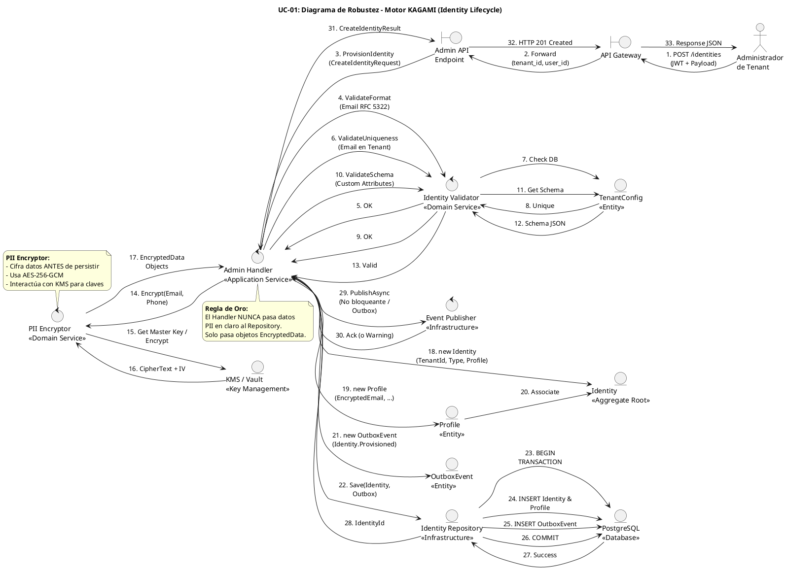

# UC-01: Provisionar Nueva Identidad - Diagrama de Robustez

| Metadatos del Documento | |
| :--- | :--- |
| **Proyecto:** | SHUGO - Identity & Access Platform |
| **Caso de Uso:** | UC-01 - Provisionar Nueva Identidad |
| **Documento:** | 06_Robustness_Diagram.md |
| **Metodología:** | ICONIX (Diagrama de Robustez) + Clean Architecture + DDD + Privacy by Design |
| **Autor:** | Gastón Ruiz |
| **Versión Actual:** | 1.0.0 |
| **Fecha:** | 30/08/2026 |

---

## Historial de Versiones

| Versión | Fecha | Autor | Descripción de Cambios | Impacto |
| :--- | :--- | :--- | :--- | :--- |
| **1.0.0** | 30/08/2026 | Gastón Ruiz | **Creación inicial.** Diagrama de Robustez para UC-01, validando la arquitectura del motor KAGAMI. Muestra la colaboración estricta entre Boundaries (API Gateway, Endpoint), Controls (Admin Handler, Identity Validator, PII Encryptor), y Entities (Identity, Profile, TenantConfig, OutboxEvent). Valida el principio de "Cifrado antes de Persistencia" y el patrón Outbox transaccional. | Documento base del paquete de diseño Tier 1 del UC-01. Sirve como puente crítico entre el Modelo de Dominio (04) y el Diagrama de Secuencia (07), asegurando que la arquitectura soporta las invariantes de seguridad y privacidad antes de codificar. |

---

## 1. Introducción y Propósito

El **Diagrama de Robustez** para el UC-01 valida que el flujo de provisionamiento de identidades puede ser orquestado respetando las reglas estrictas de acoplamiento de **ICONIX** y los principios de **Domain-Driven Design (DDD)** y **Clean Architecture**.

El desafío específico de este caso de uso es triple:
1. **Privacy by Design:** Garantizar que los datos PII (email, teléfono) sean cifrados *antes* de interactuar con la capa de persistencia.
2. **Atomicidad Transaccional:** Asegurar que la creación del Aggregate Root `Identity`, su `Profile`, y el `OutboxEvent` ocurran en una sola transacción.
3. **Validación Transversal:** Coordinar validaciones de formato, unicidad y schema sin acoplar el Handler a la base de datos.

---

## 2. Diagrama de Robustez (PlantUML)

A continuación, se presenta el Diagrama de Robustez organizado de izquierda a derecha para mostrar el flujo natural: **Actor → Boundary → Control → Entity**.



---

## 3. Explicación Detallada de los Objetos

### 3.1. Boundary Objects (Objetos de Límite)

| Objeto | Responsabilidad | Mapeo a Clean Architecture |
| :--- | :--- | :--- |
| **`API Gateway`** | Primera línea de defensa. Valida JWT, extrae `tenant_id` y `user_id`, aplica Rate Limiting. No conoce la lógica de negocio. | Middleware (Kong, AWS API Gateway). |
| **`Admin API Endpoint`** | Recibe la request HTTP, deserializa el JSON a un DTO (`CreateIdentityRequestDTO`), y lo pasa al Handler. | Controller (ASP.NET Core Controller). |

### 3.2. Control Objects (Objetos de Control)

| Objeto | Responsabilidad | Mapeo a Clean Architecture |
| :--- | :--- | :--- |
| **`Admin Handler`** | **Application Service.** Orquesta el caso de uso. Coordina validaciones, cifrado, creación del Aggregate y persistencia. Es delgado y delega la lógica compleja. | Command Handler / Application Service. |
| **`Identity Validator`** | **Domain Service.** Contiene la lógica de validación que requiere acceso a repositorios (unicidad) o configuraciones externas (Tenant Schema). | Domain Service. |
| **`PII Encryptor`** | **Domain Service.** Responsable de transformar datos sensibles (string) en `EncryptedData` (Value Object). Interactúa con infraestructura (KMS) pero su interfaz es de dominio. | Domain Service (con dependencia de infraestructura). |
| **`Event Publisher`** | **Infrastructure Service.** Publica eventos en Kafka. En el contexto del patrón Outbox, su rol es secundario (el Outbox Processor hace el trabajo pesado), pero se incluye para completar el flujo. | Infrastructure Service. |

### 3.3. Entity Objects (Objetos de Entidad)

| Objeto | Responsabilidad | Mapeo a DDD |
| :--- | :--- | :--- |
| **`Identity`** | **Aggregate Root.** Garantiza las invariantes de la identidad (Status, Type). Controla el acceso al `Profile`. | Aggregate Root. |
| **`Profile`** | **Entity.** Contiene los datos descriptivos y PII. Vive dentro del Aggregate `Identity`. | Entity (Internal to Aggregate). |
| **`TenantConfig`** | **Entity.** Representa la configuración del tenant, incluyendo el JSON Schema para atributos custom. | Entity / Reference Data. |
| **`OutboxEvent`** | **Entity.** Representa el evento de dominio pendiente de publicación. Se persiste en la misma transacción que la Identity. | Entity (Outbox Pattern). |
| **`Identity Repository`** | **Infrastructure.** Abstrae la persistencia. En el diagrama de robustez actúa como entidad que representa la base de datos. | Repository Interface (Domain) / Implementation (Infra). |
| **`KMS / Vault`** | **Infrastructure.** Servicio externo de gestión de claves maestras para el cifrado AES-256-GCM. | Infrastructure Service. |

---

## 4. Reglas de Robustez de ICONIX (Validación del Diagrama)

Verifiquemos que nuestro diagrama cumple estrictamente las reglas de acoplamiento de ICONIX:

### ✅ Regla 1: Actor → Boundary
- **Cumplida:** El `Administrador` interactúa solo con el `API Gateway`.

### ✅ Regla 2: Boundary → Boundary
- **Cumplida:** El `API Gateway` forward la request al `Admin API Endpoint`.

### ✅ Regla 3: Boundary → Control
- **Cumplida:** El `Admin API Endpoint` envía el DTO al `Admin Handler`.

### ✅ Regla 4: Control → Control
- **Cumplida y Crítica:** El `Admin Handler` delega a `Identity Validator` y `PII Encryptor`.
- **Validación:** Esto permite que el Handler sea delgado y que las reglas de validación/cifrado sean reutilizables y testeables.

### ✅ Regla 5: Control → Entity
- **Cumplida:**
  - `Admin Handler` crea `Identity` y `Profile`.
  - `Admin Handler` crea `OutboxEvent`.
  - `Admin Handler` llama a `Identity Repository` para persistir.
  - `Identity Validator` consulta `TenantConfig`.
  - `PII Encryptor` interactúa con `KMS`.

### ✅ Regla 6: NO Entity → Control / Boundary
- **Cumplida:** Ninguna entidad (`Identity`, `Profile`, `Repo`) envía mensajes de vuelta a los controles o boundaries. Solo retornan datos como respuesta a una invocación (flujo de retorno implícito).

### ✅ Regla 7: NO Entity → Entity (Directo sin Control)
- **Cumplida:** El `Admin Handler` (Control) es el único que orquesta la creación de `Identity` y `Profile`. Las entidades no se crean entre sí directamente desde el diagrama de flujo principal.

---

## 5. Consideraciones de Arquitectura (Clean Architecture + DDD)

### 5.1. El Principio "Cifrado antes de Persistencia"

El diagrama valida visualmente una de las reglas de seguridad más importantes de SHUGO:

1.  **Paso 14-17:** El `Admin Handler` llama al `PII Encryptor` *antes* de construir el `Profile`.
2.  **Paso 18-20:** El `Profile` se construye usando objetos `EncryptedData` (Value Objects), no strings en claro.
3.  **Paso 24:** El `Identity Repository` persiste el `Profile` que *ya contiene datos cifrados*.

**Justificación:**
- **Seguridad en Memoria:** Si el objeto `Identity` se serializa en un log o caché antes de llegar a la DB, los datos PII ya están cifrados.
- **Defensa en Profundidad:** Incluso si un desarrollador comete un error en el Repository, es imposible persistir texto plano porque el modelo de dominio (`Profile`) solo acepta `EncryptedData`.

### 5.2. Patrón Outbox Transaccional

El diagrama muestra cómo se resuelve el problema de la consistencia eventual sin sacrificar la atomicidad:

1.  **Paso 21:** El Handler crea un `OutboxEvent`.
2.  **Paso 23-26:** El Repository persiste la `Identity` y el `OutboxEvent` en la **misma transacción** (`BEGIN` ... `COMMIT`).
3.  **Paso 29:** La publicación a Kafka se muestra como un paso separado (o manejado por el Outbox Processor en background).

**Justificación:**
- **Atomicidad:** Si la DB falla, ni la identidad ni el evento se crean.
- **Fiabilidad:** Si Kafka falla, el evento ya está en la DB y el Outbox Processor lo publicará eventualmente.

### 5.3. Separación de Validaciones

El `Identity Validator` se encarga de las validaciones que requieren contexto externo (DB, Config), mientras que las validaciones de formato puro (ej. regex de email) están encapsuladas en los Value Objects (`EmailAddress`).

**Justificación:**
- **Cohesión:** El Validator no se llena de código de regex; solo coordina las reglas de negocio complejas.
- **Testeabilidad:** El Validator puede ser mockeado fácilmente en los tests del Handler.

---

## 6. Trazabilidad con Otros Documentos del Paquete

| Documento | Relación |
| :--- | :--- |
| `01_Requirements_Specification.md` | Este diagrama valida que los requisitos de cifrado (INV-08) y atomicidad (RN-03) pueden ser implementados con los objetos definidos. |
| `02_Use_Case_Diagram.md` | Muestra los actores y sistemas; este diagrama muestra cómo colaboran los objetos internos. |
| `03_Activity_Diagram.md` | Los carriles de actividad (Handler, Validator, Encryptor, Repository) se mapean directamente a los objetos de Control y Entity de este diagrama. |
| `04_Initial_Domain_Model.md` | Los objetos `Identity`, `Profile`, `EncryptedData` y los servicios `Validator`/`Encryptor` son exactamente las clases definidas en el modelo de dominio. |
| `05_State_Machine_Diagram.md` | Las transiciones de estado (ej. `PROVISIONED`) se ejecutan cuando el `Admin Handler` invoca el constructor de `Identity`. |
| `07_Sequence_Diagram.md` | Este diagrama define "qué objetos colaboran"; el de secuencia definirá "en qué orden temporal exacto" se envían los mensajes. |
| `08_Final_Class_Design.md` | Definirá las firmas exactas de los métodos mostrados en este diagrama (ej. `Encryptor.Encrypt()`). |

---

## 7. Notas de Implementación

### 7.1. Inyección de Dependencias

El `Admin Handler` debe tener inyectados los servicios de dominio y repositorios:

```csharp
public class AdminHandler : IAdminHandler
{
    private readonly IIdentityValidator _validator;
    private readonly IPIIEncryptor _encryptor;
    private readonly IIdentityRepository _repository;
    private readonly IUnitOfWork _unitOfWork;

    public AdminHandler(
        IIdentityValidator validator,
        IPIIEncryptor encryptor,
        IIdentityRepository repository,
        IUnitOfWork unitOfWork)
    {
        _validator = validator;
        _encryptor = encryptor;
        _repository = repository;
        _unitOfWork = unitOfWork;
    }
}
```

### 7.2. Flujo de Ejecución Simplificado (Código)

```csharp
public async Task<CreateIdentityResult> Handle(CreateIdentityRequest request, TenantId tenantId)
{
    // 1. Validaciones (Control -> Control)
    await _validator.ValidateUniquenessAsync(tenantId, request.Email);
    await _validator.ValidateSchemaAsync(tenantId, request.CustomAttributes);

    // 2. Cifrado PII (Control -> Control -> Infraestructura)
    var encryptedEmail = await _encryptor.EncryptAsync(request.Email);
    var encryptedPhone = await _encryptor.EncryptAsync(request.Phone);

    // 3. Construcción del Aggregate (Control -> Entity)
    var profile = new Profile(encryptedEmail, encryptedPhone, request.DisplayName, request.CustomAttributes);
    var identity = new Identity(tenantId, request.Type, profile);

    // 4. Outbox Event (Control -> Entity)
    var outboxEvent = new OutboxEvent("Identity.Provisioned", identity.Id, tenantId);

    // 5. Persistencia Atómica (Control -> Entity -> DB)
    await _unitOfWork.BeginTransactionAsync();
    try
    {
        await _repository.SaveAsync(identity);
        await _repository.SaveOutboxEventAsync(outboxEvent);
        await _unitOfWork.CommitAsync();
    }
    catch
    {
        await _unitOfWork.RollbackAsync();
        throw;
    }

    return new CreateIdentityResult(identity.Id, identity.Status);
}
```

---
*Fin del Documento 06_Robustness_Diagram para UC-01*