# UC-01: Provisionar Nueva Identidad - Diagrama de Secuencia

| Metadatos del Documento | |
| :--- | :--- |
| **Proyecto:** | SHUGO - Identity & Access Platform |
| **Caso de Uso:** | UC-01 - Provisionar Nueva Identidad |
| **Documento:** | 07_Sequence_Diagram.md |
| **Metodología:** | ICONIX (Diagrama de Secuencia) + Clean Architecture + DDD + Privacy by Design |
| **Autor:** | Gastón Ruiz |
| **Versión Actual:** | 1.0.0 |
| **Fecha:** | 30/08/2026 |

---

## Historial de Versiones

| Versión | Fecha | Autor | Descripción de Cambios | Impacto |
| :--- | :--- | :--- | :--- | :--- |
| **1.0.0** | 30/08/2026 | Gastón Ruiz | **Creación inicial.** Diagrama de Secuencia completo para UC-01, mostrando la orquestación temporal del motor KAGAMI. Detalla las 7 capas de procesamiento (JWT, Permisos, Formato, Unicidad, Schema, Cifrado PII, Persistencia), la transacción atómica con patrón Outbox, y la publicación asíncrona de eventos. | Documento base del paquete de diseño Tier 1 del UC-01. Sirve como guion exacto para la codificación del `AdminHandler` y la gestión de transacciones y cifrado. |

---

## 1. Introducción y Propósito

El **Diagrama de Secuencia** para el UC-01 materializa temporalmente las colaboraciones definidas en el Diagrama de Robustez. Su propósito es:

1. **Definir el orden exacto de las operaciones:** Establecer la secuencia crítica donde el cifrado de PII ocurre *antes* de la persistencia (Privacy by Design).
2. **Modelar la transacción atómica:** Mostrar cómo la creación de la `Identity`, el `Profile` y el `OutboxEvent` ocurren en una sola transacción de base de datos.
3. **Visualizar los límites asíncronos:** Mostrar cómo la publicación de eventos en Kafka se desacopla del flujo síncrono de respuesta al cliente.
4. **Demostrar el manejo de errores en cada capa:** Mostrar cómo cada validación fallida retorna un código HTTP específico sin proceder con las siguientes capas.

---

## 2. Diagrama de Secuencia - Escenario Principal (PlantUML)

A continuación, se presenta el Diagrama de Secuencia para el **Escenario Principal (creación exitosa)** y sus variaciones de excepción.

```plantuml
@startuml UC-01_Secuencia
<style>
diagram {
  BackgroundColor #FEFEFE
}
sequence {
  ArrowThickness 2
  ArrowColor #2C3E50
  ParticipantPadding 20
  BoxPadding 10
}
</style>

title UC-01: Diagrama de Secuencia - Motor KAGAMI con 7 Capas de Procesamiento

' ============================================
' PARTICIPANTES (Lifelines)
' ============================================
actor "Administrador" as Admin
participant "API Gateway" as GW
participant "Admin API\nEndpoint" as API
participant "Admin Handler\n<<Application>>" as Handler
participant "Identity Validator\n<<Domain>>" as Validator
participant "PII Encryptor\n<<Domain>>" as Encryptor
participant "KMS / Vault\n<<Infra>>" as KMS
participant "Identity Repository\n<<Infra>>" as Repo
database "PostgreSQL\n(DB)" as DB
participant "Event Publisher\n<<Infra>>" as Publisher

' ============================================
' FASE 1: AUTENTICACIÓN Y ENRUTAMIENTO (Capas 1-2)
' ============================================
Admin -> GW : 1. POST /identities\n(Authorization: Bearer JWT)
activate GW

GW -> GW : 2. Validar firma JWT\n(JWKS)
GW -> GW : 3. Verificar expiración\ny extraer claims

alt JWT inválido o expirado
    GW --> Admin : 4a. HTTP 401\n"Invalid or expired token"
    deactivate GW
else JWT válido
    GW -> GW : 5. Verificar permisos\n(admin o identity:create)
    
    alt Permisos insuficientes
        GW --> Admin : 6a. HTTP 403\n"Insufficient permissions"
        deactivate GW
    else Permisos OK
        GW -> API : 7. Forward request\n(tenant_id, user_id)
        deactivate GW
    end
end

' ============================================
' FASE 2: VALIDACIÓN DE FORMATO (Capa 3)
' ============================================
activate API
API -> API : 8. Deserializar payload\n(CreateIdentityRequest)
API -> API : 9. Validar formato básico\n(Email RFC 5322, Phone E.164)

alt Formato inválido
    API --> Admin : 10a. HTTP 400\n"Invalid payload format"
    deactivate API
else Formato válido
    API -> Handler : 11. ProvisionIdentity\n(request, tenantId)
    deactivate API
end

' ============================================
' FASE 3: VALIDACIONES DE DOMINIO (Capas 4-5)
' ============================================
activate Handler

Handler -> Validator : 12. ValidateUniqueness\n(tenantId, email)
activate Validator
Validator -> Repo : 13. ExistsByEmail\n(tenantId, email)
activate Repo
Repo -> DB : 14. SELECT COUNT(*)\nWHERE tenant_id = ?\nAND email = ?
DB --> Repo : 15. Count = 0
Repo --> Validator : 16. False (No existe)
deactivate Repo

alt Email duplicado
    Validator --> Handler : 17a. Lanzar excepción\n(DuplicateEmailException)
    Handler --> Admin : 18a. HTTP 409\n"Email already exists"
    deactivate Handler
    deactivate Validator
else Email único
    Validator --> Handler : 17b. Retornar void
    deactivate Validator
end

Handler -> Validator : 19. ValidateSchema\n(tenantId, customAttributes)
activate Validator
Validator -> Repo : 20. GetTenantSchema\n(tenantId)
Repo -> DB : 21. SELECT schema_json
DB --> Repo : 22. Schema JSON
Repo --> Validator : 23. Schema
Validator -> Validator : 24. Validar contra\nJSON Schema

alt Schema inválido
    Validator --> Handler : 25a. Lanzar excepción\n(InvalidSchemaException)
    Handler --> Admin : 26a. HTTP 400\n"Custom attributes invalid"
    deactivate Handler
    deactivate Validator
else Schema válido
    Validator --> Handler : 25b. Retornar void
    deactivate Validator
end

' ============================================
' FASE 4: CIFRADO DE PII (Capa 6 - CRÍTICO)
' ============================================
Handler -> Encryptor : 27. Encrypt(email)
activate Encryptor
Encryptor -> KMS : 28. Get Master Key\n/ Encrypt AES-256-GCM
KMS --> Encryptor : 29. CipherText + IV + KeyId
Encryptor --> Handler : 30. EncryptedData (Email)
deactivate Encryptor

Handler -> Encryptor : 31. Encrypt(phone)
activate Encryptor
Encryptor -> KMS : 32. Encrypt AES-256-GCM
KMS --> Encryptor : 33. CipherText + IV + KeyId
Encryptor --> Handler : 34. EncryptedData (Phone)
deactivate Encryptor

alt Error de cifrado (KMS caído)
    Handler --> Admin : 35a. HTTP 500\n"Failed to encrypt PII"
    Handler -> Handler : 36a. Publicar evento\nIdentity.ProvisioningFailed
    deactivate Handler
else Cifrado exitoso
    ' Continuar al siguiente paso
end

' ============================================
' FASE 5: CONSTRUCCIÓN DEL AGGREGATE (Dominio)
' ============================================
Handler -> Handler : 37. new Profile\n(encryptedEmail, encryptedPhone,\ncustomAttributes)

Handler -> Handler : 38. new Identity\n(tenantId, type, profile)
' El constructor valida invariantes\ny setea status = PROVISIONED

' ============================================
' FASE 6: PERSISTENCIA TRANSACCIONAL (Capa 7)
' ============================================
Handler -> Repo : 39. Save(identity)
activate Repo

Repo -> DB : 40. BEGIN TRANSACTION

Repo -> DB : 41. INSERT INTO identities\n(id, tenant_id, type, status)
DB --> Repo : 42. OK

Repo -> DB : 43. INSERT INTO profiles\n(identity_id, email, phone,\ncustom_attrs)
DB --> Repo : 44. OK

' Patrón Outbox: Evento dentro de la transacción
Repo -> DB : 45. INSERT INTO outbox_events\n(event_type, payload)
DB --> Repo : 46. OK

Repo -> DB : 47. COMMIT TRANSACTION
DB --> Repo : 48. Success

Repo --> Handler : 49. IdentityId
deactivate Repo

' ============================================
' FASE 7: PUBLICACIÓN ASÍNCRONA Y RESPUESTA
' ============================================
' Nota: En producción, el Outbox Processor\nlee la tabla outbox_events y publica\nen Kafka. Aquí mostramos el disparador.

Handler -> Publisher : 50. TriggerPublish\n(Identity.Provisioned)
activate Publisher
Publisher -> Publisher : 51. Leer outbox_events\ny publicar en Kafka

alt Kafka disponible
    Publisher --> Handler : 52a. Ack
else Kafka caído
    Publisher --> Handler : 52b. Warning\n(Outbox retry later)
end
deactivate Publisher

Handler --> API : 53. CreateIdentityResult\n(id, status)
activate API
API --> GW : 54. HTTP 201 Created
activate GW
GW --> Admin : 55. Response JSON\n(id, type, status, created_at)
deactivate GW
deactivate API
deactivate Handler

@enduml
```



---

## 3. Análisis Detallado del Flujo

### 3.1. Fase 1: Autenticación y Enrutamiento (Capas 1-2, Pasos 1-7)

**Participantes:** `Admin`, `API Gateway`

*   **Validación Local del JWT:** El API Gateway valida la firma del JWT localmente usando las claves públicas del JWKS endpoint de SHUGO. No llama a ningún servicio externo para validar el token.
*   **Extracción de Claims:** Extrae `tenant_id` y `user_id` del JWT y los inyecta en el contexto de la request.
*   **Validación de Permisos:** Verifica que el usuario tenga rol de administrador o el permiso granular `identity:create`.
*   **Fail Fast:** Si el JWT es inválido o los permisos son insuficientes, se retorna error inmediatamente (401 o 403).

**Justificación:**
- **Seguridad:** El `tenant_id` se extrae del JWT firmado, no de headers manipulables.
- **Rendimiento:** Validar el JWT localmente (con JWKS cacheado) es mucho más rápido que llamar a un servicio de autenticación.

### 3.2. Fase 2: Validación de Formato (Capa 3, Pasos 8-11)

**Participantes:** `Admin API Endpoint`

*   **Deserialización:** El endpoint deserializa el payload JSON en un `CreateIdentityRequest` (DTO).
*   **Validación de Formato Básico:** Valida que el email cumpla con RFC 5322 y el teléfono con E.164. Esto se hace a nivel de Value Objects (`EmailAddress`, `PhoneNumber`) en el constructor.
*   **Fail Fast:** Si el formato es inválido, retorna HTTP 400 inmediatamente.

**Justificación:**
- **Fail Fast:** Validar el formato en el endpoint previene que requests malformadas lleguen al Handler y consuman recursos.
- **Value Objects Inmutables:** Los VOs validan su propio formato en el constructor, garantizando que un objeto inválido nunca exista en el sistema.

### 3.3. Fase 3: Validaciones de Dominio (Capas 4-5, Pasos 12-26)

**Participantes:** `Admin Handler`, `Identity Validator`, `Identity Repository`, `PostgreSQL`

*   **Validación de Unicidad:** El `Identity Validator` consulta PostgreSQL para verificar que no exista una identidad con el mismo email en el tenant actual.
*   **Validación de Schema:** Si el tenant tiene un JSON Schema definido para atributos custom, el Validator lo recupera y valida los `custom_attributes` contra él.
*   **Fail Fast:** Si el email está duplicado (409) o el schema es inválido (400), se lanza una excepción de dominio y se retorna el error HTTP correspondiente.

**Justificación:**
- **Tenant Isolation:** La query de unicidad incluye `WHERE tenant_id = ?` para garantizar aislamiento.
- **Flexibilidad:** La validación de schema permite a cada tenant definir su propia estructura de datos sin modificar el código del dominio.

### 3.4. Fase 4: Cifrado de PII (Capa 6, Pasos 27-36) - **CRÍTICO**

**Participantes:** `Admin Handler`, `PII Encryptor`, `KMS/Vault`

*   **Cifrado antes de Persistencia:** El `Admin Handler` llama al `PII Encryptor` para cifrar el email y el teléfono *antes* de construir el Aggregate Root.
*   **Interacción con KMS:** El Encryptor interactúa con el servicio de gestión de claves (AWS KMS, HashiCorp Vault) para obtener la clave maestra y cifrar los datos usando AES-256-GCM.
*   **Fail Secure:** Si el cifrado falla (KMS caído, clave no disponible), el flujo se aborta inmediatamente (HTTP 500) y se publica un evento de fallo. **Nunca se persiste PII en claro.**

**Justificación:**
- **Privacy by Design:** Los datos PII nunca tocan la base de datos en texto plano. Si hay un log de queries SQL o un dump de la DB, los datos están seguros.
- **Compliance:** Cumple con GDPR Art. 32 (Security of Processing) e ISO 27001 A.10.1 (Cryptographic Controls).

### 3.5. Fase 5: Construcción del Aggregate (Pasos 37-38)

**Participantes:** `Admin Handler`

*   **Creación del Profile:** Se crea el objeto `Profile` pasando los objetos `EncryptedData` (no strings en claro).
*   **Creación de la Identity:** Se crea el Aggregate Root `Identity`, pasando el `TenantId`, `IdentityType`, y el `Profile`. El constructor valida las invariantes del dominio y setea el status inicial a `PROVISIONED`.

**Justificación:**
- **Inmutabilidad:** Una vez creado el Aggregate, sus invariantes están garantizadas. No puede existir una `Identity` sin `Profile` o con PII en claro.

### 3.6. Fase 6: Persistencia Transaccional (Capa 7, Pasos 39-49)

**Participantes:** `Admin Handler`, `Identity Repository`, `PostgreSQL`

*   **BEGIN TRANSACTION:** El Repository inicia una transacción atómica.
*   **INSERT Identity:** Inserta la fila en la tabla `identities`.
*   **INSERT Profile:** Inserta la fila en la tabla `profiles` (con los datos ya cifrados).
*   **INSERT OutboxEvent:** Inserta el evento `Identity.Provisioned` en la tabla `outbox_events` (Patrón Outbox).
*   **COMMIT:** Confirma la transacción. Si alguna operación falla, se ejecuta ROLLBACK.

**Justificación:**
- **Atomicidad:** Si la inserción del Profile falla, la Identity no se crea. Si la inserción del OutboxEvent falla, la Identity no se crea. Todo o nada.
- **Patrón Outbox:** Garantiza que el evento se cree en la misma transacción que la Identity. Si la transacción tiene éxito, el evento eventualmente se publicará en Kafka.

### 3.7. Fase 7: Publicación Asíncrona y Respuesta (Pasos 50-55)

**Participantes:** `Admin Handler`, `Event Publisher`, `Admin API Endpoint`, `API Gateway`, `Admin`

*   **Trigger de Publicación:** El Handler dispara la publicación del evento. En una implementación real con Outbox, esto lo hace un proceso en background (Outbox Processor) que lee la tabla `outbox_events`.
*   **Manejo de Errores de Kafka:** Si Kafka está caído, el evento permanece en la tabla `outbox_events` y se reintentará automáticamente. **No bloquea la respuesta al cliente.**
*   **Respuesta HTTP 201:** Se retorna el JSON con el `IdentityId` generado, el `type`, el `status` (PROVISIONED), y el `created_at`.

**Justificación:**
- **Alta Disponibilidad:** La API de KAGAMI responde en < 200ms independientemente de la latencia o disponibilidad de Kafka.
- **Consistencia Eventual:** El sistema garantiza que el evento se publicará eventualmente (At-least-once delivery).

---

## 4. Flujos Alternativos y Excepciones

### 4.1. Flujo Alternativo: Email Duplicado (Fase 3)

Si el email ya existe en el tenant:

```
Admin → GW → API → Handler → Validator → Repo → DB (Count > 0) → Validator (DuplicateEmailException) → Handler → Admin (HTTP 409)
```

**Pasos:** 1-11, 12-15, 17a-18a.
**Tiempo total:** ~30ms (validaciones en memoria + 1 query a DB).

### 4.2. Flujo Alternativo: Error de Cifrado PII (Fase 4)

Si el servicio KMS/Vault está caído:

```
Admin → GW → API → Handler → Encryptor → KMS (Error) → Encryptor (PIIEncryptionException) → Handler → Admin (HTTP 500)
```

**Pasos:** 1-26, 27-29 (Error), 35a-36a.
**Tiempo total:** ~50ms (validaciones + timeout de KMS).
**Justificación:** Fail Secure. Es preferible no crear la identidad que crearla con PII en claro o sin poder auditar su creación.

### 4.3. Flujo Alternativo: Error de Persistencia (Fase 6)

Si PostgreSQL está caído o hay un constraint violation:

```
Admin → GW → API → Handler → Repo → DB (BEGIN) → DB (INSERT Identity - OK) → DB (INSERT Profile - Error) → Repo (ROLLBACK) → Handler (DomainException) → Admin (HTTP 500)
```

**Pasos:** 1-38, 39-42 (OK), 43-44 (Error), Rollback implícito, Handler → Admin (HTTP 500).
**Tiempo total:** ~60ms (validaciones + cifrado + timeout de DB).
**Justificación:** La transacción garantiza que no queden datos huérfanos (Identity sin Profile).

### 4.4. Flujo Alternativo: Kafka Caído (Fase 7)

Si Kafka no está disponible al momento de publicar:

```
Admin → GW → API → Handler → Repo → DB (COMMIT - OK) → Handler → Publisher → Kafka (Error) → Publisher (Warning) → Handler → API → GW → Admin (HTTP 201)
```

**Pasos:** 1-49 (OK), 50-51, 52b (Warning), 53-55 (HTTP 201).
**Tiempo total:** ~200ms (flujo completo).
**Justificación:** Consistencia Eventual. La identidad se crea exitosamente. El Outbox Processor reintentará la publicación en Kafka cada 5 segundos hasta que tenga éxito.

---

## 5. Consideraciones de Arquitectura (Clean Architecture + DDD)

### 5.1. Separación de Responsabilidades

El diagrama muestra claramente que el `Admin Handler` es **delgado** y delega responsabilidades:

1. **`Identity Validator`:** Solo valida reglas de negocio (unicidad, schema). No conoce la lógica de cifrado ni persistencia.
2. **`PII Encryptor`:** Solo cifra datos. No conoce la lógica de validación ni persistencia.
3. **`Identity Repository`:** Solo persiste. No conoce la lógica de validación ni cifrado.

**Beneficios:**
- **Testeabilidad:** Cada servicio puede ser testeado unitariamente con mocks.
- **Mantenibilidad:** Cambios en el algoritmo de cifrado (ej. migrar de AES-256-GCM a ChaCha20) no afectan la lógica de validación.

### 5.2. Privacy by Design en la Secuencia Temporal

El orden de los pasos es crítico para la seguridad:

1. **Pasos 27-34 (Cifrado):** Ocurren *antes* de la construcción del Aggregate (Pasos 37-38).
2. **Pasos 37-38 (Construcción):** El `Profile` se construye con objetos `EncryptedData`, no con strings en claro.
3. **Pasos 41-44 (Persistencia):** El Repository inserta datos que *ya están cifrados* en el modelo de dominio.

**Justificación:**
- **Seguridad en Memoria:** Si el objeto `Identity` se serializa en un log o caché antes de llegar a la DB, los datos PII ya están cifrados.
- **Defensa en Profundidad:** Incluso si un desarrollador comete un error en el Repository, es imposible persistir texto plano porque el modelo de dominio (`Profile`) solo acepta `EncryptedData`.

### 5.3. Patrón Outbox para Consistencia Eventual

El diagrama muestra que el `OutboxEvent` se inserta en la misma transacción que la `Identity` y el `Profile` (Pasos 40-47).

**Justificación:**
- **Atomicidad:** Si la transacción falla, ni la identidad ni el evento se crean.
- **Fiabilidad:** Si Kafka está caído, el evento ya está en la DB y el Outbox Processor lo publicará eventualmente. Esto garantiza "At-least-once delivery".

---

## 6. Trazabilidad con Otros Documentos del Paquete

| Documento | Relación |
| :--- | :--- |
| `01_Requirements_Specification.md` | Este diagrama visualiza los flujos de texto, las invariantes de dominio y los criterios de aceptación. |
| `02_Use_Case_Diagram.md` | Muestra el límite del sistema y los actores; este diagrama muestra el flujo interno. |
| `03_Activity_Diagram.md` | Los carriles de actividad se mapean directamente a los participantes de este diagrama. |
| `04_Initial_Domain_Model.md` | Los Aggregate Roots (`Identity`, `Profile`), Value Objects (`EncryptedData`), y Domain Services (`Validator`, `Encryptor`) de este diagrama son exactamente las clases definidas en el modelo. |
| `05_State_Machine_Diagram.md` | Este diagrama muestra la colaboración de objetos; las máquinas de estados muestran las transiciones internas de cada objeto (ej. `Identity` pasa a `PROVISIONED` en el paso 38). |
| `06_Robustness_Diagram.md` | Este diagrama define "qué objetos colaboran"; el de robustez muestra la colaboración de forma más abstracta. |
| `08_Final_Class_Design.md` | Definirá las firmas exactas de los métodos mostrados en este diagrama (ej. `Encryptor.Encrypt()`, `Repository.Save()`). |
| `KAGAMI_Engine_Architecture.md` | Documento global que define la arquitectura completa del motor KAGAMI. |

---

## 7. Notas de Implementación

### 7.1. Inyección de Dependencias

El `Admin Handler` debe tener inyectados los servicios de dominio y repositorios:

```csharp
public class AdminHandler : IAdminHandler
{
    private readonly IIdentityValidator _validator;
    private readonly IPIIEncryptor _encryptor;
    private readonly IIdentityRepository _repository;
    private readonly IUnitOfWork _unitOfWork;

    public AdminHandler(
        IIdentityValidator validator,
        IPIIEncryptor encryptor,
        IIdentityRepository repository,
        IUnitOfWork unitOfWork)
    {
        _validator = validator ?? throw new ArgumentNullException(nameof(validator));
        _encryptor = encryptor ?? throw new ArgumentNullException(nameof(encryptor));
        _repository = repository ?? throw new ArgumentNullException(nameof(repository));
        _unitOfWork = unitOfWork ?? throw new ArgumentNullException(nameof(unitOfWork));
    }
}
```

### 7.2. Flujo de Ejecución del Handler (Código)

```csharp
public async Task<CreateIdentityResult> Handle(CreateIdentityRequest request, TenantId tenantId)
{
    try
    {
        // Fase 3: Validaciones de Dominio
        await _validator.ValidateUniquenessAsync(tenantId, request.Email);
        await _validator.ValidateSchemaAsync(tenantId, request.CustomAttributes);

        // Fase 4: Cifrado PII (Privacy by Design)
        var encryptedEmail = await _encryptor.EncryptAsync(request.Email);
        var encryptedPhone = await _encryptor.EncryptAsync(request.Phone);

        // Fase 5: Construcción del Aggregate
        var profile = new Profile(encryptedEmail, encryptedPhone, request.DisplayName, request.CustomAttributes);
        var identity = new Identity(tenantId, request.Type, profile); // Status = PROVISIONED

        // Fase 6: Outbox Event
        var outboxEvent = new OutboxEvent("Identity.Provisioned", identity.Id, tenantId);

        // Fase 6: Persistencia Atómica
        await _unitOfWork.BeginTransactionAsync();
        try
        {
            await _repository.SaveAsync(identity);
            await _repository.SaveOutboxEventAsync(outboxEvent);
            await _unitOfWork.CommitAsync();
        }
        catch
        {
            await _unitOfWork.RollbackAsync();
            throw;
        }

        // Fase 7: Respuesta
        return new CreateIdentityResult(identity.Id, identity.Status);
    }
    catch (DuplicateEmailException ex)
    {
        throw new HttpResponseException(HttpStatusCode.Conflict, ex.Message);
    }
    catch (PIIEncryptionException ex)
    {
        _logger.LogError(ex, "Failed to encrypt PII for tenant {TenantId}", tenantId);
        throw new HttpResponseException(HttpStatusCode.InternalServerError, "Failed to encrypt PII data");
    }
    // ... otros catches
}
```

---
*Fin del Documento 07_Sequence_Diagram para UC-01*