# UC-01: Provisionar Nueva Identidad - Diagrama de Clases de Diseño Final

| Metadatos del Documento | |
| :--- | :--- |
| **Proyecto:** | SHUGO - Identity & Access Platform |
| **Caso de Uso:** | UC-01 - Provisionar Nueva Identidad |
| **Documento:** | 08_Final_Class_Design.md |
| **Metodología:** | ICONIX (Modelo de Diseño) + DDD + Clean Architecture + Privacy by Design |
| **Autor:** | Gastón Ruiz |
| **Versión Actual:** | 1.0.0 |
| **Fecha:** | 30/08/2026 |

---

## Historial de Versiones

| Versión | Fecha | Autor | Descripción de Cambios | Impacto |
| :--- | :--- | :--- | :--- | :--- |
| **1.0.0** | 30/08/2026 | Gastón Ruiz | **Creación inicial.** Definición del Modelo de Diseño (Clases de Implementación) para UC-01. Se detallan las firmas exactas de los Servicios de Dominio (`IdentityValidator`, `PIIEncryptor`), el Aggregate Root (`Identity`), los Value Objects (`EncryptedData`, `EmailAddress`), y las interfaces de repositorio. Se incluyen patrones de diseño (Outbox, Unit of Work, Privacy by Design) y consideraciones de transaccionalidad atómica. | Documento base del paquete de diseño Tier 1 del UC-01. Sirve como plano exacto para la codificación del endpoint de provisionamiento, garantizando que la seguridad (cifrado PII) y la consistencia (Outbox) se implementen correctamente desde la primera línea de código. |

---

## 1. Introducción y Propósito

Este documento presenta el **Modelo de Diseño** (Diagrama de Clases de Implementación) para el Caso de Uso UC-01 (Provisionar Nueva Identidad).

A diferencia del Modelo de Dominio Inicial (documento 04), que era conceptual, este documento define las **clases concretas con firmas de métodos específicas**, visibilidad, y patrones de concurrencia, listas para implementar. El diseño debe garantizar:

1. **Privacy by Design:** Los datos PII (email, teléfono) se cifran en la capa de dominio *antes* de ser persistidos.
2. **Atomicidad Transaccional:** La creación de la `Identity`, su `Profile`, y el `OutboxEvent` ocurren en una sola transacción (Unit of Work).
3. **Aislamiento de Capas:** Separación estricta entre Capa de Aplicación (Handler), Capa de Dominio (Agregados, VOs, Servicios), y Capa de Infraestructura (Repositorios, KMS).
4. **Inmutabilidad y Validez:** Los Value Objects garantizan que una identidad nunca exista en un estado inválido (ej. email mal formateado).

---

## 2. Diagrama de Clases de Diseño (PlantUML)

A continuación, se presenta el diagrama de clases organizado por capas arquitectónicas.

```plantuml
@startuml UC-01_ClasesDiseno
<style>
diagram {
  BackgroundColor #FFFFFF
}
</style>
skinparam classAttributeIconSize 0
skinparam classBackgroundColor #FFFFFF
skinparam classBorderColor #34495E
skinparam classHeaderBackgroundColor #E3F2FD

title UC-01: Diagrama de Clases de Diseño Final - Motor KAGAMI (Identity Lifecycle)

' ============================================
' CAPA DE APLICACIÓN (Application Layer)
' ============================================
package "Aplicación (Application Layer)" {

    class ProvisionIdentityHandler <<Application Service>> {
        - validator: IIdentityValidator
        - encryptor: IPIIEncryptor
        - repository: IIdentityRepository
        - unitOfWork: IUnitOfWork
        - logger: ILogger<ProvisionIdentityHandler>

        + Handle(command: CreateIdentityCommand, ct: CancellationToken): Task<CreateIdentityResult>
    }

    class CreateIdentityCommand <<DTO>> {
        + Type: IdentityType
        + Email: string
        + Phone: string
        + DisplayName: string
        + CustomAttributes: Dictionary<string, object>
    }

    class CreateIdentityResult <<DTO>> {
        + IdentityId: Guid
        + Status: IdentityStatus
        + CreatedAt: DateTime
    }
}

' ============================================
' CAPA DE DOMINIO (Domain Layer)
' ============================================
package "Dominio (Domain Layer)" {

    ' Aggregate Root
    class Identity <<Aggregate Root>> {
        - id: IdentityId
        - tenantId: TenantId
        - type: IdentityType
        - status: IdentityStatus
        - profile: Profile
        - createdAt: DateTime
        - domainEvents: List<IDomainEvent>

        + Identity(tenantId: TenantId, type: IdentityType, profile: Profile)
        + Deactivate(): void
        + Purge(): void
        + GetDomainEvents(): List<IDomainEvent>
    }

    ' Entity
    class Profile <<Entity>> {
        - email: EncryptedData
        - phone: EncryptedData
        - displayName: string
        - customAttributes: CustomAttributes

        + Profile(email: EncryptedData, phone: EncryptedData, displayName: string, attrs: CustomAttributes)
        + Anonymize(): void
    }

    ' Value Objects
    class IdentityId <<Value Object>> {
        - value: Guid
        + IdentityId(value: Guid)
    }

    class EmailAddress <<Value Object>> {
        - value: string
        + EmailAddress(value: string)
    }

    class EncryptedData <<Value Object>> {
        - cipherText: string
        - iv: string
        - keyId: string
        + EncryptedData(cipherText: string, iv: string, keyId: string)
        + IsEmpty(): boolean
    }

    class CustomAttributes <<Value Object>> {
        - data: Dictionary<string, object>
        + CustomAttributes(data: Dictionary<string, object>)
        + Validate(schema: JsonSchema): void
    }

    ' Domain Services
    class IdentityValidator <<Domain Service>> {
        - repo: IIdentityRepository
        + ValidateUniquenessAsync(tenantId: TenantId, email: EmailAddress): Task
        + ValidateSchemaAsync(tenantId: TenantId, attrs: CustomAttributes): Task
    }

    class PIIEncryptor <<Domain Service>> {
        - algorithm: IEncryptionAlgorithm
        + EncryptAsync(plainText: string): Task<EncryptedData>
        + DecryptAsync(data: EncryptedData): Task<string>
    }

    ' Interfaces
    interface IIdentityRepository {
        + SaveAsync(identity: Identity): Task
        + ExistsByEmailAsync(tenantId: TenantId, email: EmailAddress): Task<boolean>
    }

    interface IUnitOfWork {
        + BeginTransactionAsync(): Task
        + CommitAsync(): Task
        + RollbackAsync(): Task
    }

    interface IEncryptionAlgorithm {
        + EncryptAsync(plainText: string): Task<EncryptionResult>
    }

    ' Outbox Entity
    class OutboxEvent <<Entity>> {
        - id: Guid
        - eventType: string
        - payload: string
        - createdAt: DateTime
        + OutboxEvent(eventType: string, payload: string)
    }

    ' Exceptions
    class DomainException <<Abstract>> {
        + Code: string
    }
    class DuplicateEmailException
    class PIIEncryptionException
    class InvalidEmailFormatException
}

' ============================================
' CAPA DE INFRAESTRUCTURA (Infrastructure Layer)
' ============================================
package "Infraestructura (Infrastructure Layer)" {

    class IdentityRepositoryImpl <<Infrastructure>> {
        - dbContext: AppDbContext
        + SaveAsync(identity: Identity): Task
        + ExistsByEmailAsync(tenantId: TenantId, email: EmailAddress): Task<boolean>
    }

    class UnitOfWorkImpl <<Infrastructure>> {
        - dbContext: AppDbContext
        + BeginTransactionAsync(): Task
        + CommitAsync(): Task
        + RollbackAsync(): Task
    }

    class KmsEncryptionService <<Infrastructure>> {
        - kmsClient: IAwsKmsClient
        + EncryptAsync(plainText: string): Task<EncryptionResult>
    }
}

' ============================================
' RELACIONES
' ============================================

' Implementation
IdentityRepositoryImpl ..|> IIdentityRepository
UnitOfWorkImpl ..|> IUnitOfWork
KmsEncryptionService ..|> IEncryptionAlgorithm

' Dependency Injection
ProvisionIdentityHandler --> IIdentityValidator
ProvisionIdentityHandler --> IPIIEncryptor
ProvisionIdentityHandler --> IIdentityRepository
ProvisionIdentityHandler --> IUnitOfWork

' Domain Usage
Identity *-- Profile : "contiene"
Profile *-- EncryptedData : "email"
Profile *-- EncryptedData : "phone"
Profile *-- CustomAttributes : "atributos"

PIIEncryptor --> IEncryptionAlgorithm : "usa"
IdentityValidator --> IIdentityRepository : "consulta"

' Outbox
ProvisionIdentityHandler ..> OutboxEvent : "crea"
IIdentityRepository ..> OutboxEvent : "persiste"

@enduml
```



---

## 3. Detalle de Clases por Capa

### 3.1. Capa de Aplicación (Application Layer)

#### **ProvisionIdentityHandler**

**Responsabilidad:** Orquestar el caso de uso UC-01. Coordina las validaciones, el cifrado de PII, la construcción del Aggregate Root, y la persistencia atómica.

**Firmas de Métodos:**

```csharp
public class ProvisionIdentityHandler : IProvisionIdentityHandler
{
    private readonly IIdentityValidator _validator;
    private readonly IPIIEncryptor _encryptor;
    private readonly IIdentityRepository _repository;
    private readonly IUnitOfWork _unitOfWork;
    private readonly ILogger<ProvisionIdentityHandler> _logger;

    public ProvisionIdentityHandler(
        IIdentityValidator validator,
        IPIIEncryptor encryptor,
        IIdentityRepository repository,
        IUnitOfWork unitOfWork,
        ILogger<ProvisionIdentityHandler> logger)
    {
        _validator = validator ?? throw new ArgumentNullException(nameof(validator));
        _encryptor = encryptor ?? throw new ArgumentNullException(nameof(encryptor));
        _repository = repository ?? throw new ArgumentNullException(nameof(repository));
        _unitOfWork = unitOfWork ?? throw new ArgumentNullException(nameof(unitOfWork));
        _logger = logger ?? throw new ArgumentNullException(nameof(logger));
    }

    /// <summary>
    /// Ejecuta el flujo de provisionamiento de identidad con 7 capas de procesamiento.
    /// </summary>
    public async Task<CreateIdentityResult> Handle(CreateIdentityCommand command, CancellationToken ct)
    {
        var tenantId = new TenantId(command.TenantId);
        var email = new EmailAddress(command.Email); // Valida RFC 5322 en constructor

        // 1. Validaciones de Dominio (Capas 4-5)
        await _validator.ValidateUniquenessAsync(tenantId, email);
        await _validator.ValidateSchemaAsync(tenantId, new CustomAttributes(command.CustomAttributes));

        // 2. Cifrado de PII (Capa 6 - Privacy by Design)
        EncryptedData encryptedEmail;
        EncryptedData encryptedPhone;
        try
        {
            encryptedEmail = await _encryptor.EncryptAsync(email.Value);
            encryptedPhone = await _encryptor.EncryptAsync(command.Phone);
        }
        catch (Exception ex)
        {
            _logger.LogError(ex, "PII Encryption failed for tenant {TenantId}", tenantId);
            throw new PIIEncryptionException("Failed to encrypt sensitive data.", ex);
        }

        // 3. Construcción del Aggregate (Capa de Dominio)
        var profile = new Profile(encryptedEmail, encryptedPhone, command.DisplayName, new CustomAttributes(command.CustomAttributes));
        var identity = new Identity(tenantId, command.Type, profile); // Status = PROVISIONED

        // 4. Patrón Outbox (Consistencia Eventual)
        var outboxEvent = new OutboxEvent("Identity.Provisioned", JsonSerializer.Serialize(new { identity.Id, identity.TenantId }));

        // 5. Persistencia Atómica (Capa 7)
        await _unitOfWork.BeginTransactionAsync();
        try
        {
            await _repository.SaveAsync(identity);
            await _repository.SaveOutboxEventAsync(outboxEvent);
            await _unitOfWork.CommitAsync();
        }
        catch (Exception ex)
        {
            _logger.LogError(ex, "Transaction failed for identity provisioning");
            await _unitOfWork.RollbackAsync();
            throw;
        }

        return new CreateIdentityResult(identity.Id, identity.Status, identity.CreatedAt);
    }
}
```

### 3.2. Capa de Dominio (Domain Layer)

#### **Identity (Aggregate Root)**

**Responsabilidad:** Garantizar las invariantes de la identidad. Controla el ciclo de vida y la creación de eventos de dominio.

```csharp
public class Identity
{
    public IdentityId Id { get; private set; }
    public TenantId TenantId { get; private set; }
    public IdentityType Type { get; private set; }
    public IdentityStatus Status { get; private set; }
    public Profile Profile { get; private set; }
    public DateTime CreatedAt { get; private set; }
    
    private readonly List<IDomainEvent> _domainEvents = new();

    // Constructor privado para EF Core
    private Identity() { }

    public Identity(TenantId tenantId, IdentityType type, Profile profile)
    {
        Id = IdentityId.NewId();
        TenantId = tenantId ?? throw new ArgumentNullException(nameof(tenantId));
        Type = type;
        Profile = profile ?? throw new ArgumentNullException(nameof(profile));
        Status = IdentityStatus.Provisioned;
        CreatedAt = DateTime.UtcNow;

        ValidateInvariants();
        AddDomainEvent(new IdentityProvisionedEvent(Id, TenantId));
    }

    public void Deactivate()
    {
        if (Status == IdentityStatus.Purged)
            throw new InvalidTransitionException("Cannot deactivate a purged identity.");
            
        Status = IdentityStatus.Deactivated;
        AddDomainEvent(new IdentityDeactivatedEvent(Id));
    }

    private void ValidateInvariants()
    {
        if (TenantId.IsEmpty()) throw new DomainException("TenantId is required.");
        if (Profile == null) throw new DomainException("Profile is required.");
    }

    public IReadOnlyCollection<IDomainEvent> GetDomainEvents() => _domainEvents.AsReadOnly();
    private void AddDomainEvent(IDomainEvent evt) => _domainEvents.Add(evt);
}
```

#### **PIIEncryptor (Domain Service)**

**Responsabilidad:** Cifrar datos sensibles. Actúa como puente entre el Dominio y la Infraestructura de criptografía.

```csharp
public class PIIEncryptor : IPIIEncryptor
{
    private readonly IEncryptionAlgorithm _algorithm;

    public PIIEncryptor(IEncryptionAlgorithm algorithm)
    {
        _algorithm = algorithm;
    }

    public async Task<EncryptedData> EncryptAsync(string plainText)
    {
        if (string.IsNullOrWhiteSpace(plainText))
            return EncryptedData.Empty();

        var result = await _algorithm.EncryptAsync(plainText);
        return new EncryptedData(result.CipherText, result.IV, result.KeyId);
    }
}
```

### 3.3. Capa de Infraestructura (Infrastructure Layer)

#### **UnitOfWorkImpl**

**Responsabilidad:** Gestionar la transacción de base de datos para garantizar la atomicidad entre `Identity`, `Profile`, y `OutboxEvent`.

```csharp
public class UnitOfWorkImpl : IUnitOfWork
{
    private readonly AppDbContext _dbContext;
    private IDbContextTransaction _currentTransaction;

    public UnitOfWorkImpl(AppDbContext dbContext)
    {
        _dbContext = dbContext;
    }

    public async Task BeginTransactionAsync()
    {
        if (_currentTransaction != null) return;
        _currentTransaction = await _dbContext.Database.BeginTransactionAsync();
    }

    public async Task CommitAsync()
    {
        try
        {
            await _dbContext.SaveChangesAsync();
            if (_currentTransaction != null)
            {
                await _currentTransaction.CommitAsync();
            }
        }
        catch
        {
            await RollbackAsync();
            throw;
        }
        finally
        {
            if (_currentTransaction != null)
            {
                await _currentTransaction.DisposeAsync();
                _currentTransaction = null;
            }
        }
    }

    public async Task RollbackAsync()
    {
        if (_currentTransaction != null)
        {
            await _currentTransaction.RollbackAsync();
            await _currentTransaction.DisposeAsync();
            _currentTransaction = null;
        }
    }
}
```

---

## 4. Patrones de Diseño Aplicados

### 4.1. Aggregate Root Pattern
**Dónde se aplica:** `Identity`.
**Beneficio:** Agrupa `Identity` y `Profile` en una sola unidad de consistencia. Ningún cambio en el `Profile` puede ocurrir sin pasar por el Aggregate Root, garantizando que las invariantes (ej. "una identidad debe tener perfil") se cumplan siempre.

### 4.2. Value Object Pattern (con Cifrado)
**Dónde se aplica:** `EncryptedData`, `EmailAddress`.
**Beneficio:** `EncryptedData` encapsula el texto cifrado, el vector de inicialización (IV) y el ID de la clave. Al ser inmutable y no tener métodos para extraer el texto plano sin la clave, previene la fuga accidental de PII en logs o serializaciones.

### 4.3. Outbox Pattern
**Dónde se aplica:** `OutboxEvent` persistido junto con `Identity`.
**Beneficio:** Garantiza que el evento `Identity.Provisioned` se guarde en la misma transacción SQL que la identidad. Si la transacción tiene éxito, el Outbox Processor publicará el evento en Kafka eventualmente. Si falla, no se crea ni la identidad ni el evento.

### 4.4. Unit of Work Pattern
**Dónde se aplica:** `UnitOfWorkImpl`.
**Beneficio:** Permite agrupar múltiples operaciones de repositorio (`SaveAsync` para Identity y `SaveOutboxEventAsync`) en una sola transacción de base de datos, asegurando atomicidad.

### 4.5. Privacy by Design (Encryption at Rest)
**Dónde se aplica:** Flujo en `ProvisionIdentityHandler` y `Profile`.
**Beneficio:** El cifrado ocurre en la capa de aplicación/dominio *antes* de que los datos lleguen al repositorio. El repositorio solo ve y persiste `EncryptedData`. Esto protege los datos incluso si hay un dump de la base de datos o logs de SQL.

---

## 5. Consideraciones de Transaccionalidad y Concurrencia

### 5.1. Atomicidad (Identity + Profile + Outbox)
La transacción abarca exactamente tres operaciones:
1. INSERT en `identities`
2. INSERT en `profiles`
3. INSERT en `outbox_events`

Si cualquiera falla, se ejecuta `ROLLBACK`. Esto previene estados huérfanos (ej. una identidad sin perfil).

### 5.2. Concurrencia en la Creación (Unicidad)
Para prevenir condiciones de carrera (Race Conditions) donde dos requests intentan crear la misma identidad simultáneamente:
- **Validación de Dominio:** `IdentityValidator` consulta `ExistsByEmailAsync`.
- **Constraint de Base de Datos:** Índice único en PostgreSQL `CREATE UNIQUE INDEX idx_identities_tenant_email ON identities(tenant_id, email_hash)`.
- **Manejo de Excepción:** Si el constraint de DB falla, el repositorio lanza `DuplicateEmailException`, que el Handler mapea a HTTP 409.

### 5.3. Aislamiento de Transacciones
Se usa el nivel de aislamiento **Read Committed** (default de PostgreSQL). Dado que es una operación de inserción, no se requieren bloqueos pesados. El constraint UNIQUE maneja la concurrencia de escritura.

---

## 6. Manejo de Errores y Mapeo a HTTP

El Handler captura excepciones de dominio y las traduce a respuestas HTTP específicas:

| Excepción de Dominio | Código HTTP | Código de Error | Descripción |
| :--- | :--- | :--- | :--- |
| `InvalidEmailFormatException` | 400 Bad Request | `INVALID_EMAIL_FORMAT` | El email no cumple RFC 5322. |
| `InvalidCustomAttributesException` | 400 Bad Request | `INVALID_SCHEMA` | Los atributos custom no cumplen el JSON Schema. |
| `DuplicateEmailException` | 409 Conflict | `DUPLICATE_EMAIL` | Ya existe una identidad con ese email en el tenant. |
| `PIIEncryptionException` | 500 Internal Server Error | `ENCRYPTION_FAILED` | Fallo al cifrar PII (KMS caído). **Fail Secure.** |
| `DomainException` (Genérica) | 500 Internal Server Error | `INTERNAL_ERROR` | Error inesperado en el dominio. |

---

## 7. Trazabilidad con Otros Documentos del Paquete

| Documento | Relación |
| :--- | :--- |
| `01_Requirements_Specification.md` | Define las invariantes (INV-01 a INV-08) que este diseño implementa mediante validaciones en `IdentityValidator` y constructores de Value Objects. |
| `02_Use_Case_Diagram.md` | Muestra los actores y sistemas externos; este diseño define las clases internas. |
| `03_Activity_Diagram.md` | Los carriles de actividad se mapean directamente a las clases de este diseño (Handler, Validator, Encryptor, Repository). |
| `04_Initial_Domain_Model.md` | Este diseño toma las clases conceptuales del modelo de dominio y les agrega firmas de métodos específicas, visibilidad, y patrones de transaccionalidad. |
| `05_State_Machine_Diagram.md` | Las máquinas de estados se implementan en las entidades de este diseño (ej. `Identity.Status` transiciona a `PROVISIONED` en el constructor). |
| `06_Robustness_Diagram.md` | Este diseño define las firmas exactas de los métodos mostrados en el diagrama de robustez. |
| `07_Sequence_Diagram.md` | Este diseño define las firmas exactas de los métodos mostrados en el diagrama de secuencia. |
| `09_Modern_Artifacts.md` | Definirá los contratos OpenAPI, las métricas OpenTelemetry, y los patrones de resiliencia que se implementan en estas clases. |

---

## 8. Notas de Implementación

### 8.1. Inyección de Dependencias

```csharp
// Capa de Aplicación
services.AddScoped<IProvisionIdentityHandler, ProvisionIdentityHandler>();

// Capa de Dominio (Servicios)
services.AddScoped<IIdentityValidator, IdentityValidator>();
services.AddScoped<IPIIEncryptor, PIIEncryptor>();

// Capa de Infraestructura (Repositorios y UoW)
services.AddScoped<IIdentityRepository, IdentityRepositoryImpl>();
services.AddScoped<IUnitOfWork, UnitOfWorkImpl>();
services.AddScoped<IEncryptionAlgorithm, KmsEncryptionService>();

// Configuración de DbContext para EF Core
services.AddDbContext<AppDbContext>(options =>
    options.UseNpgsql(configuration.GetConnectionString("DefaultConnection")));
```

### 8.2. Testeo Unitario

```csharp
[Test]
public async Task ProvisionIdentityHandler_WhenValidRequest_CreatesIdentityAndOutboxEvent()
{
    // Arrange
    var mockValidator = new Mock<IIdentityValidator>();
    var mockEncryptor = new Mock<IPIIEncryptor>();
    var mockRepo = new Mock<IIdentityRepository>();
    var mockUoW = new Mock<IUnitOfWork>();

    mockEncryptor.Setup(e => e.EncryptAsync(It.IsAny<string>()))
                 .ReturnsAsync(new EncryptedData("cipher", "iv", "key1"));

    var handler = new ProvisionIdentityHandler(
        mockValidator.Object, mockEncryptor.Object, mockRepo.Object, mockUoW.Object, Mock.Of<ILogger<ProvisionIdentityHandler>>());

    var command = new CreateIdentityCommand { TenantId = Guid.NewGuid(), Type = IdentityType.USER, Email = "test@test.com" };

    // Act
    var result = await handler.Handle(command, CancellationToken.None);

    // Assert
    result.Should().NotBeNull();
    result.Status.Should().Be(IdentityStatus.Provisioned);
    
    mockRepo.Verify(r => r.SaveAsync(It.IsAny<Identity>()), Times.Once);
    mockRepo.Verify(r => r.SaveOutboxEventAsync(It.IsAny<OutboxEvent>()), Times.Once);
    mockUoW.Verify(u => u.CommitAsync(), Times.Once);
}

[Test]
public void Identity_Constructor_SetsStatusToProvisioned()
{
    // Arrange
    var tenantId = new TenantId(Guid.NewGuid());
    var profile = new Profile(EncryptedData.Empty(), EncryptedData.Empty(), "Test", CustomAttributes.Empty());

    // Act
    var identity = new Identity(tenantId, IdentityType.USER, profile);

    // Assert
    identity.Status.Should().Be(IdentityStatus.Provisioned);
    identity.CreatedAt.Should().BeCloseTo(DateTime.UtcNow, TimeSpan.FromSeconds(1));
}
```

---
*Fin del Documento 08_Final_Class_Design para UC-01*