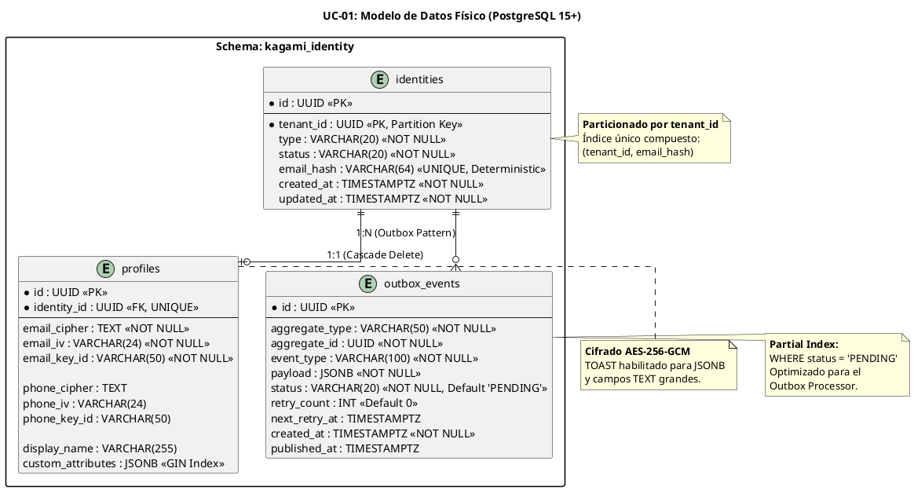

# UC-01: Provisionar Nueva Identidad - Modelo de Datos Físico Específico

| Metadatos del Documento | |
| :--- | :--- |
| **Proyecto:** | SHUGO - Identity & Access Platform |
| **Caso de Uso:** | UC-01 - Provisionar Nueva Identidad |
| **Documento:** | 10_UC_Specific_Data_Model.md |
| **Metodología:** | Physical Data Modeling + PostgreSQL Advanced Features + Privacy by Design |
| **Base de Datos:** | PostgreSQL 15+ (Primary) |
| **Autor:** | Gastón Ruiz |
| **Versión Actual:** | 1.0.0 |
| **Fecha:** | 30/08/2026 |

---

## Historial de Versiones

| Versión | Fecha | Autor | Descripción de Cambios | Impacto |
| :--- | :--- | :--- | :--- | :--- |
| **1.0.0** | 30/08/2026 | Gastón Ruiz | **Creación inicial.** Traducción del Modelo de Dominio (Doc 04) y Diseño de Clases (Doc 08) al modelo de datos físico en PostgreSQL. Incluye scripts DDL, estrategia de cifrado a nivel de columna (Column-Level Encryption), índices avanzados (B-Tree, GIN, Partial), particionamiento por tenant y Row-Level Security (RLS). | Documento de referencia para DBAs y desarrolladores backend. Define la estructura exacta de la base de datos para garantizar escalabilidad, seguridad (PII) y aislamiento multi-tenant desde el primer día. |

---

## 1. Introducción y Propósito

Este documento define el **Modelo de Datos Físico** específico para el UC-01 (Provisionar Nueva Identidad). A diferencia del Modelo de Dominio Conceptual (que se enfoca en comportamiento y reglas de negocio), este documento se enfoca en **cómo se persisten esos conceptos en PostgreSQL 15+** de manera óptima, segura y escalable.

### 1.1. Objetivos Críticos
1. **Privacy by Design (Cifrado a Nivel de Columna):** Los campos PII (email, teléfono) no se almacenan en texto plano. Se implementa un esquema de 3 columnas (`cipher_text`, `iv`, `key_id`) para soportar AES-256-GCM con rotación de claves.
2. **Unicidad Determinista sobre Datos Cifrados:** Dado que AES-GCM usa IVs aleatorios (no se puede hacer `UNIQUE` sobre el cifrado), se introduce una columna `email_hash` (HMAC-SHA256 determinista) para validar unicidad sin descifrar.
3. **Escalabilidad Multi-Tenant:** Implementación de **Particionamiento por Lista (List Partitioning)** basado en `tenant_id` y **Row-Level Security (RLS)** para garantizar aislamiento físico y lógico.
4. **Patrón Outbox Transaccional:** Diseño de la tabla `outbox_events` optimizada para el procesamiento asíncrono de eventos de dominio.

---

## 2. Diagrama de Modelo de Datos Físico (ERD)



---

## 3. Scripts DDL (Data Definition Language)

### 3.1. Configuración Inicial y Extensiones

```sql
-- Habilitar extensiones necesarias
CREATE EXTENSION IF NOT EXISTS "pgcrypto"; -- Para gen_random_uuid()
CREATE EXTENSION IF NOT EXISTS "pg_trgm";  -- Para búsquedas de texto (opcional)

-- Crear esquema lógico
CREATE SCHEMA IF NOT EXISTS kagami_identity;
SET search_path TO kagami_identity;

-- Crear Enums (Mejor rendimiento que VARCHAR con CHECK)
CREATE TYPE identity_type AS ENUM ('USER', 'SERVICE', 'DEVICE');
CREATE TYPE identity_status AS ENUM ('PROVISIONED', 'ACTIVE', 'SUSPENDED', 'DEACTIVATED', 'PURGED');
CREATE TYPE outbox_status AS ENUM ('PENDING', 'PUBLISHING', 'PUBLISHED', 'FAILED');
```

### 3.2. Tabla `identities` (Aggregate Root)

```sql
-- Tabla particionada por tenant_id para escalabilidad
CREATE TABLE identities (
    id UUID NOT NULL DEFAULT gen_random_uuid(),
    tenant_id UUID NOT NULL,
    type identity_type NOT NULL,
    status identity_status NOT NULL DEFAULT 'PROVISIONED',
    email_hash VARCHAR(64), -- HMAC-SHA256 del email (minúsculas) para unicidad
    created_at TIMESTAMPTZ NOT NULL DEFAULT NOW(),
    updated_at TIMESTAMPTZ NOT NULL DEFAULT NOW(),
    PRIMARY KEY (id, tenant_id) -- PK debe incluir la clave de partición
) PARTITION BY LIST (tenant_id);

-- Índices
CREATE UNIQUE INDEX idx_identities_tenant_email_hash 
    ON identities (tenant_id, email_hash) 
    WHERE email_hash IS NOT NULL; -- Partial index, solo para usuarios

CREATE INDEX idx_identities_tenant_status 
    ON identities (tenant_id, status);

-- Función para actualizar updated_at automáticamente
CREATE OR REPLACE FUNCTION update_updated_at_column()
RETURNS TRIGGER AS $$
BEGIN
    NEW.updated_at = NOW();
    RETURN NEW;
END;
$$ language 'plpgsql';

CREATE TRIGGER identities_updated_at 
    BEFORE UPDATE ON identities 
    FOR EACH ROW EXECUTE FUNCTION update_updated_at_column();
```

### 3.3. Tabla `profiles` (Entity Interna)

```sql
CREATE TABLE profiles (
    id UUID NOT NULL DEFAULT gen_random_uuid(),
    identity_id UUID NOT NULL,
    tenant_id UUID NOT NULL, -- Necesario para RLS y joins eficientes
    
    -- Campos de Email Cifrado
    email_cipher TEXT NOT NULL,
    email_iv VARCHAR(24) NOT NULL, -- Base64 encoded IV (12 bytes for GCM)
    email_key_id VARCHAR(50) NOT NULL,
    
    -- Campos de Teléfono Cifrado (Opcional)
    phone_cipher TEXT,
    phone_iv VARCHAR(24),
    phone_key_id VARCHAR(50),
    
    display_name VARCHAR(255),
    custom_attributes JSONB DEFAULT '{}'::jsonb,
    
    PRIMARY KEY (id, tenant_id),
    FOREIGN KEY (identity_id, tenant_id) REFERENCES identities(id, tenant_id) ON DELETE CASCADE
) PARTITION BY LIST (tenant_id);

-- Índice único para asegurar 1:1 entre Identity y Profile
CREATE UNIQUE INDEX idx_profiles_identity_id 
    ON profiles (identity_id, tenant_id);

-- Índice GIN para búsquedas dentro de JSONB (Atributos Custom)
CREATE INDEX idx_profiles_custom_attributes_gin 
    ON profiles USING GIN (custom_attributes);
```

### 3.4. Tabla `outbox_events` (Patrón Outbox)

```sql
CREATE TABLE outbox_events (
    id UUID NOT NULL DEFAULT gen_random_uuid(),
    tenant_id UUID NOT NULL,
    aggregate_type VARCHAR(50) NOT NULL, -- Ej. 'Identity'
    aggregate_id UUID NOT NULL,
    event_type VARCHAR(100) NOT NULL,    -- Ej. 'Identity.Provisioned'
    payload JSONB NOT NULL,
    status outbox_status NOT NULL DEFAULT 'PENDING',
    retry_count INT NOT NULL DEFAULT 0,
    next_retry_at TIMESTAMPTZ,
    created_at TIMESTAMPTZ NOT NULL DEFAULT NOW(),
    published_at TIMESTAMPTZ,
    PRIMARY KEY (id, tenant_id)
) PARTITION BY LIST (tenant_id);

-- Partial Index CRÍTICO: Solo indexa eventos pendientes, reduciendo tamaño y mejorando velocidad del Processor
CREATE INDEX idx_outbox_events_pending 
    ON outbox_events (tenant_id, created_at ASC) 
    WHERE status = 'PENDING' AND (next_retry_at IS NULL OR next_retry_at <= NOW());

CREATE INDEX idx_outbox_events_aggregate 
    ON outbox_events (aggregate_type, aggregate_id);
```

---

## 4. Estrategia de Cifrado a Nivel de Columna (Column-Level Encryption)

### 4.1. Mapeo de Value Object `EncryptedData` a Columnas Físicas

El Value Object `EncryptedData` del dominio se mapea a 3 columnas físicas para soportar **Key Rotation** y **Algoritmos AEAD (AES-256-GCM)**:

| Propiedad del VO | Columna Física | Tipo de Dato | Descripción |
| :--- | :--- | :--- | :--- |
| `CipherText` | `email_cipher` | `TEXT` | El texto cifrado en Base64. Puede ser largo, PostgreSQL usará TOAST automáticamente. |
| `IV` | `email_iv` | `VARCHAR(24)` | Initialization Vector (12 bytes para GCM), codificado en Base64. |
| `KeyId` | `email_key_id` | `VARCHAR(50)` | Identificador de la clave maestra usada (ej. `arn:aws:kms:us-east-1:123:key/abc`). Permite rotar claves sin recifrar toda la DB. |

### 4.2. Unicidad Determinista (El problema del cifrado aleatorio)

**Problema:** AES-256-GCM genera un `CipherText` diferente cada vez que se cifra el mismo email (debido al IV aleatorio). No podemos poner un `UNIQUE CONSTRAINT` sobre `email_cipher`.

**Solución Elite:** Calcular un **Hash Determinista (HMAC-SHA256)** del email en minúsculas usando una clave secreta del tenant, y almacenarlo en `email_hash`.

```sql
-- Ejemplo de cómo se inserta (lógica de aplicación, no SQL puro por seguridad)
-- email = "Juan@KHCS.com" -> lower() -> "juan@khcs.com"
-- email_hash = HMAC_SHA256("juan@khcs.com", tenant_secret_key)

INSERT INTO identities (tenant_id, type, status, email_hash)
VALUES ('tenant-uuid-1', 'USER', 'PROVISIONED', 'a1b2c3d4...'); -- Hash determinista
```
*Nota de Seguridad:* El `email_hash` es irreversible (es un HMAC, no un cifrado). Si se compromete la DB, el atacante no puede obtener el email real, solo puede verificar si un email específico existe (lo cual es aceptable para este trade-off de rendimiento/seguridad).

---

## 5. Estrategia de Particionamiento (Partitioning)

Para soportar tenants con millones de identidades (ej. Enterprise), usamos **Particionamiento por Lista (List Partitioning)** basado en `tenant_id`.

### 5.1. Creación de Particiones

```sql
-- Partición para el Tenant KHCS
CREATE TABLE identities_khcs PARTITION OF identities
    FOR VALUES IN ('uuid-tenant-khcs');

CREATE TABLE profiles_khcs PARTITION OF profiles
    FOR VALUES IN ('uuid-tenant-khcs');

CREATE TABLE outbox_events_khcs PARTITION OF outbox_events
    FOR VALUES IN ('uuid-tenant-khcs');

-- Partición DEFAULT para tenants pequeños o no asignados explícitamente
CREATE TABLE identities_default PARTITION OF identities DEFAULT;
CREATE TABLE profiles_default PARTITION OF profiles DEFAULT;
CREATE TABLE outbox_events_default PARTITION OF outbox_events DEFAULT;
```

### 5.2. Beneficios de Rendimiento
1. **Index Scans más rápidos:** Los índices son más pequeños por partición.
2. **Mantenimiento eficiente:** Podemos hacer `VACUUM` o `REINDEX` en una partición específica sin bloquear toda la tabla.
3. **Borrado de datos (GDPR):** Si un tenant se va, podemos hacer `DROP TABLE identities_tenant_x` en milisegundos en lugar de un `DELETE` masivo que bloquee la DB.

---

## 6. Row-Level Security (RLS) - Aislamiento Multi-Tenant

Aunque la aplicación siempre filtra por `tenant_id`, implementamos RLS como **última línea de defensa** contra errores de código o accesos directos a la DB.

```sql
-- Habilitar RLS en todas las tablas
ALTER TABLE identities ENABLE ROW LEVEL SECURITY;
ALTER TABLE profiles ENABLE ROW LEVEL SECURITY;
ALTER TABLE outbox_events ENABLE ROW LEVEL SECURITY;

-- Forzar RLS incluso para el dueño de la tabla (postgres user)
ALTER TABLE identities FORCE ROW LEVEL SECURITY;

-- Crear Política de Aislamiento
-- Asume que la aplicación setea la variable de sesión al iniciar la transacción:
-- SET LOCAL app.current_tenant_id = 'uuid-tenant-khcs';

CREATE POLICY tenant_isolation_policy ON identities
    FOR ALL
    USING (tenant_id = current_setting('app.current_tenant_id')::uuid)
    WITH CHECK (tenant_id = current_setting('app.current_tenant_id')::uuid);

-- Repetir para profiles y outbox_events...
CREATE POLICY tenant_isolation_policy ON profiles
    FOR ALL
    USING (tenant_id = current_setting('app.current_tenant_id')::uuid);
```

---

## 7. Consideraciones de Rendimiento y Mantenimiento

### 7.1. TOAST (The Oversized-Attribute Storage Technique)
Los campos `email_cipher`, `phone_cipher` y `custom_attributes` (JSONB) pueden exceder el tamaño de página de PostgreSQL (8KB).
*   **Configuración:** Dejamos la configuración por defecto (`EXTENDED`), que comprime y mueve los datos grandes a una tabla TOAST automáticamente.
*   **Impacto:** Las queries que no seleccionan estos campos (`SELECT id, status FROM identities`) serán extremadamente rápidas porque no leen las tablas TOAST.

### 7.2. Autovacuum Tuning para `outbox_events`
La tabla `outbox_events` tiene un ciclo de vida de escritura/lectura/borrado muy alto.
```sql
-- Ajustar autovacuum para la tabla outbox (ejecutar por partición si es necesario)
ALTER TABLE outbox_events SET (
    autovacuum_vacuum_scale_factor = 0.01, -- Vaciar cuando 1% de filas cambian
    autovacuum_analyze_scale_factor = 0.005,
    autovacuum_vacuum_threshold = 50,
    autovacuum_analyze_threshold = 25
);
```

---

## 8. Trazabilidad con Otros Documentos

| Documento | Relación |
| :--- | :--- |
| `04_Initial_Domain_Model.md` | Este modelo físico implementa los Aggregate Roots (`Identity`) y Value Objects (`EncryptedData`) definidos conceptualmente. |
| `08_Final_Class_Design.md` | Las columnas `cipher`, `iv`, `key_id` son la materialización física de la clase `EncryptedData`. |
| `09_Modern_Artifacts.md` | Los índices y el particionamiento son críticos para cumplir los SLAs de latencia (< 200ms p95) definidos aquí. |
| `SHUGO_Data_Model_Master.md` (Transversal) | Este documento es una extensión específica para UC-01. Las tablas compartidas (ej. `tenants`) se definen en el maestro. |

---

## 9. Anexos: Glosario de Base de Datos

| Término | Definición en Contexto SHUGO |
| :--- | :--- |
| **HMAC-SHA256** | Función hash criográfica usada para `email_hash`. Permite verificar unicidad sin descifrar. |
| **TOAST** | Mecanismo interno de PostgreSQL para almacenar campos grandes fuera de la fila principal. |
| **Partial Index** | Índice que solo cubre un subconjunto de filas (ej. `WHERE status = 'PENDING'`). Reduce drásticamente el tamaño del índice. |
| **GIN Index** | Generalized Inverted Index. Usado para buscar eficientemente dentro de campos JSONB (`custom_attributes`). |
| **List Partitioning** | Dividir una tabla lógica en tablas físicas basadas en valores específicos de una columna (`tenant_id`). |
| **RLS (Row-Level Security)** | Característica de PostgreSQL que restringe qué filas puede ver/modificar un usuario de base de datos. |

---
*Fin del Documento 10_UC_Specific_Data_Model para UC-01*