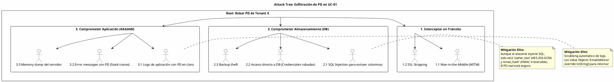

# UC-01: Provisionar Nueva Identidad - Análisis de Amenazas y Seguridad Específica

| Metadatos del Documento | |
| :--- | :--- |
| **Proyecto:** | SHUGO - Identity & Access Platform |
| **Caso de Uso:** | UC-01 - Provisionar Nueva Identidad |
| **Documento:** | 11_UC_Specific_Security_Threats.md |
| **Metodología:** | STRIDE + DREAD + Attack Trees + Privacy Impact Assessment (PIA) |
| **Estándares:** | OWASP Top 10, NIST SP 800-30, ISO/IEC 27005, GDPR Art. 35 (DPIA) |
| **Autor:** | Gastón Ruiz |
| **Versión Actual:** | 1.0.0 |
| **Fecha:** | 30/08/2026 |

---

## Historial de Versiones

| Versión | Fecha | Autor | Descripción de Cambios | Impacto |
| :--- | :--- | :--- | :--- | :--- |
| **1.0.0** | 30/08/2026 | Gastón Ruiz | **Creación inicial.** Análisis de amenazas específico para el endpoint de provisionamiento. Incluye Attack Trees detallados, matriz STRIDE/DREAD, y mitigaciones técnicas de nivel enterprise (Envelope Encryption, RLS bypass prevention, KMS DoS protection). | Documento crítico para el equipo de seguridad y DevSecOps. Define cómo proteger los datos PII y la integridad del sistema ante ataques dirigidos al punto de entrada de identidades. |

---

## 1. Introducción y Alcance

El UC-01 (Provisionar Nueva Identidad) es un **activo de alto valor** para un atacante. Es la puerta de entrada de datos sensibles (PII) y el punto donde se establecen las identidades que luego serán usadas para autenticación y autorización.

Este documento se enfoca exclusivamente en las amenazas **específicas** de este caso de uso, complementando el `Security_Threat_Model.md` global. Nos centramos en tres vectores críticos:
1. **Confidencialidad de PII:** Fugas de datos durante el tránsito, procesamiento o almacenamiento.
2. **Integridad del Provisionamiento:** Creación de identidades maliciosas o duplicadas.
3. **Disponibilidad del Servicio:** Ataques de Denegación de Servicio (DoS) dirigidos a dependencias críticas como el KMS (Key Management Service).

---

## 2. Attack Trees (Árboles de Ataque)

Los Attack Trees modelan cómo un atacante podría comprometer el sistema. Cada nodo representa un objetivo o un método.

### 2.1. Attack Tree #1: Exfiltración de PII (Confidencialidad)

**Objetivo del Atacante:** Obtener los emails y teléfonos de los usuarios de un tenant específico.



### 2.2. Attack Tree #2: Denegación de Servicio vía KMS (Disponibilidad)

**Objetivo del Atacante:** Bloquear el provisionamiento de identidades legítimas agotando la cuota del servicio de cifrado (KMS).

```text
[Root: Bloquear Provisionamiento de Identidades]
  |
  +-- [1. Saturar API Gateway]
  |     +-- 1.1. Flood de requests HTTP (Mitigado por WAF/Rate Limiting)
  |
  +-- [2. Saturar KMS (Key Management Service)]
  |     +-- 2.1. Enviar miles de requests válidos con emails únicos.
  |           |
  |           +-- [Efecto: KMS alcanza Rate Limit (ej. 1000 req/seg)]
  |           +-- [Consecuencia: KAGAMI falla al cifrar -> HTTP 500]
  |           +-- [Impacto: Ninguna identidad nueva puede ser creada (Fail Secure)]
  |
  +-- [3. Comprometer Clave Maestra (KMS Key)]
        +-- 3.1. Robar credenciales de AWS IAM / HashiCorp Vault.
              +-- [Efecto: Atacante puede descifrar PII histórico]
```

---

## 3. Matriz de Amenazas Específicas (STRIDE + DREAD)

Evaluación detallada de las amenazas identificadas en los Attack Trees.

| ID | Amenaza | Categoría STRIDE | DREAD (1-10) | Severidad | Mitigación Técnica Específica |
| :--- | :--- | :--- | :--- | :--- | :--- |
| **T-01** | **KMS Rate Limit Exhaustion (DoS)** | Denial of Service | **8.5** | **Crítica** | **Envelope Encryption:** KAGAMI genera Data Encryption Keys (DEKs) locales y solo usa KMS para cifrar las DEKs (KEKs). Reduce llamadas a KMS en 99%. |
| **T-02** | **PII Leakage via Application Logs** | Information Disclosure | **7.0** | **Alta** | **Log Scrubbing & VO Masking:** Implementar `ToString()` seguro en VOs (`EmailAddress`) y usar Serilog `Destructuring` para ofuscar campos sensibles automáticamente. |
| **T-03** | **Tenant Isolation Bypass (SQLi)** | Elevation of Privilege | **9.0** | **Crítica** | **Row-Level Security (RLS) + Parameterized Queries:** Doble capa de defensa. Si el ORM falla, la DB rechaza la query. |
| **T-04** | **Identity Spoofing (Duplicate Email)** | Tampering | **6.0** | **Media** | **Deterministic Hashing (HMAC):** Validar unicidad contra `email_hash` (HMAC-SHA256) en lugar del texto cifrado. Constraint `UNIQUE(tenant_id, email_hash)`. |
| **T-05** | **Outbox Event Replay / Tampering** | Repudiation / Tampering | **7.5** | **Alta** | **Idempotency Keys & Signatures:** Cada evento tiene un `aggregate_id` único. El consumidor (Kafka) valida firmas y descarta duplicados. |
| **T-06** | **Mass Provisioning (Spam)** | Denial of Service | **6.5** | **Media** | **Tenant-Specific Rate Limiting:** Sliding Window en Redis. Límite estricto por `tenant_id` (ej. 100 identidades/hora para Plan Free). |
| **T-07** | **Custom Attributes Injection (NoSQL/JSON)** | Injection | **7.0** | **Alta** | **JSON Schema Validation:** Validación estricta contra el schema del tenant antes de persistir. Sanitización de inputs para prevenir XXE o Script Injection en campos JSONB. |

---

## 4. Mitigaciones Técnicas de Nivel Elite

### 4.1. Envelope Encryption (Mitigación para T-01: KMS DoS)

Llamar a un KMS externo (AWS KMS, Azure Key Vault) para *cada* campo PII es lento y costoso. Implementamos **Envelope Encryption** para reducir la carga en el KMS y aumentar la resiliencia.

**Flujo de Cifrado (PIIEncryptor):**
1.  **Generar DEK Local:** KAGAMI genera una *Data Encryption Key* (DEK) aleatoria de 256 bits localmente (usando `RNGCryptoServiceProvider`).
2.  **Cifrar Datos con DEK:** El email se cifra localmente usando AES-256-GCM con la DEK. (Operación CPU local, < 1ms).
3.  **Cifrar DEK con KEK (KMS):** La DEK se envía al KMS para ser cifrada con la *Key Encryption Key* (KEK) maestra.
4.  **Almacenamiento:** Se guarda el `email_cipher` (cifrado con DEK) y el `email_key_id` (que contiene la DEK cifrada por el KMS).

**Beneficio:** Si el KMS está caído, KAGAMI puede seguir cifrando datos usando DEKs cacheadas o generar nuevas DEKs (si la política lo permite), o al menos, reduce la dependencia síncrona crítica. *Nota: Para máxima seguridad, el paso 3 sigue siendo síncrono, pero el volumen de datos enviados al KMS es mínimo (solo claves de 32 bytes, no payloads grandes).*

### 4.2. Prevención de Fugas en Logs (Mitigación para T-02)

Implementación de Value Objects seguros en C# para evitar que desarrolladores logueen PII por accidente.

```csharp
public class EmailAddress : ValueObject
{
    private readonly string _value;

    public EmailAddress(string value)
    {
        // Validación...
        _value = value.ToLowerInvariant();
    }

    // CRÍTICO: Override para prevenir leaks en logs
    public override string ToString()
    {
        // Retorna una versión enmascarada si se imprime por error
        if (string.IsNullOrEmpty(_value) || !_value.Contains("@")) return "***";
        var parts = _value.Split('@');
        return $"{parts[0].Substring(0, Math.Min(2, parts[0].Length))}***@{parts[1]}";
    }

    // Método explícito para obtener el valor real solo cuando es necesario (ej. para cifrar)
    public string GetRawValue() => _value;
}

// Uso en el Handler:
// ❌ MAL: Log.Information("Provisioning user {Email}", email); -> Loguea "ju***@khcs.com"
// ✅ BIEN: Log.Information("Provisioning user for tenant {TenantId}", tenantId);
```

### 4.3. Validación de Unicidad Determinista (Mitigación para T-04)

Dado que `email_cipher` es diferente cada vez (debido al IV aleatorio de GCM), no podemos usar un `UNIQUE INDEX` sobre él.

**Solución:**
1.  Calcular `email_hash = HMAC-SHA256(email.ToLower(), TenantSecretKey)`.
2.  Almacenar `email_hash` en la tabla `identities`.
3.  Crear índice único: `CREATE UNIQUE INDEX idx_unique_tenant_email ON identities(tenant_id, email_hash);`

**Seguridad:** El `email_hash` es irreversible (es un HMAC, no un cifrado). Si la DB es comprometida, el atacante no puede recuperar el email original desde el hash, pero puede verificar si un email específico existe (lo cual es un riesgo aceptable y necesario para la funcionalidad).

---

## 5. Compliance y Privacidad (GDPR / SOC 2)

### 5.1. GDPR Art. 32 - Security of Processing

| Requisito GDPR | Implementación en UC-01 |
| :--- | :--- |
| **Pseudonimización y cifrado** | Cifrado AES-256-GCM de PII en reposo. Hash HMAC para unicidad. |
| **Confidencialidad, integridad, disponibilidad** | RLS para confidencialidad. Constraints para integridad. Circuit Breaker para disponibilidad. |
| **Restauración de disponibilidad** | Backups cifrados de PostgreSQL. Outbox pattern para recuperación de eventos. |

### 5.2. SOC 2 - CC6.1 (Logical and Physical Access Controls)

*   **Segregación de Funciones:** El rol que ejecuta el `ProvisionIdentityHandler` no tiene permisos de `DELETE` directo en la tabla `profiles` (solo vía stored procedures o el proceso de Purge UC-05).
*   **Audit Trail:** Cada intento de provisionamiento (éxito o fallo) genera un log estructurado que alimenta el sistema de auditoría (KAGE).

---

## 6. Trazabilidad

| Documento | Relación |
| :--- | :--- |
| `01_Requirements_Specification.md` | Las invariantes de seguridad (INV-08 PII Encryption) se mitigan aquí. |
| `10_UC_Specific_Data_Model.md` | Las columnas `email_cipher`, `email_iv`, `email_hash` son la implementación física de las mitigaciones T-01 y T-04. |
| `SHUGO_Security_Architecture.md` (Transversal) | Este documento aplica los estándares globales (mTLS, Zero Trust) al contexto específico de UC-01. |

---

## 7. Anexos: Configuración de Seguridad PostgreSQL

### 7.1. Encriptación en Tránsito (SSL/TLS)

```postgresql
# postgresql.conf
ssl = on
ssl_cert_file = '/etc/ssl/certs/shugo-db.crt'
ssl_key_file = '/etc/ssl/private/shugo-db.key'
ssl_ciphers = 'HIGH:MEDIUM:+3DES:!aNULL' # Forzar cifrados fuertes
```

### 7.2. Prevención de SQL Injection (Configuración de Rol)

El usuario de aplicación (`app_kagami`) NO debe ser dueño de las tablas, ni tener permisos de superusuario.

```sql
-- Crear rol de aplicación con permisos mínimos
CREATE ROLE app_kagami WITH LOGIN PASSWORD '...';
GRANT CONNECT ON DATABASE shugo_kagami TO app_kagami;
GRANT USAGE ON SCHEMA kagami_identity TO app_kagami;

-- Solo permisos DML (Data Manipulation), NO DDL (Data Definition)
GRANT SELECT, INSERT, UPDATE ON ALL TABLES IN SCHEMA kagami_identity TO app_kagami;
-- Revocar permisos por defecto en public schema
REVOKE ALL ON SCHEMA public FROM app_kagami;
```

---
*Fin del Documento 11_UC_Specific_Security_Threats para UC-01*