# UC-02: Actualizar Identidad - Diagrama de Caso de Uso

| Metadatos del Documento | |
| :--- | :--- |
| **Proyecto:** | SHUGO - Identity & Access Platform |
| **Caso de Uso:** | UC-02 - Actualizar Identidad |
| **Documento:** | 02_Use_Case_Diagram.md |
| **Metodología:** | UML 2.5 + ICONIX + Domain-Driven Design + Optimistic Concurrency Control |
| **Autor:** | Gastón Ruiz |
| **Versión Actual:** | 1.0.0 |
| **Fecha:** | 30/08/2026 |

---

## Historial de Versiones

| Versión | Fecha | Autor | Descripción de Cambios | Impacto |
| :--- | :--- | :--- | :--- | :--- |
| **1.0.0** | 30/08/2026 | Gastón Ruiz | **Creación inicial.** Diagrama de Caso de Uso UML para UC-02. Modela la actualización de identidades introduciendo tres actores distintos (Admin, SCIM, Self-Service), el control de concurrencia optimista (OCC) como dependencia obligatoria, y los flujos extendidos para re-verificación de email y revocación de sesiones. | Documento base del paquete de diseño Tier 1 del UC-02. Establece las fronteras del sistema, los actores y las integraciones críticas para mantener la integridad de datos y la auditabilidad forense durante el ciclo de vida activo de una identidad. |

---

## 1. Diagrama de Caso de Uso (PlantUML)

A continuación, se presenta el Diagrama de Casos de Uso UML para el UC-02. Este diagrama introduce la complejidad de la concurrencia y la auditoría forense.

```plantuml
@startuml UC-02_CasoDeUso
<style>
diagram {
  BackgroundColor #FFFFFF
}
</style>
top to bottom direction
skinparam packageStyle rectangle
skinparam actorStyle awesome
skinparam usecaseBackgroundColor #E3F2FD
skinparam usecaseBorderColor #1565C0
skinparam actorBorderColor #2E7D32
skinparam rectangleBackgroundColor #FFF3E0
skinparam rectangleBorderColor #E65100

title UC-02: Actualizar Identidad - Motor KAGAMI (Identity Lifecycle)

' ============================================
' ACTORES PRIMARIOS
' ============================================
actor "Administrador\nde Tenant" as Admin
actor "Sistema SCIM/HRIS\n(Workday, BambooHR)" as SCIM
actor "Usuario Final\n(Self-Service)" as User

' ============================================
' SISTEMA PRINCIPAL: KAGAMI ENGINE
' ============================================
rectangle "SHUGO - Motor KAGAMI (Identity Lifecycle)" as KAGAMI {
  usecase "UC-02: Actualizar\nIdentidad" as UC02
  usecase "UC-01: Provisionar\nNueva Identidad" as UC01
  usecase "UC-03: Desactivar\nIdentidad" as UC03
  usecase "UC-04: Consultar\nIdentidad" as UC04
  usecase "UC-05: Purgar\nIdentidad" as UC05
}

' ============================================
' MÓDULOS DEPENDIENTES (<<include>>)
' ============================================
rectangle "SHUGO - Motor KAGI (Autenticación)" as KAGI {
  usecase "Validar JWT y\nPermisos (RBAC)" as UC_ValidarPermisos
}

rectangle "SHUGO - Motor KAGAMI (Core)" as KAGAMI_Core {
  usecase "Validar Concurrencia\n(OCC / RowVersion)" as UC_ValidarOCC
  usecase "Validar Formato\ny JSON Schema" as UC_ValidarFormato
  usecase "Re-cifrar PII\n(Si email/phone cambia)" as UC_RecifrarPII
  usecase "Persistir y Auditar\n(Before/After Snapshot)" as UC_PersistirAuditar
}

' ============================================
' MÓDULOS COMPLEMENTARIOS (<<extend>>)
' ============================================
rectangle "SHUGO - Motor KAGI (Sesiones)" as KAGI_Sessions {
  usecase "Revocar Sesiones\nActivas" as UC_RevokeSessions
}

rectangle "SHUGO - Motor KAGI (Verificación)" as KAGI_Verify {
  usecase "Iniciar Re-verificación\nde Email" as UC_ReverifyEmail
}

rectangle "SHUGO - Motor KAGE (Auditoría)" as KAGE {
  usecase "UC-46: Ingestar Log\nde Auditoría" as UC46
}

' ============================================
' RELACIONES DE INICIO (Actores → UC Principal)
' ============================================
Admin --> UC02 : Actualiza perfiles,\natributos o estado
SCIM --> UC02 : Sincroniza cambios\ndesde HRIS (PATCH/PUT)
User --> UC02 : Actualiza su propio\nperfil (Self-Service)

' ============================================
' RELACIONES <<include>> (OBLIGATORIAS)
' ============================================
' La actualización DEBE validar permisos (Admin vs Self-Service scope)
UC02 ..> UC_ValidarPermisos : <<include>>\n(Validar scope de\nactualización)

' La actualización DEBE validar que no haya conflictos de concurrencia
UC02 ..> UC_ValidarOCC : <<include>>\n(Validar header\nIf-Match: RowVersion)

' La actualización DEBE validar el payload (Merge Patch / Schema)
UC02 ..> UC_ValidarFormato : <<include>>\n(Validar RFC 7396\ny JSON Schema)

' Si cambia PII, DEBE re-cifrarse y actualizar el hash determinista
UC02 ..> UC_RecifrarPII : <<include>>\n(Re-cifrar AES-256-GCM\ny actualizar email_hash)

' La actualización DEBE persistir y generar el log Before/After
UC02 ..> UC_PersistirAuditar : <<include>>\n(Transacción atómica\n+ Audit Snapshot)

' ============================================
' RELACIONES <<extend>> (CONDICIONALES)
' ============================================
' Si el email cambia, se debe iniciar el flujo de re-verificación
UC_ReverifyEmail .up.> UC02 : <<extend>>\n(Si profile.email\ncambia)

' Si el estado cambia a SUSPENDED/DEACTIVATED, se revocan sesiones
UC_RevokeSessions .left.> UC02 : <<extend>>\n(Si status cambia a\nSUSPENDED/DEACTIVATED)

' El log de auditoría se ingesta en KAGE
UC46 .right.> UC_PersistirAuditar : <<extend>>\n(Ingestar evento\nIdentity.Updated)

' ============================================
' RELACIÓN CON OTROS UCs DE KAGAMI
' ============================================
note right of UC03
  **Transiciones de Estado:**
  UC-02 puede invocar transiciones
  (ej. ACTIVE -> SUSPENDED),
  pero UC-03 es el caso de uso
  especializado para offboarding.
end note

UC02 .down.> UC03 : <<dependency>>\n(Invoca transiciones\nde estado)

UC04 .down.> UC02 : <<dependency>>\n(Proporciona RowVersion\npara OCC)

@enduml
```

---

## 2. Explicación del Diagrama

### 2.1. Actores del Sistema

El UC-02 introduce una dinámica de actores más compleja que el UC-01, reflejando los escenarios reales de un IAM enterprise:

1.  **Administrador de Tenant (Humano):** Tiene permisos completos (`identity:update`) para modificar cualquier campo, incluyendo atributos sensibles y cambios de estado (ej. suspender un usuario).
2.  **Sistema SCIM/HRIS (Automatizado):** Actúa como un orquestador de la "fuente de la verdad" de RRHH. Envía actualizaciones masivas o incrementales (vía `PATCH` o `PUT`) cuando un empleado cambia de departamento o rol en Workday/BambooHR.
3.  **Usuario Final (Self-Service):** Un actor crítico en IAM modernos. Puede actualizar *solo* un subconjunto de campos (ej. `display_name`, `phone`, o ciertos `custom_attributes` no sensibles). **Nunca** puede modificar su propio `status`, `email` (sin re-verificación) o `custom_attributes` de seguridad (ej. `clearance_level`).

### 2.2. Relaciones UML Clave

#### Relaciones `<<include>>`: El núcleo de la integridad de datos

A diferencia de una actualización CRUD simple, actualizar una identidad en SHUGO requiere cinco validaciones obligatorias:

1.  **`<<include>>` Validar Permisos (Scope):** No es solo "¿Estás autenticado?". Es "¿Tienes permiso para editar *este* campo específico?". Un usuario Self-Service no puede editar su propio `clearance_level`.
2.  **`<<include>>` Validar Concurrencia (OCC):** El sistema exige el header `If-Match: <RowVersion>`. Si el `RowVersion` de la DB no coincide, se aborta (HTTP 409) para prevenir *Lost Updates*.
3.  **`<<include>>` Validar Formato (JSON Merge Patch):** Soporte nativo para RFC 7396. Permite enviar `{"profile": {"custom_attributes": {"rol": null}}}` para borrar un atributo específico sin borrar todo el objeto JSON.
4.  **`<<include>>` Re-cifrar PII:** Si el payload incluye un nuevo `email` o `phone`, el sistema no solo actualiza el texto cifrado, sino que **debe** recalcular el `email_hash` (HMAC determinista) para mantener la restricción `UNIQUE` de la base de datos.
5.  **`<<include>>` Persistir y Auditar (Before/After):** La transacción de DB y la escritura del log de auditoría son atómicas. El log captura exactamente qué campos cambiaron, su valor anterior (cifrado) y su valor nuevo (cifrado).

#### Relaciones `<<extend>>`: Efectos secundarios condicionales

Estos flujos solo se activan si la actualización modifica campos específicos:

1.  **`<<extend>>` Iniciar Re-verificación de Email:** Si un Admin o el propio usuario cambia el email, la identidad no puede seguir siendo `ACTIVE` para acciones sensibles hasta que se verifique el nuevo email (flujo gestionado por KAGI).
2.  **`<<extend>>` Revocar Sesiones Activas:** Si la actualización cambia el `status` de `ACTIVE` a `SUSPENDED` o `DEACTIVATED`, se dispara inmediatamente la invalidación de todos los `RefreshTokens` y sesiones activas en KAGI.

---

## 3. Análisis de Coherencia con la Especificación Analítica

Este diagrama es **100% coherente** con el documento `01_Requirements_Specification.md` del UC-02:

| Elemento del Diagrama | Referencia en Especificación |
| :--- | :--- |
| Actores: Admin, SCIM, Usuario Final | Sección 2 (Descripción Analítica) - Actores Principales |
| Relación `<<include>>` con UC_ValidarOCC | Sección 3 (INV-09) - Optimistic Concurrency Control |
| Relación `<<include>>` con UC_RecifrarPII | Sección 3 (INV-11) - PII Re-encryption |
| Relación `<<include>>` con UC_PersistirAuditar | Sección 3 (INV-10) - Audit Trail (Before/After) |
| Relación `<<include>>` con UC_ValidarFormato | Sección 3 (INV-12) - JSON Merge Patch (RFC 7396) |
| Relación `<<extend>>` con UC_RevokeSessions | Sección 2.2 (Puntos de Extensión) - Suspensión de sesiones |
| Relación `<<extend>>` con UC_ReverifyEmail | Sección 2.2 (Puntos de Extensión) - Re-verificación |
| Relación `<<dependency>>` con UC-04 | Sección 1.2 - Necesidad de obtener el RowVersion actual |

---

## 4. Consideraciones de Diseño y Arquitectura (DDD + Clean Architecture)

### 4.1. Control de Concurrencia Optimista (OCC) vs Pesimista

El diagrama enfatiza la validación de OCC (`<<include>>`). En un sistema IAM:
- **Lecturas (UC-04):** Altísimas (cada vez que se evalúa un permiso o se renderiza un perfil).
- **Escrituras (UC-02):** Bajas en comparación.

Usar **Bloqueo Pesimista** (`SELECT ... FOR UPDATE`) bloquearía las lecturas durante las actualizaciones, matando el rendimiento del sistema (especialmente en la Check API de KIZUNA que lee estos datos). El **OCC** (validar `RowVersion` en el `UPDATE`) permite lecturas no bloqueantes y detecta conflictos solo cuando ocurren, lanzando un HTTP 409 para que el cliente re-intente con los datos frescos.

### 4.2. Privacy by Design en la Auditoría (Before/After)

La relación `<<include>>` con `UC_PersistirAuditar` tiene una restricción de seguridad crítica definida en los requisitos:
- El log de auditoría **DEBE** contener el `Before` y `After` de los campos modificados.
- **Sin embargo**, si el campo modificado es PII (email, phone), los valores `oldValue` y `newValue` en el log de auditoría **deben almacenarse cifrados o hasheados**.
- *Justificación:* Los logs de auditoría suelen ser accesibles por equipos de seguridad o compliance con menos privilegios que los administradores de IAM. Exponer PII en claro en los logs violaría el principio de "Need to Know" y normativas como GDPR.

### 4.3. Manejo de JSON Merge Patch (RFC 7396)

Para los `custom_attributes` (almacenados como JSONB en PostgreSQL), el diagrama asume que el validador (`UC_ValidarFormato`) implementa la lógica de Merge Patch:
- Si el cliente envía `{"custom_attributes": {"rol": "admin"}}`, se fusiona con el JSON existente.
- Si el cliente envía `{"custom_attributes": {"rol": null}}`, la clave "rol" se **elimina** del JSONB.
- Esto previene el efecto secundario no deseado de borrar otros atributos custom que el cliente no incluyó en el payload.

---

## 5. Trazabilidad con Otros Documentos del Paquete

Este diagrama se relaciona con los siguientes documentos del paquete de diseño:

| Documento | Relación |
| :--- | :--- |
| `01_Requirements_Specification.md` | Define los flujos, invariantes (OCC, Auditoría Before/After) y criterios de aceptación que este diagrama visualiza. |
| `03_Activity_Diagram.md` | Mostrará el flujo de trabajo interno, destacando la bifurcación lógica cuando se detecta un cambio de email (Re-verificación) o cambio de estado (Revocación). |
| `04_Initial_Domain_Model.md` | Definirá el método `Update()` en el Aggregate Root `Identity`, que encapsula la lógica de generación de eventos de dominio y validación de invariantes. |
| `06_Robustness_Diagram.md` | Mostrará la colaboración entre el Handler, el OCC Validator, el PII Encryptor y el Audit Logger. |
| `07_Sequence_Diagram.md` | Detallará el orden temporal: Fetch (para RowVersion) -> Validate OCC -> Encrypt -> Save -> Audit. |
| `10_UC_Specific_Data_Model.md` (UC-01) | Define la columna `row_version` y la estructura de la tabla de auditoría que soportan este caso de uso. |
| `UC-01/02_Use_Case_Diagram.md` | Documento hermano. UC-02 depende de la existencia de la identidad creada en UC-01. |

---

## 6. Notas de Implementación

### 6.1. Generación del Diagrama
- **Herramienta:** PlantUML (Diagrams as Code).
- **Estilos:** Se mantiene la paleta de colores azul para KAGAMI y naranja para sistemas secundarios, asegurando consistencia visual con el UC-01.
- **Convención:** Las relaciones `<<extend>>` apuntan *hacia* el caso de uso base, indicando que son comportamientos opcionales que se inyectan bajo ciertas condiciones.

### 6.2. Diferenciación de Actores en la Implementación
Aunque los tres actores (Admin, SCIM, User) apuntan al mismo UC-02, la implementación del `<<include>>` **Validar Permisos** debe ser capaz de distinguir el contexto:
- **Admin:** Scope completo.
- **SCIM:** Scope definido por los mapeos de atributos del tenant (ej. solo puede editar `department` y `title`).
- **User:** Scope restrictivo (solo campos marcados como `user_editable: true` en el JSON Schema del tenant).

---
*Fin del Documento 02_Use_Case_Diagram para UC-02*