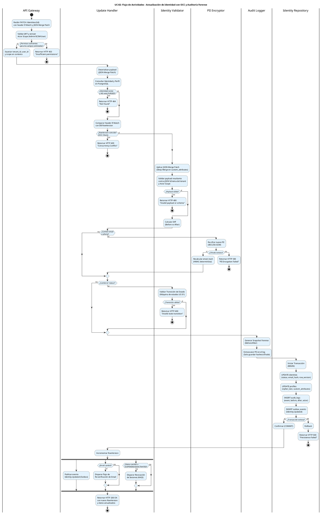

# UC-02: Actualizar Identidad - Diagrama de Actividades

| Metadatos del Documento | |
| :--- | :--- |
| **Proyecto:** | SHUGO - Identity & Access Platform |
| **Caso de Uso:** | UC-02 - Actualizar Identidad |
| **Documento:** | 03_Activity_Diagram.md |
| **Metodología:** | UML 2.5 + ICONIX + Clean Architecture + Optimistic Concurrency Control (OCC) |
| **Autor:** | Gastón Ruiz |
| **Versión Actual:** | 1.0.0 |
| **Fecha:** | 30/08/2026 |

---

## Historial de Versiones

| Versión | Fecha | Autor | Descripción de Cambios | Impacto |
| :--- | :--- | :--- | :--- | :--- |
| **1.0.0** | [30/08/2026] | Gastón Ruiz | **Creación inicial.** Modelado del flujo de trabajo interno para la actualización de identidades. Destaca la lógica de Control de Concurrencia Optimista (OCC), la aplicación de JSON Merge Patch (RFC 7396), la re-cifrado condicional de PII, y la generación atómica del snapshot de auditoría (Before/After). | Documento base del paquete de diseño Tier 1 del UC-02. Establece la lógica de negocio, los puntos de decisión críticos y las garantías de integridad y auditabilidad para el endpoint de modificación del motor KAGAMI. |

---

## 1. Introducción y Propósito

El **Diagrama de Actividades** para el UC-02 visualiza el flujo de control, decisiones y orquestación necesario para modificar una identidad existente de forma segura y auditable.

A diferencia de una operación CRUD estándar, actualizar una identidad en un sistema IAM enterprise introduce cinco complejidades arquitectónicas críticas que este diagrama modela explícitamente:

1. **Control de Concurrencia Optimista (OCC):** Prevenir *Lost Updates* cuando múltiples actores (Admin, SCIM, Usuario) editan la misma identidad simultáneamente.
2. **JSON Merge Patch (RFC 7396):** Lógica de fusión profunda (Deep Merge) para `custom_attributes`, permitiendo actualizaciones parciales sin sobrescribir datos no enviados.
3. **Detección y Re-cifrado de PII:** Si el email o teléfono cambian, el sistema debe recalcular el cifrado AES-256-GCM y el hash determinista (HMAC) en la misma transacción.
4. **Auditoría Forense (Before/After):** Generación de un snapshot exacto de los cambios, con **enmascaramiento automático de PII** para los logs de auditoría.
5. **Disparadores Condicionales (Extend Flows):** Cambios en el email o en el estado (`status`) disparan flujos asíncronos (Re-verificación, Revocación de sesiones) que no deben bloquear la respuesta HTTP.

Utilizamos carriles (swimlanes) para separar las responsabilidades entre el API Gateway, el Update Handler, el Identity Validator, el PII Encryptor, el Identity Repository, y el Audit Logger.

---

## 2. Diagrama de Actividades (PlantUML)

A continuación, se presenta el diagrama que cubre el Escenario Principal (actualización exitosa), el manejo de conflictos de concurrencia, y los flujos condicionales de PII y Estado.

---

## 3. Explicación Detallada del Flujo

### 3.1. Carriles (Partitions / Swimlanes)

El diagrama está dividido en seis carriles que representan las capas y responsabilidades de la arquitectura:

1. **`|API Gateway|` (Capa de Entrada):** Valida la identidad del actor y, crucialmente, su **Scope** (Alcance). No es lo mismo un Admin (puede editar todo) que un Usuario Self-Service (solo puede editar campos marcados como `user_editable: true` en el schema).
2. **`|Update Handler|` (Capa de Aplicación):** Orquesta el flujo. Carga los datos, coordina el OCC, aplica el Merge Patch, y gestiona la transacción atómica.
3. **`|Identity Validator|` (Capa de Dominio):** Aplica las reglas de negocio: validación de JSON Schema, validación de Scope sobre los campos específicos, y validación de la máquina de estados si cambia el `status`.
4. **`|PII Encryptor|` (Capa de Dominio/Infraestructura):** Se invoca **condicionalmente**. Solo se ejecuta si el diff detecta cambios en `email` o `phone`.
5. **`|Audit Logger|` (Capa Transversal):** Genera el snapshot forense. Su responsabilidad crítica es **enmascarar** los valores PII antes de que el log sea escrito.
6. **`|Identity Repository|` (Capa de Infraestructura):** Ejecuta la transacción atómica que actualiza las tablas `identities`, `profiles`, `audit_logs` y `outbox_events`.

### 3.2. Puntos de Decisión Críticos (Rombos)

1. **Validación de Scope (API Gateway):**
   - **Pregunta:** ¿El actor tiene permiso para editar *estos campos específicos*?
   - **Si falla:** HTTP 403. Previene que un usuario Self-Service eleve sus privilegios modificando su propio `clearance_level`.

2. **Validación de Concurrencia - OCC (Update Handler):**
   - **Pregunta:** ¿El `RowVersion` (header `If-Match`) coincide con el de la base de datos?
   - **Si falla:** HTTP 409 Conflict. Previene el *Lost Update* (sobrescritura silenciosa de datos frescos).

3. **Detección de Cambio de PII (Update Handler / PII Encryptor):**
   - **Pregunta:** ¿El `email` o `phone` del payload fusionado es diferente al actual?
   - **Si sí:** Se dispara el re-cifrado y el recálculo del `email_hash` (HMAC). Si el KMS falla aquí, se aplica **Fail Secure** (HTTP 500, Rollback) para evitar guardar PII en claro o hashes inconsistentes.

4. **Validación de Transición de Estado (Identity Validator):**
   - **Pregunta:** Si el `status` cambia (ej. de `ACTIVE` a `SUSPENDED`), ¿es una transición válida según la máquina de estados?
   - **Si falla:** HTTP 400. Previene saltos ilegales (ej. de `PURGED` a `ACTIVE`).

### 3.3. Flujos Asíncronos (No Bloqueantes)

Al final del diagrama, se utiliza un bloque `fork` para modelar las acciones que ocurren *después* de que la transacción de base de datos ha sido confirmada (COMMIT).

- **Publicación de Evento:** El Outbox Processor leerá el evento y lo publicará en Kafka.
- **Re-verificación de Email:** Si el email cambió, se invalida la verificación actual y se envía un nuevo link mágico/código.
- **Revocación de Sesiones:** Si el usuario fue suspendido, se llama a KAGI para borrar sus `RefreshTokens` y cerrar sesiones activas inmediatamente.

**Justificación:** Estas operaciones no deben aumentar la latencia de la respuesta HTTP 200 al cliente. La consistencia eventual es aceptable y deseable aquí.

---

## 4. Alineación con la Especificación de Requisitos

Este diagrama es la representación visual exacta del documento `01_Requirements_Specification.md`:

| Sección en Requisitos | Representación en el Diagrama |
| :--- | :--- |
| **2.1 Escenario Principal (Pasos 1-9)** | El flujo principal desde "Recibir PATCH" hasta "Retornar HTTP 200". |
| **2.2 Escenario Alternativo (JSON Merge Patch)** | El paso "Aplicar JSON Merge Patch (Deep Merge)". |
| **2.3 Excepción 4.1 (Conflicto de Concurrencia)** | El rombo "¿RowVersion coincide?" y su rama "no" (HTTP 409). |
| **2.3 Excepción 5.1 (Identidad no Encontrada/Purgada)** | El rombo "¿Identidad existe y NO está PURGED?" y su rama "no" (HTTP 404). |
| **2.3 Excepción 6.1 (Error de Re-cifrado PII)** | El rombo "¿Cifrado exitoso?" y su rama "no" (HTTP 500, Fail Secure). |
| **3 INV-09 (OCC)** | Validación explícita del header `If-Match`. |
| **3 INV-10 (Audit Trail Before/After)** | El carril "Audit Logger" y el paso "Generar Snapshot Forense". |
| **3 INV-11 (PII Re-encryption)** | El bloque condicional "¿Cambió email o phone?" y el re-cifrado. |
| **3 INV-12 (JSON Merge Patch RFC 7396)** | El paso de Deep Merge y validación de `null` para borrado. |
| **3 INV-14 (State Transition Rules)** | El bloque condicional "¿Cambió el 'status'?" y la validación de la máquina de estados. |

---

## 5. Consideraciones de Arquitectura y Diseño (Clean Architecture + DDD)

### 5.1. Lógica de JSON Merge Patch (RFC 7396)

El paso "Aplicar JSON Merge Patch" es crítico para los `custom_attributes` (JSONB). La implementación debe seguir estrictamente el RFC 7396:
- **Fusión:** `{"a": 1}` + `{"b": 2}` = `{"a": 1, "b": 2}`.
- **Borrado:** `{"a": 1}` + `{"a": null}` = `{}`.
- **Anidamiento:** Se debe hacer *Deep Merge* recursivo para no perder atributos anidados.

**Justificación:** Permite a los clientes (especialmente SCIM) actualizar un solo atributo custom sin tener que descargar, modificar y reenviar todo el objeto JSON, reduciendo el ancho de banda y el riesgo de errores de concurrencia.

### 5.2. Generación del Snapshot de Auditoría (Before/After)

El carril `Audit Logger` introduce un patrón de **Diffing y Enmascaramiento**:

1. **Diffing:** El sistema compara el estado original cargado de la DB con el estado resultante del Merge Patch. Solo se registran los campos que *efectivamente cambiaron*.
2. **Enmascaramiento de PII:** Si el campo cambiado es `email` o `phone`, el valor `newValue` en el log de auditoría **no** es el texto plano. Es el `email_hash` (HMAC) o el texto cifrado.

**Justificación:** Cumple con el principio de "Need to Know" y GDPR. Los analistas de seguridad que revisan los logs de auditoría no necesitan ver el email en claro para investigar un incidente; el hash es suficiente para correlacionar eventos.

### 5.3. Límites de la Transacción Atómica

La transacción de base de datos (BEGIN ... COMMIT) abarca exactamente cuatro operaciones:
1. `UPDATE identities` (incluyendo el nuevo `row_version` y `email_hash`).
2. `UPDATE profiles` (incluyendo el nuevo `cipher_text` y `custom_attributes`).
3. `INSERT audit_logs` (el snapshot forense).
4. `INSERT outbox_events` (el evento de dominio).

**Justificación:** Garantiza que nunca existirá una identidad actualizada sin su correspondiente log de auditoría o evento de dominio. Si falla el log de auditoría, la actualización se revierte (Rollback), manteniendo la integridad forense.

---

## 6. Trazabilidad con Otros Documentos del Paquete

| Documento | Relación |
| :--- | :--- |
| `01_Requirements_Specification.md` | Este diagrama visualiza los flujos de texto, las invariantes de dominio (OCC, Merge Patch, Auditoría) y los criterios de aceptación. |
| `02_Use_Case_Diagram.md` | Muestra el límite del sistema y los actores; este diagrama muestra el flujo interno y las decisiones lógicas. |
| `04_Initial_Domain_Model.md` | Las acciones de los carriles "Update Handler" e "Identity Validator" utilizarán los métodos `Update()` y `ValidateTransition()` del Aggregate Root `Identity`. |
| `06_Robustness_Diagram.md` | Mostrará la colaboración entre los objetos (Handler, Validator, Encryptor, Repository) que ejecutan este flujo. |
| `07_Sequence_Diagram.md` | Este diagrama dice "qué" decisiones se toman; el de secuencia dirá "quién" se envía mensajes en qué orden temporal exacto. |
| `10_UC_Specific_Data_Model.md` (UC-01) | Define la columna `row_version` y la estructura de la tabla `audit_logs` que soportan este flujo. |

---

## 7. Notas de Implementación

### 7.1. Generación del Diagrama
- **Herramienta:** PlantUML (Diagrams as Code).
- **Ventaja:** Versionable en Git, reproducible, sin dependencias de software propietario.
- **Sintaxis:** Uso de `fork` para modelar concurrencia/asincronía al final del flujo, y `if/else/endif` para las guardas de negocio.

### 7.2. Complejidad del Diagrama
Este es uno de los diagramas de actividades más complejos del sistema debido a:
- La lógica condicional de re-cifrado de PII.
- La validación de concurrencia (OCC).
- La bifurcación final para flujos asíncronos (Re-verificación, Revocación).

Sin embargo, esta complejidad es necesaria para capturar la riqueza del flujo de actualización en un sistema IAM de nivel enterprise que maneja PII, concurrencia y cumplimiento normativo estricto.

---
*Fin del Documento 03_Activity_Diagram para UC-02*