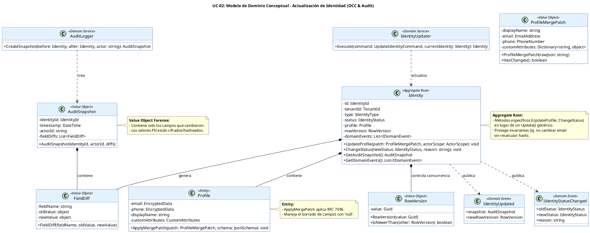

# UC-02: Actualizar Identidad - Modelo de Dominio Inicial

| Metadatos del Documento | |
| :--- | :--- |
| **Proyecto:** | SHUGO - Identity & Access Platform |
| **Caso de Uso:** | UC-02 - Actualizar Identidad |
| **Documento:** | 04_Initial_Domain_Model.md |
| **Metodología:** | ICONIX (Modelo de Análisis) + DDD (Domain-Driven Design) + RFC 7396 (JSON Merge Patch) |
| **Autor:** | Gastón Ruiz |
| **Versión Actual:** | 1.0.0 |
| **Fecha:** | 30/08/2026 |

---

## Historial de Versiones

| Versión | Fecha | Autor | Descripción de Cambios | Impacto |
| :--- | :--- | :--- | :--- | :--- |
| **1.0.0** | [30/08/2026] | Gastón Ruiz | **Creación inicial.** Definición del Modelo de Dominio Conceptual para la actualización de identidades. Introduce el Control de Concurrencia Optimista (OCC) mediante el Value Object `RowVersion`, el patrón JSON Merge Patch para atributos custom, y el concepto de `AuditSnapshot` para la auditoría forense Before/After. | Documento base del paquete de diseño Tier 1 del UC-02. Establece cómo el Aggregate Root `Identity` gestiona las mutaciones de estado de forma segura, auditable y consistente. |

---

## 1. Introducción y Propósito

Este documento presenta el **Modelo de Dominio Inicial** para el Caso de Uso UC-02 (Actualizar Identidad). 

A diferencia del UC-01 (que se centraba en la creación y validación inicial), el UC-02 introduce complejidades dinámicas críticas para un sistema IAM enterprise:
1. **Control de Concurrencia Optimista (OCC):** Para prevenir *Lost Updates* en entornos distribuidos.
2. **JSON Merge Patch (RFC 7396):** Para permitir actualizaciones parciales de `custom_attributes` sin sobrescribir datos no enviados.
3. **Auditoría Forense (Before/After):** Para generar un registro inmutable de qué cambió exactamente, cumpliendo con SOC 2 y GDPR.

El modelo se centra en el comportamiento del Aggregate Root `Identity` y cómo este orquesta las mutaciones de su `Profile` y su `Status`, generando eventos de dominio ricos en información forense.

---

## 2. Diagrama de Modelo de Dominio Conceptual (PlantUML)

A continuación, se presenta el diagrama de clases conceptual, enfocándose en los nuevos Value Objects y métodos introducidos para la operación de actualización.



---

## 3. Detalle de Conceptos de Dominio (DDD)

### 3.1. Aggregate Root: `Identity` (Métodos de Mutación)

En DDD, un Aggregate Root no debe tener un método `Update(data)` genérico que acepte cualquier cosa. Debe tener métodos explícitos que reflejen la intención del negocio y protejan las invariantes.

**Código (C#):**
```csharp
public class Identity
{
    public RowVersion RowVersion { get; private set; }
    public Profile Profile { get; private set; }
    public IdentityStatus Status { get; private set; }
    // ... otros campos

    private readonly List<IDomainEvent> _domainEvents = new();

    // Actualización de Perfil (Soporta Merge Patch)
    public void UpdateProfile(ProfileMergePatch patch, JsonSchema tenantSchema, ActorScope actorScope)
    {
        // 1. Validar Scope: ¿El actor puede editar estos campos?
        patch.ValidateScope(actorScope); 

        // 2. Delegar al Profile la aplicación del Merge Patch
        Profile.ApplyMergePatch(patch, tenantSchema);

        // 3. Generar Evento de Dominio con Snapshot Forense
        // (El snapshot se genera comparando el estado antes y después, 
        // manejado por el Domain Service IdentityUpdater)
    }

    // Cambio de Estado (Transición controlada)
    public void ChangeStatus(IdentityStatus newStatus, string reason)
    {
        if (Status == newStatus) return;

        // Validar máquina de estados (INV-14)
        if (!IsValidTransition(Status, newStatus))
            throw new InvalidTransitionException(Status, newStatus);

        var oldStatus = Status;
        Status = newStatus;
        
        AddDomainEvent(new IdentityStatusChanged(Id, oldStatus, newStatus, reason));
    }

    // Incremento de Versión (Llamado por el Repository al persistir)
    internal void IncrementRowVersion()
    {
        RowVersion = RowVersion.NewVersion();
    }
}
```

### 3.2. Entity: `Profile` y JSON Merge Patch

El `Profile` es responsable de aplicar la lógica de fusión de JSON (RFC 7396) sobre los `custom_attributes`.

**Código (C#):**
```csharp
public class Profile
{
    public EncryptedData Email { get; private set; }
    public CustomAttributes CustomAttributes { get; private set; }

    public void ApplyMergePatch(ProfileMergePatch patch, JsonSchema schema)
    {
        // Actualización de campos simples
        if (patch.DisplayName != null) DisplayName = patch.DisplayName;

        // Actualización de PII (Re-cifrado se maneja en Application Layer, 
        // aquí solo validamos el formato del VO)
        if (patch.Email != null) Email = new EmailAddress(patch.Email.Value);

        // Deep Merge para Custom Attributes (RFC 7396)
        if (patch.CustomAttributes != null)
        {
            CustomAttributes = CustomAttributes.Merge(patch.CustomAttributes);
            CustomAttributes.Validate(schema); // Validar schema después del merge
        }
    }
}
```
*Nota:* El re-cifrado real del `Email` (y el cálculo del `email_hash`) ocurre en la Capa de Aplicación (`UpdateHandler`) porque requiere servicios de infraestructura (KMS). El dominio solo valida el formato y prepara el objeto para ser cifrado.

### 3.3. Value Objects: `RowVersion` y `AuditSnapshot`

#### `RowVersion`
Representa la versión actual del Aggregate. Se utiliza para el Control de Concurrencia Optimista.

```csharp
public class RowVersion
{
    public Guid Value { get; }

    public RowVersion(Guid value) { Value = value; }
    
    public static RowVersion NewVersion() => new RowVersion(Guid.NewGuid());
}
```

#### `AuditSnapshot` y `FieldDiff`
Representan el registro forense de los cambios. Son inmutables y se adjuntan al evento de dominio.

```csharp
public class AuditSnapshot
{
    public IReadOnlyList<FieldDiff> Diffs { get; }

    public AuditSnapshot(IReadOnlyList<FieldDiff> diffs)
    {
        // Regla de Negocio: Un snapshot no puede estar vacío.
        if (diffs == null || diffs.Count == 0)
            throw new ArgumentException("AuditSnapshot must contain at least one diff.");
            
        Diffs = diffs;
    }
}

public class FieldDiff
{
    public string FieldName { get; }
    public object OldValue { get; } // Cifrado/Hasheado si es PII
    public object NewValue { get; } // Cifrado/Hasheado si es PII

    public FieldDiff(string fieldName, object oldValue, object newValue)
    {
        FieldName = fieldName;
        OldValue = oldValue;
        NewValue = newValue;
    }
}
```

---

## 4. Domain Services

### 4.1. `IdentityUpdater`

Este servicio de dominio orquesta la aplicación de un comando de actualización sobre una identidad existente, generando el snapshot de auditoría.

```csharp
public class IdentityUpdater
{
    public Identity Execute(UpdateIdentityCommand command, Identity currentIdentity, JsonSchema schema)
    {
        // 1. Capturar estado "Before" (solo los campos que van a cambiar)
        var beforeState = currentIdentity.GetRelevantState(command.FieldsToUpdate);

        // 2. Aplicar cambios
        if (command.HasProfileChanges)
            currentIdentity.UpdateProfile(command.ProfilePatch, schema, command.ActorScope);
            
        if (command.HasStatusChange)
            currentIdentity.ChangeStatus(command.NewStatus, command.Reason);

        // 3. Capturar estado "After"
        var afterState = currentIdentity.GetRelevantState(command.FieldsToUpdate);

        // 4. Generar Diff y Evento
        var diffs = DiffEngine.Compare(beforeState, afterState);
        if (diffs.Any())
        {
            var snapshot = new AuditSnapshot(diffs);
            currentIdentity.AddDomainEvent(new IdentityUpdated(currentIdentity.Id, snapshot));
        }

        return currentIdentity;
    }
}
```

---

## 5. Eventos de Dominio

Los eventos generados por UC-02 son ricos en datos forenses para que el motor KAGE (Auditoría) no tenga que volver a consultar la base de datos.

| Evento | Trigger | Payload Clave |
| :--- | :--- | :--- |
| `IdentityUpdated` | Cualquier cambio en Profile o Custom Attributes. | `AuditSnapshot` (Lista de `FieldDiff` con valores cifrados). |
| `IdentityStatusChanged` | Cambio en el campo `status`. | `oldStatus`, `newStatus`, `reason`. |
| `EmailChanged` | (Opcional) Si el email específicamente cambia. | `newEmailHash` (Para que KAGI invalide verificaciones previas). |

---

## 6. Decisiones de Diseño DDD (ADR)

### 6.1. ¿Por qué métodos específicos (`UpdateProfile`, `ChangeStatus`) en lugar de un `Update()` genérico?

**Decisión:** El Aggregate Root expone métodos de intención explícita.

**Justificación:**
- **Protección de Invariantes:** Un método `ChangeStatus` puede validar la máquina de estados internamente. Un método genérico `Update(Dictionary<string, object> data)` no puede proteger estas reglas de negocio fácilmente.
- **Claridad Semántica:** El código de la capa de aplicación es más legible (`identity.ChangeStatus(...)` vs `identity.Update(new { status = ... })`).

### 6.2. ¿Dónde se genera el `AuditSnapshot` (Before/After)?

**Decisión:** Se genera dentro del Domain Service `IdentityUpdater`, comparando el estado antes y después de aplicar los cambios.

**Justificación:**
- **Consistencia:** El snapshot es parte integral del evento de dominio `IdentityUpdated`. Si la transacción falla, el evento (y el snapshot) no se publican.
- **Privacidad:** El `DiffEngine` puede estar configurado para aplicar automáticamente el enmascaramiento (hashing) a los campos marcados como PII antes de crear el `FieldDiff`.

### 6.3. Manejo de `RowVersion` en el Dominio vs. Infraestructura

**Decisión:** El dominio tiene un objeto `RowVersion`, pero su actualización numérica/guid real la dispara el Repository al persistir.

**Justificación:**
- El dominio necesita *saber* que tiene una versión para adjuntarla a los eventos.
- La base de datos (PostgreSQL) es la fuente de la verdad para la concurrencia mediante la cláusula `WHERE row_version = @original`. El dominio no necesita gestionar la lógica de base de datos del OCC.

---

## 7. Trazabilidad

| Documento | Relación |
| :--- | :--- |
| `01_Requirements_Specification.md` | Define las invariantes (INV-09 OCC, INV-10 Audit Trail, INV-12 Merge Patch) que este modelo implementa. |
| `02_Use_Case_Diagram.md` | Muestra los actores; este modelo define los objetos con los que interactúan. |
| `03_Activity_Diagram.md` | Los carriles "Update Handler" y "Identity Validator" se implementan aquí como `IdentityUpdater` y métodos del Aggregate. |
| `06_Robustness_Diagram.md` | Mostrará la colaboración entre Handler, Updater, Encryptor y Repository. |
| `10_UC_Specific_Data_Model.md` (UC-01) | Define la columna `row_version` y la tabla `audit_logs` que este modelo utiliza. |

---

## 8. Notas para la Implementación

### 8.1. Ubicación en Clean Architecture
- **Dominio (`SHUGO.Domain`):** `Identity`, `Profile`, `RowVersion`, `AuditSnapshot`, `FieldDiff`, `IdentityUpdater`, `IIdentityRepository`.
- **Infraestructura (`SHUGO.Infrastructure`):** `IdentityRepository` (implementa la lógica de `UPDATE ... WHERE row_version = @v`), `AuditLogger` (persiste el snapshot).
- **Aplicación (`SHUGO.Application`):** `UpdateIdentityHandler` (Carga la identidad, llama a `IdentityUpdater`, persiste, maneja el re-cifrado de PII si es necesario).

### 8.2. Testeo Unitario
El modelo está diseñado para ser altamente testeable. Se pueden crear tests que verifiquen:
1. `Identity.ChangeStatus()` lanza excepción si la transición es inválida.
2. `Profile.ApplyMergePatch()` fusiona correctamente un JSON con `null` (borrando la clave).
3. `IdentityUpdater.Execute()` genera un `IdentityUpdated` event con exactamente los `FieldDiffs` esperados.

---
*Fin del Documento 04_Initial_Domain_Model para UC-02*