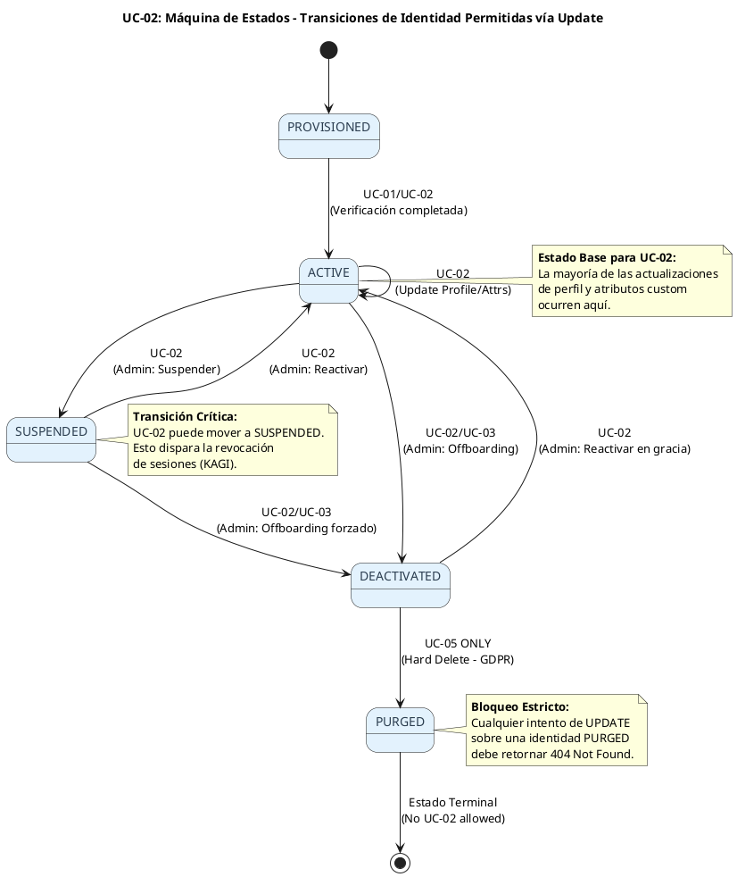
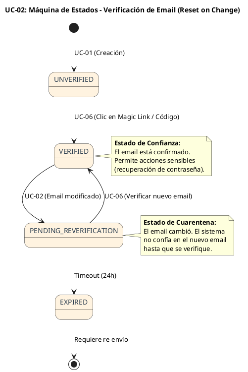
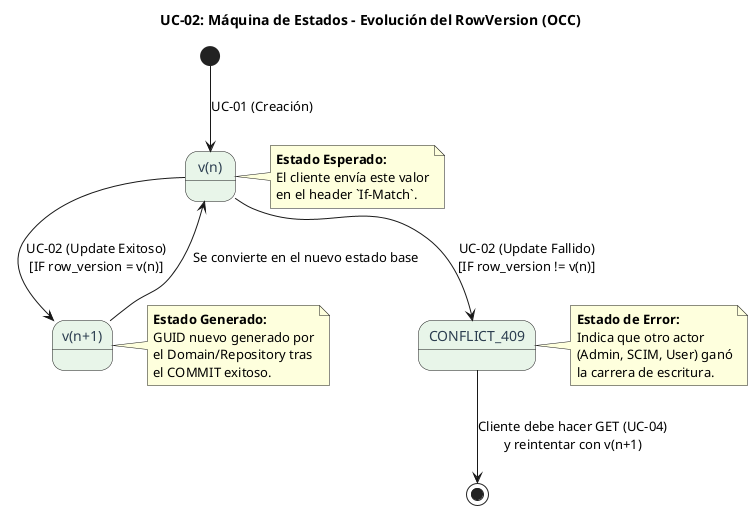

# UC-02: Actualizar Identidad - Diagrama de Máquina de Estados

| Metadatos del Documento | |
| :--- | :--- |
| **Proyecto:** | SHUGO - Identity & Access Platform |
| **Caso de Uso:** | UC-02 - Actualizar Identidad |
| **Documento:** | 05_State_Machine_Diagram.md |
| **Metodología:** | UML 2.5 + ICONIX + Domain-Driven Design (Stateful Aggregates) |
| **Autor:** | Gastón Ruiz |
| **Versión Actual:** | 1.0.0 |
| **Fecha:** | 30/08/2026 |

---

## Historial de Versiones

| Versión | Fecha | Autor | Descripción de Cambios | Impacto |
| :--- | :--- | :--- | :--- | :--- |
| **1.0.0** | 30/08/2026 | Gastón Ruiz | **Creación inicial.** Definición de las máquinas de estados relevantes para la actualización de identidades. Se modelan tres máquinas críticas: (1) Transiciones de Estado de Identidad permitidas vía Update, (2) Ciclo de Vida de la Verificación de Email (disparado condicionalmente), y (3) Evolución del `RowVersion` para Concurrencia Optimista. | Documento base del paquete de diseño Tier 1 del UC-02. Establece las reglas de transición de estado que el Aggregate Root `Identity` debe hacer cumplir estrictamente durante cualquier operación de mutación, previniendo corrupción de datos y violaciones de compliance. |

---

## 1. Introducción y Propósito

El **Diagrama de Máquina de Estados** para el UC-02 visualiza las restricciones de comportamiento temporal y las reglas de transición que gobiernan la mutación de una identidad existente.

A diferencia del UC-01 (que solo definía el estado inicial `PROVISIONED`), el UC-02 introduce la complejidad de **cambiar el estado de forma segura**. Modelamos tres máquinas de estados complementarias:

1. **Máquina de Estados de Identidad (Contexto de Actualización):** Define qué transiciones de estado global (`ACTIVE` $\to$ `SUSPENDED`, etc.) están permitidas específicamente a través del endpoint de actualización (UC-02), diferenciándolas de las transiciones especializadas (UC-03 Desactivar, UC-05 Purgar).
2. **Máquina de Estados de Verificación de Email (Efecto Secundario):** Modela el reseteo del estado de verificación cuando el UC-02 modifica el campo PII `email`. Es una máquina crítica para la seguridad.
3. **Máquina de Evolución de Versión (`RowVersion`):** Representa el ciclo de vida del token de concurrencia, garantizando que cada mutación exitosa genere una nueva versión irrevocable.

Estas máquinas garantizan:
- **Integridad del Dominio:** Una identidad `PURGED` no puede ser reactivada ni actualizada.
- **Seguridad Operativa:** Cambiar el email invalida automáticamente la confianza previa (re-verificación).
- **Consistencia de Datos:** El `RowVersion` evoluciona atómicamente con los datos.

---

## 2. Máquina de Estados #1: Transiciones de Estado de Identidad (Vía UC-02)

### 2.1. Descripción

Esta máquina representa el subconjunto de transiciones del ciclo de vida global (definido en UC-01) que el endpoint `PATCH /identities/{id}` (UC-02) está autorizado a ejecutar.

### 2.2. Diagrama de Máquina de Estados (PlantUML)



### 2.3. Descripción de Transiciones Permitidas por UC-02

| Estado Origen | Estado Destino | Trigger en UC-02 | Guarda (Guard Clause) | Acción / Efecto Secundario |
| :--- | :--- | :--- | :--- | :--- |
| **ACTIVE** | **SUSPENDED** | `{"status": "SUSPENDED"}` | Actor es Admin. | Evento `IdentityStatusChanged`. Dispara `UC_RevokeSessions`. |
| **ACTIVE** | **DEACTIVATED** | `{"status": "DEACTIVATED"}` | Actor es Admin. | Evento `IdentityStatusChanged`. (Preferible usar UC-03). |
| **SUSPENDED** | **ACTIVE** | `{"status": "ACTIVE"}` | Actor es Admin. Motivo válido. | Evento `IdentityStatusChanged`. Permite login nuevamente. |
| **DEACTIVATED** | **ACTIVE** | `{"status": "ACTIVE"}` | Dentro del `GracePeriod`. | Evento `IdentityStatusChanged`. |
| **Cualquiera** | **PURGED** | **NO PERMITIDO** | N/A | UC-02 **nunca** puede purgar. Solo UC-05 (Hard Delete). |

---

## 3. Máquina de Estados #2: Verificación de Email (Efecto Secundario)

### 3.1. Descripción

Cuando el UC-02 actualiza el campo `email` dentro del `Profile`, la máquina de estados de verificación de ese email específico se reinicia. Esto es crucial para prevenir que un administrador malintencionado (o un atacante con acceso a una cuenta) cambie el email a uno propio y tome el control sin verificación.

### 3.2. Diagrama de Máquina de Estados (PlantUML)



### 3.3. Invariantes de la Máquina de Verificación

1. **Reset Obligatorio:** Cualquier mutación exitosa del campo `email` en UC-02 *debe* transicionar el estado de verificación a `PENDING_REVERIFICATION`.
2. **Bloqueo de Acciones Sensibles:** Mientras el estado sea `PENDING_REVERIFICATION`, la identidad no puede realizar acciones que dependan de la confianza del email (ej. recuperación de contraseña).
3. **Inmutabilidad del Hash:** Al cambiar el email, el `email_hash` (HMAC) en la tabla `identities` debe actualizarse atómicamente con el nuevo valor.

---

## 4. Máquina de Estados #3: Evolución del `RowVersion` (Concurrencia)

### 4.1. Descripción

Esta máquina conceptual modela cómo el Value Object `RowVersion` evoluciona con cada transacción exitosa. Es la base del Control de Concurrencia Optimista (OCC).

### 4.2. Diagrama de Máquina de Estados (PlantUML)



---

## 5. Implementación en el Dominio (Código C#)

Las máquinas de estados no son solo diagramas; se implementan mediante **Guard Clauses** dentro del Aggregate Root `Identity`.

### 5.1. Guard Clauses para Transiciones de Estado (Máquina #1)

```csharp
public class Identity
{
    // ... campos ...

    public void ChangeStatus(IdentityStatus newStatus, string reason, ActorScope actor)
    {
        // 1. Guard: No operar sobre identidades purgadas
        if (this.Status == IdentityStatus.PURGED)
            throw new IdentityPurgedException("Cannot modify a purged identity.");

        // 2. Guard: Validar la máquina de estados (Matriz de transiciones)
        if (!IsValidTransition(this.Status, newStatus))
        {
            throw new InvalidTransitionException(
                $"Transition from {this.Status} to {newStatus} is not allowed.");
        }

        // 3. Guard: Validación de Scope (Solo Admin puede suspender)
        if (newStatus == IdentityStatus.SUSPENDED && !actor.IsAdmin)
        {
            throw new InsufficientPermissionsException("Only admins can suspend identities.");
        }

        // 4. Aplicar cambio y generar evento
        var oldStatus = this.Status;
        this.Status = newStatus;
        this.AddDomainEvent(new IdentityStatusChangedEvent(this.Id, oldStatus, newStatus, reason));
    }

    private bool IsValidTransition(IdentityStatus from, IdentityStatus to)
    {
        // Implementación de la matriz de transiciones (Máquina #1)
        var allowedTransitions = new Dictionary<IdentityStatus, List<IdentityStatus>>
        {
            { IdentityStatus.ACTIVE, new List<IdentityStatus> { IdentityStatus.SUSPENDED, IdentityStatus.DEACTIVATED } },
            { IdentityStatus.SUSPENDED, new List<IdentityStatus> { IdentityStatus.ACTIVE, IdentityStatus.DEACTIVATED } },
            { IdentityStatus.DEACTIVATED, new List<IdentityStatus> { IdentityStatus.ACTIVE } } // Solo dentro del grace period
            // PURGED no tiene salidas.
        };

        return allowedTransitions.ContainsKey(from) && allowedTransitions[from].Contains(to);
    }
}
```

### 5.2. Disparo de la Máquina de Verificación de Email (Máquina #2)

```csharp
public class Profile
{
    public EmailVerificationStatus EmailStatus { get; private set; }

    public void UpdateEmail(EmailAddress newEmail)
    {
        // Si el email es diferente, resetear el estado de verificación
        if (this.Email != newEmail)
        {
            this.Email = newEmail;
            this.EmailStatus = EmailVerificationStatus.PENDING_REVERIFICATION;
            
            // El evento se captura en el snapshot de auditoría
        }
    }
}
```

---

## 6. Trazabilidad con Otros Documentos del Paquete

| Documento | Relación |
| :--- | :--- |
| `01_Requirements_Specification.md` | Las invariantes de estado (INV-14 State Transition Rules) y concurrencia (INV-09 OCC) se definen aquí y se hacen cumplir en estas máquinas. |
| `02_Use_Case_Diagram.md` | Muestra los actores; estas máquinas definen cómo el sistema responde a sus acciones de actualización a lo largo del tiempo. |
| `03_Activity_Diagram.md` | El rombo "¿Transición válida?" y el flujo de "Re-verificación" se basan directamente en las Máquinas #1 y #2. |
| `04_Initial_Domain_Model.md` | El Aggregate Root `Identity`, su enumeración `IdentityStatus` y el Value Object `RowVersion` son la implementación directa de estas máquinas. |
| `06_Robustness_Diagram.md` | Mostrará cómo los objetos colaboran para ejecutar estas transiciones de estado de forma segura. |
| `07_Sequence_Diagram.md` | Detallará el orden temporal exacto de las llamadas que disparan estas transiciones. |
| `10_UC_Specific_Data_Model.md` (UC-01) | Define la columna `row_version` y la estructura de la tabla que soporta la Máquina #3. |

---

## 7. Notas de Implementación

### 7.1. Testing de Máquinas de Estados
Cada transición definida en estas máquinas debe tener al menos dos tests unitarios en el proyecto de Dominio:
1. **Happy Path:** Verificar que la transición válida actualiza el estado, incrementa el `RowVersion` y genera el evento de dominio correcto.
2. **Invalid Transition:** Verificar que intentar una transición ilegal (ej. `PURGED` $\to$ `ACTIVE`) lanza la excepción `IdentityPurgedException` o `InvalidTransitionException`.

### 7.2. Concurrencia y Locking
Dado que las identidades pueden ser modificadas por múltiples procesos (ej. un admin suspendiendo mientras el usuario actualiza su perfil), las transiciones de estado en la base de datos deben usar **Optimistic Concurrency Control** (columna `row_version` en PostgreSQL) para prevenir condiciones de carrera (Race Conditions). La base de datos actúa como el juez final de la Máquina #3.

---
*Fin del Documento 05_State_Machine_Diagram para UC-02*