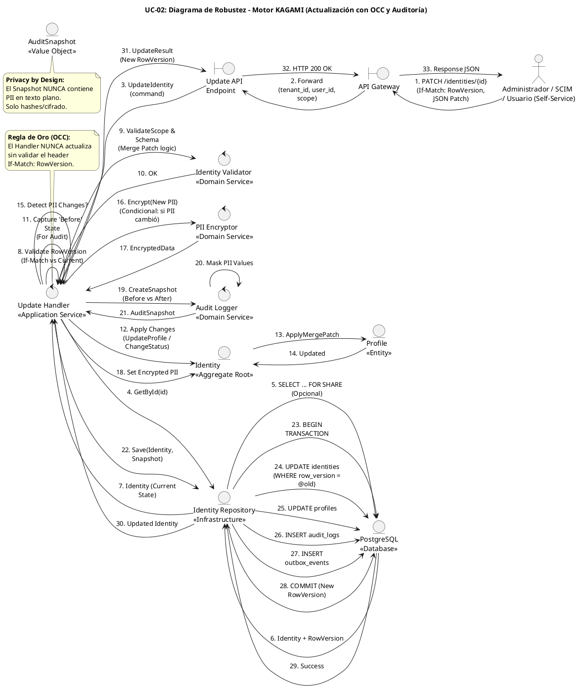

# UC-02: Actualizar Identidad - Diagrama de Robustez

| Metadatos del Documento | |
| :--- | :--- |
| **Proyecto:** | SHUGO - Identity & Access Platform |
| **Caso de Uso:** | UC-02 - Actualizar Identidad |
| **Documento:** | 06_Robustness_Diagram.md |
| **Metodología:** | ICONIX (Diagrama de Robustez) + Clean Architecture + DDD + Optimistic Concurrency Control (OCC) |
| **Autor:** | Gastón Ruiz |
| **Versión Actual:** | 1.0.0 |
| **Fecha:** | 30/08/2026 |

---

## Historial de Versiones

| Versión | Fecha | Autor | Descripción de Cambios | Impacto |
| :--- | :--- | :--- | :--- | :--- |
| **1.0.0** | 30/08/2026 | Gastón Ruiz | **Creación inicial.** Diagrama de Robustez para UC-02, validando la arquitectura del motor KAGAMI para operaciones de mutación. Muestra la colaboración estricta entre Boundaries (API Gateway, Endpoint), Controls (Update Handler, Identity Validator, PII Encryptor, Audit Logger), y Entities (Identity, Profile, AuditSnapshot, Repository). Valida el principio de "Auditoría Forense Before/After" y el Control de Concurrencia Optimista (OCC). | Documento base del paquete de diseño Tier 1 del UC-02. Sirve como puente crítico entre el Modelo de Dominio (04) y el Diagrama de Secuencia (07), asegurando que la arquitectura soporta la integridad de datos, la privacidad (PII) y la auditabilidad antes de codificar. |

---

## 1. Introducción y Propósito

El **Diagrama de Robustez** para el UC-02 valida que el flujo de actualización de identidades puede ser orquestado respetando las reglas estrictas de acoplamiento de **ICONIX** y los principios de **Domain-Driven Design (DDD)** y **Clean Architecture**.

El desafío específico de este caso de uso es cuádruple:
1. **Control de Concurrencia Optimista (OCC):** Garantizar que no ocurran *Lost Updates* cuando múltiples actores editan la misma identidad.
2. **JSON Merge Patch (RFC 7396):** Manejar actualizaciones parciales de `custom_attributes` sin sobrescribir datos no enviados.
3. **Privacy by Design en Auditoría:** Generar un log forense (Before/After) donde los valores PII estén automáticamente enmascarados/cifrados.
4. **Re-cifrado Condicional:** Solo invocar al servicio de cifrado (KMS) si los campos PII han cambiado realmente.

---

## 2. Diagrama de Robustez (PlantUML)

A continuación, se presenta el Diagrama de Robustez organizado de izquierda a derecha para mostrar el flujo natural: **Actor → Boundary → Control → Entity**.



---

## 3. Explicación Detallada de los Objetos

### 3.1. Boundary Objects (Objetos de Límite)

| Objeto | Responsabilidad | Mapeo a Clean Architecture |
| :--- | :--- | :--- |
| **`API Gateway`** | Valida JWT, extrae `tenant_id`, `user_id` y el **Scope** del actor (Admin vs. Self-Service). Inyecta el header `If-Match` en el contexto. | Middleware (Kong, AWS API Gateway). |
| **`Update API Endpoint`** | Recibe la request HTTP `PATCH`, deserializa el JSON Merge Patch a un DTO (`UpdateIdentityCommand`), y lo pasa al Handler. | Controller (ASP.NET Core Controller). |

### 3.2. Control Objects (Objetos de Control)

| Objeto | Responsabilidad | Mapeo a Clean Architecture |
| :--- | :--- | :--- |
| **`Update Handler`** | **Application Service.** Orquesta el caso de uso. Coordina la lectura, validación de OCC, aplicación de cambios, re-cifrado condicional y persistencia atómica. | Command Handler / Application Service. |
| **`Identity Validator`** | **Domain Service.** Contiene la lógica de validación de Scope (qué campos puede editar este actor), validación de JSON Schema para `custom_attributes`, y validación de transiciones de estado. | Domain Service. |
| **`PII Encryptor`** | **Domain Service.** Responsable de transformar datos sensibles (string) en `EncryptedData`. Solo se invoca si el diff detecta cambios en email/phone. | Domain Service (con dependencia de infraestructura). |
| **`Audit Logger`** | **Domain Service.** Compara el estado "Before" y "After" de la identidad, genera una lista de `FieldDiff`, y **enmascara** automáticamente los valores PII antes de crear el `AuditSnapshot`. | Domain Service. |

### 3.3. Entity Objects (Objetos de Entidad)

| Objeto | Responsabilidad | Mapeo a DDD |
| :--- | :--- | :--- |
| **`Identity`** | **Aggregate Root.** Expone métodos de intención explícita (`UpdateProfile`, `ChangeStatus`) que protegen las invariantes y generan eventos de dominio. | Aggregate Root. |
| **`Profile`** | **Entity.** Contiene los datos descriptivos y PII. Implementa la lógica de `ApplyMergePatch` para `custom_attributes`. | Entity (Internal to Aggregate). |
| **`AuditSnapshot`** | **Value Object.** Representa el registro forense inmutable de los cambios (lista de `FieldDiff`). | Value Object. |
| **`Identity Repository`** | **Infrastructure.** Abstrae la persistencia. Implementa la lógica de OCC (`UPDATE ... WHERE row_version = @v`). | Repository Interface (Domain) / Implementation (Infra). |

---

## 4. Reglas de Robustez de ICONIX (Validación del Diagrama)

Verifiquemos que nuestro diagrama cumple estrictamente las reglas de acoplamiento de ICONIX:

### ✅ Regla 1: Actor → Boundary
- **Cumplida:** El `Actor` (Admin/SCIM/User) interactúa solo con el `API Gateway`.

### ✅ Regla 2: Boundary → Boundary
- **Cumplida:** El `API Gateway` forward la request al `Update API Endpoint`.

### ✅ Regla 3: Boundary → Control
- **Cumplida:** El `Update API Endpoint` envía el Command al `Update Handler`.

### ✅ Regla 4: Control → Control
- **Cumplida y Crítica:** El `Update Handler` delega a `Identity Validator`, `PII Encryptor` (condicional) y `Audit Logger`.
- **Validación:** Esto permite que el Handler sea delgado y que las reglas de validación, cifrado y auditoría sean reutilizables y testeables.

### ✅ Regla 5: Control → Entity
- **Cumplida:**
  - `Update Handler` lee y actualiza `Identity`.
  - `Identity` delega a `Profile` para el Merge Patch.
  - `Update Handler` llama a `Identity Repository` para persistir.
  - `Audit Logger` crea `AuditSnapshot`.

### ✅ Regla 6: NO Entity → Control / Boundary
- **Cumplida:** Ninguna entidad (`Identity`, `Profile`, `Repo`) envía mensajes de vuelta a los controles o boundaries. Solo retornan datos como respuesta a una invocación (flujo de retorno implícito).

### ✅ Regla 7: NO Entity → Entity (Directo sin Control)
- **Cumplida:** El `Update Handler` (Control) es el único que orquesta la interacción entre `Identity` y `Profile` (aunque `Identity` puede llamar métodos internos de `Profile`, esto es cohesión interna del Aggregate, no acoplamiento externo).

---

## 5. Consideraciones de Arquitectura (Clean Architecture + DDD)

### 5.1. El Principio "Auditoría Forense con Enmascaramiento"

El diagrama valida visualmente una de las reglas de compliance más importantes de SHUGO:

1.  **Paso 11:** El Handler captura el estado "Before" (solo los campos relevantes).
2.  **Paso 12-14:** Se aplican los cambios (Merge Patch, Status, etc.).
3.  **Paso 19-20:** El `Audit Logger` compara Before vs After. **Críticamente**, en el paso 20, el Logger **enmascara** los valores PII (ej. reemplaza el email en claro con su hash HMAC) antes de crear el `AuditSnapshot`.
4.  **Paso 26:** El `AuditSnapshot` (ya seguro) se persiste en `audit_logs`.

**Justificación:**
- **Compliance (SOC 2 / GDPR):** Los analistas de seguridad que revisan los logs no necesitan ver el email en claro para investigar un incidente. El hash es suficiente para correlacionar.
- **Seguridad en Profundidad:** Incluso si la tabla `audit_logs` es comprometida, la PII no está expuesta.

### 5.2. Control de Concurrencia Optimista (OCC)

El diagrama muestra cómo se resuelve el problema de los *Lost Updates*:

1.  **Paso 1:** El cliente envía `If-Match: RowVersion`.
2.  **Paso 8:** El Handler valida que el `RowVersion` de la DB coincida con el del header.
3.  **Paso 24:** El Repository ejecuta `UPDATE identities ... WHERE row_version = @old_version`.
4.  **Paso 28:** Si el UPDATE afecta 0 filas (porque otro proceso ganó la carrera), la transacción falla y se retorna HTTP 409.

**Justificación:**
- **Alto Rendimiento:** No usamos bloqueos pesimistas (`SELECT FOR UPDATE`) que reducirían el throughput de lectura.
- **Detección de Conflictos:** El sistema detecta conflictos solo cuando ocurren, lanzando un error claro para que el cliente re-intente con datos frescos.

### 5.3. Re-cifrado Condicional de PII

El bloque `alt PII Changed` (Pasos 16-18) muestra que el costoso servicio de cifrado (KMS) solo se invoca si es necesario.

**Justificación:**
- **Optimización de Recursos:** Si el usuario solo actualiza su `display_name` o `custom_attributes`, no hay necesidad de consumir cuota de KMS ni añadir latencia de red.
- **Consistencia:** Si el email cambia, el `email_hash` (usado para unicidad) debe recalcularse atómicamente en la misma transacción.

---

## 6. Trazabilidad con Otros Documentos del Paquete

| Documento | Relación |
| :--- | :--- |
| `01_Requirements_Specification.md` | Este diagrama valida que los requisitos de OCC (INV-09), Auditoría Before/After (INV-10) y Merge Patch (INV-12) pueden ser implementados con los objetos definidos. |
| `02_Use_Case_Diagram.md` | Muestra los actores y sistemas; este diagrama muestra cómo colaboran los objetos internos. |
| `03_Activity_Diagram.md` | Los carriles de actividad (Handler, Validator, Encryptor, Auditor, Repository) se mapean directamente a los objetos de Control y Entity de este diagrama. |
| `04_Initial_Domain_Model.md` | Los objetos `Identity`, `Profile`, `AuditSnapshot` y los servicios `Validator`/`Encryptor`/`Auditor` son exactamente las clases definidas en el modelo de dominio. |
| `05_State_Machine_Diagram.md` | Las transiciones de estado (ej. `ACTIVE` -> `SUSPENDED`) se ejecutan cuando el `Update Handler` invoca `Identity.ChangeStatus()`. |
| `07_Sequence_Diagram.md` | Este diagrama define "qué objetos colaboran"; el de secuencia definirá "en qué orden temporal exacto" se envían los mensajes. |
| `08_Final_Class_Design.md` | Definirá las firmas exactas de los métodos mostrados en este diagrama (ej. `AuditLogger.CreateSnapshot()`). |

---

## 7. Notas de Implementación

### 7.1. Inyección de Dependencias

El `Update Handler` debe tener inyectados los servicios de dominio y repositorios:

```csharp
public class UpdateHandler : IUpdateHandler
{
    private readonly IIdentityValidator _validator;
    private readonly IPIIEncryptor _encryptor;
    private readonly IAuditLogger _auditor;
    private readonly IIdentityRepository _repository;
    private readonly IUnitOfWork _unitOfWork;

    public UpdateHandler(
        IIdentityValidator validator,
        IPIIEncryptor encryptor,
        IAuditLogger auditor,
        IIdentityRepository repository,
        IUnitOfWork unitOfWork)
    {
        _validator = validator;
        _encryptor = encryptor;
        _auditor = auditor;
        _repository = repository;
        _unitOfWork = unitOfWork;
    }
}
```

### 7.2. Flujo de Ejecución Simplificado (Código)

```csharp
public async Task<UpdateResult> Handle(UpdateCommand command, string actorScope)
{
    // 1. Cargar y Validar OCC
    var identity = await _repository.GetByIdAsync(command.IdentityId);
    if (identity.RowVersion.Value != command.IfMatchRowVersion)
        throw new ConcurrencyConflictException();

    // 2. Capturar Estado Before (Solo campos a actualizar)
    var beforeState = identity.GetRelevantState(command.FieldsToUpdate);

    // 3. Validar y Aplicar Cambios
    await _validator.ValidateScopeAsync(identity, command, actorScope);
    identity.UpdateProfile(command.ProfilePatch, command.Schema, actorScope);
    
    // 4. Re-cifrado Condicional
    if (command.HasPiiChanges)
    {
        var encrypted = await _encryptor.EncryptAsync(command.NewEmail);
        identity.SetEncryptedEmail(encrypted); // Actualiza cipher y hash
    }

    // 5. Generar Snapshot de Auditoría (Enmascarado)
    var afterState = identity.GetRelevantState(command.FieldsToUpdate);
    var snapshot = _auditor.CreateSnapshot(beforeState, afterState, command.ActorId);

    // 6. Persistencia Atómica
    await _unitOfWork.BeginTransactionAsync();
    try
    {
        await _repository.SaveAsync(identity); // Incrementa RowVersion internamente
        await _repository.SaveAuditLogAsync(snapshot);
        await _unitOfWork.CommitAsync();
    }
    catch
    {
        await _unitOfWork.RollbackAsync();
        throw;
    }

    return new UpdateResult(identity.Id, identity.RowVersion);
}
```

---
*Fin del Documento 06_Robustness_Diagram para UC-02*