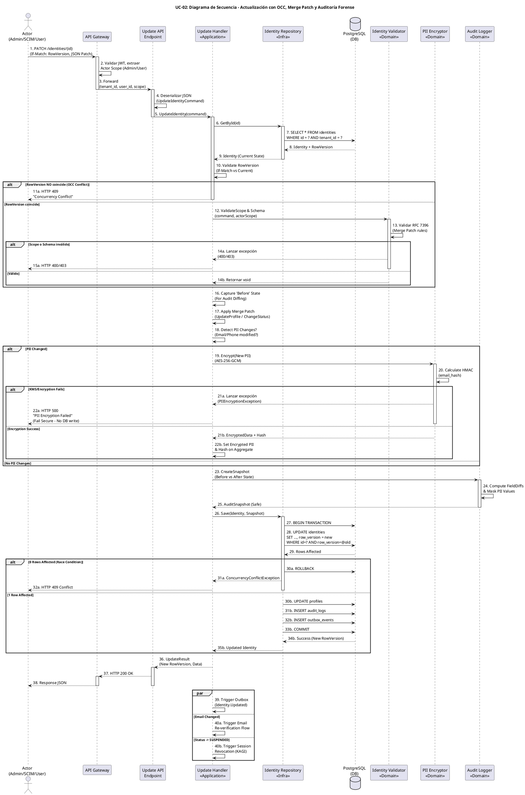

# UC-02: Actualizar Identidad - Diagrama de Secuencia

| Metadatos del Documento | |
| :--- | :--- |
| **Proyecto:** | SHUGO - Identity & Access Platform |
| **Caso de Uso:** | UC-02 - Actualizar Identidad |
| **Documento:** | 07_Sequence_Diagram.md |
| **Metodología:** | ICONIX (Diagrama de Secuencia) + Clean Architecture + DDD + Optimistic Concurrency Control (OCC) |
| **Autor:** | Gastón Ruiz |
| **Versión Actual:** | 1.0.0 |
| **Fecha:** | 30/08/2026 |

---

## Historial de Versiones

| Versión | Fecha | Autor | Descripción de Cambios | Impacto |
| :--- | :--- | :--- | :--- | :--- |
| **1.0.0** | 30/08/2026 | Gastón Ruiz | **Creación inicial.** Diagrama de Secuencia completo para UC-02. Modela la orquestación temporal exacta de la actualización de identidades, destacando la validación de Concurrencia Optimista (OCC), la aplicación de JSON Merge Patch (RFC 7396), el re-cifrado condicional de PII, y la generación atómica del snapshot de auditoría forense (Before/After) con enmascaramiento automático. | Documento base del paquete de diseño Tier 1 del UC-02. Sirve como guion exacto para la codificación del `UpdateHandler`, la gestión de transacciones, y la integración de los servicios de dominio (Validator, Encryptor, Auditor). |

---

## 1. Introducción y Propósito

El **Diagrama de Secuencia** para el UC-02 materializa temporalmente las colaboraciones definidas en el Diagrama de Robustez. Su propósito es:

1. **Definir el orden exacto de las operaciones:** Establecer la secuencia crítica donde la captura del estado "Before", la aplicación del Merge Patch, y la generación del "After" ocurren antes de la persistencia.
2. **Modelar el Control de Concurrencia Optimista (OCC):** Mostrar cómo el `RowVersion` se valida al inicio y se actualiza atómicamente al final mediante una cláusula `WHERE` en la base de datos.
3. **Visualizar la lógica condicional:** Mostrar cómo el re-cifrado de PII y los disparadores asíncronos (Re-verificación, Revocación) se ejecutan solo bajo condiciones específicas.
4. **Demostrar el manejo de errores en cada capa:** Mostrar cómo cada fallo (OCC, Cifrado, DB) retorna un código HTTP específico sin comprometer la integridad de los datos.

---

## 2. Diagrama de Secuencia - Escenario Principal (PlantUML)

A continuación, se presenta el Diagrama de Secuencia para el **Escenario Principal (actualización exitosa)** y sus variaciones de excepción.



---

## 3. Análisis Detallado del Flujo

### 3.1. Fase 1: Autenticación, Enrutamiento y Carga (Pasos 1-9)

**Participantes:** `Actor`, `API Gateway`, `Update API Endpoint`, `Update Handler`, `Identity Repository`, `PostgreSQL`

*   **Extracción de Scope:** El API Gateway no solo valida el JWT, sino que determina el *Scope* del actor (Admin, SCIM, User). Esto es crucial porque un usuario Self-Service no puede actualizar campos sensibles (ej. `clearance_level`).
*   **Carga del Aggregate:** El Handler carga la identidad completa (incluyendo el `Profile` y el `RowVersion` actual) desde PostgreSQL.

**Justificación:**
- **Eficiencia:** Cargar todo el Aggregate de una vez (usando `JOIN` o carga eager en EF Core) evita el problema de *N+1 queries* y asegura que el `RowVersion` sea el más reciente al momento de la validación.

### 3.2. Fase 2: Validación de OCC y Scope (Pasos 10-15)

**Participantes:** `Update Handler`, `Identity Validator`

*   **Validación de OCC (Paso 10):** El Handler compara el `RowVersion` enviado en el header `If-Match` con el cargado de la DB. Si no coinciden, se aborta inmediatamente (HTTP 409).
*   **Validación de Scope y Schema (Pasos 12-14):** El Validator verifica que el actor tenga permiso para los campos específicos del `JSON Merge Patch` y que el resultado de la fusión cumpla con el JSON Schema del tenant.

**Justificación:**
- **Fail Fast:** Validar el OCC antes de hacer cualquier procesamiento costoso (como cifrar o calcular diffs) ahorra recursos de CPU y llamadas a la KMS.

### 3.3. Fase 3: Aplicación de Cambios y Re-cifrado Condicional (Pasos 16-22)

**Participantes:** `Update Handler`, `PII Encryptor`

*   **Captura del Estado 'Before' (Paso 16):** Se toman los valores actuales de los campos que serán modificados.
*   **Aplicación del Merge Patch (Paso 17):** El Handler invoca los métodos de intención explícita del Aggregate (`UpdateProfile`, `ChangeStatus`).
*   **Detección y Re-cifrado (Pasos 18-22):** Si el `email` o `phone` cambiaron, se invoca al `PII Encryptor`.
    *   *Nota Crítica:* El Encryptor no solo cifra (AES-256-GCM), sino que también calcula el `email_hash` (HMAC-SHA256) para mantener la restricción `UNIQUE` de la base de datos.
    *   *Fail Secure:* Si la KMS falla, se lanza excepción y **no se escribe en la DB** (Paso 22a).

**Justificación:**
- **Optimización de KMS:** Si el usuario solo actualiza su `display_name`, la costosa llamada a la KMS (y el cálculo del HMAC) se omite completamente, reduciendo la latencia de ~50ms a <10ms.

### 3.4. Fase 4: Auditoría Forense y Persistencia Atómica (Pasos 23-35)

**Participantes:** `Update Handler`, `Audit Logger`, `Identity Repository`, `PostgreSQL`

*   **Generación del Snapshot (Pasos 23-25):** El `Audit Logger` compara el estado 'Before' y 'After'. **Críticamente**, enmascara los valores PII (reemplazándolos por sus hashes HMAC) antes de crear el `AuditSnapshot`.
*   **Transacción Atómica (Pasos 26-34):**
    1.  `BEGIN TRANSACTION`
    2.  `UPDATE identities ... WHERE row_version = @old_version` (La clave del OCC en DB).
    3.  `UPDATE profiles`
    4.  `INSERT audit_logs`
    5.  `INSERT outbox_events`
    6.  `COMMIT`
*   **Manejo de Race Condition (Pasos 29-32a):** Si otro proceso actualizó la identidad entre el Paso 7 y el Paso 28, el `UPDATE` afectará 0 filas. El Repository detecta esto, hace `ROLLBACK` y lanza `ConcurrencyConflictException` (HTTP 409).

**Justificación:**
- **Integridad Forense:** Si la inserción del log de auditoría falla, toda la transacción se revierte. Nunca existirá una identidad actualizada sin su correspondiente registro forense.
- **Privacidad en Reposo:** La tabla `audit_logs` nunca almacena PII en texto plano, cumpliendo con SOC 2 y GDPR.

### 3.5. Fase 5: Respuesta y Efectos Asíncronos (Pasos 36-40)

**Participantes:** `Update Handler`, `Update API Endpoint`, `API Gateway`, `Actor`

*   **Respuesta HTTP 200:** Se retorna el nuevo `RowVersion` y los datos actualizados.
*   **Fork Asíncrono:**
    *   **Outbox:** El evento `Identity.Updated` se publicará eventualmente en Kafka.
    *   **Re-verificación:** Si el email cambió, se dispara el flujo para invalidar la verificación previa y enviar un nuevo link.
    *   **Revocación:** Si el estado cambió a `SUSPENDED`, se llama a KAGI para destruir las sesiones activas.

**Justificación:**
- **Baja Latencia:** Estas operaciones no bloquean la respuesta HTTP. El cliente recibe su confirmación en < 250ms, mientras el sistema procesa los efectos secundarios en background.

---

## 4. Flujos Alternativos y Excepciones

### 4.1. Flujo Alternativo: Conflicto de Concurrencia (OCC) (Fase 2 o 4)

Si dos actores (ej. un Admin y un sistema SCIM) intentan actualizar la misma identidad simultáneamente:

```
Actor A -> ... -> DB (UPDATE ... WHERE row_version = v1) -> 1 Row Affected -> COMMIT (New v2)
Actor B -> ... -> DB (UPDATE ... WHERE row_version = v1) -> 0 Rows Affected -> ROLLBACK -> Handler (409)
```

**Manejo:** El cliente (Actor B) debe recibir el 409, hacer un `GET` (UC-04) para obtener el estado fresco y el nuevo `RowVersion` (v2), y reintentar la operación.

### 4.2. Flujo Alternativo: Fallo de Cifrado PII (Fase 3)

Si el servicio KMS (AWS KMS / HashiCorp Vault) está caído o la cuota está agotada:

```
Actor -> ... -> Handler -> Encryptor -> KMS (Timeout/Exception) -> Encryptor (PIIEncryptionException) -> Handler -> Actor (HTTP 500)
```

**Manejo (Fail Secure):** La operación se aborta. **No se escribe nada en la base de datos.** Es preferible denegar la actualización que guardar un email en texto plano o con un hash HMAC inconsistente.

---

## 5. Consideraciones de Arquitectura (Clean Architecture + DDD)

### 5.1. Métodos de Intención Explícita vs. Update Genérico

El diagrama muestra que el Handler no llama a un método genérico `identity.Update(dictionary)`. Llama a `UpdateProfile` y `ChangeStatus`.

**Justificación:**
- **Protección de Invariantes:** `ChangeStatus` puede validar internamente la máquina de estados (ej. no permitir `PURGED` -> `ACTIVE`). Un método genérico no puede proteger estas reglas de negocio fácilmente.
- **Claridad Semántica:** Facilita la lectura del código y el mantenimiento a largo plazo.

### 5.2. JSON Merge Patch (RFC 7396) en la Secuencia

El paso 13 (`Validar RFC 7396`) y 17 (`Apply Merge Patch`) son críticos para los `custom_attributes` (JSONB).
- Si el payload es `{"custom_attributes": {"rol": null}}`, el sistema **borra** la clave "rol" del JSONB.
- Si el payload es `{"custom_attributes": {"rol": "admin"}}`, el sistema **fusiona** (Deep Merge) sin borrar otras claves.

**Justificación:** Permite a los clientes (especialmente SCIM) actualizar un solo atributo custom sin tener que descargar, modificar y reenviar todo el objeto JSON, reduciendo el ancho de banda y el riesgo de errores de concurrencia.

---

## 6. Trazabilidad con Otros Documentos del Paquete

| Documento | Relación |
| :--- | :--- |
| `01_Requirements_Specification.md` | Este diagrama visualiza los flujos de texto, las invariantes de dominio (OCC, Merge Patch, Auditoría) y los criterios de aceptación. |
| `02_Use_Case_Diagram.md` | Muestra el límite del sistema y los actores; este diagrama muestra el flujo interno. |
| `03_Activity_Diagram.md` | Los carriles de actividad se mapean directamente a los participantes de este diagrama. |
| `04_Initial_Domain_Model.md` | Los Aggregate Roots (`Identity`, `Profile`), Value Objects (`AuditSnapshot`), y Domain Services (`Validator`, `Encryptor`, `Auditor`) de este diagrama son exactamente las clases definidas en el modelo. |
| `05_State_Machine_Diagram.md` | Este diagrama muestra la colaboración de objetos; las máquinas de estados muestran las transiciones internas de cada objeto (ej. `Identity.Status` transiciona en el paso 17). |
| `06_Robustness_Diagram.md` | Este diagrama define "qué objetos colaboran"; el de robustez muestra la colaboración de forma más abstracta. |
| `08_Final_Class_Design.md` | Definirá las firmas exactas de los métodos mostrados en este diagrama (ej. `AuditLogger.CreateSnapshot()`). |
| `KAGAMI_Engine_Architecture.md` | Documento global que define la arquitectura completa del motor KAGAMI. |

---

## 7. Notas de Implementación

### 7.1. Inyección de Dependencias y Scope

El `Update Handler` debe ser registrado como **Scoped** (por request) en el contenedor de DI, al igual que el `UnitOfWork` (si se usa explícitamente) y el `DbContext` de EF Core, para garantizar que la transacción de DB se mantenga coherente durante toda la operación.

```csharp
// Program.cs / Startup.cs
services.AddScoped<IUpdateHandler, UpdateHandler>();
services.AddScoped<IIdentityRepository, IdentityRepository>();
services.AddScoped<IUnitOfWork, UnitOfWork>(); // Si se usa patrón UoW explícito
```

### 7.2. Manejo de la Transacción y OCC en EF Core

Si se utiliza Entity Framework Core, el OCC se maneja nativamente mediante la anotación `[ConcurrencyCheck]` o `[Timestamp]` en la propiedad `RowVersion`.

```csharp
// En la configuración de la Entidad (IdentityConfiguration.cs)
builder.Property(i => i.RowVersion)
       .IsConcurrencyToken(); // EF Core añade automáticamente "AND row_version = @p" al UPDATE

// En el Repository:
public async Task SaveAsync(Identity identity)
{
    try
    {
        await _dbContext.SaveChangesAsync(); // Lanza DbUpdateConcurrencyException si hay conflicto
    }
    catch (DbUpdateConcurrencyException ex)
    {
        throw new ConcurrencyConflictException("Identity was modified by another user.", ex);
    }
}
```

---
*Fin del Documento 07_Sequence_Diagram para UC-02*