# UC-02: Actualizar Identidad - Diagrama de Clases de Diseño Final

| Metadatos del Documento | |
| :--- | :--- |
| **Proyecto:** | SHUGO - Identity & Access Platform |
| **Caso de Uso:** | UC-02 - Actualizar Identidad |
| **Documento:** | 08_Final_Class_Design.md |
| **Metodología:** | ICONIX (Modelo de Diseño) + DDD + Clean Architecture + RFC 7396 (JSON Merge Patch) |
| **Autor:** | Gastón Ruiz |
| **Versión Actual:** | 1.0.0 |
| **Fecha:** | 30/08/2026 |

---

## Historial de Versiones

| Versión | Fecha | Autor | Descripción de Cambios | Impacto |
| :--- | :--- | :--- | :--- | :--- |
| **1.0.0** | 30/08/2026 | Gastón Ruiz | **Creación inicial.** Definición del Modelo de Diseño (Clases de Implementación) para UC-02. Se detallan las firmas exactas de los Servicios de Dominio (`IdentityUpdater`, `AuditLogger`), el Aggregate Root (`Identity`), los Value Objects (`RowVersion`, `AuditSnapshot`, `FieldDiff`), y las interfaces de repositorio. Se incluyen patrones de diseño (OCC, Merge Patch, Snapshot Forense) y consideraciones de concurrencia y transaccionalidad. | Documento base del paquete de diseño Tier 1 del UC-02. Sirve como plano exacto para la codificación del endpoint de actualización, garantizando que la concurrencia (OCC), la privacidad (PII masking) y la auditabilidad (Before/After) se implementen correctamente desde la primera línea de código. |

---

## 1. Introducción y Propósito

Este documento presenta el **Modelo de Diseño** (Diagrama de Clases de Implementación) para el Caso de Uso UC-02 (Actualizar Identidad).

A diferencia del Modelo de Dominio Inicial (documento 04), que era conceptual, este documento define las **clases concretas con firmas de métodos específicas**, visibilidad, y patrones de concurrencia, listas para implementar. El diseño debe garantizar:

1. **Control de Concurrencia Optimista (OCC):** Prevenir *Lost Updates* mediante el Value Object `RowVersion` y cláusulas `WHERE` a nivel de base de datos.
2. **JSON Merge Patch (RFC 7396):** Implementar la lógica de fusión profunda (Deep Merge) para `custom_attributes`, permitiendo actualizaciones parciales y borrado de campos mediante `null`.
3. **Auditoría Forense con Privacidad:** Generar un `AuditSnapshot` inmutable que registre los cambios (Before/After) enmascarando automáticamente cualquier dato PII.
4. **Re-cifrado Condicional:** Invocar al servicio de cifrado (KMS) solo si los campos PII han cambiado realmente, optimizando latencia y costos.

---

## 2. Diagrama de Clases de Diseño (PlantUML)

A continuación, se presenta el diagrama de clases organizado por capas arquitectónicas.

```plantuml
@startuml UC-02_ClasesDiseno
<style>
diagram {
  BackgroundColor #FFFFFF
}
</style>
skinparam classAttributeIconSize 0
skinparam classBackgroundColor #FFFFFF
skinparam classBorderColor #34495E
skinparam classHeaderBackgroundColor #E3F2FD

title UC-02: Diagrama de Clases de Diseño Final - Motor KAGAMI (Actualización con OCC y Auditoría)

' ============================================
' CAPA DE APLICACIÓN (Application Layer)
' ============================================
package "Aplicación (Application Layer)" {

    class UpdateIdentityHandler <<Application Service>> {
        - validator: IIdentityValidator
        - encryptor: IPiiEncryptor
        - auditor: IAuditLogger
        - repository: IIdentityRepository
        - unitOfWork: IUnitOfWork

        + Handle(command: UpdateIdentityCommand, ct: CancellationToken): Task<UpdateIdentityResult>
    }

    class UpdateIdentityCommand <<DTO>> {
        + IdentityId: Guid
        + IfMatchRowVersion: Guid
        + ProfilePatch: ProfileMergePatch
        + NewStatus: IdentityStatus?
        + ActorScope: ActorScope
    }

    class UpdateIdentityResult <<DTO>> {
        + IdentityId: Guid
        + NewRowVersion: Guid
        + UpdatedAt: DateTime
    }
}

' ============================================
' CAPA DE DOMINIO (Domain Layer)
' ============================================
package "Dominio (Domain Layer)" {

    ' Aggregate Root
    class Identity <<Aggregate Root>> {
        - id: IdentityId
        - tenantId: TenantId
        - type: IdentityType
        - status: IdentityStatus
        - profile: Profile
        - rowVersion: RowVersion
        - domainEvents: List<IDomainEvent>

        + UpdateProfile(patch: ProfileMergePatch, schema: JsonSchema, scope: ActorScope): void
        + ChangeStatus(newStatus: IdentityStatus, reason: string): void
        + GetRelevantState(fields: List<string>): Dictionary<string, object>
        + GetDomainEvents(): List<IDomainEvent>
    }

    ' Entity
    class Profile <<Entity>> {
        - email: EncryptedData
        - phone: EncryptedData
        - displayName: string
        - customAttributes: CustomAttributes

        + ApplyMergePatch(patch: ProfileMergePatch, schema: JsonSchema): void
    }

    ' Value Objects
    class RowVersion <<Value Object>> {
        - value: Guid
        + RowVersion(value: Guid)
        + IsNewerThan(other: RowVersion): boolean
    }

    class AuditSnapshot <<Value Object>> {
        - identityId: IdentityId
        - actorId: string
        - timestamp: DateTime
        - diffs: List<FieldDiff>
    }

    class FieldDiff <<Value Object>> {
        - fieldName: string
        - oldValue: object
        - newValue: object
    }

    ' Domain Services
    class IdentityValidator <<Domain Service>> {
        + ValidateScopeAsync(identity: Identity, command: UpdateIdentityCommand): Task
        + ValidateTransitionAsync(current: IdentityStatus, target: IdentityStatus): Task
    }

    class AuditLogger <<Domain Service>> {
        + CreateSnapshot(before: Dictionary<string, object>, after: Dictionary<string, object>, actorId: string): AuditSnapshot
    }

    ' Interfaces
    interface IIdentityRepository {
        + GetByIdAsync(id: IdentityId): Task<Identity>
        + SaveAsync(identity: Identity): Task
        + SaveAuditLogAsync(snapshot: AuditSnapshot): Task
    }

    interface IUnitOfWork {
        + BeginTransactionAsync(): Task
        + CommitAsync(): Task
        + RollbackAsync(): Task
    }

    interface IPiiEncryptor {
        + EncryptAsync(plainText: string): Task<EncryptedData>
    }
}

' ============================================
' CAPA DE INFRAESTRUCTURA (Infrastructure Layer)
' ============================================
package "Infraestructura (Infrastructure Layer)" {

    class IdentityRepositoryImpl <<Infrastructure>> {
        - dbContext: AppDbContext
        + GetByIdAsync(id: IdentityId): Task<Identity>
        + SaveAsync(identity: Identity): Task
    }

    class UnitOfWorkImpl <<Infrastructure>> {
        - dbContext: AppDbContext
        + BeginTransactionAsync(): Task
        + CommitAsync(): Task
        + RollbackAsync(): Task
    }
}

' ============================================
' RELACIONES
' ============================================

' Implementation
IdentityRepositoryImpl ..|> IIdentityRepository
UnitOfWorkImpl ..|> IUnitOfWork

' Dependency Injection
UpdateIdentityHandler --> IIdentityValidator
UpdateIdentityHandler --> IPiiEncryptor
UpdateIdentityHandler --> IAuditLogger
UpdateIdentityHandler --> IIdentityRepository
UpdateIdentityHandler --> IUnitOfWork

' Domain Usage
Identity *-- Profile : "contiene"
Identity *-- RowVersion : "controla concurrencia"
AuditSnapshot *-- FieldDiff : "contiene"

IdentityValidator ..> Identity : "valida"
AuditLogger ..> AuditSnapshot : "crea"

@enduml
```



---

## 3. Detalle de Clases por Capa

### 3.1. Capa de Aplicación (Application Layer)

#### **UpdateIdentityHandler**

**Responsabilidad:** Orquestar el caso de uso UC-02. Coordina la carga, validación de OCC, aplicación de cambios (Merge Patch), re-cifrado condicional, generación del snapshot de auditoría y persistencia atómica.

**Firmas de Métodos:**

```csharp
public class UpdateIdentityHandler : IUpdateIdentityHandler
{
    private readonly IIdentityValidator _validator;
    private readonly IPiiEncryptor _encryptor;
    private readonly IAuditLogger _auditor;
    private readonly IIdentityRepository _repository;
    private readonly IUnitOfWork _unitOfWork;
    private readonly ILogger<UpdateIdentityHandler> _logger;

    public UpdateIdentityHandler(
        IIdentityValidator validator,
        IPiiEncryptor encryptor,
        IAuditLogger auditor,
        IIdentityRepository repository,
        IUnitOfWork unitOfWork,
        ILogger<UpdateIdentityHandler> logger)
    {
        _validator = validator;
        _encryptor = encryptor;
        _auditor = auditor;
        _repository = repository;
        _unitOfWork = unitOfWork;
        _logger = logger;
    }

    /// <summary>
    /// Ejecuta el flujo de actualización de identidad con OCC y Auditoría Forense.
    /// </summary>
    public async Task<UpdateIdentityResult> Handle(UpdateIdentityCommand command, CancellationToken ct)
    {
        // 1. Cargar Aggregate y Validar OCC
        var identity = await _repository.GetByIdAsync(command.IdentityId);
        if (identity == null) throw new IdentityNotFoundException(command.IdentityId);
        
        if (identity.RowVersion.Value != command.IfMatchRowVersion)
            throw new ConcurrencyConflictException(identity.RowVersion.Value, command.IfMatchRowVersion);

        // 2. Capturar Estado 'Before' (Solo campos relevantes)
        var fieldsToUpdate = command.GetFieldsToUpdate();
        var beforeState = identity.GetRelevantState(fieldsToUpdate);

        // 3. Validar Scope y Transiciones
        await _validator.ValidateScopeAsync(identity, command);
        if (command.NewStatus.HasValue)
            await _validator.ValidateTransitionAsync(identity.Status, command.NewStatus.Value);

        // 4. Aplicar Cambios (Merge Patch y Status)
        if (command.ProfilePatch != null)
            identity.UpdateProfile(command.ProfilePatch, command.TenantSchema, command.ActorScope);
            
        if (command.NewStatus.HasValue)
            identity.ChangeStatus(command.NewStatus.Value, command.Reason);

        // 5. Re-cifrado Condicional de PII
        if (command.HasPiiChanges)
        {
            try
            {
                var encryptedEmail = await _encryptor.EncryptAsync(command.NewEmail);
                identity.SetEncryptedEmail(encryptedEmail); // Actualiza cipher y hash
            }
            catch (Exception ex)
            {
                _logger.LogError(ex, "PII Encryption failed during update for {IdentityId}", command.IdentityId);
                throw new PiiEncryptionException("Failed to encrypt sensitive data.", ex);
            }
        }

        // 6. Generar Snapshot de Auditoría (Enmascarado)
        var afterState = identity.GetRelevantState(fieldsToUpdate);
        var snapshot = _auditor.CreateSnapshot(beforeState, afterState, command.ActorId);

        // 7. Persistencia Atómica
        await _unitOfWork.BeginTransactionAsync();
        try
        {
            await _repository.SaveAsync(identity); // EF Core maneja el OCC aquí
            await _repository.SaveAuditLogAsync(snapshot);
            await _unitOfWork.CommitAsync();
        }
        catch (DbUpdateConcurrencyException ex)
        {
            await _unitOfWork.RollbackAsync();
            _logger.LogWarning(ex, "Concurrency conflict detected at DB level for {IdentityId}", command.IdentityId);
            throw new ConcurrencyConflictException("Identity was modified by another process.", ex);
        }
        catch (Exception ex)
        {
            await _unitOfWork.RollbackAsync();
            throw;
        }

        return new UpdateIdentityResult(identity.Id, identity.RowVersion.Value, DateTime.UtcNow);
    }
}
```

### 3.2. Capa de Dominio (Domain Layer)

#### **Identity (Aggregate Root)**

**Responsabilidad:** Garantizar las invariantes de la identidad. Expone métodos de intención explícita (`UpdateProfile`, `ChangeStatus`) en lugar de un `Update()` genérico.

```csharp
public class Identity
{
    public IdentityId Id { get; private set; }
    public RowVersion RowVersion { get; private set; }
    public IdentityStatus Status { get; private set; }
    public Profile Profile { get; private set; }
    
    private readonly List<IDomainEvent> _domainEvents = new();

    // Constructor privado para EF Core
    private Identity() { }

    public void UpdateProfile(ProfileMergePatch patch, JsonSchema schema, ActorScope scope)
    {
        // Validar que el actor tenga permiso para los campos del patch
        patch.ValidateScope(scope); 
        
        // Delegar la lógica de Merge Patch a la entidad Profile
        Profile.ApplyMergePatch(patch, schema);
    }

    public void ChangeStatus(IdentityStatus newStatus, string reason)
    {
        if (Status == newStatus) return;

        // Validar máquina de estados
        if (!IsValidTransition(Status, newStatus))
            throw new InvalidTransitionException(Status, newStatus);

        Status = newStatus;
        AddDomainEvent(new IdentityStatusChangedEvent(Id, Status, reason));
    }

    // Método para extraer estado para auditoría
    public Dictionary<string, object> GetRelevantState(IEnumerable<string> fields)
    {
        var state = new Dictionary<string, object>();
        foreach (var field in fields)
        {
            // Lógica de reflexión o switch para extraer valores específicos
            state[field] = GetFieldValue(field); 
        }
        return state;
    }

    private bool IsValidTransition(IdentityStatus from, IdentityStatus to) { /* ... */ }
}
```

#### **AuditLogger (Domain Service)**

**Responsabilidad:** Comparar estados y generar el snapshot forense, aplicando enmascaramiento de PII.

```csharp
public class AuditLogger : IAuditLogger
{
    private readonly IPiiMasker _piiMasker; // Servicio para hashear/cifrar PII en logs

    public AuditLogger(IPiiMasker piiMasker)
    {
        _piiMasker = piiMasker;
    }

    public AuditSnapshot CreateSnapshot(
        Dictionary<string, object> before, 
        Dictionary<string, object> after, 
        string actorId)
    {
        var diffs = new List<FieldDiff>();

        foreach (var key in after.Keys)
        {
            var oldValue = before.ContainsKey(key) ? before[key] : null;
            var newValue = after[key];

            if (!Equals(oldValue, newValue))
            {
                // Enmascarar PII antes de crear el diff
                var maskedOld = _piiMasker.Mask(key, oldValue);
                var maskedNew = _piiMasker.Mask(key, newValue);

                diffs.Add(new FieldDiff(key, maskedOld, maskedNew));
            }
        }

        if (diffs.Count == 0) 
            throw new InvalidOperationException("Cannot create audit snapshot with no changes.");

        return new AuditSnapshot(Guid.NewGuid(), actorId, DateTime.UtcNow, diffs);
    }
}
```

### 3.3. Capa de Infraestructura (Infrastructure Layer)

#### **IdentityRepositoryImpl**

**Responsabilidad:** Persistir el Aggregate y manejar la lógica de OCC a nivel de base de datos.

```csharp
public class IdentityRepositoryImpl : IIdentityRepository
{
    private readonly AppDbContext _dbContext;

    public IdentityRepositoryImpl(AppDbContext dbContext)
    {
        _dbContext = dbContext;
    }

    public async Task SaveAsync(Identity identity)
    {
        // EF Core detecta cambios y genera el UPDATE con la cláusula WHERE row_version = @old
        _dbContext.Identities.Update(identity); 
        
        // Si hay conflictos, SaveChanges() lanzará DbUpdateConcurrencyException
        await _dbContext.SaveChangesAsync(); 
        
        // Actualizar el RowVersion en el dominio con el nuevo valor generado por la DB
        identity.IncrementRowVersion(); 
    }

    public async Task SaveAuditLogAsync(AuditSnapshot snapshot)
    {
        _dbContext.AuditLogs.Add(new AuditLogEntity 
        { 
            IdentityId = snapshot.IdentityId, 
            Payload = JsonSerializer.Serialize(snapshot) 
        });
    }
}
```

---

## 4. Patrones de Diseño Aplicados

### 4.1. Aggregate Root Pattern (Intention-Revealing Interfaces)
**Dónde se aplica:** `Identity.UpdateProfile()`, `Identity.ChangeStatus()`.
**Beneficio:** Previene la corrupción de estado. Un desarrollador no puede llamar a `identity.Status = SUSPENDED` directamente; debe pasar por `ChangeStatus()`, que valida la máquina de estados y genera el evento de dominio.

### 4.2. Optimistic Concurrency Control (OCC)
**Dónde se aplica:** `RowVersion` (Dominio) y `IsConcurrencyToken()` (Infraestructura/EF Core).
**Beneficio:** Permite alto throughput de lectura sin bloqueos pesimistas. Detecta conflictos de escritura en el último momento (al hacer `COMMIT`), lanzando una excepción clara para que el cliente re-intente.

### 4.3. JSON Merge Patch (RFC 7396)
**Dónde se aplica:** `Profile.ApplyMergePatch()`.
**Beneficio:** Permite actualizaciones parciales eficientes. Si el cliente envía `{"custom_attributes": {"rol": null}}`, el sistema borra la clave "rol" del JSONB sin afectar otras claves.

### 4.4. Snapshot Pattern (Forensic Audit)
**Dónde se aplica:** `AuditLogger.CreateSnapshot()` y `AuditSnapshot`.
**Beneficio:** Genera un registro inmutable y preciso de qué cambió. El enmascaramiento de PII integrado garantiza el cumplimiento de privacidad (GDPR/SOC 2) sin requerir que la capa de aplicación lo maneje manualmente.

---

## 5. Consideraciones de Concurrencia y Transaccionalidad

### 5.1. Atomicidad (Identity + Profile + AuditLog + Outbox)
La transacción abarca exactamente cuatro operaciones:
1. `UPDATE identities` (incluyendo el nuevo `row_version`).
2. `UPDATE profiles` (incluyendo el nuevo `cipher_text` si cambió PII).
3. `INSERT audit_logs` (el snapshot forense enmascarado).
4. `INSERT outbox_events` (el evento de dominio `IdentityUpdated`).

Si cualquiera falla, se ejecuta `ROLLBACK`. Esto previene estados huérfanos (ej. una identidad actualizada sin su log de auditoría).

### 5.2. Manejo de Race Conditions (Doble Validación OCC)
El sistema valida el OCC en dos niveles para máxima robustez:
1. **Nivel Aplicación (Memoria):** El `UpdateHandler` compara el `If-Match` header con el `RowVersion` cargado de la DB (Paso 10 del Diagrama de Secuencia). Falla rápido (HTTP 409) antes de procesar.
2. **Nivel Base de Datos (SQL):** El `UPDATE` generado por EF Core incluye `WHERE row_version = @old_version`. Si otro proceso ganó la carrera, afectará 0 filas y EF Core lanzará `DbUpdateConcurrencyException`, que el Repository traduce a `ConcurrencyConflictException`.

---

## 6. Manejo de Errores y Mapeo a HTTP

El Handler captura excepciones de dominio e infraestructura y las traduce a respuestas HTTP específicas:

| Excepción de Dominio/Infra | Código HTTP | Código de Error | Descripción |
| :--- | :--- | :--- | :--- |
| `IdentityNotFoundException` | 404 Not Found | `IDENTITY_NOT_FOUND` | La identidad no existe o está `PURGED`. |
| `ConcurrencyConflictException` | 409 Conflict | `CONCURRENCY_CONFLICT` | El `RowVersion` no coincide (Aplicación o DB). |
| `InvalidTransitionException` | 400 Bad Request | `INVALID_TRANSITION` | Cambio de estado no permitido (ej. `PURGED` -> `ACTIVE`). |
| `InsufficientPermissionsException` | 403 Forbidden | `INSUFFICIENT_SCOPE` | El actor no puede editar los campos solicitados. |
| `InvalidSchemaException` | 400 Bad Request | `INVALID_SCHEMA` | Los `custom_attributes` no cumplen el JSON Schema. |
| `PiiEncryptionException` | 500 Internal Server Error | `ENCRYPTION_FAILED` | Fallo al cifrar PII (KMS caído). **Fail Secure.** |
| `DbUpdateException` | 500 Internal Server Error | `PERSISTENCE_FAILED` | Error genérico de base de datos. |

---

## 7. Trazabilidad con Otros Documentos del Paquete

| Documento | Relación |
| :--- | :--- |
| `01_Requirements_Specification.md` | Define las invariantes (INV-09 OCC, INV-10 Audit Trail, INV-12 Merge Patch) que este diseño implementa. |
| `02_Use_Case_Diagram.md` | Muestra los actores y sistemas externos; este diseño define las clases internas. |
| `03_Activity_Diagram.md` | Los carriles de actividad se mapean directamente a las clases de este diseño (Handler, Validator, Encryptor, Auditor, Repository). |
| `04_Initial_Domain_Model.md` | Este diseño toma las clases conceptuales del modelo de dominio y les agrega firmas de métodos específicas, visibilidad, y patrones de concurrencia. |
| `05_State_Machine_Diagram.md` | Las máquinas de estados se implementan en las entidades de este diseño (ej. `Identity.ChangeStatus()` valida la transición). |
| `06_Robustness_Diagram.md` | Este diseño define las firmas exactas de los métodos mostrados en el diagrama de robustez. |
| `07_Sequence_Diagram.md` | Este diseño define las firmas exactas de los métodos mostrados en el diagrama de secuencia. |
| `09_Modern_Artifacts.md` | Definirá los contratos OpenAPI, las métricas OpenTelemetry, y los patrones de resiliencia que se implementan en estas clases. |

---

## 8. Notas de Implementación

### 8.1. Inyección de Dependencias

```csharp
// Capa de Aplicación
services.AddScoped<IUpdateIdentityHandler, UpdateIdentityHandler>();

// Capa de Dominio (Servicios)
services.AddScoped<IIdentityValidator, IdentityValidator>();
services.AddScoped<IAuditLogger, AuditLogger>();

// Capa de Infraestructura (Repositorios y UoW)
services.AddScoped<IIdentityRepository, IdentityRepositoryImpl>();
services.AddScoped<IUnitOfWork, UnitOfWorkImpl>();
services.AddScoped<IPiiEncryptor, KmsPiiEncryptor>();

// Configuración de DbContext para EF Core
services.AddDbContext<AppDbContext>(options =>
    options.UseNpgsql(configuration.GetConnectionString("DefaultConnection")));
```

### 8.2. Testeo Unitario

```csharp
[Test]
public async Task UpdateIdentityHandler_WhenOCCConflict_ThrowsException()
{
    // Arrange
    var mockRepo = new Mock<IIdentityRepository>();
    var identity = new Identity(/* ... */);
    mockRepo.Setup(r => r.GetByIdAsync(It.IsAny<Guid>())).ReturnsAsync(identity);
    
    var handler = new UpdateIdentityHandler(/* ... mocks ... */);
    var command = new UpdateIdentityCommand { IfMatchRowVersion = Guid.NewGuid() }; // Versión incorrecta

    // Act & Assert
    await Assert.ThrowsAsync<ConcurrencyConflictException>(() => handler.Handle(command, CancellationToken.None));
    
    mockRepo.Verify(r => r.SaveAsync(It.IsAny<Identity>()), Times.Never); // No debe persistir
}

[Test]
public void AuditLogger_CreateSnapshot_MasksPiiValues()
{
    // Arrange
    var masker = new Mock<IPiiMasker>();
    masker.Setup(m => m.Mask("email", It.IsAny<object>())).Returns("h***@***.com");
    var logger = new AuditLogger(masker.Object);

    var before = new Dictionary<string, object> { { "email", "old@test.com" } };
    var after = new Dictionary<string, object> { { "email", "new@test.com" } };

    // Act
    var snapshot = logger.CreateSnapshot(before, after, "admin-001");

    // Assert
    snapshot.Diffs.Should().HaveCount(1);
    snapshot.Diffs[0].NewValue.Should().Be("h***@***.com"); // PII enmascarada
}
```

---

## 9. Cierre del Paquete de Diseño (UC-02)

Con este documento, completamos **8 de los 9 archivos** del paquete de diseño profundo para el UC-02:

1. ✅ `01_Requirements_Specification.md` - Especificación completa con escenarios BDD
2. ✅ `02_Use_Case_Diagram.md` - Diagrama de caso de uso UML
3. ✅ `03_Activity_Diagram.md` - Diagrama de actividades con OCC y Merge Patch
4. ✅ `04_Initial_Domain_Model.md` - Modelo de dominio conceptual
5. ✅ `05_State_Machine_Diagram.md` - Máquinas de estados (Transiciones, Email Verification, RowVersion)
6. ✅ `06_Robustness_Diagram.md` - Diagrama de robustez ICONIX
7. ✅ `07_Sequence_Diagram.md` - Diagrama de secuencia con flujos alternativos
8. ✅ `08_Final_Class_Design.md` - Diseño de clases con firmas y patrones

El último documento será `09_Modern_Artifacts.md`.

---
*Fin del Documento 08_Final_Class_Design para UC-02*