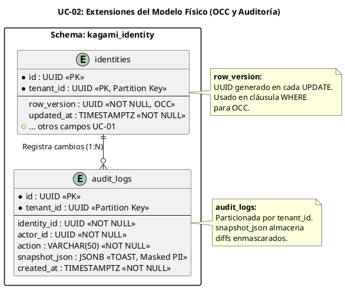

# UC-02: Actualizar Identidad - Modelo de Datos Físico Específico (OCC y Auditoría)

| Metadatos del Documento | |
| :--- | :--- |
| **Proyecto:** | SHUGO - Identity & Access Platform |
| **Caso de Uso:** | UC-02 - Actualizar Identidad |
| **Documento:** | 10_UC_Specific_Data_Model.md |
| **Metodología:** | Physical Data Modeling + Optimistic Concurrency Control (OCC) + Forensic Auditing |
| **Base de Datos:** | PostgreSQL 15+ (Primary) |
| **Autor:** | Gastón Ruiz |
| **Versión Actual:** | 1.0.0 |
| **Fecha:** | 30/08/2026 |

---

## Historial de Versiones

| Versión | Fecha | Autor | Descripción de Cambios | Impacto |
| :--- | :--- | :--- | :--- | :--- |
| **1.0.0** | 30/08/2026 | Gastón Ruiz | **Creación inicial.** Extensión del modelo de datos físico para soportar actualizaciones seguras. Introduce la columna `row_version` para OCC, la tabla `audit_logs` para trazabilidad forense (Before/After) con particionamiento por tenant, y estrategias de almacenamiento (TOAST) para snapshots JSONB grandes. | Documento de referencia para DBAs y desarrolladores backend. Define cómo se persisten los cambios, se previenen los *Lost Updates* y se garantiza la auditoría inmutable sin comprometer el rendimiento de escritura. |

---

## 1. Introducción y Propósito

Este documento define las extensiones y consideraciones físicas específicas en PostgreSQL para soportar el **UC-02 (Actualizar Identidad)**. 

Mientras que el UC-01 se centró en la inserción y el cifrado, el UC-02 introduce tres desafíos físicos críticos:
1. **Control de Concurrencia Optimista (OCC):** Necesitamos una columna física (`row_version`) que cambie atómicamente con cada actualización para detectar *Lost Updates*.
2. **Auditoría Forense (Before/After):** Requerimos una tabla de alta escritura (`audit_logs`) que almacene snapshots JSONB de los cambios, respetando el enmascaramiento de PII.
3. **Actualizaciones Parciales (JSONB):** Optimización de índices para la modificación eficiente de `custom_attributes`.

---

## 2. Diagrama de Modelo de Datos Físico (ERD Extendido)



---

## 3. Scripts DDL: Extensiones para UC-02

### 3.1. Modificación de `identities` para OCC

Agregamos la columna `row_version` y un trigger para asegurar que se actualice automáticamente (aunque la aplicación también puede gestionarlo).

```sql
SET search_path TO kagami_identity;

-- 1. Agregar columna row_version (Si no existiera desde UC-01)
ALTER TABLE identities 
ADD COLUMN IF NOT EXISTS row_version UUID NOT NULL DEFAULT gen_random_uuid();

-- 2. Agregar columna updated_at para trazabilidad temporal
ALTER TABLE identities 
ADD COLUMN IF NOT EXISTS updated_at TIMESTAMPTZ NOT NULL DEFAULT NOW();

-- 3. Trigger para actualizar row_version y updated_at automáticamente
-- Nota: Si usamos EF Core con [ConcurrencyCheck], la aplicación maneja esto.
-- Este trigger es un respaldo de seguridad a nivel de DB.
CREATE OR REPLACE FUNCTION trg_update_identity_version()
RETURNS TRIGGER AS $$
BEGIN
    -- Generar nuevo UUID para forzar conflicto si hay concurrencia
    NEW.row_version := gen_random_uuid();
    NEW.updated_at := NOW();
    RETURN NEW;
END;
$$ language 'plpgsql';

CREATE TRIGGER identities_before_update
    BEFORE UPDATE ON identities
    FOR EACH ROW
    EXECUTE FUNCTION trg_update_identity_version();
```

### 3.2. Creación de la Tabla `audit_logs` (Auditoría Forense)

Esta tabla es crítica para el cumplimiento de SOC 2 y GDPR.

```sql
-- Tabla particionada por tenant_id (Consistencia con el modelo UC-01)
CREATE TABLE audit_logs (
    id UUID NOT NULL DEFAULT gen_random_uuid(),
    tenant_id UUID NOT NULL,
    identity_id UUID NOT NULL,
    actor_id UUID NOT NULL, -- Quién hizo el cambio
    action VARCHAR(50) NOT NULL, -- 'PROFILE_UPDATED', 'STATUS_CHANGED'
    snapshot_json JSONB NOT NULL, -- El diff Before/After enmascarado
    created_at TIMESTAMPTZ NOT NULL DEFAULT NOW(),
    PRIMARY KEY (id, tenant_id)
) PARTITION BY LIST (tenant_id);

-- Índices para consultas de auditoría
-- 1. Buscar historial de una identidad específica (Ordenado por fecha descendente)
CREATE INDEX idx_audit_logs_identity_time 
    ON audit_logs (tenant_id, identity_id, created_at DESC);

-- 2. Buscar acciones de un actor específico (Investigación forense)
CREATE INDEX idx_audit_logs_actor 
    ON audit_logs (tenant_id, actor_id, created_at DESC);

-- Particiones (Ejemplo para KHCS)
CREATE TABLE audit_logs_khcs PARTITION OF audit_logs
    FOR VALUES IN ('uuid-tenant-khcs');

CREATE TABLE audit_logs_default PARTITION OF audit_logs DEFAULT;
```

---

## 4. Estrategia de Almacenamiento para `snapshot_json` (TOAST)

El campo `snapshot_json` puede crecer significativamente si se actualizan muchos `custom_attributes`. PostgreSQL maneja esto mediante **TOAST** (The Oversized-Attribute Storage Technique).

### 4.1. Estructura del JSONB de Auditoría

Para optimizar el almacenamiento y la lectura, el `snapshot_json` tiene una estructura específica:

```json
{
  "meta": {
    "action": "PROFILE_UPDATED",
    "actor_id": "uuid-admin-001",
    "ip_address": "192.168.1.1"
  },
  "diffs": [
    {
      "field": "profile.display_name",
      "old_value": "Juan Veterinario",
      "new_value": "Juan Director"
    },
    {
      "field": "profile.email",
      "old_value": "h***@***.com",  // PII Enmascarada (HMAC)
      "new_value": "a***@***.com"   // PII Enmascarada (HMAC)
    },
    {
      "field": "profile.custom_attributes.clearance",
      "old_value": 3,
      "new_value": 4
    }
  ]
}
```

### 4.2. Configuración de TOAST

Dado que los logs de auditoría se escriben una vez y se leen raramente (solo en investigaciones), configuramos el almacenamiento para priorizar la velocidad de escritura sobre la lectura en línea:

```sql
-- Configurar almacenamiento TOAST para snapshot_json
-- 'EXTENDED': Permite compresión y almacenamiento fuera de línea (Default, recomendado)
ALTER TABLE audit_logs ALTER COLUMN snapshot_json SET STORAGE EXTENDED;
```

---

## 5. Consideraciones de Rendimiento para Actualizaciones

### 5.1. Write Amplification (Amplificación de Escritura)

Cada operación de actualización en UC-02 genera **3 escrituras físicas** en PostgreSQL:
1. `UPDATE identities` (Fila principal + TOAST si cambió `row_version` significativamente).
2. `UPDATE profiles` (Si cambió el perfil).
3. `INSERT audit_logs` (Nueva fila con JSONB).

**Mitigación:**
- **Autovacuum Agresivo para `audit_logs`:** Dado que es una tabla de solo inserción (append-only), el autovacuum no necesita hacer mucho, pero debemos asegurar que las estadísticas estén actualizadas para el planificador de consultas.
- **Fillfactor:** Reducir el `fillfactor` en la tabla `identities` para permitir actualizaciones rápidas en la misma página de disco (HOT Updates).

```sql
-- Permitir HOT Updates en identities (90% de fillfactor deja 10% de espacio libre)
ALTER TABLE identities SET (fillfactor = 90);
```

### 5.2. Índices para JSONB en `custom_attributes`

Si las actualizaciones frecuentes involucran búsquedas dentro de `custom_attributes` (ej. "Actualizar todos los usuarios con `clearance: 3`"), necesitamos un índice GIN.

```sql
-- Ya definido en UC-01, pero crucial para UC-02:
CREATE INDEX idx_profiles_custom_attributes_gin 
    ON profiles USING GIN (custom_attributes);
```

---

## 6. Seguridad a Nivel de Base de Datos (RLS para Auditoría)

Los logs de auditoría son extremadamente sensibles. Ni siquiera los administradores de la aplicación deberían poder borrarlos o modificarlos directamente desde la API.

```sql
-- Habilitar RLS en audit_logs
ALTER TABLE audit_logs ENABLE ROW LEVEL SECURITY;
ALTER TABLE audit_logs FORCE ROW LEVEL SECURITY;

-- Política: Solo inserción permitida para el rol de aplicación.
-- La lectura está restringida a roles de auditoría específicos.
CREATE POLICY audit_logs_insert_only ON audit_logs
    FOR INSERT
    TO app_kagami
    WITH CHECK (tenant_id = current_setting('app.current_tenant_id')::uuid);

-- Política de lectura: Solo para el rol de auditoría (app_audit)
CREATE POLICY audit_logs_read_audit_role ON audit_logs
    FOR SELECT
    TO app_audit
    USING (tenant_id = current_setting('app.current_tenant_id')::uuid);
```

---

## 7. Trazabilidad

| Documento | Relación |
| :--- | :--- |
| `04_Initial_Domain_Model.md` | Define el Value Object `RowVersion` y `AuditSnapshot` que se materializan aquí. |
| `08_Final_Class_Design.md` | El método `SaveAsync` del repositorio utiliza la columna `row_version` para OCC. |
| `11_UC_Specific_Security_Threats.md` | La estructura enmascarada del `snapshot_json` mitiga la amenaza de "PII Leakage via Audit Logs". |
| `SHUGO_Data_Model_Master.md` (Transversal) | Este documento extiende el modelo maestro con las tablas específicas de auditoría y concurrencia. |

---

## 8. Anexos: Glosario de Base de Datos (UC-02)

| Término | Definición en Contexto UC-02 |
| :--- | :--- |
| **HOT Update (Heap Only Tuple)** | Optimización de PostgreSQL que permite actualizar una fila sin modificar los índices, si la nueva fila cabe en la misma página de disco. Crucial para el rendimiento de `identities`. |
| **TOAST** | Mecanismo para almacenar campos grandes (como el JSONB de auditoría) fuera de la fila principal, mejorando la velocidad de lectura de la tabla base. |
| **Lost Update** | Anomalía de concurrencia donde dos transacciones leen el mismo dato, lo modifican y lo guardan, perdiendo la primera modificación. Previnado por `row_version`. |
| **Append-Only Table** | Tabla diseñada principalmente para inserciones (como `audit_logs`), donde las actualizaciones y borrados son raros o inexistentes. |

---
*Fin del Documento 10_UC_Specific_Data_Model para UC-02*