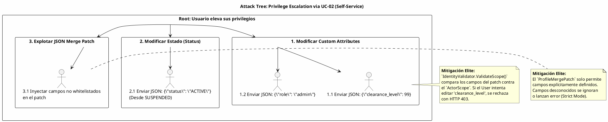

# UC-02: Actualizar Identidad - Análisis de Amenazas y Seguridad Específica

| Metadatos del Documento | |
| :--- | :--- |
| **Proyecto:** | SHUGO - Identity & Access Platform |
| **Caso de Uso:** | UC-02 - Actualizar Identidad |
| **Documento:** | 11_UC_Specific_Security_Threats.md |
| **Metodología:** | STRIDE + DREAD + Attack Trees + Immutable Audit Logging |
| **Estándares:** | OWASP Top 10 (A01:2021 Broken Access Control), NIST SP 800-53 (AU-4), SOC 2 (CC7.2) |
| **Autor:** | Gastón Ruiz |
| **Versión Actual:** | 1.0.0 |
| **Fecha:** | 30/08/2026 |

---

## Historial de Versiones

| Versión | Fecha | Autor | Descripción de Cambios | Impacto |
| :--- | :--- | :--- | :--- | :--- |
| **1.0.0** | 30/08/2026 | Gastón Ruiz | **Creación inicial.** Análisis de amenazas específico para el endpoint de actualización. Se enfoca en vectores de ataque únicos de la mutación de estado: *Lost Updates* (Concurrencia), *Privilege Escalation* vía *Scope* (JSON Merge Patch), y *Audit Log Tampering*. Define mitigaciones técnicas como OCC estricto, validación de Scope por campo y almacenamiento inmutable de logs. | Documento crítico para el equipo de seguridad. Garantiza que la capacidad de modificar identidades no sea utilizada para elevar privilegios, ocultar actividades maliciosas o corromper la integridad de los datos mediante ataques de concurrencia. |

---

## 1. Introducción y Alcance

El UC-02 (Actualizar Identidad) presenta una superficie de ataque fundamentalmente diferente al UC-01 (Crear). Mientras que la creación es unidireccional, la actualización es **bidireccional y stateful**, lo que introduce riesgos únicos:

1. **Integridad de Datos (Concurrencia):** El riesgo de que múltiples actores sobrescriban cambios mutuamente (*Lost Updates*).
2. **Control de Acceso Granular (Scope):** El riesgo de que un actor legítimo (ej. un Usuario) modifique campos que exceden su autorización (ej. su propio `clearance_level`).
3. **Trazabilidad Forense:** El riesgo de que un atacante con acceso a la base de datos intente alterar o borrar los logs de auditoría para cubrir sus huellas.

Este documento modela estos vectores de ataque y define las mitigaciones técnicas de nivel enterprise que SHUGO implementa nativamente.

---

## 2. Attack Trees (Árboles de Ataque)

### 2.1. Attack Tree #1: Privilege Escalation via Self-Service Update

**Objetivo del Atacante:** Un usuario autenticado (Actor: User) intenta elevar sus propios privilegios modificando su perfil.



### 2.2. Attack Tree #2: Audit Log Tampering (Ocultamiento de Huellas)

**Objetivo del Atacante:** Un atacante (interno o externo con acceso a DB) intenta borrar o modificar registros de auditoría para ocultar cambios maliciosos.

```text
[Root: Ocultar actividad maliciosa en UC-02]
  |
  +-- [1. Borrar logs de auditoría]
  |     +-- 1.1. Ejecutar DELETE FROM audit_logs (Mitigado por RLS y Permisos de DB)
  |     +-- 1.2. Truncar la tabla (Mitigado por permisos restrictivos)
  |
  +-- [2. Modificar el contenido del log (snapshot_json)]
  |     +-- 2.1. UPDATE audit_logs SET snapshot_json = ... (Mitigado por RLS: Solo INSERT permitido para app)
  |     +-- 2.2. Corromper el archivo físico de DB (Mitigado por Backups inmutables y WORM storage)
  |
  +-- [3. Evitar la generación del log]
        +-- 3.1. Provocar un error en la transacción antes del INSERT audit_logs.
              +-- [Efecto: La transacción completa hace ROLLBACK. El cambio de identidad NO se persiste.]
              +-- [Conclusión: Es imposible actualizar la identidad SIN generar el log.]
```

---

## 3. Matriz de Amenazas Específicas (STRIDE + DREAD)

| ID | Amenaza | Categoría STRIDE | DREAD (1-10) | Severidad | Mitigación Técnica Específica |
| :--- | :--- | :--- | :--- | :--- | :--- |
| **T-08** | **Lost Update (Race Condition)** | Tampering / Info Disclosure | **8.0** | **Alta** | **Optimistic Concurrency Control (OCC):** Columna `row_version` + Header `If-Match`. Si la versión no coincide, se rechaza (409). Doble validación (App y DB). |
| **T-09** | **Privilege Escalation via Scope** | Elevation of Privilege | **9.0** | **Crítica** | **Field-Level Scope Validation:** El `IdentityValidator` valida cada campo del `JSON Merge Patch` contra los permisos del actor. Un User no puede editar `clearance_level`. |
| **T-10** | **Audit Log Tampering** | Repudiation | **9.5** | **Crítica** | **Immutable Audit Storage:** Tabla `audit_logs` con RLS que solo permite `INSERT` al rol de aplicación. Borrado/Modificación solo posible por roles de auditoría especializados (y queda registrado). |
| **T-11** | **PII Leakage in Audit Logs** | Information Disclosure | **8.5** | **Alta** | **Automatic PII Masking:** El `AuditLogger` enmascara automáticamente (HMAC/Redaction) los valores PII antes de serializar el `snapshot_json`. |
| **T-12** | **JSON Injection / XXE** | Injection | **7.0** | **Alta** | **Strict JSON Schema Validation:** Los `custom_attributes` se validan contra un JSON Schema estricto. No se permite código ejecutable ni estructuras malformadas. |
| **T-13** | **Mass Update DoS (KMS Exhaustion)** | Denial of Service | **7.5** | **Alta** | **Conditional Encryption & Rate Limiting:** El cifrado solo ocurre si el PII cambia. Rate Limiting por tenant previene actualizaciones masivas maliciosas. |

---

## 4. Mitigaciones Técnicas de Nivel Elite

### 4.1. Control de Concurrencia Optimista (OCC) - Mitigación T-08

Para prevenir el *Lost Update* (donde el Admin B sobrescribe los cambios del Admin A sin saberlo), implementamos OCC estricto.

**Flujo de Seguridad:**
1.  **Lectura:** El cliente obtiene el `RowVersion` actual (ej. `v1`).
2.  **Escritura:** El cliente envía `If-Match: v1`.
3.  **Validación App:** El Handler verifica que la DB tenga `v1`. Si tiene `v2`, falla rápido (409).
4.  **Validación DB:** El `UPDATE` SQL incluye `WHERE row_version = 'v1'`.
    *   Si otro proceso actualizó la fila entre los pasos 2 y 4, la DB tendrá `v2`.
    *   El `UPDATE` afectará 0 filas.
    *   EF Core lanzará `DbUpdateConcurrencyException`.
    *   El sistema traduce esto a HTTP 409.

**Garantía:** Es matemáticamente imposible que ocurra un *Lost Update* silencioso. O el cliente gana la carrera, o recibe un error explícito.

### 4.2. Field-Level Scope Validation - Mitigación T-09

No basta con validar "¿Puede este usuario actualizar identidades?". Debemos validar "¿Puede este usuario actualizar *este campo específico*?".

**Implementación (C#):**

```csharp
public class IdentityValidator : IIdentityValidator
{
    // Mapa de permisos por campo
    private static readonly Dictionary<string, ActorScope> FieldPermissions = new()
    {
        { "profile.display_name", ActorScope.User | ActorScope.Admin },
        { "profile.phone", ActorScope.User | ActorScope.Admin },
        { "profile.email", ActorScope.Admin }, // User no puede cambiar email sin re-verificación compleja
        { "profile.custom_attributes.clearance_level", ActorScope.Admin }, // Solo Admin
        { "status", ActorScope.Admin }
    };

    public async Task ValidateScopeAsync(Identity identity, UpdateIdentityCommand command)
    {
        var requestedFields = command.GetRequestedFields();
        
        foreach (var field in requestedFields)
        {
            if (!FieldPermissions.TryGetValue(field, out var requiredScope))
                throw new InvalidFieldException($"Field {field} cannot be updated.");

            if (!command.ActorScope.HasFlag(requiredScope))
            {
                throw new InsufficientScopeException(
                    $"Actor lacks permission to update field '{field}'. Required: {requiredScope}");
            }
        }
    }
}
```

### 4.3. Immutable Audit Logging - Mitigación T-10

La tabla `audit_logs` está diseñada para ser **inmutable** desde la perspectiva de la aplicación.

**Configuración PostgreSQL (RLS):**

```sql
-- El rol de la aplicación (app_kagami) SOLO puede insertar.
-- NO puede hacer SELECT, UPDATE o DELETE sobre audit_logs.
REVOKE ALL ON audit_logs FROM app_kagami;
GRANT INSERT ON audit_logs TO app_kagami;

-- La lectura y administración se reserva para un rol de auditoría separado (app_audit)
-- que requiere autenticación MFA y está separado de la aplicación principal.
GRANT SELECT ON audit_logs TO app_audit;
```

**Garantía:** Incluso si un atacante compromete las credenciales de la aplicación web (`app_kagami`), no puede borrar ni leer los logs de auditoría. Solo puede agregar nuevos registros.

### 4.4. Automatic PII Masking - Mitigación T-11

El `AuditLogger` no confía en que el desarrollador recuerde enmascarar los datos. El enmascaramiento es **automático y obligatorio**.

**Lógica de Enmascaramiento:**

```csharp
public class AuditLogger : IAuditLogger
{
    public AuditSnapshot CreateSnapshot(Dictionary<string, object> before, Dictionary<string, object> after, string actorId)
    {
        var diffs = new List<FieldDiff>();

        foreach (var key in after.Keys)
        {
            var oldValue = before[key];
            var newValue = after[key];

            if (!Equals(oldValue, newValue))
            {
                // CRÍTICO: Enmascarar PII antes de crear el diff
                var maskedOld = MaskPii(key, oldValue);
                var maskedNew = MaskPii(key, newValue);

                diffs.Add(new FieldDiff(key, maskedOld, maskedNew));
            }
        }

        return new AuditSnapshot(diffs);
    }

    private object MaskPii(string fieldName, object value)
    {
        if (value == null) return null;

        // Lista blanca de campos PII
        if (fieldName.Contains("email", StringComparison.OrdinalIgnoreCase))
            return _hmacService.Hash(value.ToString()); // Irreversible
        
        if (fieldName.Contains("phone", StringComparison.OrdinalIgnoreCase))
            return Redact(value.ToString(), keepLast: 4); // +54 *** ** 5678

        return value; // No PII, guardar tal cual
    }
}
```

---

## 5. Compliance y Auditoría (SOC 2 / GDPR)

### 5.1. SOC 2 - CC7.2 (System Monitoring)

*   **Requisito:** La organización debe monitorear el sistema para detectar comportamientos anómalos.
*   **Implementación UC-02:** Cada actualización genera un evento `Identity.Updated` que alimenta el sistema de SIEM. Los picos inusuales de actualizaciones (ej. un script cambiando passwords masivamente) disparan alertas en tiempo real.

### 5.2. GDPR - Art. 30 (Records of Processing Activities)

*   **Requisito:** Mantener un registro de las actividades de tratamiento realizadas.
*   **Implementación UC-02:** La tabla `audit_logs` actúa como este registro. Gracias al `snapshot_json`, podemos reconstruir exactamente qué datos personales fueron modificados, cuándo y por quién, facilitando las solicitudes de acceso y portabilidad de datos.

---

## 6. Trazabilidad

| Documento | Relación |
| :--- | :--- |
| `01_Requirements_Specification.md` | Las invariantes de seguridad (INV-09 OCC, INV-10 Audit) se mitigan aquí. |
| `08_Final_Class_Design.md` | Las clases `IdentityValidator` y `AuditLogger` implementan las mitigaciones de T-09 y T-11. |
| `10_UC_Specific_Data_Model.md` | La configuración de RLS y la estructura de `audit_logs` soportan la mitigación T-10. |
| `SHUGO_Security_Architecture.md` (Transversal) | Este documento aplica los estándares globales de control de acceso y auditoría al contexto específico de UC-02. |

---

## 7. Anexos: Configuración de Seguridad Adicional

### 7.1. Rate Limiting para Actualizaciones

Para prevenir ataques de fuerza bruta o DoS vía actualizaciones masivas:

```csharp
// Middleware de Rate Limiting específico para PATCH/PUT
public class UpdateRateLimitMiddleware
{
    public async Task InvokeAsync(HttpContext context)
    {
        var tenantId = context.User.FindFirst("tenant_id")?.Value;
        var userId = context.User.FindFirst("sub")?.Value;

        // Límite más estricto para usuarios individuales que para Admins/SCIM
        var limitKey = $"update_limit:{tenantId}:{userId}";
        var limit = context.User.IsInRole("Admin") ? 1000 : 50; // 50 updates/hora para User

        if (!await _rateLimiter.CheckAsync(limitKey, limit))
        {
            context.Response.StatusCode = 429;
            await context.Response.WriteAsJsonAsync(new { error = "Rate limit exceeded" });
            return;
        }
        await _next(context);
    }
}
```

---
*Fin del Documento 11_UC_Specific_Security_Threats para UC-02*