# UC-03: Desactivar Identidad - Diagrama de Caso de Uso

| Metadatos del Documento | |
| :--- | :--- |
| **Proyecto:** | SHUGO - Identity & Access Platform |
| **Caso de Uso:** | UC-03 - Desactivar Identidad (Soft Delete) |
| **Documento:** | 02_Use_Case_Diagram.md |
| **Metodología:** | UML 2.5 + ICONIX + Domain-Driven Design + Event-Driven Architecture |
| **Autor:** | Gastón Ruiz |
| **Versión Actual:** | 1.0.0 |
| **Fecha:** | 03/09/2026 |

---

## Historial de Versiones

| Versión | Fecha | Autor | Descripción de Cambios | Impacto |
| :--- | :--- | :--- | :--- | :--- |
| **1.0.0** | 1/9/2026 | Gastón Ruiz | **Creación inicial.** Diagrama de Caso de Uso UML para UC-03. Modela la desactivación lógica (Soft Delete) como una acción de ciclo de vida crítica, introduciendo actores de automatización (SCIM/HRIS), la validación estricta de la máquina de estados, la auditoría forense con justificación (Reason), y la orquestación asíncrona de la revocación de sesiones (KAGI). | Documento base del paquete de diseño Tier 1 del UC-03. Establece las fronteras del sistema, los actores y las integraciones críticas para garantizar un *Offboarding* seguro, auditable y conforme con normativas como SOC 2 e ISO 27001. |

---

## 1. Diagrama de Caso de Uso (PlantUML)

A continuación, se presenta el Diagrama de Casos de Uso UML para el UC-03. Este diagrama diferencia la desactivación como una **acción de negocio explícita** en lugar de una simple mutación de estado genérica.

```plantuml
@startuml UC-03_CasoDeUso
<style>
diagram {
  BackgroundColor #FFFFFF
}
</style>
top to bottom direction
skinparam packageStyle rectangle
skinparam actorStyle awesome
skinparam usecaseBackgroundColor #E3F2FD
skinparam usecaseBorderColor #1565C0
skinparam actorBorderColor #2E7D32
skinparam rectangleBackgroundColor #FFF3E0
skinparam rectangleBorderColor #E65100

title UC-03: Desactivar Identidad (Soft Delete) - Motor KAGAMI (Identity Lifecycle)

' ============================================
' ACTORES PRIMARIOS
' ============================================
actor "Administrador\nde Tenant" as Admin
actor "Sistema de Offboarding\n(SCIM/HRIS)" as HRIS

' ============================================
' SISTEMA PRINCIPAL: KAGAMI ENGINE
' ============================================
rectangle "SHUGO - Motor KAGAMI (Identity Lifecycle)" as KAGAMI {
  usecase "UC-03: Desactivar\nIdentidad (Soft Delete)" as UC03
  usecase "UC-01: Provisionar\nNueva Identidad" as UC01
  usecase "UC-02: Actualizar\nIdentidad" as UC02
  usecase "UC-04: Consultar\nIdentidad" as UC04
  usecase "UC-05: Purgar\nIdentidad (Hard Delete)" as UC05
}

' ============================================
' MÓDULOS DEPENDIENTES (<<include>>)
' ============================================
rectangle "SHUGO - Motor KAGI (Autenticación)" as KAGI {
  usecase "Validar JWT y\nPermisos (RBAC)" as UC_ValidarPermisos
}

rectangle "SHUGO - Motor KAGAMI (Core)" as KAGAMI_Core {
  usecase "Validar Transición\nde Estado" as UC_ValidarEstado
  usecase "Registrar Auditoría\n(Reason + Actor)" as UC_RegistrarAuditoria
  usecase "Publicar Evento\n(Outbox Pattern)" as UC_PublicarEvento
}

' ============================================
' MÓDULOS COMPLEMENTARIOS (<<extend>>)
' ============================================
rectangle "SHUGO - Motor KAGI (Sesiones)" as KAGI_Sessions {
  usecase "Revocar Sesiones\ny Refresh Tokens" as UC_RevokeSessions
}

rectangle "SHUGO - Motor KIZUNA (Autorización)" as KIZUNA {
  usecase "Invalidar Caché\nde Autorización" as UC_InvalidarCache
}

rectangle "SHUGO - Motor KAGE (Auditoría)" as KAGE {
  usecase "UC-46: Ingestar Log\nde Auditoría" as UC46
}

' ============================================
' RELACIONES DE INICIO (Actores → UC Principal)
' ============================================
Admin --> UC03 : Ejecuta desactivación\nmanual o por incidente
HRIS --> UC03 : Sincroniza baja de\nempleado (Offboarding)

' ============================================
' RELACIONES <<include>> (OBLIGATORIAS)
' ============================================
' La desactivación DEBE validar permisos específicos
UC03 ..> UC_ValidarPermisos : <<include>>\n(Validar permiso\nidentity:deactivate)

' La desactivación DEBE validar la máquina de estados
UC03 ..> UC_ValidarEstado : <<include>>\n(Validar transición\nACTIVE/SUSPENDED -> DEACTIVATED)

' La desactivación DEBE registrar la razón y el actor
UC03 ..> UC_RegistrarAuditoria : <<include>>\n(Generar snapshot\nforense con 'Reason')

' La desactivación DEBE publicar el evento para sistemas downstream
UC03 ..> UC_PublicarEvento : <<include>>\n(Outbox:\nIdentity.Deactivated)

' ============================================
' RELACIONES <<extend>> (CONDICIONALES / EFECTOS SECUNDARIOS)
' ============================================
' Si la desactivación es exitosa, se deben revocar las sesiones
UC_RevokeSessions .up.> UC03 : <<extend>>\n(Si éxito: Invalidar\nsesiones en KAGI)

' Si la desactivación es exitosa, se debe invalidar la caché de AuthZ
UC_InvalidarCache .left.> UC03 : <<extend>>\n(Si éxito: Denegar\nfuturos checks en KIZUNA)

' El log de auditoría se ingesta en KAGE
UC46 .right.> UC_RegistrarAuditoria : <<extend>>\n(Ingestar evento\nIdentity.Deactivated)

' ============================================
' RELACIÓN CON OTROS UCs DE KAGAMI
' ============================================
note right of UC05
  **Ciclo de Vida:**
  UC-03 inicia el "Período de Gracia".
  Tras expirar (ej. 30 días), UC-05
  ejecutará el Hard Delete (Purga).
end note

UC03 .down.> UC05 : <<dependency>>\n(Inicia temporizador\npara Purga)

UC02 .down.> UC03 : <<dependency>>\n(UC-02 bloquea updates\nen estado DEACTIVATED)

@enduml
```

---

## 2. Explicación del Diagrama

### 2.1. Actores del Sistema

El UC-03 introduce una dualidad crítica en los actores primarios, reflejando los escenarios reales de *Offboarding* en empresas modernas:

1.  **Administrador de Tenant (Humano):** Ejecuta la desactivación manualmente, generalmente en dos escenarios:
    *   **Offboarding no automatizado:** PYMES o procesos manuales de RRHH.
    *   **Respuesta a Incidentes de Seguridad:** Bloqueo inmediato de una cuenta comprometida (ej. empleado despedido hostil, credenciales filtradas).
2.  **Sistema de Offboarding / HRIS (Automatizado - SCIM):** Representa sistemas como Workday, BambooHR o SAP SuccessFactors. Cuando un empleado es marcado como "Terminado" en el sistema de RRHH, este actor envía una solicitud SCIM (`PATCH` con `active: false` o `DELETE` lógico) que KAGAMI traduce al UC-03.

### 2.2. Relaciones UML Clave

#### Relaciones `<<include>>`: El núcleo de la integridad y seguridad

A diferencia de una actualización genérica, desactivar una identidad requiere cuatro validaciones y acciones obligatorias:

1.  **`<<include>>` Validar Permisos (RBAC):** No basta con ser administrador. Se requiere el permiso granular `identity:deactivate`. Esto permite roles de "Auditor" o "Helpdesk" que pueden ver o editar perfiles, pero no dar de baja usuarios.
2.  **`<<include>>` Validar Transición de Estado:** El sistema consulta la máquina de estados. Solo identidades en `ACTIVE` o `SUSPENDED` pueden pasar a `DEACTIVATED`. Intentar desactivar una identidad ya `DEACTIVATED` debe ser manejado como idempotente (éxito silencioso), y hacerlo sobre una `PURGED` debe retornar 404.
3.  **`<<include>>` Registrar Auditoría (Reason + Actor):** Para cumplimiento SOC 2 e ISO 27001, toda desactivación debe incluir una **razón justificativa** (ej. "Contrato finalizado", "Violación de política") y el identificador del actor que la ejecutó.
4.  **`<<include>>` Publicar Evento (Outbox):** La desactivación no es un evento aislado. Debe notificarse a todo el ecosistema (KAGI, KIZUNA, Webhooks) mediante el patrón Outbox para garantizar consistencia eventual.

#### Relaciones `<<extend>>`: Efectos secundarios de seguridad críticos

Estos flujos se activan condicionalmente tras una desactivación exitosa:

1.  **`<<extend>>` Revocar Sesiones (KAGI):** **La acción de seguridad más importante.** Si un usuario es desactivado, sus tokens de acceso y refresco activos deben ser destruidos inmediatamente. Si KAGI está caído, el Outbox Pattern garantiza que la revocación ocurra en cuanto se recupere.
2.  **`<<extend>>` Invalidar Caché (KIZUNA):** Si el usuario tenía permisos cacheados en el motor de autorización, estos deben marcarse como inválidos para aplicar el principio *Fail Secure* (denegar acceso ante la duda).

---

## 3. Análisis de Coherencia con la Especificación Analítica

Este diagrama es **100% coherente** con el documento `01_Requirements_Specification.md` del UC-03:

| Elemento del Diagrama | Referencia en Especificación |
| :--- | :--- |
| Actores: Admin y HRIS (SCIM) | Sección 2 (Descripción Analítica) - Actores Principales |
| Relación `<<include>>` con UC_ValidarPermisos | Sección 3 (Precondiciones) - Permiso `identity:deactivate` |
| Relación `<<include>>` con UC_ValidarEstado | Sección 3 (INV-15) - Transición de Estado Válida |
| Relación `<<include>>` con UC_RegistrarAuditoria | Sección 3 (INV-17) - Registro de Timestamp y Reason |
| Relación `<<include>>` con UC_PublicarEvento | Sección 3 (RN-01) - Garantía de Revocación vía Outbox |
| Relación `<<extend>>` con UC_RevokeSessions | Sección 2.1 (Escenario Principal, Paso 9) - Revocación asíncrona |
| Relación `<<dependency>>` con UC-05 | Sección 1.2 (Relación con otros UCs) - Inicio del Grace Period |
| Relación `<<dependency>>` con UC-02 | Sección 3 (INV-16) - Bloqueo de updates en estado DEACTIVATED |

---

## 4. Consideraciones de Diseño y Arquitectura (DDD + Clean Architecture)

### 4.1. Acción de Negocio vs. Mutación de Estado (RESTful Design)

El diagrama modela UC-03 como un caso de uso independiente, lo que se traduce en la API como un endpoint de acción: `POST /identities/{id}/deactivate`.

**¿Por qué no usar `PATCH /identities/{id}` con `{"status": "DEACTIVATED"}` (UC-02)?**
1.  **Semántica y Descubrimiento:** "Desactivar" es una acción de alto impacto con efectos secundarios (revocar sesiones). Un endpoint explícito deja claro su propósito.
2.  **Permisos Granulares:** Permite asignar `identity:deactivate` sin otorgar `identity:update` (que permitiría cambiar emails, roles, etc.).
3.  **Validaciones Específicas:** Permite inyectar reglas de negocio únicas, como la **Prevención de Auto-Desactivación** (INV-18: un usuario no puede desactivar su propia cuenta para evitar lockouts accidentales o evasión de auditoría).

### 4.2. Consistencia Eventual y Fail Secure en la Revocación

La relación `<<extend>>` con `UC_RevokeSessions` es asíncrona. ¿Qué pasa si KAGI está caído en el momento exacto de la desactivación?

1.  **Source of Truth:** KAGAMI marca la identidad como `DEACTIVATED` y persiste el evento en el Outbox.
2.  **Fail Secure:** Si el usuario intenta usar un Access Token viejo (que tiene 15 min de vida), KIZUNA (Check API) o el propio KAGI (al validar el token) consultará el estado en KAGAMI (o su caché eventualmente consistente) y **denegará el acceso**.
3.  **Recuperación:** En cuanto KAGI se recupere, el Outbox Processor leerá el evento `Identity.Deactivated` y limpiará los Refresh Tokens y sesiones en Redis.

### 4.3. Idempotencia y Sistemas Automatizados (SCIM)

Los sistemas HRIS (Workday, etc.) a menudo envían el mismo comando de baja múltiples veces debido a reintentos de red o sincronizaciones programadas.
El diagrama y la lógica subyacente deben tratar la desactivación de una identidad ya `DEACTIVATED` como una operación **idempotente** (HTTP 200 OK, sin generar eventos duplicados ni logs de auditoría redundantes), cumpliendo con la invariante RN-02.

---

## 5. Trazabilidad con Otros Documentos del Paquete

Este diagrama se relaciona con los siguientes documentos del paquete de diseño:

| Documento | Relación |
| :--- | :--- |
| `01_Requirements_Specification.md` | Define los flujos, invariantes (Transición de estado, Idempotencia) y criterios de aceptación que este diagrama visualiza. |
| `03_Activity_Diagram.md` | Mostrará el flujo de trabajo interno, destacando la bifurcación lógica para la revocación de sesiones y la validación de la máquina de estados. |
| `04_Initial_Domain_Model.md` | Definirá el método `Deactivate(reason)` en el Aggregate Root `Identity`, que encapsula la transición de estado y la generación del evento de dominio. |
| `05_State_Machine_Diagram.md` | (Definido en UC-02) Muestra la transición `ACTIVE` -> `DEACTIVATED` y el inicio del temporizador para UC-05 (Purga). |
| `06_Robustness_Diagram.md` | Mostrará la colaboración entre el Handler, el Validator de estados, el Audit Logger y el Event Publisher. |
| `07_Sequence_Diagram.md` | Detallará el orden temporal exacto: Validación -> Transición -> Auditoría -> Persistencia -> Publicación Outbox -> Revocación KAGI. |
| `KAGAMI_Engine_Architecture.md` | Documento global que define la arquitectura del motor, incluyendo la estrategia de Outbox y la integración con KAGI. |

---

## 6. Notas de Implementación

### 6.1. Generación del Diagrama
- **Herramienta:** PlantUML (Diagrams as Code).
- **Estilos:** Se mantiene la paleta de colores azul para KAGAMI y naranja para sistemas secundarios, asegurando consistencia visual con UC-01 y UC-02.
- **Convención:** Las relaciones `<<extend>>` apuntan *hacia* el caso de uso base, indicando que son comportamientos opcionales (aunque altamente probables en el flujo de éxito) que se inyectan bajo ciertas condiciones.

### 6.2. Diferenciación de Actores en la Implementación
Aunque tanto el Admin como el HRIS apuntan al mismo UC-03, la implementación del `<<include>>` **Validar Permisos** y **Registrar Auditoría** debe distinguir el contexto:
- **Admin:** El `reason` (razón) es obligatorio y debe ser ingresado manualmente en la UI.
- **HRIS (SCIM):** El `reason` puede ser mapeado automáticamente desde el campo `termination_reason` del payload SCIM (ej. "VOLUNTARY", "INVOLUNTARY", "RETIREMENT").

---
*Fin del Documento 02_Use_Case_Diagram para UC-03*