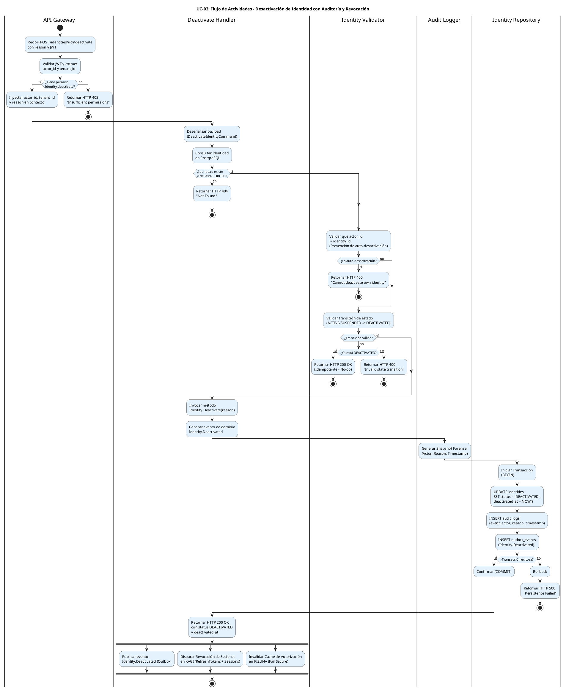

# UC-03: Desactivar Identidad - Diagrama de Actividades

| Metadatos del Documento | |
| :--- | :--- |
| **Proyecto:** | SHUGO - Identity & Access Platform |
| **Caso de Uso:** | UC-03 - Desactivar Identidad (Soft Delete) |
| **Documento:** | 03_Activity_Diagram.md |
| **Metodología:** | UML 2.5 + ICONIX + Domain-Driven Design + Event-Driven Architecture |
| **Autor:** | Gastón Ruiz |
| **Versión Actual:** | 1.0.0 |
| **Fecha:** | 1/09/2026 |

---

## Historial de Versiones

| Versión | Fecha | Autor | Descripción de Cambios | Impacto |
| :--- | :--- | :--- | :--- | :--- |
| **1.0.0** | 1/09/2026 | Gastón Ruiz | **Creación inicial.** Modelado del flujo de trabajo interno para la desactivación de identidades. Destaca la validación estricta de la máquina de estados, la generación de auditoría forense con justificación (Reason), la publicación asíncrona de eventos vía Outbox Pattern, y la bifurcación para revocación de sesiones en KAGI. | Documento base del paquete de diseño Tier 1 del UC-03. Establece la lógica de negocio, los puntos de decisión críticos y las garantías de seguridad y auditabilidad para el endpoint de desactivación del motor KAGAMI. |

---

## 1. Introducción y Propósito

El **Diagrama de Actividades** para el UC-03 visualiza el flujo de control, decisiones y orquestación necesario para desactivar lógicamente una identidad existente en el motor **KAGAMI**.

A diferencia de una actualización genérica (UC-02), la desactivación es una **acción de ciclo de vida crítica** con efectos secundarios inmediatos y de alto impacto en la seguridad. Este diagrama modela explícitamente cinco complejidades arquitectónicas:

1. **Validación de Máquina de Estados:** Garantizar que solo identidades en estados válidos (`ACTIVE`, `SUSPENDED`) puedan transicionar a `DEACTIVATED`.
2. **Auditoría Forense con Justificación:** Registrar no solo el cambio de estado, sino la **razón** (Reason) proporcionada por el actor, cumpliendo con SOC 2 e ISO 27001.
3. **Prevención de Auto-Desactivación:** Validar que el actor no esté intentando desactivar su propia identidad (previene lockouts accidentales o maliciosos).
4. **Publicación Asíncrona de Eventos:** Usar el patrón Outbox para garantizar que los sistemas downstream (KAGI, KIZUNA) reciban la notificación de desactivación.
5. **Revocación Inmediata de Sesiones:** Disparar la invalidación de todos los tokens y sesiones activas en KAGI de forma asíncrona pero garantizada.

Utilizamos carriles (swimlanes) para separar las responsabilidades entre el API Gateway, el Deactivate Handler, el Identity Validator, el Audit Logger, el Identity Repository, y el Event Publisher.

---

## 2. Diagrama de Actividades (PlantUML)

A continuación, se presenta el diagrama que cubre el Escenario Principal (desactivación exitosa), el manejo de idempotencia, y los flujos de excepción.



---

## 3. Explicación Detallada del Flujo

### 3.1. Carriles (Partitions / Swimlanes)

El diagrama está dividido en seis carriles que representan las capas y responsabilidades de la arquitectura:

1. **`|API Gateway|` (Capa de Entrada):** Valida el JWT, extrae el `actor_id` y `tenant_id`, y verifica que el actor tenga el permiso granular `identity:deactivate`. No es suficiente con ser administrador; se requiere este permiso específico.

2. **`|Deactivate Handler|` (Capa de Aplicación):** Orquesta el caso de uso. Carga la identidad, coordina las validaciones, invoca el método de dominio `Deactivate()`, gestiona la transacción atómica, y retorna la respuesta HTTP.

3. **`|Identity Validator|` (Capa de Dominio):** Contiene las reglas de negocio críticas:
   - **Prevención de Auto-Desactivación:** Valida que `actor_id != identity_id`.
   - **Validación de Máquina de Estados:** Verifica que la transición sea válida (ej. `ACTIVE` → `DEACTIVATED`).

4. **`|Audit Logger|` (Capa Transversal):** Genera el snapshot forense que incluye el actor, la razón (Reason), y el timestamp exacto de la desactivación. Este log es inmutable y se almacena en la tabla `audit_logs`.

5. **`|Identity Repository|` (Capa de Infraestructura):** Ejecuta la transacción atómica que actualiza la tabla `identities`, inserta el log de auditoría, y registra el evento en el Outbox.

6. **Flujos Asíncronos (Fork):** Representan las acciones que ocurren después del COMMIT de la transacción:
   - **Publicación de Evento:** El Outbox Processor leerá el evento y lo publicará en Kafka.
   - **Revocación de Sesiones:** KAGI invalidará todos los RefreshTokens y sesiones activas.
   - **Invalidación de Caché:** KIZUNA marcará como inválidos los permisos cacheados para aplicar Fail Secure.

### 3.2. Puntos de Decisión Críticos (Rombos)

1. **Validación de Permisos (API Gateway):**
   - **Pregunta:** ¿El actor tiene el permiso `identity:deactivate`?
   - **Si falla:** Retorna HTTP 403 inmediatamente.
   - **Justificación:** Permite roles granulares (ej. "Auditor" puede ver pero no desactivar).

2. **Existencia y Estado de la Identidad (Deactivate Handler):**
   - **Pregunta:** ¿La identidad existe y NO está en estado `PURGED`?
   - **Si falla:** Retorna HTTP 404.
   - **Justificación:** No se puede desactivar algo que no existe o que ya fue purgado (Hard Delete).

3. **Prevención de Auto-Desactivación (Identity Validator):**
   - **Pregunta:** ¿El `actor_id` es igual al `identity_id`?
   - **Si sí:** Retorna HTTP 400 "Cannot deactivate own identity".
   - **Justificación:** Previene lockouts accidentales (admin se desactiva a sí mismo) o maliciosos (empleado hostil se desactiva para evadir auditoría).

4. **Validación de Transición de Estado (Identity Validator):**
   - **Pregunta:** ¿La transición de estado actual → `DEACTIVATED` es válida?
   - **Si falla:**
     - Si ya está `DEACTIVATED`: Retorna HTTP 200 (Idempotente).
     - Si es otra transición inválida (ej. `PURGED` → `DEACTIVATED`): Retorna HTTP 400.
   - **Justificación:** Garantiza la integridad de la máquina de estados y soporta idempotencia para sistemas automatizados (SCIM).

5. **Persistencia Atómica (Identity Repository):**
   - **Pregunta:** ¿La transacción de base de datos fue exitosa?
   - **Si falla:** Rollback y HTTP 500.
   - **Justificación:** Garantiza que la identidad, el log de auditoría, y el evento Outbox se creen atómicamente. Si falla el log de auditoría, la desactivación se revierte.

### 3.3. Flujos Asíncronos (Fork)

Al final del diagrama, se utiliza un bloque `fork` para modelar las acciones que ocurren *después* de que la transacción de base de datos ha sido confirmada (COMMIT).

- **Publicación de Evento:** El Outbox Processor leerá la tabla `outbox_events` y publicará `Identity.Deactivated` en Kafka.
- **Revocación de Sesiones:** KAGI consumirá el evento y eliminará todos los RefreshTokens y sesiones activas en Redis.
- **Invalidación de Caché:** KIZUNA consumirá el evento y marcará como inválidos los permisos cacheados para esta identidad.

**Justificación:** Estas operaciones no deben aumentar la latencia de la respuesta HTTP 200 al cliente. La consistencia eventual es aceptable y deseable aquí. Además, si KAGI o KIZUNA están caídos, el patrón Outbox garantiza que los eventos se procesarán eventualmente.

---

## 4. Alineación con la Especificación de Requisitos

Este diagrama es la representación visual exacta del documento `01_Requirements_Specification.md`:

| Sección en Requisitos | Representación en el Diagrama |
| :--- | :--- |
| **2.1 Escenario Principal (Pasos 1-9)** | El flujo principal desde "Recibir POST" hasta "Retornar HTTP 200" y los forks asíncronos. |
| **2.2 Escenario Alternativo (Idempotencia)** | El rombo "¿Ya está DEACTIVATED?" y su rama "sí" (HTTP 200 OK, No-op). |
| **2.3 Excepción 3.1 (Identidad No Encontrada/Purgada)** | El rombo "¿Identidad existe y NO está PURGED?" y su rama "no" (HTTP 404). |
| **2.3 Excepción 4.1 (Transición Inválida)** | El rombo "¿Transición válida?" y su rama "no" (HTTP 400). |
| **2.3 Excepción 6.1 (Error de Persistencia)** | El rombo "¿Transacción exitosa?" y su rama "no" (Rollback, HTTP 500). |
| **3 INV-15 (Transición Válida)** | Validación explícita de la máquina de estados. |
| **3 INV-17 (Registro de Timestamp)** | El carril "Audit Logger" y el paso "Generar Snapshot Forense". |
| **3 INV-18 (Prevención de Auto-Desactivación)** | El rombo "¿Es auto-desactivación?" y su rama "sí" (HTTP 400). |
| **3 RN-01 (Garantía de Revocación)** | El fork "Disparar Revocación de Sesiones en KAGI". |
| **3 RN-02 (Idempotencia)** | El manejo de identidad ya desactivada (HTTP 200, No-op). |

---

## 5. Consideraciones de Arquitectura y Diseño (Clean Architecture + DDD)

### 5.1. Acción de Negocio vs. Mutación de Estado

El diagrama modela la desactivación como un **endpoint de acción explícito** (`POST /identities/{id}/deactivate`) en lugar de una actualización genérica (`PATCH /identities/{id}` con `{"status": "DEACTIVATED"}`).

**Justificación:**
- **Semántica Clara:** "Desactivar" es una acción de negocio con efectos secundarios críticos (revocar sesiones, invalidar caché). Un endpoint explícito deja claro su propósito.
- **Permisos Granulares:** Permite asignar `identity:deactivate` sin otorgar `identity:update` (que permitiría cambiar emails, roles, etc.).
- **Validaciones Específicas:** Permite inyectar reglas de negocio únicas, como la **Prevención de Auto-Desactivación** (INV-18).

### 5.2. Auditoría Forense con Justificación (Reason)

El carril `Audit Logger` introduce un requisito crítico para cumplimiento normativo:

1. **Reason (Razón):** El actor debe proporcionar una justificación para la desactivación (ej. "Contrato finalizado", "Violación de política", "Empleado renunció").
2. **Actor:** Se registra quién ejecutó la acción (no solo el sistema).
3. **Timestamp:** Se registra el momento exacto de la desactivación, usado para calcular el período de gracia para UC-05 (Purga).

**Justificación:**
- **SOC 2 (CC7.2):** Exige registros de auditoría que documenten quién hizo qué y por qué.
- **ISO 27001 (A.9.2.6):** Requiere procedimientos formales de revocación de acceso tras la terminación del empleo.
- **GDPR (Art. 30):** Mantiene un registro de las actividades de tratamiento, incluyendo la desactivación de identidades.

### 5.3. Consistencia Eventual y Fail Secure en la Revocación

Los flujos asíncronos (fork) modelan cómo se garantiza la revocación de sesiones incluso si KAGI está caído:

1. **Source of Truth:** KAGAMI marca la identidad como `DEACTIVATED` y persiste el evento en el Outbox.
2. **Fail Secure:** Si un usuario intenta usar un Access Token viejo (que tiene 15 min de vida), KIZUNA (Check API) o el propio KAGI (al validar el token) consultará el estado en KAGAMI (o su caché eventualmente consistente) y **denegará el acceso**.
3. **Recuperación:** En cuanto KAGI se recupere, el Outbox Processor leerá el evento `Identity.Deactivated` y limpiará los RefreshTokens y sesiones en Redis.

**Justificación:**
- **Alta Disponibilidad:** La API de KAGAMI responde en < 100ms independientemente de la latencia o disponibilidad de KAGI.
- **Seguridad:** La ventana de vulnerabilidad máxima es el TTL del Access Token (15 min). Después de eso, el usuario debe re-autenticarse, y KAGI rechazará la autenticación porque la identidad está `DEACTIVATED`.

### 5.4. Idempotencia para Sistemas Automatizados (SCIM)

El manejo de identidad ya desactivada (HTTP 200 OK, No-op) es crucial para integraciones con sistemas HRIS como Workday o BambooHR:

- **Escenario:** Un sistema SCIM envía `PATCH /Users/{id}` con `active: false` múltiples veces debido a reintentos de red o sincronizaciones programadas.
- **Comportamiento:** La primera solicitud desactiva la identidad. Las solicitudes subsiguientes retornan HTTP 200 OK sin generar eventos duplicados ni logs de auditoría redundantes.
- **Justificación:** Previene el "ruido" en los logs de auditoría y evita disparar múltiples eventos de revocación de sesiones.

---

## 6. Trazabilidad con Otros Documentos del Paquete

| Documento | Relación |
| :--- | :--- |
| `01_Requirements_Specification.md` | Este diagrama visualiza los flujos de texto, las invariantes de dominio (Transición de estado, Idempotencia, Auto-desactivación) y los criterios de aceptación. |
| `02_Use_Case_Diagram.md` | Muestra el límite del sistema y los actores; este diagrama muestra el flujo interno y las decisiones lógicas. |
| `04_Initial_Domain_Model.md` | Las acciones de los carriles "Deactivate Handler" e "Identity Validator" utilizarán el método `Deactivate(reason)` del Aggregate Root `Identity`. |
| `05_State_Machine_Diagram.md` | (Definido en UC-02) Muestra la transición `ACTIVE` → `DEACTIVATED` y el inicio del temporizador para UC-05 (Purga). |
| `06_Robustness_Diagram.md` | Mostrará la colaboración entre el Handler, el Validator, el Audit Logger y el Repository. |
| `07_Sequence_Diagram.md` | Detallará el orden temporal exacto de las llamadas que disparan estas transiciones. |
| `10_UC_Specific_Data_Model.md` | (UC-01/02) Define la columna `deactivated_at` y la estructura de la tabla `audit_logs` que soportan este flujo. |

---

## 7. Notas de Implementación

### 7.1. Generación del Diagrama
- **Herramienta:** PlantUML (Diagrams as Code).
- **Ventaja:** Versionable en Git, reproducible, sin dependencias de software propietario.
- **Sintaxis:** Uso de `fork` para modelar concurrencia/asincronía al final del flujo, y `if/else/endif` para las guardas de negocio.

### 7.2. Complejidad del Diagrama
Este diagrama es moderadamente complejo debido a:
- La validación de la máquina de estados.
- La prevención de auto-desactivación.
- La generación de auditoría con Reason.
- La bifurcación final para flujos asíncronos (Revocación, Invalidación de caché).

Sin embargo, esta complejidad es necesaria para capturar la riqueza del flujo de desactivación en un sistema IAM de nivel enterprise que maneja seguridad, cumplimiento normativo y integraciones automatizadas.

### 7.3. Código de Ejemplo (C#)

```csharp
public class DeactivateIdentityHandler : IDeactivateIdentityHandler
{
    private readonly IIdentityRepository _repository;
    private readonly IUnitOfWork _unitOfWork;
    private readonly IAuditLogger _auditLogger;
    private readonly ILogger<DeactivateIdentityHandler> _logger;

    public async Task<DeactivateIdentityResult> Handle(
        DeactivateIdentityCommand command, 
        CancellationToken ct)
    {
        // 1. Cargar identidad
        var identity = await _repository.GetByIdAsync(command.IdentityId);
        if (identity == null || identity.Status == IdentityStatus.PURGED)
            throw new IdentityNotFoundException(command.IdentityId);

        // 2. Prevenir auto-desactivación
        if (identity.Id.Value == command.ActorId)
            throw new SelfDeactivationNotAllowedException();

        // 3. Validar transición (Idempotencia)
        if (identity.Status == IdentityStatus.DEACTIVATED)
            return new DeactivateIdentityResult(identity.Id, identity.Status, identity.DeactivatedAt);

        // 4. Invocar método de dominio
        identity.Deactivate(command.Reason);

        // 5. Generar auditoría
        var auditSnapshot = _auditLogger.CreateSnapshot(
            identity.Id, 
            command.ActorId, 
            "Identity.Deactivated", 
            new { reason = command.Reason }
        );

        // 6. Persistencia atómica
        await _unitOfWork.BeginTransactionAsync();
        try
        {
            await _repository.SaveAsync(identity);
            await _repository.SaveAuditLogAsync(auditSnapshot);
            await _repository.SaveOutboxEventAsync(new OutboxEvent("Identity.Deactivated", identity.Id));
            await _unitOfWork.CommitAsync();
        }
        catch (Exception ex)
        {
            await _unitOfWork.RollbackAsync();
            _logger.LogError(ex, "Failed to deactivate identity {IdentityId}", command.IdentityId);
            throw;
        }

        return new DeactivateIdentityResult(identity.Id, identity.Status, identity.DeactivatedAt);
    }
}
```

---
*Fin del Documento 03_Activity_Diagram para UC-03*