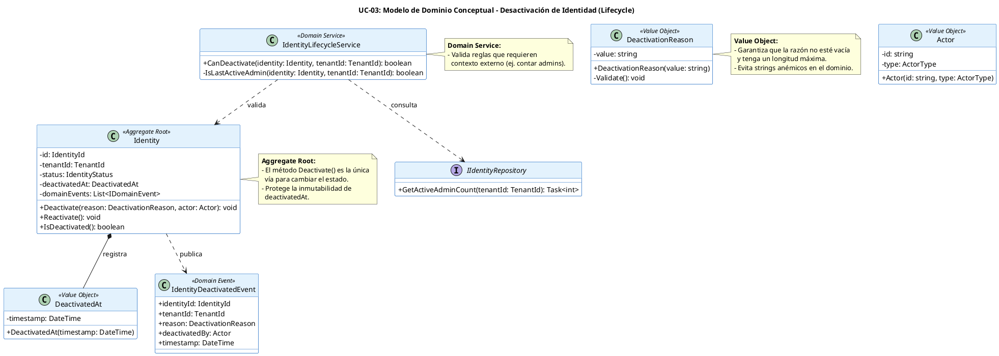

# UC-03: Desactivar Identidad - Modelo de Dominio Inicial

| Metadatos del Documento | |
| :--- | :--- |
| **Proyecto:** | SHUGO - Identity & Access Platform |
| **Caso de Uso:** | UC-03 - Desactivar Identidad (Soft Delete) |
| **Documento:** | 04_Initial_Domain_Model.md |
| **Metodología:** | ICONIX (Modelo de Análisis) + DDD (Domain-Driven Design) + Lifecycle Management |
| **Autor:** | Gastón Ruiz |
| **Versión Actual:** | 1.0.0 |
| **Fecha:** | 1/9/2026 |

---

## Historial de Versiones

| Versión | Fecha | Autor | Descripción de Cambios | Impacto |
| :--- | :--- | :--- | :--- | :--- |
| **1.0.0** | 1/9/2026 | Gastón Ruiz | **Creación inicial.** Definición del Modelo de Dominio Conceptual para la desactivación de identidades. Introduce el método de intención explícita `Deactivate()`, Value Objects para la razón y timestamp de desactivación, y el Servicio de Dominio para validar reglas transversales (ej. "Último Administrador"). | Documento base del paquete de diseño Tier 1 del UC-03. Establece cómo el Aggregate Root `Identity` protege las invariantes de su ciclo de vida, garantizando que una desactivación sea segura, auditada y conforme a las reglas de negocio del tenant. |

---

## 1. Introducción y Propósito

Este documento presenta el **Modelo de Dominio Inicial** para el Caso de Uso UC-03 (Desactivar Identidad). 

A diferencia de la creación (UC-01) o la actualización de atributos (UC-02), la desactivación es una **transición de estado de alto impacto** que altera fundamentalmente la capacidad de la identidad para interactuar con el sistema. 

El modelo se centra en:
1. **Protección de Invariantes de Ciclo de Vida:** Asegurar que una identidad no pueda ser desactivada si ya está purgada, o si es el último administrador del tenant (regla de negocio crítica).
2. **Inmutabilidad de la Evidencia:** Una vez desactivada, la fecha (`DeactivatedAt`) y la razón (`Reason`) no deben poder ser sobrescritas silenciosamente.
3. **Generación de Eventos de Dominio:** Notificar al resto del sistema (KAGI, KIZUNA) que la identidad ha cambiado su estado de confianza.

---

## 2. Diagrama de Modelo de Dominio Conceptual (PlantUML)

A continuación, se presenta el diagrama de clases conceptual, enfocándose en los métodos de mutación de estado y los nuevos Value Objects introducidos para UC-03.



---

## 3. Detalle de Conceptos de Dominio (DDD)

### 3.1. Aggregate Root: `Identity` (Métodos de Mutación)

El Aggregate Root expone un método de intención explícita `Deactivate`. Este método no solo cambia un enum, sino que encapsula la lógica de negocio y genera el evento de dominio.

**Código (C#):**
```csharp
public class Identity
{
    public IdentityId Id { get; private set; }
    public TenantId TenantId { get; private set; }
    public IdentityStatus Status { get; private set; }
    public DeactivatedAt DeactivatedAt { get; private set; }
    
    private readonly List<IDomainEvent> _domainEvents = new();

    // Constructor privado para EF Core / Deserialización
    private Identity() { }

    public void Deactivate(DeactivationReason reason, Actor actor)
    {
        // Invariante: No desactivar si ya está desactivado (Idempotencia en dominio)
        if (this.Status == IdentityStatus.DEACTIVATED)
            return; 

        // Invariante: No se puede desactivar una identidad purgada
        if (this.Status == IdentityStatus.PURGED)
            throw new IdentityPurgedException("Cannot deactivate a purged identity.");

        // Transición de Estado
        this.Status = IdentityStatus.DEACTIVATED;
        
        // Registro inmutable del timestamp
        this.DeactivatedAt = new DeactivatedAt(DateTime.UtcNow);

        // Generación de Evento de Dominio
        _domainEvents.Add(new IdentityDeactivatedEvent(
            this.Id, 
            this.TenantId, 
            reason, 
            actor, 
            DateTime.UtcNow
        ));
    }

    public IReadOnlyCollection<IDomainEvent> GetDomainEvents() => _domainEvents.AsReadOnly();
}
```

### 3.2. Value Objects: `DeactivationReason` y `DeactivatedAt`

#### `DeactivationReason`
Representa la justificación de la desactivación. No es un simple string; es un objeto inmutable que valida su propia integridad.

```csharp
public class DeactivationReason
{
    private const int MaxLength = 500;
    public string Value { get; }

    public DeactivationReason(string value)
    {
        if (string.IsNullOrWhiteSpace(value))
            throw new InvalidDeactivationReasonException("Reason cannot be empty.");
            
        if (value.Length > MaxLength)
            throw new InvalidDeactivationReasonException($"Reason cannot exceed {MaxLength} characters.");

        Value = value.Trim();
    }
}
```

#### `DeactivatedAt`
Wrapper para el timestamp de desactivación. Garantiza que el valor no sea nulo cuando el estado es `DEACTIVATED`.

```csharp
public class DeactivatedAt
{
    public DateTime Timestamp { get; }

    public DeactivatedAt(DateTime timestamp)
    {
        if (timestamp > DateTime.UtcNow)
            throw new ArgumentException("DeactivatedAt cannot be in the future.");
            
        Timestamp = timestamp;
    }
}
```

### 3.3. Domain Service: `IdentityLifecycleService`

Algunas reglas de negocio no pueden ser validadas solo con los datos dentro del Aggregate. Por ejemplo: **"No permitir desactivar al último administrador activo del tenant"**. Esta regla requiere consultar la base de datos.

**Código (C#):**
```csharp
public class IdentityLifecycleService : IIdentityLifecycleService
{
    private readonly IIdentityRepository _repository;

    public IdentityLifecycleService(IIdentityRepository repository)
    {
        _repository = repository;
    }

    public async Task<bool> CanDeactivateAsync(Identity identity, TenantId tenantId)
    {
        // Si no es admin, siempre se puede desactivar
        if (!identity.HasRole("admin")) return true;

        // Si es admin, verificar si es el último
        int activeAdminCount = await _repository.GetActiveAdminCountAsync(tenantId);
        
        // Si hay más de 1 admin activo, o si este admin ya está inactivo (no debería pasar por aquí), permitir.
        // Si es el único admin activo, bloquear.
        return activeAdminCount > 1; 
    }
}
```

---

## 4. Eventos de Dominio

El evento `IdentityDeactivatedEvent` es la forma en que el Aggregate Root comunica al resto del sistema (y a la Capa de Aplicación) que ha ocurrido un cambio de estado significativo.

| Evento | Trigger | Payload | Consumidores Típicos |
| :--- | :--- | :--- | :--- |
| `IdentityDeactivatedEvent` | Llamada exitosa a `Identity.Deactivate()`. | `IdentityId`, `TenantId`, `Reason`, `DeactivatedBy`, `Timestamp`. | **KAGI:** Revocar sesiones.<br>**KIZUNA:** Invalidar caché.<br>**KAGE:** Log de auditoría.<br>**TORII:** Webhook de baja. |

---

## 5. Excepciones de Dominio

Todas heredan de `DomainException`.

| Excepción | Descripción | Código HTTP Asociado |
| :--- | :--- | :--- |
| `IdentityPurgedException` | Se intentó desactivar una identidad que ya fue purgada (Hard Delete). | 404 Not Found |
| `InvalidDeactivationReasonException` | La razón proporcionada está vacía o excede el límite. | 400 Bad Request |
| `LastAdminDeactivationException` | Se intentó desactivar al último administrador activo del tenant. | 400 Bad Request |
| `SelfDeactivationException` | (Opcional en dominio) Un usuario intenta desactivarse a sí mismo. | 400 Bad Request |

---

## 6. Decisiones de Diseño DDD (ADR)

### 6.1. ¿Por qué un Value Object para `DeactivationReason`?

**Decisión:** Envolver el string de la razón en un Value Object `DeactivationReason`.

**Justificación:**
- **Validación Temprana:** Las reglas de negocio (longitud máxima, no vacío) se validan en el constructor. El Aggregate Root no tiene que repetir estas validaciones.
- **Tipado Fuerte:** Evita confusiones en las firmas de métodos. `Deactivate(DeactivationReason reason)` es más explícito que `Deactivate(string reason)`.
- **Inmutabilidad:** Una vez creada, la razón no puede cambiar accidentalmente.

### 6.2. ¿Dónde validar la regla del "Último Administrador"?

**Decisión:** Utilizar un **Domain Service** (`IdentityLifecycleService`) en lugar de poner la lógica en el Aggregate Root o en la Capa de Aplicación.

**Justificación:**
- **Aggregate Root:** No debe tener dependencias de repositorios (para mantenerse agnóstico de la persistencia y ser testeable unitariamente).
- **Capa de Aplicación:** Podría hacerlo, pero la regla "No desactivar al último admin" es una regla de negocio de dominio, no de orquestación.
- **Domain Service:** Es el lugar correcto para lógica de dominio que coordina múltiples aggregates o requiere acceso a repositorios para verificar invariantes globales.

---

## 7. Trazabilidad

| Documento | Relación |
| :--- | :--- |
| `01_Requirements_Specification.md` | Define las invariantes (INV-15 Transición, INV-18 Auto-desactivación) que este modelo implementa. |
| `02_Use_Case_Diagram.md` | Muestra los actores; este modelo define los objetos con los que interactúan. |
| `03_Activity_Diagram.md` | Los carriles "Identity Validator" y "Deactivate Handler" se implementan aquí como `IdentityLifecycleService` y el método `Identity.Deactivate()`. |
| `05_State_Machine_Diagram.md` | (Definido en UC-02) Muestra la transición `ACTIVE` -> `DEACTIVATED` que este modelo ejecuta. |
| `06_Robustness_Diagram.md` | Mostrará la colaboración entre el Handler, el LifecycleService y el Repository. |
| `10_UC_Specific_Data_Model.md` | Define la columna `deactivated_at` y las políticas de retención que este modelo utiliza. |

---

## 8. Notas para la Implementación

### 8.1. Ubicación en Clean Architecture
- **Dominio (`SHUGO.Domain`):** `Identity`, `DeactivationReason`, `DeactivatedAt`, `IdentityDeactivatedEvent`, `IIdentityLifecycleService`.
- **Infraestructura (`SHUGO.Infrastructure`):** `IdentityRepository` (implementa `GetActiveAdminCountAsync`).
- **Aplicación (`SHUGO.Application`):** `DeactivateIdentityHandler` (Orquesta: carga identidad -> llama a LifecycleService -> llama a Identity.Deactivate -> persiste).

### 8.2. Manejo de la Idempotencia en el Dominio
Observa en el código del Aggregate Root:
```csharp
if (this.Status == IdentityStatus.DEACTIVATED)
    return; 
```
Esta línea es crucial. Permite que la Capa de Aplicación llame a `Deactivate()` múltiples veces (por reintentos de SCIM) sin lanzar excepciones ni generar eventos duplicados. El dominio absorbe la llamada de forma segura (No-op).

---
*Fin del Documento 04_Initial_Domain_Model para UC-03*