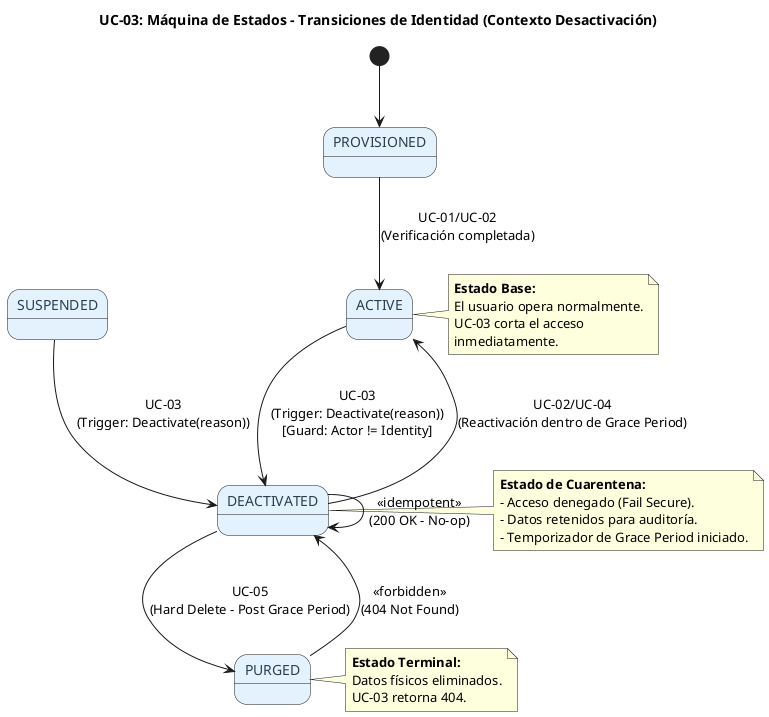
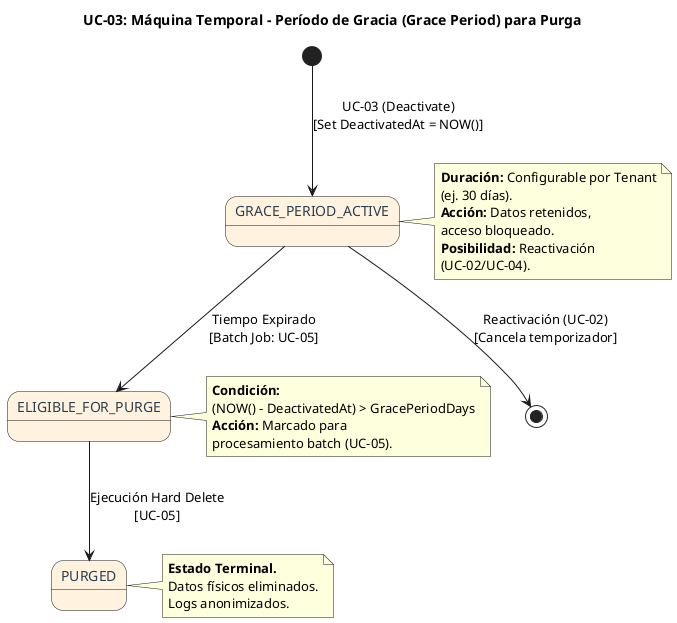
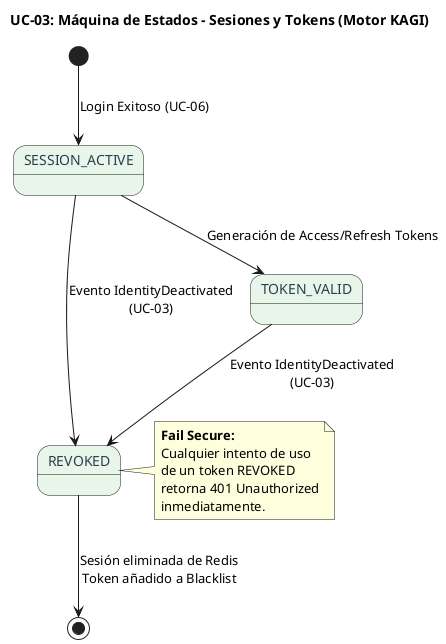

# UC-03: Desactivar Identidad - Diagrama de Máquina de Estados

| Metadatos del Documento | |
| :--- | :--- |
| **Proyecto:** | SHUGO - Identity & Access Platform |
| **Caso de Uso:** | UC-03 - Desactivar Identidad (Soft Delete) |
| **Documento:** | 05_State_Machine_Diagram.md |
| **Metodología:** | UML 2.5 + ICONIX + Domain-Driven Design (Lifecycle & Temporal States) |
| **Autor:** | Gastón Ruiz |
| **Versión Actual:** | 1.0.0 |
| **Fecha:** | 1/09/2026 |

---

## Historial de Versiones

| Versión | Fecha | Autor | Descripción de Cambios | Impacto |
| :--- | :--- | :--- | :--- | :--- |
| **1.0.0** | 1/09/2026 | Gastón Ruiz | **Creación inicial.** Definición de las máquinas de estados específicas para la desactivación de identidades. Se modelan tres máquinas críticas: (1) Transiciones de Estado de Identidad (Contexto UC-03), (2) Máquina Temporal de Período de Gracia (Grace Period para GDPR), y (3) Ciclo de Vida de Sesiones Downstream (KAGI). | Documento base del paquete de diseño Tier 1 del UC-03. Establece las reglas de transición, las guardas (guards) de seguridad y la lógica temporal que garantiza el cumplimiento normativo y la integridad del sistema durante el offboarding. |

---

## 1. Introducción y Propósito

El **Diagrama de Máquina de Estados** para el UC-03 visualiza las restricciones de comportamiento temporal y las reglas de transición que gobiernan la desactivación lógica de una identidad.

Aunque el ciclo de vida general de la identidad se definió en UC-01 y UC-02, el UC-03 introduce complejidades específicas que requieren un modelado detallado:
1. **Guardas de Seguridad (Guards):** Restricciones estrictas sobre qué estados pueden transicionar a `DEACTIVATED` (ej. una identidad `PURGED` no puede ser desactivada).
2. **Máquina Temporal (Período de Gracia):** La desactivación no es un estado terminal inmediato; inicia un temporizador que determina cuándo la identidad es elegible para el borrado físico (UC-05), cumpliendo con GDPR y políticas de retención.
3. **Propagación de Estado (Downstream):** Cómo el cambio de estado en KAGAMI fuerza transiciones inmediatas en los motores de autenticación (KAGI) y autorización (KIZUNA).

Estas máquinas garantizan:
- **Integridad del Dominio:** Prevenir operaciones ilegales o redundantes.
- **Cumplimiento Normativo:** Balancear la seguridad operativa (bloqueo inmediato) con el derecho al olvido (borrado diferido).
- **Consistencia Distribuida:** Asegurar que el acceso se deniegue en todo el ecosistema.

---

## 2. Máquina de Estados #1: Transiciones de Identidad (Contexto UC-03)

### 2.1. Descripción

Esta máquina representa el subconjunto de transiciones del ciclo de vida global que el endpoint `POST /identities/{id}/deactivate` (UC-03) está autorizado a ejecutar o validar.

### 2.2. Diagrama de Máquina de Estados (PlantUML)



### 2.3. Descripción de Transiciones y Guardas

| Estado Origen | Estado Destino | Trigger / Acción | Guarda (Guard Clause) | Comportamiento del Sistema |
| :--- | :--- | :--- | :--- | :--- |
| **ACTIVE** | **DEACTIVATED** | `Deactivate(reason)` | `ActorId != IdentityId` AND `IsLastAdmin == false` | Genera `IdentityDeactivatedEvent`, setea `DeactivatedAt`, inicia Grace Period. |
| **SUSPENDED** | **DEACTIVATED** | `Deactivate(reason)` | Ninguna (ya está bloqueada) | Mismo flujo que ACTIVE, pero sin necesidad de revocar sesiones activas (ya no hay). |
| **DEACTIVATED** | **DEACTIVATED** | `Deactivate(reason)` | Ninguna (Idempotencia) | **No-op.** Retorna éxito silencioso. No genera eventos duplicados. |
| **Cualquiera** | **DEACTIVATED** | `Deactivate(reason)` | `Status == PURGED` | **Bloqueado.** Lanza `IdentityPurgedException`. Retorna HTTP 404. |

---

## 3. Máquina de Estados #2: Período de Gracia y Elegibilidad de Purga (Temporal)

### 3.1. Descripción

Esta es una **Máquina de Estados Temporal** implícita que se activa cuando la identidad entra en estado `DEACTIVATED`. Es fundamental para el cumplimiento de **GDPR Art. 17 (Derecho al Olvido)** y políticas de retención de datos corporativas.

### 3.2. Diagrama de Máquina de Estados (PlantUML)



### 3.3. Invariantes de la Máquina Temporal

1. **Inmutabilidad del Inicio:** El timestamp `DeactivatedAt` se establece una sola vez en UC-03 y nunca se modifica, incluso si se reactiva y desactiva nuevamente (en cuyo caso se actualiza al nuevo timestamp).
2. **Configuración por Tenant:** La duración del `GRACE_PERIOD_ACTIVE` no es hardcodeada; se lee de `TenantConfig.RetentionDays`.
3. **Bloqueo de Reactivación Tardía:** Si la identidad ya transitó a `ELIGIBLE_FOR_PURGE` (o `PURGED`), el endpoint de reactivación (UC-02) debe retornar 404 o 400, impidiendo la recuperación de datos.

---

## 4. Máquina de Estados #3: Invalidación de Sesiones Downstream (KAGI)

### 4.1. Descripción

Cuando UC-03 dispara el evento `IdentityDeactivatedEvent`, el motor KAGI debe transicionar todas las sesiones asociadas a esa identidad. Esta máquina modela el comportamiento de **Fail Secure** en el sistema de autenticación.

### 4.2. Diagrama de Máquina de Estados (PlantUML)



---

## 5. Implementación en el Dominio (Código C#)

Las máquinas de estados se implementan mediante **Guard Clauses** y **Lógica Temporal** dentro del Aggregate Root y los Domain Services.

### 5.1. Guard Clauses para Transiciones (Máquina #1)

```csharp
public class Identity
{
    public IdentityStatus Status { get; private set; }
    public DeactivatedAt DeactivatedAt { get; private set; }

    public void Deactivate(DeactivationReason reason, Actor actor)
    {
        // Guarda 1: No operar sobre identidades purgadas (Máquina Terminal)
        if (this.Status == IdentityStatus.PURGED)
            throw new IdentityPurgedException("Cannot deactivate a purged identity.");

        // Guarda 2: Idempotencia (Máquina Estable)
        if (this.Status == IdentityStatus.DEACTIVATED)
            return; // No-op silencioso, no genera eventos duplicados

        // Guarda 3: Prevención de Auto-Desactivación (Regla de Negocio)
        if (this.Id.Value == actor.Id)
            throw new SelfDeactivationNotAllowedException("Users cannot deactivate their own identity.");

        // Transición de Estado y Acción
        this.Status = IdentityStatus.DEACTIVATED;
        this.DeactivatedAt = new DeactivatedAt(DateTime.UtcNow); // Inicia Máquina Temporal #2

        // Publicación de Evento (Dispara Máquina #3 en KAGI)
        this.AddDomainEvent(new IdentityDeactivatedEvent(this.Id, this.TenantId, reason, actor));
    }
}
```

### 5.2. Lógica Temporal para Grace Period (Máquina #2)

Esta lógica reside típicamente en un Domain Service o en la consulta de elegibilidad para UC-05.

```csharp
public class GracePeriodEvaluator
{
    public bool IsEligibleForPurge(Identity identity, TenantConfig config)
    {
        if (identity.Status != IdentityStatus.DEACTIVATED)
            return false;

        if (identity.DeactivatedAt == null)
            return false;

        var purgeDate = identity.DeactivatedAt.Timestamp.AddDays(config.RetentionDays);
        
        // Si la fecha actual supera la fecha de purga calculada, es elegible
        return DateTime.UtcNow >= purgeDate;
    }
}
```

---

## 6. Trazabilidad con Otros Documentos del Paquete

| Documento | Relación |
| :--- | :--- |
| `01_Requirements_Specification.md` | Las invariantes de estado (INV-15 Transición, INV-17 Timestamp) y la regla de Retención (RN-03) se definen aquí y se hacen cumplir en estas máquinas. |
| `02_Use_Case_Diagram.md` | Muestra los actores; estas máquinas definen cómo el sistema responde a sus acciones de desactivación a lo largo del tiempo. |
| `03_Activity_Diagram.md` | El rombo "¿Transición válida?" y el flujo de "Período de Gracia" se basan directamente en las Máquinas #1 y #2. |
| `04_Initial_Domain_Model.md` | El Aggregate Root `Identity`, su enumeración `IdentityStatus` y el Value Object `DeactivatedAt` son la implementación directa de estas máquinas. |
| `06_Robustness_Diagram.md` | Mostrará cómo los objetos colaboran para ejecutar estas transiciones de estado de forma segura. |
| `10_UC_Specific_Data_Model.md` | Define la columna `deactivated_at` y las políticas de retención que soportan la Máquina Temporal #2. |

---

## 7. Notas de Implementación

### 7.1. Testing de Máquinas de Estados
Cada transición y guarda definida en estas máquinas debe tener tests unitarios específicos en el proyecto de Dominio:
1. **Happy Path:** Verificar que `ACTIVE` -> `DEACTIVATED` actualiza el estado, setea `DeactivatedAt` y genera el evento.
2. **Idempotencia:** Verificar que llamar a `Deactivate()` sobre una identidad `DEACTIVATED` no lanza excepciones ni genera eventos.
3. **Guarda de Purga:** Verificar que intentar desactivar una identidad `PURGED` lanza `IdentityPurgedException`.
4. **Lógica Temporal:** Verificar que `GracePeriodEvaluator` retorna `true` solo después de `RetentionDays`.

### 7.2. Concurrencia y Locking
Dado que la desactivación puede ser disparada simultáneamente por un Admin (UI) y un sistema HRIS (SCIM), la transición de estado en la base de datos debe usar **Optimistic Concurrency Control** (columna `row_version`) para prevenir condiciones de carrera, asegurando que el evento de dominio se genere exactamente una vez.

---
*Fin del Documento 05_State_Machine_Diagram para UC-03*