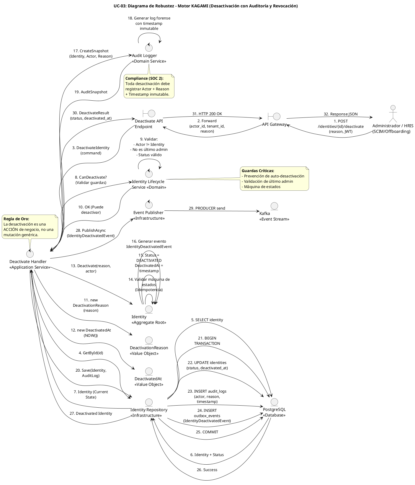

# UC-03: Desactivar Identidad - Diagrama de Robustez

| Metadatos del Documento | |
| :--- | :--- |
| **Proyecto:** | SHUGO - Identity & Access Platform |
| **Caso de Uso:** | UC-03 - Desactivar Identidad (Soft Delete) |
| **Documento:** | 06_Robustness_Diagram.md |
| **Metodología:** | ICONIX (Diagrama de Robustez) + Clean Architecture + DDD + Lifecycle Management |
| **Autor:** | Gastón Ruiz |
| **Versión Actual:** | 1.0.0 |
| **Fecha:** | 01/09/2026 |

---

## Historial de Versiones

| Versión | Fecha | Autor | Descripción de Cambios | Impacto |
| :--- | :--- | :--- | :--- | :--- |
| **1.0.0** | 01/09/2026 | Gastón Ruiz | **Creación inicial.** Diagrama de Robustez para UC-03, validando la arquitectura del motor KAGAMI para operaciones de ciclo de vida. Muestra la colaboración estricta entre Boundaries (API Gateway, Endpoint), Controls (Deactivate Handler, Identity Lifecycle Service, Audit Logger, Event Publisher), y Entities (Identity, DeactivationReason, DeactivatedAt, Repository). Valida el principio de "Acción de Negocio Explícita" y la prevención de auto-desactivación. | Documento base del paquete de diseño Tier 1 del UC-03. Sirve como puente crítico entre el Modelo de Dominio (04) y el Diagrama de Secuencia (07), asegurando que la arquitectura soporta la seguridad, auditabilidad y cumplimiento normativo antes de codificar. |

---

## 1. Introducción y Propósito

El **Diagrama de Robustez** para el UC-03 valida que el flujo de desactivación de identidades puede ser orquestado respetando las reglas estrictas de acoplamiento de **ICONIX** y los principios de **Domain-Driven Design (DDD)** y **Clean Architecture**.

El desafío específico de este caso de uso es quíntuple:
1. **Acción de Negocio vs. Mutación:** Garantizar que la desactivación sea tratada como una acción de alto impacto con efectos secundarios, no como un simple cambio de campo.
2. **Validación de Máquina de Estados:** Prevenir transiciones ilegales (ej. desactivar una identidad ya purgada).
3. **Prevención de Auto-Desactivación:** Bloquear intentos de que un usuario desactive su propia identidad (previene lockouts accidentales o evasión de auditoría).
4. **Auditoría Forense con Justificación:** Capturar no solo el cambio de estado, sino la **razón** (Reason) y el **actor** que ejecutó la acción.
5. **Propagación Asíncrona de Efectos:** Garantizar que la revocación de sesiones (KAGI) y la invalidación de caché (KIZUNA) ocurran eventualmente, incluso si esos sistemas están caídos.

---

## 2. Diagrama de Robustez (PlantUML)

A continuación, se presenta el Diagrama de Robustez organizado de izquierda a derecha para mostrar el flujo natural: **Actor → Boundary → Control → Entity**.



---

## 3. Explicación Detallada de los Objetos

### 3.1. Boundary Objects (Objetos de Límite)

| Objeto | Responsabilidad | Mapeo a Clean Architecture |
| :--- | :--- | :--- |
| **`API Gateway`** | Valida el JWT, extrae `actor_id`, `tenant_id`, y verifica que el actor tenga el permiso granular `identity:deactivate`. Inyecta la `reason` (razón) en el contexto. | Middleware (Kong, AWS API Gateway). |
| **`Deactivate API Endpoint`** | Recibe la request HTTP `POST /identities/{id}/deactivate`, deserializa el payload a un DTO (`DeactivateIdentityCommand`), y lo pasa al Handler. | Controller (ASP.NET Core Controller). |

### 3.2. Control Objects (Objetos de Control)

| Objeto | Responsabilidad | Mapeo a Clean Architecture |
| :--- | :--- | :--- |
| **`Deactivate Handler`** | **Application Service.** Orquesta el caso de uso. Coordina la carga de la identidad, validación de guardas, construcción de Value Objects, ejecución de la acción de dominio, auditoría, y persistencia atómica. | Command Handler / Application Service. |
| **`Identity Lifecycle Service`** | **Domain Service.** Contiene las reglas de negocio transversales que requieren acceso a repositorios: prevención de auto-desactivación, validación de último administrador, y validación de máquina de estados. | Domain Service. |
| **`Audit Logger`** | **Domain Service.** Genera el snapshot forense que incluye el actor, la razón (Reason), y el timestamp inmutable de la desactivación. Cumple con SOC 2 e ISO 27001. | Domain Service. |
| **`Event Publisher`** | **Infrastructure Service.** Publica el evento `IdentityDeactivatedEvent` en Kafka de forma asíncrona. Si Kafka está caído, el evento ya está en el Outbox y se reintentará. | Infrastructure Service. |

### 3.3. Entity Objects (Objetos de Entidad)

| Objeto | Responsabilidad | Mapeo a DDD |
| :--- | :--- | :--- |
| **`Identity`** | **Aggregate Root.** Expone el método de intención explícita `Deactivate(reason, actor)` que encapsula la transición de estado, la generación de eventos de dominio, y la protección de invariantes. | Aggregate Root. |
| **`DeactivationReason`** | **Value Object.** Representa la justificación de la desactivación. Valida su propia integridad (no vacío, longitud máxima). | Value Object. |
| **`DeactivatedAt`** | **Value Object.** Wrapper inmutable para el timestamp de desactivación. Garantiza que el valor no sea nulo cuando el estado es `DEACTIVATED`. | Value Object. |
| **`Identity Repository`** | **Infrastructure.** Abstrae la persistencia. Implementa la transacción atómica que actualiza la identidad, inserta el log de auditoría, y registra el evento en el Outbox. | Repository Interface (Domain) / Implementation (Infra). |

---

## 4. Reglas de Robustez de ICONIX (Validación del Diagrama)

Verifiquemos que nuestro diagrama cumple estrictamente las reglas de acoplamiento de ICONIX:

### ✅ Regla 1: Actor → Boundary
- **Cumplida:** El `Actor` (Admin/HRIS) interactúa solo con el `API Gateway`.

### ✅ Regla 2: Boundary → Boundary
- **Cumplida:** El `API Gateway` forward la request al `Deactivate API Endpoint`.

### ✅ Regla 3: Boundary → Control
- **Cumplida:** El `Deactivate API Endpoint` envía el Command al `Deactivate Handler`.

### ✅ Regla 4: Control → Control
- **Cumplida y Crítica:** El `Deactivate Handler` delega a `Identity Lifecycle Service` (validación de guardas), `Audit Logger` (generación de snapshot forense), y `Event Publisher` (publicación asíncrona).
- **Validación:** Esto permite que el Handler sea delgado y que las reglas de validación, auditoría y publicación sean reutilizables y testeables.

### ✅ Regla 5: Control → Entity
- **Cumplida:**
  - `Deactivate Handler` lee y actualiza `Identity`.
  - `Deactivate Handler` crea `DeactivationReason` y `DeactivatedAt`.
  - `Deactivate Handler` llama a `Identity Repository` para persistir.
  - `Identity Lifecycle Service` consulta `Identity Repository` para validar guardas.
  - `Audit Logger` crea `AuditSnapshot`.

### ✅ Regla 6: NO Entity → Control / Boundary
- **Cumplida:** Ninguna entidad (`Identity`, `Reason`, `Timestamp`, `Repo`) envía mensajes de vuelta a los controles o boundaries. Solo retornan datos como respuesta a una invocación (flujo de retorno implícito).

### ✅ Regla 7: NO Entity → Entity (Directo sin Control)
- **Cumplida:** El `Deactivate Handler` (Control) es el único que orquesta la interacción entre `Identity` y los Value Objects. El `Identity` puede llamar métodos internos de sus Value Objects, pero esto es cohesión interna del Aggregate, no acoplamiento externo.

---

## 5. Consideraciones de Arquitectura (Clean Architecture + DDD)

### 5.1. Acción de Negocio vs. Mutación de Estado

El diagrama valida visualmente una de las decisiones arquitectónicas más importantes de UC-03:

1.  **Endpoint Explícito:** `POST /identities/{id}/deactivate` en lugar de `PATCH /identities/{id}` con `{"status": "DEACTIVATED"}`.
2.  **Método de Intención:** `Identity.Deactivate(reason, actor)` en lugar de `identity.Status = DEACTIVATED`.
3.  **Permisos Granulares:** `identity:deactivate` en lugar de `identity:update`.

**Justificación:**
- **Semántica Clara:** "Desactivar" es una acción de alto impacto con efectos secundarios (revocar sesiones, invalidar caché). Un endpoint explícito deja claro su propósito.
- **Seguridad:** Permite asignar permisos granulares sin otorgar capacidades de actualización completa.
- **Validaciones Específicas:** Permite inyectar reglas de negocio únicas (Prevención de Auto-Desactivación, Último Admin).

### 5.2. Prevención de Auto-Desactivación (Guard Clause)

El `Identity Lifecycle Service` (Paso 9) valida que `actor_id != identity_id`. Esta guarda es crítica para:

1.  **Prevenir Lockouts Accidentales:** Un administrador no puede desactivarse a sí mismo por error.
2.  **Prevenir Evasión de Auditoría:** Un empleado hostil no puede desactivar su propia identidad para evitar ser rastreado.
3.  **Cumplimiento Normativo:** SOC 2 y ISO 27001 exigen controles de segregación de funciones.

**Implementación:**
```csharp
// En IdentityLifecycleService.CanDeactivateAsync()
if (identity.Id.Value == actor.Id)
    throw new SelfDeactivationNotAllowedException("Users cannot deactivate their own identity.");
```

### 5.3. Auditoría Forense con Justificación (Reason)

El `Audit Logger` (Pasos 17-19) genera un snapshot que incluye:
- **Actor:** Quién ejecutó la acción (no solo el sistema).
- **Reason:** Por qué se ejecutó (justificación obligatoria).
- **Timestamp:** Cuándo se ejecutó (inmutable, usado para calcular Grace Period).

**Justificación:**
- **SOC 2 (CC7.2):** Exige registros de auditoría que documenten quién hizo qué y por qué.
- **ISO 27001 (A.9.2.6):** Requiere procedimientos formales de revocación de acceso.
- **GDPR (Art. 30):** Mantiene un registro de las actividades de tratamiento.

### 5.4. Persistencia Atómica con Outbox Pattern

El `Identity Repository` (Pasos 20-27) ejecuta una transacción atómica que abarca:
1.  `UPDATE identities` (cambio de estado + `deactivated_at`).
2.  `INSERT audit_logs` (snapshot forense).
3.  `INSERT outbox_events` (evento de dominio).

**Justificación:**
- **Integridad Forense:** Si la inserción del log de auditoría falla, la desactivación se revierte. Nunca existirá una identidad desactivada sin su correspondiente registro forense.
- **Consistencia Eventual:** El evento en el Outbox garantiza que KAGI y KIZUNA reciban la notificación eventualmente, incluso si Kafka está caído.

---

## 6. Trazabilidad con Otros Documentos del Paquete

| Documento | Relación |
| :--- | :--- |
| `01_Requirements_Specification.md` | Este diagrama valida que los requisitos de prevención de auto-desactivación (INV-18), auditoría con reason (INV-17), y garantía de revocación (RN-01) pueden ser implementados con los objetos definidos. |
| `02_Use_Case_Diagram.md` | Muestra los actores y sistemas; este diagrama muestra cómo colaboran los objetos internos. |
| `03_Activity_Diagram.md` | Los carriles de actividad (Handler, LifecycleService, Auditor, Publisher) se mapean directamente a los objetos de Control de este diagrama. |
| `04_Initial_Domain_Model.md` | Los objetos `Identity`, `DeactivationReason`, `DeactivatedAt` y los servicios `LifecycleService`/`Auditor` son exactamente las clases definidas en el modelo de dominio. |
| `05_State_Machine_Diagram.md` | Las transiciones de estado (ej. `ACTIVE` -> `DEACTIVATED`) se ejecutan cuando el `Deactivate Handler` invoca `Identity.Deactivate()`. |
| `07_Sequence_Diagram.md` | Este diagrama define "qué objetos colaboran"; el de secuencia definirá "en qué orden temporal exacto" se envían los mensajes. |
| `08_Final_Class_Design.md` | Definirá las firmas exactas de los métodos mostrados en este diagrama (ej. `Identity.Deactivate()`, `AuditLogger.CreateSnapshot()`). |

---

## 7. Notas de Implementación

### 7.1. Inyección de Dependencias

El `Deactivate Handler` debe tener inyectados los servicios de dominio y repositorios:

```csharp
public class DeactivateHandler : IDeactivateHandler
{
    private readonly IIdentityLifecycleService _lifecycleService;
    private readonly IAuditLogger _auditor;
    private readonly IEventPublisher _publisher;
    private readonly IIdentityRepository _repository;
    private readonly IUnitOfWork _unitOfWork;

    public DeactivateHandler(
        IIdentityLifecycleService lifecycleService,
        IAuditLogger auditor,
        IEventPublisher publisher,
        IIdentityRepository repository,
        IUnitOfWork unitOfWork)
    {
        _lifecycleService = lifecycleService;
        _auditor = auditor;
        _publisher = publisher;
        _repository = repository;
        _unitOfWork = unitOfWork;
    }
}
```

### 7.2. Flujo de Ejecución Simplificado (Código)

```csharp
public async Task<DeactivateResult> Handle(DeactivateCommand command, CancellationToken ct)
{
    // 1. Cargar identidad
    var identity = await _repository.GetByIdAsync(command.IdentityId);
    if (identity == null || identity.Status == IdentityStatus.PURGED)
        throw new IdentityNotFoundException(command.IdentityId);

    // 2. Validar guardas (Prevención de auto-desactivación, último admin, máquina de estados)
    await _lifecycleService.ValidateDeactivationAsync(identity, command.Actor);

    // 3. Construir Value Objects
    var reason = new DeactivationReason(command.Reason);
    var timestamp = new DeactivatedAt(DateTime.UtcNow);

    // 4. Ejecutar acción de dominio
    identity.Deactivate(reason, command.Actor);

    // 5. Generar auditoría forense
    var auditSnapshot = _auditor.CreateSnapshot(identity, command.Actor, reason, timestamp);

    // 6. Persistencia atómica
    await _unitOfWork.BeginTransactionAsync();
    try
    {
        await _repository.SaveAsync(identity);
        await _repository.SaveAuditLogAsync(auditSnapshot);
        await _repository.SaveOutboxEventAsync(new OutboxEvent("Identity.Deactivated", identity.Id));
        await _unitOfWork.CommitAsync();
    }
    catch
    {
        await _unitOfWork.RollbackAsync();
        throw;
    }

    // 7. Publicar evento asíncronamente (no bloquea la respuesta)
    _ = _publisher.PublishAsync(new IdentityDeactivatedEvent(identity.Id, command.TenantId, reason, command.Actor));

    return new DeactivateResult(identity.Id, identity.Status, identity.DeactivatedAt);
}
```

---
*Fin del Documento 06_Robustness_Diagram para UC-03*