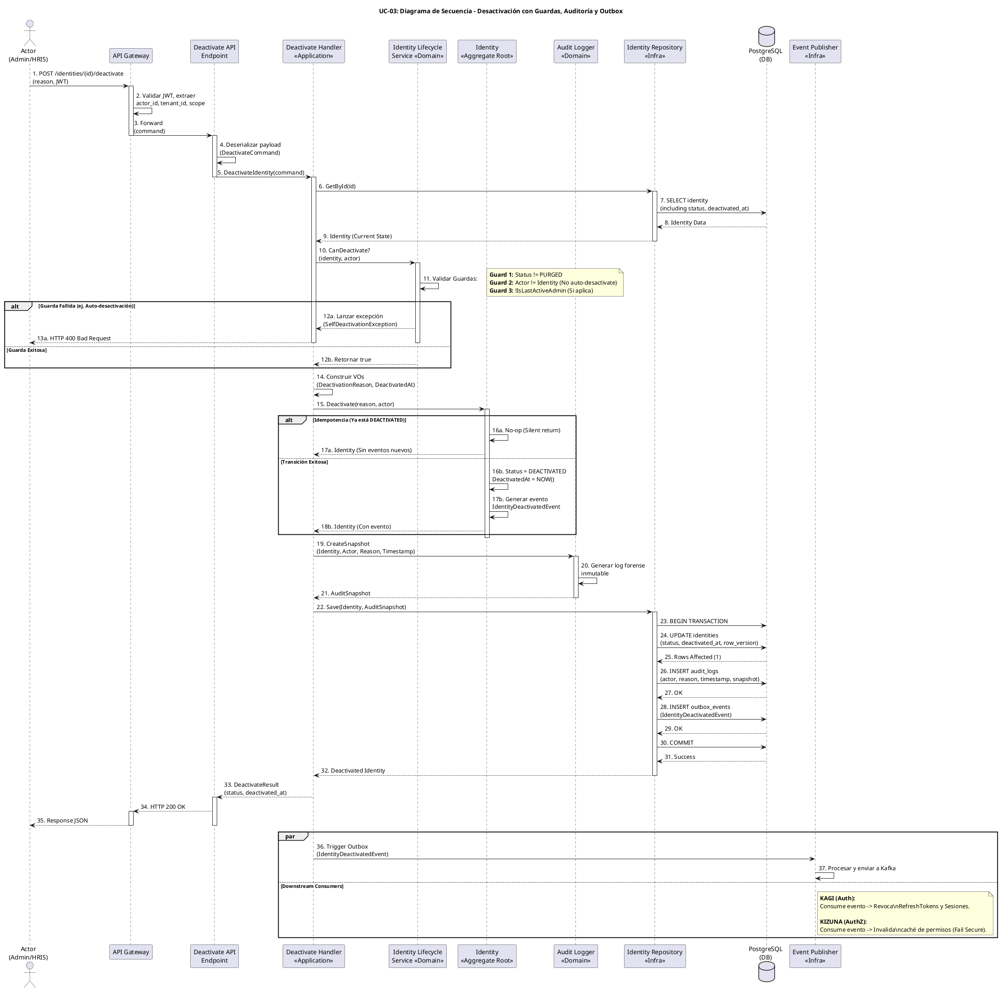

# UC-03: Desactivar Identidad - Diagrama de Secuencia

| Metadatos del Documento | |
| :--- | :--- |
| **Proyecto:** | SHUGO - Identity & Access Platform |
| **Caso de Uso:** | UC-03 - Desactivar Identidad (Soft Delete) |
| **Documento:** | 07_Sequence_Diagram.md |
| **Metodología:** | ICONIX (Diagrama de Secuencia) + Clean Architecture + DDD + Lifecycle Management |
| **Autor:** | Gastón Ruiz |
| **Versión Actual:** | 1.0.0 |
| **Fecha:** | 01/09/2026 |

---

## Historial de Versiones

| Versión | Fecha | Autor | Descripción de Cambios | Impacto |
| :--- | :--- | :--- | :--- | :--- |
| **1.0.0** | 01/09/2026 | Gastón Ruiz | **Creación inicial.** Diagrama de Secuencia completo para UC-03. Modela la orquestación temporal exacta de la desactivación de identidades, destacando la validación de guardas de seguridad (Prevención de Auto-Desactivación, Último Admin), la ejecución de la acción de dominio explícita, la generación del snapshot de auditoría forense, y la publicación asíncrona de eventos para la revocación de sesiones. | Documento base del paquete de diseño Tier 1 del UC-03. Sirve como guion exacto para la codificación del `DeactivateHandler`, la gestión de transacciones, y la integración de los servicios de dominio (LifecycleService, AuditLogger). |

---

## 1. Introducción y Propósito

El **Diagrama de Secuencia** para el UC-03 materializa temporalmente las colaboraciones definidas en el Diagrama de Robustez. Su propósito es:

1. **Definir el orden exacto de las operaciones:** Establecer la secuencia crítica donde las guardas de seguridad (Guards) se validan *antes* de ejecutar la acción de dominio.
2. **Modelar la Acción de Negocio Explícita:** Mostrar cómo la desactivación no es un simple `UPDATE`, sino una invocación al método `Identity.Deactivate()` que encapsula la lógica de negocio.
3. **Visualizar la Auditoría Forense:** Detallar cómo se captura la razón (Reason) y el actor, y cómo se persiste atómicamente junto con el cambio de estado.
4. **Demostrar la Consistencia Eventual:** Mostrar cómo los efectos secundarios críticos (Revocación de Sesiones en KAGI, Invalidación de Caché en KIZUNA) se disparan de forma asíncrona tras el COMMIT.

---

## 2. Diagrama de Secuencia - Escenario Principal (PlantUML)

A continuación, se presenta el Diagrama de Secuencia para el **Escenario Principal (desactivación exitosa)** y sus variaciones de excepción.



---

## 3. Análisis Detallado del Flujo

### 3.1. Fase 1: Autenticación, Enrutamiento y Carga (Pasos 1-9)

**Participantes:** `Actor`, `API Gateway`, `Deactivate API Endpoint`, `Deactivate Handler`, `Identity Repository`, `PostgreSQL`

*   **Extracción de Contexto:** El API Gateway valida el JWT y extrae el `actor_id` (quién hace la petición) y el `tenant_id`. Esto es crucial para las guardas de seguridad posteriores.
*   **Carga del Aggregate:** El Handler carga la identidad completa desde PostgreSQL. Es vital cargar el estado actual (`Status`) y el `deactivated_at` (si existe) para evaluar las guardas.

**Justificación:**
- **Eficiencia:** Cargar todo el Aggregate de una vez evita múltiples round-trips a la base de datos.
- **Seguridad:** El `actor_id` debe provenir del JWT (fuente confiable), nunca del payload de la request (que puede ser manipulado).

### 3.2. Fase 2: Validación de Guardas (Pasos 10-13)

**Participantes:** `Deactivate Handler`, `Identity Lifecycle Service`

*   **Guarda 1 (Estado Terminal):** Si `Status == PURGED`, la identidad ya no existe lógicamente. Lanza `IdentityPurgedException` (HTTP 404).
*   **Guarda 2 (Prevención de Auto-Desactivación):** Si `actor_id == identity_id`, se bloquea la operación. Lanza `SelfDeactivationNotAllowedException` (HTTP 400).
*   **Guarda 3 (Último Administrador):** Si la identidad tiene rol de `admin` y es la única activa en el tenant, se bloquea. Lanza `LastAdminDeactivationException` (HTTP 400).

**Justificación:**
- **Fail Fast:** Validar estas reglas antes de tocar el Aggregate Root o la base de datos ahorra recursos y mantiene la capa de aplicación limpia.
- **Domain Service:** El `Identity Lifecycle Service` es el lugar correcto para estas validaciones porque requieren contexto externo (ej. contar admins activos en la DB).

### 3.3. Fase 3: Acción de Dominio y Auditoría (Pasos 14-21)

**Participantes:** `Deactivate Handler`, `Identity` (Aggregate Root), `Audit Logger`

*   **Construcción de Value Objects:** Se crean `DeactivationReason` y `DeactivatedAt`. Estos VOs validan su propia integridad (ej. reason no vacío, timestamp no futuro).
*   **Ejecución de la Acción:** Se invoca `Identity.Deactivate(reason, actor)`.
    *   *Idempotencia:* Si la identidad ya está `DEACTIVATED`, el Aggregate Root retorna silenciosamente (No-op) sin generar eventos duplicados.
    *   *Transición:* Si es válida, cambia el estado, setea el timestamp inmutable, y añade el `IdentityDeactivatedEvent` a su lista interna de eventos.
*   **Auditoría Forense:** El `Audit Logger` genera un snapshot inmutable que registra quién, por qué y cuándo.

**Justificación:**
- **Intención Explícita:** Usar `Deactivate()` en lugar de `Status = DEACTIVATED` encapsula la lógica de negocio y garantiza que las invariantes se cumplan siempre.
- **Inmutabilidad del Timestamp:** Una vez seteado en el VO `DeactivatedAt`, no puede ser modificado, lo cual es esencial para calcular el Grace Period de GDPR.

### 3.4. Fase 4: Persistencia Atómica (Pasos 22-32)

**Participantes:** `Deactivate Handler`, `Identity Repository`, `PostgreSQL`

*   **Transacción Atómica:**
    1.  `UPDATE identities`: Cambia el estado y el `deactivated_at`. (EF Core maneja el `row_version` para OCC aquí).
    2.  `INSERT audit_logs`: Guarda el snapshot forense.
    3.  `INSERT outbox_events`: Guarda el evento de dominio para procesamiento asíncrono.
    4.  `COMMIT`: Confirma todos los cambios.

**Justificación:**
- **Integridad Forense:** Si falla la inserción del log de auditoría, toda la transacción se revierte. Nunca existirá una identidad desactivada sin su registro forense.
- **Consistencia Eventual (Outbox):** El evento se guarda en la DB en la misma transacción. Si Kafka está caído, el Outbox Processor lo publicará eventualmente.

### 3.5. Fase 5: Respuesta y Efectos Asíncronos (Pasos 33-38)

**Participantes:** `Deactivate Handler`, `API`, `GW`, `Actor`, `Event Publisher`

*   **Respuesta HTTP 200:** Se retorna el nuevo estado y el timestamp de desactivación.
*   **Fork Asíncrono:**
    *   **Outbox Processing:** El evento `IdentityDeactivatedEvent` se publica en Kafka.
    *   **Downstream Effects:**
        *   **KAGI (Auth):** Consume el evento y revoca todos los RefreshTokens y sesiones activas en Redis.
        *   **KIZUNA (AuthZ):** Consume el evento e invalida la caché de permisos para aplicar *Fail Secure* (denegar acceso ante la duda).

**Justificación:**
- **Baja Latencia:** El cliente recibe su confirmación en < 100ms. La revocación de sesiones ocurre en background.
- **Resiliencia:** Si KAGI está caído, el evento permanece en Kafka/Outbox y se procesará en cuanto se recupere. Mientras tanto, los Access Tokens existentes expirarán en 15 min (TTL corto).

---

## 4. Flujos Alternativos y Excepciones

### 4.1. Flujo Alternativo: Idempotencia (Identidad ya desactivada)

Si un sistema HRIS (SCIM) envía múltiples solicitudes de baja para la misma identidad:

```
Actor -> ... -> Handler -> Identity (Status == DEACTIVATED) -> Identity (No-op, return silently) -> Handler -> API -> Actor (HTTP 200 OK)
```

**Manejo:** El Aggregate Root detecta que ya está en el estado objetivo y retorna sin generar eventos ni logs duplicados. La aplicación retorna HTTP 200 OK con el `deactivated_at` original.

### 4.2. Flujo Alternativo: Prevención de Auto-Desactivación (Guarda Fallida)

Si un administrador intenta desactivar su propia cuenta:

```
Actor -> ... -> Handler -> Lifecycle Service (actor_id == identity_id) -> Lifecycle (SelfDeactivationException) -> Handler -> Actor (HTTP 400 Bad Request)
```

**Manejo:** La operación se aborta inmediatamente. No se toca la base de datos ni se generan eventos.

### 4.3. Flujo Alternativo: Fallo de Persistencia (DB Down)

Si PostgreSQL falla durante el COMMIT:

```
Actor -> ... -> Handler -> Repo -> DB (COMMIT fails) -> Repo (Rollback) -> Handler (DbUpdateException) -> Actor (HTTP 500 Internal Server Error)
```

**Manejo:** La transacción se revierte. La identidad permanece en su estado original (`ACTIVE` o `SUSPENDED`). No se genera log de auditoría ni evento Outbox.

---

## 5. Consideraciones de Arquitectura (Clean Architecture + DDD)

### 5.1. Acción de Negocio vs. Mutación de Estado

El diagrama muestra que el Handler no actualiza campos directamente. Invoca `Identity.Deactivate(reason, actor)`.

**Justificación:**
- **Protección de Invariantes:** El Aggregate Root controla su propio ciclo de vida.
- **Claridad Semántica:** El código de la capa de aplicación es altamente legible y expresa la intención del negocio.

### 5.2. Fail Secure en Sistemas Downstream (KAGI/KIZUNA)

Los efectos asíncronos (Fork) son críticos para la seguridad. ¿Qué pasa si Kafka está caído y KAGI no recibe el evento?

1.  **Source of Truth:** KAGAMI marcó la identidad como `DEACTIVATED` en PostgreSQL.
2.  **Fail Secure:** Si el usuario intenta usar un Access Token viejo, KIZUNA (Check API) consultará el estado en KAGAMI (o su caché eventualmente consistente) y **denegará el acceso**.
3.  **Recuperación:** En cuanto Kafka/KAGI se recuperen, el Outbox Processor entregará el evento y se limpiarán las sesiones en Redis.

**Justificación:**
- **Seguridad:** La ventana de vulnerabilidad máxima es el TTL del Access Token (15 min).
- **Alta Disponibilidad:** La API de KAGAMI responde en < 100ms independientemente de la latencia de Kafka.

---

## 6. Trazabilidad con Otros Documentos del Paquete

| Documento | Relación |
| :--- | :--- |
| `01_Requirements_Specification.md` | Este diagrama visualiza los flujos de texto, las invariantes de dominio (Guards, Idempotencia) y los criterios de aceptación. |
| `02_Use_Case_Diagram.md` | Muestra el límite del sistema y los actores; este diagrama muestra el flujo interno. |
| `03_Activity_Diagram.md` | Los carriles de actividad se mapean directamente a los participantes de este diagrama. |
| `04_Initial_Domain_Model.md` | Los Aggregate Roots (`Identity`), Value Objects (`DeactivationReason`), y Domain Services (`LifecycleService`) de este diagrama son exactamente las clases definidas en el modelo. |
| `05_State_Machine_Diagram.md` | Este diagrama muestra la colaboración de objetos; las máquinas de estados muestran las transiciones internas de cada objeto (ej. `Identity.Status` transiciona en el paso 16b). |
| `06_Robustness_Diagram.md` | Este diagrama define "qué objetos colaboran"; el de robustez muestra la colaboración de forma más abstracta. |
| `08_Final_Class_Design.md` | Definirá las firmas exactas de los métodos mostrados en este diagrama (ej. `Identity.Deactivate()`, `AuditLogger.CreateSnapshot()`). |
| `KAGAMI_Engine_Architecture.md` | Documento global que define la arquitectura completa del motor KAGAMI. |

---

## 7. Notas de Implementación

### 7.1. Inyección de Dependencias y Scope

El `Deactivate Handler` debe ser registrado como **Scoped** (por request) en el contenedor de DI, al igual que el `UnitOfWork` (si se usa explícitamente) y el `DbContext` de EF Core, para garantizar que la transacción de DB se mantenga coherente durante toda la operación.

```csharp
// Program.cs / Startup.cs
services.AddScoped<IDeactivateHandler, DeactivateHandler>();
services.AddScoped<IIdentityRepository, IdentityRepository>();
services.AddScoped<IUnitOfWork, UnitOfWork>(); 
```

### 7.2. Manejo de la Transacción y Outbox en EF Core

Si se utiliza Entity Framework Core, la transacción y el Outbox se manejan de la siguiente manera:

```csharp
public async Task<DeactivateResult> Handle(DeactivateCommand command, CancellationToken ct)
{
    // ... (Carga y Validación de Guardas) ...

    // Acción de Dominio
    identity.Deactivate(reason, actor);

    // Auditoría
    var auditSnapshot = _auditor.CreateSnapshot(identity, actor, reason);

    // Outbox Event
    var outboxEvent = new OutboxEvent("Identity.Deactivated", identity.Id, identity.TenantId);

    // Persistencia Atómica
    using var transaction = await _dbContext.Database.BeginTransactionAsync(ct);
    try
    {
        _dbContext.Identities.Update(identity);
        _dbContext.AuditLogs.Add(auditSnapshot);
        _dbContext.OutboxEvents.Add(outboxEvent);
        
        await _dbContext.SaveChangesAsync(ct); // EF Core maneja el OCC (row_version) aquí
        await transaction.CommitAsync(ct);
    }
    catch (Exception ex)
    {
        await transaction.RollbackAsync(ct);
        _logger.LogError(ex, "Failed to deactivate identity {IdentityId}", command.IdentityId);
        throw;
    }

    return new DeactivateResult(identity.Id, identity.Status, identity.DeactivatedAt);
}
```

---
*Fin del Documento 07_Sequence_Diagram para UC-03*