# UC-03: Desactivar Identidad - Diagrama de Clases de Diseño Final

| Metadatos del Documento | |
| :--- | :--- |
| **Proyecto:** | SHUGO - Identity & Access Platform |
| **Caso de Uso:** | UC-03 - Desactivar Identidad (Soft Delete) |
| **Documento:** | 08_Final_Class_Design.md |
| **Metodología:** | ICONIX (Modelo de Diseño) + DDD + Clean Architecture + Lifecycle Management |
| **Autor:** | Gastón Ruiz |
| **Versión Actual:** | 1.0.0 |
| **Fecha:** | 01/09/2026 |

---

## Historial de Versiones

| Versión | Fecha | Autor | Descripción de Cambios | Impacto |
| :--- | :--- | :--- | :--- | :--- |
| **1.0.0** | 01/09/2026 | Gastón Ruiz | **Creación inicial.** Definición del Modelo de Diseño (Clases de Implementación) para UC-03. Se detallan las firmas exactas de los Servicios de Dominio (`IdentityLifecycleService`, `AuditLogger`), el Aggregate Root (`Identity` con método `Deactivate()`), los Value Objects (`DeactivationReason`, `DeactivatedAt`), y las interfaces de repositorio. Se incluyen patrones de diseño (Acción Explícita, Idempotencia, Outbox) y consideraciones de transaccionalidad atómica. | Documento base del paquete de diseño Tier 1 del UC-03. Sirve como plano exacto para la codificación del endpoint de desactivación, garantizando que las guardas de seguridad, la auditoría forense y la propagación asíncrona de eventos se implementen correctamente desde la primera línea de código. |

---

## 1. Introducción y Propósito

Este documento presenta el **Modelo de Diseño** (Diagrama de Clases de Implementación) para el Caso de Uso UC-03 (Desactivar Identidad).

A diferencia del Modelo de Dominio Inicial (documento 04), que era conceptual, este documento define las **clases concretas con firmas de métodos específicas**, visibilidad, y patrones de concurrencia, listas para implementar. El diseño debe garantizar:

1. **Acción de Negocio Explícita:** La desactivación se implementa como un método de intención `Deactivate(reason, actor)` en el Aggregate Root, no como una mutación genérica de estado.
2. **Guardas de Seguridad Transversales:** El `IdentityLifecycleService` valida reglas que requieren contexto externo (prevención de auto-desactivación, último administrador).
3. **Idempotencia Nativa:** El Aggregate Root maneja silenciosamente las llamadas repetidas sobre identidades ya desactivadas, esencial para integraciones SCIM/HRIS.
4. **Auditoría Forense con Justificación:** El `AuditLogger` genera un snapshot inmutable que incluye el actor, la razón (Reason), y el timestamp de desactivación.
5. **Persistencia Atómica con Outbox:** La transacción abarca la actualización de la identidad, el log de auditoría, y el evento de dominio, garantizando integridad forense y consistencia eventual.

---

## 2. Diagrama de Clases de Diseño (PlantUML)

A continuación, se presenta el diagrama de clases organizado por capas arquitectónicas.

```plantuml
@startuml UC-03_ClasesDiseno
<style>
diagram {
  BackgroundColor #FFFFFF
}
</style>
skinparam classAttributeIconSize 0
skinparam classBackgroundColor #FFFFFF
skinparam classBorderColor #34495E
skinparam classHeaderBackgroundColor #E3F2FD

title UC-03: Diagrama de Clases de Diseño Final - Motor KAGAMI (Desactivación con Guardas y Auditoría)

' ============================================
' CAPA DE APLICACIÓN (Application Layer)
' ============================================
package "Aplicación (Application Layer)" {

    class DeactivateIdentityHandler <<Application Service>> {
        - lifecycleService: IIdentityLifecycleService
        - auditor: IAuditLogger
        - repository: IIdentityRepository
        - unitOfWork: IUnitOfWork
        - logger: ILogger<DeactivateIdentityHandler>

        + Handle(command: DeactivateIdentityCommand, ct: CancellationToken): Task<DeactivateIdentityResult>
    }

    class DeactivateIdentityCommand <<DTO>> {
        + IdentityId: Guid
        + ActorId: Guid
        + TenantId: Guid
        + Reason: string
    }

    class DeactivateIdentityResult <<DTO>> {
        + IdentityId: Guid
        + Status: IdentityStatus
        + DeactivatedAt: DateTime
    }
}

' ============================================
' CAPA DE DOMINIO (Domain Layer)
' ============================================
package "Dominio (Domain Layer)" {

    ' Aggregate Root
    class Identity <<Aggregate Root>> {
        - id: IdentityId
        - tenantId: TenantId
        - status: IdentityStatus
        - deactivatedAt: DeactivatedAt
        - rowVersion: RowVersion
        - domainEvents: List<IDomainEvent>

        + Deactivate(reason: DeactivationReason, actor: Actor): void
        + GetDomainEvents(): List<IDomainEvent>
    }

    ' Value Objects
    class DeactivationReason <<Value Object>> {
        - value: string
        + DeactivationReason(value: string)
        - Validate(): void
    }

    class DeactivatedAt <<Value Object>> {
        - timestamp: DateTime
        + DeactivatedAt(timestamp: DateTime)
    }

    class Actor <<Value Object>> {
        - id: Guid
        - type: ActorType
        + Actor(id: Guid, type: ActorType)
    }

    ' Domain Events
    class IdentityDeactivatedEvent <<Domain Event>> {
        + identityId: IdentityId
        + tenantId: TenantId
        + reason: DeactivationReason
        + deactivatedBy: Actor
        + timestamp: DateTime
    }

    ' Domain Services
    class IdentityLifecycleService <<Domain Service>> {
        - repository: IIdentityRepository
        + CanDeactivateAsync(identity: Identity, actor: Actor): Task<bool>
        - IsSelfDeactivation(identity: Identity, actor: Actor): bool
        - IsLastActiveAdminAsync(identity: Identity, tenantId: TenantId): Task<bool>
    }

    class AuditLogger <<Domain Service>> {
        + CreateSnapshot(identity: Identity, actor: Actor, reason: DeactivationReason): AuditSnapshot
    }

    ' Value Object de Auditoría
    class AuditSnapshot <<Value Object>> {
        - identityId: IdentityId
        - action: string
        - actorId: Guid
        - reason: string
        - timestamp: DateTime
        - snapshotJson: string
    }

    ' Interfaces
    interface IIdentityRepository {
        + GetByIdAsync(id: IdentityId): Task<Identity>
        + SaveAsync(identity: Identity): Task
        + SaveAuditLogAsync(snapshot: AuditSnapshot): Task
        + SaveOutboxEventAsync(event: OutboxEvent): Task
        + GetActiveAdminCountAsync(tenantId: TenantId): Task<int>
    }

    interface IUnitOfWork {
        + BeginTransactionAsync(): Task
        + CommitAsync(): Task
        + RollbackAsync(): Task
    }
}

' ============================================
' CAPA DE INFRAESTRUCTURA (Infrastructure Layer)
' ============================================
package "Infraestructura (Infrastructure Layer)" {

    class IdentityRepositoryImpl <<Infrastructure>> {
        - dbContext: AppDbContext
        + GetByIdAsync(id: IdentityId): Task<Identity>
        + SaveAsync(identity: Identity): Task
        + GetActiveAdminCountAsync(tenantId: TenantId): Task<int>
    }

    class UnitOfWorkImpl <<Infrastructure>> {
        - dbContext: AppDbContext
        + BeginTransactionAsync(): Task
        + CommitAsync(): Task
        + RollbackAsync(): Task
    }
}

' ============================================
' RELACIONES
' ============================================

' Implementation
IdentityRepositoryImpl ..|> IIdentityRepository
UnitOfWorkImpl ..|> IUnitOfWork

' Dependency Injection
DeactivateIdentityHandler --> IIdentityLifecycleService
DeactivateIdentityHandler --> IAuditLogger
DeactivateIdentityHandler --> IIdentityRepository
DeactivateIdentityHandler --> IUnitOfWork

' Domain Usage
Identity *-- DeactivatedAt : "registra"
Identity ..> IdentityDeactivatedEvent : "publica"
AuditSnapshot *-- DeactivationReason : "contiene"

IdentityLifecycleService ..> IIdentityRepository : "consulta"
IdentityLifecycleService ..> Identity : "valida"
AuditLogger ..> AuditSnapshot : "crea"

@enduml
```



---

## 3. Detalle de Clases por Capa

### 3.1. Capa de Aplicación (Application Layer)

#### **DeactivateIdentityHandler**

**Responsabilidad:** Orquestar el caso de uso UC-03. Coordina la carga de la identidad, validación de guardas de seguridad, ejecución de la acción de dominio, generación de auditoría forense, y persistencia atómica con Outbox.

**Firmas de Métodos:**

```csharp
public class DeactivateIdentityHandler : IDeactivateIdentityHandler
{
    private readonly IIdentityLifecycleService _lifecycleService;
    private readonly IAuditLogger _auditor;
    private readonly IIdentityRepository _repository;
    private readonly IUnitOfWork _unitOfWork;
    private readonly ILogger<DeactivateIdentityHandler> _logger;

    public DeactivateIdentityHandler(
        IIdentityLifecycleService lifecycleService,
        IAuditLogger auditor,
        IIdentityRepository repository,
        IUnitOfWork unitOfWork,
        ILogger<DeactivateIdentityHandler> logger)
    {
        _lifecycleService = lifecycleService ?? throw new ArgumentNullException(nameof(lifecycleService));
        _auditor = auditor ?? throw new ArgumentNullException(nameof(auditor));
        _repository = repository ?? throw new ArgumentNullException(nameof(repository));
        _unitOfWork = unitOfWork ?? throw new ArgumentNullException(nameof(unitOfWork));
        _logger = logger ?? throw new ArgumentNullException(nameof(logger));
    }

    /// <summary>
    /// Ejecuta el flujo de desactivación de identidad con guardas de seguridad,
    /// auditoría forense y persistencia atómica con Outbox.
    /// </summary>
    public async Task<DeactivateIdentityResult> Handle(
        DeactivateIdentityCommand command, 
        CancellationToken ct)
    {
        // 1. Cargar Aggregate
        var identity = await _repository.GetByIdAsync(command.IdentityId);
        if (identity == null || identity.Status == IdentityStatus.PURGED)
            throw new IdentityNotFoundException(command.IdentityId);

        // 2. Validar Guardas de Seguridad (Domain Service)
        var canDeactivate = await _lifecycleService.CanDeactivateAsync(identity, command.Actor);
        if (!canDeactivate)
            throw new DeactivationGuardException("Identity cannot be deactivated due to business rules.");

        // 3. Construir Value Objects
        var reason = new DeactivationReason(command.Reason);
        var actor = new Actor(command.ActorId, ActorType.Admin);

        // 4. Ejecutar Acción de Dominio (Idempotente)
        identity.Deactivate(reason, actor);

        // 5. Generar Auditoría Forense
        var auditSnapshot = _auditor.CreateSnapshot(identity, actor, reason);

        // 6. Preparar Evento Outbox
        var outboxEvent = new OutboxEvent(
            "Identity.Deactivated", 
            identity.Id, 
            identity.TenantId,
            JsonSerializer.Serialize(new IdentityDeactivatedEvent(
                identity.Id, identity.TenantId, reason, actor, DateTime.UtcNow))
        );

        // 7. Persistencia Atómica
        await _unitOfWork.BeginTransactionAsync();
        try
        {
            await _repository.SaveAsync(identity);
            await _repository.SaveAuditLogAsync(auditSnapshot);
            await _repository.SaveOutboxEventAsync(outboxEvent);
            await _unitOfWork.CommitAsync();
        }
        catch (Exception ex)
        {
            await _unitOfWork.RollbackAsync();
            _logger.LogError(ex, "Failed to deactivate identity {IdentityId}", command.IdentityId);
            throw;
        }

        return new DeactivateIdentityResult(
            identity.Id, 
            identity.Status, 
            identity.DeactivatedAt?.Timestamp
        );
    }
}
```

### 3.2. Capa de Dominio (Domain Layer)

#### **Identity (Aggregate Root)**

**Responsabilidad:** Garantizar las invariantes del ciclo de vida de la identidad. Expone el método de intención explícita `Deactivate()` que encapsula la transición de estado, la generación de eventos de dominio, y la idempotencia.

```csharp
public class Identity
{
    public IdentityId Id { get; private set; }
    public TenantId TenantId { get; private set; }
    public IdentityStatus Status { get; private set; }
    public DeactivatedAt DeactivatedAt { get; private set; }
    public RowVersion RowVersion { get; private set; }
    
    private readonly List<IDomainEvent> _domainEvents = new();

    // Constructor privado para EF Core
    private Identity() { }

    /// <summary>
    /// Desactiva la identidad (Soft Delete).
    /// Es idempotente: si ya está desactivada, no genera eventos duplicados.
    /// </summary>
    public void Deactivate(DeactivationReason reason, Actor actor)
    {
        // Guarda 1: No operar sobre identidades purgadas
        if (this.Status == IdentityStatus.PURGED)
            throw new IdentityPurgedException("Cannot deactivate a purged identity.");

        // Guarda 2: Idempotencia (No-op si ya está desactivada)
        if (this.Status == IdentityStatus.DEACTIVATED)
            return; // Silencioso, sin generar eventos duplicados

        // Transición de Estado
        this.Status = IdentityStatus.DEACTIVATED;
        
        // Registro inmutable del timestamp
        this.DeactivatedAt = new DeactivatedAt(DateTime.UtcNow);

        // Generación de Evento de Dominio
        _domainEvents.Add(new IdentityDeactivatedEvent(
            this.Id, 
            this.TenantId, 
            reason, 
            actor, 
            DateTime.UtcNow
        ));
    }

    public IReadOnlyCollection<IDomainEvent> GetDomainEvents() => _domainEvents.AsReadOnly();
    
    private void AddDomainEvent(IDomainEvent evt) => _domainEvents.Add(evt);
}
```

#### **IdentityLifecycleService (Domain Service)**

**Responsabilidad:** Validar reglas de negocio transversales que requieren acceso a repositorios, como la prevención de auto-desactivación y la validación del último administrador activo.

```csharp
public class IdentityLifecycleService : IIdentityLifecycleService
{
    private readonly IIdentityRepository _repository;

    public IdentityLifecycleService(IIdentityRepository repository)
    {
        _repository = repository ?? throw new ArgumentNullException(nameof(repository));
    }

    /// <summary>
    /// Valida si una identidad puede ser desactivada según las guardas de seguridad.
    /// </summary>
    public async Task<bool> CanDeactivateAsync(Identity identity, Actor actor)
    {
        // Guarda 1: Prevención de Auto-Desactivación
        if (IsSelfDeactivation(identity, actor))
            throw new SelfDeactivationNotAllowedException(
                "Users cannot deactivate their own identity to prevent lockouts.");

        // Guarda 2: Validación de Último Administrador Activo
        if (await IsLastActiveAdminAsync(identity, identity.TenantId))
            throw new LastAdminDeactivationException(
                "Cannot deactivate the last active administrator of the tenant.");

        return true;
    }

    private bool IsSelfDeactivation(Identity identity, Actor actor)
    {
        return identity.Id.Value == actor.Id;
    }

    private async Task<bool> IsLastActiveAdminAsync(Identity identity, TenantId tenantId)
    {
        // Si la identidad no tiene rol de admin, no aplica la guarda
        if (!identity.HasRole("admin"))
            return false;

        // Contar administradores activos en el tenant
        int activeAdminCount = await _repository.GetActiveAdminCountAsync(tenantId);
        
        // Si hay más de 1 admin activo, permitir la desactivación
        return activeAdminCount <= 1;
    }
}
```

#### **AuditLogger (Domain Service)**

**Responsabilidad:** Generar el snapshot forense inmutable que registra quién, por qué y cuándo se desactivó la identidad.

```csharp
public class AuditLogger : IAuditLogger
{
    public AuditSnapshot CreateSnapshot(
        Identity identity, 
        Actor actor, 
        DeactivationReason reason)
    {
        if (identity.Status != IdentityStatus.DEACTIVATED)
            throw new InvalidOperationException(
                "Cannot create deactivation audit snapshot for non-deactivated identity.");

        if (identity.DeactivatedAt == null)
            throw new InvalidOperationException(
                "DeactivatedAt timestamp is required for audit snapshot.");

        var snapshotJson = JsonSerializer.Serialize(new
        {
            identityId = identity.Id.Value,
            tenantId = identity.TenantId.Value,
            previousStatus = "ACTIVE", // O el estado anterior real
            newStatus = identity.Status.ToString(),
            reason = reason.Value,
            deactivatedBy = actor.Id,
            deactivatedAt = identity.DeactivatedAt.Timestamp
        });

        return new AuditSnapshot(
            identityId: identity.Id,
            action: "Identity.Deactivated",
            actorId: actor.Id,
            reason: reason.Value,
            timestamp: identity.DeactivatedAt.Timestamp,
            snapshotJson: snapshotJson
        );
    }
}
```

### 3.3. Capa de Infraestructura (Infrastructure Layer)

#### **IdentityRepositoryImpl**

**Responsabilidad:** Persistir el Aggregate y manejar la lógica de OCC a nivel de base de datos, incluyendo la consulta de administradores activos para las guardas.

```csharp
public class IdentityRepositoryImpl : IIdentityRepository
{
    private readonly AppDbContext _dbContext;

    public IdentityRepositoryImpl(AppDbContext dbContext)
    {
        _dbContext = dbContext ?? throw new ArgumentNullException(nameof(dbContext));
    }

    public async Task<Identity> GetByIdAsync(IdentityId id)
    {
        return await _dbContext.Identities
            .Include(i => i.Profile)
            .FirstOrDefaultAsync(i => i.Id == id);
    }

    public async Task SaveAsync(Identity identity)
    {
        _dbContext.Identities.Update(identity);
        await _dbContext.SaveChangesAsync();
    }

    public async Task SaveAuditLogAsync(AuditSnapshot snapshot)
    {
        _dbContext.AuditLogs.Add(new AuditLogEntity
        {
            IdentityId = snapshot.IdentityId.Value,
            TenantId = snapshot.TenantId.Value,
            Action = snapshot.Action,
            ActorId = snapshot.ActorId,
            Reason = snapshot.Reason,
            Timestamp = snapshot.Timestamp,
            SnapshotJson = snapshot.SnapshotJson
        });
    }

    public async Task SaveOutboxEventAsync(OutboxEvent @event)
    {
        _dbContext.OutboxEvents.Add(new OutboxEventEntity
        {
            EventType = @event.EventType,
            AggregateId = @event.AggregateId.Value,
            AggregateType = "Identity",
            Payload = @event.Payload,
            Status = "PENDING",
            CreatedAt = DateTime.UtcNow
        });
    }

    public async Task<int> GetActiveAdminCountAsync(TenantId tenantId)
    {
        return await _dbContext.Identities
            .Where(i => i.TenantId == tenantId 
                     && i.Status == IdentityStatus.ACTIVE
                     && i.Roles.Any(r => r.Name == "admin"))
            .CountAsync();
    }
}
```

---

## 4. Patrones de Diseño Aplicados

### 4.1. Intention-Revealing Interface (Acción Explícita)
**Dónde se aplica:** `Identity.Deactivate(reason, actor)`.
**Beneficio:** Previene la corrupción de estado. Un desarrollador no puede llamar a `identity.Status = DEACTIVATED` directamente; debe pasar por `Deactivate()`, que valida la máquina de estados, genera el evento de dominio, y setea el timestamp inmutable.

### 4.2. Idempotencia Nativa
**Dónde se aplica:** `Identity.Deactivate()` retorna silenciosamente si `Status == DEACTIVATED`.
**Beneficio:** Permite que sistemas externos (SCIM/HRIS) reintenten operaciones de baja sin generar eventos duplicados ni logs de auditoría redundantes.

### 4.3. Domain Service para Guardas Transversales
**Dónde se aplica:** `IdentityLifecycleService.CanDeactivateAsync()`.
**Beneficio:** Mantiene el Aggregate Root limpio y libre de dependencias de repositorios, mientras centraliza las reglas de negocio que requieren contexto externo (ej. contar admins activos).

### 4.4. Outbox Pattern (Consistencia Eventual)
**Dónde se aplica:** `OutboxEvent` persistido junto con `Identity` y `AuditLog`.
**Beneficio:** Garantiza que el evento `IdentityDeactivatedEvent` se publique eventualmente en Kafka, incluso si el broker está caído en el momento de la desactivación.

### 4.5. Audit Snapshot Inmutable
**Dónde se aplica:** `AuditLogger.CreateSnapshot()` y `AuditSnapshot`.
**Beneficio:** Genera un registro forense completo (Actor + Reason + Timestamp) que cumple con SOC 2 e ISO 27001, y que no puede ser modificado una vez persistido.

---

## 5. Consideraciones de Concurrencia y Transaccionalidad

### 5.1. Atomicidad (Identity + AuditLog + Outbox)
La transacción abarca exactamente tres operaciones:
1. `UPDATE identities` (cambio de estado + `deactivated_at`).
2. `INSERT audit_logs` (snapshot forense).
3. `INSERT outbox_events` (evento de dominio).

Si cualquiera falla, se ejecuta `ROLLBACK`. Esto previene estados huérfanos (ej. una identidad desactivada sin su log de auditoría).

### 5.2. Concurrencia en la Desactivación (OCC)
Dado que la desactivación puede ser disparada simultáneamente por un Admin (UI) y un sistema HRIS (SCIM), se usa **Optimistic Concurrency Control** (columna `row_version`):

```csharp
// En la configuración de la Entidad (IdentityConfiguration.cs)
builder.Property(i => i.RowVersion)
       .IsConcurrencyToken(); // EF Core añade automáticamente "AND row_version = @p" al UPDATE

// En el Repository:
public async Task SaveAsync(Identity identity)
{
    try
    {
        await _dbContext.SaveChangesAsync(); // Lanza DbUpdateConcurrencyException si hay conflicto
    }
    catch (DbUpdateConcurrencyException ex)
    {
        throw new ConcurrencyConflictException("Identity was modified by another user.", ex);
    }
}
```

### 5.3. Manejo de la Idempotencia en la Transacción
Si dos requests llegan simultáneamente para desactivar la misma identidad:
1. **Request A:** Carga identidad (`Status = ACTIVE`), valida guardas, ejecuta `Deactivate()`, persiste (`Status = DEACTIVATED`).
2. **Request B:** Carga identidad (`Status = DEACTIVATED` - ya actualizada por A), ejecuta `Deactivate()` (No-op silencioso), persiste (sin cambios).

Ambos requests retornan HTTP 200 OK, pero solo Request A genera el evento de dominio y el log de auditoría.

---

## 6. Manejo de Errores y Mapeo a HTTP

El Handler captura excepciones de dominio e infraestructura y las traduce a respuestas HTTP específicas:

| Excepción de Dominio/Infra | Código HTTP | Código de Error | Descripción |
| :--- | :--- | :--- | :--- |
| `IdentityNotFoundException` | 404 Not Found | `IDENTITY_NOT_FOUND` | La identidad no existe o está `PURGED`. |
| `SelfDeactivationNotAllowedException` | 400 Bad Request | `SELF_DEACTIVATION_NOT_ALLOWED` | El actor intentó desactivar su propia identidad. |
| `LastAdminDeactivationException` | 400 Bad Request | `LAST_ADMIN_DEACTIVATION_NOT_ALLOWED` | Se intentó desactivar al último administrador activo del tenant. |
| `DeactivationGuardException` | 400 Bad Request | `DEACTIVATION_GUARD_FAILED` | Falló alguna guarda de seguridad genérica. |
| `ConcurrencyConflictException` | 409 Conflict | `CONCURRENCY_CONFLICT` | La identidad fue modificada por otro proceso (OCC failure). |
| `DbUpdateException` | 500 Internal Server Error | `PERSISTENCE_FAILED` | Error genérico de base de datos. |

---

## 7. Trazabilidad con Otros Documentos del Paquete

| Documento | Relación |
| :--- | :--- |
| `01_Requirements_Specification.md` | Define las invariantes (INV-15 Transición, INV-17 Timestamp, INV-18 Auto-desactivación) que este diseño implementa. |
| `02_Use_Case_Diagram.md` | Muestra los actores y sistemas externos; este diseño define las clases internas. |
| `03_Activity_Diagram.md` | Los carriles de actividad se mapean directamente a las clases de este diseño (Handler, LifecycleService, Auditor, Repository). |
| `04_Initial_Domain_Model.md` | Este diseño toma las clases conceptuales del modelo de dominio y les agrega firmas de métodos específicas, visibilidad, y patrones de concurrencia. |
| `05_State_Machine_Diagram.md` | Las máquinas de estados se implementan en las entidades de este diseño (ej. `Identity.Deactivate()` valida la transición). |
| `06_Robustness_Diagram.md` | Este diseño define las firmas exactas de los métodos mostrados en el diagrama de robustez. |
| `07_Sequence_Diagram.md` | Este diseño define las firmas exactas de los métodos mostrados en el diagrama de secuencia. |
| `09_Modern_Artifacts.md` | Definirá los contratos OpenAPI, las métricas OpenTelemetry, y los patrones de resiliencia que se implementan en estas clases. |

---

## 8. Notas de Implementación

### 8.1. Inyección de Dependencias

```csharp
// Capa de Aplicación
services.AddScoped<IDeactivateIdentityHandler, DeactivateIdentityHandler>();

// Capa de Dominio (Servicios)
services.AddScoped<IIdentityLifecycleService, IdentityLifecycleService>();
services.AddScoped<IAuditLogger, AuditLogger>();

// Capa de Infraestructura (Repositorios y UoW)
services.AddScoped<IIdentityRepository, IdentityRepositoryImpl>();
services.AddScoped<IUnitOfWork, UnitOfWorkImpl>();

// Configuración de DbContext para EF Core
services.AddDbContext<AppDbContext>(options =>
    options.UseNpgsql(configuration.GetConnectionString("DefaultConnection")));
```

### 8.2. Testeo Unitario

```csharp
[Test]
public async Task DeactivateIdentityHandler_WhenSelfDeactivation_ThrowsException()
{
    // Arrange
    var identityId = new IdentityId(Guid.NewGuid());
    var actorId = identityId; // Mismo ID = auto-desactivación
    
    var mockIdentity = new Mock<Identity>();
    mockIdentity.Setup(i => i.Id).Returns(identityId);
    
    var mockRepo = new Mock<IIdentityRepository>();
    mockRepo.Setup(r => r.GetByIdAsync(identityId)).ReturnsAsync(mockIdentity.Object);
    
    var mockLifecycle = new Mock<IIdentityLifecycleService>();
    mockLifecycle.Setup(l => l.CanDeactivateAsync(It.IsAny<Identity>(), It.IsAny<Actor>()))
                 .ThrowsAsync(new SelfDeactivationNotAllowedException());
    
    var handler = new DeactivateIdentityHandler(
        mockLifecycle.Object, 
        Mock.Of<IAuditLogger>(), 
        mockRepo.Object, 
        Mock.Of<IUnitOfWork>(),
        Mock.Of<ILogger<DeactivateIdentityHandler>>());

    var command = new DeactivateIdentityCommand 
    { 
        IdentityId = identityId, 
        ActorId = actorId, 
        Reason = "Test" 
    };

    // Act & Assert
    await Assert.ThrowsAsync<SelfDeactivationNotAllowedException>(
        () => handler.Handle(command, CancellationToken.None));
    
    mockRepo.Verify(r => r.SaveAsync(It.IsAny<Identity>()), Times.Never);
}

[Test]
public void Identity_Deactivate_WhenAlreadyDeactivated_IsIdempotent()
{
    // Arrange
    var identity = new Identity(/* Status = DEACTIVATED */);
    var reason = new DeactivationReason("Test");
    var actor = new Actor(Guid.NewGuid(), ActorType.Admin);

    // Act
    identity.Deactivate(reason, actor);

    // Assert
    identity.GetDomainEvents().Should().BeEmpty(); // No se generaron eventos duplicados
}

[Test]
public void Identity_Deactivate_WhenActive_TransitionsAndGeneratesEvent()
{
    // Arrange
    var identity = new Identity(/* Status = ACTIVE */);
    var reason = new DeactivationReason("Employee terminated");
    var actor = new Actor(Guid.NewGuid(), ActorType.Admin);

    // Act
    identity.Deactivate(reason, actor);

    // Assert
    identity.Status.Should().Be(IdentityStatus.DEACTIVATED);
    identity.DeactivatedAt.Should().NotBeNull();
    identity.GetDomainEvents().Should().HaveCount(1);
    identity.GetDomainEvents().First().Should().BeOfType<IdentityDeactivatedEvent>();
}
```

---
*Fin del Documento 08_Final_Class_Design para UC-03*