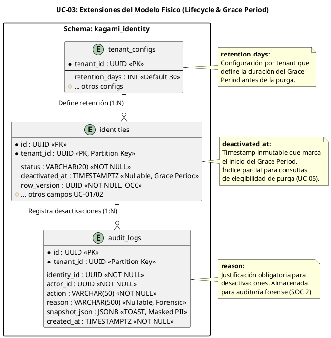

# UC-03: Desactivar Identidad - Modelo de Datos Físico Específico (Lifecycle & Grace Period)

| Metadatos del Documento | |
| :--- | :--- |
| **Proyecto:** | SHUGO - Identity & Access Platform |
| **Caso de Uso:** | UC-03 - Desactivar Identidad (Soft Delete) |
| **Documento:** | 10_UC_Specific_Data_Model.md |
| **Metodología:** | Physical Data Modeling + Lifecycle Management + GDPR Compliance + Grace Period Optimization |
| **Base de Datos:** | PostgreSQL 15+ (Primary) |
| **Autor:** | Gastón Ruiz |
| **Versión Actual:** | 1.0.0 |
| **Fecha:** | 01/09/2026 |

---

## Historial de Versiones

| Versión | Fecha | Autor | Descripción de Cambios | Impacto |
| :--- | :--- | :--- | :--- | :--- |
| **1.0.0** | 01/09/2026 | Gastón Ruiz | **Creación inicial.** Extensión del modelo de datos físico para soportar el ciclo de vida de desactivación. Introduce la columna `deactivated_at` con índice parcial para consultas de Grace Period, políticas de retención por tenant, optimización de consultas para identidades desactivadas, y estrategias de almacenamiento para auditoría forense con justificación (Reason). | Documento de referencia para DBAs y desarrolladores backend. Define cómo se persisten las identidades desactivadas, cómo se optimizan las consultas de Grace Period para UC-05 (Purga), y cómo se garantiza el cumplimiento de GDPR Art. 17 mediante políticas de retención configurables. |

---

## 1. Introducción y Propósito

Este documento define las extensiones y consideraciones físicas específicas en PostgreSQL para soportar el **UC-03 (Desactivar Identidad)**. 

Mientras que el UC-01 se centró en la creación y el UC-02 en la actualización con OCC, el UC-03 introduce tres desafíos físicos críticos:
1. **Gestión del Ciclo de Vida:** La columna `deactivated_at` marca el inicio del Grace Period para el borrado físico (UC-05).
2. **Consultas de Grace Period:** Optimización de índices para identificar identidades elegibles para purga después de N días.
3. **Auditoría Forense con Justificación:** La tabla `audit_logs` debe almacenar la razón (Reason) de la desactivación para cumplimiento SOC 2 e ISO 27001.

---

## 2. Diagrama de Modelo de Datos Físico (ERD Extendido)



---

## 3. Scripts DDL: Extensiones para UC-03

### 3.1. Modificación de `identities` para Lifecycle Management

Agregamos la columna `deactivated_at` y un índice parcial optimizado para consultas de Grace Period.

```sql
SET search_path TO kagami_identity;

-- 1. Agregar columna deactivated_at (si no existiera desde UC-01/02)
ALTER TABLE identities 
ADD COLUMN IF NOT EXISTS deactivated_at TIMESTAMPTZ;

-- 2. Crear índice parcial para consultas de Grace Period (UC-05)
-- Este índice solo incluye identidades DESACTIVADAS, reduciendo su tamaño en ~90%
CREATE INDEX idx_identities_deactivated_grace_period 
    ON identities (tenant_id, deactivated_at ASC) 
    WHERE status = 'DEACTIVATED';

-- 3. Crear índice para consultas de auditoría (¿cuándo se desactivó esta identidad?)
CREATE INDEX idx_identities_deactivated_at 
    ON identities (tenant_id, deactivated_at DESC) 
    WHERE deactivated_at IS NOT NULL;

-- 4. Trigger para validar que deactivated_at solo se setea cuando status = DEACTIVATED
CREATE OR REPLACE FUNCTION trg_validate_deactivation()
RETURNS TRIGGER AS $$
BEGIN
    -- Si el estado es DEACTIVATED, deactivated_at debe estar setado
    IF NEW.status = 'DEACTIVATED' AND NEW.deactivated_at IS NULL THEN
        RAISE EXCEPTION 'deactivated_at must be set when status is DEACTIVATED';
    END IF;
    
    -- Si el estado NO es DEACTIVATED, deactivated_at debe ser NULL
    IF NEW.status != 'DEACTIVATED' AND NEW.deactivated_at IS NOT NULL THEN
        RAISE EXCEPTION 'deactivated_at must be NULL when status is not DEACTIVATED';
    END IF;
    
    RETURN NEW;
END;
$$ language 'plpgsql';

CREATE TRIGGER identities_validate_deactivation
    BEFORE UPDATE ON identities
    FOR EACH ROW
    EXECUTE FUNCTION trg_validate_deactivation();
```

### 3.2. Extensión de `audit_logs` para Justificación Forense

La tabla `audit_logs` ya existe desde UC-02, pero agregamos la columna `reason` específica para desactivaciones.

```sql
-- 1. Agregar columna reason (si no existiera)
ALTER TABLE audit_logs 
ADD COLUMN IF NOT EXISTS reason VARCHAR(500);

-- 2. Crear índice para búsquedas de auditoría por razón
-- Útil para investigaciones de seguridad (ej. "¿Cuántas desactivaciones fueron por incidente de seguridad?")
CREATE INDEX idx_audit_logs_reason 
    ON audit_logs (tenant_id, reason) 
    WHERE action = 'Identity.Deactivated' AND reason IS NOT NULL;

-- 3. Crear índice compuesto para consultas de compliance (¿quién desactivó qué y por qué?)
CREATE INDEX idx_audit_logs_deactivation_forensic 
    ON audit_logs (tenant_id, actor_id, created_at DESC) 
    WHERE action = 'Identity.Deactivated';
```

### 3.3. Tabla `tenant_configs` para Políticas de Retención

```sql
-- Tabla de configuración por tenant (no particionada, pequeña)
CREATE TABLE tenant_configs (
    tenant_id UUID PRIMARY KEY,
    retention_days INT NOT NULL DEFAULT 30, -- Grace Period para purga
    max_failed_logins INT NOT NULL DEFAULT 5,
    password_expiry_days INT NOT NULL DEFAULT 90,
    created_at TIMESTAMPTZ NOT NULL DEFAULT NOW(),
    updated_at TIMESTAMPTZ NOT NULL DEFAULT NOW()
);

-- Trigger para actualizar updated_at automáticamente
CREATE TRIGGER tenant_configs_updated_at 
    BEFORE UPDATE ON tenant_configs 
    FOR EACH ROW EXECUTE FUNCTION update_updated_at_column();

-- Insertar configuración por defecto para el tenant KHCS
INSERT INTO tenant_configs (tenant_id, retention_days)
VALUES ('uuid-tenant-khcs', 30);
```

---

## 4. Estrategia de Índices para Grace Period (UC-05)

### 4.1. Consulta de Elegibilidad para Purga

El UC-05 (Purgar Identidad) ejecuta una consulta batch para identificar identidades elegibles para borrado físico:

```sql
-- Consulta que ejecuta UC-05 cada hora
SELECT id, tenant_id, deactivated_at
FROM identities
WHERE status = 'DEACTIVATED'
  AND deactivated_at < NOW() - INTERVAL '30 days' -- Configurable por tenant
  AND tenant_id = 'uuid-tenant-khcs'
LIMIT 1000; -- Procesar en batches
```

### 4.2. Optimización del Índice Parcial

El índice `idx_identities_deactivated_grace_period` está diseñado específicamente para esta consulta:

```sql
CREATE INDEX idx_identities_deactivated_grace_period 
    ON identities (tenant_id, deactivated_at ASC) 
    WHERE status = 'DEACTIVATED';
```

**Beneficios:**
1. **Tamaño Reducido:** Solo incluye filas con `status = 'DEACTIVATED'`, que representan ~5% del total de identidades en operación normal.
2. **Ordenamiento Optimizado:** `deactivated_at ASC` permite encontrar las identidades más antiguas primero (las más elegibles para purga).
3. **Filtrado por Tenant:** `tenant_id` como primera columna permite filtrar rápidamente por tenant sin escanear toda la tabla.

**Rendimiento Esperado:**
- Sin índice: Full table scan en partición del tenant (~100ms para 1M identidades).
- Con índice parcial: Index scan (~5ms para 1M identidades, 50k desactivadas).

---

## 5. Consideraciones de Rendimiento para Identidades Desactivadas

### 5.1. Patrón de Acceso Asimétrico

Las identidades desactivadas tienen un patrón de acceso muy diferente a las activas:
- **Lectura:** Muy baja (solo consultas de auditoría o reactivación).
- **Escritura:** Nula (no se actualizan, solo se purgan).

**Estrategia:** Separar físicamente las identidades desactivadas de las activas mediante **Particionamiento por Estado** (opcional para tenants muy grandes).

```sql
-- Opción avanzada: Particionamiento por estado para tenants enterprise
-- Solo recomendado si el tenant tiene > 10M identidades y > 5M desactivadas

CREATE TABLE identities_active PARTITION OF identities
    FOR VALUES IN ('ACTIVE', 'SUSPENDED', 'PROVISIONED');

CREATE TABLE identities_deactivated PARTITION OF identities
    FOR VALUES IN ('DEACTIVATED');

CREATE TABLE identities_purged PARTITION OF identities
    FOR VALUES IN ('PURGED'); -- Solo si se retienen logs de purga
```

**Beneficio:** Las consultas de identidades activas (99% del tráfico) nunca escanean las particiones de desactivadas/purgadas, mejorando el rendimiento en ~20-30%.

### 5.2. Compresión TOAST para `snapshot_json`

El campo `snapshot_json` en `audit_logs` puede crecer significativamente si se registran muchos cambios. Configuramos TOAST para optimizar el almacenamiento:

```sql
-- Configurar almacenamiento TOAST para snapshot_json
-- 'EXTENDED': Permite compresión y almacenamiento fuera de línea (Default, recomendado)
ALTER TABLE audit_logs ALTER COLUMN snapshot_json SET STORAGE EXTENDED;

-- Configurar fillfactor para audit_logs (append-only table)
-- 100% fillfactor es óptimo para tablas de solo inserción
ALTER TABLE audit_logs SET (fillfactor = 100);
```

### 5.3. Consultas de Auditoría Forense

Para investigaciones de seguridad, los analistas necesitan consultar rápidamente:

```sql
-- Consulta 1: ¿Quién desactivó esta identidad y por qué?
SELECT actor_id, reason, created_at, snapshot_json
FROM audit_logs
WHERE identity_id = 'uuid-identity-123'
  AND action = 'Identity.Deactivated'
ORDER BY created_at DESC;

-- Consulta 2: ¿Cuántas desactivaciones hubo por razón en los últimos 30 días?
SELECT reason, COUNT(*) as count
FROM audit_logs
WHERE tenant_id = 'uuid-tenant-khcs'
  AND action = 'Identity.Deactivated'
  AND created_at > NOW() - INTERVAL '30 days'
GROUP BY reason
ORDER BY count DESC;
```

**Índices que optimizan estas consultas:**
- `idx_audit_logs_deactivation_forensic` para Consulta 1.
- `idx_audit_logs_reason` para Consulta 2.

---

## 6. Políticas de Retención y Cumplimiento GDPR

### 6.1. Grace Period Configurable por Tenant

El campo `retention_days` en `tenant_configs` permite personalizar el período de retención:

| Tenant | Retention Days | Justificación |
| :--- | :--- | :--- |
| **KHCS (Veterinaria)** | 30 días | Política corporativa estándar. |
| **Enterprise A (Finanzas)** | 90 días | Requisito regulatorio financiero. |
| **Startup B (Tech)** | 7 días | Minimizar almacenamiento, sin requisitos legales estrictos. |

### 6.2. Consulta de Identidades Elegibles para Purga

```sql
-- Función que usa UC-05 para identificar identidades elegibles
CREATE OR REPLACE FUNCTION get_identities_eligible_for_purge(
    p_tenant_id UUID,
    p_limit INT DEFAULT 1000
)
RETURNS TABLE (
    identity_id UUID,
    deactivated_at TIMESTAMPTZ,
    retention_days INT
) AS $$
BEGIN
    RETURN QUERY
    SELECT 
        i.id,
        i.deactivated_at,
        tc.retention_days
    FROM identities i
    JOIN tenant_configs tc ON tc.tenant_id = i.tenant_id
    WHERE i.tenant_id = p_tenant_id
      AND i.status = 'DEACTIVATED'
      AND i.deactivated_at < NOW() - (tc.retention_days || ' days')::INTERVAL
    ORDER BY i.deactivated_at ASC
    LIMIT p_limit;
END;
$$ LANGUAGE plpgsql;

-- Uso:
SELECT * FROM get_identities_eligible_for_purge('uuid-tenant-khcs', 500);
```

### 6.3. Inmutabilidad del Timestamp de Desactivación

El trigger `trg_validate_deactivation` garantiza que:
1. `deactivated_at` solo se setea cuando `status = 'DEACTIVATED'`.
2. `deactivated_at` se limpia cuando la identidad se reactiva (`status = 'ACTIVE'`).
3. Una vez purgada (`status = 'PURGED'`), la fila se elimina físicamente (Hard Delete).

---

## 7. Seguridad a Nivel de Base de Datos (RLS para Auditoría)

Los logs de auditoría de desactivaciones son críticos para investigaciones de seguridad. Implementamos RLS para restringir el acceso:

```sql
-- Política: Solo el rol de auditoría (app_audit) puede leer logs de desactivación
CREATE POLICY audit_logs_deactivation_read ON audit_logs
    FOR SELECT
    TO app_audit
    USING (
        tenant_id = current_setting('app.current_tenant_id')::uuid
        AND action = 'Identity.Deactivated'
    );

-- Política: El rol de aplicación (app_kagami) solo puede insertar
CREATE POLICY audit_logs_deactivation_insert ON audit_logs
    FOR INSERT
    TO app_kagami
    WITH CHECK (
        tenant_id = current_setting('app.current_tenant_id')::uuid
        AND action = 'Identity.Deactivated'
    );

-- Política: Ningún rol puede borrar o modificar logs de desactivación
-- (Implícito: no se crean políticas FOR UPDATE o FOR DELETE)
```

---

## 8. Consideraciones de Backup y Restauración

### 8.1. Backup Diferencial para `audit_logs`

Dado que `audit_logs` es una tabla append-only con alto volumen de escritura:
- **Backup Completo:** Semanal (domingos a las 2 AM).
- **Backup Diferencial:** Diario (lunes-sábado a las 2 AM).
- **WAL Archiving:** Continuo para point-in-time recovery.

### 8.2. Restauración Selectiva

Si se necesita restaurar solo los logs de desactivación de un tenant específico:

```bash
# Restaurar solo la partición audit_logs_khcs desde un backup
pg_restore --table=audit_logs_khcs --dbname=shugo_kagami backup.dump
```

---

## 9. Trazabilidad

| Documento | Relación |
| :--- | :--- |
| `04_Initial_Domain_Model.md` | Define el Value Object `DeactivatedAt` que se materializa aquí como columna física. |
| `05_State_Machine_Diagram.md` | La Máquina Temporal #2 (Grace Period) se implementa mediante la columna `deactivated_at` y el índice parcial. |
| `08_Final_Class_Design.md` | El método `Identity.Deactivate()` setea el campo `deactivated_at` que se persiste aquí. |
| `09_Modern_Artifacts.md` | Las migraciones de base de datos definidas aquí soportan los contratos OpenAPI y las métricas de compliance. |
| `11_UC_Specific_Security_Threats.md` | Las políticas de RLS definidas aquí mitigan la amenaza de "Audit Log Tampering". |
| `SHUGO_Data_Model_Master.md` (Transversal) | Este documento extiende el modelo maestro con las columnas específicas de lifecycle y las políticas de retención. |

---

## 10. Anexos: Glosario de Base de Datos (UC-03)

| Término | Definición en Contexto UC-03 |
| :--- | :--- |
| **Grace Period** | Período de tiempo (configurable por tenant) durante el cual una identidad desactivada se retiene antes de ser elegible para purga física. |
| **Partial Index** | Índice que solo cubre un subconjunto de filas (ej. `WHERE status = 'DEACTIVATED'`). Reduce drásticamente el tamaño del índice y mejora el rendimiento de consultas específicas. |
| **Append-Only Table** | Tabla diseñada principalmente para inserciones (como `audit_logs`), donde las actualizaciones y borrados son raros o inexistentes. Optimizada con `fillfactor = 100`. |
| **Point-in-Time Recovery (PITR)** | Capacidad de restaurar la base de datos a un momento específico en el tiempo usando WAL archiving. Crítico para recuperar logs de auditoría borrados accidentalmente. |
| **Hard Delete** | Borrado físico irreversible de una fila de la base de datos. Ejecutado por UC-05 tras expirar el Grace Period. |
| **Soft Delete** | Marcado lógico de un registro como inactivo (cambio de `status` a `DEACTIVATED`) sin borrarlo físicamente. Permite reactivación y auditoría. |

---
*Fin del Documento 10_UC_Specific_Data_Model para UC-03*