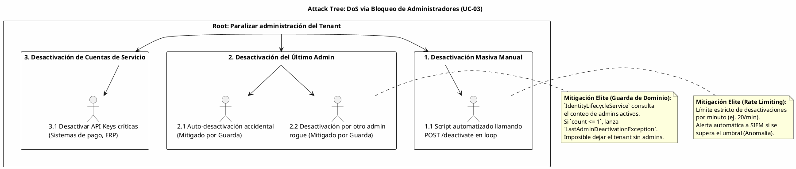

# UC-03: Desactivar Identidad - Análisis de Amenazas y Seguridad Específica

| Metadatos del Documento | |
| :--- | :--- |
| **Proyecto:** | SHUGO - Identity & Access Platform |
| **Caso de Uso:** | UC-03 - Desactivar Identidad (Soft Delete) |
| **Documento:** | 11_UC_Specific_Security_Threats.md |
| **Metodología:** | STRIDE + DREAD + Attack Trees + Immutable Audit Logging + Zero Trust |
| **Estándares:** | OWASP Top 10 (A07:2021 Identification and Authentication Failures), NIST SP 800-53 (AU-9, AC-2), SOC 2 (CC6.1, CC7.2), ISO 27001 (A.9.2.6) |
| **Autor:** | Gastón Ruiz |
| **Versión Actual:** | 1.0.0 |
| **Fecha:** | 01/09/2026 |

---

## Historial de Versiones

| Versión | Fecha | Autor | Descripción de Cambios | Impacto |
| :--- | :--- | :--- | :--- | :--- |
| **1.0.0** | 01/09/2026 | Gastón Ruiz | **Creación inicial.** Análisis de amenazas específico para el endpoint de desactivación. Se enfoca en vectores de ataque únicos de la gestión del ciclo de vida: *Denial of Service* por bloqueo de administradores, *Evasion of Audit* mediante manipulación de logs, *Mass Deactivation* (Ransomware/Insider Threat), y *Grace Period Bypass*. Define mitigaciones técnicas como guardas de dominio inquebrantables, RLS inmutable y detección de anomalías. | Documento crítico para el equipo de seguridad y DevSecOps. Garantiza que la capacidad de desactivar identidades no sea utilizada para denegar el servicio al tenant, ocultar actividades maliciosas o violar políticas de retención de datos. |

---

## 1. Introducción y Alcance

El UC-03 (Desactivar Identidad) representa uno de los puntos de mayor riesgo operativo en un sistema IAM. A diferencia de la creación o actualización, la desactivación es una **acción destructiva lógica** que corta el acceso inmediatamente. 

Los vectores de ataque específicos de este caso de uso se centran en tres áreas críticas:
1. **Disponibilidad (DoS):** Bloquear el acceso de administradores o servicios críticos para paralizar la organización.
2. **No Repudio y Auditoría:** Manipular los registros de *quién* desactivó *qué* y *por qué*, para ocultar un despido malicioso o una toma de control.
3. **Integridad del Ciclo de Vida:** Forzar el borrado físico (Purga) antes de que expire el período de gracia (Grace Period), violando normativas de retención.

Este documento modela estos vectores y define las mitigaciones de nivel enterprise que SHUGO implementa nativamente.

---

## 2. Attack Trees (Árboles de Ataque)

### 2.1. Attack Tree #1: Denial of Service (DoS) via Admin Lockout

**Objetivo del Atacante:** Un actor malintencionado (interno o externo con credenciales robadas) busca paralizar la administración del tenant desactivando a todos los usuarios con rol de administrador.



### 2.2. Attack Tree #2: Audit Evasion & Log Manipulation

**Objetivo del Atacante:** Ocultar la evidencia de una desactivación maliciosa alterando o borrando los logs de auditoría.

```text
[Root: Ocultar evidencia de desactivación maliciosa]
  |
  +-- [1. Borrar el log de auditoría]
  |     +-- 1.1. Ejecutar DELETE FROM audit_logs (Mitigado por RLS: app_kagami no tiene permisos DELETE)
  |     +-- 1.2. Truncar la tabla (Mitigado por permisos de DBA restringidos y alertas)
  |
  +-- [2. Modificar la razón (Reason) del log]
  |     +-- 2.1. UPDATE audit_logs SET reason = 'Error' (Mitigado por RLS: app_kagami solo tiene INSERT)
  |     +-- 2.2. Inyección de logs falsos con reason legítimo (Mitigado por Firmas Digitales / Hash Chains en logs críticos)
  |
  +-- [3. Desactivar el servicio de logging]
        +-- 3.1. Atacar el motor KAGE (Mitigado por arquitectura descentralizada y Outbox local en KAGAMI)
```

---

## 3. Matriz de Amenazas Específicas (STRIDE + DREAD)

| ID | Amenaza | Categoría STRIDE | DREAD (1-10) | Severidad | Mitigación Técnica Específica |
| :--- | :--- | :--- | :--- | :--- | :--- |
| **T-14** | **Mass Deactivation DoS (Ransomware/Insider)** | Denial of Service | **8.5** | **Alta** | **Rate Limiting Estricto + Anomaly Detection:** Límite de 20 desactivaciones/minuto por tenant. Alerta crítica en SIEM si se detecta un pico inusual. |
| **T-15** | **Last Admin Deactivation (Accidental/Malicioso)** | Denial of Service | **9.0** | **Crítica** | **Domain Guard (Hardcoded):** `IdentityLifecycleService` bloquea la operación si `ActiveAdminCount <= 1`. No hay override posible vía API. |
| **T-16** | **Audit Log Tampering (Borrado/Edición)** | Repudiation | **9.5** | **Crítica** | **Immutable Storage (RLS):** La tabla `audit_logs` tiene políticas RLS que deniegan `UPDATE` y `DELETE` al rol de aplicación. Solo `INSERT`. |
| **T-17** | **Grace Period Bypass (Purga Anticipada)** | Tampering | **8.0** | **Alta** | **Batch Job Isolation:** La purga (UC-05) solo es ejecutada por un proceso batch aislado que valida `NOW() - deactivated_at > retention_days` a nivel de DB. |
| **T-18** | **Reason Injection (Log Spoofing)** | Injection | **6.5** | **Media** | **Input Sanitization & Length Limits:** El Value Object `DeactivationReason` limita a 500 chars y sanitiza caracteres de control. |
| **T-19** | **Self-Deactivation for Evasion** | Repudiation | **7.5** | **Alta** | **Self-Deactivation Guard:** Bloqueo explícito si `actor_id == identity_id`. Previene que un usuario se "borre" para evitar auditorías futuras. |

---

## 4. Mitigaciones Técnicas de Nivel Elite

### 4.1. Domain Guard: Prevención de "Last Admin Standing" (Mitigación T-15)

Esta es la mitigación más crítica para la disponibilidad del tenant. Se implementa en el `IdentityLifecycleService` y es inquebrantable desde la capa de API.

**Implementación (C#):**

```csharp
public class IdentityLifecycleService : IIdentityLifecycleService
{
    private readonly IIdentityRepository _repository;

    // ... constructor ...

    public async Task<bool> CanDeactivateAsync(Identity identity, Actor actor)
    {
        // ... (Validación de Auto-Desactivación) ...

        // CRÍTICO: Validación de Último Administrador
        if (identity.HasRole("admin"))
        {
            int activeAdminCount = await _repository.GetActiveAdminCountAsync(identity.TenantId);
            
            // Si solo queda este admin activo, bloquear la desactivación
            if (activeAdminCount <= 1)
            {
                throw new LastAdminDeactivationException(
                    "Cannot deactivate the last active administrator. " +
                    "Promote another user to admin first to prevent tenant lockout.");
            }
        }

        return true;
    }
}
```

**Justificación:** Previene el escenario catastrófico donde un tenant queda huérfano y sin capacidad de gestión, lo cual requeriría intervención manual costosa del equipo de soporte de SHUGO (Break-Glass procedure).

### 4.2. Immutable Audit Logging via RLS (Mitigación T-16)

Para garantizar que los logs de desactivación no sean alterados ni borrados por la propia aplicación (en caso de compromiso de credenciales de `app_kagami`), utilizamos Row-Level Security (RLS) de PostgreSQL.

**Configuración PostgreSQL:**

```sql
-- 1. Habilitar RLS en la tabla
ALTER TABLE audit_logs ENABLE ROW LEVEL SECURITY;
ALTER TABLE audit_logs FORCE ROW LEVEL SECURITY;

-- 2. Política para el rol de aplicación (SOLO ESCRITURA)
CREATE POLICY audit_logs_app_insert_only ON audit_logs
    FOR INSERT
    TO app_kagami
    WITH CHECK (tenant_id = current_setting('app.current_tenant_id')::uuid);

-- 3. Política para el rol de auditoría (SOLO LECTURA)
CREATE POLICY audit_logs_audit_read_only ON audit_logs
    FOR SELECT
    TO app_audit
    USING (tenant_id = current_setting('app.current_tenant_id')::uuid);

-- 4. Explícitamente denegar UPDATE y DELETE para app_kagami
-- (En PostgreSQL, si no hay política FOR UPDATE/DELETE, se deniega por defecto al tener RLS forzado)
REVOKE UPDATE, DELETE ON audit_logs FROM app_kagami;
```

**Garantía:** Incluso si un atacante obtiene acceso total a la API de SHUGO (comprometiendo `app_kagami`), **físicamente no puede** ejecutar un `DELETE` o `UPDATE` sobre los logs de auditoría.

### 4.3. Rate Limiting y Detección de Anomalías (Mitigación T-14)

La desactivación es una operación de baja frecuencia y alto impacto. Un pico de desactivaciones es un indicador claro de compromiso (Ransomware encriptando/borrando accesos) o un script mal configurado.

**Estrategia de Rate Limiting (Redis Sliding Window):**

```csharp
public class DeactivationRateLimitMiddleware
{
    private const int MAX_DEACTIVATIONS_PER_MINUTE = 20;
    private const string LIMIT_KEY_PREFIX = "rate_limit:deactivation:";

    public async Task InvokeAsync(HttpContext context)
    {
        var tenantId = context.User.FindFirst("tenant_id")?.Value;
        var key = $"{LIMIT_KEY_PREFIX}{tenantId}";

        // Incrementar contador en Redis con TTL de 60s
        long count = await _redis.StringIncrementAsync(key);
        if (count == 1) await _redis.KeyExpireAsync(key, TimeSpan.FromMinutes(1));

        if (count > MAX_DEACTIVATIONS_PER_MINUTE)
        {
            // CRÍTICO: No solo bloquear, sino alertar al SIEM inmediatamente
            await _siemClient.SendAlertAsync(new SecurityAlert 
            { 
                Severity = "CRITICAL", 
                Event = "MASS_DEACTIVATION_ATTEMPT",
                TenantId = tenantId,
                Count = count
            });

            context.Response.StatusCode = 429; // Too Many Requests
            await context.Response.WriteAsJsonAsync(new { error = "Deactivation rate limit exceeded. Security alert triggered." });
            return;
        }
        
        await _next(context);
    }
}
```

---

## 5. Compliance y Auditoría (SOC 2 / ISO 27001 / GDPR)

### 5.1. SOC 2 - CC6.1 (Logical and Physical Access Controls)

*   **Requisito:** La organización debe autorizar, diseñar, implementar y monitorizar cambios en la infraestructura, software y procedimientos.
*   **Implementación UC-03:** La guarda de "Último Administrador" y la inmutabilidad de los logs (RLS) aseguran que los cambios en los accesos (desactivaciones) estén controlados, justificados (Reason) y sean irrefutables.

### 5.2. ISO 27001 - A.9.2.6 (Removal of Access Rights)

*   **Requisito:** Los derechos de acceso deben ser removidos tras la terminación del empleo.
*   **Implementación UC-03:** El endpoint `POST /deactivate` con `reason` obligatorio cumple este requisito. La integración con sistemas HRIS (SCIM) automatiza este proceso, eliminando el error humano.

### 5.3. GDPR - Art. 17 (Right to Erasure) vs. Retention Policies

*   **Conflicto Potencial:** El usuario ejerce su derecho al olvido, pero la empresa tiene una obligación legal de retener datos de auditoría por 5 años.
*   **Implementación UC-03:** La desactivación (Soft Delete) bloquea el acceso inmediatamente (cumpliendo el espíritu del Art. 17 de "cesar el tratamiento"). El Hard Delete (UC-05) se ejecuta solo tras expirar el `retention_days` configurado en `tenant_configs`, balanceando el derecho del usuario con las obligaciones legales de la empresa.

---

## 6. Trazabilidad

| Documento | Relación |
| :--- | :--- |
| `01_Requirements_Specification.md` | Las invariantes de seguridad (INV-18 Auto-desactivación) y las reglas de negocio (Último Admin) se mitigan aquí. |
| `08_Final_Class_Design.md` | Las clases `IdentityLifecycleService` y `AuditLogger` implementan las mitigaciones de T-15 y T-16. |
| `10_UC_Specific_Data_Model.md` | La configuración de RLS y la estructura de `audit_logs` soportan la mitigación T-16. |
| `SHUGO_Security_Architecture.md` (Transversal) | Este documento aplica los estándares globales de control de acceso y auditoría al contexto específico de UC-03. |

---

## 7. Anexos: Configuración de Seguridad Adicional

### 7.1. Break-Glass Procedure (Procedimiento de Emergencia)

Si un tenant queda bloqueado (ej. por un bug que evadió las guardas, o desastre natural), SHUGO tiene un procedimiento de emergencia:

1.  **Detección:** El tenant reporta imposibilidad de acceso administrativo.
2.  **Verificación:** El equipo de Soporte de SHUGO verifica la identidad del solicitante mediante canales fuera de banda (teléfono registrado, notario).
3.  **Ejecución:** Un ingeniero de SHUGO con rol `super_admin` accede a la base de datos de producción (vía bastion host con MFA y sesión grabada).
4.  **Acción:** Ejecuta un script SQL firmado para reactivar la identidad del admin:
    ```sql
    -- Solo ejecutable por rol super_admin en entorno de producción
    UPDATE identities 
    SET status = 'ACTIVE', deactivated_at = NULL, row_version = gen_random_uuid()
    WHERE id = 'uuid-admin-locked' AND tenant_id = 'uuid-tenant-locked';
    ```
5.  **Auditoría:** Esta acción genera un log de auditoría especial marcado como `SHUGO_BREAK_GLASS` que es revisado por el equipo de Compliance de SHUGO.

---
*Fin del Documento 11_UC_Specific_Security_Threats para UC-03*