# UC-04: Consultar Identidad - Diagrama de Caso de Uso

| Metadatos del Documento | |
| :--- | :--- |
| **Proyecto:** | SHUGO - Identity & Access Platform |
| **Caso de Uso:** | UC-04 - Consultar Identidad |
| **Documento:** | 02_Use_Case_Diagram.md |
| **Metodología:** | UML 2.5 + ICONIX + CQRS (Query Side) + Cache-Aside Pattern |
| **Autor:** | Gastón Ruiz |
| **Versión Actual:** | 1.0.0 |
| **Fecha:** | 02/09/2026 |

---

## Historial de Versiones

| Versión | Fecha | Autor | Descripción de Cambios | Impacto |
| :--- | :--- | :--- | :--- | :--- |
| **1.0.0** | 02/09/2026 | Gastón Ruiz | **Creación inicial.** Diagrama de Caso de Uso UML para UC-04. Modela la consulta de identidades como operación de lectura pura (CQRS Query), introduciendo tres actores distintos (Admin, Self-Service User, Sistemas Externos), el patrón Cache-Aside con Redis, la consulta a PostgreSQL con Read Replicas, y las relaciones <<extend>> con enmascaramiento de PII, paginación, y fallback de resiliencia. | Documento base del paquete de diseño Tier 1 del UC-04. Establece las fronteras del sistema, los actores y las integraciones críticas para garantizar lecturas optimizadas (< 50ms p95), aislamiento multi-tenant estricto, y privacidad por diseño (PII masking para Self-Service). |

---

## 1. Diagrama de Caso de Uso (PlantUML)

A continuación, se presenta el Diagrama de Casos de Uso UML para el UC-04. Este diagrama modela la consulta de identidades como una operación de lectura optimizada con CQRS, diferenciando niveles de acceso según el actor.

```plantuml
@startuml UC-04_CasoDeUso
<style>
diagram {
  BackgroundColor #FFFFFF
}
</style>
top to bottom direction
skinparam packageStyle rectangle
skinparam actorStyle awesome
skinparam usecaseBackgroundColor #E3F2FD
skinparam usecaseBorderColor #1565C0
skinparam actorBorderColor #2E7D32
skinparam rectangleBackgroundColor #FFF3E0
skinparam rectangleBorderColor #E65100

title UC-04: Consultar Identidad - Motor KAGAMI (CQRS Query Side)

' ============================================
' ACTORES PRIMARIOS
' ============================================
actor "Administrador\nde Tenant" as Admin
actor "Usuario Final\n(Self-Service)" as User
actor "Sistema Externo\n(SCIM/KIZUNA/KAGI)" as ExternalSystem

' ============================================
' SISTEMA PRINCIPAL: KAGAMI QUERY ENGINE
' ============================================
rectangle "SHUGO - Motor KAGAMI (Query Engine)" as KAGAMI {
  usecase "UC-04: Consultar\nIdentidad" as UC04
  usecase "UC-01: Provisionar\nNueva Identidad" as UC01
  usecase "UC-02: Actualizar\nIdentidad" as UC02
  usecase "UC-03: Desactivar\nIdentidad" as UC03
  usecase "UC-05: Purgar\nIdentidad" as UC05
}

' ============================================
' MÓDULOS DEPENDIENTES (<<include>>)
' ============================================
rectangle "SHUGO - Motor KAGI (Autenticación)" as KAGI {
  usecase "Validar JWT y\nExtraer Claims" as UC_ValidarJWT
}

rectangle "SHUGO - Motor KAGAMI (Autorización)" as KAGAMI_AuthZ {
  usecase "Validar Permisos\nde Lectura" as UC_ValidarPermisos
}

rectangle "SHUGO - Infraestructura (Caché)" as Cache {
  usecase "Consultar Caché\nRedis (Cache-Aside)" as UC_ConsultarCache
}

rectangle "SHUGO - Infraestructura (Persistencia)" as Persistencia {
  usecase "Consultar PostgreSQL\n(Primary/Read Replica)" as UC_ConsultarDB
}

' ============================================
' MÓDULOS COMPLEMENTARIOS (<<extend>>)
' ============================================
rectangle "SHUGO - Motor KAGAMI (Seguridad)" as Seguridad {
  usecase "Enmascarar PII\n(Self-Service Only)" as UC_EnmascararPII
}

rectangle "SHUGO - Motor KAGAMI (Query Builder)" as QueryBuilder {
  usecase "Construir Query\ncon Filtros y Paginación" as UC_Paginacion
}

rectangle "SHUGO - Infraestructura (Resiliencia)" as Resiliencia {
  usecase "Fallback a PostgreSQL\n(Cache Miss/Down)" as UC_FallbackCache
  usecase "Fallback a Caché\n(DB Down)" as UC_FallbackDB
}

' ============================================
' RELACIONES DE INICIO (Actores → UC Principal)
' ============================================
Admin --> UC04 : Consulta identidad\npor ID, email, o filtros
User --> UC04 : Consulta su propio\nperfil (Self-Service)
ExternalSystem --> UC04 : Consulta identidad\npara sincronización

' ============================================
' RELACIONES <<include>> (OBLIGATORIAS)
' ============================================
' La consulta DEBE validar el JWT del actor
UC04 ..> UC_ValidarJWT : <<include>>\n(Validar identidad\ndel actor)

' La consulta DEBE validar permisos de lectura
UC04 ..> UC_ValidarPermisos : <<include>>\n(Validar permisos\nidentity:read / profile:read)

' La consulta DEBE intentar caché primero (Cache-Aside)
UC04 ..> UC_ConsultarCache : <<include>>\n(Consultar Redis\n{tenant}:identity:{id})

' Si hay cache miss, la consulta DEBE ir a PostgreSQL
UC04 ..> UC_ConsultarDB : <<include>>\n(Consultar PostgreSQL\ncon tenant isolation)

' ============================================
' RELACIONES <<extend>> (CONDICIONALES)
' ============================================
' Si el actor es Self-Service, se enmascara PII
UC_EnmascararPII .up.> UC04 : <<extend>>\n(Si actor es User:\nenmascarar email/phone)

' Si la consulta tiene filtros, se aplica paginación
UC_Paginacion .left.> UC04 : <<extend>>\n(Si hay query params:\naplicar filtros y paginación)

' Si Redis falla, fallback a PostgreSQL
UC_FallbackCache .right.> UC_ConsultarCache : <<extend>>\n(Si Redis down:\nconsultar DB directamente)

' Si PostgreSQL falla, fallback a caché (si disponible)
UC_FallbackDB .right.> UC_ConsultarDB : <<extend>>\n(Si DB down:\nservir desde caché)

' ============================================
' RELACIÓN CON OTROS UCs DE KAGAMI
' ============================================
note right of UC01
  **Casos de Uso Relacionados:**
  UC-01: Crea identidad que UC-04 consulta
  UC-02: Consume RowVersion de UC-04 para OCC
  UC-03: Valida estado actual vía UC-04
  UC-05: Consulta identidades elegibles para purga
end note

UC04 .down.> UC01 : <<dependency>>\n(Consulta identidades\ncreadas por UC-01)

UC04 .down.> UC02 : <<dependency>>\n(Proporciona RowVersion\npara OCC en UC-02)

UC04 .down.> UC03 : <<dependency>>\n(Valida estado antes\nde desactivar en UC-03)

@enduml
```

---

## 2. Explicación del Diagrama

### 2.1. Límite del Sistema (System Boundary)

El diagrama identifica **cuatro límites de sistema claramente diferenciados**:

1. **Motor KAGAMI - Query Engine (UC-04):** El sistema principal que contiene el caso de uso de consulta de identidades. Es el lado **Query** de CQRS, optimizado para lecturas de alto rendimiento con caché Redis y Read Replicas de PostgreSQL.

2. **Motor KAGI (Autenticación y Autorización):** Sistema secundario que provee la validación de identidad y permisos. El UC-04 depende de KAGI para validar que el actor tenga permisos de lectura (`identity:read` para Admin, `profile:read` para User).

3. **Infraestructura de Caché (Redis):** Sistema de caché distribuida que implementa el patrón Cache-Aside. Es la primera capa de consulta para optimizar latencia (< 5ms para cache hit).

4. **Infraestructura de Persistencia (PostgreSQL):** Sistema de base de datos que actúa como source of truth. Incluye Primary para escrituras y Read Replicas para lecturas distribuidas.

**Justificación de los Límites:**
- La separación entre **Query Engine** (UC-04) y **Command Engine** (UC-01, UC-02, UC-03) sigue el principio de **CQRS (Command Query Responsibility Segregation)**. Las lecturas pueden escalar independientemente de las escrituras.
- Redis y PostgreSQL son infraestructura compartida, pero se modelan como sistemas separados para clarificar las dependencias y los patrones de resiliencia (Cache-Aside, Fallback).

### 2.2. Actores del Sistema

#### Actores Primarios: **Administrador**, **Usuario Final (Self-Service)**, y **Sistema Externo**

El UC-04 tiene tres tipos de actores primarios con diferentes niveles de acceso:

*   **Administrador de Tenant (humano):** Representa al administrador que necesita consultar identidades para gestión, auditoría, o soporte.
    *   **Meta:** Obtener información completa de identidades (incluyendo PII en claro, audit logs, row_version).
    *   **Permisos:** `identity:read`, `audit:read` (opcional para ver identidades PURGED).
    *   **Frecuencia:** Media (consultas de gestión, soporte, auditoría).

*   **Usuario Final - Self-Service (humano):** Representa al usuario que consulta su propio perfil para ver o actualizar sus datos.
    *   **Meta:** Obtener su propio perfil con PII enmascarado (privacidad por diseño).
    *   **Permisos:** `profile:read` (solo su propia identidad).
    *   **Frecuencia:** Alta (cada vez que el usuario accede a su perfil).

*   **Sistema Externo (automatizado):** Representa sistemas como SCIM/HRIS (Workday, BambooHR), KIZUNA (motor de autorización), o KAGI (motor de autenticación) que consultan identidades para sincronización o validación.
    *   **Meta:** Obtener datos de identidad para integración o validación de permisos.
    *   **Permisos:** `identity:read` (service account con scopes específicos).
    *   **Frecuencia:** Muy alta (KIZUNA consulta en cada evaluación de permisos).

**Nota de Diseño Elite:** Modelar tres actores distintos demuestra que la API de consulta está diseñada para múltiples casos de uso con diferentes requisitos de seguridad y privacidad. El enmascaramiento de PII es obligatorio para Self-Service, opcional para Admin, y configurable para Sistemas Externos.

#### Actores Secundarios (Sistemas Dependientes)

*   **UC_ValidarJWT (KAGI):** Sistema de autenticación que valida la firma del JWT y extrae el `tenant_id` y `user_id`. Es una dependencia **obligatoria** (<<include>>) porque sin identidad verificada, no hay consulta posible.

*   **UC_ValidarPermisos (KAGAMI AuthZ):** Sistema de autorización que verifica que el usuario tenga permisos de lectura. Es una dependencia **obligatoria** porque no todos los usuarios autenticados pueden consultar identidades.

*   **UC_ConsultarCache (Redis):** Sistema de caché que implementa el patrón Cache-Aside. Es una dependencia **obligatoria** como primera capa de consulta para optimizar rendimiento.

*   **UC_ConsultarDB (PostgreSQL):** Sistema de persistencia que actúa como source of truth. Es una dependencia **obligatoria** como segunda capa de consulta (cuando hay cache miss).

*   **UC_EnmascararPII (Seguridad):** Componente de seguridad que enmascara datos PII (email, teléfono) para usuarios Self-Service. Es una dependencia **condicional** (<<extend>>) que solo se activa cuando el actor es User.

*   **UC_Paginacion (QueryBuilder):** Componente que construye queries con filtros dinámicos y paginación. Es una dependencia **condicional** (<<extend>>) que solo se activa cuando hay query parameters.

*   **UC_FallbackCache (Resiliencia):** Componente de resiliencia que hace fallback a PostgreSQL cuando Redis está caído. Es una dependencia **condicional** (<<extend>>) para alta disponibilidad.

*   **UC_FallbackDB (Resiliencia):** Componente de resiliencia que hace fallback a caché cuando PostgreSQL está caído. Es una dependencia **condicional** (<<extend>>) para alta disponibilidad.

### 2.3. Relaciones UML

#### Relaciones `<<include>>`: UC-04 → UC_ValidarJWT, UC_ValidarPermisos, UC_ConsultarCache, UC_ConsultarDB

*   **Dirección:** La flecha va **DESDE** UC-04 **HACIA** los casos de uso incluidos.
*   **Semántica:** UC-04 **depende obligatoriamente** de estos cuatro casos de uso. No existe un flujo de consulta exitoso que no valide el JWT (UC_ValidarJWT), valide permisos (UC_ValidarPermisos), intente caché (UC_ConsultarCache), y consulte PostgreSQL si es necesario (UC_ConsultarDB).
*   **Justificación Arquitectónica:** Estas relaciones materializan el patrón **Cache-Aside** y el principio de **Defense in Depth** (validación JWT + validación permisos + tenant isolation).

**Detalle de cada <<include>>:**

1. **UC-04 → UC_ValidarJWT (Validar JWT):**
   - **Cuándo ocurre:** Al inicio de cada consulta.
   - **Qué hace:** Valida la firma del JWT usando las claves públicas del JWKS endpoint, verifica que no esté expirado, y extrae el `tenant_id` y `user_id` del claim.
   - **Si falla:** Retorna HTTP 401 inmediatamente, sin proceder con la consulta.

2. **UC-04 → UC_ValidarPermisos (Validar Permisos de Lectura):**
   - **Cuándo ocurre:** Después de validar el JWT.
   - **Qué hace:** Verifica que el usuario tenga permisos `identity:read` (Admin) o `profile:read` (User Self-Service).
   - **Si falla:** Retorna HTTP 403 inmediatamente.

3. **UC-04 → UC_ConsultarCache (Consultar Caché Redis):**
   - **Cuándo ocurre:** Después de validar permisos.
   - **Qué hace:** Consulta Redis usando la clave `{tenant_id}:identity:{id}` para obtener la identidad cacheada.
   - **Si hay hit:** Retorna la identidad desde caché (< 5ms), sin consultar PostgreSQL.
   - **Si hay miss:** Continúa con UC_ConsultarDB.
   - **Si Redis está caído:** Se activa UC_FallbackCache (<<extend>>).

4. **UC-04 → UC_ConsultarDB (Consultar PostgreSQL):**
   - **Cuándo ocurre:** Cuando hay cache miss o Redis está caído.
   - **Qué hace:** Consulta PostgreSQL usando el índice primario (`id`, `tenant_id`) con filtros de tenant isolation.
   - **Si hay hit:** Retorna la identidad desde PostgreSQL (< 50ms) y actualiza caché.
   - **Si no hay hit:** Retorna HTTP 404.
   - **Si PostgreSQL está caído:** Se activa UC_FallbackDB (<<extend>>).

#### Relaciones `<<extend>>`: UC_EnmascararPII → UC-04, UC_Paginacion → UC-04, UC_FallbackCache → UC_ConsultarCache, UC_FallbackDB → UC_ConsultarDB

*   **Dirección:** La flecha va **DESDE** los casos de uso extend **HACIA** UC-04 o UC_ConsultarCache/DB (casos de uso base).
*   **Semántica:** UC_EnmascararPII, UC_Paginacion, UC_FallbackCache y UC_FallbackDB son comportamientos **condicionales** que se "inyectan" en UC-04 bajo ciertas condiciones.
*   **Justificación:**
    - El enmascaramiento de PII solo ocurre para Self-Service (no para Admin).
    - La paginación solo ocurre cuando hay query parameters.
    - Los fallbacks solo ocurren cuando hay fallos de infraestructura.

**Detalle de cada <<extend>>:**

1. **UC_EnmascararPII → UC-04 (Enmascarar PII):**
   - **Cuándo ocurre:** Después de obtener la identidad, si el actor es User Self-Service.
   - **Qué hace:** Enmascara el email (`j***@khcs.com`) y el teléfono (`+54 *** ** 6789`).
   - **Si no aplica:** Admin y Sistemas Externos ven PII en claro (según permisos).

2. **UC_Paginacion → UC-04 (Construir Query con Filtros y Paginación):**
   - **Cuándo ocurre:** Cuando la consulta incluye query parameters (status, type, search, page, limit).
   - **Qué hace:** Construye una query SQL dinámica con filtros, ordenamiento, y paginación (LIMIT/OFFSET o cursor-based).
   - **Si no aplica:** Consulta simple por ID (sin filtros ni paginación).

3. **UC_FallbackCache → UC_ConsultarCache (Fallback a PostgreSQL):**
   - **Cuándo ocurre:** Cuando Redis está caído o no responde dentro del timeout (10ms).
   - **Qué hace:** Consulta PostgreSQL directamente, saltando la caché.
   - **Impacto:** Latencia ligeramente mayor (~20ms vs ~5ms), pero la consulta es exitosa.

4. **UC_FallbackDB → UC_ConsultarDB (Fallback a Caché):**
   - **Cuándo ocurre:** Cuando PostgreSQL está caído o no responde dentro del timeout (100ms).
   - **Qué hace:** Sirve datos desde caché Redis (si están disponibles), aunque puedan estar desactualizados (TTL de 60s).
   - **Impacto:** Datos potencialmente desactualizados, pero la consulta es exitosa. Incluye header `X-Data-Source: cache`.

#### Relaciones `<<dependency>>`: UC-04 → UC-01, UC-02, UC-03

*   **Dirección:** La flecha va **DESDE** UC-04 **HACIA** UC-01, UC-02, y UC-03.
*   **Semántica:** UC-04 **depende** de UC-01, UC-02, y UC-03 en el sentido de que consulta identidades creadas por UC-01, proporciona RowVersion para UC-02, y valida estado para UC-03. No es una dependencia de ejecución, sino de datos.
*   **Justificación:** Esta relación visual demuestra cómo UC-04 es el caso de uso de lectura transversal que soporta todas las operaciones de escritura:
    - **UC-01 (Provisionar):** Crea la identidad que UC-04 consulta.
    - **UC-02 (Actualizar):** Consume el RowVersion proporcionado por UC-04 para OCC.
    - **UC-03 (Desactivar):** Valida el estado actual de la identidad vía UC-04 antes de desactivar.

---

## 3. Análisis de Coherencia con la Especificación Analítica

Este diagrama es **100% coherente** con el documento `01_Requirements_Specification.md`:

| Elemento del Diagrama | Referencia en Especificación |
| :--- | :--- |
| Actores: Admin, User Self-Service, Sistema Externo | Sección 2 (Descripción Analítica) - Actor Principal |
| Relación <<include>> con UC_ValidarJWT | Sección 2.5 (Excepción 2.1) - JWT Inválido o Expirado |
| Relación <<include>> con UC_ValidarPermisos | Sección 2.5 (Excepción 5.1) - Usuario sin Permisos de Lectura |
| Relación <<include>> con UC_ConsultarCache | Sección 3 (RN-01) - Cache-Aside Pattern |
| Relación <<include>> con UC_ConsultarDB | Sección 6.2 (Cache-Aside Pattern) - Fallback a PostgreSQL |
| Relación <<extend>> con UC_EnmascararPII | Sección 3 (INV-20, RN-03) - Nivel de Detalle por Scope, Enmascaramiento de PII |
| Relación <<extend>> con UC_Paginacion | Sección 3 (INV-24) - Paginación con Límites |
| Relación <<extend>> con UC_FallbackCache | Sección 2.5 (Excepción 10.1) - Error de Caché (Redis Down) |
| Relación <<extend>> con UC_FallbackDB | Sección 2.5 (Excepción 11.1) - Error de Base de Datos (PostgreSQL Down) |
| Relación <<dependency>> con UC-01, UC-02, UC-03 | Sección 1.2 (Relación con Otros Casos de Uso) - Consumidor/Predecesor |
| Objetivos de rendimiento | Sección 1.3 - Latencia p95 < 50ms, Throughput 500 req/seg, Cache Hit Rate > 80% |

---

## 4. Consideraciones de Diseño y Arquitectura (CQRS + Cache-Aside)

### 4.1. CQRS (Command Query Responsibility Segregation)

Observa que el diagrama modela UC-04 como el lado **Query** de CQRS, separado de los casos de uso de escritura (UC-01, UC-02, UC-03):

*   **Query Side (UC-04):** Optimizado para lecturas de alto rendimiento. Usa caché Redis, Read Replicas de PostgreSQL, y puede escalar independientemente.
*   **Command Side (UC-01, UC-02, UC-03):** Optimizado para escrituras consistentes. Usa transacciones atómicas, Outbox Pattern, y validaciones de dominio estrictas.

**¿Por qué es esto crítico?**
Porque permite que las lecturas (que son ~10-50x más frecuentes que las escrituras) escalen horizontalmente sin afectar las escrituras. Por ejemplo, puedes tener 20 pods de Query Handlers y solo 5 pods de Command Handlers.

### 4.2. Cache-Aside Pattern con Fallback de Resiliencia

El diagrama muestra claramente el patrón Cache-Aside con dos capas de fallback:

1.  **Primera Capa (Redis):** Consulta caché primero. Si hay hit, retorna inmediatamente (< 5ms).
2.  **Segunda Capa (PostgreSQL):** Si hay miss, consulta PostgreSQL (< 50ms) y actualiza caché.
3.  **Fallback 1 (Redis Down):** Si Redis falla, consulta PostgreSQL directamente (UC_FallbackCache).
4.  **Fallback 2 (PostgreSQL Down):** Si PostgreSQL falla, sirve desde caché si está disponible (UC_FallbackDB).

**Justificación:**
- **Alta Disponibilidad:** El sistema puede seguir operando incluso si Redis o PostgreSQL están caídos (aunque con degradación de rendimiento o consistencia).
- **Consistencia Eventual:** Los datos en caché pueden estar desactualizados hasta 60 segundos (TTL), lo cual es aceptable para operaciones de lectura.

### 4.3. Privacy by Design (Enmascaramiento de PII)

La relación <<extend>> con UC_EnmascararPII refleja el principio de **Privacy by Design**:

*   **Admin:** Ve PII en claro (email, teléfono) porque tiene permisos de gestión.
*   **User Self-Service:** Ve PII enmascarado (`j***@khcs.com`, `+54 *** ** 6789`) para proteger su propia privacidad.
*   **Sistemas Externos:** Configuración según permisos (SCIM puede ver PII en claro para sincronización, KIZUNA solo necesita atributos no sensibles).

**Justificación:**
- **Least Privilege:** Cada actor solo ve los datos necesarios para su función.
- **GDPR Compliance:** El enmascaramiento de PII para Self-Service cumple con el principio de minimización de datos.

### 4.4. Multi-Tenancy Nativo

El diagrama muestra que todas las consultas incluyen el `tenant_id` extraído del JWT:

*   **Query Filters:** `WHERE tenant_id = @actorTenantId` en todas las consultas SQL.
*   **Row-Level Security (RLS):** PostgreSQL RLS previene que un tenant acceda a identidades de otro tenant.
*   **Ocultamiento de Existencia:** Si una identidad no existe en el tenant del actor, retorna 404 (no 403) para no revelar que la identidad existe en otro tenant.

### 4.5. Paginación y Búsqueda Avanzada

La relación <<extend>> con UC_Paginacion muestra que el sistema soporta consultas complejas con filtros dinámicos:

*   **Filtros:** status, type, search (display_name o email).
*   **Paginación:** page, limit (máximo 100), sort, order.
*   **Búsqueda por Email:** Usa el hash HMAC-SHA256 (`email_hash`) para mantener consistencia con el modelo de datos cifrado.

**Justificación:**
- **Rendimiento:** Los límites de paginación (máximo 100) previenen DoS por consultas masivas.
- **Seguridad:** La búsqueda por email usa hash en lugar de texto plano para no exponer datos sensibles en logs de queries.

---

## 5. Trazabilidad con Otros Documentos del Paquete

Este diagrama se relaciona con los siguientes documentos del paquete de diseño:

| Documento | Relación |
| :--- | :--- |
| `01_Requirements_Specification.md` | Define los flujos, invariantes (Cache-Aside, PII Masking, Tenant Isolation) y criterios de aceptación que este diagrama visualiza. |
| `03_Activity_Diagram.md` | Mostrará el flujo de trabajo interno, destacando la bifurcación lógica para cache hit/miss, enmascaramiento de PII, y fallback de resiliencia. |
| `04_Initial_Domain_Model.md` | Definirá el Query Handler, el Cache Manager, y los Value Objects `IdentityQuery`, `IdentityQueryResult`, `PaginationMetadata`. |
| `06_Robustness_Diagram.md` | Mostrará la colaboración entre el Query Handler, el Cache Manager, el Identity Repository, y el PII Masker. |
| `07_Sequence_Diagram.md` | Detallará el orden temporal de las llamadas: validación JWT → consulta caché → consulta PostgreSQL → enmascaramiento PII → construcción de respuesta. |
| `08_Final_Class_Design.md` | Definirá las firmas exactas de los métodos: `QueryHandler.Execute()`, `CacheManager.Get()`, `IdentityRepository.GetById()`. |
| `KAGAMI_Engine_Architecture.md` | Documento global que define la arquitectura completa del motor KAGAMI (del cual UC-04 es el caso de uso de lectura fundamental). |
| `KHCS_SHUGO_Integration_Contract.md` | Define cómo KHCS consume la API de consulta de identidades para sincronización y verificación. |
| `UC-02/01_Requirements_Specification.md` | Documento hermano que define la actualización, que consume el RowVersion proporcionado por UC-04. |

---

## 6. Notas de Implementación

### 6.1. Generación del Diagrama
- **Herramienta:** PlantUML (Diagrams as Code).
- **Ventaja:** Versionable en Git, reproducible, sin dependencias de software propietario.
- **Renderizado:** VS Code (extensión PlantUML), GitHub, o Pandoc para exportación a PDF.

### 6.2. Estilos Aplicados
- `<style>` block: Para evitar advertencias de `skinparam` deprecados en versiones modernas de PlantUML.
- `top to bottom direction`: Organiza el flujo de arriba hacia abajo (Actores → Sistema Principal → Sistemas Dependientes).
- `skinparam actorStyle awesome`: Íconos modernos para actores.
- `skinparam usecaseBackgroundColor #E3F2FD`: Color azul claro para casos de uso de consulta (diferenciación visual con otros motores).
- `skinparam systemBackgroundColor #FFF3E0`: Color naranja claro para sistemas secundarios (estándar UML).

### 6.3. Convenciones de Nomenclatura
- **Actores:** Nombres descriptivos que indican su rol y nivel de acceso (Admin, User Self-Service, Sistema Externo).
- **Casos de Uso:** Verbos en infinitivo que describen la meta del actor (ej. "Consultar Identidad", "Enmascarar PII").
- **Sistemas:** Nombres que reflejan el Bounded Context de DDD (ej. "Motor KAGAMI (Query Engine)", "Infraestructura (Caché)").
- **Relaciones:** Etiquetas descriptivas que explican el propósito de la relación (ej. "<<include>> (Consultar Redis {tenant}:identity:{id})").

### 6.4. Diferenciación Visual entre UC-04 y Otros UCs
Para facilitar la comprensión del patrón CQRS, se usa una diferenciación visual clara:
- **UC-04 (Consultar):** Color azul claro (#E3F2FD) para el caso de uso de lectura.
- **UC-01 a UC-03, UC-05 (CRUD):** Mismo color azul claro, conectados por relaciones <<dependency>>.
- **Relaciones <<dependency>>:** Flechas punteadas que conectan UC-04 con UC-01, UC-02, UC-03, mostrando que UC-04 es el caso de uso de lectura transversal que soporta todas las operaciones de escritura.

### 6.5. Patrones de Resiliencia Visibles
El diagrama modela explícitamente dos patrones de resiliencia críticos:
- **UC_FallbackCache:** Fallback a PostgreSQL cuando Redis está caído.
- **UC_FallbackDB:** Fallback a caché cuando PostgreSQL está caído.

Estos patrones garantizan que el sistema pueda seguir operando (aunque con degradación) incluso en escenarios de fallo de infraestructura.

---
*Fin del Documento 02_Use_Case_Diagram para UC-04*