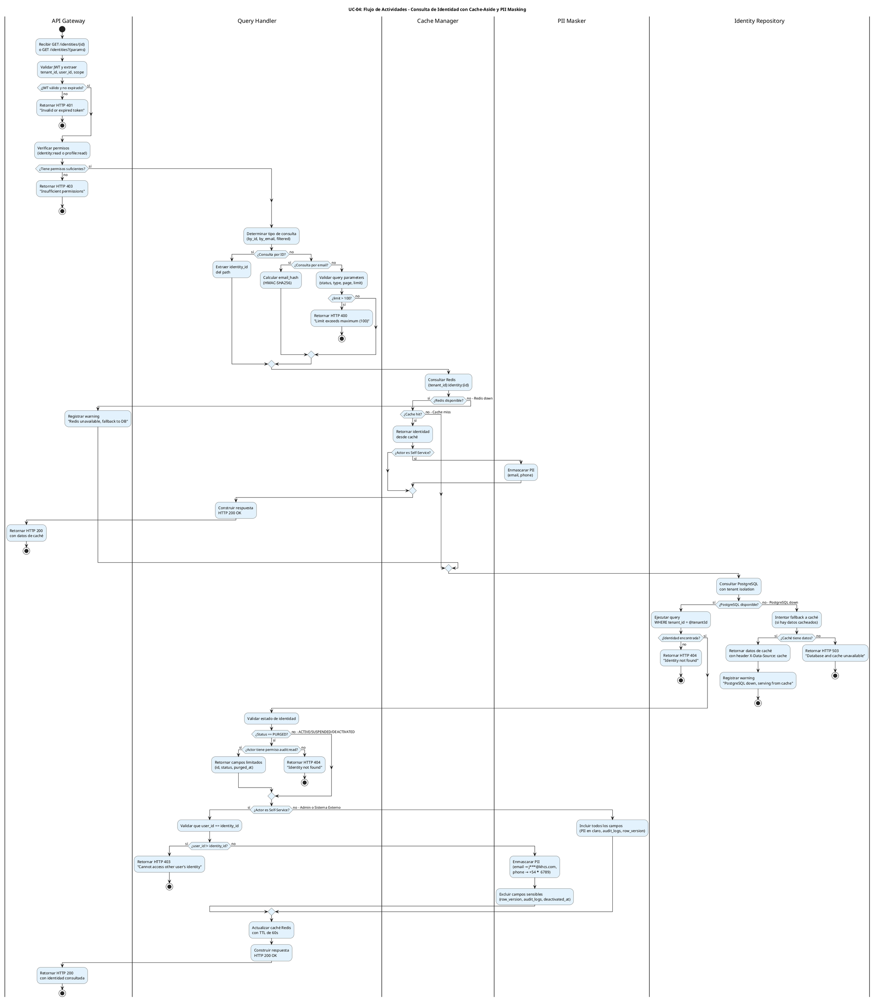

# UC-04: Consultar Identidad - Diagrama de Actividades

| Metadatos del Documento | |
| :--- | :--- |
| **Proyecto:** | SHUGO - Identity & Access Platform |
| **Caso de Uso:** | UC-04 - Consultar Identidad |
| **Documento:** | 03_Activity_Diagram.md |
| **Metodología:** | UML 2.5 + ICONIX + CQRS (Query Side) + Cache-Aside Pattern + Resilience Patterns |
| **Autor:** | Gastón Ruiz |
| **Versión Actual:** | 1.0.0 |
| **Fecha:** | 02/09/2026 |

---

## Historial de Versiones

| Versión | Fecha | Autor | Descripción de Cambios | Impacto |
| :--- | :--- | :--- | :--- | :--- |
| **1.0.0** | 02/09/2026 | Gastón Ruiz | **Creación inicial.** Modelado del flujo de trabajo interno para la consulta de identidades. Destaca el patrón Cache-Aside con doble fallback (Redis → PostgreSQL → Caché), la diferenciación de niveles de detalle según el actor (Admin vs Self-Service), el enmascaramiento condicional de PII, la paginación con filtros dinámicos, y las garantías de aislamiento multi-tenant. | Documento base del paquete de diseño Tier 1 del UC-04. Establece la lógica de negocio, los puntos de decisión críticos y las garantías de rendimiento (< 50ms p95), privacidad (PII masking) y resiliencia (fallback patterns) para el endpoint de consulta del motor KAGAMI. |

---

## 1. Introducción y Propósito

El **Diagrama de Actividades** para el UC-04 visualiza el flujo de control, decisiones y orquestación necesario para consultar identidades en el motor **KAGAMI** de SHUGO.

A diferencia de los casos de uso de escritura (UC-01, UC-02, UC-03), el UC-04 es una **operación de lectura pura** que introduce cinco complejidades arquitectónicas críticas:

1. **Patrón Cache-Aside con Doble Fallback:** La consulta debe intentar caché Redis primero, fallback a PostgreSQL si hay miss, y fallback a caché si PostgreSQL está caído, garantizando alta disponibilidad.
2. **Diferenciación de Niveles de Detalle:** Admin ve todos los campos (PII en claro, audit logs, row_version), mientras que User Self-Service solo ve su perfil con PII enmascarado.
3. **Enmascaramiento Condicional de PII:** El enmascaramiento de email y teléfono solo se aplica cuando el actor es Self-Service, no para Admin o Sistemas Externos autorizados.
4. **Paginación y Filtros Dinámicos:** Las consultas pueden incluir filtros por estado, tipo, búsqueda por email o display_name, con paginación eficiente (offset-based o cursor-based).
5. **Tenant Isolation Estricto:** Todas las consultas deben incluir `WHERE tenant_id = @actorTenantId` para prevenir fugas de datos entre tenants.

Utilizamos carriles (swimlanes) para separar las responsabilidades entre el API Gateway, el Query Handler, el Cache Manager, el Identity Repository, el PII Masker, y el Response Builder.

---

## 2. Diagrama de Actividades (PlantUML)

A continuación, se presenta el diagrama que cubre el Escenario Principal (consulta por ID exitosa con cache hit), los escenarios alternativos (cache miss, Self-Service, filtros y paginación), y los flujos de excepción (Redis/PostgreSQL down, identidad no encontrada, permisos insuficientes).



---

## 3. Explicación Detallada del Flujo

### 3.1. Carriles (Partitions / Swimlanes)

El diagrama está dividido en seis carriles que representan las capas y responsabilidades de la arquitectura:

1. **`|API Gateway|` (Capa de Entrada):** Valida el JWT, extrae el `tenant_id`, `user_id`, y `scope` del actor. Verifica permisos de lectura (`identity:read` para Admin, `profile:read` para User). Es la primera línea de defensa.

2. **`|Query Handler|` (Capa de Aplicación):** Orquesta el caso de uso. Determina el tipo de consulta (by_id, by_email, filtered), coordina las validaciones, construye la respuesta, y actualiza la caché. Es el cerebro del flujo.

3. **`|Cache Manager|` (Capa de Infraestructura - Caché):** Consulta Redis usando el patrón Cache-Aside. Si hay cache hit, retorna inmediatamente (< 5ms). Si hay miss o Redis está caído, delega al Identity Repository.

4. **`|Identity Repository|` (Capa de Infraestructura - Persistencia):** Consulta PostgreSQL con aislamiento de tenant estricto (`WHERE tenant_id = @tenantId`). Si PostgreSQL está caído, intenta fallback a caché.

5. **`|PII Masker|` (Capa de Seguridad):** Enmascara datos PII (email, teléfono) cuando el actor es Self-Service. Aplica reglas de enmascaramiento consistentes (ej. `j***@khcs.com`, `+54 *** ** 6789`).

6. **`|Response Builder|` (Capa de Aplicación):** Construye la respuesta HTTP con el nivel de detalle apropiado según el actor (Admin ve todo, Self-Service ve solo campos no sensibles).

### 3.2. Puntos de Decisión Críticos (Rombos)

1. **Validación de JWT (API Gateway):**
   - **Pregunta:** ¿El JWT es válido, no está expirado, y tiene los claims requeridos?
   - **Si falla:** Retorna HTTP 401 inmediatamente.
   - **Justificación:** Sin identidad verificada, no hay consulta posible.

2. **Validación de Permisos (API Gateway):**
   - **Pregunta:** ¿El actor tiene permisos `identity:read` (Admin) o `profile:read` (User)?
   - **Si falla:** Retorna HTTP 403 inmediatamente.
   - **Justificación:** No todos los usuarios autenticados pueden consultar identidades.

3. **Tipo de Consulta (Query Handler):**
   - **Pregunta:** ¿Es consulta por ID, por email, o con filtros?
   - **Si es por email:** Calcula el hash HMAC-SHA256 del email para buscar en el índice `idx_identities_tenant_email_hash`.
   - **Si es con filtros:** Valida que `limit <= 100` para prevenir DoS.
   - **Justificación:** Diferentes tipos de consulta requieren diferentes estrategias de optimización.

4. **Disponibilidad de Redis (Cache Manager):**
   - **Pregunta:** ¿Redis está disponible y responde dentro del timeout (10ms)?
   - **Si no:** Registra warning y hace fallback a PostgreSQL directamente.
   - **Justificación:** Alta disponibilidad. El sistema debe funcionar incluso si Redis está caído.

5. **Cache Hit vs Miss (Cache Manager):**
   - **Pregunta:** ¿La identidad está en caché Redis?
   - **Si hay hit:** Retorna inmediatamente (< 5ms), sin consultar PostgreSQL.
   - **Si hay miss:** Continúa con PostgreSQL.
   - **Justificación:** Rendimiento. 80%+ de las consultas deben ser servidas desde caché.

6. **Disponibilidad de PostgreSQL (Identity Repository):**
   - **Pregunta:** ¿PostgreSQL está disponible y responde dentro del timeout (100ms)?
   - **Si no:** Intenta fallback a caché (si hay datos cacheados).
   - **Justificación:** Alta disponibilidad. Si PostgreSQL está caído, servir datos de caché (potencialmente desactualizados) es mejor que retornar error.

7. **Identidad Encontrada (Identity Repository):**
   - **Pregunta:** ¿Existe la identidad con el ID/email proporcionado en el tenant del actor?
   - **Si no:** Retorna HTTP 404.
   - **Justificación:** No revelar existencia de identidades en otros tenants (tenant isolation).

8. **Estado PURGED (Query Handler):**
   - **Pregunta:** ¿La identidad está en estado `PURGED`?
   - **Si sí y actor tiene `audit:read`:** Retorna campos limitados (id, status, purged_at).
   - **Si sí y actor NO tiene `audit:read`:** Retorna HTTP 404 (oculta la existencia).
   - **Justificación:** Las identidades purgadas solo son visibles para auditores autorizados.

9. **Self-Service vs Admin (Query Handler):**
   - **Pregunta:** ¿El actor es User Self-Service o Admin/Sistema Externo?
   - **Si es Self-Service:** Valida que `user_id == identity_id` (solo puede consultar su propia identidad), enmascara PII, excluye campos sensibles.
   - **Si es Admin:** Incluye todos los campos (PII en claro, audit_logs, row_version).
   - **Justificación:** Privacy by Design y Least Privilege.

### 3.3. Flujos de Resiliencia (Fallback Patterns)

El diagrama modela explícitamente dos patrones de fallback críticos:

#### Fallback 1: Redis Down → PostgreSQL Directo
- **Cuándo ocurre:** Redis no responde dentro del timeout (10ms) o está caído.
- **Qué hace:** El Query Handler consulta PostgreSQL directamente, saltando la caché.
- **Impacto:** Latencia ligeramente mayor (~20ms vs ~5ms), pero la consulta es exitosa.
- **Nota:** No actualiza caché (Redis está caído).

#### Fallback 2: PostgreSQL Down → Caché (si disponible)
- **Cuándo ocurre:** PostgreSQL no responde dentro del timeout (100ms) o está caído.
- **Qué hace:** El Query Handler intenta servir datos desde caché Redis (si están disponibles).
- **Impacto:** Datos potencialmente desactualizados (TTL de 60s), pero la consulta es exitosa.
- **Nota:** Incluye header `X-Data-Source: cache` para indicar datos potencialmente desactualizados.

#### Fallback 3: Ambos Caídos → Service Unavailable
- **Cuándo ocurre:** Tanto Redis como PostgreSQL están caídos.
- **Qué hace:** Retorna HTTP 503 Service Unavailable.
- **Impacto:** El sistema no puede servir la consulta.
- **Nota:** Registra error crítico en logs y alerta al equipo de operaciones.

---

## 4. Alineación con la Especificación de Requisitos

Este diagrama es la representación visual exacta del documento `01_Requirements_Specification.md`:

| Sección en Requisitos | Representación en el Diagrama |
| :--- | :--- |
| **2.1 Escenario Principal (Pasos 1-14)** | El flujo principal desde "Recibir GET" hasta "Retornar HTTP 200" con cache hit. |
| **2.2 Escenario Alternativo (Self-Service)** | La bifurcación "¿Actor es Self-Service?" y el enmascaramiento de PII. |
| **2.3 Escenario Alternativo (Filtros y Paginación)** | La validación de query parameters y límites de paginación. |
| **2.4 Escenario Alternativo (Búsqueda por Email)** | El cálculo de email_hash y consulta al índice. |
| **2.5 Excepción 2.1 (JWT Inválido)** | El primer rombo "¿JWT válido y no expirado?" y su rama "no" (HTTP 401). |
| **2.5 Excepción 5.1 (Sin Permisos)** | El rombo "¿Tiene permisos suficientes?" y su rama "no" (HTTP 403). |
| **2.5 Excepción 7.1 (Self-Service consulta otro usuario)** | El rombo "¿user_id != identity_id?" y su rama "sí" (HTTP 403). |
| **2.5 Excepción 8.1 (Identidad No Encontrada)** | El rombo "¿Identidad encontrada?" y su rama "no" (HTTP 404). |
| **2.5 Excepción 9.1 (Identidad PURGED)** | El rombo "¿Status == PURGED?" y sus ramas (404 o campos limitados). |
| **2.5 Excepción 10.1 (Redis Down)** | El rombo "¿Redis disponible?" y su rama "no" (fallback a PostgreSQL). |
| **2.5 Excepción 11.1 (PostgreSQL Down)** | El rombo "¿PostgreSQL disponible?" y su rama "no" (fallback a caché). |
| **3 INV-19 (Tenant Isolation)** | La query `WHERE tenant_id = @tenantId` en el Identity Repository. |
| **3 INV-20 (Nivel de Detalle por Scope)** | La bifurcación "¿Actor es Self-Service?" con enmascaramiento condicional. |
| **3 INV-21 (RowVersion para OCC)** | La inclusión de `row_version` en la respuesta para Admin. |
| **3 INV-22 (Ocultamiento de PURGED)** | El rombo "¿Status == PURGED?" con retorno de 404 para actores sin `audit:read`. |
| **3 INV-23 (Self-Service Restringido)** | La validación `user_id == identity_id` para Self-Service. |
| **3 INV-24 (Paginación con Límites)** | La validación `limit <= 100` para prevenir DoS. |
| **3 RN-01 (Cache-Aside Pattern)** | El flujo completo de consulta a Redis → PostgreSQL → actualización de caché. |
| **3 RN-03 (Enmascaramiento de PII)** | El carril "PII Masker" con enmascaramiento condicional. |
| **3 RN-04 (Búsqueda por Email via Hash)** | El cálculo de `email_hash` para búsquedas por email. |

---

## 5. Consideraciones de Arquitectura y Diseño (CQRS + Cache-Aside)

### 5.1. Patrón Cache-Aside con Invalidación Perezosa

El diagrama muestra claramente el patrón Cache-Aside:

1. **Consulta Caché Primero:** El Cache Manager consulta Redis antes que PostgreSQL.
2. **Cache Hit:** Si está en caché, retorna inmediatamente (< 5ms).
3. **Cache Miss:** Si no está en caché, consulta PostgreSQL (< 50ms).
4. **Actualización de Caché:** Tras consultar PostgreSQL, actualiza Redis con TTL de 60s.
5. **Invalidación Perezosa:** Cuando UC-01, UC-02, o UC-03 modifican una identidad, invalidan la caché correspondiente (DEL key), y la próxima consulta repuebla la caché.

**Justificación:**
- **Rendimiento:** 80%+ de las consultas son servidas desde caché, reduciendo la carga en PostgreSQL.
- **Consistencia Eventual:** Los datos en caché pueden estar desactualizados hasta 60 segundos, lo cual es aceptable para operaciones de lectura.
- **Simplicidad:** La invalidación perezosa es más simple que la invalidación activa (actualizar caché en cada escritura).

### 5.2. Privacy by Design con Enmascaramiento Condicional

El carril `PII Masker` introduce un requisito crítico para cumplimiento GDPR:

1. **Detección de Actor:** El Query Handler determina si el actor es Admin, Self-Service, o Sistema Externo.
2. **Enmascaramiento Condicional:** Solo se aplica enmascaramiento cuando el actor es Self-Service.
3. **Reglas de Enmascaramiento:**
   - Email: `juan@khcs.com` → `j***@khcs.com` (primer carácter + *** + dominio)
   - Teléfono: `+5491123456789` → `+54 *** ** 6789` (código país + *** + *** + últimos 4 dígitos)
4. **Exclusión de Campos Sensibles:** Self-Service no ve `row_version`, `audit_logs`, `deactivated_at`.

**Justificación:**
- **GDPR Art. 5 (Minimización de Datos):** Self-Service solo ve los datos necesarios para su función.
- **Least Privilege:** Cada actor solo ve los datos autorizados para su rol.
- **Prevención de PII Leakage:** Incluso si un usuario Self-Service intenta acceder a datos de otro usuario, el sistema lo bloquea (validación `user_id == identity_id`).

### 5.3. Tenant Isolation con Ocultamiento de Existencia

El Identity Repository ejecuta todas las consultas con `WHERE tenant_id = @tenantId`:

1. **Query Filters:** Todas las queries incluyen el filtro de tenant.
2. **Row-Level Security (RLS):** PostgreSQL RLS previene que un tenant acceda a identidades de otro tenant incluso si hay bugs en la aplicación.
3. **Ocultamiento de Existencia:** Si una identidad no existe en el tenant del actor, retorna 404 (no 403) para no revelar que la identidad existe en otro tenant.

**Justificación:**
- **Multi-Tenancy Estricto:** Ningún tenant puede acceder a datos de otro tenant.
- **Prevención de Enumeration Attacks:** Retornar 404 en lugar de 403 previene que un atacante descubra qué identidades existen en otros tenants.

### 5.4. Paginación con Límites Estrictos

El Query Handler valida los parámetros de paginación:

1. **Límite Máximo:** `limit <= 100` para prevenir DoS por consultas masivas.
2. **Offset-Based Pagination:** Para páginas iniciales (page 1-10).
3. **Cursor-Based Pagination:** Para páginas profundas (page > 10), usando `created_at` como cursor.
4. **Metadatos de Paginación:** La respuesta incluye `total_count`, `page`, `limit`, `total_pages`, `has_next`, `has_prev`.

**Justificación:**
- **Prevención de DoS:** Sin límites, un atacante podría consultar millones de registros y saturar la base de datos.
- **Rendimiento:** Offset-based es eficiente para páginas iniciales, cursor-based para páginas profundas.
- **UX:** Los metadatos de paginación permiten al cliente construir navegación de páginas.

---

## 6. Trazabilidad con Otros Documentos del Paquete

| Documento | Relación |
| :--- | :--- |
| `01_Requirements_Specification.md` | Este diagrama visualiza los flujos de texto, las invariantes de dominio (Cache-Aside, PII Masking, Tenant Isolation) y los criterios de aceptación. |
| `02_Use_Case_Diagram.md` | Muestra el límite del sistema y los actores; este diagrama muestra el flujo interno y las decisiones lógicas. |
| `04_Initial_Domain_Model.md` | Las acciones de los carriles "Query Handler", "Cache Manager", "Identity Repository" se implementan aquí como clases y métodos. |
| `06_Robustness_Diagram.md` | Mostrará la colaboración entre el Query Handler, el Cache Manager, el Identity Repository, y el PII Masker. |
| `07_Sequence_Diagram.md` | Detallará el orden temporal exacto de las llamadas: validación JWT → consulta caché → consulta PostgreSQL → enmascaramiento PII → construcción de respuesta. |
| `08_Final_Class_Design.md` | Definirá las firmas exactas de los métodos: `QueryHandler.Execute()`, `CacheManager.Get()`, `IdentityRepository.GetById()`, `PIIMasker.Mask()`. |
| `KAGAMI_Engine_Architecture.md` | Documento global que define la arquitectura completa del motor KAGAMI (del cual UC-04 es el caso de uso de lectura fundamental). |

---

## 7. Notas de Implementación

### 7.1. Generación del Diagrama
- **Herramienta:** PlantUML (Diagrams as Code).
- **Ventaja:** Versionable en Git, reproducible, sin dependencias de software propietario.
- **Sintaxis:** Uso de `if/else/endif` para decisiones, carriles para separar responsabilidades, y notas explicativas estratégicas.

### 7.2. Complejidad del Diagrama
Este es uno de los diagramas de actividades más complejos del sistema debido a:
- La lógica de Cache-Aside con doble fallback.
- La diferenciación de niveles de detalle según el actor.
- El enmascaramiento condicional de PII.
- La paginación con filtros dinámicos.
- Los múltiples flujos de excepción (Redis/PostgreSQL down, identidad no encontrada, permisos insuficientes).

Sin embargo, esta complejidad es necesaria para capturar la riqueza del flujo de consulta en un sistema IAM de nivel enterprise que maneja PII, multi-tenancy, y alta disponibilidad.

### 7.3. Código de Ejemplo (C#)

```csharp
public class QueryHandler : IQueryHandler
{
    private readonly ICacheManager _cacheManager;
    private readonly IIdentityRepository _repository;
    private readonly IPIIMasker _piiMasker;
    private readonly ILogger<QueryHandler> _logger;

    public async Task<IdentityQueryResult> Handle(IdentityQuery query, Actor actor, CancellationToken ct)
    {
        // 1. Intentar caché primero
        var cachedIdentity = await _cacheManager.GetAsync(query.TenantId, query.IdentityId);
        if (cachedIdentity != null)
        {
            // Cache hit
            if (actor.IsSelfService)
            {
                cachedIdentity = _piiMasker.Mask(cachedIdentity);
            }
            return new IdentityQueryResult(cachedIdentity, dataSource: "cache");
        }

        // 2. Cache miss - consultar PostgreSQL
        try
        {
            var identity = await _repository.GetByIdAsync(query.TenantId, query.IdentityId);
            if (identity == null)
            {
                throw new IdentityNotFoundException(query.IdentityId);
            }

            // 3. Validar estado PURGED
            if (identity.Status == IdentityStatus.PURGED && !actor.HasPermission("audit:read"))
            {
                throw new IdentityNotFoundException(query.IdentityId); // Ocultar existencia
            }

            // 4. Validar Self-Service
            if (actor.IsSelfService && actor.UserId != identity.Id)
            {
                throw new ForbiddenException("Cannot access other user's identity");
            }

            // 5. Enmascarar PII si es Self-Service
            if (actor.IsSelfService)
            {
                identity = _piiMasker.Mask(identity);
            }

            // 6. Actualizar caché
            await _cacheManager.SetAsync(query.TenantId, query.IdentityId, identity, ttl: TimeSpan.FromSeconds(60));

            return new IdentityQueryResult(identity, dataSource: "database");
        }
        catch (PostgreSqlException ex)
        {
            _logger.LogError(ex, "PostgreSQL unavailable, attempting fallback to cache");
            
            // 7. Fallback a caché (si hay datos stale)
            var staleCachedIdentity = await _cacheManager.GetStaleAsync(query.TenantId, query.IdentityId);
            if (staleCachedIdentity != null)
            {
                _logger.LogWarning("Serving stale data from cache due to PostgreSQL outage");
                return new IdentityQueryResult(staleCachedIdentity, dataSource: "cache_stale");
            }

            throw new ServiceUnavailableException("Database and cache unavailable");
        }
    }
}
```

---
*Fin del Documento 03_Activity_Diagram para UC-04*