# UC-04: Consultar Identidad - Modelo de Dominio Inicial

| Metadatos del Documento | |
| :--- | :--- |
| **Proyecto:** | SHUGO - Identity & Access Platform |
| **Caso de Uso:** | UC-04 - Consultar Identidad |
| **Documento:** | 04_Initial_Domain_Model.md |
| **Metodología:** | ICONIX (Modelo de Análisis) + DDD (Domain-Driven Design) + CQRS (Query Side) + Cache-Aside Pattern |
| **Autor:** | Gastón Ruiz |
| **Versión Actual:** | 1.0.0 |
| **Fecha:** | 02/09/2026 |

---

## Historial de Versiones

| Versión | Fecha | Autor | Descripción de Cambios | Impacto |
| :--- | :--- | :--- | :--- | :--- |
| **1.0.0** | 02/09/2026 | Gastón Ruiz | **Creación inicial.** Definición del Modelo de Dominio Conceptual para la consulta de identidades. Introduce el Query Handler como servicio de aplicación, el Cache Manager con patrón Cache-Aside, el Identity Repository optimizado para lecturas, el PII Masker para enmascaramiento condicional, y los Value Objects `IdentityQuery`, `IdentityQueryResult`, `PaginationMetadata`. | Documento base del paquete de diseño Tier 1 del UC-04. Establece cómo el lado Query de CQRS gestiona las lecturas optimizadas, el aislamiento multi-tenant, y la privacidad por diseño (PII masking) de forma independiente al lado Command. |

---

## 1. Introducción y Propósito

Este documento presenta el **Modelo de Dominio Inicial** para el Caso de Uso UC-04 (Consultar Identidad).

A diferencia de los casos de uso de escritura (UC-01, UC-02, UC-03) que se centran en la mutación de estado y la consistencia transaccional, el UC-04 es una **operación de lectura pura** que introduce complejidades únicas:

1. **Patrón CQRS (Query Side):** Separación completa del lado de lectura del lado de escritura, permitiendo optimización independiente.
2. **Cache-Aside Pattern:** Implementación de caché Redis con invalidación perezosa para optimizar rendimiento.
3. **Niveles de Detalle Diferenciados:** Admin ve todos los campos (PII en claro), Self-Service ve solo su perfil con PII enmascarado.
4. **Tenant Isolation Estricto:** Todas las consultas incluyen `WHERE tenant_id = @actorTenantId` para prevenir fugas de datos.
5. **Resiliencia Multi-Capa:** Fallback de Redis → PostgreSQL → Caché (stale) para alta disponibilidad.

El modelo se centra en:
- **Optimización de Lecturas:** Consultas rápidas (< 50ms p95) mediante caché y índices optimizados.
- **Privacidad por Diseño:** Enmascaramiento automático de PII para Self-Service.
- **Escalabilidad Horizontal:** Query Handlers stateless que pueden escalar independientemente de los Command Handlers.

---

## 2. Diagrama de Modelo de Dominio Conceptual (PlantUML)

A continuación, se presenta el diagrama de clases conceptual, enfocándose en los servicios de aplicación, infraestructura, y Value Objects introducidos para UC-04.

```plantuml
@startuml UC-04_DominioConceptual
<style>
diagram {
  BackgroundColor #FFFFFF
}
</style>
skinparam classAttributeIconSize 0
skinparam classBackgroundColor #FFFFFF
skinparam classBorderColor #1565C0
skinparam classHeaderBackgroundColor #E3F2FD

title UC-04: Modelo de Dominio Conceptual - Consulta de Identidad (CQRS Query Side)

' ============================================
' SERVICIOS DE APLICACIÓN (Application Services)
' ============================================
class QueryHandler <<Application Service>> {
  - cacheManager: ICacheManager
  - repository: IIdentityRepository
  - piiMasker: IPIIMasker
  - logger: ILogger<QueryHandler>
  
  + Execute(query: IdentityQuery, actor: Actor): Task<IdentityQueryResult>
  - ValidateTenantIsolation(identity: Identity, tenantId: TenantId): void
  - DetermineDetailLevel(actor: Actor): DetailLevel
}

' ============================================
' SERVICIOS DE INFRAESTRUCTURA
' ============================================
interface ICacheManager <<Infrastructure>> {
  + GetAsync(tenantId: TenantId, identityId: IdentityId): Task<Identity?>
  + SetAsync(tenantId: TenantId, identityId: IdentityId, identity: Identity, ttl: TimeSpan): Task
  + InvalidateAsync(tenantId: TenantId, identityId: IdentityId): Task
  + GetStaleAsync(tenantId: TenantId, identityId: IdentityId): Task<Identity?>
}

interface IIdentityRepository <<Infrastructure>> {
  + GetByIdAsync(tenantId: TenantId, identityId: IdentityId): Task<Identity?>
  + GetByEmailHashAsync(tenantId: TenantId, emailHash: string): Task<Identity?>
  + GetFilteredAsync(query: IdentityQuery): Task<PagedResult<Identity>>
}

interface IPIIMasker <<Infrastructure>> {
  + Mask(identity: Identity): Identity
  - MaskEmail(email: string): string
  - MaskPhone(phone: string): string
}

' ============================================
' VALUE OBJECTS
' ============================================
class IdentityQuery <<Value Object>> {
  + TenantId: TenantId
  + IdentityId: IdentityId?
  + EmailHash: string?
  + Status: IdentityStatus?
  + Type: IdentityType?
  + Page: int
  + Limit: int
  + Sort: string
  + Order: string
  
  + IdentityQuery(tenantId, ...)
  - Validate(): void
}

class IdentityQueryResult <<Value Object>> {
  + Identity: Identity?
  + Identities: List<Identity>?
  + Pagination: PaginationMetadata?
  + DataSource: string
  + IsMasked: bool
  
  + IdentityQueryResult(identity, dataSource, isMasked)
  + IdentityQueryResult(identities, pagination, dataSource, isMasked)
}

class PaginationMetadata <<Value Object>> {
  + TotalCount: int
  + Page: int
  + Limit: int
  + TotalPages: int
  + HasNext: bool
  + HasPrev: bool
  
  + PaginationMetadata(totalCount, page, limit)
}

class Actor <<Value Object>> {
  + UserId: Guid
  + TenantId: TenantId
  + Scope: ActorScope
  + Permissions: List<string>
  
  + Actor(userId, tenantId, scope, permissions)
  + IsSelfService: bool
  + IsAdmin: bool
  + HasPermission(permission: string): bool
}

' ============================================
' ENTIDADES DE DOMINIO (Reutilizadas de UC-01)
' ============================================
class Identity <<Aggregate Root>> {
  - id: IdentityId
  - tenantId: TenantId
  - type: IdentityType
  - status: IdentityStatus
  - profile: Profile
  - rowVersion: RowVersion
  - createdAt: DateTime
  - deactivatedAt: DeactivatedAt?
  
  + Identity(...)
}

class Profile <<Entity>> {
  - email: EncryptedData
  - phone: EncryptedData
  - displayName: string
  - customAttributes: CustomAttributes
  
  + Profile(...)
}

' ============================================
' RELACIONES
' ============================================
QueryHandler --> ICacheManager : "consulta"
QueryHandler --> IIdentityRepository : "consulta"
QueryHandler --> IPIIMasker : "enmascara"

QueryHandler --> IdentityQuery : "recibe"
QueryHandler --> IdentityQueryResult : "retorna"

IdentityQueryResult --> Identity : "contiene"
IdentityQueryResult --> PaginationMetadata : "contiene"

IdentityQueryResult --> Actor : "usa"

ICacheManager --> Identity : "cachea"
IIdentityRepository --> Identity : "persiste"
IPIIMasker --> Identity : "enmascara"

note right of QueryHandler
  **CQRS Query Side:**
  - Separado del Command Side
  - Optimizado para lecturas
  - Puede escalar independientemente
end note

note right of ICacheManager
  **Cache-Aside Pattern:**
  - Consulta caché primero
  - Fallback a PostgreSQL
  - TTL de 60 segundos
end note

note right of IPIIMasker
  **Privacy by Design:**
  - Enmascaramiento condicional
  - Solo para Self-Service
  - Reglas consistentes
end note

@enduml
```



---

## 3. Detalle de Conceptos de Dominio (DDD)

### 3.1. Servicios de Aplicación (Application Services)

#### **QueryHandler**

**Responsabilidad:** Orquestar el caso de uso de consulta de identidades. Coordina la consulta de caché, fallback a PostgreSQL, enmascaramiento de PII, y construcción de la respuesta.

**Código (C#):**

```csharp
public class QueryHandler : IQueryHandler
{
    private readonly ICacheManager _cacheManager;
    private readonly IIdentityRepository _repository;
    private readonly IPIIMasker _piiMasker;
    private readonly ILogger<QueryHandler> _logger;

    public QueryHandler(
        ICacheManager cacheManager,
        IIdentityRepository repository,
        IPIIMasker piiMasker,
        ILogger<QueryHandler> logger)
    {
        _cacheManager = cacheManager ?? throw new ArgumentNullException(nameof(cacheManager));
        _repository = repository ?? throw new ArgumentNullException(nameof(repository));
        _piiMasker = piiMasker ?? throw new ArgumentNullException(nameof(piiMasker));
        _logger = logger ?? throw new ArgumentNullException(nameof(logger));
    }

    /// <summary>
    /// Ejecuta la consulta de identidad con patrón Cache-Aside y enmascaramiento condicional de PII.
    /// </summary>
    public async Task<IdentityQueryResult> Execute(IdentityQuery query, Actor actor)
    {
        // 1. Intentar caché primero (Cache-Aside Pattern)
        var cachedIdentity = await _cacheManager.GetAsync(query.TenantId, query.IdentityId);
        
        if (cachedIdentity != null)
        {
            // Cache hit
            _logger.LogDebug("Cache hit for identity {IdentityId} in tenant {TenantId}", 
                query.IdentityId, query.TenantId);
            
            var result = ApplyDetailLevel(cachedIdentity, actor);
            return new IdentityQueryResult(result, dataSource: "cache", isMasked: actor.IsSelfService);
        }

        // 2. Cache miss - consultar PostgreSQL
        try
        {
            Identity identity;
            
            if (query.IdentityId.HasValue)
            {
                identity = await _repository.GetByIdAsync(query.TenantId, query.IdentityId.Value);
            }
            else if (!string.IsNullOrEmpty(query.EmailHash))
            {
                identity = await _repository.GetByEmailHashAsync(query.TenantId, query.EmailHash);
            }
            else
            {
                var pagedResult = await _repository.GetFilteredAsync(query);
                var maskedIdentities = pagedResult.Items.Select(i => ApplyDetailLevel(i, actor)).ToList();
                
                return new IdentityQueryResult(
                    maskedIdentities, 
                    pagedResult.Metadata, 
                    dataSource: "database", 
                    isMasked: actor.IsSelfService);
            }

            if (identity == null)
            {
                throw new IdentityNotFoundException(query.IdentityId ?? query.EmailHash);
            }

            // 3. Validar Tenant Isolation
            ValidateTenantIsolation(identity, query.TenantId);

            // 4. Validar estado PURGED
            if (identity.Status == IdentityStatus.PURGED && !actor.HasPermission("audit:read"))
            {
                throw new IdentityNotFoundException(query.IdentityId); // Ocultar existencia
            }

            // 5. Validar Self-Service (solo puede consultar su propia identidad)
            if (actor.IsSelfService && actor.UserId != identity.Id.Value)
            {
                throw new ForbiddenException("Cannot access other user's identity");
            }

            // 6. Aplicar nivel de detalle (enmascaramiento si es Self-Service)
            var resultIdentity = ApplyDetailLevel(identity, actor);

            // 7. Actualizar caché (TTL 60s)
            await _cacheManager.SetAsync(
                query.TenantId, 
                query.IdentityId.Value, 
                identity, 
                ttl: TimeSpan.FromSeconds(60));

            return new IdentityQueryResult(resultIdentity, dataSource: "database", isMasked: actor.IsSelfService);
        }
        catch (PostgreSqlException ex)
        {
            _logger.LogError(ex, "PostgreSQL unavailable for tenant {TenantId}, attempting fallback to cache", 
                query.TenantId);
            
            // 8. Fallback a caché (datos stale)
            var staleCachedIdentity = await _cacheManager.GetStaleAsync(query.TenantId, query.IdentityId.Value);
            
            if (staleCachedIdentity != null)
            {
                _logger.LogWarning("Serving stale data from cache for identity {IdentityId} due to PostgreSQL outage", 
                    query.IdentityId);
                
                var staleResult = ApplyDetailLevel(staleCachedIdentity, actor);
                return new IdentityQueryResult(staleResult, dataSource: "cache_stale", isMasked: actor.IsSelfService);
            }

            throw new ServiceUnavailableException("Database and cache unavailable. Please try again later.");
        }
    }

    private Identity ApplyDetailLevel(Identity identity, Actor actor)
    {
        if (actor.IsSelfService)
        {
            // Self-Service: enmascarar PII y excluir campos sensibles
            return _piiMasker.Mask(identity);
        }
        
        // Admin o Sistema Externo: retornar todos los campos
        return identity;
    }

    private void ValidateTenantIsolation(Identity identity, TenantId tenantId)
    {
        if (identity.TenantId.Value != tenantId.Value)
        {
            throw new ForbiddenException("Cannot access identity from another tenant");
        }
    }
}
```

### 3.2. Servicios de Infraestructura

#### **ICacheManager**

**Responsabilidad:** Gestionar la caché Redis con patrón Cache-Aside. Proporciona métodos para consultar, almacenar, invalidar, y recuperar datos stale.

**Código (C#):**

```csharp
public class RedisCacheManager : ICacheManager
{
    private readonly IConnectionMultiplexer _redis;
    private readonly ILogger<RedisCacheManager> _logger;
    private const string CACHE_KEY_PREFIX = "identity:";
    private const int DEFAULT_TTL_SECONDS = 60;

    public RedisCacheManager(IConnectionMultiplexer redis, ILogger<RedisCacheManager> logger)
    {
        _redis = redis ?? throw new ArgumentNullException(nameof(redis));
        _logger = logger ?? throw new ArgumentNullException(nameof(logger));
    }

    public async Task<Identity?> GetAsync(TenantId tenantId, IdentityId identityId)
    {
        try
        {
            var db = _redis.GetDatabase();
            var cacheKey = $"{CACHE_KEY_PREFIX}{tenantId.Value}:{identityId.Value}";
            
            var cachedJson = await db.StringGetAsync(cacheKey);
            
            if (cachedJson.IsNullOrEmpty)
            {
                return null; // Cache miss
            }

            var identity = JsonSerializer.Deserialize<Identity>(cachedJson!);
            return identity;
        }
        catch (RedisConnectionException ex)
        {
            _logger.LogWarning(ex, "Redis unavailable, returning cache miss");
            return null;
        }
    }

    public async Task SetAsync(TenantId tenantId, IdentityId identityId, Identity identity, TimeSpan ttl)
    {
        try
        {
            var db = _redis.GetDatabase();
            var cacheKey = $"{CACHE_KEY_PREFIX}{tenantId.Value}:{identityId.Value}";
            
            var json = JsonSerializer.Serialize(identity);
            
            await db.StringSetAsync(cacheKey, json, ttl);
        }
        catch (RedisConnectionException ex)
        {
            _logger.LogWarning(ex, "Redis unavailable, cache not updated");
        }
    }

    public async Task InvalidateAsync(TenantId tenantId, IdentityId identityId)
    {
        try
        {
            var db = _redis.GetDatabase();
            var cacheKey = $"{CACHE_KEY_PREFIX}{tenantId.Value}:{identityId.Value}";
            
            await db.KeyDeleteAsync(cacheKey);
        }
        catch (RedisConnectionException ex)
        {
            _logger.LogWarning(ex, "Redis unavailable, cache invalidation failed");
        }
    }

    public async Task<Identity?> GetStaleAsync(TenantId tenantId, IdentityId identityId)
    {
        // Intenta obtener datos de caché incluso si el TTL expiró
        // Útil para fallback cuando PostgreSQL está caído
        try
        {
            var db = _redis.GetDatabase();
            var cacheKey = $"{CACHE_KEY_PREFIX}{tenantId.Value}:{identityId.Value}";
            
            var cachedJson = await db.StringGetAsync(cacheKey);
            
            if (cachedJson.IsNullOrEmpty)
            {
                return null;
            }

            var identity = JsonSerializer.Deserialize<Identity>(cachedJson!);
            return identity;
        }
        catch (RedisConnectionException ex)
        {
            _logger.LogWarning(ex, "Redis unavailable, cannot serve stale data");
            return null;
        }
    }
}
```

#### **IIdentityRepository**

**Responsabilidad:** Consultar identidades en PostgreSQL con aislamiento de tenant estricto. Optimizado para lecturas con índices específicos.

**Código (C#):**

```csharp
public class IdentityRepository : IIdentityRepository
{
    private readonly AppDbContext _dbContext;
    private readonly ILogger<IdentityRepository> _logger;

    public IdentityRepository(AppDbContext dbContext, ILogger<IdentityRepository> logger)
    {
        _dbContext = dbContext ?? throw new ArgumentNullException(nameof(dbContext));
        _logger = logger ?? throw new ArgumentNullException(nameof(logger));
    }

    public async Task<Identity?> GetByIdAsync(TenantId tenantId, IdentityId identityId)
    {
        return await _dbContext.Identities
            .Include(i => i.Profile)
            .FirstOrDefaultAsync(i => 
                i.TenantId == tenantId && 
                i.Id == identityId);
    }

    public async Task<Identity?> GetByEmailHashAsync(TenantId tenantId, string emailHash)
    {
        return await _dbContext.Identities
            .Include(i => i.Profile)
            .FirstOrDefaultAsync(i => 
                i.TenantId == tenantId && 
                i.Profile.EmailHash == emailHash);
    }

    public async Task<PagedResult<Identity>> GetFilteredAsync(IdentityQuery query)
    {
        var dbQuery = _dbContext.Identities
            .Include(i => i.Profile)
            .Where(i => i.TenantId == query.TenantId);

        // Aplicar filtros dinámicos
        if (query.Status.HasValue)
        {
            dbQuery = dbQuery.Where(i => i.Status == query.Status.Value);
        }

        if (query.Type.HasValue)
        {
            dbQuery = dbQuery.Where(i => i.Type == query.Type.Value);
        }

        // Contar total antes de paginación
        var totalCount = await dbQuery.CountAsync();

        // Aplicar paginación
        var offset = (query.Page - 1) * query.Limit;
        var items = await dbQuery
            .OrderByDescending(i => i.CreatedAt)
            .Skip(offset)
            .Take(query.Limit)
            .ToListAsync();

        var metadata = new PaginationMetadata(totalCount, query.Page, query.Limit);

        return new PagedResult<Identity>(items, metadata);
    }
}
```

#### **IPIIMasker**

**Responsabilidad:** Enmascarar datos PII (email, teléfono) para usuarios Self-Service, cumpliendo con GDPR y principios de minimización de datos.

**Código (C#):**

```csharp
public class PIIMasker : IPIIMasker
{
    public Identity Mask(Identity identity)
    {
        if (identity == null)
        {
            throw new ArgumentNullException(nameof(identity));
        }

        // Crear una copia de la identidad con PII enmascarado
        var maskedProfile = new Profile(
            email: MaskEmail(identity.Profile.Email),
            phone: MaskPhone(identity.Profile.Phone),
            displayName: identity.Profile.DisplayName,
            customAttributes: identity.Profile.CustomAttributes
        );

        // Crear nueva identidad con perfil enmascarado
        var maskedIdentity = new Identity(
            id: identity.Id,
            tenantId: identity.TenantId,
            type: identity.Type,
            status: identity.Status,
            profile: maskedProfile,
            rowVersion: identity.RowVersion,
            createdAt: identity.CreatedAt,
            deactivatedAt: identity.DeactivatedAt
        );

        return maskedIdentity;
    }

    private string MaskEmail(string email)
    {
        if (string.IsNullOrEmpty(email))
        {
            return string.Empty;
        }

        var parts = email.Split('@');
        if (parts.Length != 2)
        {
            return "***@***.com";
        }

        var localPart = parts[0];
        var domain = parts[1];

        // Mostrar primer carácter + *** + dominio
        var maskedLocal = localPart.Length > 0 ? $"{localPart[0]}***" : "***";
        
        return $"{maskedLocal}@{domain}";
    }

    private string MaskPhone(string phone)
    {
        if (string.IsNullOrEmpty(phone))
        {
            return string.Empty;
        }

        // Formato: +54 *** ** 6789 (código país + *** + *** + últimos 4 dígitos)
        if (phone.Length >= 4)
        {
            var lastFour = phone.Substring(phone.Length - 4);
            return $"+** *** ** {lastFour}";
        }

        return "***";
    }
}
```

### 3.3. Value Objects

#### **IdentityQuery**

**Responsabilidad:** Representar los criterios de búsqueda para consultar identidades. Valida los parámetros de entrada (límites de paginación, filtros válidos).

**Código (C#):**

```csharp
public class IdentityQuery
{
    public TenantId TenantId { get; }
    public IdentityId? IdentityId { get; }
    public string? EmailHash { get; }
    public IdentityStatus? Status { get; }
    public IdentityType? Type { get; }
    public int Page { get; }
    public int Limit { get; }
    public string Sort { get; }
    public string Order { get; }

    private const int MAX_LIMIT = 100;
    private const int DEFAULT_LIMIT = 20;
    private const int DEFAULT_PAGE = 1;

    public IdentityQuery(
        TenantId tenantId,
        IdentityId? identityId = null,
        string? emailHash = null,
        IdentityStatus? status = null,
        IdentityType? type = null,
        int page = DEFAULT_PAGE,
        int limit = DEFAULT_LIMIT,
        string sort = "created_at",
        string order = "desc")
    {
        TenantId = tenantId ?? throw new ArgumentNullException(nameof(tenantId));
        IdentityId = identityId;
        EmailHash = emailHash;
        Status = status;
        Type = type;
        Page = page < 1 ? DEFAULT_PAGE : page;
        Limit = limit < 1 ? DEFAULT_LIMIT : (limit > MAX_LIMIT ? MAX_LIMIT : limit);
        Sort = sort;
        Order = order.ToLower() == "asc" ? "asc" : "desc";

        Validate();
    }

    private void Validate()
    {
        if (IdentityId.HasValue && !string.IsNullOrEmpty(EmailHash))
        {
            throw new ArgumentException("Cannot specify both IdentityId and EmailHash");
        }

        if (Page < 1)
        {
            throw new ArgumentException("Page must be greater than 0");
        }

        if (Limit < 1 || Limit > MAX_LIMIT)
        {
            throw new ArgumentException($"Limit must be between 1 and {MAX_LIMIT}");
        }
    }
}
```

#### **IdentityQueryResult**

**Responsabilidad:** Representar el resultado de una consulta de identidad, incluyendo la identidad (o lista de identidades), metadatos de paginación, fuente de datos, y flag de enmascaramiento.

**Código (C#):**

```csharp
public class IdentityQueryResult
{
    public Identity? Identity { get; }
    public List<Identity>? Identities { get; }
    public PaginationMetadata? Pagination { get; }
    public string DataSource { get; }
    public bool IsMasked { get; }

    // Constructor para consulta por ID
    public IdentityQueryResult(Identity identity, string dataSource, bool isMasked)
    {
        Identity = identity ?? throw new ArgumentNullException(nameof(identity));
        DataSource = dataSource ?? throw new ArgumentNullException(nameof(dataSource));
        IsMasked = isMasked;
    }

    // Constructor para consulta con filtros (paginada)
    public IdentityQueryResult(
        List<Identity> identities, 
        PaginationMetadata pagination, 
        string dataSource, 
        bool isMasked)
    {
        Identities = identities ?? throw new ArgumentNullException(nameof(identities));
        Pagination = pagination ?? throw new ArgumentNullException(nameof(pagination));
        DataSource = dataSource ?? throw new ArgumentNullException(nameof(dataSource));
        IsMasked = isMasked;
    }
}
```

#### **PaginationMetadata**

**Responsabilidad:** Representar los metadatos de paginación para consultas con filtros.

**Código (C#):**

```csharp
public class PaginationMetadata
{
    public int TotalCount { get; }
    public int Page { get; }
    public int Limit { get; }
    public int TotalPages { get; }
    public bool HasNext { get; }
    public bool HasPrev { get; }

    public PaginationMetadata(int totalCount, int page, int limit)
    {
        TotalCount = totalCount;
        Page = page;
        Limit = limit;
        TotalPages = (int)Math.Ceiling((double)totalCount / limit);
        HasNext = page < TotalPages;
        HasPrev = page > 1;
    }
}
```

#### **Actor**

**Responsabilidad:** Representar al actor que realiza la consulta, incluyendo su ID, tenant, scope, y permisos. Determina si es Self-Service o Admin.

**Código (C#):**

```csharp
public class Actor
{
    public Guid UserId { get; }
    public TenantId TenantId { get; }
    public ActorScope Scope { get; }
    public List<string> Permissions { get; }

    public Actor(Guid userId, TenantId tenantId, ActorScope scope, List<string> permissions)
    {
        UserId = userId;
        TenantId = tenantId ?? throw new ArgumentNullException(nameof(tenantId));
        Scope = scope;
        Permissions = permissions ?? new List<string>();
    }

    public bool IsSelfService => Scope == ActorScope.User;
    public bool IsAdmin => Scope == ActorScope.Admin;

    public bool HasPermission(string permission)
    {
        return Permissions.Contains(permission);
    }
}

public enum ActorScope
{
    Admin,
    User,
    System
}
```

---

## 4. Patrones de Diseño Aplicados

### 4.1. CQRS (Command Query Responsibility Segregation)
**Dónde se aplica:** `QueryHandler` está completamente separado de los `CommandHandler` de UC-01, UC-02, UC-03.
**Beneficio:** Permite que las lecturas escalen independientemente de las escrituras. Por ejemplo, puedes tener 20 pods de Query Handlers y solo 5 pods de Command Handlers.

### 4.2. Cache-Aside Pattern
**Dónde se aplica:** `ICacheManager` con Redis.
**Beneficio:** 80%+ de las consultas son servidas desde caché (< 5ms), reduciendo la carga en PostgreSQL. La invalidación perezosa simplifica la gestión de caché.

### 4.3. Privacy by Design (PII Masking)
**Dónde se aplica:** `IPIIMasker` con enmascaramiento condicional.
**Beneficio:** Self-Service solo ve PII enmascarado (`j***@khcs.com`), cumpliendo con GDPR Art. 5 (minimización de datos) y principios de least privilege.

### 4.4. Tenant Isolation
**Dónde se aplica:** `IIdentityRepository` con `WHERE tenant_id = @tenantId` en todas las queries.
**Beneficio:** Previene fugas de datos entre tenants. Combinado con Row-Level Security (RLS) de PostgreSQL, proporciona defensa en profundidad.

### 4.5. Resilience Patterns (Fallback)
**Dónde se aplica:** `QueryHandler` con fallback Redis → PostgreSQL → Caché (stale).
**Beneficio:** Alta disponibilidad. El sistema puede seguir operando incluso si Redis o PostgreSQL están caídos (aunque con degradación de rendimiento o consistencia).

---

## 5. Decisiones de Diseño DDD (ADR)

### 5.1. ¿Por qué separar QueryHandler de CommandHandler?

**Decisión:** Implementar CQRS con QueryHandler completamente separado.

**Justificación:**
- **Optimización Independiente:** Las lecturas pueden usar caché, Read Replicas, e índices optimizados sin afectar las escrituras.
- **Escalabilidad:** Los Query Handlers pueden escalar horizontalmente según la carga de lectura (~10-50x más frecuente que escrituras).
- **Simplicidad:** Cada handler tiene una responsabilidad única, facilitando el mantenimiento y testing.

### 5.2. ¿Por qué Cache-Aside en lugar de Write-Through?

**Decisión:** Usar Cache-Aside con invalidación perezosa en lugar de Write-Through.

**Justificación:**
- **Simplicidad:** No hay necesidad de actualizar caché en cada escritura. Solo se invalida (DEL key) y la próxima consulta repuebla.
- **Consistencia Eventual Aceptable:** Los datos en caché pueden estar desactualizados hasta 60 segundos (TTL), lo cual es aceptable para operaciones de lectura.
- **Resiliencia:** Si Redis está caído, las escrituras no se ven afectadas.

### 5.3. ¿Por qué enmascaramiento en lugar de cifrado para Self-Service?

**Decisión:** Enmascarar PII (ej. `j***@khcs.com`) en lugar de cifrarlo para Self-Service.

**Justificación:**
- **UX:** El usuario necesita ver parte de su email/teléfono para verificar que es correcto.
- **GDPR Art. 5 (Minimización):** Self-Service solo necesita ver datos parciales para su función.
- **Simplicidad:** El enmascaramiento es más simple que el cifrado/descifrado y no requiere gestión de claves.

---

## 6. Trazabilidad

| Documento | Relación |
| :--- | :--- |
| `01_Requirements_Specification.md` | Define las invariantes (INV-19 Tenant Isolation, INV-20 Nivel de Detalle, RN-01 Cache-Aside) que este modelo implementa. |
| `02_Use_Case_Diagram.md` | Muestra los actores y sistemas; este modelo define los objetos con los que interactúan. |
| `03_Activity_Diagram.md` | Los carriles de actividad (Query Handler, Cache Manager, Identity Repository, PII Masker) se implementan aquí como clases. |
| `05_State_Machine_Diagram.md` | No aplica directamente (UC-04 es de lectura pura, no cambia estados). |
| `06_Robustness_Diagram.md` | Mostrará la colaboración entre QueryHandler, CacheManager, IdentityRepository, y PIIMasker. |
| `07_Sequence_Diagram.md` | Detallará el orden temporal de las llamadas: validación JWT → consulta caché → consulta PostgreSQL → enmascaramiento PII → construcción de respuesta. |
| `10_UC_Specific_Data_Model.md` | Define los índices de PostgreSQL optimizados para las consultas de este modelo (idx_identities_tenant_email_hash, etc.). |

---

## 7. Notas para la Implementación

### 7.1. Ubicación en Clean Architecture
- **Aplicación (`SHUGO.Application`):** `QueryHandler`, `IdentityQuery`, `IdentityQueryResult`, `PaginationMetadata`, `Actor`.
- **Dominio (`SHUGO.Domain`):** `Identity`, `Profile` (reutilizados de UC-01).
- **Infraestructura (`SHUGO.Infrastructure`):** `RedisCacheManager`, `IdentityRepository`, `PIIMasker`.

### 7.2. Inyección de Dependencias

```csharp
// Capa de Aplicación
services.AddScoped<IQueryHandler, QueryHandler>();

// Capa de Infraestructura
services.AddSingleton<ICacheManager>(sp => 
{
    var redis = ConnectionMultiplexer.Connect(configuration.GetConnectionString("Redis"));
    return new RedisCacheManager(redis, sp.GetRequiredService<ILogger<RedisCacheManager>>());
});

services.AddScoped<IIdentityRepository, IdentityRepository>();
services.AddScoped<IPIIMasker, PIIMasker>();
```

### 7.3. Testeo Unitario

```csharp
[Test]
public async Task QueryHandler_WhenCacheHit_ReturnsFromCache()
{
    // Arrange
    var mockCacheManager = new Mock<ICacheManager>();
    var mockRepository = new Mock<IIdentityRepository>();
    var mockPiiMasker = new Mock<IPIIMasker>();
    
    var cachedIdentity = new Identity(/* ... */);
    mockCacheManager.Setup(c => c.GetAsync(It.IsAny<TenantId>(), It.IsAny<IdentityId>()))
                    .ReturnsAsync(cachedIdentity);
    
    var handler = new QueryHandler(
        mockCacheManager.Object, 
        mockRepository.Object, 
        mockPiiMasker.Object,
        Mock.Of<ILogger<QueryHandler>>());

    var query = new IdentityQuery(new TenantId(Guid.NewGuid()), new IdentityId(Guid.NewGuid()));
    var actor = new Actor(Guid.NewGuid(), query.TenantId, ActorScope.Admin, new List<string> { "identity:read" });

    // Act
    var result = await handler.Execute(query, actor);

    // Assert
    result.DataSource.Should().Be("cache");
    result.Identity.Should().BeSameAs(cachedIdentity);
    mockRepository.Verify(r => r.GetByIdAsync(It.IsAny<TenantId>(), It.IsAny<IdentityId>()), Times.Never);
}

[Test]
public async Task QueryHandler_WhenSelfService_MasksPII()
{
    // Arrange
    var mockCacheManager = new Mock<ICacheManager>();
    var mockRepository = new Mock<IIdentityRepository>();
    var mockPiiMasker = new Mock<IPIIMasker>();
    
    var identity = new Identity(/* ... */);
    var maskedIdentity = new Identity(/* ... con PII enmascarado ... */);
    
    mockCacheManager.Setup(c => c.GetAsync(It.IsAny<TenantId>(), It.IsAny<IdentityId>()))
                    .ReturnsAsync((Identity?)null); // Cache miss
    
    mockRepository.Setup(r => r.GetByIdAsync(It.IsAny<TenantId>(), It.IsAny<IdentityId>()))
                  .ReturnsAsync(identity);
    
    mockPiiMasker.Setup(p => p.Mask(identity)).Returns(maskedIdentity);
    
    var handler = new QueryHandler(
        mockCacheManager.Object, 
        mockRepository.Object, 
        mockPiiMasker.Object,
        Mock.Of<ILogger<QueryHandler>>());

    var query = new IdentityQuery(new TenantId(Guid.NewGuid()), new IdentityId(Guid.NewGuid()));
    var actor = new Actor(Guid.NewGuid(), query.TenantId, ActorScope.User, new List<string> { "profile:read" });

    // Act
    var result = await handler.Execute(query, actor);

    // Assert
    result.IsMasked.Should().BeTrue();
    result.Identity.Should().BeSameAs(maskedIdentity);
    mockPiiMasker.Verify(p => p.Mask(identity), Times.Once);
}
```

---
*Fin del Documento 04_Initial_Domain_Model para UC-04*