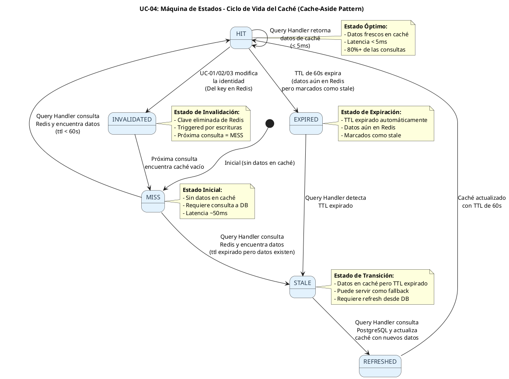
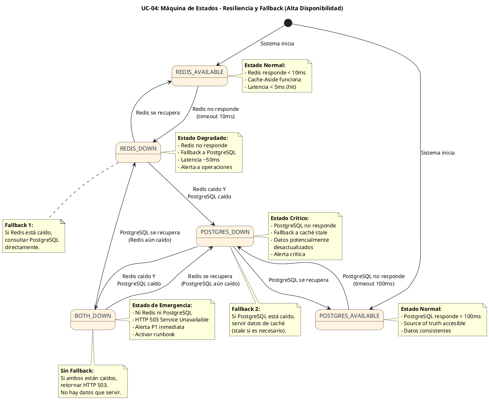
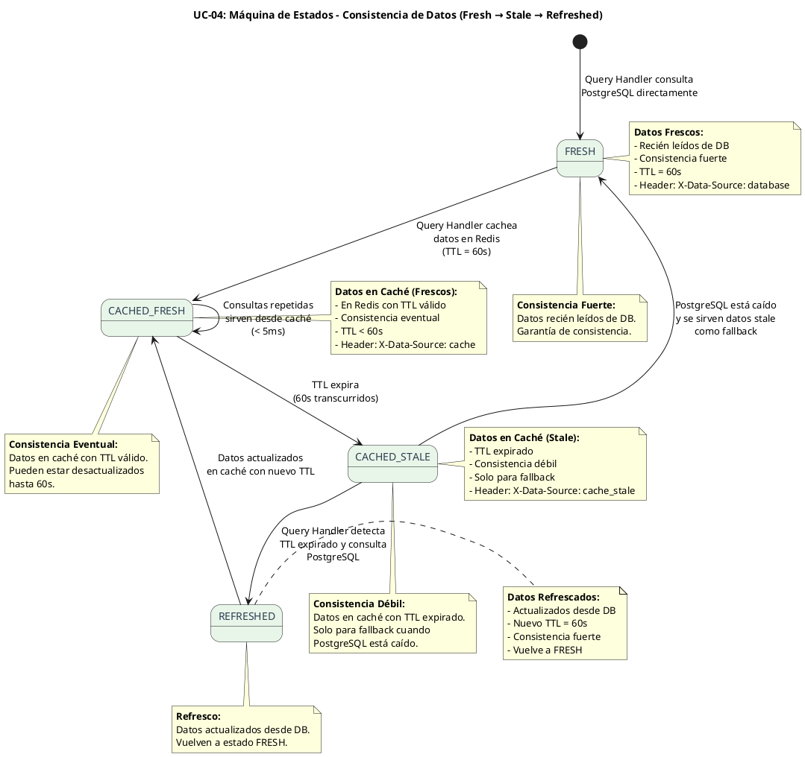

# UC-04: Consultar Identidad - Diagrama de Máquina de Estados

| Metadatos del Documento | |
| :--- | :--- |
| **Proyecto:** | SHUGO - Identity & Access Platform |
| **Caso de Uso:** | UC-04 - Consultar Identidad |
| **Documento:** | 05_State_Machine_Diagram.md |
| **Metodología:** | UML 2.5 + ICONIX + CQRS (Query Side) + Cache Lifecycle + Resilience Patterns |
| **Autor:** | Gastón Ruiz |
| **Versión Actual:** | 1.0.0 |
| **Fecha:** | 01/09/2026 |

---

## Historial de Versiones

| Versión | Fecha | Autor | Descripción de Cambios | Impacto |
| :--- | :--- | :--- | :--- | :--- |
| **1.0.0** | 01/09/2026 | Gastón Ruiz | **Creación inicial.** Definición de las máquinas de estados relevantes para UC-04. Aunque UC-04 es una operación de lectura pura (no muta estados de dominio), modela tres máquinas críticas: (1) Ciclo de Vida del Caché (Hit/Miss/Stale/Invalidated/Expired), (2) Máquina de Resiliencia (Redis Available → Redis Down → Fallback to DB), y (3) Máquina de Consistencia de Datos (Fresh → Stale → Refreshed). | Documento base del paquete de diseño Tier 1 del UC-04. Establece las reglas de transición que el `QueryHandler`, `CacheManager`, y `IdentityRepository` deben respetar para garantizar alto rendimiento, alta disponibilidad, y consistencia eventual aceptable. |

---

## 1. Introducción y Propósito

El **Diagrama de Máquina de Estados** para el UC-04 modela las restricciones de comportamiento temporal y las reglas de transición que gobiernan la consulta de identidades.

A diferencia de los UCs de escritura (UC-01, UC-02, UC-03) que modelan el ciclo de vida de la identidad, el UC-04 es una **operación de lectura pura** que no muta estados de dominio. Sin embargo, introduce tres máquinas de estados implícitas críticas:

1. **Máquina de Ciclo de Vida del Caché:** Modela cómo los datos fluyen entre Redis (caché) y PostgreSQL (source of truth), incluyendo estados de Hit, Miss, Stale, Invalidated, y Expired.
2. **Máquina de Resiliencia:** Modela las transiciones de disponibilidad de Redis y PostgreSQL, incluyendo fallbacks para alta disponibilidad.
3. **Máquina de Consistencia de Datos:** Modela cómo los datos pasan de Fresh (recién leídos de DB) a Stale (en caché pero potencialmente desactualizados) y de vuelta a Fresh.

Estas máquinas garantizan:
- **Alto Rendimiento:** 80%+ de las consultas servidas desde caché (< 5ms).
- **Alta Disponibilidad:** El sistema sigue operando incluso si Redis o PostgreSQL están caídos.
- **Consistencia Eventual Aceptable:** Los datos en caché pueden estar desactualizados hasta 60 segundos (TTL), lo cual es aceptable para operaciones de lectura.

---

## 2. Máquina de Estados #1: Ciclo de Vida del Caché (Cache Lifecycle)

### 2.1. Descripción

Esta máquina modela cómo los datos de identidad fluyen entre Redis (caché) y PostgreSQL (source of truth). Es fundamental para entender el patrón Cache-Aside y la invalidación perezosa.

### 2.2. Diagrama de Máquina de Estados (PlantUML)



### 2.3. Descripción de Estados y Transiciones

| Estado | Descripción | Transiciones de Salida | Invariante Clave |
| :--- | :--- | :--- | :--- |
| **MISS** | No hay datos en caché para la identidad consultada. | → `HIT` (si se consulta DB y se cachea), → `STALE` (si hay datos expirados) | Requiere consulta a PostgreSQL. Latencia ~50ms. |
| **HIT** | Datos frescos en caché con TTL válido (< 60s). | → `HIT` (consultas repetidas), → `INVALIDATED` (escritura en DB), → `EXPIRED` (TTL expira) | Latencia < 5ms. 80%+ de las consultas deben estar en este estado. |
| **STALE** | Datos en caché pero TTL expirado. Aún pueden servir como fallback. | → `REFRESHED` (se actualizan desde DB), → `MISS` (si se eliminan) | Pueden servir como fallback si PostgreSQL está caído. |
| **INVALIDATED** | Clave eliminada de Redis por escritura (UC-01/02/03). | → `MISS` (próxima consulta) | Invalidación perezosa: no se actualiza caché en escrituras, solo se elimina. |
| **EXPIRED** | TTL de 60s expiró automáticamente. Datos aún en Redis. | → `STALE` (detectado por Query Handler) | Redis mantiene los datos pero los marca como expirados. |
| **REFRESHED** | Datos actualizados desde PostgreSQL y cacheados con nuevo TTL. | → `HIT` (caché actualizado) | Caché actualizado con TTL de 60s. |

### 2.4. Invariantes de la Máquina de Caché

1. **TTL Estricto:** Los datos en caché tienen un TTL máximo de 60 segundos. Después de eso, se marcan como `EXPIRED` y eventualmente `STALE`.
2. **Invalidación Perezosa:** Las escrituras (UC-01/02/03) no actualizan caché, solo lo invalidan (`DEL key`). La próxima consulta repuebla el caché.
3. **Fallback Aceptable:** Los datos `STALE` pueden servir como fallback si PostgreSQL está caído, aunque estén desactualizados.
4. **Consistencia Eventual:** Los datos en caché pueden estar desactualizados hasta 60 segundos, lo cual es aceptable para operaciones de lectura.

---

## 3. Máquina de Estados #2: Resiliencia y Fallback (Resilience Machine)

### 3.1. Descripción

Esta máquina modela las transiciones de disponibilidad de Redis y PostgreSQL, incluyendo los patrones de fallback para garantizar alta disponibilidad.

### 3.2. Diagrama de Máquina de Estados (PlantUML)



### 3.3. Descripción de Estados y Transiciones

| Estado | Descripción | Transiciones de Salida | Invariante Clave |
| :--- | :--- | :--- | :--- |
| **REDIS_AVAILABLE** | Redis responde dentro del timeout (10ms). | → `REDIS_DOWN` (timeout), → `REDIS_AVAILABLE` (operación normal) | Cache-Aside funciona. 80%+ de consultas servidas desde caché. |
| **REDIS_DOWN** | Redis no responde o está caído. | → `REDIS_AVAILABLE` (recuperación), → `POSTGRES_DOWN` (si PostgreSQL también cae) | Fallback a PostgreSQL. Latencia ~50ms. Alerta a operaciones. |
| **POSTGRES_AVAILABLE** | PostgreSQL responde dentro del timeout (100ms). | → `POSTGRES_DOWN` (timeout), → `POSTGRES_AVAILABLE` (operación normal) | Source of truth accesible. Datos consistentes. |
| **POSTGRES_DOWN** | PostgreSQL no responde o está caído. | → `POSTGRES_AVAILABLE` (recuperación), → `BOTH_DOWN` (si Redis también cae) | Fallback a caché stale. Datos potencialmente desactualizados. Alerta crítica. |
| **BOTH_DOWN** | Ni Redis ni PostgreSQL están disponibles. | → `REDIS_DOWN` (PostgreSQL se recupera), → `POSTGRES_DOWN` (Redis se recupera) | HTTP 503 Service Unavailable. Alerta P1 inmediata. Activar runbook de emergencia. |

### 3.4. Invariantes de la Máquina de Resiliencia

1. **Timeouts Estrictos:** Redis tiene timeout de 10ms, PostgreSQL tiene timeout de 100ms. Si se excede, se considera "down".
2. **Fallback Automático:** Si Redis está caído, se consulta PostgreSQL directamente. Si PostgreSQL está caído, se sirve desde caché.
3. **Alertas Automáticas:** Cada transición a estado degradado dispara alertas al equipo de operaciones.
4. **Recuperación Automática:** Cuando Redis o PostgreSQL se recuperan, el sistema vuelve automáticamente al estado normal sin intervención manual.

---

## 4. Máquina de Estados #3: Consistencia de Datos (Data Consistency Machine)

### 4.1. Descripción

Esta máquina modela cómo los datos pasan de Fresh (recién leídos de DB) a Stale (en caché pero potencialmente desactualizados) y de vuelta a Fresh. Es fundamental para entender la consistencia eventual del sistema.

### 4.2. Diagrama de Máquina de Estados (PlantUML)



### 4.3. Descripción de Estados y Transiciones

| Estado | Descripción | Transiciones de Salida | Invariante Clave |
| :--- | :--- | :--- | :--- |
| **FRESH** | Datos recién leídos de PostgreSQL. | → `CACHED_FRESH` (se cachean en Redis) | Consistencia fuerte. Header: `X-Data-Source: database`. |
| **CACHED_FRESH** | Datos en caché Redis con TTL válido (< 60s). | → `CACHED_FRESH` (consultas repetidas), → `CACHED_STALE` (TTL expira) | Consistencia eventual. Pueden estar desactualizados hasta 60s. Header: `X-Data-Source: cache`. |
| **CACHED_STALE** | Datos en caché Redis con TTL expirado. | → `REFRESHED` (se actualizan desde DB), → `FRESH` (fallback si PostgreSQL está caído) | Consistencia débil. Solo para fallback. Header: `X-Data-Source: cache_stale`. |
| **REFRESHED** | Datos actualizados desde PostgreSQL y cacheados con nuevo TTL. | → `CACHED_FRESH` (caché actualizado) | Consistencia fuerte. Nuevo TTL de 60s. |

### 4.4. Invariantes de la Máquina de Consistencia

1. **TTL de 60 Segundos:** Los datos en caché tienen un TTL máximo de 60 segundos. Después de eso, se marcan como `CACHED_STALE`.
2. **Header de Fuente de Datos:** Cada respuesta incluye un header `X-Data-Source` que indica si los datos son `database`, `cache`, o `cache_stale`.
3. **Fallback Aceptable:** Los datos `CACHED_STALE` pueden servir como fallback si PostgreSQL está caído, aunque estén desactualizados.
4. **Refresco Automático:** Cuando se detecta TTL expirado, el Query Handler consulta PostgreSQL y actualiza el caché automáticamente.

---

## 5. Implementación en el Dominio (Código C#)

### 5.1. Máquina de Ciclo de Vida del Caché en `RedisCacheManager`

```csharp
public class RedisCacheManager : ICacheManager
{
    private readonly IConnectionMultiplexer _redis;
    private readonly ILogger<RedisCacheManager> _logger;
    private const string CACHE_KEY_PREFIX = "identity:";
    private const int DEFAULT_TTL_SECONDS = 60;

    public async Task<CacheState> GetCacheStateAsync(TenantId tenantId, IdentityId identityId)
    {
        try
        {
            var db = _redis.GetDatabase();
            var cacheKey = $"{CACHE_KEY_PREFIX}{tenantId.Value}:{identityId.Value}";
            
            // Intentar obtener datos con TTL
            var cachedJson = await db.StringGetAsync(cacheKey);
            
            if (cachedJson.IsNullOrEmpty)
            {
                return CacheState.MISS; // No hay datos en caché
            }

            // Verificar TTL restante
            var ttl = await db.KeyTimeToLiveAsync(cacheKey);
            
            if (ttl.HasValue && ttl.Value.TotalSeconds > 0)
            {
                return CacheState.HIT; // Datos frescos en caché
            }
            else
            {
                return CacheState.STALE; // TTL expirado pero datos aún existen
            }
        }
        catch (RedisConnectionException)
        {
            return CacheState.REDIS_DOWN; // Redis no disponible
        }
    }

    public async Task InvalidateAsync(TenantId tenantId, IdentityId identityId)
    {
        try
        {
            var db = _redis.GetDatabase();
            var cacheKey = $"{CACHE_KEY_PREFIX}{tenantId.Value}:{identityId.Value}";
            
            await db.KeyDeleteAsync(cacheKey);
            _logger.LogDebug("Cache invalidated for identity {IdentityId} in tenant {TenantId}", 
                identityId, tenantId);
        }
        catch (RedisConnectionException ex)
        {
            _logger.LogWarning(ex, "Redis unavailable, cache invalidation failed");
        }
    }
}

public enum CacheState
{
    MISS,           // No hay datos en caché
    HIT,            // Datos frescos en caché (TTL válido)
    STALE,          // Datos en caché pero TTL expirado
    REDIS_DOWN      // Redis no disponible
}
```

### 5.2. Máquina de Resiliencia en `QueryHandler`

```csharp
public class QueryHandler : IQueryHandler
{
    private readonly ICacheManager _cacheManager;
    private readonly IIdentityRepository _repository;
    private readonly IPIIMasker _piiMasker;
    private readonly ILogger<QueryHandler> _logger;

    public async Task<IdentityQueryResult> Execute(IdentityQuery query, Actor actor)
    {
        // Máquina de Resiliencia: Evaluar estado de Redis
        var cacheState = await _cacheManager.GetCacheStateAsync(query.TenantId, query.IdentityId.Value);

        switch (cacheState)
        {
            case CacheState.HIT:
                // Estado: REDIS_AVAILABLE + CACHED_FRESH
                var cachedIdentity = await _cacheManager.GetAsync(query.TenantId, query.IdentityId.Value);
                var result = ApplyDetailLevel(cachedIdentity!, actor);
                return new IdentityQueryResult(result, dataSource: "cache", isMasked: actor.IsSelfService);

            case CacheState.STALE:
                // Estado: REDIS_AVAILABLE + CACHED_STALE
                // Intentar refrescar desde DB
                try
                {
                    var freshIdentity = await _repository.GetByIdAsync(query.TenantId, query.IdentityId.Value);
                    if (freshIdentity != null)
                    {
                        await _cacheManager.SetAsync(query.TenantId, query.IdentityId.Value, freshIdentity, 
                            TimeSpan.FromSeconds(60));
                        var refreshedResult = ApplyDetailLevel(freshIdentity, actor);
                        return new IdentityQueryResult(refreshedResult, dataSource: "database", isMasked: actor.IsSelfService);
                    }
                }
                catch (PostgreSqlException)
                {
                    // Fallback: servir datos stale
                    _logger.LogWarning("PostgreSQL unavailable, serving stale data from cache");
                    var staleIdentity = await _cacheManager.GetStaleAsync(query.TenantId, query.IdentityId.Value);
                    if (staleIdentity != null)
                    {
                        var staleResult = ApplyDetailLevel(staleIdentity, actor);
                        return new IdentityQueryResult(staleResult, dataSource: "cache_stale", isMasked: actor.IsSelfService);
                    }
                }
                break;

            case CacheState.MISS:
                // Estado: REDIS_AVAILABLE + MISS
                // Consultar DB y cachea
                try
                {
                    var identity = await _repository.GetByIdAsync(query.TenantId, query.IdentityId.Value);
                    if (identity != null)
                    {
                        await _cacheManager.SetAsync(query.TenantId, query.IdentityId.Value, identity, 
                            TimeSpan.FromSeconds(60));
                        var dbResult = ApplyDetailLevel(identity, actor);
                        return new IdentityQueryResult(dbResult, dataSource: "database", isMasked: actor.IsSelfService);
                    }
                    else
                    {
                        throw new IdentityNotFoundException(query.IdentityId.Value);
                    }
                }
                catch (PostgreSqlException ex)
                {
                    _logger.LogError(ex, "PostgreSQL unavailable");
                    throw new ServiceUnavailableException("Database unavailable. Please try again later.");
                }

            case CacheState.REDIS_DOWN:
                // Estado: REDIS_DOWN
                // Fallback a PostgreSQL directamente
                _logger.LogWarning("Redis unavailable, falling back to PostgreSQL");
                try
                {
                    var identity = await _repository.GetByIdAsync(query.TenantId, query.IdentityId.Value);
                    if (identity != null)
                    {
                        var dbResult = ApplyDetailLevel(identity, actor);
                        return new IdentityQueryResult(dbResult, dataSource: "database", isMasked: actor.IsSelfService);
                    }
                    else
                    {
                        throw new IdentityNotFoundException(query.IdentityId.Value);
                    }
                }
                catch (PostgreSqlException)
                {
                    // Estado: BOTH_DOWN
                    _logger.LogCritical("Both Redis and PostgreSQL unavailable");
                    throw new ServiceUnavailableException("Database and cache unavailable. Please try again later.");
                }
        }

        throw new ServiceUnavailableException("Unable to retrieve identity data.");
    }
}
```

### 5.3. Máquina de Consistencia de Datos en `IdentityQueryResult`

```csharp
public class IdentityQueryResult
{
    public Identity? Identity { get; }
    public List<Identity>? Identities { get; }
    public PaginationMetadata? Pagination { get; }
    public string DataSource { get; }
    public bool IsMasked { get; }
    public DataConsistency Consistency { get; }

    public IdentityQueryResult(Identity identity, string dataSource, bool isMasked)
    {
        Identity = identity ?? throw new ArgumentNullException(nameof(identity));
        DataSource = dataSource ?? throw new ArgumentNullException(nameof(dataSource));
        IsMasked = isMasked;
        
        // Determinar consistencia según fuente de datos
        Consistency = dataSource switch
        {
            "database" => DataConsistency.STRONG,
            "cache" => DataConsistency.EVENTUAL,
            "cache_stale" => DataConsistency.WEAK,
            _ => DataConsistency.UNKNOWN
        };
    }
}

public enum DataConsistency
{
    STRONG,     // Datos frescos de DB (FRESH)
    EVENTUAL,   // Datos en caché con TTL válido (CACHED_FRESH)
    WEAK,       // Datos en caché con TTL expirado (CACHED_STALE)
    UNKNOWN     // Fuente desconocida
}
```

---

## 6. Trazabilidad con Otros Documentos del Paquete

| Documento | Relación |
| :--- | :--- |
| `01_Requirements_Specification.md` | Las invariantes de Cache-Aside (RN-01), consistencia eventual (RN-02), y fallback (RN-06) se definen aquí y se hacen cumplir en estas máquinas. |
| `02_Use_Case_Diagram.md` | Muestra los actores; estas máquinas definen cómo el sistema responde a sus consultas a lo largo del tiempo. |
| `03_Activity_Diagram.md` | Los carriles de actividad (Cache Manager, Identity Repository) se implementan aquí como máquinas de estados. |
| `04_Initial_Domain_Model.md` | El `QueryHandler`, `CacheManager`, y `IdentityRepository` son la implementación directa de estas máquinas. |
| `06_Robustness_Diagram.md` | Mostrará cómo los objetos colaboran para ejecutar estas transiciones de estado. |
| `07_Sequence_Diagram.md` | Detallará el orden temporal exacto de las llamadas que disparan estas transiciones. |
| `10_UC_Specific_Data_Model.md` | Define los índices de PostgreSQL optimizados para las consultas de estas máquinas. |
| `11_UC_Specific_Security_Threats.md` | Las amenazas de "Cache Poisoning" y "Stale Data Attacks" se mitigan con las invariantes de estas máquinas. |
| `12_UC_Specific_Performance_Benchmarks.md` | Los SLAs de latencia (< 5ms para cache hit, < 50ms para DB query) se validan con estas máquinas. |

---

## 7. Notas de Implementación

### 7.1. Testing de Máquinas de Estados

Cada transición definida en estas máquinas debe tener al menos dos tests unitarios:
1. **Happy Path:** Verificar que la transición válida actualiza el estado correctamente.
2. **Invalid Transition:** Verificar que intentar una transición ilegal maneja el error apropiadamente.

```csharp
[Test]
public async Task CacheManager_WhenRedisAvailable_ReturnsHit()
{
    // Arrange
    var mockRedis = new Mock<IConnectionMultiplexer>();
    var mockDb = new Mock<IDatabase>();
    mockRedis.Setup(r => r.GetDatabase()).Returns(mockDb.Object);
    mockDb.Setup(db => db.StringGetAsync(It.IsAny<RedisKey>()))
          .ReturnsAsync("{\"id\":\"test\"}");
    mockDb.Setup(db => db.KeyTimeToLiveAsync(It.IsAny<RedisKey>()))
          .ReturnsAsync(TimeSpan.FromSeconds(30));

    var cacheManager = new RedisCacheManager(mockRedis.Object, Mock.Of<ILogger<RedisCacheManager>>());

    // Act
    var state = await cacheManager.GetCacheStateAsync(new TenantId(Guid.NewGuid()), new IdentityId(Guid.NewGuid()));

    // Assert
    state.Should().Be(CacheState.HIT);
}

[Test]
public async Task QueryHandler_WhenRedisDown_FallsBackToPostgres()
{
    // Arrange
    var mockCacheManager = new Mock<ICacheManager>();
    mockCacheManager.Setup(c => c.GetCacheStateAsync(It.IsAny<TenantId>(), It.IsAny<IdentityId>()))
                    .ReturnsAsync(CacheState.REDIS_DOWN);

    var mockRepository = new Mock<IIdentityRepository>();
    var identity = new Identity(/* ... */);
    mockRepository.Setup(r => r.GetByIdAsync(It.IsAny<TenantId>(), It.IsAny<IdentityId>()))
                  .ReturnsAsync(identity);

    var handler = new QueryHandler(
        mockCacheManager.Object,
        mockRepository.Object,
        Mock.Of<IPIIMasker>(),
        Mock.Of<ILogger<QueryHandler>>());

    var query = new IdentityQuery(new TenantId(Guid.NewGuid()), new IdentityId(Guid.NewGuid()));
    var actor = new Actor(Guid.NewGuid(), query.TenantId, ActorScope.Admin, new List<string> { "identity:read" });

    // Act
    var result = await handler.Execute(query, actor);

    // Assert
    result.DataSource.Should().Be("database");
    result.Consistency.Should().Be(DataConsistency.STRONG);
    mockRepository.Verify(r => r.GetByIdAsync(It.IsAny<TenantId>(), It.IsAny<IdentityId>()), Times.Once);
}
```

### 7.2. Concurrencia y Race Conditions

Dado que múltiples Query Handlers pueden consultar y actualizar caché simultáneamente, se deben considerar las siguientes race conditions:

1. **Thundering Herd Problem:** Múltiples consultas llegan simultáneamente a un caché vacío (MISS), todas consultan PostgreSQL y actualizan caché.
   - **Mitigación:** Usar locks distribuidos en Redis (`SETNX`) para que solo un Query Handler consulte PostgreSQL y los demás esperen.

2. **Stale Write Problem:** Un Query Handler lee datos stale de caché mientras otro está actualizando desde PostgreSQL.
   - **Mitigación:** Aceptar consistencia eventual. Los datos stale son aceptables para lecturas.

3. **Cache Invalidation Race:** UC-02 actualiza una identidad e invalida caché, pero un Query Handler ya leyó los datos viejos y los está cacheando.
   - **Mitigación:** Usar versionamiento (RowVersion) para detectar y rechazar actualizaciones de caché con datos viejos.

---
*Fin del Documento 05_State_Machine_Diagram para UC-04*