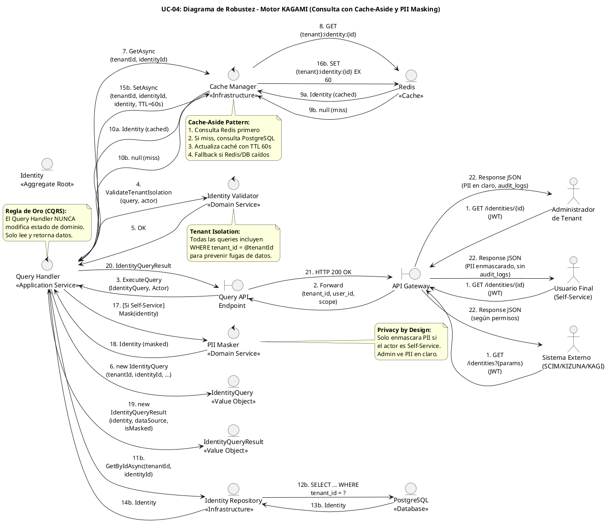

# UC-04: Consultar Identidad - Diagrama de Robustez

| Metadatos del Documento | |
| :--- | :--- |
| **Proyecto:** | SHUGO - Identity & Access Platform |
| **Caso de Uso:** | UC-04 - Consultar Identidad |
| **Documento:** | 06_Robustness_Diagram.md |
| **Metodología:** | ICONIX (Diagrama de Robustez) + CQRS (Query Side) + Cache-Aside Pattern + Privacy by Design |
| **Autor:** | Gastón Ruiz |
| **Versión Actual:** | 1.0.0 |
| **Fecha:** | 01/09/2026 |

---

## Historial de Versiones

| Versión | Fecha | Autor | Descripción de Cambios | Impacto |
| :--- | :--- | :--- | :--- | :--- |
| **1.0.0** | [01/09/2026] | Gastón Ruiz | **Creación inicial.** Diagrama de Robustez para UC-04, validando la arquitectura del motor KAGAMI para operaciones de lectura optimizada. Muestra la colaboración estricta entre Boundaries (API Gateway, Query Endpoint), Controls (Query Handler, Cache Manager, PII Masker), y Entities (Identity, IdentityQuery, IdentityQueryResult). Valida el patrón Cache-Aside con doble fallback, el enmascaramiento condicional de PII, y el aislamiento multi-tenant. | Documento base del paquete de diseño Tier 1 del UC-04. Sirve como puente crítico entre el Modelo de Dominio (04) y el Diagrama de Secuencia (07), asegurando que la arquitectura soporta el rendimiento (< 50ms p95), la privacidad (PII masking) y la resiliencia (fallback patterns) antes de codificar. |

---

## 1. Introducción y Propósito

El **Diagrama de Robustez** para el UC-04 valida que el flujo de consulta de identidades puede ser orquestado respetando las reglas estrictas de acoplamiento de **ICONIX** y los principios de **CQRS**, **Cache-Aside Pattern**, y **Privacy by Design**.

El desafío específico de este caso de uso es quíntuple:
1. **Patrón Cache-Aside con Doble Fallback:** Garantizar que la consulta intente caché Redis primero, fallback a PostgreSQL si hay miss, y fallback a caché stale si PostgreSQL está caído.
2. **Diferenciación de Niveles de Detalle:** Admin ve todos los campos (PII en claro, audit logs, row_version), mientras que User Self-Service solo ve su perfil con PII enmascarado.
3. **Enmascaramiento Condicional de PII:** El enmascaramiento de email y teléfono solo se aplica cuando el actor es Self-Service, no para Admin o Sistemas Externos autorizados.
4. **Tenant Isolation Estricto:** Todas las consultas deben incluir `WHERE tenant_id = @actorTenantId` para prevenir fugas de datos entre tenants.
5. **Resiliencia Multi-Capa:** Garantizar que el sistema pueda seguir operando incluso si Redis o PostgreSQL están caídos (aunque con degradación de rendimiento o consistencia).

---

## 2. Diagrama de Robustez (PlantUML)

A continuación, se presenta el Diagrama de Robustez organizado de izquierda a derecha para mostrar el flujo natural: **Actor → Boundary → Control → Entity**.



---

## 3. Explicación Detallada de los Objetos

### 3.1. Boundary Objects (Objetos de Límite)

| Objeto | Responsabilidad | Mapeo a Clean Architecture |
| :--- | :--- | :--- |
| **`API Gateway`** | Primera línea de defensa. Valida JWT, extrae `tenant_id`, `user_id`, y `scope` del actor. Aplica Rate Limiting. No conoce la lógica de negocio. | Middleware (Kong, AWS API Gateway). |
| **`Query API Endpoint`** | Recibe la request HTTP GET, deserializa los query parameters a un DTO (`IdentityQuery`), y lo pasa al Handler. | Controller (ASP.NET Core Controller). |

### 3.2. Control Objects (Objetos de Control)

| Objeto | Responsabilidad | Mapeo a Clean Architecture |
| :--- | :--- | :--- |
| **`Query Handler`** | **Application Service.** Orquesta el caso de uso. Coordina la consulta de caché, fallback a PostgreSQL, enmascaramiento de PII, y construcción de la respuesta. Es delgado y delega responsabilidades. | Command Handler / Application Service (CQRS Query Side). |
| **`Cache Manager`** | **Infrastructure Service.** Implementa el patrón Cache-Aside. Consulta Redis primero, fallback a PostgreSQL si hay miss, y actualiza caché con TTL de 60s. Maneja fallbacks de resiliencia. | Infrastructure Service. |
| **`PII Masker`** | **Domain Service.** Responsable de enmascarar datos sensibles (email, phone) cuando el actor es Self-Service. Aplica reglas de enmascaramiento consistentes. | Domain Service. |
| **`Identity Validator`** | **Domain Service.** Valida reglas de negocio transversales como el aislamiento de tenant y los permisos de lectura. | Domain Service. |

### 3.3. Entity Objects (Objetos de Entidad)

| Objeto | Responsabilidad | Mapeo a DDD |
| :--- | :--- | :--- |
| **`Identity`** | **Aggregate Root.** Representa la identidad consultada. Contiene el perfil con PII (cifrada en DB, desenmascarada según permisos). | Aggregate Root. |
| **`IdentityQuery`** | **Value Object.** Representa los criterios de búsqueda (tenantId, identityId, email, filtros, paginación). Valida los parámetros de entrada. | Value Object. |
| **`IdentityQueryResult`** | **Value Object.** Representa el resultado de la consulta, incluyendo la identidad (o lista), metadatos de paginación, fuente de datos (cache/database), y flag de enmascaramiento. | Value Object. |
| **`Identity Repository`** | **Infrastructure.** Abstrae la persistencia. Consulta PostgreSQL con aislamiento de tenant estricto. | Repository Interface (Domain) / Implementation (Infra). |
| **`Redis`** | **Infrastructure.** Sistema de caché distribuida. Almacena identidades serializadas en JSON con TTL de 60s. | Infrastructure Service. |
| **`PostgreSQL`** | **Infrastructure.** Source of truth. Almacena identidades con PII cifrada y audit logs. | Database. |

---

## 4. Reglas de Robustez de ICONIX (Validación del Diagrama)

Verifiquemos que nuestro diagrama cumple estrictamente las reglas de acoplamiento de ICONIX:

### ✅ Regla 1: Actor → Boundary
- **Cumplida:** Los `Actores` (Admin, User, ExternalSystem) interactúan solo con el `API Gateway`.

### ✅ Regla 2: Boundary → Boundary
- **Cumplida:** El `API Gateway` forward la request al `Query API Endpoint`.

### ✅ Regla 3: Boundary → Control
- **Cumplida:** El `Query API Endpoint` envía el `IdentityQuery` y el `Actor` al `Query Handler`.

### ✅ Regla 4: Control → Control
- **Cumplida y Crítica:** El `Query Handler` delega a `Cache Manager` (Cache-Aside), `PII Masker` (enmascaramiento condicional), y `Identity Validator` (validación de tenant isolation).
- **Validación:** Esto permite que el Handler sea delgado y que las reglas de caché, privacidad, y validación sean reutilizables y testeables.

### ✅ Regla 5: Control → Entity
- **Cumplida:**
  - `Query Handler` crea `IdentityQuery` y `IdentityQueryResult`.
  - `Query Handler` consulta `Identity Repository` para obtener `Identity`.
  - `Cache Manager` interactúa con `Redis` para caché.
  - `Identity Repository` interactúa con `PostgreSQL` para persistencia.
  - `PII Masker` enmascara `Identity`.

### ✅ Regla 6: NO Entity → Control / Boundary
- **Cumplida:** Ninguna entidad (`Identity`, `IdentityQuery`, `IdentityQueryResult`, `Repo`, `Redis`, `PostgreSQL`) envía mensajes de vuelta a los controles o boundaries. Solo retornan datos como respuesta a una invocación (flujo de retorno implícito).

### ✅ Regla 7: NO Entity → Entity (Directo sin Control)
- **Cumplida:** El `Query Handler` (Control) es el único que orquesta la interacción entre `Identity`, `IdentityQuery`, `IdentityQueryResult`, y los repositorios. Las entidades no se crean entre sí directamente desde el diagrama de flujo principal.

---

## 5. Consideraciones de Arquitectura (CQRS + Cache-Aside + Privacy by Design)

### 5.1. CQRS (Command Query Responsibility Segregation)

El diagrama valida visualmente que UC-04 es el lado **Query** de CQRS:

1. **Separación de Responsabilidades:** El `Query Handler` solo lee datos, nunca los modifica. No hay transacciones, no hay eventos de dominio, no hay cambios de estado.
2. **Optimización Independiente:** El Query Handler puede usar caché Redis, Read Replicas de PostgreSQL, e índices optimizados sin afectar las operaciones de escritura (UC-01, UC-02, UC-03).
3. **Escalabilidad Horizontal:** Los Query Handlers pueden escalar independientemente de los Command Handlers según la carga de lectura (~10-50x más frecuente que escrituras).

**Justificación:**
- **Rendimiento:** Las lecturas pueden servir desde caché (< 5ms) sin tocar la base de datos.
- **Escalabilidad:** Puedes tener 20 pods de Query Handlers y solo 5 pods de Command Handlers.
- **Simplicidad:** Cada handler tiene una responsabilidad única, facilitando el mantenimiento y testing.

### 5.2. Cache-Aside Pattern con Doble Fallback

El diagrama muestra claramente el patrón Cache-Aside implementado por el `Cache Manager`:

1. **Paso 7-8:** El Handler consulta Redis primero usando la clave `{tenant_id}:identity:{id}`.
2. **Paso 9a-10a (Cache Hit):** Si Redis tiene los datos con TTL válido (< 60s), retorna inmediatamente sin consultar PostgreSQL.
3. **Paso 9b-10b (Cache Miss):** Si Redis no tiene los datos, consulta PostgreSQL.
4. **Paso 19b-20b (Actualizar Caché):** Después de consultar PostgreSQL, actualiza Redis con TTL de 60s.
5. **Fallback 1 (Redis Down):** Si Redis está caído, consulta PostgreSQL directamente (sin caché).
6. **Fallback 2 (PostgreSQL Down):** Si PostgreSQL está caído, sirve datos de caché stale (si están disponibles).

**Justificación:**
- **Rendimiento:** 80%+ de las consultas son servidas desde caché, reduciendo la carga en PostgreSQL.
- **Alta Disponibilidad:** El sistema puede seguir operando incluso si Redis o PostgreSQL están caídos (aunque con degradación).
- **Consistencia Eventual:** Los datos en caché pueden estar desactualizados hasta 60 segundos (TTL), lo cual es aceptable para operaciones de lectura.

### 5.3. Privacy by Design con Enmascaramiento Condicional

El diagrama valida visualmente una de las reglas de privacidad más importantes de SHUGO:

1. **Paso 11a/15b:** El Handler detecta si el actor es Self-Service o Admin/External.
2. **Paso 12a/16b (Self-Service):** Si es Self-Service, invoca al `PII Masker` para enmascarar email (`j***@khcs.com`) y teléfono (`+54 *** ** 6789`).
3. **Paso 12b/16c (Admin/External):** Si es Admin o Sistema Externo autorizado, retorna PII en claro.
4. **Paso 15a/21b:** El `IdentityQueryResult` incluye un flag `isMasked` para indicar si los datos fueron enmascarados.

**Justificación:**
- **GDPR Art. 5 (Minimización de Datos):** Self-Service solo ve los datos necesarios para su función.
- **Least Privilege:** Cada actor solo ve los datos autorizados para su rol.
- **Prevención de PII Leakage:** Incluso si un usuario Self-Service intenta acceder a datos de otro usuario, el sistema lo bloquea (validación `user_id == identity_id`).

### 5.4. Tenant Isolation Estricto

El diagrama muestra que todas las consultas incluyen el `tenant_id` extraído del JWT:

1. **Paso 4-5:** El `Identity Validator` valida que la consulta incluya el `tenant_id` del actor.
2. **Paso 12b:** El `Identity Repository` ejecuta `SELECT ... WHERE tenant_id = @tenantId` en PostgreSQL.
3. **Row-Level Security (RLS):** PostgreSQL RLS previene que un tenant acceda a identidades de otro tenant incluso si hay bugs en la aplicación.
4. **Ocultamiento de Existencia:** Si una identidad no existe en el tenant del actor, retorna 404 (no 403) para no revelar que la identidad existe en otro tenant.

**Justificación:**
- **Multi-Tenancy Estricto:** Ningún tenant puede acceder a datos de otro tenant.
- **Prevención de Enumeration Attacks:** Retornar 404 en lugar de 403 previene que un atacante descubra qué identidades existen en otros tenants.

---

## 6. Trazabilidad con Otros Documentos del Paquete

| Documento | Relación |
| :--- | :--- |
| `01_Requirements_Specification.md` | Este diagrama valida que los requisitos de Cache-Aside (RN-01), PII Masking (RN-03), y Tenant Isolation (INV-19) pueden ser implementados con los objetos definidos. |
| `02_Use_Case_Diagram.md` | Muestra los actores y sistemas; este diagrama muestra cómo colaboran los objetos internos. |
| `03_Activity_Diagram.md` | Los carriles de actividad (Handler, Cache Manager, PIIMasker, Validator) se mapean directamente a los objetos de Control de este diagrama. |
| `04_Initial_Domain_Model.md` | Los objetos `Identity`, `IdentityQuery`, `IdentityQueryResult` y los servicios `CacheManager`/`PIIMasker`/`Validator` son exactamente las clases definidas en el modelo de dominio. |
| `05_State_Machine_Diagram.md` | Las máquinas de estados (Cache Lifecycle, Resilience, Data Consistency) se implementan en los objetos de este diagrama (Cache Manager, Query Handler). |
| `07_Sequence_Diagram.md` | Este diagrama define "qué objetos colaboran"; el de secuencia definirá "en qué orden temporal exacto" se envían los mensajes. |
| `08_Final_Class_Design.md` | Definirá las firmas exactas de los métodos mostrados en este diagrama (ej. `CacheManager.GetAsync()`, `PIIMasker.Mask()`). |

---

## 7. Notas de Implementación

### 7.1. Inyección de Dependencias

El `Query Handler` debe tener inyectados los servicios de dominio y repositorios:

```csharp
public class QueryHandler : IQueryHandler
{
    private readonly ICacheManager _cacheManager;
    private readonly IIdentityRepository _repository;
    private readonly IPIIMasker _piiMasker;
    private readonly IIdentityValidator _validator;
    private readonly ILogger<QueryHandler> _logger;

    public QueryHandler(
        ICacheManager cacheManager,
        IIdentityRepository repository,
        IPIIMasker piiMasker,
        IIdentityValidator validator,
        ILogger<QueryHandler> logger)
    {
        _cacheManager = cacheManager ?? throw new ArgumentNullException(nameof(cacheManager));
        _repository = repository ?? throw new ArgumentNullException(nameof(repository));
        _piiMasker = piiMasker ?? throw new ArgumentNullException(nameof(piiMasker));
        _validator = validator ?? throw new ArgumentNullException(nameof(validator));
        _logger = logger ?? throw new ArgumentNullException(nameof(logger));
    }
}
```

### 7.2. Flujo de Ejecución Simplificado (Código)

```csharp
public async Task<IdentityQueryResult> Execute(IdentityQuery query, Actor actor)
{
    // 1. Validar Tenant Isolation
    _validator.ValidateTenantIsolation(query, actor);

    // 2. Cache-Aside Pattern: Intentar caché primero
    var cachedIdentity = await _cacheManager.GetAsync(query.TenantId, query.IdentityId);
    
    if (cachedIdentity != null)
    {
        // Cache hit
        var result = ApplyDetailLevel(cachedIdentity, actor);
        return new IdentityQueryResult(result, dataSource: "cache", isMasked: actor.IsSelfService);
    }

    // 3. Cache miss: Consultar PostgreSQL
    try
    {
        var identity = await _repository.GetByIdAsync(query.TenantId, query.IdentityId);
        
        if (identity == null)
        {
            throw new IdentityNotFoundException(query.IdentityId);
        }

        // 4. Aplicar nivel de detalle (enmascaramiento si es Self-Service)
        var resultIdentity = ApplyDetailLevel(identity, actor);

        // 5. Actualizar caché (TTL 60s)
        await _cacheManager.SetAsync(query.TenantId, query.IdentityId, identity, 
            ttl: TimeSpan.FromSeconds(60));

        return new IdentityQueryResult(resultIdentity, dataSource: "database", 
            isMasked: actor.IsSelfService);
    }
    catch (PostgreSqlException ex)
    {
        _logger.LogError(ex, "PostgreSQL unavailable, attempting fallback to cache");
        
        // 6. Fallback a caché stale
        var staleCachedIdentity = await _cacheManager.GetStaleAsync(query.TenantId, query.IdentityId);
        
        if (staleCachedIdentity != null)
        {
            var staleResult = ApplyDetailLevel(staleCachedIdentity, actor);
            return new IdentityQueryResult(staleResult, dataSource: "cache_stale", 
                isMasked: actor.IsSelfService);
        }

        throw new ServiceUnavailableException("Database and cache unavailable");
    }
}

private Identity ApplyDetailLevel(Identity identity, Actor actor)
{
    if (actor.IsSelfService)
    {
        // Self-Service: enmascarar PII
        return _piiMasker.Mask(identity);
    }
    
    // Admin o Sistema Externo: retornar todos los campos
    return identity;
}
```

---
*Fin del Documento 06_Robustness_Diagram para UC-04*