# UC-04: Consultar Identidad - Diagrama de Secuencia

| Metadatos del Documento | |
| :--- | :--- |
| **Proyecto:** | SHUGO - Identity & Access Platform |
| **Caso de Uso:** | UC-04 - Consultar Identidad |
| **Documento:** | 07_Sequence_Diagram.md |
| **Metodología:** | ICONIX (Diagrama de Secuencia) + CQRS (Query Side) + Cache-Aside Pattern + Privacy by Design |
| **Autor:** | Gastón Ruiz |
| **Versión Actual:** | 1.0.0 |
| **Fecha:** | 02/09/2026 |

---

## Historial de Versiones

| Versión | Fecha | Autor | Descripción de Cambios | Impacto |
| :--- | :--- | :--- | :--- | :--- |
| **1.0.0** | 02/09/2026 | Gastón Ruiz | **Creación inicial.** Diagrama de Secuencia completo para UC-04. Modela la orquestación temporal exacta de la consulta de identidades, destacando el patrón Cache-Aside con doble fallback (Redis → PostgreSQL → Caché stale), el enmascaramiento condicional de PII según el actor, la validación de tenant isolation, y la construcción de respuesta con metadatos de fuente de datos (X-Data-Source). | Documento base del paquete de diseño Tier 1 del UC-04. Sirve como guion exacto para la codificación del `QueryHandler`, la gestión del Cache-Aside Pattern, y la integración de los servicios de infraestructura (CacheManager, IdentityRepository, PIIMasker). |

---

## 1. Introducción y Propósito

El **Diagrama de Secuencia** para el UC-04 materializa temporalmente las colaboraciones definidas en el Diagrama de Robustez. Su propósito es:

1. **Definir el orden exacto de las operaciones:** Establecer la secuencia crítica donde la consulta de caché ocurre *antes* de consultar PostgreSQL, y el enmascaramiento de PII ocurre *después* de obtener los datos.
2. **Modelar el patrón Cache-Aside con doble fallback:** Mostrar cómo el sistema intenta Redis primero, fallback a PostgreSQL si hay miss, y fallback a caché stale si PostgreSQL está caído.
3. **Visualizar la lógica condicional:** Mostrar cómo el enmascaramiento de PII solo se ejecuta cuando el actor es Self-Service, y cómo los headers de respuesta (X-Data-Source) indican la fuente de datos.
4. **Demostrar el manejo de errores en cada capa:** Mostrar cómo cada fallo (Redis down, PostgreSQL down, identidad no encontrada) retorna un código HTTP específico sin comprometer la disponibilidad del sistema.

---

## 2. Diagrama de Secuencia - Escenario Principal (PlantUML)

A continuación, se presenta el Diagrama de Secuencia para el **Escenario Principal (consulta exitosa con cache hit)**, el escenario de **cache miss con consulta a PostgreSQL**, y los **flujos de excepción** (Redis/PostgreSQL down, identidad no encontrada).

```plantuml
@startuml UC-04_Secuencia
<style>
diagram {
  BackgroundColor #FEFEFE
}
sequence {
  ArrowThickness 2
  ArrowColor #2C3E50
  ParticipantPadding 20
  BoxPadding 10
}
</style>

title UC-04: Diagrama de Secuencia - Consulta de Identidad con Cache-Aside y PII Masking

' ============================================
' PARTICIPANTES (Lifelines)
' ============================================
actor "Actor\n(Admin/User/External)" as Actor
participant "API Gateway" as GW
participant "Query API\nEndpoint" as API
participant "Query Handler\n<<Application>>" as Handler
participant "Identity Validator\n<<Domain>>" as Validator
participant "Cache Manager\n<<Infrastructure>>" as CacheManager
database "Redis\n<<Cache>>" as Redis
participant "Identity Repository\n<<Infrastructure>>" as Repo
database "PostgreSQL\n<<Database>>" as DB
participant "PII Masker\n<<Domain>>" as PIIMasker

' ============================================
' FASE 1: AUTENTICACIÓN Y ENRUTAMIENTO (Pasos 1-5)
' ============================================
Actor -> GW : 1. GET /identities/{id}\n(Authorization: Bearer JWT)
activate GW

GW -> GW : 2. Validar firma JWT\n(JWKS)
GW -> GW : 3. Extraer tenant_id,\nuser_id, scope

alt JWT inválido o expirado
  GW --> Actor : 4a. HTTP 401\n"Invalid or expired token"
  deactivate GW
else JWT válido
  GW -> GW : 5. Verificar permisos\n(identity:read o profile:read)
  
  alt Permisos insuficientes
    GW --> Actor : 6a. HTTP 403\n"Insufficient permissions"
    deactivate GW
  else Permisos OK
    GW -> API : 7. Forward request\n(tenant_id, user_id, scope)
    deactivate GW
  end
end

' ============================================
' FASE 2: VALIDACIÓN Y CONSTRUCCIÓN DE QUERY (Pasos 8-11)
' ============================================
activate API
API -> API : 8. Deserializar query params\n(IdentityQuery)
API -> Handler : 9. ExecuteQuery\n(IdentityQuery, Actor)
deactivate API

activate Handler
Handler -> Validator : 10. ValidateTenantIsolation\n(query, actor)
activate Validator
Validator -> Validator : 11. Validar tenant_id\nen query params
Validator --> Handler : 12. OK
deactivate Validator

' ============================================
' FASE 3: CACHE-ASIDE PATTERN - REDIS (Pasos 13-18)
' ============================================
Handler -> CacheManager : 13. GetAsync\n(tenantId, identityId)
activate CacheManager

CacheManager -> Redis : 14. GET {tenant}:identity:{id}
activate Redis

alt Redis disponible
  alt Cache Hit (TTL válido < 60s)
    Redis --> CacheManager : 15a. Identity (JSON)
    CacheManager --> Handler : 16a. Identity (cached)
    deactivate Redis
    deactivate CacheManager
    
    ' Ir a Fase 5 (Enmascaramiento)
    Handler -> Handler : 17a. ¿Actor es Self-Service?
    
    alt Self-Service
      Handler -> PIIMasker : 18a. Mask(identity)
      activate PIIMasker
      PIIMasker -> PIIMasker : 19a. Enmascarar email\n(j***@khcs.com)
      PIIMasker -> PIIMasker : 20a. Enmascarar phone\n(+54 *** ** 6789)
      PIIMasker --> Handler : 21a. Identity (masked)
      deactivate PIIMasker
      
      Handler -> Handler : 22a. Construir respuesta\ncon PII enmascarado
      Handler -> Handler : 23a. Agregar header\nX-Data-Source: cache
    else Admin/External
      Handler -> Handler : 22b. Construir respuesta\ncon PII en claro
      Handler -> Handler : 23b. Agregar header\nX-Data-Source: cache
    end
    
    Handler --> API : 24. IdentityQueryResult\n(identity, "cache")
    activate API
    API --> GW : 25. HTTP 200 OK\n+ X-Data-Source: cache
    activate GW
    GW --> Actor : 26. Response JSON
    deactivate GW
    deactivate API
    deactivate Handler
    
  else Cache Miss (TTL expirado o no existe)
    Redis --> CacheManager : 15b. null (miss)
    CacheManager --> Handler : 16b. null (miss)
    deactivate Redis
    deactivate CacheManager
    
    ' Continuar a Fase 4 (PostgreSQL)
  end
else Redis no disponible (timeout 10ms)
  Redis --> CacheManager : 15c. Timeout
  CacheManager --> Handler : 16c. null (Redis down)
  deactivate Redis
  deactivate CacheManager
  
  Handler -> Handler : 17c. Registrar warning\n"Redis unavailable, fallback to DB"
  
  ' Continuar a Fase 4 (PostgreSQL)
end

' ============================================
' FASE 4: FALLBACK A POSTGRESQL (Pasos 27-35)
' ============================================
Handler -> Repo : 27. GetByIdAsync\n(tenantId, identityId)
activate Repo

Repo -> DB : 28. SELECT * FROM identities\nWHERE tenant_id = ? AND id = ?
activate DB

alt PostgreSQL disponible
  alt Identidad encontrada
    DB --> Repo : 29a. Identity (con PII cifrada)
    Repo --> Handler : 30a. Identity
    deactivate DB
    deactivate Repo
    
    ' Ir a Fase 5 (Enmascaramiento)
    Handler -> Handler : 31a. ¿Actor es Self-Service?
    
    alt Self-Service
      Handler -> PIIMasker : 32a. Mask(identity)
      activate PIIMasker
      PIIMasker -> PIIMasker : 33a. Enmascarar email/phone
      PIIMasker --> Handler : 34a. Identity (masked)
      deactivate PIIMasker
      
      Handler -> Handler : 35a. Construir respuesta\ncon PII enmascarado
    else Admin/External
      Handler -> Handler : 35b. Construir respuesta\ncon PII en claro
    end
    
    ' Fase 6: Actualizar caché
    Handler -> CacheManager : 36. SetAsync\n(tenantId, identityId, identity, TTL=60s)
    activate CacheManager
    CacheManager -> Redis : 37. SET {tenant}:identity:{id}\nEX 60
    Redis --> CacheManager : 38. OK
    CacheManager --> Handler : 39. Cached
    deactivate CacheManager
    
    Handler -> Handler : 40. Agregar header\nX-Data-Source: database
    
    Handler --> API : 41. IdentityQueryResult\n(identity, "database")
    activate API
    API --> GW : 42. HTTP 200 OK\n+ X-Data-Source: database
    activate GW
    GW --> Actor : 43. Response JSON
    deactivate GW
    deactivate API
    deactivate Handler
    
  else Identidad no encontrada
    DB --> Repo : 29b. null
    Repo --> Handler : 30b. null
    deactivate DB
    deactivate Repo
    
    Handler -> Handler : 31b. Lanzar\nIdentityNotFoundException
    
    Handler --> API : 32b. HTTP 404\n"Identity not found"
    activate API
    API --> GW : 33b. HTTP 404
    activate GW
    GW --> Actor : 34b. Error JSON
    deactivate GW
    deactivate API
    deactivate Handler
  end
  
else PostgreSQL no disponible (timeout 100ms)
  DB --> Repo : 29c. Timeout
  Repo --> Handler : 30c. PostgreSQL down
  deactivate DB
  deactivate Repo
  
  Handler -> Handler : 31c. Registrar error\n"PostgreSQL unavailable"
  
  ' Fase 7: Fallback a caché stale
  Handler -> CacheManager : 32c. GetStaleAsync\n(tenantId, identityId)
  activate CacheManager
  CacheManager -> Redis : 33c. GET {tenant}:identity:{id}\n(stale data)
  
  alt Caché tiene datos stale
    Redis --> CacheManager : 34c. Identity (stale)
    CacheManager --> Handler : 35c. Identity (stale)
    deactivate Redis
    deactivate CacheManager
    
    Handler -> Handler : 36c. Registrar warning\n"Serving stale data from cache"
    
    ' Enmascaramiento si es Self-Service
    Handler -> Handler : 37c. ¿Actor es Self-Service?
    
    alt Self-Service
      Handler -> PIIMasker : 38c. Mask(identity)
      activate PIIMasker
      PIIMasker --> Handler : 39c. Identity (masked)
      deactivate PIIMasker
    end
    
    Handler -> Handler : 40c. Agregar header\nX-Data-Source: cache_stale
    
    Handler --> API : 41c. IdentityQueryResult\n(identity, "cache_stale")
    activate API
    API --> GW : 42c. HTTP 200 OK\n+ X-Data-Source: cache_stale
    activate GW
    GW --> Actor : 43c. Response JSON\n(stale data)
    deactivate GW
    deactivate API
    deactivate Handler
    
  else Caché no tiene datos
    Redis --> CacheManager : 34d. null
    CacheManager --> Handler : 35d. null
    deactivate Redis
    deactivate CacheManager
    
    Handler -> Handler : 36d. Lanzar\nServiceUnavailableException
    
    Handler --> API : 37d. HTTP 503\n"Database and cache unavailable"
    activate API
    API --> GW : 38d. HTTP 503
    activate GW
    GW --> Actor : 39d. Error JSON
    deactivate GW
    deactivate API
    deactivate Handler
  end
end

@enduml
```



---

## 3. Análisis Detallado del Flujo

### 3.1. Fase 1: Autenticación y Enrutamiento (Pasos 1-7)

**Participantes:** `Actor`, `API Gateway`

*   **Validación Local del JWT:** El API Gateway valida la firma del JWT localmente usando las claves públicas del JWKS endpoint de SHUGO. No llama a ningún servicio externo para validar el token.
*   **Extracción de Claims:** Extrae `tenant_id`, `user_id`, y `scope` del JWT y los inyecta en el contexto de la request.
*   **Validación de Permisos:** Verifica que el usuario tenga permisos `identity:read` (Admin) o `profile:read` (User Self-Service).
*   **Fail Fast:** Si el JWT es inválido o los permisos son insuficientes, se retorna error inmediatamente (401 o 403).

**Justificación:**
- **Seguridad:** El `tenant_id` se extrae del JWT firmado, no de headers manipulables.
- **Rendimiento:** Validar el JWT localmente (con JWKS cacheado) es mucho más rápido que llamar a un servicio de autenticación.

### 3.2. Fase 2: Validación y Construcción de Query (Pasos 8-12)

**Participantes:** `Query API Endpoint`, `Query Handler`, `Identity Validator`

*   **Deserialización:** El endpoint deserializa los query parameters en un `IdentityQuery` (DTO).
*   **Validación de Tenant Isolation:** El `Identity Validator` valida que el `tenant_id` en la query coincida con el `tenant_id` del actor.
*   **Fail Fast:** Si hay una violación de tenant isolation, se retorna HTTP 403 inmediatamente.

**Justificación:**
- **Multi-Tenancy Estricto:** Previene que un actor consulte identidades de otro tenant.
- **Seguridad en Profundidad:** Aunque PostgreSQL tiene RLS, la validación en la capa de aplicación proporciona una segunda línea de defensa.

### 3.3. Fase 3: Cache-Aside Pattern - Redis (Pasos 13-26)

**Participantes:** `Query Handler`, `Cache Manager`, `Redis`, `PII Masker`

*   **Consulta de Caché:** El `Cache Manager` consulta Redis usando la clave `{tenant_id}:identity:{id}`.
*   **Cache Hit (TTL válido < 60s):** Si Redis tiene los datos con TTL válido, retorna inmediatamente (< 5ms) sin consultar PostgreSQL.
*   **Cache Miss (TTL expirado o no existe):** Si Redis no tiene los datos o el TTL expiró, continúa con PostgreSQL.
*   **Redis Down (timeout 10ms):** Si Redis no responde dentro del timeout, registra un warning y continúa con PostgreSQL.
*   **Enmascaramiento Condicional:** Si el actor es Self-Service, invoca al `PII Masker` para enmascarar email y teléfono.
*   **Header X-Data-Source:** Agrega el header `X-Data-Source: cache` para indicar que los datos vienen de caché.

**Justificación:**
- **Rendimiento:** 80%+ de las consultas son servidas desde caché, reduciendo la carga en PostgreSQL.
- **Alta Disponibilidad:** Si Redis está caído, el sistema sigue operando consultando PostgreSQL directamente.
- **Privacy by Design:** El enmascaramiento de PII solo se aplica cuando el actor es Self-Service, cumpliendo con GDPR Art. 5 (minimización de datos).

### 3.4. Fase 4: Fallback a PostgreSQL (Pasos 27-43)

**Participantes:** `Query Handler`, `Identity Repository`, `PostgreSQL`, `PII Masker`, `Cache Manager`

*   **Consulta a PostgreSQL:** El `Identity Repository` ejecuta `SELECT * FROM identities WHERE tenant_id = ? AND id = ?`.
*   **Identidad Encontrada:** Si la identidad existe, retorna los datos con PII cifrada.
*   **Identidad No Encontrada:** Si la identidad no existe, lanza `IdentityNotFoundException` y retorna HTTP 404.
*   **Enmascaramiento Condicional:** Si el actor es Self-Service, invoca al `PII Masker` para enmascarar email y teléfono.
*   **Actualización de Caché:** Después de consultar PostgreSQL, actualiza Redis con TTL de 60s.
*   **Header X-Data-Source:** Agrega el header `X-Data-Source: database` para indicar que los datos vienen de PostgreSQL.

**Justificación:**
- **Source of Truth:** PostgreSQL es la fuente de verdad. Los datos siempre están actualizados.
- **Consistencia Eventual:** Después de consultar PostgreSQL, se actualiza caché para futuras consultas.
- **Ocultamiento de Existencia:** Retornar 404 (no 403) previene que un atacante descubra qué identidades existen en otros tenants.

### 3.5. Fase 7: Fallback a Caché Stale (Pasos 32c-43d)

**Participantes:** `Query Handler`, `Cache Manager`, `Redis`, `PII Masker`

*   **PostgreSQL Down (timeout 100ms):** Si PostgreSQL no responde dentro del timeout, intenta servir datos de caché stale.
*   **Caché con Datos Stale:** Si Redis tiene datos (aunque con TTL expirado), los sirve como fallback.
*   **Caché sin Datos:** Si Redis no tiene datos, retorna HTTP 503 Service Unavailable.
*   **Header X-Data-Source:** Agrega el header `X-Data-Source: cache_stale` para indicar que los datos pueden estar desactualizados.

**Justificación:**
- **Alta Disponibilidad:** El sistema puede seguir operando incluso si PostgreSQL está caído, sirviendo datos potencialmente desactualizados.
- **Transparencia:** El header `X-Data-Source: cache_stale` informa al cliente que los datos pueden no estar actualizados.
- **Consistencia Débil Aceptable:** Para operaciones de lectura, es aceptable servir datos con hasta 60 segundos de desactualización.

---

## 4. Flujos Alternativos y Excepciones

### 4.1. Flujo Alternativo: Cache Hit (Fase 3)

Si la identidad está en caché Redis con TTL válido:

```
Actor -> GW -> API -> Handler -> CacheManager -> Redis (HIT) -> Handler -> PIIMasker (si Self-Service) -> Handler -> API -> GW -> Actor (HTTP 200, X-Data-Source: cache)
```

**Pasos:** 1-26.
**Tiempo total:** ~5ms (cache hit) + ~2ms (enmascaramiento si aplica) = ~7ms.
**Justificación:** La mayoría de las consultas deben ser servidas desde caché para optimizar rendimiento.

### 4.2. Flujo Alternativo: Cache Miss con PostgreSQL Disponible (Fase 4)

Si la identidad no está en caché pero PostgreSQL está disponible:

```
Actor -> GW -> API -> Handler -> CacheManager -> Redis (MISS) -> Handler -> Repo -> DB (FOUND) -> Handler -> PIIMasker (si Self-Service) -> Handler -> CacheManager (SET) -> Redis -> Handler -> API -> GW -> Actor (HTTP 200, X-Data-Source: database)
```

**Pasos:** 1-16b, 27-43.
**Tiempo total:** ~5ms (cache miss) + ~20ms (PostgreSQL query) + ~5ms (enmascaramiento) + ~5ms (actualizar caché) = ~35ms.
**Justificación:** Las consultas que no están en caché deben ir a PostgreSQL y actualizar caché para futuras consultas.

### 4.3. Flujo Alternativo: Redis Down (Fase 4)

Si Redis está caído pero PostgreSQL está disponible:

```
Actor -> GW -> API -> Handler -> CacheManager -> Redis (DOWN) -> Handler -> Repo -> DB (FOUND) -> Handler -> PIIMasker (si Self-Service) -> Handler -> API -> GW -> Actor (HTTP 200, X-Data-Source: database)
```

**Pasos:** 1-16c, 27-43 (sin actualizar caché).
**Tiempo total:** ~10ms (Redis timeout) + ~20ms (PostgreSQL query) + ~5ms (enmascaramiento) = ~35ms.
**Justificación:** El sistema sigue operando consultando PostgreSQL directamente, aunque con latencia ligeramente mayor.

### 4.4. Flujo Alternativo: PostgreSQL Down con Caché Stale (Fase 7)

Si PostgreSQL está caído pero Redis tiene datos stale:

```
Actor -> GW -> API -> Handler -> CacheManager -> Redis (MISS) -> Handler -> Repo -> DB (DOWN) -> Handler -> CacheManager -> Redis (STALE) -> Handler -> PIIMasker (si Self-Service) -> Handler -> API -> GW -> Actor (HTTP 200, X-Data-Source: cache_stale)
```

**Pasos:** 1-16b, 27-30c, 32c-43c.
**Tiempo total:** ~5ms (cache miss) + ~100ms (PostgreSQL timeout) + ~5ms (caché stale) + ~5ms (enmascaramiento) = ~115ms.
**Justificación:** El sistema sirve datos potencialmente desactualizados para mantener disponibilidad, informando al cliente con el header `X-Data-Source: cache_stale`.

### 4.5. Flujo de Excepción: Identidad No Encontrada (Fase 4)

Si la identidad no existe en PostgreSQL:

```
Actor -> GW -> API -> Handler -> CacheManager -> Redis (MISS) -> Handler -> Repo -> DB (NOT FOUND) -> Handler -> API -> GW -> Actor (HTTP 404)
```

**Pasos:** 1-16b, 27-30b, 31b-34b.
**Tiempo total:** ~5ms (cache miss) + ~20ms (PostgreSQL query) = ~25ms.
**Justificación:** Retornar 404 (no 403) previene enumeration attacks y no revela si la identidad existe en otro tenant.

### 4.6. Flujo de Excepción: Ambos Sistemas Caídos (Fase 7)

Si tanto Redis como PostgreSQL están caídos:

```
Actor -> GW -> API -> Handler -> CacheManager -> Redis (DOWN) -> Handler -> Repo -> DB (DOWN) -> Handler -> CacheManager -> Redis (NO DATA) -> Handler -> API -> GW -> Actor (HTTP 503)
```

**Pasos:** 1-16c, 27-30c, 32c-35d, 36d-39d.
**Tiempo total:** ~10ms (Redis timeout) + ~100ms (PostgreSQL timeout) + ~5ms (caché miss) = ~115ms.
**Justificación:** Si no hay datos que servir, se retorna HTTP 503 Service Unavailable. El cliente debe reintentar después.

---

## 5. Consideraciones de Arquitectura (CQRS + Cache-Aside + Privacy by Design)

### 5.1. CQRS (Command Query Responsibility Segregation)

El diagrama muestra claramente que UC-04 es el lado **Query** de CQRS:

1. **Separación de Responsabilidades:** El `Query Handler` solo lee datos, nunca los modifica. No hay transacciones, no hay eventos de dominio, no hay cambios de estado.
2. **Optimización Independiente:** El Query Handler puede usar caché Redis, Read Replicas de PostgreSQL, e índices optimizados sin afectar las operaciones de escritura (UC-01, UC-02, UC-03).
3. **Escalabilidad Horizontal:** Los Query Handlers pueden escalar independientemente de los Command Handlers según la carga de lectura (~10-50x más frecuente que escrituras).

### 5.2. Cache-Aside Pattern con Doble Fallback

El diagrama modela explícitamente el patrón Cache-Aside con las siguientes capas:

1. **Primera Capa (Redis):** Consulta caché primero. Si hay hit, retorna inmediatamente (< 5ms).
2. **Segunda Capa (PostgreSQL):** Si hay miss, consulta PostgreSQL (< 50ms) y actualiza caché.
3. **Fallback 1 (Redis Down):** Si Redis está caído, consulta PostgreSQL directamente.
4. **Fallback 2 (PostgreSQL Down):** Si PostgreSQL está caído, sirve desde caché stale si está disponible.

**Justificación:**
- **Alta Disponibilidad:** El sistema puede seguir operando incluso si Redis o PostgreSQL están caídos (aunque con degradación de rendimiento o consistencia).
- **Consistencia Eventual:** Los datos en caché pueden estar desactualizados hasta 60 segundos (TTL), lo cual es aceptable para operaciones de lectura.

### 5.3. Privacy by Design con Enmascaramiento Condicional

El diagrama muestra que el enmascaramiento de PII solo se aplica cuando el actor es Self-Service:

1. **Detección de Actor:** El Query Handler verifica si el actor es Self-Service (`actor.IsSelfService`).
2. **Enmascaramiento Condicional:** Solo si es Self-Service, invoca al `PII Masker`.
3. **Reglas de Enmascaramiento:**
   - Email: `juan@khcs.com` → `j***@khcs.com` (primer carácter + *** + dominio)
   - Teléfono: `+5491123456789` → `+54 *** ** 6789` (código país + *** + *** + últimos 4 dígitos)
4. **Header X-Data-Source:** Indica la fuente de datos (cache, database, cache_stale).

**Justificación:**
- **GDPR Art. 5 (Minimización de Datos):** Self-Service solo ve los datos necesarios para su función.
- **Least Privilege:** Cada actor solo ve los datos autorizados para su rol.
- **Transparencia:** El header `X-Data-Source` informa al cliente sobre la frescura de los datos.

### 5.4. Tenant Isolation con Ocultamiento de Existencia

El diagrama muestra que todas las consultas incluyen el `tenant_id` extraído del JWT:

1. **Query Filters:** `WHERE tenant_id = @actorTenantId` en todas las consultas SQL.
2. **Row-Level Security (RLS):** PostgreSQL RLS previene que un tenant acceda a identidades de otro tenant.
3. **Ocultamiento de Existencia:** Si una identidad no existe en el tenant del actor, retorna 404 (no 403) para no revelar que la identidad existe en otro tenant.

**Justificación:**
- **Multi-Tenancy Estricto:** Ningún tenant puede acceder a datos de otro tenant.
- **Prevención de Enumeration Attacks:** Retornar 404 en lugar de 403 previene que un atacante descubra qué identidades existen en otros tenants.

---

## 6. Trazabilidad con Otros Documentos del Paquete

| Documento | Relación |
| :--- | :--- |
| `01_Requirements_Specification.md` | Este diagrama visualiza los flujos de texto, las invariantes de dominio (Cache-Aside, PII Masking, Tenant Isolation) y los criterios de aceptación. |
| `02_Use_Case_Diagram.md` | Muestra el límite del sistema y los actores; este diagrama muestra el flujo interno. |
| `03_Activity_Diagram.md` | Los carriles de actividad se mapean directamente a los participantes de este diagrama. |
| `04_Initial_Domain_Model.md` | Los Aggregate Roots (`Identity`), Value Objects (`IdentityQuery`, `IdentityQueryResult`), y Domain Services (`CacheManager`, `PIIMasker`) de este diagrama son exactamente las clases definidas en el modelo. |
| `05_State_Machine_Diagram.md` | Este diagrama muestra la colaboración de objetos; las máquinas de estados (Cache Lifecycle, Resilience, Data Consistency) muestran las transiciones internas de cada objeto. |
| `06_Robustness_Diagram.md` | Este diagrama define "qué objetos colaboran"; el de robustez muestra la colaboración de forma más abstracta. |
| `08_Final_Class_Design.md` | Definirá las firmas exactas de los métodos mostrados en este diagrama (ej. `CacheManager.GetAsync()`, `PIIMasker.Mask()`). |
| `KAGAMI_Engine_Architecture.md` | Documento global que define la arquitectura completa del motor KAGAMI. |

---

## 7. Notas de Implementación

### 7.1. Inyección de Dependencias y Scope

El `Query Handler` debe ser registrado como **Scoped** (por request) en el contenedor de DI, al igual que el `CacheManager` y el `IdentityRepository`, para garantizar que cada request tenga su propia instancia.

```csharp
// Program.cs / Startup.cs
services.AddScoped<IQueryHandler, QueryHandler>();
services.AddScoped<ICacheManager, RedisCacheManager>();
services.AddScoped<IIdentityRepository, IdentityRepository>();
services.AddScoped<IPIIMasker, PIIMasker>();
services.AddScoped<IIdentityValidator, IdentityValidator>();
```

### 7.2. Manejo de Timeouts y Circuit Breakers

Para garantizar la resiliencia, se deben configurar timeouts y circuit breakers para Redis y PostgreSQL:

```csharp
// Configuración de Redis con timeout de 10ms
services.AddSingleton<IConnectionMultiplexer>(sp =>
{
    var configuration = ConfigurationOptions.Parse(redisConnectionString);
    configuration.SyncTimeout = 10; // 10ms timeout
    configuration.ConnectTimeout = 10;
    return ConnectionMultiplexer.Connect(configuration);
});

// Configuración de PostgreSQL con timeout de 100ms
services.AddDbContext<AppDbContext>(options =>
    options.UseNpgsql(postgresConnectionString, npgsqlOptions =>
    {
        npgsqlOptions.CommandTimeout(100); // 100ms timeout
    }));

// Circuit Breaker para Redis (Polly)
services.AddPolicyHandler(Policy<HttpResponseMessage>
    .Handle<RedisConnectionException>()
    .CircuitBreakerAsync(
        exceptionsAllowedBeforeBreaking: 5,
        durationOfBreak: TimeSpan.FromSeconds(30),
        onBreak: (ex, duration) => Log.Warning("Redis Circuit Breaker OPEN"),
        onReset: () => Log.Information("Redis Circuit Breaker CLOSED")
    ));
```

### 7.3. Headers de Respuesta

El endpoint debe agregar headers específicos para indicar la fuente de datos y el nivel de consistencia:

```csharp
public async Task<IActionResult> ExecuteQuery(IdentityQuery query, Actor actor)
{
    var result = await _queryHandler.Execute(query, actor);
    
    // Agregar header X-Data-Source
    Response.Headers.Add("X-Data-Source", result.DataSource);
    
    // Agregar header X-Data-Consistency
    var consistency = result.DataSource switch
    {
        "database" => "strong",
        "cache" => "eventual",
        "cache_stale" => "weak",
        _ => "unknown"
    };
    Response.Headers.Add("X-Data-Consistency", consistency);
    
    return Ok(result);
}
```

---
*Fin del Documento 07_Sequence_Diagram para UC-04*