# UC-04: Consultar Identidad - Diagrama de Clases de Diseño Final

| Metadatos del Documento | |
| :--- | :--- |
| **Proyecto:** | SHUGO - Identity & Access Platform |
| **Caso de Uso:** | UC-04 - Consultar Identidad |
| **Documento:** | 08_Final_Class_Design.md |
| **Metodología:** | ICONIX (Modelo de Diseño) + CQRS (Query Side) + Cache-Aside Pattern + Privacy by Design |
| **Autor:** | Gastón Ruiz |
| **Versión Actual:** | 1.0.0 |
| **Fecha:** | 02/09/2026 |

---

## Historial de Versiones

| Versión | Fecha | Autor | Descripción de Cambios | Impacto |
| :--- | :--- | :--- | :--- | :--- |
| **1.0.0** | 02/09/2026 | Gastón Ruiz | **Creación inicial.** Definición del Modelo de Diseño (Clases de Implementación) para UC-04. Se detallan las firmas exactas de los Servicios de Aplicación (`QueryHandler`), Servicios de Infraestructura (`CacheManager`, `IdentityRepository`, `PIIMasker`), y Value Objects (`IdentityQuery`, `IdentityQueryResult`, `PaginationMetadata`). Se incluyen patrones de diseño (CQRS Query Side, Cache-Aside con doble fallback, PII Masking condicional) y consideraciones de resiliencia (timeouts, circuit breakers, fallbacks). | Documento base del paquete de diseño Tier 1 del UC-04. Sirve como plano exacto para la codificación del endpoint de consulta, garantizando que el rendimiento (< 50ms p95), la privacidad (PII masking) y la resiliencia (fallback patterns) se implementen correctamente desde la primera línea de código. |

---

## 1. Introducción y Propósito

Este documento presenta el **Modelo de Diseño** (Diagrama de Clases de Implementación) para el Caso de Uso UC-04 (Consultar Identidad).

A diferencia del Modelo de Dominio Inicial (documento 04), que era conceptual, este documento define las **clases concretas con firmas de métodos específicas**, visibilidad, y patrones de resiliencia, listas para implementar. El diseño debe garantizar:

1. **CQRS Query Side Puro:** Separación completa del lado de lectura del lado de escritura, permitiendo optimización independiente.
2. **Cache-Aside Pattern con Doble Fallback:** Redis → PostgreSQL → Caché stale, garantizando alta disponibilidad.
3. **Privacy by Design con Enmascaramiento Condicional:** Solo Self-Service ve PII enmascarada, Admin ve todo.
4. **Tenant Isolation Estricto:** Todas las consultas incluyen `WHERE tenant_id = @actorTenantId`.
5. **Resiliencia Multi-Capa:** Timeouts, circuit breakers, y fallbacks para Redis y PostgreSQL.

---

## 2. Diagrama de Clases de Diseño (PlantUML)

A continuación, se presenta el diagrama de clases organizado por capas arquitectónicas.

```plantuml
@startuml UC-04_ClasesDiseno
<style>
diagram {
  BackgroundColor #FFFFFF
}
</style>
skinparam classAttributeIconSize 0
skinparam classBackgroundColor #FFFFFF
skinparam classBorderColor #34495E
skinparam classHeaderBackgroundColor #E3F2FD

title UC-04: Diagrama de Clases de Diseño Final - Motor KAGAMI (CQRS Query Side con Cache-Aside)

' ============================================
' CAPA DE APLICACIÓN (Application Layer)
' ============================================
package "Aplicación (Application Layer)" {

    class QueryHandler <<Application Service>> {
        - cacheManager: ICacheManager
        - repository: IIdentityRepository
        - piiMasker: IPIIMasker
        - validator: IIdentityValidator
        - logger: ILogger<QueryHandler>

        + Execute(query: IdentityQuery, actor: Actor, ct: CancellationToken): Task<IdentityQueryResult>
        - ApplyDetailLevel(identity: Identity, actor: Actor): Identity
    }

    class IdentityQuery <<Value Object>> {
        + TenantId: TenantId
        + IdentityId: Guid?
        + EmailHash: string?
        + Status: IdentityStatus?
        + Type: IdentityType?
        + Page: int
        + Limit: int
        + Sort: string
        + Order: string
        
        + IdentityQuery(tenantId, identityId?, emailHash?, ...)
        - Validate(): void
    }

    class IdentityQueryResult <<Value Object>> {
        + Identity: Identity?
        + Identities: List<Identity>?
        + Pagination: PaginationMetadata?
        + DataSource: string
        + IsMasked: bool
        + Consistency: DataConsistency
        
        + IdentityQueryResult(identity, dataSource, isMasked)
        + IdentityQueryResult(identities, pagination, dataSource, isMasked)
    }

    class PaginationMetadata <<Value Object>> {
        + TotalCount: int
        + Page: int
        + Limit: int
        + TotalPages: int
        + HasNext: bool
        + HasPrev: bool
        
        + PaginationMetadata(totalCount, page, limit)
    }

    class Actor <<Value Object>> {
        + UserId: Guid
        + TenantId: TenantId
        + Scope: ActorScope
        + Permissions: List<string>
        
        + Actor(userId, tenantId, scope, permissions)
        + IsSelfService: bool
        + IsAdmin: bool
        + HasPermission(permission: string): bool
    }

    enum ActorScope {
        Admin
        User
        System
    }

    enum DataConsistency {
        STRONG
        EVENTUAL
        WEAK
        UNKNOWN
    }
}

' ============================================
' CAPA DE DOMINIO (Domain Layer)
' ============================================
package "Dominio (Domain Layer)" {

    ' Domain Services
    class IdentityValidator <<Domain Service>> {
        + ValidateTenantIsolation(query: IdentityQuery, actor: Actor): void
        + ValidateSelfServiceAccess(identityId: Guid, actor: Actor): void
    }

    class PiiMasker <<Domain Service>> {
        + Mask(identity: Identity): Identity
        - MaskEmail(email: string): string
        - MaskPhone(phone: string): string
    }

    ' Interfaces
    interface ICacheManager {
        + GetAsync(tenantId: TenantId, identityId: Guid): Task<Identity?>
        + SetAsync(tenantId: TenantId, identityId: Guid, identity: Identity, ttl: TimeSpan): Task
        + InvalidateAsync(tenantId: TenantId, identityId: Guid): Task
        + GetStaleAsync(tenantId: TenantId, identityId: Guid): Task<Identity?>
        + GetCacheStateAsync(tenantId: TenantId, identityId: Guid): Task<CacheState>
    }

    interface IIdentityRepository {
        + GetByIdAsync(tenantId: TenantId, identityId: Guid): Task<Identity?>
        + GetByEmailHashAsync(tenantId: TenantId, emailHash: string): Task<Identity?>
        + GetFilteredAsync(query: IdentityQuery): Task<PagedResult<Identity>>
    }

    interface IPIIMasker {
        + Mask(identity: Identity): Identity
    }

    interface IIdentityValidator {
        + ValidateTenantIsolation(query: IdentityQuery, actor: Actor): void
        + ValidateSelfServiceAccess(identityId: Guid, actor: Actor): void
    }

    enum CacheState {
        MISS
        HIT
        STALE
        REDIS_DOWN
    }

    class PagedResult<T> {
        + Items: List<T>
        + Metadata: PaginationMetadata
        
        + PagedResult(items, metadata)
    }
}

' ============================================
' CAPA DE INFRAESTRUCTURA (Infrastructure Layer)
' ============================================
package "Infraestructura (Infrastructure Layer)" {

    class RedisCacheManager <<Infrastructure>> {
        - redis: IConnectionMultiplexer
        - logger: ILogger<RedisCacheManager>
        - CACHE_KEY_PREFIX: string = "identity:"
        - DEFAULT_TTL_SECONDS: int = 60
        
        + GetAsync(tenantId: TenantId, identityId: Guid): Task<Identity?>
        + SetAsync(tenantId: TenantId, identityId: Guid, identity: Identity, ttl: TimeSpan): Task
        + InvalidateAsync(tenantId: TenantId, identityId: Guid): Task
        + GetStaleAsync(tenantId: TenantId, identityId: Guid): Task<Identity?>
        + GetCacheStateAsync(tenantId: TenantId, identityId: Guid): Task<CacheState>
    }

    class IdentityRepositoryImpl <<Infrastructure>> {
        - dbContext: AppDbContext
        - logger: ILogger<IdentityRepositoryImpl>
        
        + GetByIdAsync(tenantId: TenantId, identityId: Guid): Task<Identity?>
        + GetByEmailHashAsync(tenantId: TenantId, emailHash: string): Task<Identity?>
        + GetFilteredAsync(query: IdentityQuery): Task<PagedResult<Identity>>
    }
}

' ============================================
' ENTIDADES DE DOMINIO (Reutilizadas de UC-01)
' ============================================
class Identity <<Aggregate Root>> {
    - id: Guid
    - tenantId: Guid
    - type: IdentityType
    - status: IdentityStatus
    - profile: Profile
    - rowVersion: Guid
    - createdAt: DateTime
    - deactivatedAt: DateTime?
}

class Profile <<Entity>> {
    - email: EncryptedData
    - phone: EncryptedData
    - displayName: string
    - customAttributes: Dictionary<string, object>
}

' ============================================
' RELACIONES
' ============================================

' Implementation
RedisCacheManager ..|> ICacheManager
IdentityRepositoryImpl ..|> IIdentityRepository
PiiMasker ..|> IPIIMasker
IdentityValidator ..|> IIdentityValidator

' Dependency Injection
QueryHandler --> ICacheManager
QueryHandler --> IIdentityRepository
QueryHandler --> IPIIMasker
QueryHandler --> IIdentityValidator

' Domain Usage
QueryHandler --> IdentityQuery : "recibe"
QueryHandler --> IdentityQueryResult : "retorna"
IdentityQueryResult --> Identity : "contiene"
IdentityQueryResult --> PaginationMetadata : "contiene"
IdentityQueryResult --> Actor : "usa"

ICacheManager --> Identity : "cachea"
IIdentityRepository --> Identity : "persiste"
IPIIMasker --> Identity : "enmascara"

@enduml
```



---

## 3. Detalle de Clases por Capa

### 3.1. Capa de Aplicación (Application Layer)

#### **QueryHandler**

**Responsabilidad:** Orquestar el caso de uso UC-04. Coordina la consulta de caché, fallback a PostgreSQL, enmascaramiento de PII, y construcción de la respuesta con metadatos de fuente de datos.

**Firmas de Métodos:**

```csharp
public class QueryHandler : IQueryHandler
{
    private readonly ICacheManager _cacheManager;
    private readonly IIdentityRepository _repository;
    private readonly IPIIMasker _piiMasker;
    private readonly IIdentityValidator _validator;
    private readonly ILogger<QueryHandler> _logger;

    public QueryHandler(
        ICacheManager cacheManager,
        IIdentityRepository repository,
        IPIIMasker piiMasker,
        IIdentityValidator validator,
        ILogger<QueryHandler> logger)
    {
        _cacheManager = cacheManager ?? throw new ArgumentNullException(nameof(cacheManager));
        _repository = repository ?? throw new ArgumentNullException(nameof(repository));
        _piiMasker = piiMasker ?? throw new ArgumentNullException(nameof(piiMasker));
        _validator = validator ?? throw new ArgumentNullException(nameof(validator));
        _logger = logger ?? throw new ArgumentNullException(nameof(logger));
    }

    /// <summary>
    /// Ejecuta la consulta de identidad con patrón Cache-Aside y enmascaramiento condicional de PII.
    /// Implementa doble fallback: Redis → PostgreSQL → Caché stale.
    /// </summary>
    public async Task<IdentityQueryResult> Execute(
        IdentityQuery query, 
        Actor actor, 
        CancellationToken ct)
    {
        // 1. Validar Tenant Isolation
        _validator.ValidateTenantIsolation(query, actor);

        // 2. Cache-Aside Pattern: Intentar caché primero
        var cacheState = await _cacheManager.GetCacheStateAsync(query.TenantId, query.IdentityId!.Value, ct);

        switch (cacheState)
        {
            case CacheState.HIT:
                // Cache hit: retornar desde caché (< 5ms)
                var cachedIdentity = await _cacheManager.GetAsync(query.TenantId, query.IdentityId.Value, ct);
                var cachedResult = ApplyDetailLevel(cachedIdentity!, actor);
                return new IdentityQueryResult(cachedResult, dataSource: "cache", isMasked: actor.IsSelfService);

            case CacheState.STALE:
                // Cache stale: intentar refrescar desde DB
                try
                {
                    var freshIdentity = await _repository.GetByIdAsync(query.TenantId, query.IdentityId.Value, ct);
                    if (freshIdentity != null)
                    {
                        // Actualizar caché con datos frescos
                        await _cacheManager.SetAsync(query.TenantId, query.IdentityId.Value, freshIdentity, 
                            TimeSpan.FromSeconds(60), ct);
                        var refreshedResult = ApplyDetailLevel(freshIdentity, actor);
                        return new IdentityQueryResult(refreshedResult, dataSource: "database", isMasked: actor.IsSelfService);
                    }
                }
                catch (Exception ex) when (ex is PostgreSqlException || ex is TimeoutException)
                {
                    _logger.LogWarning(ex, "PostgreSQL unavailable, serving stale data from cache");
                    // Fallback: servir datos stale
                    var staleIdentity = await _cacheManager.GetStaleAsync(query.TenantId, query.IdentityId.Value, ct);
                    if (staleIdentity != null)
                    {
                        var staleResult = ApplyDetailLevel(staleIdentity, actor);
                        return new IdentityQueryResult(staleResult, dataSource: "cache_stale", isMasked: actor.IsSelfService);
                    }
                }
                break;

            case CacheState.MISS:
            case CacheState.REDIS_DOWN:
                // Cache miss o Redis down: consultar PostgreSQL
                if (cacheState == CacheState.REDIS_DOWN)
                {
                    _logger.LogWarning("Redis unavailable, falling back to PostgreSQL");
                }

                try
                {
                    Identity? identity;

                    if (query.IdentityId.HasValue)
                    {
                        identity = await _repository.GetByIdAsync(query.TenantId, query.IdentityId.Value, ct);
                    }
                    else if (!string.IsNullOrEmpty(query.EmailHash))
                    {
                        identity = await _repository.GetByEmailHashAsync(query.TenantId, query.EmailHash, ct);
                    }
                    else
                    {
                        var pagedResult = await _repository.GetFilteredAsync(query, ct);
                        var maskedIdentities = pagedResult.Items.Select(i => ApplyDetailLevel(i, actor)).ToList();
                        return new IdentityQueryResult(
                            maskedIdentities, 
                            pagedResult.Metadata, 
                            dataSource: "database", 
                            isMasked: actor.IsSelfService);
                    }

                    if (identity == null)
                    {
                        throw new IdentityNotFoundException(query.IdentityId ?? query.EmailHash);
                    }

                    // Validar Self-Service (solo puede consultar su propia identidad)
                    if (actor.IsSelfService)
                    {
                        _validator.ValidateSelfServiceAccess(identity.Id, actor);
                    }

                    // Validar estado PURGED
                    if (identity.Status == IdentityStatus.PURGED && !actor.HasPermission("audit:read"))
                    {
                        throw new IdentityNotFoundException(query.IdentityId); // Ocultar existencia
                    }

                    // Aplicar nivel de detalle (enmascaramiento si es Self-Service)
                    var resultIdentity = ApplyDetailLevel(identity, actor);

                    // Actualizar caché (TTL 60s) si Redis está disponible
                    if (cacheState != CacheState.REDIS_DOWN)
                    {
                        await _cacheManager.SetAsync(query.TenantId, query.IdentityId!.Value, identity, 
                            TimeSpan.FromSeconds(60), ct);
                    }

                    return new IdentityQueryResult(resultIdentity, dataSource: "database", isMasked: actor.IsSelfService);
                }
                catch (Exception ex) when (ex is PostgreSqlException || ex is TimeoutException)
                {
                    _logger.LogError(ex, "PostgreSQL unavailable, attempting fallback to cache");
                    
                    // Fallback a caché stale
                    var staleCachedIdentity = await _cacheManager.GetStaleAsync(query.TenantId, query.IdentityId!.Value, ct);
                    if (staleCachedIdentity != null)
                    {
                        _logger.LogWarning("Serving stale data from cache due to PostgreSQL outage");
                        var staleResult = ApplyDetailLevel(staleCachedIdentity, actor);
                        return new IdentityQueryResult(staleResult, dataSource: "cache_stale", isMasked: actor.IsSelfService);
                    }

                    throw new ServiceUnavailableException("Database and cache unavailable. Please try again later.");
                }
        }

        throw new ServiceUnavailableException("Unable to retrieve identity data.");
    }

    /// <summary>
    /// Aplica el nivel de detalle según el actor (Admin vs Self-Service).
    /// Self-Service ve PII enmascarada, Admin ve todo.
    /// </summary>
    private Identity ApplyDetailLevel(Identity identity, Actor actor)
    {
        if (actor.IsSelfService)
        {
            // Self-Service: enmascarar PII y excluir campos sensibles
            return _piiMasker.Mask(identity);
        }
        
        // Admin o Sistema Externo: retornar todos los campos
        return identity;
    }
}
```

### 3.2. Capa de Dominio (Domain Layer)

#### **IdentityValidator**

**Responsabilidad:** Validar reglas de negocio transversales como el aislamiento de tenant y los permisos de lectura.

```csharp
public class IdentityValidator : IIdentityValidator
{
    public void ValidateTenantIsolation(IdentityQuery query, Actor actor)
    {
        if (query.TenantId.Value != actor.TenantId.Value)
        {
            throw new ForbiddenException("Cannot access identities from another tenant");
        }
    }

    public void ValidateSelfServiceAccess(Guid identityId, Actor actor)
    {
        if (!actor.IsSelfService)
        {
            return; // No aplica para Admin o System
        }

        if (actor.UserId != identityId)
        {
            throw new ForbiddenException("Self-service users can only access their own identity");
        }
    }
}
```

#### **PiiMasker**

**Responsabilidad:** Enmascarar datos PII (email, teléfono) para usuarios Self-Service, cumpliendo con GDPR y principios de minimización de datos.

```csharp
public class PiiMasker : IPIIMasker
{
    public Identity Mask(Identity identity)
    {
        if (identity == null)
        {
            throw new ArgumentNullException(nameof(identity));
        }

        // Crear una copia de la identidad con PII enmascarado
        var maskedProfile = new Profile(
            email: MaskEmail(identity.Profile.Email.Value),
            phone: MaskPhone(identity.Profile.Phone?.Value),
            displayName: identity.Profile.DisplayName,
            customAttributes: identity.Profile.CustomAttributes
        );

        // Crear nueva identidad con perfil enmascarado
        var maskedIdentity = new Identity(
            id: identity.Id,
            tenantId: identity.TenantId,
            type: identity.Type,
            status: identity.Status,
            profile: maskedProfile,
            rowVersion: identity.RowVersion,
            createdAt: identity.CreatedAt,
            deactivatedAt: identity.DeactivatedAt
        );

        return maskedIdentity;
    }

    private string MaskEmail(string email)
    {
        if (string.IsNullOrEmpty(email))
        {
            return string.Empty;
        }

        var parts = email.Split('@');
        if (parts.Length != 2)
        {
            return "***@***.com";
        }

        var localPart = parts[0];
        var domain = parts[1];

        // Mostrar primer carácter + *** + dominio
        var maskedLocal = localPart.Length > 0 ? $"{localPart[0]}***" : "***";
        
        return $"{maskedLocal}@{domain}";
    }

    private string MaskPhone(string? phone)
    {
        if (string.IsNullOrEmpty(phone))
        {
            return string.Empty;
        }

        // Formato: +** *** ** 6789 (código país + *** + *** + últimos 4 dígitos)
        if (phone.Length >= 4)
        {
            var lastFour = phone.Substring(phone.Length - 4);
            return $"+** *** ** {lastFour}";
        }

        return "***";
    }
}
```

### 3.3. Capa de Infraestructura (Infrastructure Layer)

#### **RedisCacheManager**

**Responsabilidad:** Implementar el patrón Cache-Aside con Redis, incluyendo gestión de TTL, invalidación, y fallback a datos stale.

```csharp
public class RedisCacheManager : ICacheManager
{
    private readonly IConnectionMultiplexer _redis;
    private readonly ILogger<RedisCacheManager> _logger;
    private const string CACHE_KEY_PREFIX = "identity:";
    private const int DEFAULT_TTL_SECONDS = 60;

    public RedisCacheManager(IConnectionMultiplexer redis, ILogger<RedisCacheManager> logger)
    {
        _redis = redis ?? throw new ArgumentNullException(nameof(redis));
        _logger = logger ?? throw new ArgumentNullException(nameof(logger));
    }

    public async Task<Identity?> GetAsync(TenantId tenantId, Guid identityId, CancellationToken ct)
    {
        try
        {
            var db = _redis.GetDatabase();
            var cacheKey = $"{CACHE_KEY_PREFIX}{tenantId.Value}:{identityId}";
            
            var cachedJson = await db.StringGetAsync(cacheKey);
            
            if (cachedJson.IsNullOrEmpty)
            {
                return null; // Cache miss
            }

            var identity = JsonSerializer.Deserialize<Identity>(cachedJson!);
            return identity;
        }
        catch (RedisConnectionException ex)
        {
            _logger.LogWarning(ex, "Redis unavailable, returning cache miss");
            return null;
        }
    }

    public async Task SetAsync(TenantId tenantId, Guid identityId, Identity identity, TimeSpan ttl, CancellationToken ct)
    {
        try
        {
            var db = _redis.GetDatabase();
            var cacheKey = $"{CACHE_KEY_PREFIX}{tenantId.Value}:{identityId}";
            
            var json = JsonSerializer.Serialize(identity);
            
            await db.StringSetAsync(cacheKey, json, ttl);
        }
        catch (RedisConnectionException ex)
        {
            _logger.LogWarning(ex, "Redis unavailable, cache not updated");
        }
    }

    public async Task InvalidateAsync(TenantId tenantId, Guid identityId, CancellationToken ct)
    {
        try
        {
            var db = _redis.GetDatabase();
            var cacheKey = $"{CACHE_KEY_PREFIX}{tenantId.Value}:{identityId}";
            
            await db.KeyDeleteAsync(cacheKey);
        }
        catch (RedisConnectionException ex)
        {
            _logger.LogWarning(ex, "Redis unavailable, cache invalidation failed");
        }
    }

    public async Task<Identity?> GetStaleAsync(TenantId tenantId, Guid identityId, CancellationToken ct)
    {
        // Intenta obtener datos de caché incluso si el TTL expiró
        // Útil para fallback cuando PostgreSQL está caído
        try
        {
            var db = _redis.GetDatabase();
            var cacheKey = $"{CACHE_KEY_PREFIX}{tenantId.Value}:{identityId}";
            
            var cachedJson = await db.StringGetAsync(cacheKey);
            
            if (cachedJson.IsNullOrEmpty)
            {
                return null;
            }

            var identity = JsonSerializer.Deserialize<Identity>(cachedJson!);
            return identity;
        }
        catch (RedisConnectionException ex)
        {
            _logger.LogWarning(ex, "Redis unavailable, cannot serve stale data");
            return null;
        }
    }

    public async Task<CacheState> GetCacheStateAsync(TenantId tenantId, Guid identityId, CancellationToken ct)
    {
        try
        {
            var db = _redis.GetDatabase();
            var cacheKey = $"{CACHE_KEY_PREFIX}{tenantId.Value}:{identityId}";
            
            // Intentar obtener datos con TTL
            var cachedJson = await db.StringGetAsync(cacheKey);
            
            if (cachedJson.IsNullOrEmpty)
            {
                return CacheState.MISS; // No hay datos en caché
            }

            // Verificar TTL restante
            var ttl = await db.KeyTimeToLiveAsync(cacheKey);
            
            if (ttl.HasValue && ttl.Value.TotalSeconds > 0)
            {
                return CacheState.HIT; // Datos frescos en caché
            }
            else
            {
                return CacheState.STALE; // TTL expirado pero datos aún existen
            }
        }
        catch (RedisConnectionException)
        {
            return CacheState.REDIS_DOWN; // Redis no disponible
        }
    }
}
```

#### **IdentityRepositoryImpl**

**Responsabilidad:** Consultar identidades en PostgreSQL con aislamiento de tenant estricto. Optimizado para lecturas con índices específicos.

```csharp
public class IdentityRepositoryImpl : IIdentityRepository
{
    private readonly AppDbContext _dbContext;
    private readonly ILogger<IdentityRepositoryImpl> _logger;

    public IdentityRepositoryImpl(AppDbContext dbContext, ILogger<IdentityRepositoryImpl> logger)
    {
        _dbContext = dbContext ?? throw new ArgumentNullException(nameof(dbContext));
        _logger = logger ?? throw new ArgumentNullException(nameof(logger));
    }

    public async Task<Identity?> GetByIdAsync(TenantId tenantId, Guid identityId, CancellationToken ct)
    {
        return await _dbContext.Identities
            .Include(i => i.Profile)
            .AsNoTracking() // Optimización para lecturas
            .FirstOrDefaultAsync(i => 
                i.TenantId == tenantId.Value && 
                i.Id == identityId, ct);
    }

    public async Task<Identity?> GetByEmailHashAsync(TenantId tenantId, string emailHash, CancellationToken ct)
    {
        return await _dbContext.Identities
            .Include(i => i.Profile)
            .AsNoTracking()
            .FirstOrDefaultAsync(i => 
                i.TenantId == tenantId.Value && 
                i.Profile.EmailHash == emailHash, ct);
    }

    public async Task<PagedResult<Identity>> GetFilteredAsync(IdentityQuery query, CancellationToken ct)
    {
        var dbQuery = _dbContext.Identities
            .Include(i => i.Profile)
            .AsNoTracking()
            .Where(i => i.TenantId == query.TenantId.Value);

        // Aplicar filtros dinámicos
        if (query.Status.HasValue)
        {
            dbQuery = dbQuery.Where(i => i.Status == query.Status.Value);
        }

        if (query.Type.HasValue)
        {
            dbQuery = dbQuery.Where(i => i.Type == query.Type.Value);
        }

        // Contar total antes de paginación
        var totalCount = await dbQuery.CountAsync(ct);

        // Aplicar paginación
        var offset = (query.Page - 1) * query.Limit;
        var items = await dbQuery
            .OrderByDescending(i => i.CreatedAt)
            .Skip(offset)
            .Take(query.Limit)
            .ToListAsync(ct);

        var metadata = new PaginationMetadata(totalCount, query.Page, query.Limit);

        return new PagedResult<Identity>(items, metadata);
    }
}
```

---

## 4. Patrones de Diseño Aplicados

### 4.1. CQRS (Command Query Responsibility Segregation)
**Dónde se aplica:** `QueryHandler` está completamente separado de los `CommandHandler` de UC-01, UC-02, UC-03.
**Beneficio:** Permite que las lecturas escalen independientemente de las escrituras. Por ejemplo, puedes tener 20 pods de Query Handlers y solo 5 pods de Command Handlers.

### 4.2. Cache-Aside Pattern con Doble Fallback
**Dónde se aplica:** `RedisCacheManager` con Redis.
**Beneficio:** 80%+ de las consultas son servidas desde caché (< 5ms), reduciendo la carga en PostgreSQL. Los fallbacks garantizan alta disponibilidad incluso si Redis o PostgreSQL están caídos.

### 4.3. Privacy by Design (PII Masking)
**Dónde se aplica:** `PiiMasker` con enmascaramiento condicional.
**Beneficio:** Self-Service solo ve PII enmascarado (`j***@khcs.com`), cumpliendo con GDPR Art. 5 (minimización de datos) y principios de least privilege.

### 4.4. Tenant Isolation
**Dónde se aplica:** `IdentityValidator` y `IdentityRepositoryImpl` con `WHERE tenant_id = @tenantId` en todas las queries.
**Beneficio:** Previene fugas de datos entre tenants. Combinado con Row-Level Security (RLS) de PostgreSQL, proporciona defensa en profundidad.

### 4.5. Resilience Patterns (Fallback)
**Dónde se aplica:** `QueryHandler` con fallback Redis → PostgreSQL → Caché (stale).
**Beneficio:** Alta disponibilidad. El sistema puede seguir operando incluso si Redis o PostgreSQL están caídos (aunque con degradación de rendimiento o consistencia).

---

## 5. Consideraciones de Resiliencia y Concurrencia

### 5.1. Timeouts y Circuit Breakers

Para garantizar la resiliencia, se deben configurar timeouts y circuit breakers:

```csharp
// Configuración de Redis con timeout de 10ms
services.AddSingleton<IConnectionMultiplexer>(sp =>
{
    var configuration = ConfigurationOptions.Parse(redisConnectionString);
    configuration.SyncTimeout = 10; // 10ms timeout
    configuration.ConnectTimeout = 10;
    return ConnectionMultiplexer.Connect(configuration);
});

// Configuración de PostgreSQL con timeout de 100ms
services.AddDbContext<AppDbContext>(options =>
    options.UseNpgsql(postgresConnectionString, npgsqlOptions =>
    {
        npgsqlOptions.CommandTimeout(100); // 100ms timeout
    }));

// Circuit Breaker para Redis (Polly)
services.AddPolicyHandler(Policy<HttpResponseMessage>
    .Handle<RedisConnectionException>()
    .CircuitBreakerAsync(
        exceptionsAllowedBeforeBreaking: 5,
        durationOfBreak: TimeSpan.FromSeconds(30),
        onBreak: (ex, duration) => Log.Warning("Redis Circuit Breaker OPEN"),
        onReset: () => Log.Information("Redis Circuit Breaker CLOSED")
    ));
```

### 5.2. Concurrencia y Race Conditions

Dado que múltiples Query Handlers pueden consultar y actualizar caché simultáneamente, se deben considerar las siguientes race conditions:

1. **Thundering Herd Problem:** Múltiples consultas llegan simultáneamente a un caché vacío (MISS), todas consultan PostgreSQL y actualizan caché.
   - **Mitigación:** Usar locks distribuidos en Redis (`SETNX`) para que solo un Query Handler consulte PostgreSQL y los demás esperen.

2. **Stale Write Problem:** Un Query Handler lee datos stale de caché mientras otro está actualizando desde PostgreSQL.
   - **Mitigación:** Aceptar consistencia eventual. Los datos stale son aceptables para lecturas.

3. **Cache Invalidation Race:** UC-02 actualiza una identidad e invalida caché, pero un Query Handler ya leyó los datos viejos y los está cacheando.
   - **Mitigación:** Usar versionamiento (RowVersion) para detectar y rechazar actualizaciones de caché con datos viejos.

---

## 6. Manejo de Errores y Mapeo a HTTP

El Handler captura excepciones de dominio e infraestructura y las traduce a respuestas HTTP específicas:

| Excepción de Dominio/Infra | Código HTTP | Código de Error | Descripción |
| :--- | :--- | :--- | :--- |
| `IdentityNotFoundException` | 404 Not Found | `IDENTITY_NOT_FOUND` | La identidad no existe o está `PURGED` (sin permisos de auditoría). |
| `ForbiddenException` | 403 Forbidden | `FORBIDDEN` | Violación de tenant isolation o Self-Service accediendo otra identidad. |
| `ServiceUnavailableException` | 503 Service Unavailable | `SERVICE_UNAVAILABLE` | Tanto Redis como PostgreSQL están caídos. |
| `UnauthorizedException` | 401 Unauthorized | `UNAUTHORIZED` | JWT inválido o expirado. |
| `PostgreSqlException` | 503 Service Unavailable | `DATABASE_UNAVAILABLE` | PostgreSQL caído y no hay caché stale disponible. |
| `RedisConnectionException` | 200 OK (con fallback) | N/A | Redis caído, se hace fallback a PostgreSQL directamente. |

---

## 7. Trazabilidad con Otros Documentos del Paquete

| Documento | Relación |
| :--- | :--- |
| `01_Requirements_Specification.md` | Define las invariantes (INV-19 Tenant Isolation, INV-20 Nivel de Detalle, RN-01 Cache-Aside) que este diseño implementa. |
| `02_Use_Case_Diagram.md` | Muestra los actores y sistemas externos; este diseño define las clases internas. |
| `03_Activity_Diagram.md` | Los carriles de actividad se mapean directamente a las clases de este diseño (Handler, CacheManager, PIIMasker, Validator, Repository). |
| `04_Initial_Domain_Model.md` | Este diseño toma las clases conceptuales del modelo de dominio y les agrega firmas de métodos específicas, visibilidad, y patrones de resiliencia. |
| `05_State_Machine_Diagram.md` | Las máquinas de estados (Cache Lifecycle, Resilience, Data Consistency) se implementan en las clases de este diseño (CacheManager, QueryHandler). |
| `06_Robustness_Diagram.md` | Este diseño define las firmas exactas de los métodos mostrados en el diagrama de robustez. |
| `07_Sequence_Diagram.md` | Este diseño define las firmas exactas de los métodos mostrados en el diagrama de secuencia. |
| `09_Modern_Artifacts.md` | Definirá los contratos OpenAPI, las métricas OpenTelemetry, y los patrones de resiliencia que se implementan en estas clases. |

---

## 8. Notas de Implementación

### 8.1. Inyección de Dependencias

```csharp
// Capa de Aplicación
services.AddScoped<IQueryHandler, QueryHandler>();

// Capa de Dominio (Servicios)
services.AddScoped<IIdentityValidator, IdentityValidator>();
services.AddScoped<IPIIMasker, PiiMasker>();

// Capa de Infraestructura (Repositorios y Caché)
services.AddScoped<IIdentityRepository, IdentityRepositoryImpl>();
services.AddSingleton<ICacheManager>(sp =>
{
    var redis = ConnectionMultiplexer.Connect(configuration.GetConnectionString("Redis"));
    return new RedisCacheManager(redis, sp.GetRequiredService<ILogger<RedisCacheManager>>());
});

// Configuración de DbContext para EF Core
services.AddDbContext<AppDbContext>(options =>
    options.UseNpgsql(configuration.GetConnectionString("DefaultConnection")));
```

### 8.2. Testeo Unitario

```csharp
[Test]
public async Task QueryHandler_WhenCacheHit_ReturnsFromCache()
{
    // Arrange
    var mockCacheManager = new Mock<ICacheManager>();
    var mockRepository = new Mock<IIdentityRepository>();
    var mockPiiMasker = new Mock<IPIIMasker>();
    var mockValidator = new Mock<IIdentityValidator>();
    
    var cachedIdentity = new Identity(/* ... */);
    mockCacheManager.Setup(c => c.GetCacheStateAsync(It.IsAny<TenantId>(), It.IsAny<Guid>(), It.IsAny<CancellationToken>()))
                    .ReturnsAsync(CacheState.HIT);
    mockCacheManager.Setup(c => c.GetAsync(It.IsAny<TenantId>(), It.IsAny<Guid>(), It.IsAny<CancellationToken>()))
                    .ReturnsAsync(cachedIdentity);
    
    var handler = new QueryHandler(
        mockCacheManager.Object, 
        mockRepository.Object, 
        mockPiiMasker.Object,
        mockValidator.Object,
        Mock.Of<ILogger<QueryHandler>>());

    var query = new IdentityQuery(new TenantId(Guid.NewGuid()), new Guid());
    var actor = new Actor(Guid.NewGuid(), query.TenantId, ActorScope.Admin, new List<string> { "identity:read" });

    // Act
    var result = await handler.Execute(query, actor, CancellationToken.None);

    // Assert
    result.DataSource.Should().Be("cache");
    result.Consistency.Should().Be(DataConsistency.EVENTUAL);
    result.Identity.Should().BeSameAs(cachedIdentity);
    mockRepository.Verify(r => r.GetByIdAsync(It.IsAny<TenantId>(), It.IsAny<Guid>(), It.IsAny<CancellationToken>()), Times.Never);
}

[Test]
public async Task QueryHandler_WhenSelfService_MasksPII()
{
    // Arrange
    var mockCacheManager = new Mock<ICacheManager>();
    var mockRepository = new Mock<IIdentityRepository>();
    var mockPiiMasker = new Mock<IPIIMasker>();
    var mockValidator = new Mock<IIdentityValidator>();
    
    var identity = new Identity(/* ... */);
    var maskedIdentity = new Identity(/* ... con PII enmascarado ... */);
    
    mockCacheManager.Setup(c => c.GetCacheStateAsync(It.IsAny<TenantId>(), It.IsAny<Guid>(), It.IsAny<CancellationToken>()))
                    .ReturnsAsync(CacheState.MISS);
    
    mockRepository.Setup(r => r.GetByIdAsync(It.IsAny<TenantId>(), It.IsAny<Guid>(), It.IsAny<CancellationToken>()))
                  .ReturnsAsync(identity);
    
    mockPiiMasker.Setup(p => p.Mask(identity)).Returns(maskedIdentity);
    
    var handler = new QueryHandler(
        mockCacheManager.Object, 
        mockRepository.Object, 
        mockPiiMasker.Object,
        mockValidator.Object,
        Mock.Of<ILogger<QueryHandler>>());

    var query = new IdentityQuery(new TenantId(Guid.NewGuid()), new Guid());
    var actor = new Actor(Guid.NewGuid(), query.TenantId, ActorScope.User, new List<string> { "profile:read" });

    // Act
    var result = await handler.Execute(query, actor, CancellationToken.None);

    // Assert
    result.IsMasked.Should().BeTrue();
    result.DataSource.Should().Be("database");
    result.Consistency.Should().Be(DataConsistency.STRONG);
    result.Identity.Should().BeSameAs(maskedIdentity);
    mockPiiMasker.Verify(p => p.Mask(identity), Times.Once);
}

[Test]
public async Task QueryHandler_WhenPostgresDown_ServesStaleCache()
{
    // Arrange
    var mockCacheManager = new Mock<ICacheManager>();
    var mockRepository = new Mock<IIdentityRepository>();
    var mockPiiMasker = new Mock<IPIIMasker>();
    var mockValidator = new Mock<IIdentityValidator>();
    
    var staleIdentity = new Identity(/* ... */);
    
    mockCacheManager.Setup(c => c.GetCacheStateAsync(It.IsAny<TenantId>(), It.IsAny<Guid>(), It.IsAny<CancellationToken>()))
                    .ReturnsAsync(CacheState.STALE);
    
    mockRepository.Setup(r => r.GetByIdAsync(It.IsAny<TenantId>(), It.IsAny<Guid>(), It.IsAny<CancellationToken>()))
                  .ThrowsAsync(new PostgreSqlException("DB down"));
    
    mockCacheManager.Setup(c => c.GetStaleAsync(It.IsAny<TenantId>(), It.IsAny<Guid>(), It.IsAny<CancellationToken>()))
                    .ReturnsAsync(staleIdentity);
    
    var handler = new QueryHandler(
        mockCacheManager.Object, 
        mockRepository.Object, 
        mockPiiMasker.Object,
        mockValidator.Object,
        Mock.Of<ILogger<QueryHandler>>());

    var query = new IdentityQuery(new TenantId(Guid.NewGuid()), new Guid());
    var actor = new Actor(Guid.NewGuid(), query.TenantId, ActorScope.Admin, new List<string> { "identity:read" });

    // Act
    var result = await handler.Execute(query, actor, CancellationToken.None);

    // Assert
    result.DataSource.Should().Be("cache_stale");
    result.Consistency.Should().Be(DataConsistency.WEAK);
    result.Identity.Should().BeSameAs(staleIdentity);
}

[Test]
public void PiiMasker_MaskEmail_ReturnsMaskedEmail()
{
    // Arrange
    var masker = new PiiMasker();
    var identity = new Identity(/* ... con email "juan@khcs.com" ... */);

    // Act
    var maskedIdentity = masker.Mask(identity);

    // Assert
    maskedIdentity.Profile.Email.Value.Should().Be("j***@khcs.com");
}
```

---

## 9. Cierre del Paquete de Diseño Funcional (UC-04)

Con este documento, completamos los **9 archivos del Paquete de Diseño Profundo Funcional (Tier 1)** para el UC-04:

1. ✅ `01_Requirements_Specification.md` - Especificación completa con escenarios BDD
2. ✅ `02_Use_Case_Diagram.md` - Diagrama de caso de uso UML
3. ✅ `03_Activity_Diagram.md` - Diagrama de actividades con Cache-Aside y PII Masking
4. ✅ `04_Initial_Domain_Model.md` - Modelo de dominio conceptual
5. ✅ `05_State_Machine_Diagram.md` - Máquinas de estados (Cache Lifecycle, Resilience, Data Consistency)
6. ✅ `06_Robustness_Diagram.md` - Diagrama de robustez ICONIX
7. ✅ `07_Sequence_Diagram.md` - Diagrama de secuencia con flujos alternativos
8. ✅ `08_Final_Class_Design.md` - Diseño de clases con firmas y patrones

El último documento será `09_Modern_Artifacts.md`.

---
*Fin del Documento 08_Final_Class_Design para UC-04*