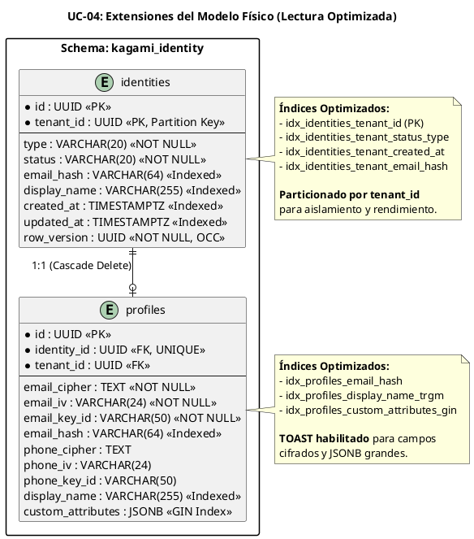

# UC-04: Consultar Identidad - Modelo de Datos Físico Específico (Lectura Optimizada)

| Metadatos del Documento | |
| :--- | :--- |
| **Proyecto:** | SHUGO - Identity & Access Platform |
| **Caso de Uso:** | UC-04 - Consultar Identidad |
| **Documento:** | 10_UC_Specific_Data_Model.md |
| **Metodología:** | Physical Data Modeling + CQRS Query Optimization + Read Replica Strategy + Index Tuning |
| **Base de Datos:** | PostgreSQL 15+ (Primary + Read Replicas) |
| **Autor:** | Gastón Ruiz |
| **Versión Actual:** | 1.0.0 |
| **Fecha:** | 02/09/2026 |

---

## Historial de Versiones

| Versión | Fecha | Autor | Descripción de Cambios | Impacto |
| :--- | :--- | :--- | :--- | :--- |
| **1.0.0** | 02/09/2026 | Gastón Ruiz | **Creación inicial.** Extensión del modelo de datos físico para soportar operaciones de lectura de alto volumen. Introduce índices compuestos optimizados para consultas frecuentes, configuración de Read Replicas para distribuir carga, estrategia de particionamiento por tenant para escalabilidad, y optimizaciones específicas para el patrón Cache-Aside. | Documento de referencia para DBAs y desarrolladores backend. Define cómo se optimiza PostgreSQL para soportar 500+ req/seg con latencia < 50ms p95, garantizando aislamiento multi-tenant estricto y rendimiento consistente incluso bajo carga extrema. |

---

## 1. Introducción y Propósito

Este documento define las extensiones y consideraciones físicas específicas en PostgreSQL para soportar el **UC-04 (Consultar Identidad)**.

Mientras que el UC-01 se centró en la inserción y cifrado, el UC-02 en OCC y auditoría, y el UC-03 en ciclo de vida, el UC-04 introduce desafíos físicos únicos orientados a **lectura de alto volumen**:

1. **Índices Compuestos Optimizados:** Índices diseñados específicamente para las consultas más frecuentes (por ID, por email hash, con filtros de estado/tipo).
2. **Read Replicas:** Configuración de réplicas de solo lectura para distribuir la carga de consultas y mejorar disponibilidad.
3. **Particionamiento por Tenant:** Separación física de datos por tenant para mejorar rendimiento y aislamiento.
4. **Optimizaciones para Cache-Aside:** Configuración de PostgreSQL para trabajar eficientemente con Redis (invalidación rápida, consultas optimizadas).
5. **Query Hints y Plan Optimization:** Uso de hints y estadísticas actualizadas para garantizar planes de ejecución óptimos.

---

## 2. Diagrama de Modelo de Datos Físico (ERD Extendido)



---

## 3. Scripts DDL: Índices Optimizados para Lectura

### 3.1. Índices para Consultas por ID (Cache Miss Fallback)

```sql
SET search_path TO kagami_identity;

-- Índice primario compuesto (ya existe desde UC-01, pero verificamos)
-- Este índice es crítico para consultas por ID con tenant isolation
CREATE UNIQUE INDEX IF NOT EXISTS idx_identities_pkey 
    ON identities(tenant_id, id);

-- Índice para consultas por ID sin filtro de tenant (solo para admin queries)
-- Útil cuando el tenant_id se extrae del JWT y se inyecta en la query
CREATE INDEX IF NOT EXISTS idx_identities_id 
    ON identities(id);
```

### 3.2. Índices para Consultas con Filtros (Listado Paginado)

```sql
-- Índice compuesto para consultas con filtros de status y type
-- Optimizado para: WHERE tenant_id = ? AND status = ? AND type = ?
CREATE INDEX IF NOT EXISTS idx_identities_tenant_status_type 
    ON identities(tenant_id, status, type)
    INCLUDE (id, created_at); -- Covering index para evitar table lookup

-- Índice para ordenamiento por created_at (paginación por fecha)
-- Optimizado para: ORDER BY created_at DESC LIMIT ? OFFSET ?
CREATE INDEX IF NOT EXISTS idx_identities_tenant_created_at 
    ON identities(tenant_id, created_at DESC)
    INCLUDE (id, status, type); -- Covering index

-- Índice para ordenamiento por updated_at
CREATE INDEX IF NOT EXISTS idx_identities_tenant_updated_at 
    ON identities(tenant_id, updated_at DESC)
    INCLUDE (id, status, type);
```

### 3.3. Índices para Búsquedas por Email (SCIM/HRIS)

```sql
-- Índice para búsqueda exacta por email hash (HMAC-SHA256)
-- Optimizado para: WHERE tenant_id = ? AND email_hash = ?
CREATE UNIQUE INDEX IF NOT EXISTS idx_identities_tenant_email_hash 
    ON identities(tenant_id, email_hash)
    WHERE email_hash IS NOT NULL;

-- Índice en profiles para búsqueda por email hash (redundante pero útil para JOINs)
CREATE UNIQUE INDEX IF NOT EXISTS idx_profiles_email_hash 
    ON profiles(tenant_id, email_hash)
    WHERE email_hash IS NOT NULL;
```

### 3.4. Índices para Búsquedas Full-Text (Display Name)

```sql
-- Habilitar extensión pg_trgm para búsquedas fuzzy
CREATE EXTENSION IF NOT EXISTS pg_trgm;

-- Índice GIN para búsquedas fuzzy en display_name
-- Optimizado para: WHERE display_name ILIKE '%juan%'
CREATE INDEX IF NOT EXISTS idx_profiles_display_name_trgm 
    ON profiles USING GIN (display_name gin_trgm_ops);

-- Índice para búsquedas exactas en display_name
CREATE INDEX IF NOT EXISTS idx_profiles_display_name 
    ON profiles(tenant_id, display_name);
```

### 3.5. Índices para Atributos Custom (JSONB)

```sql
-- Índice GIN para búsquedas dentro de custom_attributes
-- Optimizado para: WHERE custom_attributes @> '{"department": "Vet"}'
CREATE INDEX IF NOT EXISTS idx_profiles_custom_attributes_gin 
    ON profiles USING GIN (custom_attributes);

-- Índice para búsquedas específicas en campos comunes de custom_attributes
-- Útil si ciertos atributos se consultan frecuentemente
CREATE INDEX IF NOT EXISTS idx_profiles_custom_department 
    ON profiles((custom_attributes->>'department'))
    WHERE custom_attributes ? 'department';
```

### 3.6. Índices para Auditoría (Admin Queries)

```sql
-- Índice para consultas de auditoría (admin con permiso audit:read)
-- Optimizado para: WHERE tenant_id = ? AND status = 'PURGED'
CREATE INDEX IF NOT EXISTS idx_identities_tenant_purged 
    ON identities(tenant_id, updated_at DESC)
    WHERE status = 'PURGED';

-- Índice para consultas de identidades desactivadas
CREATE INDEX IF NOT EXISTS idx_identities_tenant_deactivated 
    ON identities(tenant_id, deactivated_at DESC)
    WHERE status = 'DEACTIVATED';
```

---

## 4. Estrategia de Read Replicas

### 4.1. Configuración de Read Replicas en PostgreSQL

Para distribuir la carga de lectura, configuramos Read Replicas que se sincronizan con el Primary mediante streaming replication.

**Arquitectura:**
```
                    ┌─────────────────┐
                    │   Primary DB    │
                    │  (Read/Write)   │
                    └────────┬────────┘
                             │
              ┌──────────────┼──────────────┐
              │              │              │
              ▼              ▼              ▼
        ┌──────────┐  ┌──────────┐  ┌──────────┐
        │ Replica 1│  │ Replica 2│  │ Replica 3│
        │ (Read)   │  │ (Read)   │  │ (Read)   │
        └──────────┘  └──────────┘  └──────────┘
```

**Configuración en `postgresql.conf` (Primary):**
```ini
# Habilitar streaming replication
wal_level = replica
max_wal_senders = 10
max_replication_slots = 10
hot_standby = on
```

**Configuración en `postgresql.conf` (Replicas):**
```ini
# Configurar como read-only
hot_standby = on
max_connections = 500  # Mayor que Primary (solo lecturas)
```

### 4.2. Enrutamiento de Queries en la Aplicación

El `IdentityRepository` debe enrutar las consultas a Read Replicas según el tipo de operación:

```csharp
public class IdentityRepositoryImpl : IIdentityRepository
{
    private readonly AppDbContext _primaryDbContext;
    private readonly AppDbContext _replicaDbContext;
    private readonly ILogger<IdentityRepositoryImpl> _logger;

    public IdentityRepositoryImpl(
        AppDbContext primaryDbContext,
        AppDbContext replicaDbContext,
        ILogger<IdentityRepositoryImpl> logger)
    {
        _primaryDbContext = primaryDbContext;
        _replicaDbContext = replicaDbContext;
        _logger = logger;
    }

    public async Task<Identity?> GetByIdAsync(TenantId tenantId, Guid identityId, CancellationToken ct)
    {
        // Consultas de lectura van a Replica
        return await _replicaDbContext.Identities
            .Include(i => i.Profile)
            .AsNoTracking()
            .FirstOrDefaultAsync(i => 
                i.TenantId == tenantId.Value && 
                i.Id == identityId, ct);
    }

    public async Task<PagedResult<Identity>> GetFilteredAsync(IdentityQuery query, CancellationToken ct)
    {
        // Consultas de listado van a Replica
        var dbQuery = _replicaDbContext.Identities
            .Include(i => i.Profile)
            .AsNoTracking()
            .Where(i => i.TenantId == query.TenantId.Value);

        // ... resto de la lógica ...
    }

    // Las escrituras (si las hubiera en Query side) van a Primary
    // Pero UC-04 es lectura pura, así que no hay escrituras aquí
}
```

### 4.3. Configuración de PgBouncer para Read Replicas

```ini
[databases]
shugo_kagami_primary = host=postgres-primary port=5432 dbname=shugo_kagami
shugo_kagami_replica = host=postgres-replica port=5432 dbname=shugo_kagami

[pgbouncer]
listen_port = 6432
listen_addr = 0.0.0.0
auth_type = md5
pool_mode = transaction

# Pool para Primary (escrituras)
[databases_primary]
shugo_kagami_primary = host=postgres-primary port=5432 dbname=shugo_kagami
max_client_conn = 200
default_pool_size = 50

# Pool para Replica (lecturas - mayor capacidad)
[databases_replica]
shugo_kagami_replica = host=postgres-replica port=5432 dbname=shugo_kagami
max_client_conn = 1000
default_pool_size = 200
```

---

## 5. Estrategia de Particionamiento por Tenant

### 5.1. Particionamiento por Lista (List Partitioning)

Para tenants muy grandes (>1M identidades), particionamos la tabla `identities` por `tenant_id`:

```sql
-- Tabla particionada por tenant_id
CREATE TABLE identities (
    id UUID NOT NULL DEFAULT gen_random_uuid(),
    tenant_id UUID NOT NULL,
    type VARCHAR(20) NOT NULL,
    status VARCHAR(20) NOT NULL DEFAULT 'PROVISIONED',
    email_hash VARCHAR(64),
    display_name VARCHAR(255),
    created_at TIMESTAMPTZ NOT NULL DEFAULT NOW(),
    updated_at TIMESTAMPTZ NOT NULL DEFAULT NOW(),
    row_version UUID NOT NULL DEFAULT gen_random_uuid(),
    PRIMARY KEY (id, tenant_id)
) PARTITION BY LIST (tenant_id);

-- Crear particiones para tenants específicos
CREATE TABLE identities_khcs PARTITION OF identities
    FOR VALUES IN ('uuid-tenant-khcs');

CREATE TABLE identities_enterprise_a PARTITION OF identities
    FOR VALUES IN ('uuid-tenant-enterprise-a');

-- Partición default para tenants pequeños
CREATE TABLE identities_default PARTITION OF identities DEFAULT;
```

### 5.2. Beneficios del Particionamiento

1. **Rendimiento:** Las consultas que filtran por `tenant_id` solo escanean la partición relevante, no toda la tabla.
2. **Mantenimiento:** Podemos hacer `VACUUM` o `REINDEX` en una partición específica sin bloquear otras.
3. **Borrado de Datos:** Si un tenant se va, podemos hacer `DROP TABLE identities_tenant_x` en milisegundos.
4. **Aislamiento:** Los datos de diferentes tenants están físicamente separados.

### 5.3. Consideraciones de Índices en Particiones

Los índices se crean automáticamente en cada partición, pero podemos optimizarlos:

```sql
-- Crear índice solo en particiones de tenants grandes
CREATE INDEX idx_identities_khcs_status_type 
    ON identities_khcs(status, type)
    INCLUDE (id, created_at);

-- Los índices en la partición default son más pequeños y eficientes
CREATE INDEX idx_identities_default_status_type 
    ON identities_default(tenant_id, status, type)
    INCLUDE (id, created_at);
```

---

## 6. Optimizaciones para Cache-Aside

### 6.1. Consultas Optimizadas para Cache Miss

Cuando hay cache miss, la consulta a PostgreSQL debe ser lo más rápida posible:

```sql
-- Consulta optimizada para cache miss (por ID)
-- Usa covering index para evitar table lookup
SELECT id, tenant_id, type, status, email_hash, display_name, 
       created_at, updated_at, row_version
FROM identities
WHERE tenant_id = $1 AND id = $2;

-- Si necesita el perfil completo (incluyendo PII cifrado)
SELECT i.id, i.tenant_id, i.type, i.status, i.email_hash, 
       i.display_name, i.created_at, i.updated_at, i.row_version,
       p.email_cipher, p.email_iv, p.email_key_id,
       p.phone_cipher, p.phone_iv, p.phone_key_id,
       p.custom_attributes
FROM identities i
LEFT JOIN profiles p ON p.identity_id = i.id AND p.tenant_id = i.tenant_id
WHERE i.tenant_id = $1 AND i.id = $2;
```

### 6.2. Invalidación Rápida de Caché

Cuando UC-01, UC-02, o UC-03 modifican una identidad, deben invalidar la caché:

```csharp
// En el Command Handler (UC-01, UC-02, UC-03):
public async Task<UpdateResult> Handle(UpdateCommand command, CancellationToken ct)
{
    // ... lógica de actualización ...
    
    await _unitOfWork.CommitAsync(ct);
    
    // Invalidar caché DESPUÉS de COMMIT exitoso
    await _cacheManager.InvalidateAsync(command.TenantId, command.IdentityId, ct);
    
    return result;
}
```

### 6.3. Warm-up de Caché

Para evitar cache misses masivos después de un reinicio, implementamos un proceso de warm-up:

```csharp
public class CacheWarmupService : BackgroundService
{
    private readonly ICacheManager _cacheManager;
    private readonly IIdentityRepository _repository;
    private readonly ITenantRepository _tenantRepository;

    protected override async Task ExecuteAsync(CancellationToken stoppingToken)
    {
        while (!stoppingToken.IsCancellationRequested)
        {
            try
            {
                // Obtener tenants activos
                var tenants = await _tenantRepository.GetActiveTenantsAsync(stoppingToken);
                
                foreach (var tenant in tenants)
                {
                    // Precargar las 1000 identidades más recientes de cada tenant
                    var recentIdentities = await _repository.GetRecentAsync(
                        tenant.Id, 
                        limit: 1000, 
                        stoppingToken);
                    
                    foreach (var identity in recentIdentities)
                    {
                        await _cacheManager.SetAsync(
                            tenant.Id, 
                            identity.Id, 
                            identity, 
                            ttl: TimeSpan.FromSeconds(60),
                            stoppingToken);
                    }
                }
                
                // Ejecutar warm-up cada 5 minutos
                await Task.Delay(TimeSpan.FromMinutes(5), stoppingToken);
            }
            catch (Exception ex)
            {
                _logger.LogError(ex, "Cache warmup failed");
                await Task.Delay(TimeSpan.FromMinutes(1), stoppingToken);
            }
        }
    }
}
```

---

## 7. Consideraciones de Rendimiento

### 7.1. Estadísticas Actualizadas

Para que el planificador de PostgreSQL genere planes de ejecución óptimos, las estadísticas deben estar actualizadas:

```sql
-- Aumentar frecuencia de autovacuum para tablas de lectura frecuente
ALTER TABLE identities SET (
    autovacuum_vacuum_scale_factor = 0.02,  -- Vaciar cuando 2% de filas cambian
    autovacuum_analyze_scale_factor = 0.01, -- Analizar cuando 1% de filas cambian
    autovacuum_vacuum_threshold = 100,
    autovacuum_analyze_threshold = 50
);

ALTER TABLE profiles SET (
    autovacuum_vacuum_scale_factor = 0.02,
    autovacuum_analyze_scale_factor = 0.01,
    autovacuum_vacuum_threshold = 100,
    autovacuum_analyze_threshold = 50
);

-- Analizar manualmente después de cambios masivos
ANALYZE identities;
ANALYZE profiles;
```

### 7.2. Configuración de Memoria para Lecturas

```ini
# postgresql.conf optimizado para lecturas
shared_buffers = 8GB              # 25% de RAM total
effective_cache_size = 24GB       # 75% de RAM total
work_mem = 64MB                   # Para operaciones de ordenamiento
maintenance_work_mem = 2GB        # Para VACUUM y CREATE INDEX
wal_buffers = 64MB

# Configuración de Read Replicas (solo lecturas)
# En replicas, podemos asignar más memoria a consultas
work_mem = 128MB                  # Mayor para replicas (solo lecturas)
```

### 7.3. Query Hints para Optimización

En casos donde el planificador no elige el índice óptimo, podemos usar hints:

```sql
-- Forzar uso de índice específico
SELECT * FROM identities
WHERE tenant_id = $1 AND status = 'ACTIVE'
ORDER BY created_at DESC
LIMIT 50;

-- Si el planificador elige un seq scan en lugar de index scan,
-- podemos forzar el uso del índice:
SET enable_seqscan = off;
SELECT * FROM identities
WHERE tenant_id = $1 AND status = 'ACTIVE'
ORDER BY created_at DESC
LIMIT 50;
SET enable_seqscan = on;
```

---

## 8. Seguridad a Nivel de Base de Datos

### 8.1. Row-Level Security (RLS) para Lecturas

Aunque la aplicación siempre filtra por `tenant_id`, implementamos RLS como última línea de defensa:

```sql
-- Habilitar RLS en todas las tablas
ALTER TABLE identities ENABLE ROW LEVEL SECURITY;
ALTER TABLE profiles ENABLE ROW LEVEL SECURITY;

-- Forzar RLS incluso para el dueño de la tabla
ALTER TABLE identities FORCE ROW LEVEL SECURITY;
ALTER TABLE profiles FORCE ROW LEVEL SECURITY;

-- Política de lectura: Solo puede leer identidades de su propio tenant
CREATE POLICY tenant_isolation_read ON identities
    FOR SELECT
    USING (tenant_id = current_setting('app.current_tenant_id')::uuid);

CREATE POLICY tenant_isolation_read ON profiles
    FOR SELECT
    USING (tenant_id = current_setting('app.current_tenant_id')::uuid);
```

### 8.2. Roles de Base de Datos para Lectura

```sql
-- Crear rol específico para lecturas (usado por Read Replicas)
CREATE ROLE app_kagami_read WITH LOGIN PASSWORD '...';

-- Grant solo permisos de lectura
GRANT CONNECT ON DATABASE shugo_kagami TO app_kagami_read;
GRANT USAGE ON SCHEMA kagami_identity TO app_kagami_read;
GRANT SELECT ON ALL TABLES IN SCHEMA kagami_identity TO app_kagami_read;

-- Revocar permisos de escritura
REVOKE INSERT, UPDATE, DELETE ON ALL TABLES IN SCHEMA kagami_identity FROM app_kagami_read;
```

---

## 9. Monitoreo y Diagnóstico

### 9.1. Consultas para Diagnosticar Problemas de Rendimiento

```sql
-- Identificar queries lentas
SELECT query, calls, total_time, mean_time, rows
FROM pg_stat_statements
WHERE query LIKE '%identities%'
ORDER BY mean_time DESC
LIMIT 10;

-- Verificar uso de índices
SELECT schemaname, tablename, indexname, idx_scan, idx_tup_read, idx_tup_fetch
FROM pg_stat_user_indexes
WHERE tablename IN ('identities', 'profiles')
ORDER BY idx_scan DESC;

-- Identificar tablas con mucho bloat
SELECT schemaname, tablename, 
       pg_size_pretty(pg_total_relation_size(schemaname||'.'||tablename)) AS total_size,
       n_dead_tup, n_live_tup,
       ROUND(n_dead_tup::numeric / NULLIF(n_live_tup, 0) * 100, 2) AS dead_tuple_pct
FROM pg_stat_user_tables
WHERE tablename IN ('identities', 'profiles')
ORDER BY n_dead_tup DESC;
```

### 9.2. Métricas de Base de Datos para OpenTelemetry

```csharp
public class DatabaseMetrics
{
    private readonly Meter _meter;
    private readonly Counter<long> _queryCount;
    private readonly Histogram<double> _queryLatency;

    public DatabaseMetrics(IMeterFactory meterFactory)
    {
        _meter = meterFactory.Create("shugo.database");
        _queryCount = _meter.CreateCounter<long>("db.query.total");
        _queryLatency = _meter.CreateHistogram<double>("db.query.latency", "ms");
    }

    public void RecordQuery(string queryType, double latencyMs, bool success)
    {
        _queryCount.Add(1, 
            new KeyValuePair<string, object?>("query_type", queryType),
            new KeyValuePair<string, object?>("success", success));
        _queryLatency.Record(latencyMs,
            new KeyValuePair<string, object?>("query_type", queryType));
    }
}
```

---

## 10. Trazabilidad

| Documento | Relación |
| :--- | :--- |
| `04_Initial_Domain_Model.md` | Define el `IdentityRepository` que utiliza estos índices y Read Replicas. |
| `07_Sequence_Diagram.md` | Muestra las consultas a PostgreSQL que se optimizan con estos índices. |
| `08_Final_Class_Design.md` | El `IdentityRepositoryImpl` implementa las consultas optimizadas definidas aquí. |
| `09_Modern_Artifacts.md` | Las métricas de latencia de PostgreSQL se monitorean con las configuraciones definidas aquí. |
| `12_UC_Specific_Performance_Benchmarks.md` | Los SLAs de latencia (< 50ms p95) se validan con los índices y optimizaciones definidos aquí. |
| `SHUGO_Data_Model_Master.md` (Transversal) | Este documento extiende el modelo maestro con optimizaciones específicas para lecturas. |

---

## 11. Anexos: Glosario de Base de Datos (UC-04)

| Término | Definición en Contexto UC-04 |
| :--- | :--- |
| **Covering Index** | Índice que incluye todas las columnas necesarias para la consulta, evitando el table lookup. Mejora rendimiento significativamente. |
| **Read Replica** | Copia de solo lectura de la base de datos que se sincroniza con el Primary mediante streaming replication. |
| **List Partitioning** | División de una tabla en particiones basadas en valores específicos de una columna (tenant_id). |
| **pg_trgm** | Extensión de PostgreSQL que proporciona operadores y índices para búsquedas fuzzy en texto. |
| **GIN Index** | Generalized Inverted Index. Usado para buscar eficientemente dentro de campos JSONB o arrays. |
| **HOT Update** | Heap Only Tuple Update. Optimización de PostgreSQL que permite actualizar una fila sin modificar índices. |
| **Streaming Replication** | Mecanismo de PostgreSQL que envía cambios del Primary a las Replicas en tiempo real mediante WAL. |
| **Autovacuum** | Proceso automático de PostgreSQL que limpia tuplas muertas y actualiza estadísticas. |

---
*Fin del Documento 10_UC_Specific_Data_Model para UC-04*