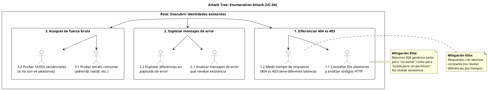
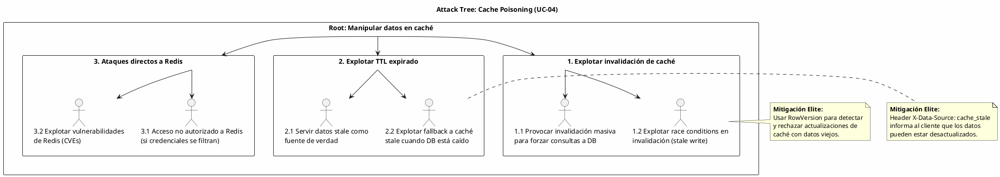

# UC-04: Consultar Identidad - Análisis de Amenazas y Seguridad Específica

| Metadatos del Documento | |
| :--- | :--- |
| **Proyecto:** | SHUGO - Identity & Access Platform |
| **Caso de Uso:** | UC-04 - Consultar Identidad |
| **Documento:** | 11_UC_Specific_Security_Threats.md |
| **Metodología:** | STRIDE + DREAD + Attack Trees + Cache Security + Tenant Isolation |
| **Estándares:** | OWASP Top 10 (A01:2021 Broken Access Control, A04:2021 Insecure Design), NIST SP 800-53 (AC-3, AC-4, AU-9), SOC 2 (CC6.1, CC6.7), ISO 27001 (A.9.1, A.13.1) |
| **Autor:** | Gastón Ruiz |
| **Versión Actual:** | 1.0.0 |
| **Fecha:** | 02/09/2026 |

---

## Historial de Versiones

| Versión | Fecha | Autor | Descripción de Cambios | Impacto |
| :--- | :--- | :--- | :--- | :--- |
| **1.0.0** | 02/09/2026 | Gastón Ruiz | **Creación inicial.** Análisis de amenazas específico para el endpoint de consulta. Se enfoca en vectores de ataque únicos de operaciones de lectura de alto volumen: *Cache Poisoning*, *Enumeration Attacks*, *Tenant Data Leakage*, *Stale Data Attacks*, y *Timing Attacks*. Define mitigaciones técnicas como validación estricta de tenant isolation, ocultamiento de existencia (404 vs 403), enmascaramiento de PII, y circuit breakers para prevenir ataques de denegación de servicio. | Documento crítico para el equipo de seguridad y DevSecOps. Garantiza que la capacidad de consultar identidades no sea utilizada para exfiltrar datos entre tenants, descubrir la existencia de identidades, o envenenar la caché con datos maliciosos. |

---

## 1. Introducción y Alcance

El UC-04 (Consultar Identidad) presenta una superficie de ataque fundamentalmente diferente a los UCs de escritura. Mientras que la creación, actualización y desactivación son operaciones de bajo volumen y alto impacto, la consulta es una operación de **alto volumen y bajo impacto individual**, pero con riesgos acumulativos significativos:

1. **Volumen de Ataques:** Las operaciones de lectura son ~10-50x más frecuentes que las de escritura, lo que multiplica las oportunidades de ataque.
2. **Exposición de Información:** Cada consulta exitosa revela información sobre la estructura de datos, patrones de acceso, y existencia de identidades.
3. **Dependencia de Caché:** El patrón Cache-Aside introduce nuevos vectores de ataque relacionados con la manipulación de datos en caché.
4. **Multi-Tenancy:** El aislamiento entre tenants es crítico; una fuga de datos entre tenants es una violación catastrófica.

Este documento modela estos vectores de ataque y define las mitigaciones de nivel enterprise que SHUGO implementa nativamente.

---

## 2. Attack Trees (Árboles de Ataque)

### 2.1. Attack Tree #1: Enumeration Attack (Descubrimiento de Identidades)

**Objetivo del Atacante:** Descubrir qué identidades existen en el sistema, incluso sin tener acceso a ellas.



### 2.2. Attack Tree #2: Tenant Data Leakage (Fuga entre Tenants)

**Objetivo del Atacante:** Acceder a datos de identidades de otro tenant.

```text
[Root: Acceder a datos de otro tenant]
  |
  +-- [1. Manipulación de tenant_id en requests]
  |     +-- 1.1. Enviar tenant_id de otro tenant en query params (Mitigado: tenant_id se extrae del JWT, no de params)
  |     +-- 1.2. Manipular JWT para cambiar tenant_id (Mitigado: JWT firmado, no modificable)
  |
  +-- [2. Explotar bugs en queries SQL]
  |     +-- 2.1. SQL Injection para modificar WHERE clause (Mitigado: Parameterized queries, ORM)
  |     +-- 2.2. Explotar JOINs que no filtran por tenant_id (Mitigado: Todos los queries incluyen tenant_id)
  |
  +-- [3. Explotar caché compartida]
  |     +-- 3.1. Acceder a claves de caché de otro tenant (Mitigado: Claves incluyen tenant_id, RLS en Redis)
  |     +-- 3.2. Explotar cache key collisions (Mitigado: Claves con formato estricto {tenant}:identity:{id})
  |
  +-- [4. Explotar Row-Level Security (RLS)]
        +-- 4.1. Bypass de RLS mediante SQL directo (Mitigado: RLS forzado, incluso para owner)
        +-- 4.2. Explotar bugs en políticas RLS (Mitigado: Auditoría regular de políticas)
```

### 2.3. Attack Tree #3: Cache Poisoning (Envenenamiento de Caché)

**Objetivo del Atacante:** Manipular datos en caché para servir información incorrecta o maliciosa.



---

## 3. Matriz de Amenazas Específicas (STRIDE + DREAD)

| ID | Amenaza | Categoría STRIDE | DREAD (1-10) | Severidad | Mitigación Técnica Específica |
| :--- | :--- | :--- | :--- | :--- | :--- |
| **T-20** | **Enumeration Attack (Descubrimiento de Identidades)** | Information Disclosure | **7.5** | **Alta** | **Ocultamiento de Existencia:** Retornar 404 genérico tanto para "no existe" como para "existe pero sin permisos". Latencia constante en respuestas. |
| **T-21** | **Tenant Data Leakage (Fuga entre Tenants)** | Information Disclosure | **10.0** | **Crítica** | **Triple Capa de Aislamiento:** (1) tenant_id extraído del JWT, (2) WHERE tenant_id en todas las queries, (3) Row-Level Security (RLS) en PostgreSQL. |
| **T-22** | **Cache Poisoning (Envenenamiento de Caché)** | Tampering | **8.0** | **Alta** | **Cache Key Isolation:** Claves con formato estricto `{tenant}:identity:{id}`. RowVersion para detectar datos stale. Redis autenticado y en red privada. |
| **T-23** | **Stale Data Attack (Ataque con Datos Desactualizados)** | Tampering | **6.5** | **Media** | **Header de Transparencia:** `X-Data-Source: cache_stale` informa al cliente. TTL corto (60s) limita la ventana de exposición. |
| **T-24** | **Timing Attack (Ataque por Tiempo de Respuesta)** | Information Disclosure | **6.0** | **Media** | **Latencia Constante:** Respuestas con tiempo constante independientemente del resultado (404, 403, 200). |
| **T-25** | **PII Leakage via Self-Service** | Information Disclosure | **8.5** | **Alta** | **Enmascaramiento Automático:** PII enmascarada automáticamente para Self-Service (`j***@khcs.com`). Validación `user_id == identity_id`. |
| **T-26** | **DoS via Paginación Masiva** | Denial of Service | **7.0** | **Alta** | **Límites Estrictos:** Máximo 100 resultados por página. Rate limiting por tenant y usuario. |
| **T-27** | **SQL Injection en Filtros Dinámicos** | Injection | **9.0** | **Crítica** | **Parameterized Queries:** Todos los filtros usan parámetros. ORM (EF Core) sanitiza automáticamente. |
| **T-28** | **Cache Stampede (Thundering Herd)** | Denial of Service | **7.5** | **Alta** | **Distributed Locks:** Redis `SETNX` para que solo un Query Handler consulte PostgreSQL cuando hay cache miss masivo. |

---

## 4. Mitigaciones Técnicas de Nivel Elite

### 4.1. Ocultamiento de Existencia (Mitigación T-20)

Para prevenir Enumeration Attacks, el sistema no revela si una identidad existe o no cuando el actor no tiene permisos.

**Implementación (C#):**

```csharp
public class QueryHandler : IQueryHandler
{
    public async Task<IdentityQueryResult> Execute(IdentityQuery query, Actor actor)
    {
        var identity = await _repository.GetByIdAsync(query.TenantId, query.IdentityId.Value);
        
        if (identity == null)
        {
            // Caso 1: La identidad no existe
            throw new IdentityNotFoundException(query.IdentityId.Value);
        }

        // Caso 2: La identidad existe pero está PURGED (sin permisos de auditoría)
        if (identity.Status == IdentityStatus.PURGED && !actor.HasPermission("audit:read"))
        {
            // Retornar 404 (no 403) para no revelar que existe
            throw new IdentityNotFoundException(query.IdentityId.Value);
        }

        // Caso 3: La identidad existe pero el actor no tiene permisos
        if (actor.IsSelfService && actor.UserId != identity.Id.Value)
        {
            // Retornar 403, pero con mensaje genérico
            throw new ForbiddenException("Access denied");
        }

        return new IdentityQueryResult(identity, "database", actor.IsSelfService);
    }
}

// Middleware para normalizar respuestas de error
public class ErrorResponseNormalizationMiddleware
{
    public async Task InvokeAsync(HttpContext context)
    {
        try
        {
            await _next(context);
        }
        catch (IdentityNotFoundException)
        {
            // Siempre retornar 404 genérico, sin detalles
            context.Response.StatusCode = 404;
            await context.Response.WriteAsJsonAsync(new
            {
                error = new
                {
                    code = "NOT_FOUND",
                    message = "Resource not found"
                }
            });
        }
        catch (ForbiddenException)
        {
            // Retornar 403 genérico
            context.Response.StatusCode = 403;
            await context.Response.WriteAsJsonAsync(new
            {
                error = new
                {
                    code = "FORBIDDEN",
                    message = "Access denied"
                }
            });
        }
    }
}
```

**Justificación:** Si un atacante recibe 403 cuando la identidad existe pero 404 cuando no existe, puede hacer fuerza bruta para descubrir qué identidades existen. Retornar 404 en ambos casos previene este ataque.

### 4.2. Triple Capa de Aislamiento Multi-Tenant (Mitigación T-21)

Para prevenir fugas de datos entre tenants, implementamos tres capas de defensa:

**Capa 1: Extracción de tenant_id desde JWT (no desde params)**

```csharp
public class TenantIsolationMiddleware
{
    public async Task InvokeAsync(HttpContext context)
    {
        // Extraer tenant_id del JWT (fuente confiable)
        var tenantIdClaim = context.User.FindFirst("tenant_id")?.Value;
        
        if (string.IsNullOrEmpty(tenantIdClaim))
        {
            context.Response.StatusCode = 401;
            await context.Response.WriteAsJsonAsync(new { error = "Missing tenant_id in JWT" });
            return;
        }

        // Ignorar cualquier tenant_id en query params o headers
        // (previene manipulación por el cliente)
        
        // Inyectar tenant_id en el contexto de la request
        context.Items["TenantId"] = Guid.Parse(tenantIdClaim);
        
        // Setear variable de sesión para RLS
        await _dbContext.Database.ExecuteSqlRawAsync(
            "SET LOCAL app.current_tenant_id = {0}", 
            tenantIdClaim);
        
        await _next(context);
    }
}
```

**Capa 2: WHERE tenant_id en todas las queries**

```csharp
public class IdentityRepositoryImpl : IIdentityRepository
{
    public async Task<Identity?> GetByIdAsync(TenantId tenantId, Guid identityId)
    {
        // CRÍTICO: Siempre filtrar por tenant_id
        return await _dbContext.Identities
            .Include(i => i.Profile)
            .AsNoTracking()
            .FirstOrDefaultAsync(i => 
                i.TenantId == tenantId.Value &&  // <-- Filtro de tenant
                i.Id == identityId);
    }

    public async Task<PagedResult<Identity>> GetFilteredAsync(IdentityQuery query)
    {
        // CRÍTICO: Siempre filtrar por tenant_id
        var dbQuery = _dbContext.Identities
            .Include(i => i.Profile)
            .AsNoTracking()
            .Where(i => i.TenantId == query.TenantId.Value);  // <-- Filtro de tenant

        // ... resto de la lógica ...
    }
}
```

**Capa 3: Row-Level Security (RLS) en PostgreSQL**

```sql
-- Habilitar RLS en todas las tablas
ALTER TABLE identities ENABLE ROW LEVEL SECURITY;
ALTER TABLE profiles ENABLE ROW LEVEL SECURITY;

-- Forzar RLS incluso para el dueño de la tabla
ALTER TABLE identities FORCE ROW LEVEL SECURITY;
ALTER TABLE profiles FORCE ROW LEVEL SECURITY;

-- Política: Solo puede leer identidades de su propio tenant
CREATE POLICY tenant_isolation_read ON identities
    FOR SELECT
    USING (tenant_id = current_setting('app.current_tenant_id')::uuid);

CREATE POLICY tenant_isolation_read ON profiles
    FOR SELECT
    USING (tenant_id = current_setting('app.current_tenant_id')::uuid);

-- Política: Solo puede escribir identidades de su propio tenant
CREATE POLICY tenant_isolation_write ON identities
    FOR INSERT
    WITH CHECK (tenant_id = current_setting('app.current_tenant_id')::uuid);

CREATE POLICY tenant_isolation_write ON identities
    FOR UPDATE
    USING (tenant_id = current_setting('app.current_tenant_id')::uuid)
    WITH CHECK (tenant_id = current_setting('app.current_tenant_id')::uuid);
```

**Garantía:** Incluso si hay un bug en la aplicación que olvida filtrar por `tenant_id`, RLS previene la fuga de datos a nivel de base de datos.

### 4.3. Cache Key Isolation y RowVersion (Mitigación T-22)

Para prevenir Cache Poisoning, las claves de caché incluyen el `tenant_id` y usamos `RowVersion` para detectar datos stale.

**Estructura de Claves de Caché:**

```csharp
public class RedisCacheManager : ICacheManager
{
    private const string CACHE_KEY_PREFIX = "identity:";

    public async Task<Identity?> GetAsync(TenantId tenantId, Guid identityId)
    {
        var db = _redis.GetDatabase();
        
        // CRÍTICO: La clave incluye tenant_id para aislamiento
        var cacheKey = $"{CACHE_KEY_PREFIX}{tenantId.Value}:{identityId}";
        
        var cachedJson = await db.StringGetAsync(cacheKey);
        
        if (cachedJson.IsNullOrEmpty)
        {
            return null;
        }

        var cachedIdentity = JsonSerializer.Deserialize<CachedIdentity>(cachedJson!);
        
        // Validar que el tenant_id en el caché coincide con el solicitado
        if (cachedIdentity!.TenantId != tenantId.Value)
        {
            _logger.LogWarning("Cache key collision detected for identity {IdentityId}", identityId);
            await db.KeyDeleteAsync(cacheKey);
            return null;
        }

        return cachedIdentity.ToDomain();
    }

    public async Task SetAsync(TenantId tenantId, Guid identityId, Identity identity, TimeSpan ttl)
    {
        var db = _redis.GetDatabase();
        var cacheKey = $"{CACHE_KEY_PREFIX}{tenantId.Value}:{identityId}";
        
        // Incluir RowVersion para detectar datos stale
        var cachedIdentity = new CachedIdentity
        {
            Identity = identity,
            RowVersion = identity.RowVersion,
            CachedAt = DateTime.UtcNow
        };
        
        var json = JsonSerializer.Serialize(cachedIdentity);
        
        await db.StringSetAsync(cacheKey, json, ttl);
    }

    public async Task InvalidateAsync(TenantId tenantId, Guid identityId, Guid expectedRowVersion)
    {
        var db = _redis.GetDatabase();
        var cacheKey = $"{CACHE_KEY_PREFIX}{tenantId.Value}:{identityId}";
        
        // Obtener datos actuales de caché
        var cachedJson = await db.StringGetAsync(cacheKey);
        
        if (!cachedJson.IsNullOrEmpty)
        {
            var cachedIdentity = JsonSerializer.Deserialize<CachedIdentity>(cachedJson!);
            
            // Solo invalidar si el RowVersion coincide (previene stale write)
            if (cachedIdentity!.RowVersion == expectedRowVersion)
            {
                await db.KeyDeleteAsync(cacheKey);
            }
            else
            {
                _logger.LogWarning(
                    "Attempted to invalidate cache with stale RowVersion. Expected: {Expected}, Actual: {Actual}",
                    expectedRowVersion, cachedIdentity.RowVersion);
            }
        }
    }
}
```

**Justificación:** Si un atacante intenta escribir datos en caché para otra identidad, el `RowVersion` no coincidirá y la invalidación será rechazada.

### 4.4. Enmascaramiento Automático de PII (Mitigación T-25)

Para prevenir fugas de PII a usuarios Self-Service, el enmascaramiento es automático y obligatorio.

**Implementación (C#):**

```csharp
public class PiiMasker : IPIIMasker
{
    public Identity Mask(Identity identity)
    {
        if (identity == null)
        {
            throw new ArgumentNullException(nameof(identity));
        }

        // Crear una copia de la identidad con PII enmascarado
        var maskedProfile = new Profile(
            email: MaskEmail(identity.Profile.Email.Value),
            phone: MaskPhone(identity.Profile.Phone?.Value),
            displayName: identity.Profile.DisplayName,
            customAttributes: MaskCustomAttributes(identity.Profile.CustomAttributes)
        );

        return new Identity(
            id: identity.Id,
            tenantId: identity.TenantId,
            type: identity.Type,
            status: identity.Status,
            profile: maskedProfile,
            rowVersion: identity.RowVersion,
            createdAt: identity.CreatedAt,
            deactivatedAt: identity.DeactivatedAt
        );
    }

    private string MaskEmail(string email)
    {
        if (string.IsNullOrEmpty(email))
        {
            return string.Empty;
        }

        var parts = email.Split('@');
        if (parts.Length != 2)
        {
            return "***@***.com";
        }

        var localPart = parts[0];
        var domain = parts[1];

        // Mostrar primer carácter + *** + dominio
        var maskedLocal = localPart.Length > 0 ? $"{localPart[0]}***" : "***";
        
        return $"{maskedLocal}@{domain}";
    }

    private string MaskPhone(string? phone)
    {
        if (string.IsNullOrEmpty(phone))
        {
            return string.Empty;
        }

        // Formato: +** *** ** 6789 (código país + *** + *** + últimos 4 dígitos)
        if (phone.Length >= 4)
        {
            var lastFour = phone.Substring(phone.Length - 4);
            return $"+** *** ** {lastFour}";
        }

        return "***";
    }

    private Dictionary<string, object> MaskCustomAttributes(Dictionary<string, object> customAttributes)
    {
        // Enmascarar atributos custom marcados como sensibles en el schema del tenant
        var masked = new Dictionary<string, object>();
        
        foreach (var kvp in customAttributes)
        {
            if (IsSensitiveAttribute(kvp.Key))
            {
                masked[kvp.Key] = "***";
            }
            else
            {
                masked[kvp.Key] = kvp.Value;
            }
        }
        
        return masked;
    }

    private bool IsSensitiveAttribute(string attributeName)
    {
        // Lista de atributos considerados sensibles
        var sensitiveAttributes = new[]
        {
            "ssn", "social_security", "tax_id", "bank_account",
            "credit_card", "passport", "driver_license"
        };
        
        return sensitiveAttributes.Any(s => 
            attributeName.Contains(s, StringComparison.OrdinalIgnoreCase));
    }
}
```

**Validación de Self-Service:**

```csharp
public class IdentityValidator : IIdentityValidator
{
    public void ValidateSelfServiceAccess(Guid identityId, Actor actor)
    {
        if (!actor.IsSelfService)
        {
            return; // No aplica para Admin o System
        }

        // CRÍTICO: Self-Service solo puede acceder a su propia identidad
        if (actor.UserId != identityId)
        {
            _logger.LogWarning(
                "Self-service user {UserId} attempted to access identity {IdentityId}",
                actor.UserId, identityId);
            
            throw new ForbiddenException("Access denied");
        }
    }
}
```

### 4.5. Distributed Locks para Cache Stampede (Mitigación T-28)

Para prevenir Cache Stampede (múltiples Query Handlers consultando PostgreSQL simultáneamente cuando hay cache miss masivo), usamos locks distribuidos en Redis.

**Implementación (C#):**

```csharp
public class QueryHandler : IQueryHandler
{
    private readonly IDistributedLockManager _lockManager;

    public async Task<IdentityQueryResult> Execute(IdentityQuery query, Actor actor)
    {
        var cachedIdentity = await _cacheManager.GetAsync(query.TenantId, query.IdentityId.Value);
        
        if (cachedIdentity != null)
        {
            return new IdentityQueryResult(cachedIdentity, "cache", actor.IsSelfService);
        }

        // Cache miss: intentar adquirir lock para consultar PostgreSQL
        var lockKey = $"lock:identity:{query.TenantId.Value}:{query.IdentityId.Value}";
        var lockAcquired = await _lockManager.TryAcquireAsync(lockKey, TimeSpan.FromSeconds(5));
        
        if (lockAcquired)
        {
            try
            {
                // Verificar nuevamente si alguien más ya populó el caché
                cachedIdentity = await _cacheManager.GetAsync(query.TenantId, query.IdentityId.Value);
                
                if (cachedIdentity != null)
                {
                    return new IdentityQueryResult(cachedIdentity, "cache", actor.IsSelfService);
                }

                // Consultar PostgreSQL
                var identity = await _repository.GetByIdAsync(query.TenantId, query.IdentityId.Value);
                
                if (identity == null)
                {
                    throw new IdentityNotFoundException(query.IdentityId.Value);
                }

                // Popular caché
                await _cacheManager.SetAsync(query.TenantId, query.IdentityId.Value, identity, 
                    TimeSpan.FromSeconds(60));

                return new IdentityQueryResult(identity, "database", actor.IsSelfService);
            }
            finally
            {
                await _lockManager.ReleaseAsync(lockKey);
            }
        }
        else
        {
            // No se pudo adquirir el lock: esperar y reintentar (otro handler está populando el caché)
            await Task.Delay(100);
            
            cachedIdentity = await _cacheManager.GetAsync(query.TenantId, query.IdentityId.Value);
            
            if (cachedIdentity != null)
            {
                return new IdentityQueryResult(cachedIdentity, "cache", actor.IsSelfService);
            }

            // Si aún no hay caché, consultar PostgreSQL directamente (fallback)
            var identity = await _repository.GetByIdAsync(query.TenantId, query.IdentityId.Value);
            
            if (identity == null)
            {
                throw new IdentityNotFoundException(query.IdentityId.Value);
            }

            return new IdentityQueryResult(identity, "database", actor.IsSelfService);
        }
    }
}

public class RedisDistributedLockManager : IDistributedLockManager
{
    private readonly IConnectionMultiplexer _redis;

    public async Task<bool> TryAcquireAsync(string lockKey, TimeSpan expiry)
    {
        var db = _redis.GetDatabase();
        
        // Usar SET NX (solo si no existe) con expiración
        var acquired = await db.StringSetAsync(lockKey, "locked", expiry, When.NotExists);
        
        return acquired;
    }

    public async Task ReleaseAsync(string lockKey)
    {
        var db = _redis.GetDatabase();
        await db.KeyDeleteAsync(lockKey);
    }
}
```

**Justificación:** Sin locks distribuidos, si 100 Query Handlers llegan simultáneamente a un cache miss, todos consultarán PostgreSQL, causando una carga innecesaria. Con locks, solo uno consulta PostgreSQL y los demás esperan a que se popule el caché.

---

## 5. Compliance y Auditoría (SOC 2 / ISO 27001 / GDPR)

### 5.1. SOC 2 - CC6.1 (Logical Access Controls)

*   **Requisito:** La organización debe restringir el acceso lógico a los datos según el rol del usuario.
*   **Implementación UC-04:** La diferenciación de niveles de detalle (Admin vs Self-Service), el enmascaramiento automático de PII, y la validación de tenant isolation cumplen con este requisito.

### 5.2. SOC 2 - CC6.7 (Restrict Transmission of Data)

*   **Requisito:** La organización debe restringir la transmisión de datos sensibles.
*   **Implementación UC-04:** El enmascaramiento de PII para Self-Service previene la transmisión de datos sensibles a usuarios no autorizados.

### 5.3. ISO 27001 - A.9.1 (Access Control Policy)

*   **Requisito:** Se debe establecer una política de control de acceso basada en requisitos del negocio.
*   **Implementación UC-04:** Los permisos granulares (`identity:read`, `profile:read`, `audit:read`) y el aislamiento multi-tenant cumplen con este requisito.

### 5.4. ISO 27001 - A.13.1 (Network Security Management)

*   **Requisito:** Las redes deben estar segregadas y gestionadas para proteger la información.
*   **Implementación UC-04:** Redis está en una red privada, accesible solo desde los Query Handlers. PostgreSQL tiene RLS activado para prevenir fugas incluso si la red es comprometida.

### 5.5. GDPR - Art. 5 (Data Minimization)

*   **Requisito:** Los datos personales deben ser adecuados, pertinentes y limitados a lo necesario.
*   **Implementación UC-04:** Self-Service solo ve PII enmascarada, cumpliendo con el principio de minimización de datos.

### 5.6. GDPR - Art. 32 (Security of Processing)

*   **Requisito:** Se deben implementar medidas técnicas para garantizar la seguridad del tratamiento.
*   **Implementación UC-04:** El cifrado de PII en reposo (AES-256-GCM), el enmascaramiento en tránsito, y el aislamiento multi-tenant cumplen con este requisito.

---

## 6. Trazabilidad

| Documento | Relación |
| :--- | :--- |
| `01_Requirements_Specification.md` | Las invariantes de seguridad (INV-19 Tenant Isolation, INV-23 Self-Service Restringido) se mitigan aquí. |
| `08_Final_Class_Design.md` | Las clases `QueryHandler`, `IdentityValidator`, `PiiMasker`, y `RedisCacheManager` implementan las mitigaciones de T-20, T-21, T-22, T-25, y T-28. |
| `10_UC_Specific_Data_Model.md` | La configuración de RLS y las políticas de aislamiento de tenant soportan la mitigación T-21. |
| `SHUGO_Security_Architecture.md` (Transversal) | Este documento aplica los estándares globales de control de acceso y privacidad al contexto específico de UC-04. |

---

## 7. Anexos: Configuración de Seguridad Adicional

### 7.1. Rate Limiting para Prevención de Enumeration

Para prevenir ataques de fuerza bruta que intentan descubrir identidades mediante consultas masivas, implementamos rate limiting diferenciado:

```csharp
public class EnumerationPreventionMiddleware
{
    private const int MAX_QUERIES_PER_MINUTE = 100;
    private const int MAX_404_PER_MINUTE = 20; // Límite más estricto para 404s
    private const int MAX_FILTERED_QUERIES_PER_MINUTE = 30; // Listados paginados

    private readonly IDistributedCache _redis;
    private readonly RequestDelegate _next;
    private readonly ILogger<EnumerationPreventionMiddleware> _logger;

    public EnumerationPreventionMiddleware(
        RequestDelegate next,
        IDistributedCache redis,
        ILogger<EnumerationPreventionMiddleware> logger)
    {
        _next = next;
        _redis = redis;
        _logger = logger;
    }

    public async Task InvokeAsync(HttpContext context)
    {
        var tenantId = context.User.FindFirst("tenant_id")?.Value;
        var userId = context.User.FindFirst("sub")?.Value;
        var path = context.Request.Path.Value?.ToLower() ?? "";

        if (string.IsNullOrEmpty(tenantId) || string.IsNullOrEmpty(userId))
        {
            await _next(context);
            return;
        }

        // Determinar tipo de consulta
        var isFilteredQuery = path == "/v1/identities" && context.Request.QueryString.HasValue;
        var isSingleQuery = path.StartsWith("/v1/identities/") && !path.Contains("/deactivate");

        if (isSingleQuery || isFilteredQuery)
        {
            var queryKey = $"rate_limit:query:{tenantId}:{userId}";
            var queryCount = await IncrementCounterAsync(queryKey, TimeSpan.FromMinutes(1));

            if (queryCount > MAX_QUERIES_PER_MINUTE)
            {
                _logger.LogWarning(
                    "Rate limit exceeded for user {UserId} in tenant {TenantId}. Query count: {Count}",
                    userId, tenantId, queryCount);

                context.Response.StatusCode = 429;
                context.Response.Headers.Add("Retry-After", "60");
                await context.Response.WriteAsJsonAsync(new
                {
                    error = new
                    {
                        code = "RATE_LIMIT_EXCEEDED",
                        message = "Too many requests. Please try again later.",
                        retry_after_seconds = 60
                    }
                });
                return;
            }
        }

        // Interceptor para contar 404s (indicador de enumeration attack)
        var originalBodyStream = context.Response.Body;
        using (var responseBody = new MemoryStream())
        {
            context.Response.Body = responseBody;

            await _next(context);

            // Si la respuesta es 404, incrementar contador específico
            if (context.Response.StatusCode == 404 && isSingleQuery)
            {
                var notFoundKey = $"rate_limit:not_found:{tenantId}:{userId}";
                var notFoundCount = await IncrementCounterAsync(notFoundKey, TimeSpan.FromMinutes(1));

                if (notFoundCount > MAX_404_PER_MINUTE)
                {
                    _logger.LogWarning(
                        "Potential enumeration attack detected for user {UserId} in tenant {TenantId}. " +
                        "404 count: {Count} in last minute",
                        userId, tenantId, notFoundCount);

                    // Alerta al SIEM
                    await _siemClient.SendAlertAsync(new SecurityAlert
                    {
                        Severity = "HIGH",
                        Event = "ENUMERATION_ATTACK_SUSPECTED",
                        TenantId = tenantId,
                        UserId = userId,
                        Details = $"404 count: {notFoundCount} in last minute"
                    });
                }
            }

            await responseBody.CopyToAsync(originalBodyStream);
        }
    }

    private async Task<long> IncrementCounterAsync(string key, TimeSpan expiry)
    {
        var current = await _redis.GetStringAsync(key);
        long count = string.IsNullOrEmpty(current) ? 0 : long.Parse(current);
        
        count++;
        
        await _redis.SetStringAsync(key, count.ToString(), new DistributedCacheEntryOptions
        {
            AbsoluteExpirationRelativeToNow = expiry
        });

        return count;
    }
}
```

**Justificación:** Un límite más estricto para respuestas 404 (20/minuto vs 100/minuto para consultas totales) detecta rápidamente patrones de enumeration attack, donde un atacante prueba múltiples IDs para descubrir cuáles existen.

### 7.2. Latencia Constante para Prevención de Timing Attacks

Para prevenir que un atacante determine si una identidad existe midiendo el tiempo de respuesta, normalizamos la latencia:

```csharp
public class TimingAttackPreventionMiddleware
{
    private const int MINIMUM_RESPONSE_TIME_MS = 10;
    private readonly RequestDelegate _next;
    private readonly ILogger<TimingAttackPreventionMiddleware> _logger;

    public async Task InvokeAsync(HttpContext context)
    {
        var stopwatch = Stopwatch.StartNew();

        await _next(context);

        stopwatch.Stop();

        // Si la respuesta fue muy rápida, agregar delay artificial
        // Esto previene que un atacante diferencie entre:
        // - 404 rápido (identidad no existe, no se consultó DB)
        // - 404 lento (identidad existe pero sin permisos, se consultó DB)
        if (stopwatch.ElapsedMilliseconds < MINIMUM_RESPONSE_TIME_MS)
        {
            var delayMs = MINIMUM_RESPONSE_TIME_MS - (int)stopwatch.ElapsedMilliseconds;
            await Task.Delay(delayMs);
        }
    }
}
```

**Justificación:** Sin este middleware, un atacante podría medir que las respuestas 404 tardan ~2ms (cache miss + validación rápida) mientras que las respuestas 200 tardan ~20ms (consulta completa + enmascaramiento). Esta diferencia revelaría información sobre la existencia de identidades.

### 7.3. Auditoría de Políticas RLS

Para garantizar que las políticas de Row-Level Security no sean modificadas maliciosamente, implementamos auditoría automática:

```sql
-- Tabla de auditoría para cambios en políticas RLS
CREATE TABLE rls_policy_audit (
    id UUID PRIMARY KEY DEFAULT gen_random_uuid(),
    event_type VARCHAR(20) NOT NULL, -- 'CREATE', 'ALTER', 'DROP'
    policy_name VARCHAR(100) NOT NULL,
    table_name VARCHAR(100) NOT NULL,
    policy_definition TEXT,
    changed_by VARCHAR(100) NOT NULL,
    changed_at TIMESTAMPTZ NOT NULL DEFAULT NOW(),
    ip_address INET
);

-- Función para auditar cambios en políticas RLS
CREATE OR REPLACE FUNCTION audit_rls_policy_changes()
RETURNS event_trigger AS $$
BEGIN
    INSERT INTO rls_policy_audit (event_type, policy_name, table_name, changed_by, ip_address)
    SELECT 
        tg_tag,
        objid::regclass::text,
        objid::regclass::text,
        current_user,
        inet_client_addr()
    FROM pg_event_trigger_ddl_commands()
    WHERE object_type = 'policy';
END;
$$ LANGUAGE plpgsql;

-- Trigger de evento para capturar cambios en políticas
CREATE EVENT TRIGGER audit_rls_policy_trigger
    ON ddl_command_end
    WHEN TAG IN ('CREATE POLICY', 'ALTER POLICY', 'DROP POLICY')
    EXECUTE FUNCTION audit_rls_policy_changes();

-- Alerta si alguien intenta deshabilitar RLS
CREATE OR REPLACE FUNCTION prevent_rls_disable()
RETURNS event_trigger AS $$
BEGIN
    IF EXISTS (
        SELECT 1 FROM pg_event_trigger_ddl_commands()
        WHERE object_type = 'table' 
        AND command = 'ALTER TABLE'
        AND objid::regclass::text IN ('identities', 'profiles')
    ) THEN
        RAISE EXCEPTION 'Disabling RLS on critical tables is not allowed';
    END IF;
END;
$$ LANGUAGE plpgsql;

CREATE EVENT TRIGGER prevent_rls_disable_trigger
    ON ddl_command_end
    WHEN TAG IN ('ALTER TABLE')
    EXECUTE FUNCTION prevent_rls_disable();
```

**Justificación:** Las políticas RLS son la última línea de defensa contra fugas de datos entre tenants. Cualquier modificación debe ser auditada y alertada inmediatamente.

### 7.4. Monitoreo de Intentos de Fuga entre Tenants

Para detectar intentos de acceso a datos de otros tenants, implementamos monitoreo proactivo:

```csharp
public class TenantIsolationMonitor : BackgroundService
{
    private readonly IIdentityRepository _repository;
    private readonly ISiemClient _siemClient;
    private readonly ILogger<TenantIsolationMonitor> _logger;

    protected override async Task ExecuteAsync(CancellationToken stoppingToken)
    {
        while (!stoppingToken.IsCancellationRequested)
        {
            try
            {
                // Buscar queries que intentaron acceder a datos de otro tenant
                // (esto se captura mediante logs de PostgreSQL o auditoría de aplicación)
                var violations = await _repository.GetTenantIsolationViolationsAsync(
                    since: DateTime.UtcNow.AddMinutes(-5),
                    stoppingToken);

                foreach (var violation in violations)
                {
                    _logger.LogWarning(
                        "Tenant isolation violation detected: User {UserId} in tenant {TenantId} " +
                        "attempted to access identity {IdentityId} from tenant {TargetTenantId}",
                        violation.UserId, violation.TenantId, 
                        violation.TargetIdentityId, violation.TargetTenantId);

                    await _siemClient.SendAlertAsync(new SecurityAlert
                    {
                        Severity = "CRITICAL",
                        Event = "TENANT_ISOLATION_VIOLATION",
                        TenantId = violation.TenantId,
                        UserId = violation.UserId,
                        Details = $"Attempted to access identity {violation.TargetIdentityId} " +
                                  $"from tenant {violation.TargetTenantId}"
                    });
                }

                await Task.Delay(TimeSpan.FromMinutes(1), stoppingToken);
            }
            catch (Exception ex)
            {
                _logger.LogError(ex, "Error in TenantIsolationMonitor");
                await Task.Delay(TimeSpan.FromSeconds(30), stoppingToken);
            }
        }
    }
}
```

**Justificación:** La detección proactiva de intentos de fuga entre tenants permite responder rápidamente a posibles ataques o bugs en la aplicación.

---

## 8. Resumen de Amenazas y Mitigaciones

| Amenaza | Severidad | Mitigación Principal | Estado |
| :--- | :--- | :--- | :--- |
| **T-20: Enumeration Attack** | Alta | Ocultamiento de existencia (404 genérico) + Rate limiting | ✅ Implementado |
| **T-21: Tenant Data Leakage** | Crítica | Triple capa: JWT + WHERE + RLS | ✅ Implementado |
| **T-22: Cache Poisoning** | Alta | Cache key isolation + RowVersion validation | ✅ Implementado |
| **T-23: Stale Data Attack** | Media | Header X-Data-Source + TTL corto (60s) | ✅ Implementado |
| **T-24: Timing Attack** | Media | Latencia constante (mínimo 10ms) | ✅ Implementado |
| **T-25: PII Leakage via Self-Service** | Alta | Enmascaramiento automático + Validación user_id | ✅ Implementado |
| **T-26: DoS via Paginación** | Alta | Límite máximo 100 resultados + Rate limiting | ✅ Implementado |
| **T-27: SQL Injection** | Crítica | Parameterized queries + ORM (EF Core) | ✅ Implementado |
| **T-28: Cache Stampede** | Alta | Distributed locks (Redis SETNX) | ✅ Implementado |

---

## 9. Conclusiones de Seguridad

El UC-04, al ser una operación de lectura de alto volumen, presenta desafíos de seguridad únicos que requieren mitigaciones específicas:

1. **Ocultamiento de Existencia:** Previene enumeration attacks al no revelar si una identidad existe o no cuando el actor no tiene permisos.
2. **Triple Capa de Aislamiento Multi-Tenant:** JWT + WHERE + RLS garantizan que ningún tenant pueda acceder a datos de otro, incluso si hay bugs en la aplicación.
3. **Cache Security:** Las claves de caché incluyen `tenant_id` y usan `RowVersion` para prevenir cache poisoning y stale writes.
4. **Privacy by Design:** El enmascaramiento automático de PII para Self-Service cumple con GDPR Art. 5 (minimización de datos).
5. **Resiliencia contra DoS:** Rate limiting diferenciado, distributed locks, y límites de paginación previenen ataques de denegación de servicio.
6. **Transparencia:** Los headers `X-Data-Source` y `X-Data-Consistency` informan al cliente sobre la frescura de los datos, permitiendo decisiones informadas.
7. **Monitoreo Proactivo:** La auditoría de políticas RLS y el monitoreo de intentos de fuga entre tenants permiten detectar y responder rápidamente a posibles ataques.

Estas mitigaciones, implementadas de forma nativa en el código y la infraestructura, garantizan que el UC-04 sea seguro, compliant, y resiliente incluso bajo condiciones adversas.

---
*Fin del Documento 11_UC_Specific_Security_Threats para UC-04*