# UC-05: Purgar Identidad - Diagrama de Caso de Uso

| Metadatos del Documento | |
| :--- | :--- |
| **Proyecto:** | SHUGO - Identity & Access Platform |
| **Caso de Uso:** | UC-05 - Purgar Identidad (Hard Delete / GDPR Right to Erasure) |
| **Documento:** | 02_Use_Case_Diagram.md |
| **Metodología:** | UML 2.5 + ICONIX + Domain-Driven Design + GDPR Compliance + Legal Hold |
| **Autor:** | Gastón Ruiz |
| **Versión Actual:** | 1.0.0 |
| **Fecha:** | 03/09/2026 |

---

## Historial de Versiones

| Versión | Fecha | Autor | Descripción de Cambios | Impacto |
| :--- | :--- | :--- | :--- | :--- |
| **1.0.0** | 03/09/2026 | Gastón Ruiz | **Creación inicial.** Diagrama de Caso de Uso UML para UC-05. Modela la purga irreversible (Hard Delete) como una acción de cumplimiento GDPR crítica, introduciendo el sistema de Legal Hold como bloqueador de prioridad, la anonimización criptográfica de PII, el procesamiento batch para purgas masivas, y las relaciones con sistemas downstream (KAGI, KIZUNA, KAGE). | Documento base del paquete de diseño Tier 1 del UC-05. Establece las fronteras del sistema, los actores y las integraciones críticas para garantizar el cumplimiento del Derecho al Olvido (GDPR Art. 17) con manejo de excepciones legales y auditabilidad completa. |

---

## 1. Diagrama de Caso de Uso (PlantUML)

A continuación, se presenta el Diagrama de Casos de Uso UML para el UC-05. Este diagrama modela la purga como una **acción destructiva e irreversible** con validaciones estrictas de compliance y Legal Hold.

```plantuml
@startuml UC-05_CasoDeUso
<style>
diagram {
  BackgroundColor #FFFFFF
}
</style>
top to bottom direction
skinparam packageStyle rectangle
skinparam actorStyle awesome
skinparam usecaseBackgroundColor #E3F2FD
skinparam usecaseBorderColor #1565C0
skinparam actorBorderColor #2E7D32
skinparam rectangleBackgroundColor #FFF3E0
skinparam rectangleBorderColor #E65100

title UC-05: Purgar Identidad (Hard Delete) - Motor KAGAMI (GDPR Compliance)

' ============================================
' ACTORES PRIMARIOS
' ============================================
actor "Administrador\nde Tenant" as Admin
actor "Sistema de Cumplimiento\nGDPR (Automatizado)" as GDPRSystem

' ============================================
' SISTEMA PRINCIPAL: KAGAMI ENGINE
' ============================================
rectangle "SHUGO - Motor KAGAMI (Identity Lifecycle)" as KAGAMI {
  usecase "UC-05: Purgar\nIdentidad (Hard Delete)" as UC05
  usecase "UC-05b: Purga Masiva\n(Batch Processing)" as UC05b
  usecase "UC-01: Provisionar\nNueva Identidad" as UC01
  usecase "UC-02: Actualizar\nIdentidad" as UC02
  usecase "UC-03: Desactivar\nIdentidad (Soft Delete)" as UC03
  usecase "UC-04: Consultar\nIdentidad" as UC04
}

' ============================================
' MÓDULOS DEPENDIENTES (<<include>>)
' ============================================
rectangle "SHUGO - Motor KAGI (Autenticación)" as KAGI {
  usecase "Validar JWT y\nPermisos (RBAC)" as UC_ValidarPermisos
}

rectangle "SHUGO - Motor KAGAMI (Core)" as KAGAMI_Core {
  usecase "Validar Precondiciones\n(Estado + Grace Period)" as UC_ValidarPrecondiciones
  usecase "Validar Legal Hold\n(Bloqueo Legal)" as UC_ValidarLegalHold
  usecase "Anonimizar PII\n(HMAC-SHA256 Irreversible)" as UC_AnonimizarPII
  usecase "Anonimizar Audit Logs\n(Preservar estructura)" as UC_AnonimizarLogs
  usecase "Publicar Evento\n(Outbox Pattern)" as UC_PublicarEvento
}

rectangle "SHUGO - Sistema de Legal Hold" as LegalHold {
  usecase "Consultar Legal Hold\nActivo" as UC_ConsultarLegalHold
}

' ============================================
' MÓDULOS COMPLEMENTARIOS (<<extend>>)
' ============================================
rectangle "SHUGO - Motor KAGI (Sesiones)" as KAGI_Sessions {
  usecase "Eliminar Sesiones\ny Refresh Tokens" as UC_EliminarSesiones
}

rectangle "SHUGO - Motor KIZUNA (Autorización)" as KIZUNA {
  usecase "Eliminar Caché\nde Autorización" as UC_EliminarCacheAuthZ
}

rectangle "SHUGO - Motor KAGE (Auditoría)" as KAGE {
  usecase "Completar Anonimización\nde Logs Históricos" as UC_CompletarAnonimizacion
}

rectangle "SHUGO - Motor TORII (Webhooks)" as TORII {
  usecase "Notificar a Sistemas\nExternos (GDPR Delete)" as UC_NotificarWebhooks
}

' ============================================
' RELACIONES DE INICIO (Actores → UC Principal)
' ============================================
Admin --> UC05 : Ejecuta purga manual\n(GDPR Art. 17)
GDPRSystem --> UC05 : Ejecuta purga automatizada\n(política de retención)
Admin --> UC05b : Ejecuta purga masiva\n(hasta 1000 identidades)
GDPRSystem --> UC05b : Ejecuta purga masiva\n(cierre de tenant)

' ============================================
' RELACIONES <<include>> (OBLIGATORIAS)
' ============================================
' La purga DEBE validar permisos específicos
UC05 ..> UC_ValidarPermisos : <<include>>\n(Validar permiso\nidentity:purge)

' La purga DEBE validar precondiciones (estado + Grace Period)
UC05 ..> UC_ValidarPrecondiciones : <<include>>\n(Validar DEACTIVATED\n+ Grace Period expirado)

' La purga DEBE validar Legal Hold (bloqueo legal)
UC05 ..> UC_ValidarLegalHold : <<include>>\n(Consultar sistema\nLegal Hold)

UC_ValidarLegalHold ..> UC_ConsultarLegalHold : <<include>>\n(Query a tabla\nlegal_holds)

' La purga DEBE anonimizar PII antes de marcar como PURGED
UC05 ..> UC_AnonimizarPII : <<include>>\n(Reemplazar email/phone\ncon HMAC-SHA256)

' La purga DEBE anonimizar audit logs asociados
UC05 ..> UC_AnonimizarLogs : <<include>>\n(Anonimizar snapshot_json\nen audit_logs)

' La purga DEBE publicar evento para sistemas downstream
UC05 ..> UC_PublicarEvento : <<include>>\n(Outbox:\nIdentity.Purged)

' ============================================
' RELACIONES <<extend>> (CONDICIONALES / EFECTOS SECUNDARIOS)
' ============================================
' Si la purga es exitosa, se deben eliminar sesiones
UC_EliminarSesiones .up.> UC05 : <<extend>>\n(Si éxito: Eliminar\nsesiones en KAGI)

' Si la purga es exitosa, se debe eliminar caché de AuthZ
UC_EliminarCacheAuthZ .left.> UC05 : <<extend>>\n(Si éxito: Eliminar\ncaché en KIZUNA)

' Si la purga es exitosa, KAGE completa anonimización
UC_CompletarAnonimizacion .right.> UC_AnonimizarLogs : <<extend>>\n(Si éxito: Indexar\nidentidad como purgada)

' Si la purga es exitosa, notificar a sistemas externos
UC_NotificarWebhooks .down.> UC05 : <<extend>>\n(Si éxito: Webhook\n"identity.purged")

' ============================================
' RELACIÓN CON OTROS UCs DE KAGAMI
' ============================================
note right of UC03
  **Precondición Obligatoria:**
  UC-03 (Desactivar) debe ejecutarse
  ANTES de UC-05 (Purgar).
  La identidad debe estar DEACTIVATED
  y haber superado el Grace Period.
end note

UC05 .down.> UC03 : <<dependency>>\n(Requiere UC-03\nprevio)

note left of UC04
  **Post-Purga:**
  UC-04 retorna 404 para identidades
  purgadas (ocultamiento de existencia).
  Solo visible con permiso audit:read.
end note

UC05 .down.> UC04 : <<dependency>>\n(UC-04 retorna 404\npost-purga)

note right of UC05b
  **Batch Processing:**
  UC-05b procesa hasta 1000 identidades
  en lotes de 100, validando cada una
  individualmente (estado, Grace Period,
  Legal Hold).
end note

UC05b .down.> UC05 : <<include>>\n(Ejecuta UC-05 para\ncada identidad válida)

@enduml
```

---

## 2. Explicación del Diagrama

### 2.1. Límite del Sistema (System Boundary)

El diagrama identifica **cinco límites de sistema claramente diferenciados**:

1. **Motor KAGAMI - Identity Lifecycle (UC-05, UC-05b):** El sistema principal que ejecuta la purga irreversible. Incluye tanto la purga individual como el procesamiento batch.

2. **Motor KAGI (Autenticación y Sesiones):** Sistema que valida permisos y, tras la purga exitosa, elimina todas las sesiones y tokens asociados.

3. **Sistema de Legal Hold:** Sistema especializado que gestiona las retenciones legales. Tiene prioridad sobre GDPR Art. 17 y bloquea la purga cuando está activo.

4. **Motor KIZUNA (Autorización):** Sistema que, tras la purga exitosa, elimina la caché de autorización y las tuplas de relación asociadas.

5. **Motor KAGE (Auditoría):** Sistema que completa la anonimización de logs históricos y marca la identidad como purgada en el índice de auditoría.

6. **Motor TORII (Webhooks):** Sistema que notifica a sistemas externos sobre la purga exitosa (ej. "Usuario eliminado permanentemente por GDPR").

**Justificación de los Límites:**
- La separación entre **UC-05 (Purga Individual)** y **UC-05b (Purga Masiva)** refleja dos casos de uso distintos con diferentes requisitos de procesamiento (síncrono vs asíncrono, individual vs batch).
- El **Sistema de Legal Hold** se modela como un sistema separado porque tiene lógica de negocio propia (gestión de casos judiciales, fechas de inicio/fin, autoridades emisoras) y prioridad sobre GDPR.

### 2.2. Actores del Sistema

#### Actores Primarios: **Administrador** y **Sistema de Cumplimiento GDPR**

El UC-05 tiene dos tipos de actores primarios que reflejan los escenarios reales de cumplimiento GDPR:

*   **Administrador de Tenant (humano):** Ejecuta la purga manualmente, generalmente en dos escenarios:
    *   **Solicitud directa del usuario:** Un usuario ejerce su derecho al olvido (GDPR Art. 17) y el admin ejecuta la purga tras validar la solicitud.
    *   **Limpieza manual:** El admin identifica identidades obsoletas o comprometidas y las purga manualmente.
    *   **Meta:** Eliminar permanentemente datos personales de forma auditable.
    *   **Permisos:** `identity:purge` (permiso granular separado de `identity:update` y `identity:deactivate`).
    *   **Frecuencia:** Baja (purgas puntuales, no masivas).

*   **Sistema de Cumplimiento GDPR (automatizado):** Representa procesos automatizados que ejecutan purgas basadas en políticas de retención:
    *   **Política de retención automática:** Tras expirar el Grace Period (ej. 30 días), el sistema purga automáticamente identidades desactivadas.
    *   **Cierre de tenant:** Cuando un tenant cancela su suscripción, el sistema purga todas sus identidades en batch.
    *   **Meta:** Cumplir automáticamente con políticas de retención y GDPR sin intervención manual.
    *   **Permisos:** `identity:purge` (service account con scopes específicos).
    *   **Frecuencia:** Media/Alta (purgas programadas, cierres de tenant).

**Nota de Diseño Elite:** Modelar dos actores distintos demuestra que el sistema soporta tanto purgas manuales (con validación humana) como automatizadas (basadas en políticas), cubriendo todos los escenarios de cumplimiento GDPR.

#### Actores Secundarios (Sistemas Dependientes)

*   **UC_ValidarPermisos (KAGI):** Sistema de autenticación que valida que el actor tenga el permiso granular `identity:purge`. Es una dependencia **obligatoria** (<<include>>) porque la purga es una operación destructiva que requiere autorización explícita.

*   **UC_ValidarPrecondiciones (KAGAMI Core):** Valida que la identidad esté en estado `DEACTIVATED` y que haya transcurrido el Grace Period. Es una dependencia **obligatoria** porque la purga solo puede ejecutarse bajo estas condiciones.

*   **UC_ValidarLegalHold (KAGAMI Core) + UC_ConsultarLegalHold (Legal Hold System):** Valida que no haya retención legal activa sobre la identidad. Es una dependencia **obligatoria** porque Legal Hold tiene prioridad sobre GDPR Art. 17.

*   **UC_AnonimizarPII (KAGAMI Core):** Anonimiza los datos PII (email, phone) reemplazándolos con hashes HMAC-SHA256 irreversibles. Es una dependencia **obligatoria** porque la anonimización debe ocurrir antes de marcar la identidad como `PURGED`.

*   **UC_AnonimizarLogs (KAGAMI Core):** Anonimiza los logs de auditoría asociados, reemplazando PII en el `snapshot_json` con hashes irreversibles. Es una dependencia **obligatoria** porque los logs deben preservarse para auditoría, pero sin exponer PII.

*   **UC_PublicarEvento (KAGAMI Core):** Publica el evento `Identity.Purged` en el Outbox para notificar a sistemas downstream. Es una dependencia **obligatoria** para garantizar consistencia eventual.

*   **UC_EliminarSesiones (KAGI Sessions):** Elimina todos los RefreshTokens y sesiones activas en Redis. Es una dependencia **condicional** (<<extend>>) que se activa tras una purga exitosa.

*   **UC_EliminarCacheAuthZ (KIZUNA):** Elimina la caché de autorización y las tuplas de relación asociadas. Es una dependencia **condicional** (<<extend>>) que se activa tras una purga exitosa.

*   **UC_CompletarAnonimizacion (KAGE):** Completa la anonimización de logs históricos y marca la identidad como purgada en el índice de auditoría. Es una dependencia **condicional** (<<extend>>) que se activa tras una purga exitosa.

*   **UC_NotificarWebhooks (TORII):** Notifica a sistemas externos sobre la purga exitosa. Es una dependencia **condicional** (<<extend>>) que se activa tras una purga exitosa.

### 2.3. Relaciones UML

#### Relaciones `<<include>>`: UC-05 → UC_ValidarPermisos, UC_ValidarPrecondiciones, UC_ValidarLegalHold, UC_AnonimizarPII, UC_AnonimizarLogs, UC_PublicarEvento

*   **Dirección:** La flecha va **DESDE** UC-05 **HACIA** los casos de uso incluidos.
*   **Semántica:** UC-05 **depende obligatoriamente** de estos seis casos de uso. No existe un flujo de purga exitoso que no valide permisos, precondiciones, Legal Hold, anonimice PII, anonimice logs, y publique el evento.
*   **Justificación Arquitectónica:** Estas relaciones materializan el principio de **Defense in Depth** (múltiples capas de validación) y el cumplimiento de **GDPR Art. 17** (anonimización completa antes de marcar como purgado).

**Detalle de cada <<include>>:**

1. **UC-05 → UC_ValidarPermisos (Validar Permisos):**
   - **Cuándo ocurre:** Al inicio de cada purga.
   - **Qué hace:** Verifica que el usuario tenga el permiso granular `identity:purge`.
   - **Si falla:** Retorna HTTP 403 inmediatamente.
   - **Justificación:** La purga es una operación destructiva que requiere autorización explícita, separada de otros permisos.

2. **UC-05 → UC_ValidarPrecondiciones (Validar Precondiciones):**
   - **Cuándo ocurre:** Después de validar permisos.
   - **Qué hace:** Verifica que la identidad esté en estado `DEACTIVATED` y que haya transcurrido el Grace Period (ej. `NOW() - deactivated_at > retention_days`).
   - **Si falla:**
     - Si no está `DEACTIVATED`: Retorna HTTP 400 "Identity must be deactivated before purging".
     - Si Grace Period no ha expirado: Retorna HTTP 400 "Grace period has not expired. Purge available after {date}".
   - **Justificación:** La purga solo puede ejecutarse bajo condiciones estrictas para prevenir eliminaciones prematuras o accidentales.

3. **UC-05 → UC_ValidarLegalHold (Validar Legal Hold):**
   - **Cuándo ocurre:** Después de validar precondiciones.
   - **Qué hace:** Consulta el sistema de Legal Hold para verificar que no haya retención legal activa sobre la identidad.
   - **Si falla:** Retorna HTTP 403 "Identity is under legal hold. Contact compliance officer" y genera alerta al oficial de cumplimiento.
   - **Justificación:** Legal Hold tiene prioridad sobre GDPR Art. 17. Esto está contemplado en el propio GDPR Art. 17.3(b): "El derecho al olvido no aplica cuando el tratamiento es necesario para el cumplimiento de una obligación legal."

4. **UC-05 → UC_AnonimizarPII (Anonimizar PII):**
   - **Cuándo ocurre:** Después de validar Legal Hold.
   - **Qué hace:** Reemplaza los datos PII (email, phone) con hashes HMAC-SHA256 irreversibles.
   - **Si falla:** Retorna HTTP 500 y hace Rollback de la transacción.
   - **Justificación:** La anonimización debe ocurrir antes de marcar la identidad como `PURGED` para garantizar que los datos personales no sean recuperables.

5. **UC-05 → UC_AnonimizarLogs (Anonimizar Audit Logs):**
   - **Cuándo ocurre:** Después de anonimizar PII.
   - **Qué hace:** Reemplaza los valores PII en el `snapshot_json` de los logs de auditoría asociados con hashes irreversibles.
   - **Si falla:** Retorna HTTP 500 y hace Rollback de la transacción.
   - **Justificación:** Los logs de auditoría deben preservarse para investigaciones futuras, pero sin exponer PII.

6. **UC-05 → UC_PublicarEvento (Publicar Evento):**
   - **Cuándo ocurre:** Después de anonimizar logs.
   - **Qué hace:** Publica el evento `Identity.Purged` en el Outbox para notificar a sistemas downstream.
   - **Si falla:** El evento permanece en el Outbox y se reintentará (Outbox Pattern).
   - **Justificación:** Garantiza consistencia eventual entre KAGAMI y los sistemas downstream (KAGI, KIZUNA, KAGE).

#### Relaciones `<<extend>>`: UC_EliminarSesiones → UC-05, UC_EliminarCacheAuthZ → UC-05, UC_CompletarAnonimizacion → UC_AnonimizarLogs, UC_NotificarWebhooks → UC-05

*   **Dirección:** La flecha va **DESDE** los casos de uso extend **HACIA** UC-05 o UC_AnonimizarLogs (casos de uso base).
*   **Semántica:** UC_EliminarSesiones, UC_EliminarCacheAuthZ, UC_CompletarAnonimizacion, y UC_NotificarWebhooks son comportamientos **condicionales** que se "inyectan" en UC-05 bajo ciertas condiciones (purga exitosa).
*   **Justificación:**
    - La eliminación de sesiones y caché solo ocurre si la purga es exitosa.
    - La completación de anonimización en KAGE solo ocurre si la anonimización inicial fue exitosa.
    - La notificación por webhooks solo ocurre si la purga es exitosa.

**Detalle de cada <<extend>>:**

1. **UC_EliminarSesiones → UC-05 (Eliminar Sesiones):**
   - **Cuándo ocurre:** Después de que la purga es exitosa (transacción confirmada).
   - **Qué hace:** KAGI consume el evento `Identity.Purged` y elimina todos los RefreshTokens y sesiones activas en Redis.
   - **Si no aplica:** Si la purga falla, no se eliminan sesiones.
   - **Justificación:** Garantiza que la identidad purgada no pueda autenticarse ni tener sesiones activas.

2. **UC_EliminarCacheAuthZ → UC-05 (Eliminar Caché de Autorización):**
   - **Cuándo ocurre:** Después de que la purga es exitosa.
   - **Qué hace:** KIZUNA consume el evento `Identity.Purged` y elimina la caché de autorización y las tuplas de relación asociadas.
   - **Si no aplica:** Si la purga falla, no se elimina caché.
   - **Justificación:** Garantiza que la identidad purgada no tenga permisos cacheados ni relaciones en el grafo de autorización.

3. **UC_CompletarAnonimizacion → UC_AnonimizarLogs (Completar Anonimización):**
   - **Cuándo ocurre:** Después de que la anonimización inicial es exitosa.
   - **Qué hace:** KAGE consume el evento `Identity.Purged` y completa la anonimización de logs históricos, marcando la identidad como purgada en el índice de auditoría.
   - **Si no aplica:** Si la anonimización inicial falla, no se completa.
   - **Justificación:** Garantiza que todos los logs históricos asociados a la identidad estén anonimizados y que la identidad esté marcada como purgada en el sistema de auditoría.

4. **UC_NotificarWebhooks → UC-05 (Notificar Webhooks):**
   - **Cuándo ocurre:** Después de que la purga es exitosa.
   - **Qué hace:** TORII consume el evento `Identity.Purged` y notifica a sistemas externos registrados (ej. "Usuario eliminado permanentemente por GDPR").
   - **Si no aplica:** Si la purga falla, no se notifica.
   - **Justificación:** Permite a sistemas externos sincronizar su estado con la purga (ej. eliminar registros en sistemas de facturación, CRM, etc.).

#### Relaciones `<<dependency>>`: UC-05 → UC-03, UC-05 → UC-04, UC-05b → UC-05

*   **Dirección:** La flecha va **DESDE** UC-05/UC-05b **HACIA** UC-03, UC-04, y UC-05.
*   **Semántica:** UC-05 **depende** de UC-03 (precondición obligatoria), UC-04 (consulta post-purga), y UC-05b **incluye** UC-05 (ejecuta UC-05 para cada identidad válida).
*   **Justificación:**
    - UC-03 (Desactivar) debe ejecutarse antes de UC-05 (Purgar). La identidad debe estar `DEACTIVATED` y haber superado el Grace Period.
    - UC-04 (Consultar) retorna 404 para identidades purgadas (ocultamiento de existencia), excepto para auditores con permiso `audit:read`.
    - UC-05b (Purga Masiva) ejecuta UC-05 para cada identidad válida en el batch, validando individualmente (estado, Grace Period, Legal Hold).

---

## 3. Análisis de Coherencia con la Especificación Analítica

Este diagrama es **100% coherente** con el documento `01_Requirements_Specification.md`:

| Elemento del Diagrama | Referencia en Especificación |
| :--- | :--- |
| Actores: Admin y Sistema de Cumplimiento GDPR | Sección 2 (Descripción Analítica) - Actores Principales |
| Relación <<include>> con UC_ValidarPermisos | Sección 2 (Precondiciones) - Permiso `identity:purge` |
| Relación <<include>> con UC_ValidarPrecondiciones | Sección 3 (INV-25, INV-26) - Estado DEACTIVATED + Grace Period |
| Relación <<include>> con UC_ValidarLegalHold | Sección 3 (INV-27) - Legal Hold Priority |
| Relación <<include>> con UC_AnonimizarPII | Sección 3 (INV-28) - Anonimización Completa |
| Relación <<include>> con UC_AnonimizarLogs | Sección 3 (INV-29) - Preservación de Evidencia |
| Relación <<include>> con UC_PublicarEvento | Sección 3 (RN-03) - Notificación Downstream |
| Relación <<extend>> con UC_EliminarSesiones | Sección 2.1 (Escenario Principal, Paso 13) - Eliminación de sesiones |
| Relación <<extend>> con UC_EliminarCacheAuthZ | Sección 2.1 (Escenario Principal, Paso 14) - Eliminación de caché |
| Relación <<extend>> con UC_CompletarAnonimizacion | Sección 2.1 (Escenario Principal, Paso 15) - Completar anonimización |
| Relación <<extend>> con UC_NotificarWebhooks | Sección 5 (Eventos de Dominio) - Consumidores del evento |
| Relación <<dependency>> con UC-03 | Sección 1.2 (Relación con Otros UCs) - Predecesor Obligatorio |
| Relación <<dependency>> con UC-04 | Sección 1.2 (Relación con Otros UCs) - Consumidor (retorna 404 post-purga) |
| UC-05b (Batch Processing) | Sección 2.2 (Escenario Alternativo) - Purga Masiva |
| UC-05b → UC-05 (<<include>>) | Sección 3 (RN-02) - Procesamiento Batch |

---

## 4. Consideraciones de Diseño y Arquitectura (DDD + GDPR Compliance)

### 4.1. Acción Destructiva Irreversible vs. Mutación de Estado

El diagrama modela UC-05 como una **acción destructiva e irreversible** con endpoint dedicado (`POST /identities/{id}/purge`), diferenciándola claramente de:

- **UC-02 (Actualizar):** Mutación reversible de atributos.
- **UC-03 (Desactivar):** Soft Delete reversible (puede reactivarse dentro del Grace Period).
- **UC-05 (Purgar):** Hard Delete irreversible (no puede revertirse).

**¿Por qué es esto crítico?**
Porque la purga tiene implicaciones legales y de cumplimiento que requieren:
- **Validaciones estrictas:** Estado, Grace Period, Legal Hold.
- **Anonimización completa:** PII y audit logs.
- **Notificación downstream:** KAGI, KIZUNA, KAGE deben sincronizar el estado.
- **Auditoría detallada:** Registro de actor, razón, timestamp, y campos anonimizados.

### 4.2. Legal Hold como Bloqueador de Prioridad

La relación <<include>> con UC_ValidarLegalHold refleja el principio de **Legal Hold Priority**:

*   **Legal Hold Activo:** La purga se bloquea independientemente de otros factores (estado, Grace Period, solicitud del usuario).
*   **Prioridad sobre GDPR Art. 17:** Legal Hold tiene prioridad sobre el derecho al olvido, conforme a GDPR Art. 17.3(b).
*   **Notificación al Oficial de Cumplimiento:** Si se intenta purgar una identidad bajo Legal Hold, se genera alerta al oficial de cumplimiento.

**Justificación:**
- **Cumplimiento Legal:** Las organizaciones están obligadas a preservar datos bajo orden judicial o investigación regulatoria.
- **Prevención de Sanciones:** Violar un Legal Hold puede resultar en sanciones legales severas (multas, desacato al tribunal).
- **Auditabilidad:** El sistema registra todos los intentos de purga bloqueados por Legal Hold para auditoría.

### 4.3. Anonimización Criptográfica Irreversible

Las relaciones <<include>> con UC_AnonimizarPII y UC_AnonimizarLogs modelan la estrategia de anonimización:

*   **HMAC-SHA256 Irreversible:** Los datos PII se reemplazan con hashes HMAC-SHA256 que no pueden revertirse sin la clave secreta.
*   **Preservación de Estructura:** Los logs de auditoría mantienen su estructura (campos, timestamps), solo se anonimizan los valores PII.
*   **Transacción Atómica:** La anonimización de PII y logs ocurre en la misma transacción que el cambio de estado. Si falla, se hace Rollback completo.

**Justificación:**
- **GDPR Art. 17:** Requiere eliminación de datos personales, pero permite retención de evidencia de que la purga ocurrió.
- **NIST SP 800-88:** Define "Purge" como nivel de sanitización donde los datos no son recuperables con técnicas de laboratorio.
- **Auditoría Forense:** Los logs anonimizados permiten investigar incidentes sin exponer PII.

### 4.4. Procesamiento Batch para Purgas Masivas

El caso de uso UC-05b (Purga Masiva) modela el procesamiento batch:

*   **Hasta 1000 Identidades por Batch:** Límite para prevenir sobrecarga del sistema.
*   **Validación Individual:** Cada identidad se valida individualmente (estado, Grace Period, Legal Hold).
*   **Segmentación en Lotes de 100:** Las identidades válidas se procesan en lotes de 100 para optimizar rendimiento.
*   **Reporte Detallado:** El batch retorna un reporte con: purgadas exitosamente, saltadas (con razón), fallidas (con error).

**Justificación:**
- **Escalabilidad:** Tenants grandes pueden necesitar purgar miles de identidades (ej. cierre de cuenta).
- **Atomicidad por Lote:** Si un lote falla, solo ese lote se revierte. Los lotes exitosos no se ven afectados.
- **Progreso Visible:** El administrador puede consultar el progreso en tiempo real.

### 4.5. Consistencia Eventual con Sistemas Downstream

Las relaciones <<extend>> con UC_EliminarSesiones, UC_EliminarCacheAuthZ, UC_CompletarAnonimizacion, y UC_NotificarWebhooks modelan la consistencia eventual:

*   **Outbox Pattern:** El evento `Identity.Purged` se publica en el Outbox y se procesa asíncronamente.
*   **Fail Secure:** Si KAGI, KIZUNA, o KAGE están caídos, el evento permanece en el Outbox y se reintentará.
*   **Source of Truth:** KAGAMI es la fuente de verdad. Si un sistema downstream no recibe el evento, eventualmente sincronizará su estado consultando a KAGAMI.

**Justificación:**
- **Alta Disponibilidad:** La purga no falla si un sistema downstream está caído.
- **Consistencia Eventual:** Los sistemas downstream eventualmente sincronizarán su estado.
- **Resiliencia:** El Outbox Pattern garantiza que los eventos no se pierdan.

---

## 5. Trazabilidad con Otros Documentos del Paquete

Este diagrama se relaciona con los siguientes documentos del paquete de diseño:

| Documento | Relación |
| :--- | :--- |
| `01_Requirements_Specification.md` | Define los flujos, invariantes (Legal Hold Priority, Anonimización Completa, Irreversibilidad) y criterios de aceptación que este diagrama visualiza. |
| `03_Activity_Diagram.md` | Mostrará el flujo de trabajo interno, destacando la bifurcación lógica para validación de precondiciones, Legal Hold, anonimización, y publicación de eventos. |
| `04_Initial_Domain_Model.md` | Definirá el método `Purge()` en el Aggregate Root `Identity`, el Domain Service `IdentityPurgeService`, y los Value Objects `LegalHold`, `PurgeReason`. |
| `05_State_Machine_Diagram.md` | (Definido en UC-02) Muestra la transición `DEACTIVATED` → `PURGED` como estado terminal. |
| `06_Robustness_Diagram.md` | Mostrará la colaboración entre el Purge Handler, el Legal Hold Validator, el PII Anonymizer, el Audit Log Anonymizer, y el Event Publisher. |
| `07_Sequence_Diagram.md` | Detallará el orden temporal exacto de las llamadas: validación de permisos → validación de precondiciones → validación de Legal Hold → anonimización de PII → anonimización de logs → persistencia → publicación de evento → eliminación de sesiones/caché. |
| `08_Final_Class_Design.md` | Definirá las firmas exactas de los métodos: `Identity.Purge()`, `IdentityPurgeService.ValidateLegalHold()`, `PIIAnonymizer.Anonymize()`. |
| `10_UC_Specific_Data_Model.md` | Definirá la estrategia de anonimización a nivel de columna, la estructura de la tabla `legal_holds`, y los índices para consultas de elegibilidad de purga. |
| `11_UC_Specific_Security_Threats.md` | Analizará las amenazas específicas de purga: purga no autorizada, purga prematura, purga durante Legal Hold, y evasión de auditoría. |
| `12_UC_Specific_Performance_Benchmarks.md` | Definirá los SLAs específicos para purga individual (< 500ms p95) y batch (1000 identidades/minuto). |
| `KAGAMI_Engine_Architecture.md` | Documento global que define la arquitectura completa del motor KAGAMI. |
| `UC-03/02_Use_Case_Diagram.md` | Documento hermano que define la desactivación (Soft Delete) como precondición obligatoria para la purga. |

---

## 6. Notas de Implementación

### 6.1. Generación del Diagrama
- **Herramienta:** PlantUML (Diagrams as Code).
- **Ventaja:** Versionable en Git, reproducible, sin dependencias de software propietario.
- **Renderizado:** VS Code (extensión PlantUML), GitHub, o Pandoc para exportación a PDF.

### 6.2. Estilos Aplicados
- `<style>` block: Para evitar advertencias de `skinparam` deprecados en versiones modernas de PlantUML.
- `top to bottom direction`: Organiza el flujo de arriba hacia abajo (Actores → Sistema Principal → Sistemas Dependientes).
- `skinparam actorStyle awesome`: Íconos modernos para actores.
- `skinparam usecaseBackgroundColor #E3F2FD`: Color azul claro para casos de uso de cumplimiento (diferenciación visual).
- `skinparam systemBackgroundColor #FFF3E0`: Color naranja claro para sistemas secundarios (estándar UML).

### 6.3. Convenciones de Nomenclatura
- **Actores:** Nombres descriptivos que indican su rol y nivel de automatización (Admin, Sistema de Cumplimiento GDPR).
- **Casos de Uso:** Verbos en infinitivo que describen la meta del actor (ej. "Purgar Identidad", "Anonimizar PII", "Validar Legal Hold").
- **Sistemas:** Nombres que reflejan el Bounded Context de DDD (ej. "Motor KAGAMI (Identity Lifecycle)", "Sistema de Legal Hold").
- **Relaciones:** Etiquetas descriptivas que explican el propósito de la relación (ej. "<<include>> (Validar DEACTIVATED + Grace Period expirado)").

### 6.4. Diferenciación Visual entre UC-05 y Otros UCs
Para facilitar la comprensión del ciclo de vida completo, se usa una diferenciación visual clara:
- **UC-05 (Purgar):** Color azul claro (#E3F2FD) para el caso de uso de cumplimiento GDPR.
- **UC-05b (Purga Masiva):** Mismo color azul claro, conectado por relación <<include>> a UC-05.
- **UC-01 a UC-04 (CRUD):** Mismo color azul claro, conectados por relaciones <<dependency>>.
- **Relaciones <<dependency>>:** Flechas punteadas que conectan UC-05 con UC-03 (precondición) y UC-04 (consulta post-purga), mostrando el ciclo de vida completo.

### 6.5. Patrones de Compliance Visibles
El diagrama modela explícitamente tres patrones de cumplimiento críticos:
- **Legal Hold Priority:** UC_ValidarLegalHold bloquea la purga si hay retención legal activa.
- **Anonimización Criptográfica:** UC_AnonimizarPII y UC_AnonimizarLogs garantizan que los datos PII no sean recuperables.
- **Preservación de Evidencia:** Los logs de auditoría se anonimizan pero no se eliminan, preservando la evidencia de que la purga ocurrió.

---
*Fin del Documento 02_Use_Case_Diagram para UC-05*