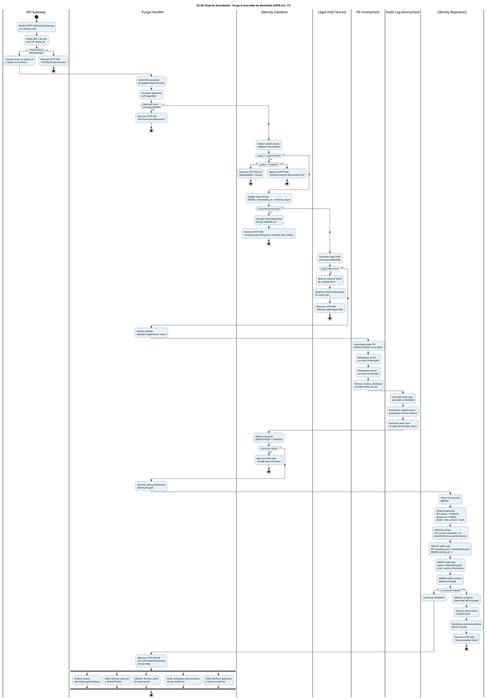

# UC-05: Purgar Identidad - Diagrama de Actividades

| Metadatos del Documento | |
| :--- | :--- |
| **Proyecto:** | SHUGO - Identity & Access Platform |
| **Caso de Uso:** | UC-05 - Purgar Identidad (Hard Delete / GDPR Right to Erasure) |
| **Documento:** | 03_Activity_Diagram.md |
| **Metodología:** | UML 2.5 + ICONIX + Domain-Driven Design + GDPR Compliance + Batch Processing |
| **Autor:** | Gastón Ruiz |
| **Versión Actual:** | 1.0.0 |
| **Fecha:** | 03/09/2026 |

---

## Historial de Versiones

| Versión | Fecha | Autor | Descripción de Cambios | Impacto |
| :--- | :--- | :--- | :--- | :--- |
| **1.0.0** | 03/09/2026 | Gastón Ruiz | **Creación inicial.** Modelado del flujo de trabajo interno para la purga irreversible de identidades. Destaca la validación estricta de precondiciones (estado DEACTIVATED + Grace Period), la consulta de Legal Hold, la anonimización criptográfica de PII (HMAC-SHA256) y audit logs, la persistencia atómica con transacción, y la publicación asíncrona de eventos para sistemas downstream (KAGI, KIZUNA, KAGE, TORII). Incluye tanto el flujo individual como el procesamiento batch. | Documento base del paquete de diseño Tier 1 del UC-05. Establece la lógica de negocio, los puntos de decisión críticos y las garantías de cumplimiento GDPR Art. 17, NIST SP 800-88, e irreversibilidad para el endpoint de purga del motor KAGAMI. |

---

## 1. Introducción y Propósito

El **Diagrama de Actividades** para el UC-05 visualiza el flujo de control, decisiones y orquestación necesario para ejecutar la **purga irreversible (Hard Delete)** de identidades en el motor **KAGAMI** de SHUGO.

A diferencia de la desactivación (UC-03) que es un Soft Delete reversible, la purga es una **acción destructiva e irreversible** que introduce seis complejidades arquitectónicas críticas:

1. **Validación Estricta de Precondiciones:** La identidad debe estar `DEACTIVATED` y haber superado el Grace Period (configurable por tenant, ej. 30 días).
2. **Legal Hold Priority:** El sistema debe consultar el sistema de Legal Hold antes de proceder. Si hay retención legal activa, la purga se bloquea independientemente de otros factores.
3. **Anonimización Criptográfica Irreversible:** Los datos PII (email, phone) se reemplazan con hashes HMAC-SHA256 irreversibles antes de marcar la identidad como `PURGED`.
4. **Anonimización de Audit Logs:** Los logs de auditoría asociados se anonimizan preservando la estructura pero eliminando PII, cumpliendo con GDPR Art. 17 y NIST SP 800-88.
5. **Persistencia Atómica:** La transición de estado, anonimización de PII, y anonimización de logs ocurren en una sola transacción atómica. Si falla cualquier paso, se hace Rollback completo.
6. **Notificación Asíncrona a Sistemas Downstream:** Tras la purga exitosa, se publican eventos para que KAGI, KIZUNA, KAGE, y TORII sincronicen su estado.

Utilizamos carriles (swimlanes) para separar las responsabilidades entre el API Gateway, el Purge Handler, el Identity Validator, el Legal Hold Service, el PII Anonymizer, el Audit Log Anonymizer, el Identity Repository, y el Event Publisher.

---

## 2. Diagrama de Actividades (PlantUML)

A continuación, se presenta el diagrama que cubre el Escenario Principal (purga individual exitosa), el procesamiento batch, y los flujos de excepción (Grace Period no expirado, Legal Hold activo, fallo de anonimización).



---

## 3. Explicación Detallada del Flujo

### 3.1. Carriles (Partitions / Swimlanes)

El diagrama está dividido en siete carriles que representan las capas y responsabilidades de la arquitectura:

1. **`|API Gateway|` (Capa de Entrada):** Valida el JWT, extrae el `actor_id` y `tenant_id`, y verifica que el actor tenga el permiso granular `identity:purge`. Es la primera línea de defensa.

2. **`|Purge Handler|` (Capa de Aplicación):** Orquesta el caso de uso. Carga la identidad, coordina las validaciones, invoca el método de dominio `Purge()`, gestiona la transacción atómica, y retorna la respuesta HTTP.

3. **`|Identity Validator|` (Capa de Dominio):** Contiene las reglas de negocio críticas:
   - **Validación de Estado:** Verifica que la identidad esté en estado `DEACTIVATED`.
   - **Validación de Grace Period:** Calcula si ha transcurrido el período de gracia (ej. 30 días desde `deactivated_at`).
   - **Validación de Transición:** Valida la transición `DEACTIVATED` → `PURGED` según la máquina de estados.

4. **`|Legal Hold Service|` (Capa de Dominio/Infraestructura):** Consulta el sistema de Legal Hold para verificar que no haya retención legal activa. Si hay Legal Hold, bloquea la purga y genera alerta al oficial de cumplimiento.

5. **`|PII Anonymizer|` (Capa de Dominio):** Responsable de anonimizar los datos PII (email, phone) reemplazándolos con hashes HMAC-SHA256 irreversibles. También elimina los custom_attributes sensibles (SSN, tax_id).

6. **`|Audit Log Anonymizer|` (Capa de Dominio):** Anonimiza los logs de auditoría asociados, reemplazando los valores PII en el `snapshot_json` con hashes irreversibles, pero preservando la estructura del log (timestamps, actor, action).

7. **`|Identity Repository|` (Capa de Infraestructura):** Ejecuta la transacción atómica que actualiza la tabla `identities`, `profiles`, `audit_logs`, y registra el evento en el Outbox.

8. **Flujos Asíncronos (Fork):** Representan las acciones que ocurren después del COMMIT de la transacción:
   - **Publicación de Evento:** El Outbox Processor leerá el evento y lo publicará en Kafka.
   - **KAGI:** Eliminará todas las sesiones y RefreshTokens en Redis.
   - **KIZUNA:** Eliminará la caché de autorización y las tuplas de relación.
   - **KAGE:** Completará la anonimización de logs históricos y marcará la identidad como purgada en el índice.
   - **TORII:** Notificará a sistemas externos registrados (webhooks).

### 3.2. Puntos de Decisión Críticos (Rombos)

1. **Validación de Permisos (API Gateway):**
   - **Pregunta:** ¿El actor tiene el permiso `identity:purge`?
   - **Si falla:** Retorna HTTP 403 inmediatamente.
   - **Justificación:** La purga es una operación destructiva que requiere autorización explícita, separada de otros permisos.

2. **Existencia y Estado de la Identidad (Purge Handler):**
   - **Pregunta:** ¿La identidad existe y NO está en estado `PURGED`?
   - **Si no existe o está PURGED:** Retorna HTTP 404 (ocultamiento de existencia).
   - **Justificación:** No revelar si la identidad existió o fue purgada.

3. **Validación de Estado (Identity Validator):**
   - **Pregunta:** ¿El estado actual es `DEACTIVATED`?
   - **Si es PURGED:** Retorna HTTP 200 (idempotente, No-op).
   - **Si es ACTIVE/SUSPENDED:** Retorna HTTP 400 "Identity must be deactivated first".
   - **Justificación:** La purga solo puede ejecutarse sobre identidades desactivadas.

4. **Validación de Grace Period (Identity Validator):**
   - **Pregunta:** ¿Ha transcurrido el Grace Period (`NOW() - deactivated_at > retention_days`)?
   - **Si no:** Retorna HTTP 400 con la fecha disponible para purga.
   - **Justificación:** Permite reactivación en caso de error durante el Grace Period.

5. **Validación de Legal Hold (Legal Hold Service):**
   - **Pregunta:** ¿Hay Legal Hold activo sobre la identidad?
   - **Si sí:** Bloquea la purga, genera alerta al oficial de cumplimiento, retorna HTTP 403.
   - **Justificación:** Legal Hold tiene prioridad sobre GDPR Art. 17 (GDPR Art. 17.3(b)).

6. **Validación de Transición de Estado (Identity Validator):**
   - **Pregunta:** ¿La transición `DEACTIVATED` → `PURGED` es válida según la máquina de estados?
   - **Si falla:** Retorna HTTP 400.
   - **Justificación:** Garantiza la integridad de la máquina de estados.

7. **Persistencia Atómica (Identity Repository):**
   - **Pregunta:** ¿La transacción de base de datos fue exitosa?
   - **Si falla:** Rollback completo, alerta crítica, reintento automático (hasta 3 veces), HTTP 500.
   - **Justificación:** Garantiza que la identidad, la anonimización de PII, la anonimización de logs, y el evento Outbox se creen atómicamente. Si falla la anonimización, la purga se revierte.

### 3.3. Flujos Asíncronos (Fork)

Al final del diagrama, se utiliza un bloque `fork` para modelar las acciones que ocurren *después* de que la transacción de base de datos ha sido confirmada (COMMIT).

- **Publicación de Evento:** El Outbox Processor leerá la tabla `outbox_events` y publicará `Identity.Purged` en Kafka.
- **KAGI (Sesiones):** Consumirá el evento y eliminará todos los RefreshTokens y sesiones activas en Redis.
- **KIZUNA (Autorización):** Consumirá el evento y eliminará la caché de autorización y las tuplas de relación.
- **KAGE (Auditoría):** Consumirá el evento y completará la anonimización de logs históricos, marcando la identidad como purgada en el índice.
- **TORII (Webhooks):** Consumirá el evento y notificará a sistemas externos registrados.

**Justificación:** Estas operaciones no deben aumentar la latencia de la respuesta HTTP 200 al cliente. La consistencia eventual es aceptable y deseable aquí. Además, si algún sistema downstream está caído, el patrón Outbox garantiza que los eventos se procesarán eventualmente.

---

## 4. Alineación con la Especificación de Requisitos

Este diagrama es la representación visual exacta del documento `01_Requirements_Specification.md`:

| Sección en Requisitos | Representación en el Diagrama |
| :--- | :--- |
| **2.1 Escenario Principal (Pasos 1-15)** | El flujo principal desde "Recibir POST" hasta "Retornar HTTP 200" y los forks asíncronos. |
| **2.2 Escenario Alternativo (Batch Processing)** | El flujo batch procesa múltiples identidades en lotes de 100, validando cada una individualmente. |
| **2.3 Escenario Alternativo (Idempotencia)** | El rombo "¿Status == PURGED?" y su rama "sí" (HTTP 200 OK, No-op). |
| **2.4 Excepción 3.1 (Identidad No Encontrada/Purgada)** | El rombo "¿Identidad existe y NO está PURGED?" y su rama "no" (HTTP 404). |
| **2.4 Excepción 4.1 (Identidad No Desactivada)** | El rombo "¿Status == DEACTIVATED?" y su rama "no" (HTTP 400). |
| **2.4 Excepción 4.2 (Grace Period No Expirado)** | El rombo "¿Grace Period expirado?" y su rama "no" (HTTP 400 con fecha). |
| **2.4 Excepción 5.1 (Legal Hold Activo)** | El rombo "¿Legal Hold activo?" y su rama "sí" (HTTP 403 + alerta). |
| **2.4 Excepción 8.1 (Error de Anonimización)** | El rombo "¿Transacción exitosa?" y su rama "no" (Rollback, alerta, reintento). |
| **3 INV-25 (Precondición de Estado)** | Validación explícita de estado `DEACTIVATED`. |
| **3 INV-26 (Grace Period Obligatorio)** | Cálculo de `NOW() - deactivated_at > retention_days`. |
| **3 INV-27 (Legal Hold Priority)** | Consulta al Legal Hold Service con bloqueo si está activo. |
| **3 INV-28 (Anonimización Completa)** | Carriles "PII Anonymizer" y "Audit Log Anonymizer". |
| **3 INV-29 (Preservación de Evidencia)** | Los logs se anonimizan pero no se eliminan. |
| **3 INV-30 (Irreversibilidad)** | Transición a estado terminal `PURGED`. |
| **3 RN-01 (Idempotencia)** | Manejo de identidad ya purgada (HTTP 200, No-op). |
| **3 RN-03 (Notificación Downstream)** | Forks asíncronos para KAGI, KIZUNA, KAGE, TORII. |
| **3 RN-04 (Auditoría de Purga)** | Inserción de log de purga en la transacción atómica. |
| **3 RN-05 (Reintento Automático)** | Reintento hasta 3 veces con backoff exponencial si falla. |

---

## 5. Consideraciones de Arquitectura y Diseño (Clean Architecture + DDD)

### 5.1. Acción Destructiva Irreversible vs. Mutación de Estado

El diagrama modela la purga como un **endpoint de acción explícito** (`POST /identities/{id}/purge`) en lugar de una actualización genérica (`PATCH /identities/{id}` con `{"status": "PURGED"}`).

**Justificación:**
- **Semántica Clara:** "Purgar" es una acción destructiva irreversible con efectos secundarios críticos (anonimización, notificación downstream). Un endpoint explícito deja claro su propósito.
- **Permisos Granulares:** Permite asignar `identity:purge` sin otorgar `identity:update` (que permitiría modificar otros campos).
- **Validaciones Específicas:** Permite inyectar reglas de negocio únicas (Grace Period, Legal Hold, anonimización criptográfica).

### 5.2. Legal Hold como Bloqueador de Prioridad

El carril `Legal Hold Service` introduce un requisito crítico para cumplimiento legal:

1. **Consulta de Legal Hold:** Antes de proceder con la purga, se consulta el sistema de Legal Hold.
2. **Bloqueo Automático:** Si hay Legal Hold activo, la purga se bloquea independientemente de otros factores.
3. **Notificación al Oficial de Cumplimiento:** Se genera alerta inmediata al oficial de cumplimiento.
4. **Registro de Intento Bloqueado:** Se registra el intento de purga bloqueado en audit_logs para auditoría.

**Justificación:**
- **GDPR Art. 17.3(b):** "El derecho al olvido no aplica cuando el tratamiento es necesario para el cumplimiento de una obligación legal."
- **Prevención de Sanciones:** Violar un Legal Hold puede resultar en sanciones legales severas (multas, desacato al tribunal).
- **Auditabilidad:** Todos los intentos de purga bloqueados quedan registrados para auditoría.

### 5.3. Anonimización Criptográfica Irreversible

Los carriles `PII Anonymizer` y `Audit Log Anonymizer` implementan la estrategia de anonimización:

1. **HMAC-SHA256 Irreversible:** Los datos PII se reemplazan con hashes HMAC-SHA256 que no pueden revertirse sin la clave secreta.
2. **Eliminación de Custom Attributes Sensibles:** Campos como SSN, tax_id se eliminan completamente (no se anonimizan, se eliminan).
3. **Preservación de Estructura de Logs:** Los logs de auditoría mantienen su estructura (campos, timestamps, actor), solo se anonimizan los valores PII dentro del `snapshot_json`.
4. **Transacción Atómica:** La anonimización de PII y logs ocurre en la misma transacción que el cambio de estado. Si falla, se hace Rollback completo.

**Justificación:**
- **GDPR Art. 17:** Requiere eliminación de datos personales, pero permite retención de evidencia de que la purga ocurrió.
- **NIST SP 800-88:** Define "Purge" como nivel de sanitización donde los datos no son recuperables con técnicas de laboratorio.
- **Auditoría Forense:** Los logs anonimizados permiten investigar incidentes sin exponer PII.

### 5.4. Persistencia Atómica con Outbox Pattern

El `Identity Repository` (Pasos 20-27) ejecuta una transacción atómica que abarca:
1. `UPDATE identities` (cambio de estado a `PURGED` + `purged_at` + anonimización de email/phone).
2. `UPDATE profiles` (eliminación de custom_attributes sensibles).
3. `UPDATE audit_logs` (anonimización de `snapshot_json`).
4. `INSERT audit_logs` (log de purga con actor, reason, timestamp).
5. `INSERT outbox_events` (evento de dominio `Identity.Purged`).

**Justificación:**
- **Integridad Forense:** Si la inserción del log de purga falla, la purga se revierte. Nunca existirá una identidad purgada sin su correspondiente registro forense.
- **Consistencia Eventual:** El evento en el Outbox garantiza que KAGI, KIZUNA, KAGE, y TORII reciban la notificación eventualmente, incluso si están caídos.
- **Irreversibilidad:** Una vez confirmada la transacción, la operación es irreversible por diseño.

### 5.5. Procesamiento Batch para Purgas Masivas

Para tenants grandes que necesitan purgar miles de identidades, el sistema soporta procesamiento batch:

1. **Recepción:** El endpoint `POST /identities/purge-batch` recibe hasta 1000 IDs.
2. **Validación Previa:** Se valida cada identidad individualmente (estado, Grace Period, Legal Hold).
3. **Segmentación:** Las identidades válidas se agrupan en lotes de 100 para procesamiento.
4. **Ejecución:** Cada lote se procesa en una transacción independiente (ejecuta el flujo individual para cada identidad).
5. **Reporte:** Se genera un reporte con: purgadas exitosamente, saltadas (con razón), fallidas (con error).
6. **Reintento:** Las identidades fallidas se reintentan hasta 3 veces con backoff exponencial.

**Justificación:**
- **Atomicidad por Lote:** Si un lote falla, solo ese lote se revierte. Los lotes exitosos no se ven afectados.
- **Progreso Visible:** El administrador puede consultar el progreso en tiempo real.
- **Resiliencia:** Si el proceso se interrumpe, puede reanudarse desde el último lote exitoso.

---

## 6. Trazabilidad con Otros Documentos del Paquete

| Documento | Relación |
| :--- | :--- |
| `01_Requirements_Specification.md` | Este diagrama visualiza los flujos de texto, las invariantes de dominio (Legal Hold Priority, Anonimización Completa, Irreversibilidad) y los criterios de aceptación. |
| `02_Use_Case_Diagram.md` | Muestra el límite del sistema y los actores; este diagrama muestra el flujo interno y las decisiones lógicas. |
| `04_Initial_Domain_Model.md` | Las acciones de los carriles "Purge Handler", "Identity Validator", "Legal Hold Service", "PII Anonymizer", "Audit Log Anonymizer" se implementan aquí como clases y métodos. |
| `05_State_Machine_Diagram.md` | (Definido en UC-02) Muestra la transición `DEACTIVATED` → `PURGED` como estado terminal que este diagrama ejecuta. |
| `06_Robustness_Diagram.md` | Mostrará la colaboración entre el Purge Handler, el Legal Hold Service, el PII Anonymizer, el Audit Log Anonymizer, y el Repository. |
| `07_Sequence_Diagram.md` | Detallará el orden temporal exacto de las llamadas: validación de permisos → validación de precondiciones → validación de Legal Hold → anonimización de PII → anonimización de logs → persistencia → publicación de evento. |
| `08_Final_Class_Design.md` | Definirá las firmas exactas de los métodos: `Identity.Purge()`, `IdentityPurgeService.ValidateLegalHold()`, `PIIAnonymizer.Anonymize()`. |
| `10_UC_Specific_Data_Model.md` | Definirá la estrategia de anonimización a nivel de columna, la estructura de la tabla `legal_holds`, y los índices para consultas de elegibilidad de purga. |
| `11_UC_Specific_Security_Threats.md` | Analizará las amenazas específicas de purga: purga no autorizada, purga prematura, purga durante Legal Hold, y evasión de auditoría. |
| `12_UC_Specific_Performance_Benchmarks.md` | Definirá los SLAs específicos para purga individual (< 500ms p95) y batch (1000 identidades/minuto). |
| `UC-03/01_Requirements_Specification.md` | Documento hermano que define la desactivación (Soft Delete) como precondición obligatoria para la purga. |

---

## 7. Notas de Implementación

### 7.1. Generación del Diagrama
- **Herramienta:** PlantUML (Diagrams as Code).
- **Ventaja:** Versionable en Git, reproducible, sin dependencias de software propietario.
- **Sintaxis:** Uso de `if/else/endif` para decisiones, `fork` para concurrencia/asincronía al final del flujo, y carriles para separar responsabilidades.

### 7.2. Complejidad del Diagrama
Este es uno de los diagramas de actividades más complejos del sistema debido a:
- La validación de múltiples precondiciones (estado, Grace Period, Legal Hold).
- La anonimización criptográfica de PII y audit logs.
- La persistencia atómica con múltiples tablas.
- Los múltiples flujos asíncronos para sistemas downstream.
- El manejo de excepciones (Grace Period, Legal Hold, fallo de anonimización).

Sin embargo, esta complejidad es necesaria para capturar la riqueza del flujo de purga en un sistema IAM de nivel enterprise que maneja cumplimiento GDPR, Legal Hold, y anonimización criptográfica.

### 7.3. Código de Ejemplo (C#)

```csharp
public class PurgeIdentityHandler : IPurgeIdentityHandler
{
    private readonly IIdentityRepository _repository;
    private readonly IIdentityValidator _validator;
    private readonly ILegalHoldService _legalHoldService;
    private readonly IPIIAnonymizer _piiAnonymizer;
    private readonly IAuditLogAnonymizer _auditLogAnonymizer;
    private readonly IUnitOfWork _unitOfWork;
    private readonly ILogger<PurgeIdentityHandler> _logger;

    public async Task<PurgeIdentityResult> Handle(
        PurgeIdentityCommand command, 
        CancellationToken ct)
    {
        // 1. Cargar identidad
        var identity = await _repository.GetByIdAsync(command.IdentityId);
        if (identity == null || identity.Status == IdentityStatus.PURGED)
            throw new IdentityNotFoundException(command.IdentityId);

        // 2. Validar estado (debe estar DEACTIVATED)
        if (identity.Status != IdentityStatus.DEACTIVATED)
            throw new InvalidStateException(
                $"Identity must be DEACTIVATED before purging. Current status: {identity.Status}");

        // 3. Validar Grace Period
        var tenantConfig = await _repository.GetTenantConfigAsync(identity.TenantId);
        var gracePeriodEndDate = identity.DeactivatedAt.Value.AddDays(tenantConfig.RetentionDays);
        
        if (DateTime.UtcNow < gracePeriodEndDate)
            throw new GracePeriodNotExpiredException(
                $"Grace period has not expired. Purge available after {gracePeriodEndDate:O}");

        // 4. Validar Legal Hold
        var legalHold = await _legalHoldService.GetActiveLegalHoldAsync(command.IdentityId);
        if (legalHold != null)
        {
            // Generar alerta al oficial de cumplimiento
            await _legalHoldService.NotifyComplianceOfficerAsync(
                command.IdentityId, 
                command.ActorId, 
                legalHold.CaseReference);
            
            // Registrar intento bloqueado
            await _repository.SaveBlockedPurgeAttemptAsync(
                command.IdentityId, 
                command.ActorId, 
                legalHold.CaseReference);
            
            throw new LegalHoldActiveException(
                $"Identity is under legal hold (Case #{legalHold.CaseReference}). Contact compliance officer.");
        }

        // 5. Anonimizar PII
        var anonymizedPII = await _piiAnonymizer.AnonymizeAsync(identity);

        // 6. Anonimizar audit logs
        var anonymizedAuditLogs = await _auditLogAnonymizer.AnonymizeAsync(command.IdentityId);

        // 7. Ejecutar acción de dominio
        identity.Purge(command.Reason, command.ActorId);

        // 8. Persistencia atómica
        await _unitOfWork.BeginTransactionAsync();
        try
        {
            await _repository.SaveAsync(identity); // Actualiza status, purged_at, email, phone
            await _repository.UpdateProfileAsync(anonymizedPII.Profile); // Elimina custom_attributes sensibles
            await _repository.UpdateAuditLogsAsync(anonymizedAuditLogs); // Anonimiza snapshot_json
            await _repository.SavePurgeAuditLogAsync(
                command.IdentityId, 
                command.ActorId, 
                command.Reason, 
                DateTime.UtcNow);
            await _repository.SaveOutboxEventAsync(
                new OutboxEvent("Identity.Purged", identity.Id, identity.TenantId));
            
            await _unitOfWork.CommitAsync();
        }
        catch (Exception ex)
        {
            await _unitOfWork.RollbackAsync();
            _logger.LogError(ex, "Failed to purge identity {IdentityId}", command.IdentityId);
            
            // Generar alerta crítica
            await _alertService.SendCriticalAlertAsync(
                $"Purge failed for identity {command.IdentityId}: {ex.Message}");
            
            throw;
        }

        return new PurgeIdentityResult(
            identity.Id, 
            identity.Status, 
            identity.PurgedAt,
            anonymizedPII.AnonymizedFields,
            anonymizedAuditLogs.Count);
    }
}
```

---
*Fin del Documento 03_Activity_Diagram para UC-05*