# UC-05: Purgar Identidad - Modelo de Dominio Inicial

| Metadatos del Documento | |
| :--- | :--- |
| **Proyecto:** | SHUGO - Identity & Access Platform |
| **Caso de Uso:** | UC-05 - Purgar Identidad (Hard Delete / GDPR Right to Erasure) |
| **Documento:** | 04_Initial_Domain_Model.md |
| **Metodología:** | ICONIX (Modelo de Análisis) + DDD (Domain-Driven Design) + GDPR Compliance + Cryptographic Anonymization |
| **Autor:** | Gastón Ruiz |
| **Versión Actual:** | 1.0.0 |
| **Fecha:** | 03/09/2026 |

---

## Historial de Versiones

| Versión | Fecha | Autor | Descripción de Cambios | Impacto |
| :--- | :--- | :--- | :--- | :--- |
| **1.0.0** | 03/09/2026 | Gastón Ruiz | **Creación inicial.** Definición del Modelo de Dominio Conceptual para la purga irreversible de identidades. Introduce el método terminal `Purge()`, el Servicio de Dominio `IdentityPurgeService` para orquestar reglas transversales (Legal Hold, Grace Period), los Servicios de Anonimización Criptográfica (`PIIAnonymizer`, `AuditLogAnonymizer`), y los Value Objects `PurgeReason` y `AnonymizedData`. | Documento base del paquete de diseño Tier 1 del UC-05. Establece cómo el Aggregate Root `Identity` transiciona a su estado terminal `PURGED` garantizando el cumplimiento de GDPR Art. 17, NIST SP 800-88, y la irreversibilidad criptográfica de los datos personales. |

---

## 1. Introducción y Propósito

Este documento presenta el **Modelo de Dominio Inicial** para el Caso de Uso UC-05 (Purgar Identidad).

A diferencia de los UCs anteriores que gestionaban el ciclo de vida activo o la suspensión reversible, UC-05 representa el **estado terminal e irreversible** de una identidad. El modelo de dominio debe reflejar no solo un cambio de estado, sino una **transformación criptográfica de los datos** para cumplir con el Derecho al Olvido (GDPR Art. 17) y estándares de sanitización de datos (NIST SP 800-88).

El modelo se centra en:
1. **Transición Terminal:** El paso de `DEACTIVATED` a `PURGED` como un punto de no retorno.
2. **Anonimización Criptográfica:** La sustitución de PII por hashes HMAC-SHA256 irreversibles, preservando la integridad referencial y de auditoría.
3. **Reglas Transversales de Compliance:** La validación de Legal Hold y Grace Period, que requieren la coordinación de múltiples conceptos de dominio.
4. **Preservación de Evidencia:** La garantía de que, aunque los datos personales desaparecen, la evidencia de que la purga ocurrió (y quién la ejecutó) permanece inmutable.

---

## 2. Diagrama de Modelo de Dominio Conceptual (PlantUML)

A continuación, se presenta el diagrama de clases conceptual, enfocándose en los métodos destructivos, los servicios de anonimización y las reglas de compliance.

```plantuml
@startuml UC-05_DominioConceptual
<style>
diagram {
  BackgroundColor #FFFFFF
}
</style>
skinparam classAttributeIconSize 0
skinparam classBackgroundColor #FFFFFF
skinparam classBorderColor #1565C0
skinparam classHeaderBackgroundColor #E3F2FD

title UC-05: Modelo de Dominio Conceptual - Purga Irreversible (GDPR & Legal Hold)

' ============================================
' AGGREGATE ROOT
' ============================================
class Identity <<Aggregate Root>> {
  - id: IdentityId
  - tenantId: TenantId
  - status: IdentityStatus
  - deactivatedAt: DeactivatedAt
  - purgedAt: PurgedAt
  - domainEvents: List<IDomainEvent>
  
  + Purge(reason: PurgeReason, actor: Actor): void
  + IsEligibleForPurge(config: TenantConfig): boolean
}

' ============================================
' DOMAIN SERVICES
' ============================================
class IdentityPurgeService <<Domain Service>> {
  - legalHoldChecker: ILegalHoldChecker
  - gracePeriodEvaluator: IGracePeriodEvaluator
  
  + ExecutePurge(identity: Identity, reason: PurgeReason, actor: Actor): PurgeResult
  - ValidateLegalHold(identityId: IdentityId): void
  - ValidateGracePeriod(identity: Identity, config: TenantConfig): void
}

class PIIAnonymizer <<Domain Service>> {
  + AnonymizeProfile(profile: Profile): AnonymizedData
  - HashPII(value: string): string
}

class AuditLogAnonymizer <<Domain Service>> {
  + AnonymizeLogs(logs: List<AuditLog>, identityId: IdentityId): int
  - MaskSnapshotJson(json: string): string
}

' ============================================
' VALUE OBJECTS
' ============================================
class PurgeReason <<Value Object>> {
  - value: string
  - gdprRequestId: string?
  + PurgeReason(value, gdprRequestId?)
  - Validate(): void
}

class AnonymizedData <<Value Object>> {
  - emailHash: string
  - phoneHash: string
  - displayName: string
  - sensitiveAttributesRemoved: List<string>
}

class PurgedAt <<Value Object>> {
  - timestamp: DateTime
  + PurgedAt(timestamp: DateTime)
}

' ============================================
' DOMAIN EVENTS
' ============================================
class IdentityPurged <<Domain Event>> {
  + identityId: IdentityId
  + tenantId: TenantId
  + purgedBy: Actor
  + reason: PurgeReason
  + anonymizedFieldsCount: int
  + auditLogsAnonymizedCount: int
}

class IdentityPurgeBlocked <<Domain Event>> {
  + identityId: IdentityId
  + blockedBy: LegalHoldId
  + requestedBy: Actor
}

' ============================================
' INTERFACES & EXTERNAL CONCEPTS
' ============================================
interface ILegalHoldChecker {
  + HasActiveHold(identityId: IdentityId): boolean
  + GetActiveHoldId(identityId: IdentityId): LegalHoldId?
}

interface IGracePeriodEvaluator {
  + IsExpired(deactivatedAt: DeactivatedAt, config: TenantConfig): boolean
}

' ============================================
' RELACIONES
' ============================================
IdentityPurgeService ..> Identity : "coordina purga"
IdentityPurgeService ..> ILegalHoldChecker : "valida retención"
IdentityPurgeService ..> IGracePeriodEvaluator : "valida tiempo"

IdentityPurgeService ..> PIIAnonymizer : "anonimiza datos"
IdentityPurgeService ..> AuditLogAnonymizer : "anonimiza logs"

Identity ..> IdentityPurged : "publica"
Identity ..> IdentityPurgeBlocked : "publica (vía servicio)"

PIIAnonymizer ..> AnonymizedData : "genera"

note right of Identity
  **Estado Terminal:**
  El método Purge() es la única
  vía para llegar a PURGED.
  Una vez purgado, no hay vuelta atrás.
end note

note right of PIIAnonymizer
  **Crypto-Shredding:**
  Usa HMAC-SHA256 con clave
  maestra del tenant.
  Irreversible sin la clave.
end note

@enduml
```



---

## 3. Detalle de Conceptos de Dominio (DDD)

### 3.1. Aggregate Root: `Identity` (Método Terminal)

El Aggregate Root expone el método `Purge()`. A diferencia de `Deactivate()`, este método asume que las precondiciones externas (Legal Hold, Grace Period) ya han sido validadas por el Domain Service, y se enfoca en la **transformación interna y la generación del evento**.

**Código (C#):**
```csharp
public class Identity
{
    public IdentityStatus Status { get; private set; }
    public PurgedAt PurgedAt { get; private set; }
    
    // ... otros campos ...

    /// <summary>
    /// Ejecuta la transición terminal a PURGED.
    /// Nota: La validación de Legal Hold y Grace Period debe ocurrir ANTES en el Domain Service.
    /// </summary>
    public void Purge(PurgeReason reason, Actor actor)
    {
        // Invariante: No se puede purgar si no está desactivado
        if (this.Status != IdentityStatus.DEACTIVATED)
        {
            throw new InvalidTransitionException(
                $"Cannot purge identity in status {this.Status}. Must be DEACTIVATED.");
        }

        // Invariante: Idempotencia
        if (this.Status == IdentityStatus.PURGED)
            return;

        // Transición de Estado
        this.Status = IdentityStatus.PURGED;
        this.PurgedAt = new PurgedAt(DateTime.UtcNow);

        // Generación de Evento de Dominio
        // Nota: Los detalles de qué campos se anonimizaron los adjunta el servicio de aplicación
        // o se calculan aquí si el Aggregate tiene acceso al Profile.
        this.AddDomainEvent(new IdentityPurgedEvent(
            this.Id, 
            this.TenantId, 
            reason, 
            actor, 
            DateTime.UtcNow
        ));
    }
}
```

### 3.2. Domain Service: `IdentityPurgeService`

La purga no es una operación que pueda vivir únicamente dentro del Aggregate `Identity` porque requiere validar reglas de negocio que involucran conceptos externos (Legal Hold, configuración de retención del tenant) y coordinar la anonimización de otras entidades (Audit Logs). Por lo tanto, se utiliza un **Domain Service**.

**Código (C#):**
```csharp
public class IdentityPurgeService : IIdentityPurgeService
{
    private readonly ILegalHoldChecker _legalHoldChecker;
    private readonly IGracePeriodEvaluator _gracePeriodEvaluator;
    private readonly IPIIAnonymizer _piiAnonymizer;
    private readonly IAuditLogAnonymizer _auditLogAnonymizer;

    public async Task<PurgeResult> ExecutePurgeAsync(
        Identity identity, 
        PurgeReason reason, 
        Actor actor, 
        TenantConfig config)
    {
        // 1. Validar Legal Hold (Bloqueador de prioridad)
        if (_legalHoldChecker.HasActiveHold(identity.Id))
        {
            var holdId = _legalHoldChecker.GetActiveHoldId(identity.Id);
            throw new LegalHoldActiveException(holdId);
        }

        // 2. Validar Grace Period
        if (!_gracePeriodEvaluator.IsExpired(identity.DeactivatedAt, config))
        {
            throw new GracePeriodNotExpiredException(config.RetentionDays);
        }

        // 3. Anonimizar PII (Crypto-Shredding)
        var anonymizedData = _piiAnonymizer.AnonymizeProfile(identity.Profile);
        identity.ApplyAnonymization(anonymizedData); // Método interno del Aggregate

        // 4. Anonimizar Logs de Auditoría
        int logsAnonymized = await _auditLogAnonymizer.AnonymizeLogsAsync(identity.Id);

        // 5. Ejecutar transición de estado en el Aggregate
        identity.Purge(reason, actor);

        return new PurgeResult(identity.Id, logsAnonymized, anonymizedData.FieldsAffected);
    }
}
```

### 3.3. Value Objects: `PurgeReason` y `AnonymizedData`

#### `PurgeReason`
Captura la justificación legal o de negocio para la purga. Es crucial para la auditoría de compliance.

```csharp
public class PurgeReason
{
    public string Value { get; }
    public string? GdprRequestId { get; } // Opcional: vincula con el ticket de GDPR

    public PurgeReason(string value, string? gdprRequestId = null)
    {
        if (string.IsNullOrWhiteSpace(value))
            throw new ArgumentException("Purge reason is mandatory for compliance.");
            
        Value = value;
        GdprRequestId = gdprRequestId;
    }
}
```

#### `AnonymizedData`
Representa el resultado de la transformación criptográfica. No contiene los hashes en sí (esos van a la DB), sino metadatos sobre qué fue anonimizado para el evento de dominio.

```csharp
public class AnonymizedData
{
    public IReadOnlyList<string> FieldsAffected { get; }
    public bool SensitiveAttributesRemoved { get; }

    public AnonymizedData(IReadOnlyList<string> fieldsAffected, bool sensitiveAttributesRemoved)
    {
        FieldsAffected = fieldsAffected;
        SensitiveAttributesRemoved = sensitiveAttributesRemoved;
    }
}
```

---

## 4. Eventos de Dominio

### Evento 1: `IdentityPurged`
Se genera cuando la purga se ejecuta exitosamente. Es consumido por KAGI, KIZUNA, KAGE y TORII.

| Campo | Tipo | Descripción |
| :--- | :--- | :--- |
| `IdentityId` | `IdentityId` | ID de la identidad purgada. |
| `TenantId` | `TenantId` | Tenant al que pertenecía. |
| `PurgedBy` | `Actor` | Quién ejecutó la purga (Admin o Sistema GDPR). |
| `Reason` | `PurgeReason` | Justificación de la purga. |
| `AnonymizedFieldsCount` | `int` | Cantidad de campos PII anonimizados. |
| `AuditLogsAnonymizedCount` | `int` | Cantidad de logs de auditoría anonimizados. |

### Evento 2: `IdentityPurgeBlocked`
Se genera (o lanza como excepción de dominio) cuando se intenta purgar una identidad bajo Legal Hold.

| Campo | Tipo | Descripción |
| :--- | :--- | :--- |
| `IdentityId` | `IdentityId` | ID de la identidad intentada purgar. |
| `BlockedBy` | `LegalHoldId` | ID del Legal Hold que bloqueó la operación. |
| `RequestedBy` | `Actor` | Quién intentó la purga. |

---

## 5. Decisiones de Diseño DDD (ADR)

### 5.1. ¿Por qué un Domain Service para la Purga y no solo un método en `Identity`?

**Decisión:** Utilizar `IdentityPurgeService` para orquestar la purga.

**Justificación:**
- **Reglas Transversales:** La validación de Legal Hold y Grace Period requiere acceso a configuraciones de tenant y servicios de compliance externos al Aggregate `Identity`.
- **Coordinación de Múltiples Entidades:** La purga no solo afecta a `Identity`, sino que debe anonimizar `AuditLogs` (que pueden ser otro Aggregate o entidad en un Bounded Context de Compliance). Un Aggregate no debe modificar directamente otro Aggregate.
- **Principio de Responsabilidad Única:** Mantener el Aggregate `Identity` enfocado en su estado y reglas internas, delegando la complejidad de compliance al servicio.

### 5.2. ¿Anonimización vs. Eliminación Física (Hard Delete)?

**Decisión:** Implementar "Hard Delete" mediante **Anonimización Criptográfica (Crypto-Shredding)** en lugar de `DELETE FROM identities`.

**Justificación:**
- **Integridad Referencial:** Eliminar la fila físicamente rompería las Foreign Keys en `audit_logs`, `outbox_events`, y tablas de historial.
- **Auditoría Forense:** GDPR y SOC 2 requieren evidencia de que la purga ocurrió. Mantener la fila con `status = PURGED` y `purged_at` provee esta evidencia sin exponer PII.
- **NIST SP 800-88:** El estándar define "Purge" como técnicas que hacen los datos irrecuperables (como HMAC-SHA256 sin la clave), lo cual cumple legalmente con la eliminación de datos personales.

### 5.3. Manejo del Grace Period en el Dominio

**Decisión:** El `GracePeriodEvaluator` compara `DateTime.UtcNow` contra `DeactivatedAt + TenantConfig.RetentionDays`.

**Justificación:**
- **Flexibilidad por Tenant:** Diferentes tenants tienen diferentes requisitos legales de retención (ej. 30 días para estándar, 365 días para financiero). La configuración vive en `TenantConfig`, no hardcodeada en el dominio.
- **Inmutabilidad del Tiempo:** El `DeactivatedAt` es un Value Object inmutable establecido en UC-03, garantizando que el cálculo del Grace Period sea determinista y no manipulable.

---

## 6. Trazabilidad

| Documento | Relación |
| :--- | :--- |
| `01_Requirements_Specification.md` | Define las invariantes (INV-25 a INV-30) y reglas de negocio (RN-01 a RN-06) que este modelo implementa. |
| `02_Use_Case_Diagram.md` | Muestra los actores y sistemas; este modelo define los objetos de dominio con los que interactúan. |
| `03_Activity_Diagram.md` | Los carriles de actividad (Purge Handler, Identity Validator, Legal Hold Service, Anonymizers) se implementan aquí como Domain Services y Aggregate Roots. |
| `05_State_Machine_Diagram.md` | (Definido en UC-02) Muestra la transición `DEACTIVATED` → `PURGED` que el método `Identity.Purge()` ejecuta. |
| `06_Robustness_Diagram.md` | Mostrará la colaboración entre el Purge Handler, el IdentityPurgeService, y los Anonymizers. |
| `10_UC_Specific_Data_Model.md` | Definirá cómo los Value Objects `AnonymizedData` se mapean a columnas físicas (hashes) en PostgreSQL. |

---

## 7. Notas para la Implementación

### 7.1. Ubicación en Clean Architecture
- **Dominio (`SHUGO.Domain`):** `Identity`, `PurgeReason`, `AnonymizedData`, `IdentityPurgeService`, `IPIIAnonymizer`, `ILegalHoldChecker`.
- **Infraestructura (`SHUGO.Infrastructure`):** Implementaciones de `IPIIAnonymizer` (usando HMAC-SHA256), `ILegalHoldChecker` (consulta a DB o API externa), y repositorios.
- **Aplicación (`SHUGO.Application`):** `PurgeIdentityHandler` (orquesta la transacción, llama al Domain Service, persiste eventos).

### 7.2. Seguridad de la Clave de Anonimización
La clave utilizada para el HMAC-SHA256 en `PIIAnonymizer` debe ser específica por Tenant y gestionada por un KMS (Key Management Service). Si la clave se rota o destruye (Crypto-Shredding total), todos los hashes de ese tenant se vuelven inútiles, garantizando el "Right to Erasure" absoluto.

### 7.3. Testing de Dominio
- **Unit Tests:** Verificar que `Identity.Purge()` lanza excepción si el estado no es `DEACTIVATED`.
- **Integration Tests:** Verificar que `IdentityPurgeService.ExecutePurgeAsync()` llama al `LegalHoldChecker` y aborta si hay hold activo.
- **Crypto Tests:** Verificar que `PIIAnonymizer` genera el mismo hash para el mismo input (determinístico) pero que no es reversible.

---
*Fin del Documento 04_Initial_Domain_Model para UC-05*